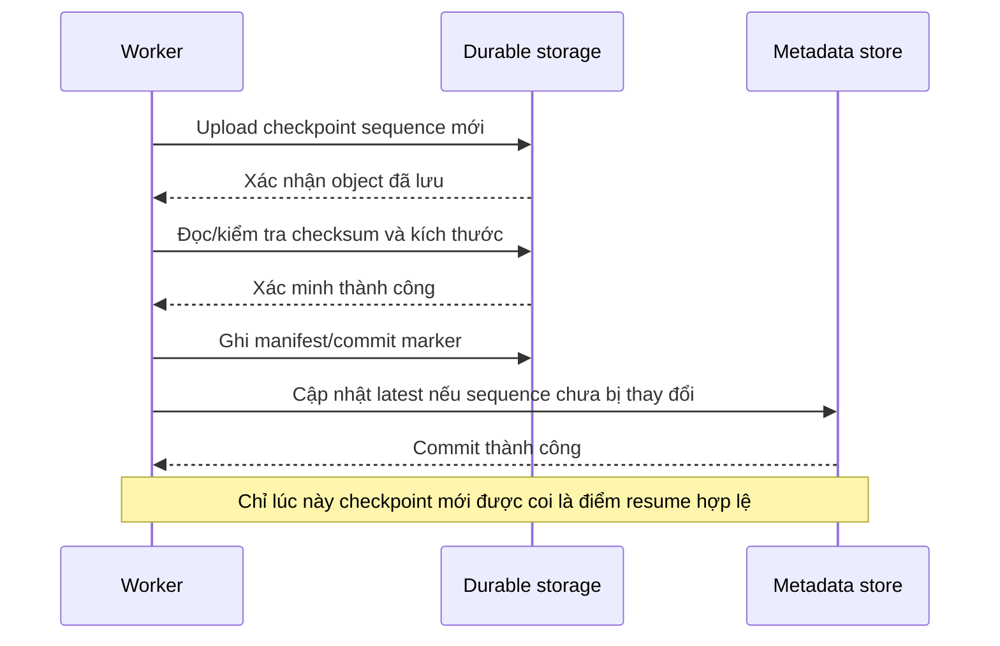

# Checkpoint, retry và khôi phục tiến độ tác vụ

Compute có thể bị thu hồi (interruptible compute), chẳng hạn VM Spot/Preemptible hoặc worker chạy trên capacity dư thừa, thường có chi phí thấp hơn nhưng không bảo đảm máy tồn tại đến khi công việc hoàn tất. Provider có thể thu hồi instance khi cần capacity, khi hết thời hạn sử dụng hoặc khi có sự kiện nền tảng. Nếu ứng dụng chỉ giữ tiến độ trong RAM hoặc local disk, một lần thu hồi có thể làm mất nhiều giờ tính toán.

Muốn dùng loại compute này cho workload dài, ứng dụng phải có khả năng lưu tiến độ ra nơi bền vững, nhận biết thời điểm cần dừng, tiếp tục từ checkpoint gần nhất và xử lý việc một đoạn công việc có thể được chạy lại. **Checkpoint bảo vệ tiến độ; retry khôi phục công việc chưa hoàn tất; idempotency ngăn chạy lại tạo tác động trùng.** Ba cơ chế cần được thiết kế cùng nhau.

## 1. Vì sao cần checkpoint và retry?

Với VM thông thường, người vận hành có thể kỳ vọng máy chạy trong thời gian đã cấp phát. Với capacity có thể bị thu hồi, ứng dụng cần xem interruption là một sự kiện bình thường của vòng đời workload.

Các tình huống có thể làm tác vụ dừng trước khi hoàn tất:

- Provider thu hồi Spot/Preemptible VM để tái phân bổ capacity.
- Instance bị dừng hoặc thay thế do maintenance, host failure hay giới hạn thời gian chạy.
- Container/Pod bị eviction khi node bị thu hồi hoặc cần drain.
- Worker process crash, VM reboot hoặc node mất kết nối.
- Queue consumer bị mất lease hoặc không acknowledge message đúng hạn.
- Job bị hủy do người vận hành, deadline hoặc thay đổi cấu hình.

Nếu tác vụ không lưu tiến độ, lần chạy tiếp theo có thể phải bắt đầu từ đầu. Với công việc chia thành nhiều phần, checkpoint cho phép chỉ chạy lại phần chưa hoàn tất. Retry giúp scheduler hoặc queue gửi lại phần việc thất bại; idempotency bảo đảm việc nhận lại cùng một phần không tạo kết quả trùng hoặc làm sai dữ liệu.

### Ví dụ workload phù hợp

- Batch ETL xử lý hàng triệu bản ghi theo partition.
- Render video hoặc ảnh theo frame/chunk.
- Huấn luyện mô hình machine learning theo epoch hoặc batch.
- Tính toán khoa học, mô phỏng và tìm kiếm tham số.
- Worker xử lý message hoặc file từ queue.
- Build/test phân tán có thể chia thành nhiều task độc lập.

Workload có state khó lưu, yêu cầu latency liên tục hoặc không thể tiếp tục sau gián đoạn có thể không phù hợp với capacity bị thu hồi nếu không có lớp điều phối và lưu trạng thái thích hợp.

## 2. Phân biệt checkpoint, retry và resume

| Cơ chế | Trả lời câu hỏi | Vai trò |
|---|---|---|
| Checkpoint | Đã hoàn thành đến đâu và state cần thiết là gì? | Lưu tiến độ cùng trạng thái có thể khôi phục |
| Retry | Phần việc chưa thành công sẽ được chạy lại khi nào? | Thử lại sau lỗi tạm thời hoặc interruption |
| Resume | Lần chạy mới bắt đầu từ trạng thái nào? | Đọc checkpoint hợp lệ và tiếp tục phần còn lại |
| Idempotency | Nếu cùng phần việc chạy nhiều lần thì sao? | Ngăn side effect trùng lặp |
| Reconciliation | Kết quả nào đã được commit thực sự? | Đối chiếu checkpoint, output và trạng thái scheduler |

Checkpoint không chỉ là lưu một con số phần trăm. Nó phải chứa đủ thông tin để tái tạo trạng thái tính toán, xác định input đã xử lý, phiên bản code/schema và những output đã commit. Retry không được giả định rằng lần chạy trước chưa tạo side effect; nó phải kiểm tra trạng thái commit hoặc dùng idempotency key.

## 3. Thiết kế đơn vị công việc có thể tiếp tục

Trước khi thiết kế định dạng checkpoint, hãy chia workload thành các đơn vị có ranh giới rõ ràng. Một task càng lớn thì lượng công việc có thể mất khi bị thu hồi càng cao.

### Chia nhỏ theo partition hoặc chunk

Ví dụ, một job ETL xử lý 100 triệu bản ghi có thể chia theo khoảng khóa hoặc partition. Mỗi worker nhận một phần, đọc dữ liệu đầu vào, tạo output và ghi nhận phần đã hoàn tất. Nếu một worker bị thu hồi, scheduler chỉ cần giao lại partition chưa commit.

Với render video, chia theo đoạn thời gian hoặc frame range. Với training, chia theo batch hoặc epoch và lưu optimizer state, scheduler state cùng random number generator state nếu cần tái lập chính xác. Với mô phỏng, chia theo seed hoặc dải tham số để mỗi đơn vị có thể chạy độc lập.

### Chọn kích thước chunk

Chunk quá lớn làm mất nhiều tiến độ khi interruption xảy ra. Chunk quá nhỏ làm tăng overhead lập lịch, mở file, ghi metadata và commit checkpoint.

Chọn kích thước chunk dựa trên:

- Thời gian xử lý trung bình và độ biến thiên của mỗi chunk.
- Tần suất interruption quan sát được của loại capacity.
- Thời gian ghi checkpoint và tải lại checkpoint.
- Chi phí khởi động worker và khởi tạo dependency.
- Deadline của job và RPO tiến độ mà hệ thống chấp nhận.

Ví dụ, nếu một chunk thường mất 20 phút nhưng checkpoint chỉ được tạo sau mỗi 2 giờ, interruption có thể làm mất gần 2 giờ công việc. Nếu mỗi chunk mất 1 phút nhưng scheduler mất nhiều giây để cấp phát task, overhead có thể trở nên đáng kể. Đo thực tế để chọn điểm cân bằng.

### Ranh giới commit

Một đơn vị công việc nên có trạng thái rõ ràng, chẳng hạn `PENDING`, `RUNNING`, `COMMITTED`, `RETRYABLE_FAILED` hoặc `PERMANENT_FAILED`. Chỉ đánh dấu `COMMITTED` sau khi output đã được ghi bền vững và xác minh. Worker không nên tự tuyên bố hoàn tất chỉ vì đã tính xong trong RAM.

## 4. Checkpoint cần lưu những gì?

Nội dung checkpoint phụ thuộc workload, nhưng thường cần đủ thông tin để xác định job, tái tạo state và kiểm tra tính tương thích.

| Trường | Mục đích |
|---|---|
| Job ID / task ID | Xác định công việc cần resume |
| Partition/chunk ID | Xác định phần input đang xử lý |
| Input version hoặc snapshot ID | Bảo đảm lần chạy mới đọc cùng một tập dữ liệu logic |
| Offset/cursor/range đã xử lý | Xác định vị trí tiếp tục |
| Application state | State thuật toán, accumulator, model weights hoặc progress cần thiết |
| Code/build version | Xác định phiên bản chương trình tạo checkpoint |
| Schema/format version | Hỗ trợ đọc và migrate checkpoint |
| Dependency/config version | Tái tạo cấu hình xử lý quan trọng |
| Output reference | Vị trí output đã tạo hoặc commit |
| Checksum/size | Phát hiện checkpoint bị hỏng hoặc ghi thiếu |
| Created time và sequence | Chọn checkpoint mới nhất hợp lệ và chống ghi lùi |
| Attempt/worker ID | Hỗ trợ điều tra và phát hiện worker cũ |

Không lưu secret, access token hoặc private key trong checkpoint. Nếu state chứa dữ liệu nhạy cảm, áp dụng mã hóa, quyền truy cập và retention phù hợp như dữ liệu nguồn.

### Checkpoint phải tương thích giữa các phiên bản

Worker mới có thể chạy phiên bản code khác worker đã tạo checkpoint. Định dạng checkpoint cần có version và quy tắc compatibility. Nếu schema thay đổi không tương thích, cần migration có kiểm soát hoặc chạy lại phần việc từ một ranh giới an toàn.

Không nên âm thầm đọc checkpoint cũ bằng cấu trúc mới rồi bỏ qua trường không hiểu. Có thể tạo bản checkpoint mới sau khi migrate, giữ bản cũ cho tới khi xác minh resume thành công.

## 5. Lưu checkpoint ở nơi bền vững

Local RAM và local/ephemeral disk thường mất khi instance bị thu hồi. Vì vậy, checkpoint quan trọng cần được lưu ra dịch vụ tồn tại độc lập với worker, ví dụ object storage, persistent block storage, database hoặc hệ thống checkpoint chuyên dụng.

### So sánh nơi lưu

| Nơi lưu | Ưu điểm | Rủi ro/cần lưu ý |
|---|---|---|
| RAM của worker | Rất nhanh | Mất khi process/VM dừng |
| Local/ephemeral disk | Ghi nhanh, phù hợp scratch | Có thể mất khi instance bị thu hồi hoặc thay host |
| Persistent block volume | Có thể tồn tại qua reboot hoặc detach/attach theo dịch vụ | Có thể bị ràng buộc zone, attachment và single-writer |
| Object storage | Bền vững, mở rộng tốt, tách khỏi vòng đời VM | Cần quản lý object version, upload hoàn tất và consistency workflow |
| Database/metadata store | Dễ cập nhật trạng thái và claim task | Có thể trở thành bottleneck; cần transaction/conditional write |
| Shared filesystem | Hỗ trợ nhiều worker cùng đọc/ghi theo semantics filesystem | Cần xử lý locking, throughput và failure domain |

Local disk vẫn hữu ích làm scratch để tính toán hoặc tạo checkpoint tạm. Sau đó cần upload bản hoàn chỉnh tới nơi bền vững và chỉ công bố checkpoint sau khi upload thành công.

### Không ghi đè checkpoint tốt bằng bản chưa hoàn tất

Một cách an toàn là ghi checkpoint mới dưới một key/filename riêng, kiểm tra checksum và kích thước, rồi cập nhật manifest hoặc con trỏ `latest` bằng thao tác có điều kiện. Nếu worker bị thu hồi giữa chừng, checkpoint cũ vẫn còn nguyên.

Với filesystem hỗ trợ atomic rename, có thể ghi file tạm trên cùng filesystem, flush dữ liệu, rồi rename thành tên cuối. Nhưng atomic rename trên local disk chỉ bảo vệ tính nguyên vẹn cục bộ; nó không làm dữ liệu tồn tại sau khi VM bị thu hồi. Bản cuối vẫn cần được chuyển tới storage bền vững.

## 6. Ghi checkpoint an toàn: dữ liệu trước, manifest sau

Đối với checkpoint gồm nhiều file, không nên cập nhật từng file tại vị trí `latest` rồi để worker khác đọc trong lúc upload dở. Dùng một thư mục/prefix riêng cho mỗi checkpoint sequence, tải toàn bộ thành phần lên, xác minh, rồi ghi manifest/commit marker cuối cùng.

Quy trình tham khảo:

1. Tạo checkpoint sequence mới, ví dụ `job-42/partition-7/checkpoint-00018/`.
2. Ghi state, offset và output metadata vào các object riêng.
3. Upload đầy đủ và chờ storage xác nhận hoàn tất.
4. Kiểm tra checksum, size và phiên bản schema.
5. Ghi manifest chứa danh sách object cùng checksum.
6. Cập nhật con trỏ checkpoint hiện hành bằng compare-and-swap hoặc conditional write.
7. Worker resume chỉ đọc checkpoint có manifest/commit marker hợp lệ.



Nếu worker chết trước bước cập nhật manifest, bản checkpoint chưa hoàn chỉnh sẽ bị bỏ qua. Nếu chết sau khi manifest đã commit, worker tiếp theo có thể resume từ bản mới. Dọn các object tạm/orphan theo lifecycle riêng sau khi đã bảo đảm chúng không còn được tham chiếu.

### Tránh ghi lùi checkpoint

Hai worker có thể vô tình cùng xử lý một partition do lease hết hạn hoặc message được giao lại. Nếu worker cũ hoàn tất muộn rồi ghi đè checkpoint mới hơn, tiến độ có thể bị lùi. Dùng sequence tăng đơn điệu, generation number, lease/fencing token hoặc conditional update để chỉ worker sở hữu quyền hiện hành mới được commit.

## 7. Khi nào nên tạo checkpoint?

Checkpoint theo lịch giúp giới hạn lượng công việc có thể mất. Ngoài ra, nên tạo checkpoint tại các ranh giới logic hoặc trước sự kiện có thể dừng worker.

### Checkpoint định kỳ

Tạo checkpoint sau một khoảng thời gian hoặc sau một số lượng đơn vị công việc nhất định. Chu kỳ phải cân bằng giữa overhead và lượng tiến độ có thể mất.

### Checkpoint theo ranh giới công việc

Tạo checkpoint sau khi hoàn tất partition, batch, epoch, frame range hoặc transaction group. Đây thường là điểm dễ khôi phục vì input và output đã có ranh giới rõ.

### Checkpoint khi nhận interruption notice

Một số nền tảng phát thông báo trước khi thu hồi instance, qua metadata endpoint, event service, agent hoặc tín hiệu trong guest. Ứng dụng có thể nhận thông báo và bắt đầu graceful shutdown: ngừng nhận công việc mới, lưu checkpoint, flush log và thoát.

Thông báo có thể rất ngắn, bị trễ hoặc không tới được nếu VM mất kết nối đột ngột. Vì vậy, không chờ tới interruption notice mới tạo checkpoint đầu tiên. Duy trì checkpoint định kỳ để hệ thống vẫn phục hồi được khi không có cảnh báo.

### Checkpoint trước thay đổi quan trọng

Nên tạo checkpoint trước khi:

- Cập nhật image, kernel, driver hoặc runtime.
- Thay đổi cấu hình thuật toán hoặc schema state.
- Chuyển workload sang machine family khác.
- Bắt đầu giai đoạn tính toán có chi phí lớn.
- Thực hiện thao tác có thể làm mất state trong RAM.

## 8. Chọn chu kỳ checkpoint theo RPO tiến độ

Với workload tính toán, có thể xem checkpoint interval như RPO của tiến độ. Nếu checkpoint thành công mỗi 15 phút, khi worker bị thu hồi đột ngột, lượng công việc phải chạy lại thường không vượt quá khoảng thời gian kể từ checkpoint gần nhất, cộng phần công việc chưa commit và độ trễ lưu bản sao.

Tuy nhiên, checkpoint quá thường xuyên cũng tiêu tốn thời gian và tài nguyên. Giả sử:

- **C** là thời gian cần để tạo và lưu một checkpoint.
- **T** là khoảng cách giữa hai checkpoint.
- **M** là thời gian trung bình giữa các lần interruption/failure.

Một ước lượng cổ điển cho chu kỳ tối ưu trong mô hình lỗi ngẫu nhiên đơn giản là:

\[
T_{opt} \approx \sqrt{2CM}
\]

Công thức chỉ là điểm bắt đầu để suy nghĩ về overhead và rủi ro mất tiến độ; nó giả định failure rate tương đối ổn định, checkpoint cost gần như cố định và chưa tính nhiều yếu tố thực tế như thời gian khởi động lại, biến động giá/capacity hay deadline. Với Spot/Preemptible compute, cần dùng dữ liệu interruption thực tế theo instance family/region và kiểm thử để hiệu chỉnh.

### Ví dụ tính toán

Giả sử checkpoint mất 2 phút và thời gian trung bình giữa các lần interruption 20 giờ. Theo công thức đơn giản:

\[
T_{opt} \approx \sqrt{2 \times 2 \times 1200}
\approx 69.3\text{ phút}
\]

Đây không phải lịch bắt buộc. Nếu RPO tiến độ yêu cầu tối đa 20 phút, phải đặt chu kỳ ngắn hơn hoặc checkpoint theo chunk. Nếu checkpoint tiêu tốn nhiều I/O, có thể giảm kích thước state hoặc lưu delta để giảm overhead.

## 9. Retry: phân loại lỗi trước khi thử lại

Không phải lỗi nào cũng nên retry. Retry lỗi tạm thời giúp hệ thống phục hồi; retry lỗi cấu hình hoặc dữ liệu vĩnh viễn chỉ lặp lại thất bại và tiêu tốn capacity.

### Lỗi thường có thể retry

- Interruption/spot termination hoặc worker bị mất.
- Network timeout tạm thời, connection reset hoặc service throttling.
- API trả lỗi 429/5xx có khả năng hồi phục.
- Node/VM chưa có capacity và scheduler có thể thử zone/family khác.
- Worker process crash do lỗi không xác định, sau khi đã giữ log và checkpoint.

### Lỗi thường cần xử lý trước khi retry

- Input không hợp lệ hoặc thiếu dữ liệu bắt buộc.
- Permission denied hoặc credential hết hạn do cấu hình identity sai.
- Checkpoint không tương thích schema/code và không có migration.
- Output vi phạm constraint nghiệp vụ.
- Job vượt giới hạn tài nguyên do cấu hình sai, không thể giải quyết bằng cùng instance.
- Lỗi logic xác định khiến cùng input luôn crash tại cùng bước.

Hệ thống có thể phân loại lỗi thành `RETRYABLE`, `PERMANENT` và `NEEDS_REVIEW`. Lỗi không rõ nguyên nhân có thể retry giới hạn một vài lần, nhưng cần giữ crash log và mở cảnh báo khi vượt ngưỡng.

## 10. Exponential backoff, jitter và retry budget

Retry ngay lập tức có thể khiến nhiều worker cùng gọi lại một dependency đang lỗi, tạo retry storm. Exponential backoff tăng thời gian chờ sau mỗi lần thất bại; jitter thêm độ ngẫu nhiên để các worker không đồng loạt retry.

Ví dụ công thức:

\[
delay_n = \min(delay_{max}, delay_{base} \times 2^n) + jitter
\]

Trong triển khai thực tế, có thể dùng full jitter:

\[
delay_n \sim U(0, \min(delay_{max}, delay_{base} \times 2^n))
\]

Trong đó (n) là số lần retry đã thực hiện. Đặt giới hạn retry, tổng thời gian retry và deadline của job. Khi hết retry budget, chuyển task sang dead-letter queue hoặc trạng thái cần can thiệp.

### Ví dụ pseudocode

```python
import random
import time

def retry_delay(attempt, base_seconds=2, max_seconds=120):
    ceiling = min(max_seconds, base_seconds * (2 ** attempt))
    return random.uniform(0, ceiling)

def run_with_retry(task, max_attempts=6):
    for attempt in range(max_attempts):
        try:
            return execute_idempotently(task)
        except RetryableError:
            if attempt == max_attempts - 1:
                raise
            time.sleep(retry_delay(attempt))
```

Đây là pseudocode minh họa. Trong worker thực tế, không nên giữ process ngủ lâu nếu queue/scheduler có thể quản lý retry delay. Cần phân loại exception cụ thể, ghi attempt count và bảo đảm `execute_idempotently` thực sự có cơ chế chống side effect trùng.

### Retry budget

Retry budget giới hạn số lần thử lại hoặc tổng thời gian retry trong một cửa sổ. Nó giúp bảo vệ dependency và tránh một task lỗi chiếm capacity vô hạn. Theo dõi retry rate, attempt distribution, dead-letter count và thời gian từ lần đầu tới lần thành công.

## 11. Idempotency và xử lý side effect trùng lặp

Trong hệ thống phân tán, worker có thể hoàn thành một thao tác nhưng mất kết nối trước khi gửi acknowledgement. Queue sẽ giao message lại dù side effect đã xảy ra. Vì vậy, retry cần được thiết kế theo ngữ nghĩa at-least-once và idempotency.

### Idempotency key

Tạo khóa ổn định từ định danh công việc và phần việc, ví dụ:

```text
idempotency_key = job_id + ":" + partition_id + ":" + operation_version
```

Khi thực hiện side effect, hệ thống kiểm tra khóa đã được commit chưa. Nếu đã có kết quả, trả lại kết quả cũ thay vì thực hiện lại. Khóa cần ổn định qua retry và không được tạo ngẫu nhiên cho mỗi attempt.

### Ghi output theo tên xác định

Với object storage, có thể ghi output vào key xác định theo job/partition/version. Worker retry ghi cùng nội dung vào cùng logical key hoặc tạo artifact version riêng rồi commit manifest. Tránh tạo file output mới với tên ngẫu nhiên mỗi lần retry nếu hệ thống phía sau sẽ coi đó là kết quả khác.

### Transaction cho dữ liệu trong database

Nếu output và trạng thái task nằm trong cùng database, cập nhật kết quả và trạng thái `COMMITTED` trong một transaction có thể ngăn trạng thái nửa chừng. Nếu output nằm ở hệ thống khác, cần pattern như outbox, commit marker, deduplication table hoặc reconciliation; không giả định có transaction phân tán tự động.

### At-least-once và exactly-once

Nhiều queue và scheduler bảo đảm giao ít nhất một lần, nên message có thể lặp. Exactly-once end-to-end thường đòi hỏi transaction hoặc deduplication trên toàn bộ side effect, không chỉ cấu hình queue. Thiết kế idempotent thường thực tế và dễ kiểm chứng hơn việc giả định mỗi task chỉ chạy đúng một lần.

## 12. Đồng bộ checkpoint với output và input acknowledgement

Một lỗi tinh vi xảy ra khi checkpoint ghi trước output hoặc acknowledgement xảy ra trước commit dữ liệu.

Ví dụ worker đọc message, cập nhật checkpoint là “đã xử lý” rồi mới ghi output. Nếu worker bị thu hồi giữa hai bước, lần chạy sau bỏ qua message dù output chưa tồn tại. Trường hợp ngược lại, output đã ghi nhưng checkpoint chưa cập nhật, message được giao lại và có thể tạo output trùng.

Quy tắc an toàn tổng quát:

1. Xử lý input trong phạm vi idempotency key ổn định.
2. Ghi output vào nơi bền vững.
3. Xác minh output đã commit.
4. Ghi checkpoint/commit marker hoặc trạng thái task bằng thao tác có điều kiện.
5. Chỉ acknowledge input hoặc giải phóng lease sau khi commit hoàn tất.

Nếu output và checkpoint nằm trong cùng một transactional store, dùng transaction. Nếu nằm ở hai hệ thống khác nhau, thiết kế quy trình reconciliation để xử lý trường hợp một bên đã commit còn bên kia chưa cập nhật.

### Ví dụ trạng thái task

```text
PENDING
  -> CLAIMED(attempt=1, lease_token=A)
  -> OUTPUT_WRITTEN(idempotency_key=job-42:part-7:v2)
  -> COMMITTED(checkpoint_seq=18)

Nếu worker mất trước COMMITTED:
  task hết lease -> CLAIMED(attempt=2, lease_token=B)
  worker mới kiểm tra idempotency_key
  nếu output đã tồn tại và hợp lệ -> hoàn tất commit
  nếu chưa có output -> chạy lại phần việc
```

Lease token hoặc fencing token giúp ngăn worker cũ ghi trạng thái sau khi quyền sở hữu task đã chuyển sang worker mới.

## 13. Nhận interruption notice và graceful shutdown

Một số loại interruptible capacity cung cấp tín hiệu trước khi instance bị thu hồi. Tín hiệu có thể đến qua metadata service, event API, guest agent, orchestration event hoặc OS signal tùy provider và runtime.

Khi nhận tín hiệu:

1. Đánh dấu worker không nhận task mới.
2. Ngừng poll queue hoặc dừng nhận message mới.
3. Hoàn tất nhanh phần việc sắp commit nếu còn đủ thời gian.
4. Lưu checkpoint gần nhất và upload tới storage bền vững.
5. Flush log/metric và ghi trạng thái attempt.
6. Giải phóng lease hoặc để lease hết hạn theo cơ chế an toàn.
7. Thoát process trước deadline nếu có thể.

Không giả định notice luôn tới hoặc luôn có đủ thời gian để lưu toàn bộ state. Hãy đặt chu kỳ checkpoint định kỳ và thiết kế shutdown có deadline. Nếu checkpoint mất lâu hơn thời gian cảnh báo, chỉ lưu state đã chuẩn bị sẵn hoặc dừng tại ranh giới chunk an toàn.

### Xử lý SIGTERM trong container/VM

Orchestrator thường gửi SIGTERM trước khi kết thúc container rồi chờ termination grace period. Ứng dụng cần bắt tín hiệu, chuyển readiness sang false, ngừng nhận việc mới và checkpoint. Nếu không kết thúc trước deadline, runtime có thể gửi SIGKILL và process không thể hoàn tất cleanup.

Ví dụ pseudocode:

```python
import signal
import threading

stop_requested = threading.Event()

def handle_shutdown(signum, frame):
    stop_requested.set()

signal.signal(signal.SIGTERM, handle_shutdown)
signal.signal(signal.SIGINT, handle_shutdown)

while not stop_requested.is_set():
    task = claim_next_task(timeout=1)
    if task is None:
        continue
    process_until_safe_checkpoint(task, stop_requested)

save_final_checkpoint_if_needed()
flush_logs_and_exit()
```

Đây là cấu trúc minh họa; hàm xử lý task phải có timeout, idempotency và cơ chế release lease. Handler tín hiệu nên làm ít việc nhất có thể; đặt cờ dừng rồi để luồng chính hoàn tất cleanup an toàn.

## 14. Resume và khôi phục tiến độ

Khi worker mới nhận task đã bị gián đoạn, nó cần chọn checkpoint mới nhất **đã commit và tương thích**, xác minh dữ liệu rồi tiếp tục từ ranh giới an toàn.

Quy trình resume:

1. Nhận job/task ID và xác minh task chưa được commit hoàn toàn.
2. Đọc manifest hoặc metadata checkpoint hiện hành.
3. Kiểm tra checksum, schema version, code version và input version.
4. Xác minh output của các chunk đã commit còn tồn tại.
5. Nạp state, offset/cursor hoặc optimizer state.
6. Xác nhận worker đang sở hữu lease/generation hiện hành.
7. Tiếp tục phần chưa hoàn tất.
8. Commit checkpoint mới theo sequence tăng dần.

Nếu checkpoint không hợp lệ, không âm thầm tiếp tục từ một offset đoán được. Chuyển task sang recovery state, thử checkpoint trước đó hoặc chạy lại chunk từ đầu nếu thao tác idempotent.

### Resume khác với restart từ đầu

Restart từ đầu phù hợp khi task nhỏ, chi phí chạy lại thấp và không có side effect khó đảo ngược. Resume phù hợp với task dài hoặc tốn kém, miễn là state có thể serialize và tương thích. Một số thuật toán không thể khôi phục chính xác từ state rút gọn; cần lưu thêm random seed, optimizer momentum, scheduler state hoặc trạng thái nội bộ khác.

## 15. Điều phối retry và placement trên nhiều loại capacity

Nếu một Spot/Preemptible VM bị thu hồi, scheduler có thể thử lại trên instance khác, zone khác hoặc loại capacity khác. Để tăng xác suất hoàn thành:

- Khai báo nhiều machine family tương thích nếu workload không phụ thuộc phần cứng cụ thể.
- Cho phép nhiều zone/region nếu dữ liệu và yêu cầu latency/sovereignty cho phép.
- Dùng fallback capacity ổn định hơn cho phần việc gần deadline hoặc sau nhiều lần retry.
- Giới hạn số worker đồng thời theo khả năng của dependency.
- Ưu tiên task có tiến độ gần hoàn tất hoặc deadline gần nếu chính sách công bằng cho phép.
- Không để mọi worker phụ thuộc cùng một pool/zone dễ bị thu hồi đồng thời.

### Phân biệt retry task và thay instance

Một worker process có thể restart trên cùng VM; scheduler có thể khởi chạy worker mới trên VM khác; autoscaling group có thể thay VM; queue có thể redeliver message. Các cơ chế này có phạm vi khác nhau. Cần xác định một nơi chịu trách nhiệm retry để tránh nhiều lớp cùng retry, làm số attempt nhân lên ngoài dự kiến.

### Giới hạn retry đồng thời

Khi một đợt interruption ảnh hưởng nhiều instance, toàn bộ task có thể quay lại queue cùng lúc. Dùng concurrency limit, backoff, jitter và rate limit để tránh scheduler khởi chạy quá nhiều worker mới, làm quá tải registry, storage hoặc database.

## 16. Quản lý checkpoint và retention

Checkpoint thường có tần suất cao hơn backup dữ liệu dài hạn. Không nhất thiết giữ mọi checkpoint mãi mãi.

Một policy có thể:

- Giữ checkpoint mới nhất đã commit cho mỗi partition.
- Giữ thêm một hoặc vài checkpoint trước để rollback khi bản mới bị lỗi.
- Giữ checkpoint tại ranh giới epoch/batch quan trọng.
- Giữ manifest và output reference theo vòng đời job.
- Xóa checkpoint tạm/orphan sau thời gian an toàn.
- Giữ checkpoint cuối cùng lâu hơn nếu cần audit hoặc tái lập kết quả.

Không xóa checkpoint cũ trước khi bản mới đã được xác minh và có thể resume. Với job đang chạy, cần lock/lease hoặc reference count để lifecycle không xóa checkpoint đang được worker đọc.

### Checkpoint không thay thế backup

Checkpoint giúp tiếp tục một tác vụ; backup bảo vệ dữ liệu và trạng thái trong thời gian dài hơn. Nếu object storage hoặc database chứa checkpoint bị xóa nhầm, cần versioning/backup phù hợp. Nếu input dataset thay đổi, checkpoint cũ có thể không còn tái lập được kết quả dù bản thân file checkpoint vẫn tồn tại.

## 17. Quan sát interruption, retry và tiến độ

Để đánh giá độ tin cậy, cần theo dõi cả sự kiện compute và vòng đời task.

| Metric | Ý nghĩa |
|---|---|
| Interruption count/rate | Tần suất instance hoặc worker bị thu hồi |
| Time to checkpoint | Thời gian tạo và lưu một checkpoint |
| Checkpoint age | Độ cũ của checkpoint gần nhất đã commit |
| Checkpoint success/failure | Tỷ lệ checkpoint hoàn tất và nguyên nhân lỗi |
| Lost work duration | Ước lượng thời gian tính toán phải chạy lại |
| Resume success rate | Tỷ lệ task tiếp tục từ checkpoint thành công |
| Retry attempts per task | Số lần thử lại và phân bố attempt |
| Duplicate suppression count | Số side effect trùng được idempotency chặn |
| Queue age/backlog | Công việc đang chờ và thời gian chờ |
| Completion rate | Tốc độ task hoàn tất |
| Cost per completed unit | Chi phí thực tế cho mỗi task/partition hoàn tất |
| Dead-letter/permanent failure | Task không thể retry tự động |

Log cần chứa job ID, task/partition ID, attempt, worker ID, checkpoint sequence, code version và interruption reason. Không ghi state nhạy cảm hoặc token vào log. Đồng bộ timestamp để ghép event provider, worker log và queue history.

### Cảnh báo hữu ích

- Không có checkpoint thành công mới trong thời gian vượt RPO tiến độ.
- Tỷ lệ interruption tăng bất thường ở một zone/family.
- Retry attempts tăng nhưng completion rate không tăng.
- Checkpoint upload kéo dài hoặc checksum fail.
- Resume thất bại do schema/version mismatch.
- Queue age vượt deadline dù worker count đã tăng.
- Nhiều task cùng tạo output trùng hoặc bị deduplicate.
- Chi phí trên mỗi đơn vị công việc tăng sau khi chuyển sang capacity interruptible.

## 18. Ví dụ: worker xử lý dữ liệu theo partition

Giả sử một job phân tích dữ liệu có 500 partition. Mỗi partition được xử lý độc lập và output được lưu thành object. Worker có thể bị thu hồi bất kỳ lúc nào.

Thiết kế:

1. Scheduler tạo task với khóa ổn định `job_id + partition_id + input_version`.
2. Worker claim task bằng lease có thời hạn và fencing token.
3. Worker đọc checkpoint gần nhất đã commit cho partition.
4. Worker xử lý một batch nhỏ, ghi output theo key xác định.
5. Worker xác minh output, ghi manifest và commit offset/checkpoint.
6. Lặp lại tới khi partition hoàn tất.
7. Nếu interruption xảy ra, worker ngừng nhận batch mới và lưu checkpoint nếu còn thời gian.
8. Nếu worker mất đột ngột, lease hết hạn và scheduler giao task cho worker khác.
9. Worker mới kiểm tra idempotency key, tiếp tục từ checkpoint hợp lệ và bỏ qua output đã commit.
10. Khi tất cả partition hoàn tất, job aggregator xác minh manifest rồi đánh dấu job hoàn tất.

Thiết kế này giới hạn công việc phải chạy lại ở batch chưa commit gần nhất. Nó cũng tránh đánh dấu job hoàn tất chỉ vì tất cả worker đã thoát; aggregator cần kiểm tra kết quả đã commit của từng partition.

## 19. Ví dụ: huấn luyện mô hình trên GPU có thể bị thu hồi

Training job có thể chạy nhiều giờ hoặc nhiều ngày. Checkpoint cần lưu đủ trạng thái để tiếp tục quá trình tối ưu, không chỉ lưu model weights.

Thông tin thường cần lưu:

- Model parameters/weights.
- Optimizer state, ví dụ momentum hoặc adaptive moments.
- Learning rate scheduler state.
- Epoch và batch/global step.
- Random number generator state nếu cần tái lập.
- Data sampler/shuffle state hoặc cách xác định batch tiếp theo.
- Mixed precision scaler state nếu framework sử dụng.
- Phiên bản framework, CUDA/driver và cấu hình training.

Checkpoint nên được ghi vào persistent/object storage. Khi interruption notice đến, training loop có thể hoàn tất batch hiện tại nếu an toàn rồi lưu checkpoint. Không nhất thiết chờ hết epoch nếu epoch rất dài; checkpoint theo số step giúp giới hạn lượng công việc phải chạy lại.

Khi resume trên GPU family khác, kiểm tra tương thích framework, driver, precision mode và memory capacity. Một checkpoint có thể đọc được nhưng hiệu năng hoặc kết quả số học thay đổi trên hardware khác; cần validation trước khi tiếp tục production training.

## 20. Troubleshooting checkpoint và retry

| Triệu chứng | Nguyên nhân có thể | Hướng kiểm tra |
|---|---|---|
| Worker bị thu hồi và chạy lại từ đầu | Không có checkpoint bền vững hoặc scheduler không tìm được manifest | Kiểm tra checkpoint path, commit marker và task metadata |
| Checkpoint file tồn tại nhưng không resume được | Upload chưa hoàn tất, checksum sai hoặc schema không tương thích | Kiểm tra manifest, checksum và version |
| Tiến độ bị lùi sau retry | Worker cũ ghi đè checkpoint mới | Kiểm tra sequence, lease/fencing token và conditional write |
| Output bị nhân đôi | Side effect không idempotent hoặc ack/commit sai thứ tự | Kiểm tra idempotency key, output key và transaction |
| Retry liên tục cùng một lỗi | Lỗi permanent bị phân loại thành transient | Phân loại exception, retry budget và dead-letter flow |
| Nhiều worker retry cùng lúc | Thiếu backoff/jitter hoặc interruption diện rộng | Kiểm tra retry timing, concurrency limit và queue rate |
| Checkpoint quá chậm | State lớn, I/O contention hoặc upload đồng bộ | Đo serialization/upload, delta checkpoint và storage throughput |
| Checkpoint mới làm hỏng bản cũ | Ghi đè tại cùng key trước khi hoàn tất | Dùng versioned path và manifest commit sau cùng |
| Job hoàn tất nhưng output thiếu | Mark complete trước khi mọi partition commit | Kiểm tra aggregator và manifest từng partition |
| Resume khác kết quả ban đầu | Thiếu RNG/sampler/optimizer state hoặc input thay đổi | Lưu đầy đủ state và input version |

### Quy trình điều tra

1. Xác định interruption reason từ provider, scheduler hoặc container event.
2. Tìm task ID, attempt cuối và worker ID.
3. Kiểm tra checkpoint gần nhất có manifest/commit marker hợp lệ.
4. Xác minh checksum, schema và input version.
5. Đối chiếu output đã commit với checkpoint offset.
6. Kiểm tra lease, fencing token và lịch sử retry.
7. Chạy resume trong môi trường thử nghiệm hoặc một partition nhỏ.
8. Chỉ đánh dấu task hoàn tất khi output và metadata được xác minh.

## 21. Checklist thiết kế checkpoint và retry

**Workload và chunking:**

- [ ] Công việc được chia thành chunk/partition có ranh giới rõ.
- [ ] Thời gian xử lý mỗi chunk phù hợp với interruption risk và overhead.
- [ ] Có định nghĩa trạng thái task và ranh giới commit.
- [ ] Input có version/snapshot để lần resume đọc cùng dữ liệu logic.

**Checkpoint:**

- [ ] Checkpoint chứa đủ state, offset, version và output reference.
- [ ] Checkpoint quan trọng được lưu ngoài RAM/local ephemeral disk.
- [ ] Dùng sequence/version riêng và manifest/commit marker.
- [ ] Xác minh checksum, schema và khả năng đọc lại.
- [ ] Worker cũ không thể ghi lùi checkpoint sau khi mất lease.
- [ ] Có checkpoint định kỳ và xử lý interruption notice khi được cung cấp.

**Retry và idempotency:**

- [ ] Phân biệt lỗi retryable và permanent.
- [ ] Có exponential backoff, jitter, retry budget và deadline.
- [ ] Side effect có idempotency key hoặc deduplication.
- [ ] Output được commit trước khi input được acknowledge.
- [ ] Có dead-letter hoặc manual review cho task vượt retry limit.

**Vận hành và khôi phục:**

- [ ] Scheduler có thể chạy lại task trên capacity/zone tương thích.
- [ ] Có graceful shutdown nhưng không phụ thuộc hoàn toàn vào notice.
- [ ] Có concurrency limit để tránh retry storm.
- [ ] Theo dõi checkpoint age, retry rate, resume success và lost work.
- [ ] Có restore/resume test khi worker bị kill đột ngột.
- [ ] Retention không xóa checkpoint đang được tham chiếu.

## Kết luận

Workload chạy trên compute có thể bị thu hồi cần được thiết kế để interruption là một phần bình thường của vòng đời. Chia công việc thành chunk, lưu checkpoint bền vững theo cách có commit marker, tạo checkpoint định kỳ và khi có tín hiệu dừng, rồi dùng retry có backoff để tiếp tục từ điểm gần nhất. Idempotency, lease/fencing và thứ tự commit output trước acknowledgement giúp ngăn side effect trùng hoặc tiến độ bị lùi. Cuối cùng, đo checkpoint age, retry rate, resume success và chi phí trên mỗi đơn vị công việc để chứng minh workload vừa chịu được interruption vừa đạt mục tiêu thời gian và chi phí.
