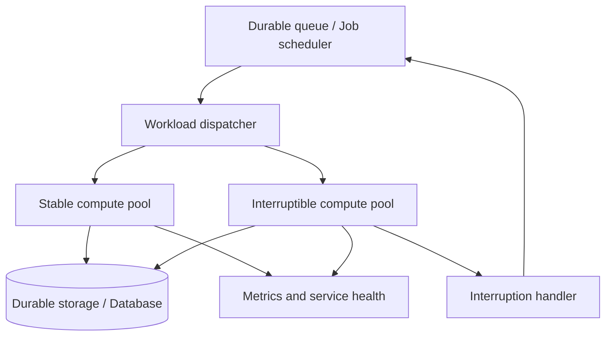

# Kết hợp capacity ổn định và capacity có thể bị thu hồi

## 1. Vì sao nên kết hợp hai loại capacity?

Workload compute trên cloud thường có nhu cầu thay đổi theo thời gian. API có thể cần đủ máy để phục vụ tải nền và giữ SLO trong mọi thời điểm; hệ thống xử lý batch lại có thể tận dụng thêm hàng trăm VM hoặc worker khi có việc. Nếu chỉ dùng capacity có giá ổn định, tổ chức có thể phải trả tiền cho tài nguyên đắt hơn trong suốt thời gian tải cao. Nếu chỉ dùng capacity có thể bị thu hồi, workload có thể thiếu tài nguyên đúng lúc nhà cung cấp cần lấy lại máy.

Một kiến trúc kết hợp dùng **capacity ổn định** làm nền tảng bảo đảm mức phục vụ tối thiểu và dùng **capacity có thể bị thu hồi** để mở rộng khi có cơ hội. Capacity ổn định thường đến từ instance theo nhu cầu, capacity đã cam kết hoặc tài nguyên dự phòng được tổ chức kiểm soát. Capacity có thể bị thu hồi thường là Spot/Preemptible VM hoặc node được cung cấp với mức giá thấp hơn nhưng nhà cung cấp có quyền thu hồi khi cần.

Điểm cốt lõi là phân chia workload theo khả năng chịu gián đoạn. Request tương tác, database primary hoặc dịch vụ cần duy trì liên tục nên dựa vào capacity ổn định. Batch, worker stateless, render, xử lý dữ liệu có checkpoint hoặc tác vụ có thể chạy lại thường phù hợp với capacity có thể bị thu hồi. Nhiều hệ thống có thể chạy cùng một workload trên cả hai loại, miễn là biết rõ phần nào phải luôn được bảo đảm và phần nào có thể biến động.

Trong module **CLOUD_CORE_SERVICES_COMPUTE**, mô hình này kết nối lựa chọn VM, container và serverless với mở rộng tải, khả năng sẵn sàng, cấu hình CPU/bộ nhớ/mạng và tối ưu chi phí vận hành.

Sau bài học, người học có thể:

- Phân biệt capacity ổn định và capacity có thể bị thu hồi.
- Xác định workload nào phù hợp với Spot/Preemptible compute.
- Tính baseline capacity, phần capacity linh hoạt và headroom cần thiết.
- Thiết kế checkpoint, retry, queue và xử lý sự kiện thu hồi.
- Kết hợp hai loại capacity trong instance group, Kubernetes và batch scheduler.
- Giảm rủi ro tập trung theo loại máy, zone, quota hoặc thời điểm.
- Đo chi phí thực tế, tỷ lệ gián đoạn và hiệu quả công việc hoàn tất.

## 2. Hai nhóm capacity

### 2.1. Capacity ổn định

Capacity ổn định là tài nguyên mà tổ chức có thể dựa vào để đáp ứng nhu cầu nền trong điều kiện vận hành đã thiết kế. Nó có thể là VM theo nhu cầu, capacity reservation thực sự giữ chỗ tài nguyên hoặc node pool được duy trì sẵn. Reserved Instance hay committed-use commitment ở một số nền tảng chủ yếu tạo ưu đãi giá; chỉ tính chúng là capacity được bảo đảm khi sản phẩm và điều khoản cụ thể có cam kết giữ capacity.

Đặc điểm thường gặp:

- Có khả năng cấp phát và duy trì cao hơn so với capacity có thể bị thu hồi, theo điều khoản của dịch vụ.
- Phù hợp với workload có yêu cầu availability hoặc latency nghiêm ngặt.
- Có chi phí đơn vị cao hơn trong một số mô hình so với tài nguyên Spot/Preemptible.
- Có thể vẫn bị ảnh hưởng bởi lỗi phần cứng, zone hoặc sự cố dịch vụ; “ổn định” không có nghĩa là không thể hỏng.

Capacity ổn định nên được bố trí ở mức đủ để duy trì chức năng cốt lõi khi phần capacity có thể bị thu hồi biến mất. Với dịch vụ nhiều vùng, baseline cần được tính theo kịch bản mất một zone hoặc một fault domain, không chỉ theo trạng thái bình thường.

### 2.2. Capacity có thể bị thu hồi

Capacity có thể bị thu hồi (interruptible capacity) là tài nguyên có giá thấp hơn hoặc được cấp theo điều kiện linh hoạt, nhưng nhà cung cấp có thể thu hồi khi cần cân bằng capacity. Các tên thường gặp gồm Spot Instances, Spot VMs, Preemptible VMs hoặc interruptible nodes.

Đặc điểm:

- Giá có thể thấp hơn đáng kể so với loại instance thông thường, nhưng mức tiết kiệm thay đổi theo loại máy, vùng, thời điểm và chính sách nhà cung cấp.
- Không bảo đảm tồn tại liên tục đến khi workload hoàn tất.
- Có thể bị thu hồi do nhu cầu capacity, thay đổi thị trường hoặc chính sách của dịch vụ.
- Thời gian thông báo trước, hành vi shutdown và khả năng thay thế khác nhau theo provider và loại sản phẩm.
- Phù hợp nhất với tác vụ có thể tiếp tục, retry, checkpoint hoặc hoàn tất trong thời gian ngắn.

Không được giả định mọi Spot/Preemptible VM đều có cùng thời gian cảnh báo hoặc luôn có cảnh báo. Thiết kế phải dựa trên hợp đồng và tài liệu của đúng dịch vụ, đồng thời chịu được trường hợp máy biến mất nhanh hơn dự kiến.

### 2.3. So sánh

| Tiêu chí | Capacity ổn định | Capacity có thể bị thu hồi |
|---|---|---|
| Mục đích | Bảo đảm baseline và dịch vụ cốt lõi | Bổ sung capacity với chi phí thấp hơn |
| Khả năng tồn tại | Dễ dự đoán hơn, theo SLA/điều khoản dịch vụ | Có thể bị thu hồi bất cứ khi nào theo chính sách |
| Giá | Thường cao hơn theo đơn vị trong một số mô hình | Thường thấp hơn nhưng biến động và không bảo đảm |
| Workload phù hợp | API chính, database, control plane, tác vụ không thể gián đoạn | Batch, worker stateless, render, phân tích, CI, job có checkpoint |
| Cách xử lý lỗi | HA, failover, retry và thay thế thông thường | Cần interruption handling, checkpoint và capacity fallback |
| Quản trị | Dự báo tải, dự phòng, availability zone | Đa dạng loại máy/zone, theo dõi interruption và pool capacity |

Capacity ổn định vẫn có thể gặp lỗi; capacity interruptible vẫn có thể chạy lâu. Sự khác biệt nằm ở mức cam kết và quyền thu hồi, không phải một loại luôn khỏe còn loại kia luôn lỗi.

## 3. Phân loại workload trước khi chọn capacity

### 3.1. Workload không nên phụ thuộc vào interruptible capacity

Thận trọng khi sử dụng capacity có thể bị thu hồi cho:

- Database primary hoặc node giữ trạng thái duy nhất.
- Dịch vụ điều phối, control plane hoặc thành phần quản lý cluster.
- API đồng bộ có SLO latency/availability nghiêm ngặt nhưng không có đủ baseline ổn định.
- Tác vụ ghi dữ liệu không idempotent và không có transaction/recovery phù hợp.
- Hệ thống giữ lease, quorum hoặc vai trò leader mà chưa có cơ chế fencing/failover.
- Thành phần không thể tái tạo nhanh hoặc không có backup/checkpoint hợp lệ.

Có thể dùng interruptible capacity cho một phần replica hoặc tác vụ phụ nếu kiến trúc có đủ capacity ổn định để duy trì dịch vụ khi phần đó bị thu hồi.

### 3.2. Workload phù hợp

| Workload | Mức phù hợp | Điều kiện thiết kế |
|---|---|---|
| Batch ETL | Cao | Chia partition, checkpoint, retry và lưu kết quả bền vững |
| Render ảnh/video | Cao | Chia frame/tile, ghi kết quả từng phần và chạy lại phần thiếu |
| CI build/test | Cao | Runner stateless, artifact lưu ngoài máy và job có thể xếp hàng lại |
| Distributed training | Trung bình đến cao | Framework hỗ trợ checkpoint, elastic worker hoặc restart từ checkpoint |
| Queue consumer | Cao | Message ack đúng lúc, idempotency, visibility timeout và DLQ |
| Web/API stateless | Có điều kiện | Stable baseline đủ phục vụ tải tối thiểu; interruptible replica chỉ bổ sung |
| Database primary | Thấp | Chỉ dùng khi engine/kiến trúc có cơ chế chịu lỗi và chính sách được xác minh rõ |
| Development/test | Cao | Có thể tạm dừng, tái tạo và thông báo người dùng |

### 3.3. Đánh giá khả năng gián đoạn

Trước khi chuyển workload sang interruptible capacity, trả lời:

1. Công việc có thể dừng giữa chừng không?
2. Trạng thái đang xử lý nằm ở máy hay ở dịch vụ lưu trữ bền vững?
3. Có thể checkpoint và khôi phục trên loại máy khác không?
4. Tác vụ có thể chạy lại mà không tạo dữ liệu trùng không?
5. Có deadline hoặc SLA khiến việc chạy lại không còn ý nghĩa không?
6. Khi tất cả interruptible capacity biến mất, phần ổn định có duy trì chức năng cốt lõi không?
7. Hệ thống có thể xếp hàng và chờ capacity quay lại không?

Nếu chưa trả lời được các câu hỏi về trạng thái, idempotency và baseline, chưa nên chuyển workload quan trọng sang mô hình này.

## 4. Chia baseline và burst capacity

### 4.1. Xác định baseline

Baseline là lượng compute ổn định cần thiết để phục vụ tải nền và đáp ứng mục tiêu dịch vụ. Baseline nên dựa trên:

- Tải bình thường và tải tối thiểu cần duy trì.
- SLO về availability, latency và throughput.
- Nhu cầu khi một node hoặc zone bị lỗi.
- Thời gian khởi tạo capacity mới.
- Tài nguyên cần cho health check, maintenance và deployment.
- Nhu cầu của dependency như database, cache, network và quota.

Không chọn baseline chỉ bằng mức CPU trung bình. Một dịch vụ có thể dùng CPU thấp nhưng cần nhiều replica để phân bố địa lý, giữ connection hoặc chịu lỗi. Một worker có thể không cần phục vụ ngay nhưng cần baseline đủ để đáp ứng deadline queue.

### 4.2. Tính capacity cần thiết

Gọi:

- \(D\): nhu cầu compute dự kiến tại thời điểm đang xét.
- \(B\): baseline capacity ổn định.
- \(S\): capacity có thể bị thu hồi đang chạy.
- \(H\): headroom hoặc phần dự phòng cần thiết.

Nhu cầu cần phục vụ được biểu diễn gần đúng:

\[
D \leq B + S
\]

Nhưng để chịu được việc interruptible capacity bị thu hồi, baseline phải tự duy trì mức tải cốt lõi:

\[
D_{critical} + H \leq B
\]

Phần tải linh hoạt có thể phân bổ sang interruptible capacity:

\[
D_{flexible} \leq S + B_{spare}
\]

Trong đó \(B_{spare}\) là phần capacity ổn định còn dư sau khi phục vụ nhu cầu cốt lõi. Các công thức là mô hình lập kế hoạch; cần tính đơn vị capacity nhất quán như vCPU, worker slot, request/s hoặc GPU accelerator.

### 4.3. Ví dụ tính baseline và burst

Một dịch vụ xử lý ảnh cần 100 worker slot ở giờ cao điểm. Trong đó 40 slot xử lý tác vụ ưu tiên cao cần hoàn thành trong thời hạn ngắn; 60 slot còn lại xử lý tác vụ có thể chờ hoặc chạy lại. Nhóm vận hành giữ thêm 20 slot headroom để chịu biến động và một phần lỗi.

Một phương án đơn giản:

- Capacity ổn định: 60 slot (40 slot critical + 20 slot headroom).
- Capacity interruptible mục tiêu: tối đa 40 slot bổ sung trong điều kiện có sẵn.
- Khi interruptible capacity mất hoàn toàn, hệ thống vẫn duy trì nhóm tác vụ ưu tiên cao; tác vụ linh hoạt được giữ trong queue.

Không cần bảo đảm 100 worker slot bằng tài nguyên ổn định nếu deadline của phần linh hoạt cho phép chờ. Ngược lại, nếu mọi tác vụ đều phải hoàn tất ngay, cần tăng baseline hoặc thay đổi cam kết dịch vụ.

### 4.4. Tính theo kịch bản thu hồi

Lập ít nhất ba kịch bản:

| Kịch bản | Interruptible capacity | Hành vi mong muốn |
|---|---:|---|
| Bình thường | Đủ | Burst workload được xử lý nhanh, queue giảm |
| Một phần bị thu hồi | Giảm một phần | Queue tăng có kiểm soát, workload critical vẫn được phục vụ |
| Toàn bộ bị thu hồi | 0 | Baseline ổn định giữ chức năng cốt lõi, job linh hoạt chờ hoặc chạy lại |

Với dịch vụ nhiều zone, cần thêm kịch bản mất zone hoặc thiếu capacity ở một nhóm instance family. Đừng giả định capacity interruptible ở zone khác luôn có thể cấp ngay.

## 5. Kiến trúc pool ổn định và pool interruptible

### 5.1. Tách pool theo vai trò

Một kiến trúc phổ biến có hai pool:

- **Stable pool:** chạy replica tối thiểu, dịch vụ điều phối, tác vụ ưu tiên cao và các thành phần không thể mất đột ngột.
- **Interruptible pool:** nhận workload có thể dừng, retry hoặc checkpoint; được phép thay đổi số lượng theo availability và giá.

Tách pool giúp áp dụng policy, autoscaling, health check, quota và quyền khác nhau. Tuy nhiên, workload vẫn cần dùng chung queue, storage hoặc service discovery phù hợp. Không đặt trạng thái duy nhất trên interruptible node.



### 5.2. Phân loại job và ưu tiên

Scheduler nên gắn metadata cho job:

- Priority hoặc service class.
- Deadline và thời gian chạy dự kiến.
- Khả năng checkpoint/retry.
- CPU, RAM, GPU, disk và network requirement.
- Có thể chạy trên stable, interruptible hay cả hai.
- Số lần retry tối đa và chính sách khi quá hạn.

Job critical có thể được đặt lên stable pool. Job linh hoạt có thể ưu tiên interruptible pool, nhưng vẫn có fallback sang stable pool nếu có headroom và chi phí cho phép. Không để job ít ưu tiên chiếm hết stable capacity.

### 5.3. Tách quyền và giới hạn tài nguyên

Stable và interruptible pool có thể cần IAM role, network policy, security group hoặc service account khác nhau. Dùng quyền tối thiểu cho từng loại workload. Cần giới hạn tổng CPU/RAM/GPU, connection và concurrency để interruptible pool không làm quá tải dependency dùng chung.

### 5.4. Đa dạng hóa loại máy và zone

Interruptible capacity có thể không sẵn ở một instance family hoặc zone cụ thể. Tăng khả năng cấp phát bằng cách:

- Chọn nhiều instance type có hiệu năng tương đương.
- Hỗ trợ nhiều kích cỡ CPU/RAM phù hợp với job.
- Phân tán qua nhiều availability zone nếu dữ liệu và mạng cho phép.
- Tránh ràng buộc quá chặt vào một loại accelerator hoặc CPU generation.
- Dùng capacity-optimized hoặc diversified allocation policy nếu dịch vụ hỗ trợ.

Không đa dạng hóa đến mức workload chạy sai hiệu năng hoặc không tương thích. Kiểm tra kiến trúc CPU, instruction set, GPU driver, memory, local storage và network throughput trước khi thêm loại máy vào pool.

## 6. Xử lý sự kiện interruption

### 6.1. Vòng đời của một interruption

Nhà cung cấp có thể gửi cảnh báo hoặc metadata cho biết instance sắp bị thu hồi. Hệ thống nên nhận sự kiện qua cơ chế được hỗ trợ, xác định tài nguyên bị ảnh hưởng và bắt đầu graceful handling.

Một quy trình tổng quát:

1. Nhận interruption notice hoặc phát hiện instance không còn khả dụng.
2. Đánh dấu node/worker không nhận job mới.
3. Xác định job đang chạy và khả năng checkpoint.
4. Flush trạng thái cần thiết sang storage bền vững.
5. Hoàn tất, checkpoint hoặc requeue job.
6. Đóng kết nối, gửi telemetry và rời pool.
7. Scheduler tìm capacity thay thế nếu cần.

Thông báo trước chỉ là cơ hội giảm thiệt hại. Không được phụ thuộc hoàn toàn vào việc notice luôn đến hoặc có đủ thời gian xử lý.

### 6.2. Xử lý khi không có notice

Instance có thể mất đột ngột do host failure, network partition hoặc cơ chế thu hồi không cung cấp thời gian báo trước đủ dùng. Vì vậy:

- Lưu checkpoint định kỳ, không chỉ khi có interruption.
- Đưa job state và queue ra khỏi local disk của instance.
- Dùng lease hoặc visibility timeout để phát hiện worker mất.
- Thiết kế job idempotent để có thể chạy lại.
- Dùng retry có giới hạn và dead-letter queue.
- Theo dõi worker heartbeat và job progress từ hệ thống bên ngoài.

### 6.3. Graceful shutdown

Khi nhận tín hiệu kết thúc, worker nên ngừng nhận job mới, hoàn tất hoặc checkpoint job đang chạy, flush log/metric và đóng kết nối. Cần có timeout tổng thể để shutdown không bị treo.

Không cố hoàn tất một job dài nếu thời gian còn lại không đủ. Hãy checkpoint và để scheduler tiếp tục trên worker khác. Với job không thể checkpoint, có thể dừng và chạy lại từ đầu nếu chi phí và deadline cho phép.

### 6.4. Không dựa vào local ephemeral state

Local SSD, temporary disk hoặc filesystem của instance có thể mất khi instance bị thu hồi. Lưu checkpoint, artifact, input và trạng thái job ở object storage, database hoặc shared storage có độ bền phù hợp. Local cache có thể tái tạo; dữ liệu duy nhất không nên chỉ tồn tại trên máy interruptible.

## 7. Checkpoint, retry và idempotency

### 7.1. Checkpoint là gì?

Checkpoint là bản ghi trạng thái đủ để tiếp tục công việc từ một điểm gần nhất thay vì chạy lại toàn bộ. Nội dung checkpoint phụ thuộc workload:

- ETL: partition đã hoàn tất, offset, watermark và trạng thái transform.
- Render: frame/tile đã hoàn tất, thông số render và checksum output.
- Training: model weights, optimizer state, scheduler state, random seed và bước training.
- Simulation: trạng thái mô phỏng, timestep và input cần thiết.
- Queue worker: job ID, bước xử lý và kết quả trung gian đã lưu bền vững.

Checkpoint cần có version, timestamp, checksum và metadata về code/model/schema để xác định khả năng tương thích.

### 7.2. Chọn checkpoint interval

Checkpoint quá thường xuyên làm tăng I/O, network và chi phí storage; checkpoint quá thưa làm mất nhiều công việc khi bị thu hồi. Có thể chọn interval dựa trên thời gian chạy lại chấp nhận được và xác suất interruption.

Nếu một job chạy trong nhiều giờ và checkpoint mất 30 giây, checkpoint mỗi 10 phút có thể hợp lý hơn checkpoint mỗi vài giây. Nhưng nếu mỗi bước tạo ra dữ liệu không thể tái tạo, cần checkpoint thường xuyên hơn hoặc commit từng bước.

Một cách đánh giá đơn giản là so sánh chi phí checkpoint với kỳ vọng công việc phải chạy lại. Mô hình tối ưu phụ thuộc xác suất interruption, thời gian ghi checkpoint, thời gian khởi động lại và chi phí tài nguyên.

### 7.3. Atomic checkpoint

Không ghi đè checkpoint tốt gần nhất bằng một bản đang ghi dở. Một quy trình an toàn có thể:

1. Ghi checkpoint mới vào object/key tạm.
2. Flush và xác minh checksum/size.
3. Ghi metadata hoàn chỉnh.
4. Cập nhật pointer hoặc manifest trỏ đến checkpoint mới.
5. Chỉ sau đó mới đánh dấu checkpoint trước có thể hết retention.

Nếu worker chết giữa các bước, scheduler vẫn có thể dùng checkpoint hoàn chỉnh trước đó.

### 7.4. Idempotency và xử lý trùng

Khi worker bị thu hồi, message có thể được giao lại. Tác vụ cần idempotent hoặc dùng idempotency key để việc chạy lại không tạo giao dịch trùng. Với xử lý nhiều bước, ghi tiến độ và kết quả theo transaction hoặc state machine phù hợp.

Ví dụ, trước khi gửi thanh toán, kiểm tra job ID đã được hoàn tất chưa; dùng khóa idempotency ổn định cho lần retry. Không tạo khóa mới mỗi lần retry vì dịch vụ nhận có thể coi đó là giao dịch khác.

### 7.5. Retry budget và dead-letter

Retry không nên vô hạn. Đặt số lần thử tối đa, exponential backoff, jitter và deadline. Nếu job liên tục thất bại vì input lỗi hoặc dependency không sẵn sàng, chuyển vào dead-letter queue để điều tra. Phân biệt interruption retry với lỗi ứng dụng để tránh chạy lại vô ích.

## 8. Autoscaling và phân bổ capacity

### 8.1. Stable baseline không scale theo interruption

Stable pool cần duy trì min capacity đủ cho tải cốt lõi. Không giảm stable baseline chỉ vì interruptible pool đang có nhiều máy; những máy giá thấp có thể bị thu hồi đồng thời.

Một policy có thể scale stable pool theo tải nền hoặc SLO, trong khi interruptible pool scale theo backlog linh hoạt và giới hạn max được tính trước. Khi interruptible capacity giảm, scheduler giữ job trong queue hoặc chuyển một phần sang stable nếu còn headroom.

### 8.2. Scale-out interruptible pool

Scale-out có thể dựa trên queue depth, message age, job count hoặc CPU. Trước khi thêm máy, kiểm tra quota, loại máy và zone availability. Không scale vượt capacity của dependency hoặc ngân sách chi phí.

Nếu capacity interruptible không có sẵn, job cần ở trạng thái pending và scheduler thử lại theo backoff. Không tạo vòng lặp yêu cầu instance liên tục với tần suất cao.

### 8.3. Scale-in và rebalance

Khi giảm tải, ưu tiên dừng instance interruptible sau khi drain job. Với instance group, dùng lifecycle hook hoặc termination handler để xử lý job đang chạy. Với Kubernetes, cordon node và evict workload có thể di dời; nhưng job stateful hoặc local data cần checkpoint trước.

Nếu provider có rebalance recommendation, xem đó là tín hiệu chuẩn bị di chuyển workload sang pool khác. Không chờ đến interruption cuối cùng mới bắt đầu drain.

### 8.4. Capacity fallback

Khi interruptible capacity không sẵn hoặc bị thu hồi, có một số lựa chọn:

- Chờ trong queue nếu deadline cho phép.
- Chuyển job sang stable pool nếu còn capacity và ngân sách.
- Chuyển sang instance type/zone khác đã được kiểm thử.
- Giảm concurrency hoặc chia nhỏ job.
- Tạm dừng nhận job ít ưu tiên.
- Từ chối có kiểm soát nếu hệ thống không thể đảm bảo deadline.

Fallback phải có giới hạn. Nếu toàn bộ workload chuyển sang stable pool cùng lúc, database, quota hoặc chi phí có thể vượt kế hoạch. Nên xác định trước phần tải nào được phép fallback.

## 9. Kết hợp trong VM Instance Groups

### 9.1. Hai nhóm máy riêng

Có thể tạo một instance group ổn định và một nhóm Spot/Preemptible riêng. Stable group giữ min size; interruptible group có thể scale từ 0 đến max theo queue hoặc workload. Tách nhóm giúp cấu hình launch template, health check, lifecycle và allocation strategy riêng.

### 9.2. Mixed instance policy

Một số nền tảng hỗ trợ mixed instances group, kết hợp loại capacity ổn định và Spot trong cùng nhóm. Policy có thể xác định tỷ lệ hoặc mức ưu tiên giữa hai loại. Cần đọc rõ hành vi khi Spot không đủ capacity, rebalance, replacement và scale-in.

Nếu dùng mixed group, cần chắc chắn phần capacity ổn định thực sự đủ duy trì baseline theo cách policy phân bổ. Một tỷ lệ phần trăm không tự động bảo đảm đúng số máy ổn định khi instance type khác kích thước.

### 9.3. Diversification

Chọn nhiều instance type tương thích và nhiều zone để giảm phụ thuộc vào một pool capacity. Có thể dùng allocation strategy ưu tiên capacity availability thay vì chỉ chọn giá thấp nhất, nếu dịch vụ hỗ trợ.

Kiểm tra mỗi loại máy có đủ CPU, RAM, network, local disk và kiến trúc phù hợp. Một loại máy rẻ hơn nhưng hiệu năng thấp có thể làm job kéo dài và tổng chi phí tăng.

### 9.4. Interruption handling

Dùng lifecycle notification hoặc metadata/event service của provider để nhận cảnh báo thu hồi. Khi nhận event, đặt instance vào trạng thái không nhận job mới, checkpoint và kết thúc an toàn. Có watchdog bên ngoài để phát hiện trường hợp instance mất mà không gửi event.

## 10. Kết hợp trong Kubernetes

### 10.1. Node pool theo độ ổn định

Tách node pool stable và interruptible. Gắn label và taint để scheduler biết node nào phù hợp với workload. Ví dụ:

```yaml
apiVersion: v1
kind: Node
metadata:
  name: interruptible-node-01
  labels:
    capacity-class: interruptible
    workload-tier: batch
  annotations:
    example.com/interruption-aware: "true"
spec:
  taints:
    - key: capacity-class
      value: interruptible
      effect: NoSchedule
```

Đây là ví dụ minh họa cấu trúc label/taint; Node object thường được quản lý bởi kubelet/cloud controller và không nên tự tạo thủ công trong cluster production.

Pod batch có thể khai báo toleration và node affinity để chạy trên interruptible pool. Pod API quan trọng nên ưu tiên stable pool hoặc yêu cầu capacity ổn định qua node affinity/taint policy.

### 10.2. Ví dụ workload batch

```yaml
apiVersion: apps/v1
kind: Deployment
metadata:
  name: image-worker
spec:
  replicas: 4
  selector:
    matchLabels:
      app: image-worker
  template:
    metadata:
      labels:
        app: image-worker
    spec:
      terminationGracePeriodSeconds: 90
      tolerations:
        - key: capacity-class
          operator: Equal
          value: interruptible
          effect: NoSchedule
      affinity:
        nodeAffinity:
          preferredDuringSchedulingIgnoredDuringExecution:
            - weight: 100
              preference:
                matchExpressions:
                  - key: capacity-class
                    operator: In
                    values: [interruptible]
      containers:
        - name: worker
          image: example.invalid/image-worker:v1
          lifecycle:
            preStop:
              exec:
                command: ["/app/worker", "drain"]
```

Ví dụ trên ưu tiên node interruptible; trong thực tế cần định nghĩa rõ fallback sang stable pool, cách scheduler xử lý khi không có node phù hợp và cách worker checkpoint khi nhận `SIGTERM`. `preStop` chỉ là một phần của graceful shutdown; ứng dụng phải có logic dừng nhận job và lưu trạng thái.

### 10.3. Node termination handler

Kubernetes không tự hiểu mọi loại interruption event của từng cloud provider. Có thể cần node termination handler hoặc controller nhận event, cordon node, drain pod và cập nhật trạng thái. Công cụ cụ thể phụ thuộc nền tảng.

Drain phải xét PodDisruptionBudget, DaemonSet, local storage và thời gian grace. PDB bảo vệ voluntary disruption trong phạm vi Kubernetes kiểm soát, nhưng không thể ngăn provider thu hồi node bất ngờ hoặc bảo đảm máy còn đủ thời gian để drain. Vì vậy, checkpoint và retry vẫn cần thiết.

### 10.4. Tách control plane và workload quan trọng

Không đặt thành phần quản lý cluster, DNS nội bộ, ingress cốt lõi hoặc hệ thống nhận interruption event duy nhất trên interruptible pool. Nếu controller xử lý event bị thu hồi cùng lúc với node worker, hệ thống có thể không điều phối được việc drain.

## 11. Workload phân tán và GPU

### 11.1. Chia job thành đơn vị độc lập

Tách job lớn thành partition, shard, frame hoặc task độc lập. Mỗi đơn vị có ID, input/output rõ ràng và có thể chạy lại. Scheduler phân phối các phần cho stable và interruptible worker theo ưu tiên.

Nếu job phân tán cần nhiều node đồng thời, việc mất một node có thể làm cả job thất bại. Dùng framework hỗ trợ elastic membership, worker replacement hoặc checkpoint toàn job; nếu không, cân nhắc chạy job đồng bộ trên stable capacity.

### 11.2. Checkpoint cho GPU training

Training job có thể lưu model weights, optimizer state, learning rate scheduler, random state, epoch/step và dữ liệu phân phối. Checkpoint chỉ model weights có thể không đủ để tiếp tục training tương đương vì optimizer state và random state bị mất.

Ghi checkpoint vào object storage hoặc shared durable storage, xác minh checksum và khả năng load trên loại GPU/driver khác. Tần suất checkpoint cần cân bằng thời gian ghi và lượng compute có thể mất.

### 11.3. Accelerator capacity

GPU interruptible capacity có thể khan hiếm hơn CPU và phụ thuộc model GPU, VRAM, interconnect và zone. Diversification phải xét tương thích CUDA/runtime, driver, framework và yêu cầu collective communication.

Không chuyển job sang GPU khác chỉ vì cùng số lượng accelerator. Hiệu năng, VRAM và topology có thể khác; cần benchmark và xác minh kết quả. Khi không có GPU capacity, job nên chờ hoặc chạy trên stable GPU nếu deadline và ngân sách cho phép.

## 12. Chi phí và hiệu quả kinh tế

### 12.1. Giá rẻ không đồng nghĩa chi phí hoàn tất thấp

Interruptible VM có thể có giá theo giờ thấp hơn nhưng interruption làm công việc phải chạy lại, tạo checkpoint/storage overhead hoặc kéo dài thời gian hoàn tất. Đánh giá chi phí theo **kết quả hoàn tất**, không chỉ giá compute mỗi giờ.

Các khoản cần tính:

- Compute hours của stable và interruptible pool.
- Công việc bị mất và thời gian chạy lại.
- Checkpoint storage, request và network transfer.
- Queue delay và chi phí deadline bị trễ.
- Chi phí stable fallback khi interruptible capacity không sẵn.
- Chi phí vận hành scheduler, interruption handler và quan sát.

### 12.2. Chi phí kỳ vọng

Một mô hình đơn giản:

\[
C_{total} = C_{stable} + C_{interruptible} + C_{checkpoint} + C_{retry} + C_{fallback}
\]

Để so sánh với phương án chỉ dùng stable capacity, hãy tính tổng chi phí cho cùng lượng công việc hoàn tất và cùng mục tiêu deadline. Nếu interruption quá thường xuyên, checkpoint quá nặng hoặc fallback liên tục, mức tiết kiệm có thể giảm đáng kể.

### 12.3. Đo hiệu quả theo workload

Theo dõi:

- Tỷ lệ job hoàn tất trên interruptible capacity.
- Interruption rate theo loại máy, zone và thời điểm.
- Thời gian từ notice đến termination nếu có notice.
- Công việc phải chạy lại và checkpoint recovery duration.
- Queue age, deadline miss và thời gian hoàn tất.
- Chi phí trên job hoàn tất hoặc đơn vị dữ liệu xử lý.
- Tỷ lệ fallback sang stable pool.

Không chỉ đo số giờ Spot đã sử dụng. Một pool rẻ nhưng nhiều job thất bại có thể không mang lại lợi ích kinh tế.

### 12.4. Ngân sách và guardrail

Đặt giới hạn max size, quota và ngân sách cho interruptible pool. Cảnh báo khi stable fallback tăng bất thường hoặc interruptible capacity không đủ trong thời gian dài. Nếu workload không gấp, có thể giảm tốc độ xử lý thay vì mở rộng stable pool vượt ngân sách.

## 13. Bảo mật, dữ liệu và vận hành

### 13.1. Dữ liệu bền vững

Không lưu dữ liệu duy nhất trên boot disk hoặc local ephemeral disk của interruptible instance. Dùng object storage, database, shared volume hoặc dịch vụ queue có độ bền phù hợp. Tách input, checkpoint và output để có thể tái tạo worker.

### 13.2. Identity và quyền tối thiểu

Interruptible worker chỉ cần quyền đọc input, ghi checkpoint/output và cập nhật trạng thái job. Không cấp quyền quản trị cluster hoặc quyền xóa backup nếu không cần. Credential nên ngắn hạn và được cấp qua workload identity.

### 13.3. Network và dependency

Đặt worker trong subnet và security policy phù hợp. Nếu job có thể được gửi đến nhiều zone, bảo đảm đường đi đến storage và queue hoạt động ở các vùng đó. Tính chi phí cross-zone/region traffic và latency khi đặt compute gần dữ liệu.

### 13.4. Logging và audit

Ghi job ID, instance ID, capacity class, zone, checkpoint version và interruption event. Không ghi secret hoặc dữ liệu nhạy cảm trong log. Khi worker biến mất đột ngột, telemetry bên ngoài phải cho phép xác định job nào cần retry.

## 14. Ví dụ thực tế

### Ví dụ 1: Batch ETL kết hợp stable và Spot workers

Một pipeline ETL cần xử lý 10 TB dữ liệu mỗi ngày. Deadline cho phép xử lý trong 6 giờ. Hệ thống có 20 stable worker slot để duy trì tiến độ tối thiểu và mở rộng thêm tối đa 80 interruptible slot khi capacity sẵn có.

**Thiết kế:** chia dữ liệu theo partition; mỗi partition có trạng thái bền vững; worker ghi output tạm rồi commit manifest khi hoàn tất. Khi nhận interruption, worker ngừng nhận partition mới và checkpoint tiến độ. Nếu mất đột ngột, scheduler giao lại partition chưa commit.

**Fallback:** nếu Spot capacity giảm, 20 stable worker tiếp tục xử lý; backlog còn lại chờ hoặc chạy chậm hơn. Dashboard theo dõi oldest partition age, throughput, interruption rate và cost per TB.

### Ví dụ 2: API stateless dùng Spot làm capacity bổ sung

Một API có baseline 6 stable VM, đủ duy trì SLO ở tải nền. Khi chiến dịch tăng traffic, autoscaler bổ sung tối đa 10 Spot VM. API không lưu state trên máy và mọi request có thể được chuyển đến replica khác.

**Thiết kế:** readiness/health check trước khi nhận traffic, connection draining khi có interruption, session và dữ liệu lưu ở dịch vụ dùng chung. Stable pool vẫn đủ xử lý tải ưu tiên nếu Spot bị thu hồi; nếu không, hệ thống bật rate limit hoặc degraded mode.

**Kiểm soát:** max Spot replica bị giới hạn theo database connection budget và quota. Theo dõi error rate, latency, healthy target count và stable capacity headroom.

### Ví dụ 3: GPU training có checkpoint

Một job training chạy trên GPU Spot trong nhiều giờ. Framework lưu model, optimizer, scheduler và step vào object storage sau mỗi khoảng thời gian đã thử nghiệm.

**Thiết kế:** khi có notice, job dừng nhận batch mới, hoàn tất checkpoint atomic rồi kết thúc. Nếu không có notice và node mất, orchestrator khởi chạy lại từ checkpoint hoàn chỉnh gần nhất. Job được gắn run ID và checkpoint version để tránh ghi đè trạng thái của lần chạy khác.

**Fallback:** khi GPU Spot khan hiếm, job chờ hoặc chuyển sang GPU stable nếu deadline cho phép. Đo thời gian mất công việc trung bình và chi phí checkpoint để xác định tần suất phù hợp.

### Ví dụ 4: CI runner trên interruptible capacity

Một đội phát triển dùng runner interruptible cho build/test. Runner không lưu source hoặc artifact duy nhất trên local disk; pipeline có thể tạo runner mới và chạy lại job.

**Thiết kế:** job được chia nhỏ, artifact và cache quan trọng lưu ở storage dùng chung, test có timeout và retry budget. Khi runner bị thu hồi, hệ thống đánh dấu job interrupted và xếp hàng chạy lại.

**Kiểm soát:** không retry vô hạn test lỗi do code; phân biệt interruption với test failure. Theo dõi thời gian chờ runner, job retry, chi phí trên pipeline thành công và tỷ lệ Spot availability.

## 15. Những sai lầm thường gặp

- **Dùng interruptible capacity cho baseline cốt lõi:** toàn bộ dịch vụ có thể mất capacity khi provider thu hồi.
- **Giả định luôn có notice:** instance có thể biến mất mà không có đủ thời gian xử lý.
- **Chỉ checkpoint khi nhận notice:** lỗi đột ngột làm mất toàn bộ tiến độ kể từ checkpoint trước.
- **Lưu trạng thái trên local disk:** dữ liệu biến mất cùng instance.
- **Không có idempotency:** job retry có thể tạo dữ liệu hoặc giao dịch trùng.
- **Retry không giới hạn:** làm tăng queue, chi phí và tải dependency.
- **Tập trung vào một instance type/zone:** thiếu capacity khi pool cụ thể bị cạn.
- **Chuyển toàn bộ workload sang stable khi Spot mất:** gây vượt quota, connection và ngân sách.
- **Đặt PDB như bảo đảm chống eviction:** disruption từ provider có thể vượt phạm vi bảo vệ của PDB.
- **Không tách control plane khỏi pool interruptible:** mất node xử lý event có thể làm quy trình drain thất bại.
- **Chỉ so giá compute mỗi giờ:** bỏ qua checkpoint, retry, deadline và fallback.
- **Không đo job completion:** không biết mức tiết kiệm có tạo ra kết quả thực tế hay không.

## 16. Checklist triển khai

### Phân loại và capacity planning

- [ ] Đã phân loại workload theo khả năng chịu gián đoạn và deadline.
- [ ] Đã xác định stable baseline đủ giữ chức năng cốt lõi khi interruptible capacity bằng 0.
- [ ] Đã tính headroom, mất zone và nhu cầu của dependency.
- [ ] Đã giới hạn max interruptible capacity theo quota, network và ngân sách.
- [ ] Đã đa dạng hóa instance type/zone trong phạm vi tương thích.

### Thiết kế workload

- [ ] Job có thể chia nhỏ, retry hoặc checkpoint.
- [ ] Input, checkpoint và output nằm trên storage bền vững.
- [ ] Job có ID ổn định và xử lý idempotent.
- [ ] Retry có backoff, jitter, giới hạn và DLQ.
- [ ] Worker có graceful shutdown và ngừng nhận việc mới khi drain.
- [ ] Workload critical không phụ thuộc vào interruptible pool.

### Tích hợp nền tảng

- [ ] Instance group/node pool phân biệt stable và interruptible.
- [ ] Interruption event được thu nhận và có watchdog cho trường hợp mất đột ngột.
- [ ] Scheduler hỗ trợ pending, requeue, fallback và priority.
- [ ] PDB, lifecycle hook và termination grace được hiểu đúng giới hạn.
- [ ] Control plane và event handler có capacity ổn định.

### Vận hành và chi phí

- [ ] Theo dõi interruption rate, checkpoint recovery và job completion.
- [ ] Theo dõi stable headroom, Spot availability, queue age và fallback rate.
- [ ] Đo cost per completed job hoặc đơn vị công việc.
- [ ] Đã diễn tập mất một phần và toàn bộ interruptible capacity.
- [ ] Đã xác minh RTO/deadline và chính sách dữ liệu sau khi chạy lại.
- [ ] Định kỳ rà soát savings sau khi tính retry, checkpoint và vận hành.

## 17. Kết luận

Kết hợp capacity ổn định với capacity có thể bị thu hồi giúp cân bằng tính sẵn sàng và chi phí. Stable pool bảo đảm baseline cho chức năng cốt lõi; interruptible pool cung cấp burst capacity cho workload có thể dừng, retry hoặc checkpoint. Việc phân chia cần dựa trên SLO, deadline, khả năng phục hồi và giới hạn của dependency.

Thiết kế tốt phải lưu trạng thái bên ngoài instance, checkpoint định kỳ, xử lý interruption notice nhưng vẫn chịu được mất máy đột ngột, bảo đảm idempotency và giới hạn retry. Diversification, fallback có kiểm soát, giám sát interruption và đo chi phí trên công việc hoàn tất giúp mô hình vận hành ổn định. Hãy kiểm thử kịch bản interruptible capacity biến mất hoàn toàn trước khi dựa vào nó trong production.
