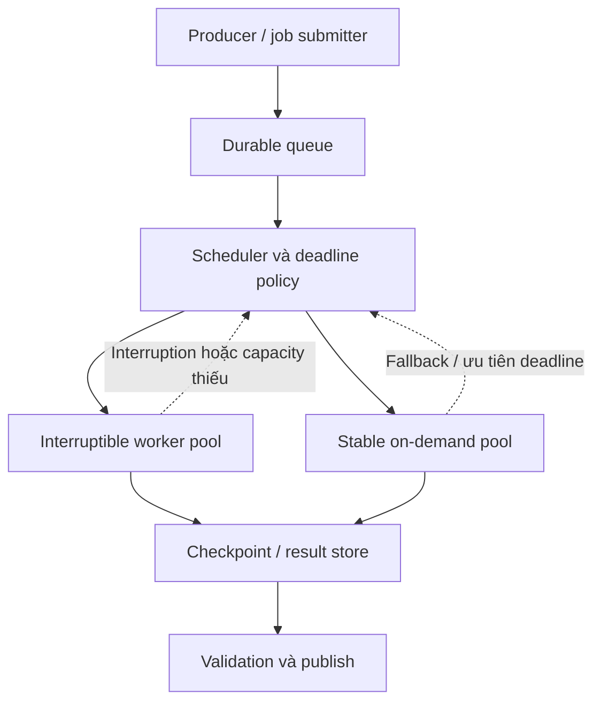

# Đánh giá chi phí thực tế có tính đến gián đoạn và thời gian hoàn thành

## Mục tiêu học tập

Sau bài học, bạn có thể:

- Phân biệt giá thuê theo giờ của interruptible compute với tổng chi phí để hoàn thành một đơn vị công việc thành công.
- Nhận diện chi phí ẩn do checkpoint, khởi động lại, tính toán bị mất, lưu trữ, truyền dữ liệu, điều phối và capacity dự phòng.
- Ước lượng xác suất hoàn thành trước deadline và thời gian hoàn thành kỳ vọng khi instance có thể bị thu hồi.
- Chọn khoảng checkpoint phù hợp với thời gian tạo checkpoint và mức độ gián đoạn.
- So sánh interruptible compute với on-demand theo cost per successful job, thời gian p95 và tỷ lệ hoàn thành đúng hạn.
- Thiết kế chiến lược kết hợp capacity ổn định với capacity giá thấp có thể bị thu hồi.
- Kiểm thử mô hình chi phí bằng dữ liệu vận hành và điều chỉnh quyết định theo workload thực tế.

## 1. Giá thuê thấp chưa chắc tạo ra chi phí thấp

Interruptible compute là năng lực tính toán có giá thấp hơn hoặc được cung cấp theo điều kiện có thể thu hồi. Tùy nhà cung cấp, dịch vụ có thể được gọi là Spot, Preemptible hoặc tên tương đương. Nhà cung cấp có quyền thu hồi instance khi cần capacity, khi chính sách dịch vụ thay đổi hoặc theo các điều kiện đã công bố.

Mức giá theo giờ thường hấp dẫn, nhưng một job chạy trên instance có thể bị gián đoạn trước khi hoàn tất. Nếu job phải chạy lại từ đầu, tổ chức đã trả tiền cho thời gian tính toán bị mất. Nếu job có checkpoint, vẫn có chi phí ghi checkpoint, khôi phục trạng thái, khởi động tiến trình và xử lý dữ liệu dở dang.

Vì vậy, câu hỏi kinh tế đúng không chỉ là:

- Một giờ interruptible rẻ hơn một giờ on-demand bao nhiêu?

Mà còn phải là:

- Cần bao nhiêu giờ compute thực tế để hoàn thành một job thành công?
- Job mất bao lâu theo thời gian thực, tính cả thời gian chờ capacity và retry?
- Có bao nhiêu công việc bị trễ deadline hoặc phải chuyển sang capacity giá cao?
- Tổng chi phí cho mỗi job hoàn tất là bao nhiêu?

**Cost per successful job** (chi phí cho mỗi job hoàn tất thành công) là chỉ số hữu ích để so sánh. Một phương án có giá thuê thấp nhưng thường xuyên mất tiến độ, chạy lại nhiều lần hoặc trễ SLA có thể đắt hơn phương án ổn định.

### Ví dụ trực quan

Một tác vụ cần 8 giờ tính toán hữu ích:

- On-demand có giá 0,40 USD/giờ và chạy liên tục trong 8 giờ.
- Interruptible có giá 0,12 USD/giờ nhưng job có thể bị thu hồi, cần checkpoint và có thể phải chạy lại.

Nếu chỉ so giá thuê, interruptible rẻ hơn 70%. Nhưng phép so sánh chưa tính giờ chạy lại, checkpoint, lưu trữ, truyền dữ liệu và thời gian chờ máy mới. Cần tính tổng nguồn lực tiêu thụ để hoàn tất cùng một kết quả.

## 2. Xác định đơn vị so sánh trước khi tính chi phí

Hai phương án chỉ có thể so sánh công bằng khi chúng tạo ra cùng một kết quả với chất lượng và điều kiện tương đương.

Đơn vị công việc có thể là:

- Một job ETL hoàn tất và tạo đúng tập dữ liệu đầu ra.
- Một frame render được xuất thành công.
- Một batch gồm một triệu bản ghi đã xử lý.
- Một lần huấn luyện đạt checkpoint hoặc metric chất lượng mục tiêu.
- Một tập test CI hoàn tất và tạo artifact hợp lệ.
- Một tác vụ chuyển mã video hoàn thành với độ phân giải và chất lượng đã yêu cầu.

Không nên so sánh chỉ bằng instance-hour nếu loại VM, CPU, bộ nhớ, hiệu năng disk, GPU hoặc phần mềm khác nhau. Một instance rẻ hơn có thể xử lý chậm hơn, khiến tổng giờ sử dụng tăng.

### 2.1. Chuẩn hóa workload

Trước khi so sánh, cố định hoặc ghi nhận:

- Kích thước và nội dung dữ liệu đầu vào.
- Phiên bản ứng dụng, thư viện và thuật toán.
- Cấu hình CPU, RAM, disk, network và accelerator.
- Số worker, mức concurrency và batch size.
- Điều kiện chất lượng đầu ra.
- Deadline và mức độ ưu tiên.
- Cơ chế checkpoint, retry và resume.
- Tình trạng cache, dữ liệu đã tải và dependency.

Nếu interruptible dùng instance khác loại với on-demand, hãy benchmark năng suất thực tế. So sánh chi phí trên một đơn vị công việc hoàn tất thay vì chỉ lấy giá theo giờ.

## 3. Các thành phần của tổng chi phí

Tổng chi phí của một job interruptible thường có nhiều thành phần hơn giá VM.

| Thành phần | Ví dụ | Vì sao phát sinh |
|---|---|---|
| Compute | Instance, GPU, accelerator | Trả tiền cho thời gian chạy, kể cả lần chạy bị gián đoạn |
| Lost work | CPU/GPU time từ checkpoint gần nhất tới lúc bị thu hồi | Phần tính toán chưa được lưu trạng thái phải làm lại |
| Checkpoint | CPU, I/O và thời gian ghi trạng thái | Lưu tiến độ để tiếp tục sau interruption |
| Restore/resume | Đọc checkpoint, dựng lại process và cache | Khôi phục trạng thái trước khi xử lý tiếp |
| Provisioning/wait | Chờ capacity, tạo VM, boot và warm-up | Job chưa xử lý được dù đã được lên lịch |
| Storage | Volume, object storage, snapshot, log và artifact | Giữ checkpoint, dữ liệu tạm và kết quả |
| Data transfer | Đọc dữ liệu, copy checkpoint, egress | Truyền dữ liệu giữa VM, zone, region hoặc dịch vụ |
| Orchestration | Scheduler, queue, workflow engine, control plane | Quản lý retry, lease, checkpoint và vòng đời job |
| Fallback capacity | Chuyển sang on-demand hoặc pool khác | Bảo đảm deadline khi interruptible thiếu capacity |
| Idle/overlap | VM dự phòng, thời gian chờ, hai worker chạy trùng | Tạo dư thừa để tăng khả năng hoàn thành đúng hạn |
| License/support | Phần mềm thương mại, OS hoặc accelerator license | Có thể tính theo thời gian, core hoặc instance |
| Operations | Monitoring, log, alert và xử lý sự cố | Theo dõi interruption và điều phối phục hồi |

Một số khoản là chi phí trực tiếp, một số là chi phí cơ hội hoặc chi phí vận hành. Khi lập mô hình, cần ghi rõ khoản nào được tính vào hóa đơn cloud và khoản nào được quy đổi thành chi phí nội bộ.

### 3.1. Công thức tổng quát

\[
C_{\text{success}} =
\frac{
C_{\text{compute}} +
C_{\text{checkpoint}} +
C_{\text{restore}} +
C_{\text{storage}} +
C_{\text{transfer}} +
C_{\text{orchestration}} +
C_{\text{fallback}} +
C_{\text{other}}
}{
N_{\text{successful jobs}}
}
\]

Trong đó:

- \(C_{\text{success}}\): chi phí bình quân cho một job thành công.
- \(C_{\text{compute}}\): tổng compute cost của mọi lần chạy.
- \(C_{\text{checkpoint}}\): chi phí tạo checkpoint.
- \(C_{\text{restore}}\): chi phí khởi tạo lại và phục hồi.
- \(C_{\text{fallback}}\): chi phí capacity thay thế.
- \(N_{\text{successful jobs}}\): số job hoàn tất và vượt qua kiểm tra kết quả.

Nếu có job thất bại vĩnh viễn, chi phí của chúng vẫn nằm trong tử số nhưng không tăng mẫu số. Đây là lý do tỷ lệ hoàn thành phải được theo dõi cùng chi phí.

### 3.2. Chi phí trên mỗi đơn vị công việc

Nếu mỗi job có khối lượng khác nhau, cost per job có thể gây hiểu nhầm. Khi đó, dùng chi phí trên một đơn vị đầu ra:

\[
C_{\text{unit}} =
\frac{\text{Tổng chi phí compute và vận hành}}
{\text{Số đơn vị đầu ra hợp lệ}}
\]

Ví dụ: USD trên mỗi GB dữ liệu ETL hợp lệ, mỗi frame render, mỗi triệu bản ghi hoặc mỗi giờ video đã chuyển mã. Đơn vị đầu ra cần có tiêu chí chất lượng rõ ràng.

## 4. Xác suất bị gián đoạn và thời gian hoàn thành

Một instance interruptible có thể chạy được một khoảng thời gian trước khi bị thu hồi. Để ước lượng rủi ro, có thể dùng tỷ lệ interruption quan sát được của pool capacity.

Gọi:

- \(\lambda\): tỷ lệ interruption trung bình trên mỗi giờ chạy, theo một mô hình xấp xỉ.
- \(t\): thời gian job cần chạy liên tục.
- \(P(\text{survive } t)\): xác suất instance không bị interruption trong khoảng thời gian đó.

Nếu giả định interruption xảy ra theo quá trình Poisson với hazard không đổi, xác suất sống sót là:

\[
P(\text{survive } t) = e^{-\lambda t}
\]

Xác suất bị gián đoạn ít nhất một lần là:

\[
P(\text{interrupt before } t) = 1 - e^{-\lambda t}
\]

Mô hình này giúp hiểu ảnh hưởng của thời gian chạy và tỷ lệ interruption, nhưng chỉ là xấp xỉ. Trong thực tế, interruption rate có thể thay đổi theo loại instance, zone, thời điểm, nhu cầu thị trường và chính sách provider. Không nên coi \(\lambda\) là hằng số cố định cho mọi pool hoặc tương lai.

### 4.1. Ví dụ xác suất hoàn thành không checkpoint

Một job cần chạy liên tục 4 giờ. Pool có interruption rate 0,1 lần trên mỗi giờ chạy theo dữ liệu lịch sử.

\[
P(\text{survive } 4) = e^{-0.1 \times 4} \approx 0.670
\]

Xác suất bị gián đoạn trước khi hoàn tất:

\[
1 - 0.670 = 0.330
\]

Theo mô hình đơn giản này, khoảng 33% lần thử có thể bị interruption trước khi job hoàn tất. Job càng dài, khả năng cần chạy lại càng tăng.

Không dùng xác suất trên làm cam kết SLA. Cần xem phân bố thực tế, số mẫu, thời điểm và pool cụ thể.

### 4.2. Thời gian hoàn thành kỳ vọng khi phải chạy lại từ đầu

Với job không checkpoint, giả sử mỗi lần chạy bắt đầu lại từ đầu và interruption có hazard không đổi \(\lambda\). Thời gian hoàn thành kỳ vọng theo mô hình exponential là:

\[
E[T] = \frac{e^{\lambda t} - 1}{\lambda}
\]

Trong ví dụ \(t=4\) giờ và \(\lambda=0,1\) mỗi giờ:

\[
E[T] = \frac{e^{0.4} - 1}{0.1} \approx 4.92 \text{ giờ}
\]

Thời gian kỳ vọng tăng từ 4 giờ tính toán hữu ích lên khoảng 4,92 giờ, chưa tính thời gian chờ cấp VM, boot, tải dữ liệu và chạy kiểm tra sau khi hoàn tất.

Công thức giả định các lần thử độc lập, interruption rate không đổi và mỗi interruption làm mất toàn bộ tiến độ. Nếu job có checkpoint hoặc provider có notice period, cần dùng mô hình khác phù hợp hơn.

### 4.3. Thời gian hoàn thành không chỉ là compute time

Wall-clock completion time nên bao gồm:

\[
T_{\text{wall}} =
T_{\text{queue}} +
T_{\text{provision}} +
T_{\text{boot}} +
T_{\text{warm-up}} +
T_{\text{useful work}} +
T_{\text{checkpoint}} +
T_{\text{retry}} +
T_{\text{finalize}}
\]

Một job có 8 giờ compute hữu ích nhưng phải chờ pool 30 phút, boot 3 phút, tải dữ liệu 10 phút và retry hai lần có thể mất hơn 9 giờ theo thời gian thực.

Khi workload có deadline, hãy đo phân vị p50, p95 và p99 của wall-clock completion time. Giá trị trung bình có thể che khuất một số job bị kéo dài rất lâu do capacity thiếu hoặc nhiều lần interruption.

## 5. Checkpoint làm giảm lượng công việc bị mất

Checkpoint lưu trạng thái đủ để job tiếp tục từ một điểm đã hoàn tất. Khi instance bị thu hồi, scheduler có thể khởi tạo worker mới, nạp checkpoint và tiếp tục phần còn lại.

Checkpoint có thể chứa:

- Vị trí hoặc offset đã xử lý.
- Kết quả trung gian đã ghi bền vững.
- Trạng thái model, optimizer và random seed.
- Phân đoạn file đã hoàn tất.
- Metadata, version và checksum.
- Trạng thái workflow hoặc các bước đã commit.

Checkpoint phải được lưu ở nơi còn tồn tại sau khi VM bị thu hồi, ví dụ object storage hoặc persistent volume có vòng đời độc lập. Lưu checkpoint trên local/ephemeral disk của instance sẽ không giúp phục hồi nếu disk bị mất cùng VM.

### 5.1. Chi phí checkpoint

Checkpoint không miễn phí:

- Ghi trạng thái tiêu tốn I/O và thời gian.
- Có thể tạm dừng hoặc làm chậm tính toán.
- Tạo object/file và metadata.
- Tốn dung lượng lưu giữ nhiều phiên bản.
- Có thể phát sinh data transfer.
- Khi resume cần đọc, giải mã và khôi phục trạng thái.
- Checkpoint quá thường xuyên làm giảm phần thời gian hữu ích.

Checkpoint quá thưa làm mất nhiều tiến độ khi interruption. Checkpoint quá dày làm overhead tăng. Cần tìm khoảng phù hợp với thời gian tạo checkpoint và rủi ro interruption.

### 5.2. Ước lượng khoảng checkpoint

Một mô hình gần đúng cho workload có interruption rate \(\lambda\) và thời gian tạo một checkpoint là \(c\):

\[
O(\tau) \approx \frac{c}{\tau} + \frac{\lambda \tau}{2}
\]

Trong đó:

- \(\tau\): khoảng thời gian giữa hai checkpoint.
- \(c/\tau\): phần overhead do tạo checkpoint.
- \(\lambda\tau/2\): phần công việc kỳ vọng bị mất do interruption, nếu interruption xảy ra đều trong một chu kỳ checkpoint.

Khoảng checkpoint làm nhỏ overhead xấp xỉ là:

\[
\tau^* \approx \sqrt{\frac{2c}{\lambda}}
\]

Đây là mô hình đơn giản để chọn điểm bắt đầu thử nghiệm, không phải công thức bảo đảm tối ưu cho mọi hệ thống. Nó giả định hazard ổn định, checkpoint có thời lượng tương đối cố định, job có thể resume chính xác và overhead nhỏ so với thời gian tính toán.

### 5.3. Ví dụ chọn khoảng checkpoint

Giả sử:

- Thời gian tạo một checkpoint \(c = 2\) phút, tương đương 0,033 giờ.
- Interruption rate lịch sử \(\lambda = 0,08\) mỗi giờ.

\[
\tau^* \approx \sqrt{\frac{2 \times 0.033}{0.08}}
\approx 0.91 \text{ giờ}
\]

Điểm khởi đầu có thể là checkpoint khoảng 55 phút một lần. Sau đó chạy thử với các khoảng 30, 45, 60 và 90 phút, đo overhead thực tế, số interruption, lost work và thời gian hoàn thành.

Nếu checkpoint tốn 10 phút thay vì 2 phút, khoảng tối ưu xấp xỉ sẽ dài hơn. Nếu pool bị interruption thường xuyên hơn, khoảng checkpoint nên ngắn hơn. Với workload có thể lưu trạng thái rất nhanh, checkpoint thường xuyên hơn có thể hợp lý.

### 5.4. Checkpoint phải nhất quán và có version

Một checkpoint không nhất quán có thể khiến job resume sai hoặc tạo dữ liệu hỏng. Cần:

1. Dừng hoặc đồng bộ các worker liên quan tại một điểm an toàn.
2. Flush trạng thái cần thiết.
3. Ghi checkpoint vào object/storage bền vững.
4. Xác minh checksum và metadata.
5. Chỉ đánh dấu checkpoint hoàn tất sau khi dữ liệu đã được ghi bền vững.
6. Lưu version ứng dụng, schema và định dạng checkpoint.
7. Giữ checkpoint trước đó cho tới khi checkpoint mới được xác minh.

Không ghi đè checkpoint cuối cùng bằng một bản mới chưa hoàn tất. Dùng cơ chế ghi tạm rồi publish/rename hoặc manifest pointer sau khi dữ liệu hoàn chỉnh.

## 6. Tính chi phí thực tế cho một job

Có thể dùng mô hình tính theo thời gian chạy và chi phí phụ trợ:

\[
C_{\text{job}} =
H_{\text{compute}} \times R_{\text{hour}}
+ C_{\text{storage}}
+ C_{\text{transfer}}
+ C_{\text{checkpoint}}
+ C_{\text{orchestration}}
+ C_{\text{fallback}}
\]

Trong đó \(H_{\text{compute}}\) là tổng giờ compute bị tính phí qua mọi lần thử, bao gồm cả phần công việc bị mất. \(R_{\text{hour}}\) là giá theo giờ tương ứng với loại instance và thời điểm sử dụng.

Nếu dịch vụ tính phí theo giây, phút, dung lượng provisioned hoặc một đơn vị khác, hãy dùng đơn vị billing thực tế. Không tự giả định mọi provider làm tròn giờ hoặc tính phí giống nhau.

### 6.1. Cost per successful job

\[
C_{\text{success}} =
\frac{\sum C_{\text{all attempts}} + C_{\text{shared overhead}}}
{N_{\text{completed and validated}}}
\]

Chi phí shared overhead như scheduler, monitoring hoặc baseline capacity có thể được phân bổ theo số job, compute time hoặc mức sử dụng. Chọn phương pháp nhất quán khi so sánh.

Nếu job thất bại hoặc kết quả không qua validation, không tính nó là successful job. Nếu có job hoàn tất sau deadline, theo dõi riêng vì nó có thể không đáp ứng giá trị nghiệp vụ.

### 6.2. Cost per on-time successful job

Với workload có deadline, dùng:

\[
C_{\text{on-time}} =
\frac{\text{Tổng chi phí của các lần chạy và capacity liên quan}}
{\text{Số job hoàn tất hợp lệ trước deadline}}
\]

Một policy có thể tạo nhiều job thành công nhưng phần lớn trễ deadline. Khi đó cost per successful job có vẻ tốt nhưng cost per on-time successful job rất cao hoặc không xác định nếu không job nào đạt deadline.

## 7. Ví dụ tính toán chi phí có checkpoint

Một batch job cần 8 giờ tính toán hữu ích. So sánh hai lựa chọn:

- On-demand: 0,40 USD/giờ.
- Interruptible: 0,12 USD/giờ.
- Checkpoint mất 2 phút, mỗi giờ tạo một lần.
- Interruption rate ước lượng 0,08 mỗi giờ.
- Các chi phí checkpoint storage, transfer và orchestration được ước tính riêng.

Dùng mô hình gần đúng ở phần trước, overhead do checkpoint và lost work khoảng:

\[
O \approx \frac{0.033}{1} + \frac{0.08 \times 1}{2}
= 0.073
\]

Tức khoảng 7,3% so với phần công việc hữu ích theo giả định của mô hình. Với 8 giờ công việc, thời gian bổ sung ước tính khoảng 0,59 giờ. Wall-clock compute tương đương khoảng 8,59 giờ, chưa tính queue/provisioning và finalization.

| Khoản | On-demand | Interruptible |
|---|---:|---:|
| Giờ compute hữu ích | 8,00 | 8,00 |
| Giờ tính phí ước tính | 8,00 | 8,59 |
| Giá mỗi giờ | 0,40 USD | 0,12 USD |
| Compute cost | 3,20 USD | 1,03 USD |
| Checkpoint storage/transfer/orchestration | 0,00 USD trong ví dụ | 0,28 USD |
| Tổng chi phí ước tính | 3,20 USD | 1,31 USD |
| Cost saving so với on-demand | — | Khoảng 59% |

Đây là mô hình minh họa, không phải dự báo giá hoặc tỷ lệ interruption của nhà cung cấp. Chi phí phụ trợ của on-demand cũng có thể khác; bảng giả định chúng không đáng kể hoặc đã được tính riêng. Nếu job thường xuyên bị thu hồi hơn, cần chờ capacity lâu hoặc phải dùng fallback on-demand, kết quả có thể thay đổi đáng kể.

### 7.1. Khi nào mức giảm giá không còn hấp dẫn?

Giả sử giá interruptible bằng 30% giá on-demand. Nếu tổng giờ compute bị tính phí tăng lên 1,8 lần vì retry và lost work, phần compute cost tương đối là:

\[
0.30 \times 1.8 = 0.54
\]

Compute vẫn rẻ hơn 46% trước chi phí phụ trợ. Nhưng nếu checkpoint, storage, transfer, orchestration và fallback làm chi phí tăng thêm 0,6 lần chi phí on-demand, tổng chi phí tương đối thành 1,14. Khi đó interruptible đã đắt hơn.

Điều quan trọng là đo tổng chi phí của kết quả hoàn tất, không suy ra hiệu quả từ discount danh nghĩa.

## 8. Thời gian hoàn thành và deadline

Workload có thể chấp nhận thời gian hoàn thành dài hơn để giảm chi phí, hoặc cần hoàn thành trước một deadline cố định. Hai mục tiêu này dẫn đến quyết định khác nhau.

### 8.1. Workload không có deadline chặt

Ví dụ render batch qua đêm hoặc ETL có thể chạy trong một cửa sổ rộng. Interruptible compute có thể phù hợp nếu:

- Job có thể chia thành task nhỏ.
- Tiến độ được checkpoint hoặc task có thể chạy lại.
- Queue giữ job bền vững.
- Có đủ thời gian chờ pool capacity.
- Tác vụ thất bại không làm mất kết quả đã hoàn tất.

Với workload này, cost per successful job có thể quan trọng hơn p50 completion time, nhưng vẫn phải đặt giới hạn thời gian tối đa để tránh job bị trì hoãn vô hạn.

### 8.2. Workload có deadline

Ví dụ pipeline dữ liệu phải hoàn tất trước 06:00 để báo cáo bắt đầu, hoặc model cần hoàn tất trước thời điểm phát hành.

Cần đo:

- Xác suất job hoàn tất trước deadline.
- p95/p99 wall-clock time.
- Thời gian chờ capacity.
- Số lần interruption.
- Tỷ lệ phải chuyển sang fallback.
- Chi phí khi dùng fallback.

Có thể dùng interruptible trong phần đầu của cửa sổ thời gian, sau đó chuyển job còn lại sang on-demand khi deadline đến gần. Cách này giữ cơ hội tiết kiệm khi capacity dồi dào và bảo vệ deadline khi thời gian dự phòng giảm.

### 8.3. Deadline-aware fallback

Một chiến lược tham khảo:

1. Bắt đầu job trên interruptible pool.
2. Checkpoint thường xuyên hơn khi deadline gần hoặc tiến độ quan trọng tăng.
3. Ước lượng thời gian còn lại dựa trên tốc độ xử lý thực tế.
4. Nếu remaining time vượt budget hoặc pool liên tục bị thu hồi, chuyển sang capacity ổn định.
5. Giữ idempotency để tránh hai worker cùng commit kết quả.
6. Chỉ công bố kết quả sau validation.

Không chờ tới sát deadline mới fallback. Cần có ngưỡng thời gian đủ để provision on-demand, khôi phục checkpoint và hoàn tất phần còn lại.

## 9. Chọn workload phù hợp với interruptible compute

| Workload | Mức phù hợp | Lý do và điều kiện |
|---|---|---|
| Batch ETL chia thành partition | Cao | Mỗi partition có thể retry độc lập và lưu output bền vững |
| Rendering theo frame/tile | Cao | Frame hoặc tile hoàn tất có thể giữ lại; phần còn lại chạy lại |
| CI build/test | Cao | Job có thể chạy lại, artifact được lưu ngoài VM |
| ML training có checkpoint | Cao đến trung bình | Cần checkpoint model/optimizer và kiểm thử resume |
| Media transcoding theo segment | Cao | Segment độc lập, manifest tổng hợp sau khi hoàn tất |
| Queue worker stateless | Cao | Job được ack sau commit, lease và retry được thiết kế đúng |
| API stateless có fallback | Trung bình | Có thể dùng capacity phụ trợ, nhưng cần giữ baseline ổn định |
| GPU inference realtime | Thấp đến trung bình | Interruption ảnh hưởng latency và availability; cần pool dự phòng |
| Database primary | Thấp | Trạng thái ghi liên tục, failover và consistency phức tạp |
| Singleton control plane | Thấp | Mất instance có thể làm gián đoạn toàn hệ thống |
| Session giữ trong RAM | Thấp | Mất VM có thể làm mất trạng thái người dùng nếu chưa externalize |

Mức phù hợp không chỉ phụ thuộc tên workload. Một API có thể chạy trên interruptible nếu stateless, có baseline on-demand và có thể thay instance nhanh; một batch job có thể không phù hợp nếu nó ghi trực tiếp vào dữ liệu không thể rollback.

## 10. Chia nhỏ job để giảm rủi ro

Một job kéo dài 12 giờ có thể mất nhiều tiến độ khi interruption xảy ra. Nếu chia thành 120 task, mỗi task 6 phút và mỗi task có output độc lập, scheduler chỉ cần retry phần chưa hoàn tất.

Thiết kế task nên:

- Có input và output xác định.
- Có ID duy nhất.
- Có thể chạy lại mà không tạo side effect trùng.
- Lưu kết quả bền vững trước khi đánh dấu hoàn tất.
- Có timeout và giới hạn retry.
- Có thể chạy trên instance type hoặc pool khác nếu cần.
- Có metadata để biết task nào đã hoàn tất.

### 10.1. Task granularity

Task quá lớn làm mất nhiều tiến độ khi interruption. Task quá nhỏ làm tăng overhead scheduling, queue, startup và metadata.

Chọn kích thước task bằng cách đo:

- Thời gian xử lý trung bình và p95.
- Thời gian startup mỗi task.
- Chi phí checkpoint/commit.
- Tỷ lệ interruption của pool.
- Khả năng chạy song song.
- Deadline tổng.

Ví dụ, nếu startup mất 20 giây và task chỉ xử lý 10 giây, phần overhead quá lớn. Nếu task chạy 6 giờ không checkpoint, nguy cơ mất nhiều công việc cao. Cần thử nhiều kích thước để cân bằng.

### 10.2. Exactly-once không tự có từ queue

Queue thường cung cấp ít nhất một lần giao message hoặc semantics tương đương. Worker có thể bị thu hồi sau khi ghi output nhưng trước khi acknowledge message. Khi message được giao lại, task có thể chạy lần nữa.

Cần dùng:

- Idempotency key theo job/task.
- Conditional write hoặc unique constraint.
- Lease/visibility timeout phù hợp với thời gian xử lý.
- Fencing token hoặc generation number khi worker có thể chạy trùng.
- Output tạm và bước publish nguyên tử.
- Acknowledge chỉ sau khi kết quả đã bền vững.

Không dựa vào bộ nhớ của VM để biết task đã hoàn tất.

## 11. Đa dạng hóa capacity pool

Một pool interruptible có thể thiếu capacity hoặc có tỷ lệ interruption tăng. Nếu chỉ dùng một loại instance ở một zone, workload dễ bị ảnh hưởng khi pool đó không còn khả dụng.

Có thể đa dạng hóa theo:

- Nhiều instance family có hiệu năng tương đương.
- Nhiều kích thước VM.
- Nhiều zone hoặc region được phép.
- Nhiều pool/market segment nếu provider hỗ trợ.
- CPU architecture tương thích.
- Capacity fallback on-demand hoặc reserved.

Cần kiểm tra ứng dụng có tương thích với mọi pool không: CPU instruction set, RAM, GPU, local storage, network performance, driver và license.

### 11.1. Không chỉ chọn pool có giá thấp nhất

Một pool có giá rất thấp có thể có capacity khan hiếm hoặc interruption rate cao. Pool giá cao hơn nhưng ổn định có thể hoàn thành job nhanh và rẻ hơn tính theo kết quả.

Xếp hạng pool nên xét:

- Giá thực tế tại thời điểm sử dụng.
- Tỷ lệ capacity được cấp thành công.
- Thời gian chờ provisioning.
- Interruption rate theo lịch sử.
- Thời gian hoàn thành job.
- Chi phí chuyển dữ liệu và checkpoint.
- Tỷ lệ fallback.
- Tương thích phần cứng và hiệu năng.

Không suy ra interruption probability chỉ từ giá spot. Giá thấp và rủi ro thu hồi có thể liên quan tới cung cầu nhưng không phải cùng một đại lượng.

## 12. Kết hợp interruptible và capacity ổn định

Một kiến trúc thực tế thường dùng nhiều loại capacity:

- **Base capacity:** on-demand hoặc reserved để bảo đảm tải tối thiểu.
- **Burst capacity:** interruptible để xử lý phần tải linh hoạt.
- **Fallback capacity:** on-demand hoặc pool khác khi interruptible không đủ.
- **Queue:** hấp thụ burst và tách thời điểm nhận việc khỏi thời điểm xử lý.
- **Checkpoint store:** giữ trạng thái độc lập với vòng đời VM.
- **Scheduler:** chọn pool, retry và áp deadline.

Sơ đồ tham khảo:

Scheduler cần tránh để hai worker cùng ghi kết quả cuối cho một task. Có thể dùng lease, fencing token và conditional commit. Khi chuyển fallback, worker cũ có thể chưa nhận được thông báo interruption hoặc đang ở trạng thái không xác định; do đó phải bảo vệ dữ liệu bằng idempotency.

### 12.1. Quy tắc fallback

Có thể chuyển sang stable pool khi:

- Job còn ít thời gian hơn budget còn lại.
- Số lần interruption vượt giới hạn.
- Không tìm được capacity trong thời gian chờ tối đa.
- Pool có interruption rate tăng mạnh.
- Checkpoint không thể restore.
- Job thuộc nhóm ưu tiên cao hoặc không được phép trễ.

Fallback nên được thiết kế trước, có quota và capacity dự phòng. Nếu mọi job cùng chuyển sang on-demand khi spot bị thiếu, hệ thống có thể vượt quota hoặc chi phí dự kiến.

## 13. Đo interruption và chi phí từ telemetry

Để tính mô hình chính xác, mỗi job cần có ID và các mốc thời gian:

- Submitted time.
- Queue wait start/end.
- Provision request và instance ready.
- Job start, checkpoint start/end.
- Interruption notice hoặc termination event.
- Resume start/end.
- Job success/failure.
- Output validation và publish.
- Fallback decision.

### 13.1. Metric cần thu thập

| Nhóm | Metric | Mục đích |
|---|---|---|
| Capacity | Provision success rate, queue wait, instance startup time | Đo khả năng lấy được máy |
| Interruption | Count, rate theo pool/type/zone, thời gian sống instance | Ước lượng rủi ro thu hồi |
| Progress | Useful work, checkpoint age, lost work duration | Đo công việc bị mất |
| Recovery | Resume duration, retry count, restore failures | Đo chi phí phục hồi |
| Completion | Success rate, p50/p95/p99 wall time, deadline miss | Đo kết quả và thời gian |
| Cost | Compute, storage, transfer, orchestration, fallback | Tính tổng chi phí |
| Efficiency | Cost per successful job/unit, cost per on-time job | So sánh phương án |
| Quality | Validation failure, duplicate output, data corruption | Bảo đảm kết quả hợp lệ |

### 13.2. Đo interruption rate đúng cách

Không chỉ đếm số instance bị thu hồi. Cần có mẫu số là tổng giờ instance thực sự chạy trong cùng pool và cùng khoảng thời gian:

\[
\lambda_{\text{observed}} =
\frac{\text{Số interruption}}
{\text{Tổng instance-hours được quan sát}}
\]

Đây là tỷ lệ interruption trên mỗi instance-hour theo định nghĩa đo của nhóm. Nếu một pool có nhiều loại VM hoặc zone khác nhau, hãy phân đoạn dữ liệu. Một pool nhỏ có ít mẫu có thể có tỷ lệ rất biến động.

Ghi rõ loại sự kiện: provider interruption, instance crash, lỗi ứng dụng, lỗi mạng, user termination hay hết quota. Không gộp mọi lần dừng VM thành interruption của provider.

### 13.3. Theo dõi chi phí theo pool và job

Gắn tag hoặc label:

- Job ID và workflow ID.
- Pool name, instance family và zone.
- Interruptible/on-demand.
- Checkpoint version.
- Team, project và cost center.
- Retry attempt và fallback reason.

Từ đó có thể phân bổ chi phí cho từng job và tìm pool có hiệu quả tốt. Tránh gắn nhãn chứa dữ liệu nhạy cảm hoặc thông tin người dùng.

## 14. Kiểm thử mô hình chi phí và khả năng phục hồi

Không nên chỉ lấy bảng giá và interruption rate lịch sử rồi đưa thẳng vào kế hoạch. Cần kiểm thử hành vi của ứng dụng khi bị thu hồi.

### 14.1. Kịch bản thử nghiệm

- Job hoàn tất bình thường không có interruption.
- Interruption ngay sau khi bắt đầu.
- Interruption ngay trước checkpoint.
- Interruption ngay sau checkpoint.
- Checkpoint bị lỗi hoặc ghi chưa hoàn tất.
- Instance mất đột ngột không có notice.
- Không cấp được instance mới trong một khoảng thời gian.
- Nhiều worker bị thu hồi cùng lúc.
- Queue giao lại cùng task hai lần.
- Fallback sang on-demand khi deadline gần.
- Restore checkpoint trên instance type khác.
- Job bị retry vượt giới hạn.

### 14.2. Fault injection

Có thể chủ động terminate instance thử nghiệm hoặc gửi tín hiệu shutdown theo kịch bản để mô phỏng interruption. Nếu provider có thông báo interruption, hãy kiểm tra ứng dụng nhận và xử lý đúng; đồng thời kiểm thử trường hợp không có thời gian báo trước.

Đo:

- Thời gian từ notice đến checkpoint hoàn tất.
- Tỷ lệ checkpoint thành công.
- Lượng công việc mất khi bị dừng đột ngột.
- Thời gian resume.
- Số lần task chạy trùng.
- Tỷ lệ hoàn tất cuối cùng.
- Chi phí tổng cho mỗi kết quả.

Không fault-inject trên workload production nếu chưa có kế hoạch, phạm vi và điều kiện dừng được phê duyệt.

### 14.3. So sánh nhiều phương án

Chạy cùng workload với:

1. On-demand không checkpoint.
2. Interruptible không checkpoint.
3. Interruptible có checkpoint theo nhiều khoảng.
4. Kết hợp interruptible và fallback.
5. Chia job thành task nhỏ.
6. Nhiều pool interruptible đa dạng.

So sánh trên cùng dữ liệu, chất lượng đầu ra và deadline. Ghi lại chi phí, p50/p95 completion time, success rate, deadline miss và lost work.

## 15. Ví dụ thực tế: pipeline ETL qua đêm

Một pipeline ETL cần xử lý 12 TB dữ liệu trước 06:00. Công việc được chia thành 240 partition, mỗi partition có thể chạy độc lập. Kết quả ghi ra object storage và được publish sau bước validation.

Đội vận hành thử hai chiến lược:

**Chiến lược A: chỉ dùng on-demand**

- Capacity ổn định và ít bị gián đoạn.
- Thời gian hoàn thành dễ dự đoán hơn.
- Chi phí compute theo giá on-demand.
- Không cần nhiều retry do interruption, nhưng vẫn cần xử lý lỗi ứng dụng.

**Chiến lược B: interruptible với fallback**

- Scheduler đưa phần lớn partition vào interruptible pool.
- Mỗi partition có trạng thái bền vững và idempotency key.
- Worker chỉ acknowledge sau khi output được ghi và xác minh.
- Nếu instance bị thu hồi, partition được đưa lại queue.
- Khi còn ít thời gian trước 06:00, partition chưa hoàn tất được chuyển sang on-demand.
- Kết quả chỉ được publish sau khi đủ partition và kiểm tra tổng thể.

Nhóm đo cost per successful partition, tổng cost per pipeline, thời gian p95, số lần retry, lost work và tỷ lệ fallback. Nếu interruptible giảm compute cost nhưng làm nhiều partition trễ, chiến lược B có thể không đáp ứng yêu cầu báo cáo. Khi đó cần tăng base capacity, chuyển fallback sớm hơn hoặc điều chỉnh kích thước partition.

## 16. Các rủi ro làm mô hình chi phí sai lệch

- **Interruption rate thay đổi theo thời gian:** dữ liệu lịch sử không bảo đảm tương lai giống nhau.
- **Capacity không sẵn có:** job có thể chờ lâu dù giá thấp.
- **Pool đa dạng nhưng hiệu năng khác nhau:** số giờ chạy không thể so trực tiếp.
- **Checkpoint quá lớn:** thời gian ghi/đọc có thể chiếm phần đáng kể của job.
- **Checkpoint không nhất quán:** resume có thể tạo output sai hoặc mất dữ liệu.
- **Retry storm:** nhiều job cùng chạy lại làm tăng tải storage, queue và dependency.
- **Fallback đồng loạt:** chi phí on-demand có thể tăng đột biến hoặc chạm quota.
- **Data transfer:** checkpoint và input lớn có thể làm chi phí mạng vượt phần tiết kiệm compute.
- **Giới hạn license:** phần mềm có thể tính phí theo core/instance dù compute giá thấp.
- **Deadline miss:** job thành công nhưng quá muộn có thể không còn giá trị nghiệp vụ.
- **Billing granularity:** thời điểm bắt đầu/kết thúc và cách làm tròn khác nhau theo dịch vụ.
- **Chi phí quản trị:** cần tính effort vận hành nếu số lần interruption quá cao.

## 17. Quy trình ra quyết định

Sử dụng quy trình sau cho mỗi workload:

1. Xác định kết quả thành công và deadline.
2. Đo thời gian xử lý hữu ích, p95 và mức độ biến động.
3. Xác định job có thể chia nhỏ, checkpoint hoặc resume không.
4. Xác định dữ liệu và output có nằm ngoài vòng đời VM không.
5. Thu thập giá, capacity availability và interruption history theo pool.
6. Ước lượng lost work, retry, checkpoint, storage và transfer.
7. Tính cost per successful job và cost per on-time job.
8. So sánh với on-demand cùng chất lượng và cùng deadline.
9. Thiết kế base capacity, interruptible burst và fallback.
10. Chạy fault injection và load test.
11. Đặt giới hạn retry, thời gian chờ capacity và chi phí tối đa.
12. Triển khai theo giai đoạn, theo dõi và cập nhật mô hình.

### 17.1. Ma trận quyết định

| Điều kiện workload | Hướng lựa chọn |
|---|---|
| Job ngắn, độc lập, retry rẻ | Ưu tiên thử interruptible |
| Job dài nhưng checkpoint nhanh và resume tin cậy | Interruptible có checkpoint |
| Job dài, không thể checkpoint, deadline rộng | Chỉ dùng khi interruption risk và chi phí kỳ vọng vẫn chấp nhận được |
| Job dài, không checkpoint, deadline chặt | On-demand hoặc hybrid có stable capacity |
| Workload realtime cần latency ổn định | Duy trì stable capacity; dùng interruptible cho phần không thiết yếu nếu phù hợp |
| Capacity interruptible biến động mạnh | Đa dạng hóa pool và có fallback |
| Chi phí checkpoint/transfer cao | Benchmark lại hoặc dùng task granularity khác |
| Output có side effect khó đảo ngược | Cần idempotency, transactional commit và kiểm soát retry trước khi dùng |

## 18. Checklist đánh giá chi phí thực tế

### Trước khi chọn pool

- [ ] Định nghĩa job thành công và chất lượng đầu ra.
- [ ] Xác định deadline và mức trễ có thể chấp nhận.
- [ ] Đo thời gian compute hữu ích và wall-clock completion.
- [ ] Kiểm tra khả năng retry, checkpoint và resume.
- [ ] Xác nhận dữ liệu bền vững nằm ngoài VM.
- [ ] Thu thập giá và interruption history theo instance family/zone.
- [ ] Kiểm tra capacity availability, quota và fallback.
- [ ] Tính storage, transfer, license và orchestration cost.

### Khi thiết kế job

- [ ] Chia nhỏ job nếu phù hợp.
- [ ] Chọn checkpoint interval dựa trên thời gian ghi và interruption rate.
- [ ] Version hóa checkpoint và xác minh checksum.
- [ ] Dùng idempotency key và commit output an toàn.
- [ ] Đặt retry limit, backoff và deadline.
- [ ] Không acknowledge job trước khi kết quả được lưu bền vững.
- [ ] Có cơ chế resume trên instance type tương thích.

### Khi vận hành

- [ ] Theo dõi interruption rate theo pool.
- [ ] Đo queue wait, provisioning, boot và warm-up.
- [ ] Ghi lost work và thời gian resume.
- [ ] Theo dõi success rate, p95/p99 và deadline miss.
- [ ] Tính cost per successful job và cost per on-time job.
- [ ] Theo dõi tỷ lệ fallback và chi phí phát sinh.
- [ ] Kiểm thử interruption đột ngột và checkpoint lỗi.
- [ ] Rà soát lại mô hình khi giá, pool hoặc workload thay đổi.

## 19. Tự kiểm tra

**Tình huống 1:** Một instance interruptible rẻ hơn on-demand 70%, nhưng job thường phải chạy lại 1,8 lần. Chỉ nhìn giá mỗi giờ có đủ để kết luận tiết kiệm không?

**Gợi ý:** Không. Hãy nhân giá với tổng giờ compute bị tính phí, rồi cộng checkpoint, storage, transfer, orchestration và fallback. So sánh cost per successful job.

**Tình huống 2:** Một job chạy 6 giờ không checkpoint. Pool có interruption rate cao hơn khi nhu cầu tăng. Rủi ro nào cần đánh giá?

**Gợi ý:** Xác suất hoàn tất không bị gián đoạn giảm khi thời gian chạy dài và hazard tăng. Cân nhắc chia task, checkpoint hoặc stable capacity.

**Tình huống 3:** Checkpoint mất 8 phút nhưng được tạo mỗi 5 phút. Điều gì có thể xảy ra?

**Gợi ý:** Overhead checkpoint có thể lớn hơn thời gian tính toán hữu ích. Cần đo thời gian ghi thực tế và chọn khoảng phù hợp với interruption risk.

**Tình huống 4:** Worker ghi output xong nhưng bị thu hồi trước khi acknowledge queue. Message được giao lại và worker khác chạy lại. Cần cơ chế gì?

**Gợi ý:** Idempotency key, conditional commit hoặc unique constraint để lần chạy lại không tạo output trùng; acknowledge chỉ sau khi trạng thái bền vững.

**Tình huống 5:** Interruptible có cost per successful job thấp nhưng p95 completion time vượt deadline. Có nên chọn không?

**Gợi ý:** Không nếu deadline là yêu cầu bắt buộc. Hãy tăng stable baseline, fallback sớm hơn hoặc chọn on-demand cho phần công việc có deadline.

**Tình huống 6:** Một pool có giá thấp nhất nhưng thời gian chờ cấp VM và interruption rate cao. Làm sao so với pool đắt hơn?

**Gợi ý:** So sánh thời gian hoàn tất, xác suất đúng hạn, lost work, retry, fallback và tổng chi phí trên cùng đơn vị đầu ra. Giá thấp nhất không đồng nghĩa hiệu quả nhất.

## Kết luận

Đánh giá interruptible compute cần dựa trên chi phí để tạo ra một kết quả hợp lệ và thời gian hoàn thành thực tế. Hãy tính cả compute bị mất, checkpoint, resume, storage, transfer, orchestration và fallback; dùng interruption history để ước lượng rủi ro nhưng không coi đó là cam kết tương lai. Job ngắn, độc lập hoặc có checkpoint thường phù hợp hơn; workload có deadline chặt hoặc trạng thái khó phục hồi cần stable capacity hoặc chiến lược hybrid. Quyết định nên được kiểm chứng bằng fault injection, đo p95/p99 completion time, success rate và cost per successful job theo từng pool.
