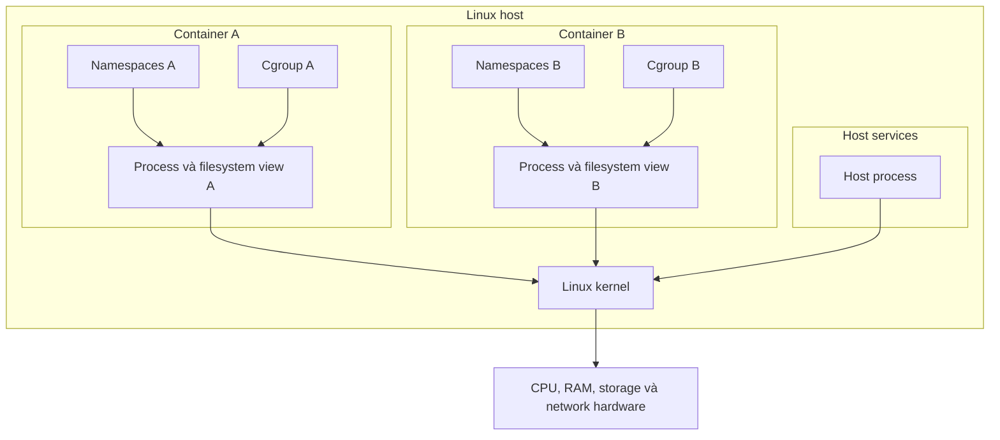

# Namespace, cgroup và ranh giới cô lập với máy chủ

## Mục tiêu học tập

Sau bài học, bạn có thể:

- Giải thích cách Linux namespace cô lập góc nhìn về tiến trình, mạng, filesystem, người dùng và tài nguyên hệ thống.
- Phân biệt namespace với cgroup: namespace kiểm soát những gì tiến trình nhìn thấy; cgroup nhóm tiến trình để đo lường và điều khiển mức sử dụng tài nguyên.
- Nhận diện các namespace phổ biến và vai trò của từng loại.
- Đọc cấu trúc cgroup v2 và hiểu giới hạn CPU, bộ nhớ, tiến trình và I/O.
- Kiểm tra namespace và cgroup của một container trên Linux.
- Hiểu những gì container cô lập được và những gì vẫn chia sẻ với host.
- Kết hợp namespace, cgroup, Linux capabilities, seccomp, LSM và user namespace để tăng cường bảo mật.
- Đánh giá rủi ro của privileged container, host mount và quyền truy cập socket quản trị.
- Phân biệt mức cô lập của container với máy ảo và các runtime sandbox.

## 1. Container cô lập tiến trình như thế nào?

Container là cách đóng gói và chạy ứng dụng cùng dependency trong một môi trường có ranh giới tài nguyên và quyền truy cập được kiểm soát. Trên Linux, container thông thường không khởi động một kernel riêng. Các tiến trình trong container vẫn sử dụng kernel của máy chủ (host), nhưng kernel cung cấp những cơ chế để giới hạn góc nhìn, tài nguyên và quyền của chúng.

Hai cơ chế nền tảng là:

- **Namespace:** tạo các góc nhìn riêng cho nhóm tiến trình, ví dụ danh sách process, hostname, network interface, mount point hoặc user ID.
- **Cgroup (control group):** nhóm tiến trình để theo dõi và áp dụng giới hạn hoặc trọng số sử dụng CPU, RAM, I/O, số tiến trình và một số tài nguyên khác.

Có thể hình dung:

- Namespace trả lời: "Tiến trình này nhìn thấy những gì?"
- Cgroup trả lời: "Nhóm tiến trình này được dùng bao nhiêu tài nguyên và đang tiêu thụ bao nhiêu?"

Hai cơ chế phối hợp để tạo nên môi trường container. Chúng không thay thế toàn bộ các lớp bảo mật khác. Runtime còn có thể cấu hình mount, capabilities, seccomp, Linux Security Modules (LSM), user namespace và chính sách thiết bị.

### 1.1. Mô hình tổng quát



Các container có namespace và cgroup riêng nhưng vẫn gọi system call vào cùng kernel host. Nếu kernel gặp lỗi nghiêm trọng hoặc bị khai thác, nhiều container và host có thể cùng bị ảnh hưởng. Đây là khác biệt quan trọng giữa container thông thường và VM có kernel guest riêng.

### 1.2. Container không phải một máy ảo nhỏ

| Đặc điểm | Container Linux thông thường | Máy ảo |
|---|---|---|
| Kernel | Dùng chung kernel host | Có kernel guest riêng |
| Khởi động | Thường nhanh, chủ yếu khởi chạy tiến trình | Phải khởi động hệ điều hành guest |
| Cô lập process | Namespace và các cơ chế kernel | Hypervisor và kernel guest |
| Giới hạn tài nguyên | Cgroup và policy của host/orchestrator | vCPU, RAM, disk và network ảo |
| OS bên trong | User space của image phải tương thích kernel host | Có thể chạy kernel OS guest riêng |
| Mật độ triển khai | Thường cao | Thường tốn thêm tài nguyên cho mỗi guest OS |
| Ranh giới bảo mật | Chia sẻ kernel, cần hardening runtime | Có ranh giới hypervisor/VM riêng, vẫn cần hardening guest và hypervisor |

Container phù hợp để đóng gói và triển khai ứng dụng nhất quán. VM cung cấp ranh giới kernel riêng và hỗ trợ nhiều hệ điều hành hoặc kernel khác nhau. Một hệ thống có thể chạy container bên trong VM để kết hợp hai cách cô lập.

## 2. Linux namespace là gì?

Namespace là cơ chế kernel tạo ra một phạm vi quan sát riêng cho tiến trình. Các tiến trình trong cùng namespace nhìn thấy một số tài nguyên hoặc định danh chung; tiến trình ở namespace khác có thể có góc nhìn khác.

Khi runtime tạo container, nó có thể tạo một hoặc nhiều namespace mới rồi đưa tiến trình ứng dụng vào các namespace đó. Một số namespace có thể được chia sẻ giữa nhiều container, ví dụ các container trong cùng Kubernetes Pod thường chia sẻ network namespace.

Các loại namespace Linux phổ biến:

| Namespace | Cô lập góc nhìn nào? | Ví dụ |
|---|---|---|
| PID | Process ID và cây tiến trình | Process trong container có PID 1 riêng |
| Mount (mnt) | Mount point và filesystem view | Container có root filesystem riêng |
| Network (net) | Network device, route, socket, port và firewall context | Container có interface và IP riêng |
| UTS | Hostname và domain name | Container có hostname riêng |
| IPC | System V IPC và POSIX message queue | Hạn chế chia sẻ IPC giữa các nhóm |
| User | User ID và group ID | UID 0 trong container có thể ánh xạ sang UID không đặc quyền trên host |
| Cgroup | Góc nhìn về đường dẫn cgroup | Tiến trình có thể thấy cây cgroup được giới hạn |
| Time | Một số clock của hệ thống | Có thể điều chỉnh clock offset trong namespace được hỗ trợ |

Namespace cgroup không thay thế cgroup controller. Nó chủ yếu cô lập góc nhìn về cấu trúc cgroup; việc giới hạn CPU hoặc RAM vẫn do cgroup hierarchy và controller thực hiện.

### 2.1. PID namespace

PID namespace tạo cây process riêng. Tiến trình đầu tiên trong PID namespace thường nhìn thấy PID 1 và đóng vai trò init của container. Các process khác trong namespace được đánh số tương đối với namespace đó.

Ví dụ:

- Trên host, process của ứng dụng có PID 24870.
- Bên trong container, cùng process có thể được hiển thị là PID 1.
- Process ở container A không mặc định nhìn thấy toàn bộ process của container B qua góc nhìn PID namespace riêng.

PID 1 trong container có trách nhiệm xử lý tín hiệu và thu hồi process con mồ côi. Nếu ứng dụng chạy trực tiếp làm PID 1 mà không xử lý signal/reaping đúng cách, việc shutdown có thể không sạch. Nhiều image dùng init nhỏ hoặc runtime phù hợp để xử lý vai trò này.

PID namespace không ngăn host administrator quan sát process. Host có góc nhìn rộng hơn và có thể kiểm tra process bằng công cụ hệ thống.

### 2.2. Mount namespace

Mount namespace cung cấp bảng mount riêng cho nhóm tiến trình. Runtime thường thiết lập root filesystem của container, mount các thư mục cần thiết và giới hạn các đường dẫn được nhìn thấy.

Các khái niệm liên quan:

- **Root filesystem:** cây thư mục mà tiến trình container coi là /.
- **Bind mount:** gắn một đường dẫn từ host vào container.
- **Volume:** vùng dữ liệu được quản lý độc lập với vòng đời container.
- **Mount propagation:** quy định sự kiện mount/unmount có lan truyền giữa các mount namespace hay không.
- **Read-only mount:** cho phép đọc nhưng ngăn ghi qua mount đó.

Mount namespace không tự bảo đảm dữ liệu an toàn. Nếu mount /var/run/docker.sock, thư mục chứa secret hoặc toàn bộ filesystem host vào container với quyền ghi, tiến trình container có thể có khả năng tác động rất lớn tới host. Quyền và phạm vi mount là một phần của ranh giới bảo mật.

### 2.3. Network namespace

Network namespace có thể có:

- Network interface riêng.
- Địa chỉ IP và route riêng.
- Bảng socket và port riêng.
- Quy tắc firewall/network stack riêng trong phạm vi hỗ trợ.
- Loopback interface riêng.

Một container có thể dùng veth pair kết nối network namespace của nó với bridge hoặc thiết bị mạng của host. Runtime hoặc CNI plugin cấu hình địa chỉ, route, NAT và policy.

Port 8080 có thể được nhiều container sử dụng đồng thời nếu chúng nằm trong network namespace riêng. Nhưng khi publish port lên cùng một địa chỉ/port của host, cần tránh xung đột và kiểm soát chính sách truy cập.

Network namespace không tự mã hóa lưu lượng hay xác thực peer. Cần firewall, network policy, TLS và cơ chế identity phù hợp.

### 2.4. User namespace

User namespace ánh xạ UID/GID bên trong namespace sang UID/GID trên host. Điều này cho phép tiến trình có thể chạy với UID 0 bên trong container nhưng được ánh xạ sang một UID không đặc quyền ở host, nếu runtime cấu hình user namespace mapping.

Lợi ích:

- Giảm tác động khi tiến trình container bị chiếm quyền root bên trong namespace.
- Tách định danh người dùng giữa container và host.
- Hỗ trợ rootless container runtime.

Cần hiểu rằng user namespace không tự loại bỏ mọi rủi ro. Các mount, capability, system call và tài nguyên được chia sẻ vẫn cần được giới hạn. Một số tính năng kernel hoặc volume có thể có hạn chế khi bật user namespace/rootless mode.

### 2.5. UTS, IPC và time namespace

- UTS namespace cho phép đặt hostname riêng để ứng dụng nhận diện môi trường.
- IPC namespace tách một số cơ chế giao tiếp liên tiến trình như System V IPC và POSIX message queue.
- Time namespace hỗ trợ offset cho một số clock; nó không tạo một đồng hồ phần cứng độc lập và không có nghĩa mọi thao tác thời gian đều tách khỏi host.

Các namespace này thường ít được nhắc tới hơn PID, mount và network, nhưng có thể quan trọng với ứng dụng legacy hoặc môi trường cần kiểm soát định danh và giao tiếp.

## 3. Cgroup là gì?

Cgroup là cơ chế kernel Linux để tổ chức tiến trình thành các nhóm có thể đo lường và điều khiển mức tiêu thụ tài nguyên. Cgroup hỗ trợ phân cấp: một nhóm cha có thể chứa các nhóm con, và giới hạn ở cấp cha ảnh hưởng đến tổng tài nguyên các nhóm con có thể dùng.

Ví dụ:

- Một cgroup cho toàn bộ dịch vụ API.
- Cgroup con cho từng container.
- Cgroup khác cho database, agent và hệ thống logging.
- Cgroup cha đặt giới hạn tổng để workload không chiếm hết tài nguyên host.

Cgroup thường được runtime và system manager như systemd quản lý. Người vận hành hiếm khi phải tự ghi trực tiếp file cgroup trong production; công cụ Docker, Podman, containerd, Kubernetes và systemd thường cấu hình chúng.

### 3.1. Cgroup v1 và v2

Linux từng có cgroup v1 với nhiều hierarchy/controller tách biệt. Cgroup v2 cung cấp một hierarchy thống nhất và giao diện controller nhất quán hơn.

| Nội dung | Cgroup v1 | Cgroup v2 |
|---|---|---|
| Hierarchy | Có thể có nhiều hierarchy | Một unified hierarchy |
| Controller | Có thể gắn vào các hierarchy khác nhau | Controller được bật và phân phối theo cây thống nhất |
| Giao diện | Nhiều tên file và semantics khác nhau | Giao diện thống nhất hơn |
| Delegation | Có thể phức tạp | Có quy tắc delegation rõ hơn |
| Adoption | Hệ thống cũ hoặc cấu hình tương thích | Phổ biến trên các distro và nền tảng Linux mới |

Không nên giả định mọi host đã dùng cgroup v2. Kiểm tra filesystem cgroup và cấu hình kernel trước khi dùng lệnh hoặc đọc metric. Một số môi trường vẫn chạy hybrid hoặc v1 do yêu cầu tương thích.

### 3.2. Cgroup hierarchy

Một cây cgroup v2 có thể trông như sau:

```text
/sys/fs/cgroup/
├── system.slice/
│   ├── docker-<container-a>.scope/
│   └── containerd.service/
├── user.slice/
└── workload.slice/
    ├── api.service/
    │   ├── container-a/
    │   └── container-b/
    └── worker.service/
        └── worker-1/
```

Đường dẫn thực tế phụ thuộc systemd, runtime và cách triển khai. Trong cgroup v2, file cgroup.controllers cho biết controller nào có sẵn ở cấp đó; cgroup.subtree_control điều khiển controller được phân phối xuống các nhóm con theo quy tắc của hierarchy.

Không tự ghi file controller ở host đang chạy production nếu chưa hiểu cấu trúc cha/con, quyền delegation và tác động tới service manager. Ưu tiên cấu hình qua runtime hoặc orchestrator.

## 4. Cgroup kiểm soát những tài nguyên nào?

Các controller phổ biến trong cgroup v2:

| Controller | Tài nguyên | File/metric thường gặp |
|---|---|---|
| cpu | CPU time, trọng số và quota | cpu.weight, cpu.max, cpu.stat |
| cpuset | CPU và NUMA node được phép dùng | cpuset.cpus, cpuset.mems |
| memory | Bộ nhớ và swap | memory.current, memory.high, memory.max, memory.events |
| io | Giới hạn và trọng số I/O theo thiết bị | io.weight, io.max, io.stat |
| pids | Số process/task | pids.current, pids.max, pids.events |
| hugetlb | HugeTLB pages | hugetlb.* |
| rdma | Tài nguyên RDMA nếu kernel/device hỗ trợ | rdma.* |
| misc | Một số tài nguyên đặc thù được kernel hỗ trợ | misc.* |

Tên file và controller sẵn có phụ thuộc kernel. Không phải mọi hệ thống đều bật mọi controller.

### 4.1. CPU: weight và quota

Cgroup v2 có hai khái niệm quan trọng:

- cpu.weight: trọng số tương đối khi các nhóm cạnh tranh CPU. Trọng số cao hơn giúp nhóm có phần CPU lớn hơn trong điều kiện tranh chấp; nó không phải giới hạn tuyệt đối.
- cpu.max: quota CPU trong một chu kỳ. Cấu trúc thường là MAX PERIOD theo microsecond; giá trị max biểu thị không đặt quota ở cấp đó.

Ví dụ:

```text
cpu.weight = 200
cpu.max    = 50000 100000
```

Giá trị cpu.max minh họa quota 50.000 µs trong chu kỳ 100.000 µs, tương đương tối đa khoảng 0,5 CPU theo thời gian trung bình của chu kỳ. Đây là giới hạn quota, không có nghĩa tiến trình được ghim vào nửa lõi cụ thể.

Phân biệt:

- CPU weight ảnh hưởng chia sẻ tương đối khi có cạnh tranh.
- CPU quota giới hạn tổng thời gian CPU trong chu kỳ.
- CPU affinity/cpuset xác định CPU nào được phép chạy.
- CPU usage đo lượng CPU đã tiêu thụ.

Container có CPU limit quá thấp có thể bị throttling. CPU utilization nhìn thấy ở mức thấp không luôn có nghĩa ứng dụng còn dư capacity; quota có thể đã hết trong các khoảng ngắn khiến latency tăng.

### 4.2. Memory: current, high và max

Các file thường gặp:

- memory.current: lượng memory đang được tính cho cgroup.
- memory.high: ngưỡng pressure; vượt ngưỡng có thể khiến kernel throttle và reclaim mạnh hơn.
- memory.max: giới hạn cứng của memory cgroup.
- memory.events: bộ đếm sự kiện như high, max, oom và oom_kill.
- memory.stat: chi tiết memory theo loại.
- memory.swap.max: giới hạn swap riêng trong cgroup v2 nếu controller và cấu hình hỗ trợ.

memory.max không giống giới hạn heap của runtime. Ví dụ, Java heap có thể được cấu hình 2 GiB trong khi container memory limit là 2 GiB; native memory, thread stack, direct buffer và page cache vẫn cần thêm RAM. Khi tổng memory vượt giới hạn, kernel có thể kích hoạt OOM handling và giết tiến trình trong cgroup theo chính sách.

Nên theo dõi memory.current, memory.events, OOM kill và memory pressure cùng với metric của ứng dụng. Không chỉ nhìn RSS của một process rồi kết luận toàn bộ container còn đủ RAM.

### 4.3. I/O: weight và max

Cgroup v2 controller io hỗ trợ:

- io.weight: trọng số tương đối giữa các nhóm I/O khi thiết bị và scheduler hỗ trợ.
- io.max: giới hạn read/write bytes per second hoặc IOPS theo major:minor của thiết bị.
- io.stat: thống kê I/O theo thiết bị.

Giới hạn I/O ở cgroup có thể hữu ích khi một container tạo tải disk lớn và ảnh hưởng workload khác. Tuy nhiên, hiệu lực phụ thuộc loại thiết bị, kernel, block layer và storage backend. Với network block storage hoặc filesystem đặc biệt, cần kiểm tra hành vi thực tế thay vì mặc định mọi giới hạn đều được áp dụng giống nhau.

### 4.4. PIDs controller

pids.max giới hạn số task/process thuộc cgroup. Nó giúp tránh container tạo quá nhiều process hoặc thread và làm cạn tài nguyên host.

Khi chạm giới hạn, thao tác tạo process/thread mới có thể thất bại. Ứng dụng có thể biểu hiện bằng lỗi fork, thread creation hoặc worker không khởi động được. Theo dõi pids.current, pids.max và pids.events khi điều tra.

## 5. Namespace và cgroup bổ sung cho nhau

Namespace và cgroup giải quyết hai vấn đề khác nhau:

| Câu hỏi | Namespace | Cgroup |
|---|---|---|
| Container nhìn thấy process nào? | PID namespace | Không quyết định góc nhìn PID |
| Container thấy interface và route nào? | Network namespace | Có thể đo/giới hạn tài nguyên liên quan, không tạo network view |
| Container thấy filesystem nào? | Mount namespace và mount policy | Có thể giới hạn I/O, không quyết định cây thư mục |
| Container dùng bao nhiêu CPU? | Không phải chức năng chính | CPU controller |
| Container dùng bao nhiêu RAM? | Không phải chức năng chính | Memory controller |
| Container tạo tối đa bao nhiêu process? | PID namespace tách góc nhìn | PIDs controller đặt giới hạn |
| Container root ánh xạ thành UID nào trên host? | User namespace | Không ánh xạ user identity |

Ví dụ, một container có PID namespace riêng nên thấy process của chính nó. Cùng lúc, cgroup của container giới hạn CPU ở mức 2 CPU và RAM ở mức 1 GiB. Namespace không tạo giới hạn CPU; cgroup không tạo danh sách process riêng.

### 5.1. Cả hai đều không phải ranh giới bảo mật hoàn chỉnh

Namespace và cgroup là primitive quan trọng, nhưng một container an toàn còn cần:

- Chạy với user không đặc quyền khi có thể.
- User namespace/rootless mode phù hợp.
- Bỏ Linux capabilities không cần thiết.
- Seccomp profile giới hạn system call.
- LSM như SELinux hoặc AppArmor.
- Read-only root filesystem khi phù hợp.
- Giới hạn mount và thiết bị.
- Không chia sẻ host namespace tùy tiện.
- Giới hạn network và secret.
- Cập nhật kernel, runtime và image.

Cgroup chủ yếu điều khiển tài nguyên; nó không ngăn một tiến trình truy cập dữ liệu nếu quyền filesystem hoặc capability cho phép. Namespace cô lập góc nhìn; nó không tự xác thực hay mã hóa dữ liệu.

## 6. Ranh giới cô lập giữa container và host

Một container thông thường chia sẻ kernel với host. Vì vậy, ranh giới thực tế được tạo bởi nhiều lớp:

1. **Process view:** PID namespace và các namespace khác.
2. **Filesystem view:** mount namespace, root filesystem, bind mount và volume.
3. **Identity:** user namespace, UID/GID, Linux capabilities.
4. **System call:** seccomp filter và chính sách LSM.
5. **Resource control:** cgroup.
6. **Network:** network namespace, firewall, routing và network policy.
7. **Runtime/orchestrator:** cấu hình container, quyền quản trị và lifecycle.
8. **Host:** kernel, driver, runtime, daemon, thiết bị và dữ liệu quản trị.

### 6.1. Container có thể nhìn thấy host tới đâu?

Mức nhìn thấy phụ thuộc cấu hình. Một container mặc định có thể không thấy process của host qua PID namespace, nhưng nếu dùng host PID namespace thì góc nhìn mở rộng. Tương tự:

- Dùng host network khiến container chia sẻ network namespace của host.
- Dùng host IPC có thể chia sẻ IPC namespace.
- Bind mount đường dẫn host làm đường dẫn đó xuất hiện trong container.
- Gắn /dev hoặc thiết bị host có thể mở rộng khả năng tương tác với thiết bị.
- Mount socket runtime như Docker socket có thể cấp quyền điều khiển container/host rất rộng.

Không có khái niệm "container luôn không thể truy cập host". Cần xem namespace, mount, user, capability và socket được cấp cụ thể.

### 6.2. Vì sao privileged container nguy hiểm?

Chế độ privileged thường cấp thêm capabilities và quyền truy cập thiết bị, đồng thời giảm một số lớp hạn chế mà runtime áp dụng mặc định. Tác động cụ thể phụ thuộc runtime và cấu hình.

Rủi ro gồm:

- Tiến trình có nhiều quyền kernel hơn cần thiết.
- Có thể truy cập thiết bị hoặc filesystem host.
- Có thể làm suy yếu seccomp/LSM hoặc các giới hạn runtime.
- Khi ứng dụng bị xâm nhập, phạm vi tác động có thể lan rộng hơn.
- Container có thể ảnh hưởng host hoặc workload khác.

Chỉ dùng privileged khi có yêu cầu kỹ thuật rõ ràng, được kiểm soát và đánh giá rủi ro. Với nhu cầu cụ thể như truy cập một thiết bị, ưu tiên cấp đúng device và capability cần thiết thay vì bật toàn bộ quyền.

### 6.3. Docker socket và quyền quản trị

Socket điều khiển Docker daemon thường cho phép client yêu cầu daemon tạo container, mount host path và cấu hình quyền. Nếu container không tin cậy được gắn socket này, người có quyền trong container có thể sử dụng daemon để tạo workload với quyền rất cao trên host.

Vì vậy:

- Không mount Docker socket vào ứng dụng thông thường.
- Không xem socket runtime là một file cấu hình vô hại.
- Nếu cần điều khiển runtime, dùng API/proxy có authorization và phạm vi thao tác hẹp.
- Bảo vệ daemon socket bằng quyền file và cơ chế xác thực phù hợp.
- Audit các container có mount socket hoặc host path nhạy cảm.

## 7. Các lớp bảo mật bổ sung

### 7.1. Linux capabilities

Linux capabilities chia một phần quyền quản trị truyền thống thành các quyền nhỏ hơn. Runtime thường bỏ nhiều capability mặc định và chỉ giữ những quyền cần thiết.

Ví dụ một ứng dụng web thông thường hiếm khi cần CAP_SYS_ADMIN. Capability này có phạm vi rất rộng và có thể làm tăng rủi ro nếu cấp cho container.

Nguyên tắc:

- Bỏ tất cả capability không cần.
- Chỉ thêm capability cụ thể sau khi xác định system call hoặc thao tác cần.
- Tránh privileged như cách sửa nhanh lỗi permission.
- Kiểm tra capability effective của process khi điều tra.

### 7.2. Seccomp

Seccomp filter giới hạn system call mà process được phép gọi. Container runtime có thể áp dụng profile mặc định hoặc profile tùy chỉnh.

Seccomp giúp giảm bề mặt tấn công nếu ứng dụng bị khai thác. Tuy nhiên, profile quá chặt có thể làm ứng dụng lỗi khi khởi động hoặc dùng thư viện cần system call chưa được cho phép.

Nên kiểm thử profile theo workload, theo dõi lỗi EPERM/ENOSYS và quản lý profile theo version.

### 7.3. Linux Security Modules

SELinux và AppArmor cung cấp chính sách kiểm soát truy cập bổ sung. Chúng có thể giới hạn process được đọc/ghi đường dẫn, dùng socket hoặc tương tác với đối tượng hệ thống.

- SELinux thường dùng label và policy.
- AppArmor thường gắn profile theo đường dẫn và hành vi.
- Chính sách ở chế độ enforcing có thể từ chối hành động dù UID trong container có quyền Unix tương ứng.

Khi container không truy cập được file, cần xem cả mode bit, UID/GID mapping, mount option và log LSM.

### 7.4. Rootless container

Rootless mode chạy runtime hoặc container mà không cần daemon quản trị toàn cục chạy với root theo mô hình truyền thống. User namespace có thể ánh xạ UID/GID bên trong sang subordinate ID trên host.

Ưu điểm:

- Giảm quyền của runtime và workload.
- Giảm tác động nếu ứng dụng bị chiếm quyền.
- Hữu ích cho môi trường phát triển và một số workload production.

Giới hạn có thể gồm port thấp, network mode, device, filesystem, storage driver và một số tính năng kernel. Kiểm tra compatibility trước khi chuyển production.

### 7.5. Read-only filesystem và mount tối thiểu

Root filesystem read-only giảm khả năng thay đổi binary hoặc cấu hình hệ thống khi container đang chạy. Ứng dụng có thể mount các đường dẫn ghi riêng như /tmp, cache hoặc thư mục dữ liệu cần thiết.

Thiết kế nên:

- Chỉ mount đường dẫn host/volume thực sự cần.
- Dùng read-only cho cấu hình và dữ liệu không cần ghi.
- Tách dữ liệu bền vững khỏi filesystem tạm của container.
- Tránh mount thư mục chứa credential hoặc socket quản trị.
- Giới hạn quyền truy cập theo UID/GID phù hợp.

## 8. Kiểm tra namespace của một tiến trình

Linux cung cấp thông tin namespace qua /proc. Các lệnh sau dùng để quan sát, không thay đổi cấu hình hệ thống.

### 8.1. Xem namespace của shell hiện tại

```bash
# Liệt kê namespace của tiến trình shell hiện tại
ls -l /proc/self/ns

# Hiển thị inode định danh từng namespace
readlink /proc/self/ns/pid
readlink /proc/self/ns/mnt
readlink /proc/self/ns/net
readlink /proc/self/ns/user
readlink /proc/self/ns/cgroup

# Liệt kê namespace và tiến trình
lsns
```

Giá trị dạng pid:[402653xxxx] là inode định danh namespace. Hai process có cùng inode ở loại namespace tương ứng thường cùng thuộc namespace đó.

### 8.2. So sánh host và container

Lấy PID của tiến trình container từ host rồi kiểm tra:

```bash
# Thay PID bằng PID host của tiến trình cần kiểm tra
PID=24870

# Namespace của tiến trình
sudo ls -l /proc/$PID/ns

# Namespace của shell hiện tại (có thể là host hoặc container)
ls -l /proc/self/ns

# Cgroup path của tiến trình
cat /proc/$PID/cgroup
```

Không phải mọi namespace đều cần có inode khác host trong mọi cấu hình. Container có thể chia sẻ một số namespace với host hoặc với container khác theo chủ ý.

### 8.3. Dùng nsenter để quan sát từ namespace của process

nsenter cho phép chạy một chương trình trong namespace của process được chọn. Đây là công cụ quản trị mạnh; hãy dùng quyền phù hợp và chỉ thực hiện thao tác quan sát khi cần chẩn đoán.

```bash
# Xem network interface từ network namespace của process
sudo nsenter -t 24870 -n ip -br address

# Xem route trong network namespace đó
sudo nsenter -t 24870 -n ip route

# Xem mount trong mount namespace đó
sudo nsenter -t 24870 -m findmnt
```

-n chọn network namespace, -m chọn mount namespace. Có thể kết hợp thêm namespace khác theo nhu cầu. Trước khi chạy lệnh có tác động, xác minh đúng PID và namespace mục tiêu.

### 8.4. Thử tạo namespace trong môi trường lab

Lệnh unshare có thể tạo namespace mới cho một tiến trình con. Ví dụ dưới đây tạo UTS và PID namespace để quan sát PID riêng; yêu cầu quyền và tính năng kernel phù hợp.

```bash
# Chỉ chạy trong máy lab dùng để học
sudo unshare --uts --pid --fork --mount-proc sh

# Trong shell mới:
hostname lab-container
echo "PID trong namespace:"
ps -ef
exit
```

Sau khi thoát, shell quay lại namespace ban đầu. Không dùng lệnh thử nghiệm trên host production nếu chưa hiểu quyền, mount propagation và tác động.

## 9. Kiểm tra cgroup v2

### 9.1. Xác định hệ thống đang dùng cgroup nào

```bash
# Kiểm tra filesystem cgroup
stat -fc %T /sys/fs/cgroup

# Xem controller khả dụng ở root
cat /sys/fs/cgroup/cgroup.controllers

# Xem cgroup path của shell hiện tại
cat /proc/self/cgroup

# Xem các mount cgroup
findmnt -t cgroup,cgroup2
```

Nếu stat hiển thị cgroup2fs, hệ thống đang mount unified cgroup v2 tại đường dẫn đó. Nếu thấy nhiều mount cgroup riêng, hệ thống có thể dùng v1 hoặc hybrid mode.

### 9.2. Tìm cgroup của container

Trên host, lấy PID host của container rồi xem:

```bash
PID=24870
cat /proc/$PID/cgroup
```

Trong cgroup v2, file thường có dạng 0::/path/to/group. Dùng đường dẫn tương ứng dưới /sys/fs/cgroup để xem controller và metric nếu quyền cho phép.

Runtime có thể dùng systemd slice/scope hoặc đường dẫn riêng. Công cụ systemd-cgls, systemctl status và docker inspect/podman inspect giúp liên kết container với cgroup.

### 9.3. Đọc CPU và memory

```bash
# Thay bằng cgroup path thực tế
CG=/sys/fs/cgroup/workload.slice/api.service/container-a

# CPU quota, weight và usage statistics
cat "$CG/cpu.max"
cat "$CG/cpu.weight"
cat "$CG/cpu.stat"

# Memory hiện tại, high/max và event
cat "$CG/memory.current"
cat "$CG/memory.high"
cat "$CG/memory.max"
cat "$CG/memory.events"
```

Một số file có thể không tồn tại nếu controller chưa được bật hoặc cgroup path khác. Không sửa file chỉ để làm ví dụ chạy được; hãy xác minh controller và quyền quản trị trước.

### 9.4. Đọc I/O và số tiến trình

```bash
# I/O theo thiết bị
cat "$CG/io.stat"

# Giới hạn I/O nếu controller hỗ trợ
cat "$CG/io.max"
cat "$CG/io.weight"

# Số process/task và giới hạn
cat "$CG/pids.current"
cat "$CG/pids.max"
cat "$CG/pids.events"
```

Để diễn giải io.stat, cần ghép major:minor của thiết bị với lsblk hoặc thông tin block device. pids.current tính task theo semantics của kernel, có thể bao gồm thread; đừng mặc định đây chỉ là số process hiển thị bởi ps.

## 10. Quan sát container bằng Docker và Podman

Các runtime cung cấp giao diện thuận tiện hơn việc đọc cgroup file trực tiếp.

### 10.1. Docker

```bash
# Liệt kê container
docker ps

# Xem cấu hình namespace, mount và resource limit
docker inspect <container-name-or-id>

# Xem CPU, memory, network và block I/O
docker stats

# Xem process trong container
docker top <container-name-or-id>

# Xem log
docker logs --tail 100 <container-name-or-id>
```

docker stats hữu ích để quan sát nhanh nhưng số liệu và cách hiển thị có thể khác theo cgroup v1/v2, runtime và nền tảng. Khi cần điều tra chính xác, đối chiếu với cgroup metrics trên host.

### 10.2. Ví dụ giới hạn tài nguyên

Một container thử nghiệm có thể được chạy với giới hạn CPU và RAM:

```bash
# Ví dụ lab; image demo phải tồn tại và không thực hiện thao tác nhạy cảm
docker run --rm \
  --cpus="1.5" \
  --memory="512m" \
  --pids-limit=128 \
  --name=resource-lab \
  demo-image:latest
```

Các tham số trên minh họa giới hạn khoảng 1,5 CPU, 512 MiB memory và tối đa 128 PID/task theo runtime. Cú pháp và hành vi cụ thể cần đối chiếu phiên bản Docker/daemon. Không áp dụng trực tiếp lên workload production nếu chưa benchmark và đặt ngưỡng an toàn.

### 10.3. Podman và rootless

Podman hỗ trợ chạy container rootless trong nhiều cấu hình Linux. Có thể dùng podman inspect, podman stats và podman info để kiểm tra runtime, resource limit và cấu hình user namespace.

Rootless mode có thể dùng cgroup v2 delegation để quản lý tài nguyên. Nếu systemd không cấp delegation hoặc controller không được bật cho user slice, một số giới hạn có thể không hoạt động như mong đợi. Kiểm tra cảnh báo runtime và cgroup path thay vì giả định mọi tùy chọn đã được thực thi.

## 11. Namespace và cgroup trong Kubernetes

Kubernetes dùng container runtime và Linux kernel primitive để cô lập container. Pod là đơn vị triển khai cơ bản và có thể chia sẻ một số namespace giữa các container trong cùng Pod.

Thông thường:

- Container trong cùng Pod chia sẻ network namespace, cùng IP và port space.
- Các container có thể giao tiếp qua localhost.
- Volume của Pod có thể được mount vào nhiều container.
- PID namespace có thể được chia sẻ nếu cấu hình shareProcessNamespace bật.
- Các namespace khác tùy runtime và cấu hình Pod.

### 11.1. Requests và limits

Trong Kubernetes:

- **CPU request** ảnh hưởng việc scheduler đặt Pod lên node và có thể ảnh hưởng trọng số CPU khi tranh chấp.
- **CPU limit** giới hạn thời gian CPU theo cơ chế cgroup, thường dẫn tới throttling khi vượt quota.
- **Memory request** dùng trong scheduling và có thể ảnh hưởng QoS.
- **Memory limit** đặt giới hạn memory; vượt quá có thể dẫn tới OOM kill.
- **Ephemeral-storage request/limit** kiểm soát dung lượng lưu trữ tạm ở mức Kubernetes hỗ trợ; đây không phải cgroup memory controller.

Ví dụ manifest:

```yaml
apiVersion: v1
kind: Pod
metadata:
  name: resource-demo
spec:
  containers:
    - name: app
      image: demo-image:latest
      resources:
        requests:
          cpu: "500m"
          memory: "256Mi"
        limits:
          cpu: "1"
          memory: "512Mi"
```

Ví dụ này yêu cầu scheduler dành 0,5 CPU và 256 MiB memory làm request, đồng thời giới hạn container ở 1 CPU và 512 MiB memory. Đây là giá trị minh họa; cần sizing theo tải thực tế và theo dõi throttling/OOM.

### 11.2. QoS classes

Kubernetes phân Pod vào các nhóm QoS chính:

- **Guaranteed:** mọi container phù hợp trong Pod có request bằng limit cho CPU và memory.
- **Burstable:** có ít nhất một request hoặc limit, nhưng không đáp ứng điều kiện Guaranteed.
- **BestEffort:** không khai báo request/limit CPU và memory.

QoS ảnh hưởng cách kubelet và kernel xử lý áp lực tài nguyên, đặc biệt trong tình huống node thiếu memory. QoS không thay thế việc đặt resource request/limit đúng và không bảo đảm Pod luôn nhận được hiệu năng cố định.

### 11.3. Kiểm tra resource và cgroup trong Kubernetes

```bash
# Trạng thái và node placement
kubectl get pods -o wide

# Chi tiết requests/limits, events và trạng thái container
kubectl describe pod resource-demo

# Metric sử dụng nếu metrics pipeline có sẵn
kubectl top pod resource-demo
kubectl top node

# Xem manifest và resource declaration
kubectl get pod resource-demo -o yaml
```

kubectl top phụ thuộc metrics pipeline và không phải công cụ profiling đầy đủ. Khi CPU throttling hoặc OOM xảy ra, cần xem container status, restart count, events, node pressure và metric cgroup/host.

## 12. Đọc các triệu chứng khi namespace hoặc cgroup cấu hình sai

| Triệu chứng | Nguyên nhân có thể | Hướng kiểm tra |
|---|---|---|
| Process trong container thấy PID 1 khác host | PID namespace riêng | So sánh /proc/<pid>/ns và /proc/<pid>/status |
| Ứng dụng không phân giải DNS | Network namespace, DNS config hoặc policy | Kiểm tra route, resolv.conf, DNS và network policy |
| Port trong container hoạt động nhưng host không truy cập được | Chưa publish port hoặc firewall/NAT | Kiểm tra port mapping, listener và firewall |
| Container CPU bị throttling | CPU quota/limit thấp hoặc workload burst | Xem cpu.max, cpu.stat, runtime stats |
| Container bị OOM kill dù host còn RAM | Memory cgroup limit bị chạm | Xem memory.events, memory.max và container status |
| Fork/thread tạo mới thất bại | PIDs limit hoặc OS resource limit | Xem pids.current, pids.max, ulimit |
| Disk latency tăng khi một container chạy batch | I/O contention hoặc cgroup I/O policy | Xem io.stat, device latency và workload |
| Container đọc được dữ liệu host ngoài dự kiến | Bind mount rộng hoặc quyền file | Kiểm tra docker inspect, mount và UID/GID |
| Container có quyền quá rộng | Privileged/capabilities/host namespace | Kiểm tra security context và runtime config |
| Root trong container có quyền ghi ngoài dự kiến | User namespace/mount mapping hoặc host path | Kiểm tra UID mapping, mount và LSM |
| Process không dừng khi container stop | PID 1 không xử lý signal hoặc child process | Kiểm tra entrypoint, init và signal handling |

### 12.1. CPU throttling

CPU limit có thể gây throttling ngay cả khi tổng CPU host còn nhàn rỗi, vì quota của cgroup đã hết trong chu kỳ. Khi điều tra:

- So sánh CPU usage với throttled time/period trong cpu.stat.
- Kiểm tra request/limit của Kubernetes hoặc tham số runtime.
- Xem latency theo thời gian và mức đồng thời.
- Đánh giá có nên tăng limit, giảm concurrency hoặc tối ưu ứng dụng.

Không đơn giản tăng CPU limit nếu node đã overcommit hoặc dependency mới là bottleneck.

### 12.2. OOM trong container

Memory cgroup có thể OOM kill process trong container khi chạm giới hạn. Host vẫn còn RAM nhưng container không được phép dùng phần RAM còn lại theo policy.

Kiểm tra:

- memory.current, memory.max và memory.events.
- Container exit code/reason và restart count.
- Heap, native memory, thread count và cache.
- Memory limit của Pod và memory pressure ở node.
- Process nào bị kill và thời điểm.

Tăng memory limit có thể giúp, nhưng cần xác định leak, memory spike hoặc sizing sai. Nếu mọi container được tăng limit mà node không có capacity, node có thể bị memory pressure hoặc OOM ở cấp host.

## 13. Ranh giới bảo mật: container, VM và sandbox

Vì container chia sẻ kernel host, mức tin cậy của workload cần được đánh giá theo môi trường triển khai.

### 13.1. Khi container thông thường phù hợp

Container thông thường thường phù hợp khi:

- Workload thuộc cùng tổ chức hoặc cùng miền tin cậy.
- Host kernel được quản lý và cập nhật.
- Runtime áp dụng namespace, cgroup và security policy hợp lý.
- Container không được cấp quyền host quá rộng.
- Image và dependency được kiểm soát nguồn gốc.
- Secret và dữ liệu được cấp theo nguyên tắc least privilege.

### 13.2. Khi cần ranh giới mạnh hơn

Với workload không tin cậy, multi-tenant hoặc xử lý mã do người dùng cung cấp, có thể cần lớp cô lập mạnh hơn:

- **VM riêng:** kernel guest riêng và ranh giới hypervisor.
- **MicroVM:** VM tối giản, giảm thời gian boot và footprint so với VM truyền thống trong một số nền tảng.
- **Sandboxed runtime:** ví dụ gVisor hoặc Kata Containers, bổ sung lớp cô lập system call hoặc VM tùy runtime.
- **Dedicated node/host:** tách workload theo mức độ tin cậy hoặc yêu cầu compliance.

Các giải pháp này có trade-off về latency, overhead, compatibility, vận hành và chi phí. Không có lựa chọn nào tự động an toàn nếu cấu hình sai.

### 13.3. Bảng so sánh ranh giới

| Mô hình | Kernel | Ranh giới chính | Trường hợp thường gặp |
|---|---|---|---|
| Container thông thường | Chia sẻ host kernel | Namespace, cgroup và policy kernel | Ứng dụng cùng miền tin cậy |
| Rootless container | Chia sẻ host kernel | User namespace và quyền host hạn chế hơn | Workload không cần quyền root host |
| Sandboxed container | Tùy runtime, có thể thêm kernel/VM trung gian | Sandbox system call hoặc VM | Workload có mức tin cậy khác nhau |
| VM | Kernel guest riêng | Hypervisor và guest OS | Multi-tenant hoặc cần OS/kernel khác |
| MicroVM | Kernel guest riêng trong VM tối giản | Hypervisor với footprint nhỏ hơn trong một số thiết kế | Sandbox workload ngắn hạn, mật độ cao |

Không nên diễn giải bảng như thứ tự bảo mật tuyệt đối. Kết quả phụ thuộc hypervisor, kernel, runtime, cấu hình, patching và threat model.

## 14. Ví dụ thực tế: giới hạn một container xử lý ảnh

Một nhóm chạy API và worker xử lý ảnh trên cùng Linux host. Worker có thể tiêu thụ CPU và RAM lớn khi xử lý ảnh dung lượng cao, làm API tăng latency.

Đội vận hành thiết kế:

1. Chạy API và worker trong container riêng.
2. Dùng PID, mount và network namespace riêng theo runtime.
3. Đặt worker vào cgroup có CPU quota và memory limit phù hợp.
4. Đặt giới hạn PIDs để tránh worker tạo quá nhiều thread.
5. Mount thư mục input read-only và thư mục output riêng.
6. Chạy worker bằng UID không đặc quyền.
7. Bỏ capability không cần, áp dụng seccomp/LSM theo runtime.
8. Theo dõi CPU throttling, memory events, queue depth và API p95 latency.
9. Chạy tải thử với nhiều kích thước ảnh và concurrency khác nhau.
10. Điều chỉnh CPU/memory limit dựa trên throughput và SLO.

Nếu worker bị OOM, nhóm xem memory peak, image dimensions và concurrency trước khi tăng limit. Nếu CPU throttling làm xử lý chậm, nhóm đánh giá quota, số worker và giới hạn capacity của host. API vẫn cần baseline tài nguyên đủ để phục vụ request khi worker bận.

### 14.1. Khi worker chạy mã không tin cậy

Nếu người dùng có thể tải lên plugin hoặc script tùy ý để xử lý ảnh, container thông thường với kernel dùng chung có thể chưa phải ranh giới phù hợp. Đội cần xem xét sandbox runtime hoặc VM/microVM riêng, giới hạn network egress, thời gian chạy, dung lượng input/output và quyền truy cập dữ liệu.

## 15. Checklist cấu hình namespace và cgroup

### Trước khi chạy container

- [ ] Xác định container cần namespace nào riêng và namespace nào có thể chia sẻ.
- [ ] Kiểm tra PID, mount, network, IPC, UTS và user namespace.
- [ ] Xác định cgroup version và controller khả dụng.
- [ ] Đặt CPU request/limit hoặc weight/quota phù hợp.
- [ ] Đặt memory limit và theo dõi OOM events.
- [ ] Đặt PIDs limit nếu workload có thể tạo nhiều process/thread.
- [ ] Đánh giá I/O limit và contention trên storage.
- [ ] Kiểm tra root filesystem, bind mount và volume.
- [ ] Tránh privileged và host namespace khi không cần.
- [ ] Bỏ capabilities không cần và áp dụng seccomp/LSM.
- [ ] Không mount runtime socket hoặc host path nhạy cảm vào ứng dụng.
- [ ] Dùng UID không đặc quyền hoặc rootless khi tương thích.

### Khi vận hành

- [ ] Theo dõi CPU usage và throttling.
- [ ] Theo dõi memory current, peak và OOM events.
- [ ] Theo dõi PIDs, file descriptor và thread count.
- [ ] Theo dõi I/O và network theo workload.
- [ ] Kiểm tra container restart, exit reason và kernel event.
- [ ] Đối chiếu runtime metrics với cgroup và host metrics.
- [ ] Kiểm tra image, kernel và runtime patch level.
- [ ] Rà soát mount, capabilities, seccomp và LSM sau mỗi thay đổi.
- [ ] Kiểm thử giới hạn dưới tải đỉnh.
- [ ] Xác định workload nào cần VM hoặc sandbox mạnh hơn.

## 16. Những nhầm lẫn thường gặp

- **Namespace và cgroup là cùng một cơ chế.** Namespace cô lập góc nhìn; cgroup đo lường và điều khiển tài nguyên.
- **Container có kernel riêng.** Container Linux thông thường chia sẻ kernel host.
- **PID namespace làm process biến mất khỏi host.** Host vẫn có góc nhìn quản trị rộng hơn.
- **Network namespace tự bảo vệ lưu lượng.** Nó tạo network view riêng; firewall, policy và TLS vẫn cần thiết.
- **Cgroup là ranh giới bảo mật.** Cgroup chủ yếu quản lý tài nguyên, không thay thế access control.
- **CPU weight là CPU limit.** Weight là trọng số tương đối khi tranh chấp; quota mới giới hạn thời gian CPU.
- **Host còn RAM thì container không thể OOM.** Memory cgroup có thể OOM kill container dù host còn RAM.
- **Container root tương đương root host trong mọi cấu hình.** User namespace có thể ánh xạ UID; capabilities và policy cũng giới hạn quyền.
- **Privileged chỉ giúp truy cập thiết bị.** Nó có thể mở rộng rất nhiều quyền và tăng rủi ro với host.
- **Read-only root filesystem khiến mọi dữ liệu bất biến.** Volume hoặc bind mount ghi vẫn có thể thay đổi nếu được cấp quyền.
- **Mọi container trong một Pod có PID namespace chung.** Network namespace thường được chia sẻ; PID namespace cần cấu hình chia sẻ riêng.
- **Cgroup v2 luôn có mọi controller.** Controller còn phụ thuộc kernel, hierarchy, delegation và cấu hình runtime.
- **Docker stats là số liệu đầy đủ nhất.** Cần đối chiếu với cgroup, host và ứng dụng để tìm nguyên nhân.

## 17. Tự kiểm tra

**Tình huống 1:** Một process có PID 1 bên trong container nhưng PID 24870 trên host. Vì sao hai giá trị không mâu thuẫn?

**Gợi ý:** Process nằm trong PID namespace riêng. PID 1 là định danh trong namespace của container; host nhìn thấy cùng process bằng PID của host.

**Tình huống 2:** Một container thấy network interface eth0 và IP riêng, nhưng host vẫn quản lý được kết nối của nó. Cơ chế nào tạo ra điều này?

**Gợi ý:** Network namespace tạo network view riêng; runtime có thể nối interface container với host bằng veth pair, bridge, routing hoặc CNI.

**Tình huống 3:** Container bị CPU throttling dù host CPU còn nhàn rỗi. Bạn kiểm tra gì?

**Gợi ý:** Kiểm tra cpu.max, cpu.stat, runtime CPU limit hoặc Kubernetes limit. Quota của cgroup có thể hết dù host còn CPU.

**Tình huống 4:** Host còn RAM nhưng một container bị OOMKilled. Vì sao?

**Gợi ý:** Container có memory cgroup limit riêng. Khi vượt memory.max, kernel có thể OOM kill trong cgroup dù host còn RAM chưa cấp cho container.

**Tình huống 5:** Một ứng dụng container chỉ cần đọc một file cấu hình trên host. Có nên mount toàn bộ /etc của host vào container không?

**Gợi ý:** Không. Chỉ mount đúng file/thư mục cần thiết, ưu tiên read-only và giới hạn UID/GID. Mount rộng làm tăng dữ liệu host mà ứng dụng có thể nhìn thấy.

**Tình huống 6:** Một nền tảng chạy mã tùy ý do khách hàng gửi lên trên nhiều tenant. Container thông thường có đủ ranh giới tin cậy không?

**Gợi ý:** Cần đánh giá threat model. Vì container chia sẻ kernel host, workload không tin cậy có thể cần sandbox runtime, microVM hoặc VM riêng, cùng network và resource policy chặt chẽ.

## Kết luận

Namespace và cgroup là hai nền tảng cốt lõi để tạo môi trường container trên Linux. Namespace cô lập góc nhìn về process, mount, network, user và các tài nguyên hệ thống; cgroup đo lường và giới hạn CPU, memory, I/O, PIDs cùng các tài nguyên được kernel hỗ trợ. Container vẫn chia sẻ kernel với host, vì vậy ranh giới bảo mật cần kết hợp user namespace, capabilities, seccomp, LSM, mount tối thiểu, network policy và cấu hình runtime an toàn. Hãy kiểm tra cả namespace lẫn cgroup khi chẩn đoán sự cố, đồng thời chọn container, sandbox hoặc VM theo mức độ tin cậy và yêu cầu cô lập của workload.
