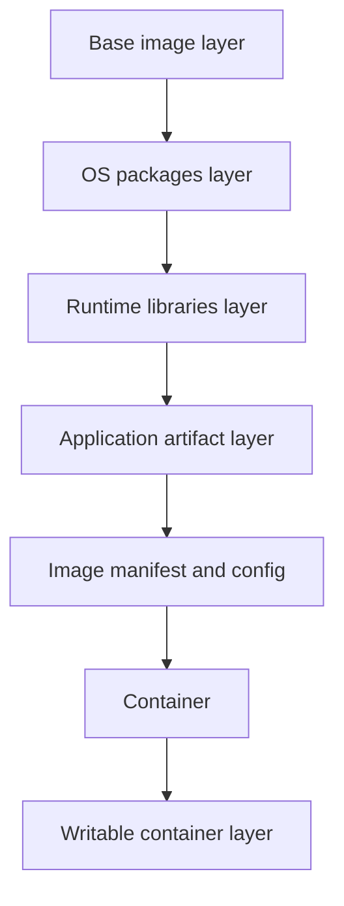

# Thiết kế image tối thiểu và tối ưu các lớp build

Container image là gói bất biến chứa ứng dụng cùng những thành phần cần thiết để chạy ứng dụng: runtime, thư viện, cấu hình mặc định và các file phụ trợ. Một image quá lớn làm tăng thời gian build, truyền image, lưu trữ và khởi động workload. Image chứa compiler, package manager, source code hoặc công cụ debug không cần thiết cũng làm tăng bề mặt tấn công và khiến việc kiểm soát nội dung khó hơn.

Thiết kế image tốt cần đạt ba mục tiêu cùng lúc: **chỉ đóng gói những gì runtime cần**, **tận dụng cache để build nhanh và ổn định**, và **giữ quy trình build có thể tái lập, kiểm tra và cập nhật an toàn**. Image nhỏ là một lợi ích, nhưng không phải tiêu chí duy nhất; tính tương thích, khả năng quan sát, cập nhật bảo mật và độ tin cậy của chuỗi cung ứng cũng quan trọng.

## 1. Image và các lớp build

OCI container image thường được biểu diễn bằng manifest, config và một tập các layer. Mỗi layer chứa thay đổi filesystem được tạo ra trong quá trình build. Các layer được lưu theo nội dung và có thể dùng chung giữa nhiều image nếu nội dung tương ứng giống nhau.

Dockerfile gồm các instruction như `FROM`, `WORKDIR`, `COPY`, `ADD`, `RUN`, `ENV`, `USER` và `ENTRYPOINT`. Nhiều instruction tạo ra layer hoặc metadata tương ứng trong image. Khi container chạy, các layer image được dùng ở chế độ chỉ đọc và runtime tạo một writable layer riêng cho container; dữ liệu cần tồn tại lâu dài nên đặt trong volume hoặc dịch vụ lưu trữ phù hợp.



Sơ đồ mô tả khái niệm các lớp filesystem. Image thực tế có thể có nhiều layer hơn hoặc ít hơn tùy cách build, base image và công cụ đóng gói. Metadata như `ENV`, `USER` hoặc `ENTRYPOINT` cũng được ghi vào image config và không nhất thiết tạo layer filesystem.

### Vì sao layer quan trọng?

- **Tái sử dụng:** nhiều image có thể dùng chung base layer, giảm dữ liệu cần tải nếu layer đã có trên node.
- **Cache build:** nếu input và instruction không đổi, builder có thể tái sử dụng kết quả của bước trước.
- **Phân phối:** image được truyền theo layer; thay đổi nhỏ ở layer cuối có thể tránh phải truyền lại các layer trước đã có.
- **Lịch sử và kiểm tra:** `docker history` giúp xem các bước tạo image và kích thước layer, nhưng không thay thế việc kiểm tra nội dung thực tế.

Một layer không thể bị xóa khỏi image cuối chỉ bằng cách xóa file ở một `RUN` instruction sau đó. Ví dụ, cài package ở layer đầu rồi xóa cache ở layer tiếp theo vẫn để lại dữ liệu package trong layer cũ. Vì vậy, thao tác cài đặt và dọn file tạm cần diễn ra trong cùng một `RUN` khi mục tiêu là giảm kích thước image.

## 2. Chọn base image phù hợp

Base image là điểm xuất phát của Dockerfile. Lựa chọn này ảnh hưởng đến kích thước, thư viện hệ thống, khả năng tương thích, tần suất cập nhật và mức độ dễ điều tra sự cố.

| Loại base image | Đặc điểm | Khi cân nhắc |
|---|---|---|
| Full distribution image | Nhiều package và tiện ích hệ thống | Ứng dụng cần thư viện hoặc công cụ hệ điều hành đa dạng |
| Slim/minimal distribution | Giữ các thành phần cơ bản, lược bỏ package không cần | Workload cần tương thích hệ sinh thái Linux quen thuộc nhưng muốn giảm image |
| Alpine | Nhẹ, dùng musl libc và BusyBox | Ứng dụng đã kiểm tra tương thích với musl và package Alpine |
| Distroless | Chỉ chứa runtime và thư viện cần chạy ứng dụng, thường không có shell/package manager | Production workload cần giảm bề mặt tấn công |
| `scratch` | Image rỗng | Binary tĩnh hoặc image được đóng gói đầy đủ các file phụ thuộc cần thiết |

Không chọn base image chỉ dựa vào kích thước tải xuống. Alpine dùng musl thay cho glibc; một số binary native, extension hoặc thư viện được biên dịch cho glibc có thể không chạy trực tiếp. Image distroless không có shell nên việc debug tương tác cần công cụ hoặc quy trình riêng. `scratch` không cung cấp CA certificates, timezone data, user database hay thư viện hệ thống; ứng dụng phải mang theo những thành phần cần thiết.

### Ưu tiên nguồn image đáng tin cậy

- Chọn image chính thức hoặc image do tổ chức duy trì từ nguồn đã được phê duyệt.
- Kiểm tra publisher, repository, kiến trúc CPU, lịch cập nhật và chính sách hỗ trợ.
- Ưu tiên base image có bản vá bảo mật và quy trình phát hành rõ ràng.
- Tránh dùng tag trôi nổi như `latest` trong build production vì cùng một tag có thể trỏ tới nội dung khác ở lần build sau.
- Ghim phiên bản cụ thể; với yêu cầu tái lập nghiêm ngặt, ghim digest của manifest/image đã xác minh.
- Có lịch rebuild để nhận bản vá mới của base image và thư viện hệ thống.

Ghim digest giúp cố định nội dung đầu vào nhưng cũng khiến image không tự nhận bản vá mới khi upstream cập nhật. Cần kết hợp pinning với quy trình theo dõi advisory và chủ động cập nhật digest.

## 3. Chỉ đưa runtime cần thiết vào image cuối

Image production nên chứa những thành phần ứng dụng cần để khởi chạy và xử lý công việc. Thông thường không cần đưa vào image cuối:

- Compiler, build tool và package manager chỉ dùng trong lúc build.
- Source code, test fixture, tài liệu và file mẫu không cần khi chạy.
- Cache của package manager, file archive tải về và object trung gian.
- Debugger, editor, shell tiện ích hoặc công cụ quản trị không được dùng ở runtime.
- Credential, private key, file `.env` hoặc cấu hình riêng của môi trường.
- Log build, báo cáo test và artifact trung gian không cần thiết.

Tuy vậy, không xóa mù quáng thư viện hệ thống mà ứng dụng cần ở runtime. Ví dụ, một ứng dụng native có thể phụ thuộc `libssl`, CA certificates, timezone database hoặc font. Với Java, runtime cần JRE phù hợp, CA trust store và các native library mà JNI sử dụng. Với Node.js, Python hoặc .NET, cần giữ runtime và package production tương ứng.

Nên xác định dependency runtime bằng manifest/build output, kiểm tra linkage của binary và chạy smoke test trong image cuối. Build thành công ở builder image không chứng minh runtime image có đủ thư viện.

## 4. Multi-stage build: tách môi trường build và runtime

Multi-stage build cho phép dùng nhiều `FROM` trong một Dockerfile. Stage đầu có thể chứa compiler, SDK, package manager và source code; stage cuối chỉ sao chép artifact đã tạo sang runtime image.

Lợi ích:

- Compiler và build tools không xuất hiện trong image production.
- Image cuối chỉ chứa artifact và runtime dependency cần thiết.
- Có thể dùng base image khác nhau cho build và runtime.
- Dễ tách bước test, build và đóng gói theo mục tiêu.
- Giảm kích thước và bề mặt tấn công của image cuối.

Ví dụ cho ứng dụng Java đóng gói thành executable JAR:

```dockerfile
# syntax=docker/dockerfile:1.7

ARG BUILD_IMAGE=maven:3.9-eclipse-temurin-21
ARG RUNTIME_IMAGE=eclipse-temurin:21-jre

FROM ${BUILD_IMAGE} AS build
WORKDIR /workspace

# Copy manifest truoc de cache dependency layer
COPY pom.xml mvnw ./
COPY .mvn/ .mvn/
RUN chmod +x mvnw && ./mvnw -B -ntp dependency:go-offline

# Source thay doi thuong xuyen nen copy sau dependency
COPY src/ src/
RUN ./mvnw -B -ntp package -DskipTests \
    && mkdir -p /out \
    && cp target/*.jar /out/app.jar

FROM ${RUNTIME_IMAGE} AS runtime
WORKDIR /app
COPY --from=build --chown=10001:10001 /out/app.jar /app/app.jar
USER 10001:10001
ENTRYPOINT ["java", "-jar", "/app/app.jar"]
```

Trong ví dụ này, stage `build` chứa Maven và JDK; stage `runtime` chỉ nhận file JAR và JRE. `COPY --from=build` không đưa toàn bộ filesystem của builder vào image cuối. `USER` chạy ứng dụng bằng UID/GID không đặc quyền; cần xác nhận thư mục ghi, thư mục tạm và quyền truy cập file phù hợp với ứng dụng.

Các điểm cần điều chỉnh theo dự án:

- `target/*.jar` có thể khớp nhiều artifact nếu dự án tạo cả JAR chính và JAR phụ; nên copy đúng tên file build output.
- Maven Wrapper cần các file wrapper và cấu hình repository phù hợp; nếu wrapper cần tải distribution, bước build phải có network hoặc cache tương ứng.
- `dependency:go-offline` có thể không tải được mọi plugin hoặc artifact phát sinh động; xác minh với build thực tế.
- `-DskipTests` chỉ minh họa bước đóng gói. CI nên chạy test ở stage hoặc job riêng trước khi phát hành image.
- Base image trong ví dụ dùng tag để dễ đọc; production nên pin phiên bản và digest đã kiểm duyệt, đồng thời có lịch cập nhật.

## 5. Tối ưu thứ tự instruction để tận dụng cache

Builder thường cache kết quả theo instruction và các input liên quan. Nếu một file được copy vào image thay đổi, các bước phía sau có thể phải chạy lại. Do đó, nên đặt những input ít thay đổi trước và input thay đổi thường xuyên sau.

Với ứng dụng Java, thứ tự thường hiệu quả:

1. Chọn base image và khai báo tham số build không nhạy cảm.
2. Thiết lập `WORKDIR`.
3. Copy `pom.xml`, Maven Wrapper và cấu hình dependency.
4. Tải hoặc chuẩn bị dependency.
5. Copy source code.
6. Compile, test và package artifact.
7. Copy artifact sang runtime stage.

Nếu source code thay đổi mỗi lần commit nhưng dependency manifest không đổi, builder có thể tái sử dụng layer tải dependency. Nếu copy toàn bộ source trước rồi mới chạy `dependency:go-offline`, mỗi thay đổi source có thể làm mất cache của bước dependency.

### Ví dụ thứ tự kém hiệu quả

```dockerfile
FROM maven:3.9-eclipse-temurin-21
WORKDIR /workspace
COPY . .
RUN ./mvnw -B -ntp dependency:go-offline
RUN ./mvnw -B -ntp package
```

### Ví dụ thứ tự tận dụng cache tốt hơn

```dockerfile
FROM maven:3.9-eclipse-temurin-21
WORKDIR /workspace
COPY pom.xml mvnw ./
COPY .mvn/ .mvn/
RUN chmod +x mvnw && ./mvnw -B -ntp dependency:go-offline
COPY src/ src/
RUN ./mvnw -B -ntp package
```

Hai ví dụ chỉ minh họa thứ tự. Với dự án Maven nhiều module, cần copy các POM của module phụ thuộc trước khi tải dependency. Với Gradle, nên copy `settings.gradle`, build scripts, version catalog và lockfiles trước source. Cần bảo đảm bước build không phụ thuộc file bị bỏ sót ở context.

Cache có thể bị vô hiệu hóa bởi thay đổi base image, build argument, file được copy, instruction hoặc môi trường builder. Không nên giả định cache luôn được dùng; hãy kiểm tra output build để biết bước nào được tái sử dụng.

## 6. Gộp thao tác cài package và dọn file tạm trong cùng layer

Với image dựa trên Debian/Ubuntu, cài package và xóa package index trong cùng một `RUN` giúp không lưu lại file cache trong layer cuối của instruction:

```dockerfile
RUN apt-get update \
    && apt-get install -y --no-install-recommends ca-certificates tzdata \
    && rm -rf /var/lib/apt/lists/*
```

Không tách `apt-get update` và `apt-get install` thành hai layer độc lập nếu mục tiêu là build tái lập và tránh dùng package index cũ. Việc ghép các lệnh trong cùng instruction giúp package index được làm mới ngay trước khi cài đặt.

Với Alpine, có thể dùng:

```dockerfile
RUN apk add --no-cache ca-certificates tzdata
```

Chỉ cài package runtime thực sự cần. Không cài compiler hoặc header trong runtime stage nếu ứng dụng không cần biên dịch tại chỗ. Với package có phiên bản hoặc repository đặc thù, hãy pin theo chính sách của distribution và cập nhật có kiểm soát.

Không dùng `apt-get upgrade` tùy tiện trong mỗi build mà không quản lý phiên bản và kiểm thử. Một quy trình an toàn thường cập nhật base image đã được vá, rebuild image, chạy test và phát hành artifact mới.

## 7. Dùng `.dockerignore` để thu nhỏ build context

Docker gửi build context tới builder. Nếu context chứa `.git`, `node_modules`, `target`, `dist`, log, file backup hoặc dữ liệu lớn, thời gian gửi context và khả năng cache có thể bị ảnh hưởng. Quan trọng hơn, file bí mật có thể vô tình được đưa vào context và bị copy vào image.

Ví dụ `.dockerignore`:

```text
.git
.idea
.vscode
**/target
**/build
node_modules
coverage
*.log
*.tmp
.env
.env.*
*.pem
*.key
secrets/
```

Đây là danh sách khởi đầu, cần điều chỉnh theo dự án. Không loại trừ file manifest, lockfile hoặc cấu hình build cần thiết. Nếu một file cần dùng trong build, hãy đưa vào context theo cách có chủ đích và bảo đảm nó không chứa secret.

`.dockerignore` giảm lượng dữ liệu được gửi cho builder và ngăn những file không cần thiết lọt vào các lệnh `COPY . .`. Nó không thay thế quản lý secret; credential vẫn phải được cấp qua cơ chế riêng của build/runtime.

## 8. Chỉ copy đúng artifact cần thiết

`COPY` nên chỉ định rõ file hoặc thư mục cần thiết. Tránh copy toàn bộ repository vào runtime stage. Ví dụ:

```dockerfile
COPY --from=build /out/app.jar /app/app.jar
```

Với ứng dụng Node.js, có thể cài production dependency riêng trong stage runtime hoặc copy thư mục đã prune; không đưa cache npm và dev dependency nếu không cần. Với Python, dùng virtual environment hoặc wheel được build trong stage trước, sau đó copy các package runtime phù hợp.

Phân biệt `COPY` và `ADD`:

- Dùng `COPY` cho thao tác sao chép file thông thường vì semantics rõ ràng.
- `ADD` có thêm hành vi như giải nén một số archive local và hỗ trợ URL trong các trường hợp nhất định; chỉ dùng khi thực sự cần hành vi đó.
- Không dùng `ADD` URL để tải dependency không được kiểm soát. Tải artifact trong bước build với checksum/signature xác minh hoặc dùng package manager và lockfile.

`COPY --chown=user:group` có thể đặt owner khi copy để tránh thêm một bước `RUN chown` tạo layer mới. Với file cần quyền thực thi, đặt permission có chủ đích; không cấp `chmod 777` để xử lý lỗi permission.

## 9. BuildKit cache mount cho dependency

BuildKit hỗ trợ cache mount để giữ cache của package manager giữa các lần build mà không đưa cache đó vào layer của image.

Ví dụ Maven:

```dockerfile
# syntax=docker/dockerfile:1.7
FROM maven:3.9-eclipse-temurin-21 AS build
WORKDIR /workspace
COPY pom.xml mvnw ./
COPY .mvn/ .mvn/
RUN chmod +x mvnw
RUN --mount=type=cache,target=/root/.m2 \
    ./mvnw -B -ntp dependency:go-offline

COPY src/ src/
RUN --mount=type=cache,target=/root/.m2 \
    ./mvnw -B -ntp package -DskipTests
```

Cache mount hữu ích vì các dependency đã tải có thể được tái sử dụng khi build tiếp theo, kể cả khi layer của bước build phải chạy lại. Cache mount là dữ liệu hỗ trợ builder, không phải nội dung được copy vào image cuối. Cache có thể bị xóa hoặc không được chia sẻ giữa builder; build phải vẫn hoạt động đúng khi cache trống.

Với npm, pip hoặc Gradle, chọn đúng thư mục cache của công cụ. Dùng cache không thay thế lockfile, checksum hoặc xác minh nguồn package.

## 10. Secret trong quá trình build

Không truyền credential qua `ARG`, `ENV` hoặc `COPY` file secret vào image. Giá trị có thể xuất hiện trong metadata, layer, build history, cache hoặc artifact được lưu lại.

BuildKit hỗ trợ secret mount để một lệnh build đọc secret tạm thời:

```dockerfile
RUN --mount=type=secret,id=maven_settings,target=/root/.m2/settings.xml \
    --mount=type=cache,target=/root/.m2/repository \
    ./mvnw -B -ntp dependency:go-offline
```

Secret được cấp khi build, ví dụ:

```bash
docker build --secret id=maven_settings,src=./settings.xml -t orders-api:dev .
```

`settings.xml` ở đây là file chứa thông tin xác thực repository nội bộ; không commit file đó vào source control hoặc build context. Cơ chế secret mount giúp tránh ghi secret vào layer, nhưng lệnh build vẫn có thể vô tình in secret ra log hoặc sao chép nội dung sang artifact. Hãy giới hạn quyền, tránh `set -x` và kiểm tra script build.

Secret runtime cũng cần được cấp qua secret manager hoặc cơ chế runtime được phê duyệt, không đóng gói vào image. Image nên có thể dùng lại ở nhiều môi trường mà không chứa credential riêng của production.

## 11. Giữ image runtime nhỏ nhưng vẫn dễ vận hành

Image tối thiểu thường không có shell, package manager hoặc công cụ debug. Điều này giảm bề mặt tấn công nhưng làm thay đổi cách điều tra sự cố.

Các nguyên tắc nên áp dụng:

- Ghi log ra stdout/stderr để nền tảng thu thập, thay vì yêu cầu shell vào container để đọc file log.
- Xuất metric và trace qua endpoint hoặc agent được quản lý.
- Dùng ephemeral debug container hoặc image debug riêng trong môi trường được kiểm soát nếu nền tảng hỗ trợ.
- Giữ image debug không được dùng làm production image mặc định.
- Cung cấp health/readiness endpoint hoặc cơ chế kiểm tra phù hợp với runtime.
- Lưu dữ liệu bền vững ngoài writable layer của container.
- Kiểm tra quyền ghi của `/tmp`, thư mục cache và thư mục ứng dụng khi chạy non-root/read-only filesystem.

Không cài SSH server hoặc debugger thường trực vào mọi production image chỉ để thuận tiện. Thiết kế quy trình debug có audit và giới hạn quyền sẽ an toàn hơn.

## 12. Chạy ứng dụng bằng user không đặc quyền

Container không tự động an toàn chỉ vì process chạy trong container. Nếu ứng dụng chạy bằng root, lỗi ứng dụng hoặc lỗ hổng có thể tạo hậu quả lớn hơn trong phạm vi container và đôi khi ảnh hưởng host nếu runtime bị cấu hình sai.

Trong Dockerfile, khai báo user không đặc quyền:

```dockerfile
WORKDIR /app
COPY --chown=10001:10001 app.jar /app/app.jar
USER 10001:10001
ENTRYPOINT ["java", "-jar", "/app/app.jar"]
```

UID/GID số giúp giảm phụ thuộc vào `/etc/passwd` trong một số runtime tối giản, nhưng ứng dụng hoặc thư viện có thể cần tên user, home directory hoặc NSS lookup. Hãy kiểm tra hành vi thực tế và tạo user/group trong image nếu cần.

Ở runtime, có thể kết hợp các biện pháp như drop Linux capabilities không cần, bật `no-new-privileges`, dùng read-only root filesystem và giới hạn CPU/RAM. Đây là cấu hình runtime/orchestrator, không chỉ là thuộc tính Dockerfile. Cần cấp writable volume hoặc tmpfs cho đường dẫn ứng dụng thực sự cần ghi.

## 13. Dùng `ENTRYPOINT` và `CMD` đúng cách

Nên dùng exec form cho tiến trình chính:

```dockerfile
ENTRYPOINT ["java", "-jar", "/app/app.jar"]
```

Exec form giúp tiến trình ứng dụng nhận signal trực tiếp hơn, hỗ trợ shutdown/graceful termination. Shell form như `ENTRYPOINT java -jar app.jar` thường chạy qua shell, có thể khiến việc truyền signal và xử lý PID 1 phức tạp hơn.

`ENTRYPOINT` xác định chương trình chính; `CMD` có thể cung cấp đối số mặc định hoặc lệnh mặc định tùy cách kết hợp. Không đặt một lệnh dài hạn chạy nền rồi để container sống bằng một tiến trình không liên quan. Container nên có vòng đời gắn với tiến trình chính của workload.

## 14. Reproducible build và pin dependency

Image nhỏ nhưng được build từ dependency trôi nổi vẫn có thể thay đổi ngoài dự kiến. Reproducible build giúp tạo artifact có thể tái tạo từ cùng source và input đã xác định.

Thực hành:

- Pin base image theo version/digest đã phê duyệt.
- Commit lockfile hoặc dependency constraints phù hợp với ecosystem.
- Dùng package repository đáng tin cậy và xác minh checksum/signature khi có.
- Tránh tải binary không kiểm tra từ URL không cố định.
- Ghi nhận source commit, build ID, builder version và target platform.
- Tách cấu hình môi trường khỏi image; inject ở runtime.
- Chuẩn hóa locale, timezone và biến môi trường build khi cần tái lập.
- Dùng build process không phụ thuộc file hoặc credential ngầm trên máy developer.

Reproducibility không có nghĩa giữ mãi dependency cũ. Cần quy trình nâng cấp có kiểm thử và rebuild định kỳ để nhận bản vá bảo mật.

## 15. Multi-platform image và kiến trúc CPU

Một image có thể hỗ trợ nhiều kiến trúc như `linux/amd64` và `linux/arm64` thông qua manifest list/index. Builder có thể tạo image cho nhiều platform:

```bash
docker buildx build \
  --platform linux/amd64,linux/arm64 \
  -t registry.example.com/commerce/orders-api:1.4.0 \
  --push .
```

Lệnh trên minh họa Buildx và registry. Build đa kiến trúc cần base image hỗ trợ platform đích và mọi binary/native dependency cũng phải tương thích. Build trên máy khác kiến trúc có thể cần QEMU emulation hoặc builder native; emulation có thể chậm và không phải lúc nào cũng phù hợp để benchmark.

Không chỉ đổi `--platform` là ứng dụng tự tương thích. Kiểm tra JNI/native library, package có binary, cryptographic provider, agent, driver và runtime. Nếu image có nhiều platform, xác minh manifest index trỏ tới artifact đúng cho từng kiến trúc.

## 16. Kiểm tra kích thước và layer của image

Một số lệnh hữu ích:

```bash
# Build image
docker build -t orders-api:dev .

# Xem danh sach image va kich thuoc
docker image ls orders-api

# Xem lich su cac layer/instruction
docker history orders-api:dev

# Xem metadata image
docker image inspect orders-api:dev
```

`docker history` giúp phát hiện layer lớn, chẳng hạn layer copy toàn bộ source hoặc cài package quá nhiều. `docker image inspect` hiển thị config, architecture, user, entrypoint và metadata. Kích thước hiển thị có thể phản ánh kích thước nén/không nén khác nhau tùy lệnh và công cụ; khi đánh giá chi phí truyền tải, cần đo dung lượng thực tế được registry lưu và truyền.

Công cụ phân tích layer như `dive` có thể giúp tìm file lớn, file trùng hoặc file đã xóa ở layer sau nhưng vẫn tồn tại trong layer trước. Dùng kết quả phân tích để xác định instruction cần sửa, không chỉ cố giảm số lượng layer bằng cách gộp mọi lệnh.

## 17. Giảm kích thước mà không làm build khó bảo trì

Một số cách thường hiệu quả:

- Dùng multi-stage build để loại compiler và build dependency khỏi runtime.
- Chọn base image nhỏ nhưng tương thích và được cập nhật.
- Chỉ copy artifact và file runtime cần thiết.
- Dùng `.dockerignore` để loại file không liên quan khỏi context.
- Cài package tối thiểu; dọn cache trong cùng `RUN`.
- Dùng cache mount cho package manager và compiler cache.
- Tránh cài nhiều package tiện ích chỉ để debug production.
- Loại file test, source map hoặc tài liệu nếu runtime không cần.
- Nén artifact khi phù hợp, nhưng đo trade-off CPU giải nén và thời gian khởi động.
- Tách image build/test/debug khỏi image production.

Không nên tối ưu kích thước bằng cách xóa CA certificate, timezone, locale hoặc thư viện native mà ứng dụng cần. Image giảm vài MB nhưng lỗi TLS, thời gian hoặc encoding sẽ gây rủi ro vận hành lớn hơn.

## 18. Bảo mật chuỗi cung ứng image

Image là artifact triển khai và cần được quản lý như một phần của software supply chain.

Các biện pháp nên có:

- Quét lỗ hổng base image và package ứng dụng trước khi phát hành.
- Tạo SBOM (Software Bill of Materials) để biết thành phần và phiên bản nằm trong image.
- Lưu build provenance/attestation để truy vết source, builder và tham số build.
- Ký image hoặc artifact theo chính sách tổ chức và xác minh chữ ký trước deploy.
- Giới hạn quyền push/pull registry; dùng identity ngắn hạn khi có thể.
- Không đưa secret hoặc dữ liệu nhạy cảm vào layer, label, build arg hay log.
- Dùng registry riêng, retention và replication phù hợp.
- Rebuild khi base image hoặc dependency có bản vá; không chỉ quét image cũ rồi bỏ đó.
- Triển khai image theo digest để bảo đảm đúng artifact đã kiểm tra.

Quét lỗ hổng có thể phát hiện package đã biết CVE nhưng không tự chứng minh ứng dụng có thể bị khai thác. Cần kết hợp mức độ nghiêm trọng, khả năng tiếp cận, exploitability, bản vá khả dụng và chính sách chấp nhận rủi ro.

## 19. Quy trình build và phát hành image

Một pipeline cơ bản có thể gồm:

1. Checkout source tại commit xác định.
2. Kiểm tra lint Dockerfile, `.dockerignore` và dependency manifest.
3. Chạy unit/integration test và kiểm tra chất lượng source.
4. Build bằng builder đã được quản lý, tận dụng cache an toàn.
5. Tạo image runtime qua multi-stage build.
6. Kiểm tra kích thước, user, entrypoint, architecture và file không mong muốn.
7. Quét image, tạo SBOM và provenance.
8. Ký image và push vào registry.
9. Deploy theo digest tới staging/canary.
10. Smoke test, kiểm tra health, log, metric và hiệu năng.
11. Promote đúng digest sang production theo chính sách phát hành.
12. Theo dõi bản vá base image và rebuild theo lịch hoặc khi có advisory.

Cache của builder giúp tăng tốc nhưng cần được quản lý như một đầu vào của pipeline. Không dùng cache từ nguồn không tin cậy để build artifact production nếu chưa có chính sách xác minh. Cũng cần bảo đảm secret mount và log build không làm lộ credential.

## 20. Ví dụ Dockerfile tối giản cho binary Go

Với binary Go được build tĩnh và không cần thư viện ngoài, có thể dùng `scratch` làm runtime stage:

```dockerfile
FROM golang:1.23 AS build
WORKDIR /src
COPY go.mod go.sum ./
RUN go mod download
COPY . .
RUN CGO_ENABLED=0 GOOS=linux go build -trimpath -ldflags="-s -w" -o /out/service ./cmd/service

FROM scratch
COPY --from=build /out/service /service
USER 65532:65532
ENTRYPOINT ["/service"]
```

Ví dụ này chỉ phù hợp khi binary thực sự không cần dynamic library hoặc file hệ thống khác. Nếu ứng dụng cần gọi HTTPS, có thể cần copy CA certificate bundle vào runtime image. Nếu cần timezone database, template hoặc static asset, phải copy các file đó. `CGO_ENABLED=0` có thể thay đổi khả năng dùng thư viện native; hãy kiểm thử chức năng trước khi dùng.

Trong production, pin digest cho builder image và kiểm tra binary cho đúng target architecture. Image `scratch` không có shell nên không thể chạy `sh`, `ls` hoặc package manager bên trong container; thiết kế logging và debug phải phù hợp.

## 21. Đo hiệu quả tối ưu

Đánh giá thay đổi bằng nhiều chỉ số:

| Chỉ số | Vì sao cần đo |
|---|---|
| Image compressed size | Ước lượng dung lượng registry và dữ liệu truyền |
| Build duration | Đánh giá cache và hiệu quả pipeline |
| Cache hit rate | Biết dependency/build step có được tái sử dụng |
| Pull duration | Ảnh hưởng thời gian scale-out và rollout |
| Container startup time | Đánh giá thời gian từ tạo container tới readiness |
| CVE/package count | Theo dõi bề mặt package và trạng thái bản vá |
| Runtime memory/CPU | Đảm bảo image tối giản không làm runtime tốn tài nguyên hơn |
| Failure rate | Phát hiện thiếu thư viện hoặc khác biệt môi trường |

So sánh trên cùng builder, network, cache state và target platform. Build đầu tiên không có cache thường chậm hơn các build tiếp theo; hãy đo cả cold build và warm build. Khi image nhỏ hơn nhưng startup chậm hơn do giải nén hoặc thiếu cache, cần đánh giá tổng thể.

## 22. Những sai lầm thường gặp

- **Dùng base image nhỏ nhất mà không kiểm tra tương thích:** ứng dụng lỗi do musl/glibc, CA certificate hoặc native library. Chạy test trên image cuối.
- **Chỉ dùng một stage cho build và runtime:** compiler, source và package build lọt vào production. Dùng multi-stage build.
- **Copy toàn bộ repository quá sớm:** cache dependency bị vô hiệu hóa thường xuyên và context lớn. Copy manifest trước, source sau.
- **Xóa file ở layer sau để giảm image:** dữ liệu vẫn nằm trong layer trước. Cài và dọn trong cùng `RUN` hoặc dùng multi-stage.
- **Dùng tag `latest`:** build có thể thay đổi ngoài dự kiến. Pin version/digest và có lịch cập nhật.
- **Đưa secret qua ARG/ENV hoặc COPY:** secret có thể bị lưu trong image metadata/layer. Dùng secret mount và secret manager.
- **Cài shell/debugger vào mọi production image:** tăng package và bề mặt tấn công. Dùng image debug riêng hoặc ephemeral debug tooling.
- **Chạy process bằng root:** tăng tác động nếu ứng dụng bị khai thác. Dùng UID/GID không đặc quyền và kiểm tra quyền ghi.
- **Chỉ tối ưu số layer:** gộp mọi lệnh làm Dockerfile khó cache và khó đọc. Tối ưu theo dependency và cache invalidation.
- **Bỏ qua image scan/SBOM:** không biết thành phần nào nằm trong artifact. Tích hợp kiểm tra supply chain vào pipeline.

## 23. Checklist thiết kế image tối thiểu

- [ ] Base image đến từ nguồn tin cậy, có phiên bản rõ ràng và digest được quản lý.
- [ ] Đã xác minh tương thích OS, libc, kiến trúc CPU và native dependency.
- [ ] Runtime stage chỉ chứa artifact, runtime và thư viện thực sự cần.
- [ ] Compiler, build tool, source và test dependency nằm ngoài image production.
- [ ] Dockerfile copy manifest/lockfile trước source để tận dụng cache.
- [ ] Package index và cache tạm được dọn trong cùng layer cài đặt khi phù hợp.
- [ ] `.dockerignore` loại `.git`, build output, log và file nhạy cảm không cần thiết.
- [ ] Không có secret trong ARG, ENV, layer, label hoặc build log.
- [ ] Dùng BuildKit cache mount đúng mục đích và build vẫn chạy khi cache trống.
- [ ] `COPY` chỉ lấy artifact cần thiết; owner và permission được đặt rõ.
- [ ] Process chạy non-root; entrypoint dùng exec form và hỗ trợ graceful shutdown.
- [ ] Đã kiểm tra CA certificates, timezone, thư viện native và đường dẫn ghi cần thiết.
- [ ] Image có SBOM, vulnerability scan, provenance/signature theo chính sách.
- [ ] Đã đo image size, build time, cache hit, pull/startup time và runtime behavior.
- [ ] Có quy trình rebuild, cập nhật base image và rollback theo digest.

Thiết kế image tối thiểu là quá trình chọn đúng base image, tách build khỏi runtime, chỉ copy artifact cần thiết và tổ chức instruction để cache được tái sử dụng. Khi kết hợp với pin dependency, quản lý secret, chạy non-root và kiểm soát supply chain, image sẽ nhẹ hơn, dễ phân phối hơn và đáng tin cậy hơn trong môi trường compute dùng container.
