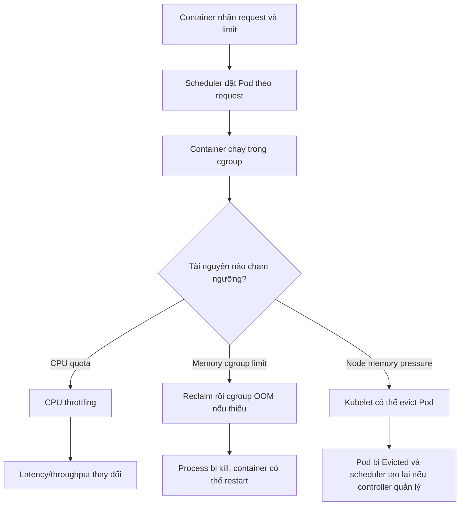

# CPU limit, memory limit và hiện tượng throttling hoặc OOM

Container dùng chung CPU, bộ nhớ và các tài nguyên của node với những workload khác. Resource request và resource limit giúp nền tảng lập lịch, phân bổ và giới hạn mức tiêu thụ của từng container. Cấu hình quá thấp có thể khiến ứng dụng bị CPU throttling hoặc bị kernel kết thúc vì thiếu bộ nhớ; cấu hình quá cao lại làm giảm mật độ workload trên node và tăng chi phí vận hành.

Trong module **CLOUD_CORE_SERVICES_COMPUTE**, việc cấu hình CPU và memory cần dựa trên đặc điểm workload, số liệu đo được và mục tiêu latency/availability. Bài học này giải thích cách Linux control groups (cgroups) thực thi giới hạn, cách Kubernetes dùng requests và limits, sự khác nhau giữa throttling, OOM kill và eviction, cách sizing, quan sát và xử lý sự cố bằng ví dụ thực tế.

## Mục tiêu học tập

Sau bài này, bạn có thể:

- Phân biệt CPU request, CPU limit, memory request và memory limit.
- Giải thích cách cgroups giới hạn CPU time và memory của container.
- Nhận diện CPU throttling, container OOM kill và node-pressure eviction.
- Hiểu Kubernetes QoS classes và ảnh hưởng của requests/limits đến scheduling, eviction và autoscaling.
- Tính CPU theo millicore, memory theo MiB/GiB và chọn ngưỡng từ dữ liệu benchmark.
- Cấu hình resource cho workload CPU-bound, memory-bound, latency-sensitive và bursty.
- Đọc metric, event và trạng thái Pod để tìm nguyên nhân throttling/OOM.
- Điều chỉnh JVM, sidecar, worker concurrency và autoscaling để tránh giới hạn sai.
- Xây dựng quy trình kiểm thử, cảnh báo và xử lý resource pressure trong production.

## 1. Request và limit giải quyết hai bài toán khác nhau

Khi chạy nhiều container trên một node, scheduler phải quyết định container nào được đặt ở đâu, còn kernel phải thực thi giới hạn khi container đang chạy. Hai giai đoạn này cần hai loại thông tin.

- **Request** mô tả lượng tài nguyên workload cần được tính vào kế hoạch scheduling. Scheduler dùng tổng request để quyết định node còn đủ khả năng nhận Pod hay không.
- **Limit** đặt mức sử dụng tối đa mà container được phép dùng theo cơ chế của runtime/kernel. Với CPU, limit thường tạo quota CPU time; với memory, vượt limit có thể dẫn đến OOM kill.

Request không phải là mức sử dụng cố định và CPU request không tự động dành riêng một core vật lý. Limit cũng không phải lời hứa rằng ứng dụng sẽ luôn nhận được mức CPU đó; nó là trần sử dụng.

| Thuộc tính | CPU | Memory |
|---|---|---|
| Request | Dùng để scheduling và xác định trọng số tương đối khi tranh chấp CPU | Dùng để scheduling và là mốc quan trọng trong đánh giá áp lực/eviction |
| Limit | Trần CPU time; có thể gây throttling khi chạm quota | Trần bộ nhớ cgroup; vượt giới hạn có thể kích hoạt OOM kill |
| Khi thiếu tài nguyên | Tiến trình thường chạy chậm hơn, chờ CPU | Có thể bị reclaim, OOM kill hoặc Pod bị eviction tùy loại áp lực |
| Có thể burst? | Có thể dùng CPU rảnh trong giới hạn quota và cơ chế chia sẻ | Có thể dùng dưới memory limit; không có cơ chế burst an toàn vượt hard limit |

### 1.1. CPU được đo bằng core và millicore

Trong Kubernetes, CPU được biểu diễn bằng số core hoặc millicore:

- `1` CPU tương đương một core logic theo đơn vị scheduling của Kubernetes.
- `500m` tương đương 0,5 CPU.
- `250m` tương đương 0,25 CPU.
- `100m` tương đương 0,1 CPU.
- `1500m` tương đương 1,5 CPU.

Ví dụ, container có request `500m` được scheduler tính là cần nửa CPU. Nếu limit là `1`, container có thể dùng tối đa khoảng một CPU theo quota trong chu kỳ thực thi. Đây không phải cam kết rằng container luôn được chạy trên đúng một core riêng.

### 1.2. Memory dùng đơn vị byte, MiB và GiB

Kubernetes chấp nhận các hậu tố thập phân và nhị phân:

| Đơn vị | Giá trị |
|---|---:|
| `1K` | 1.000 byte |
| `1M` | 1.000.000 byte |
| `1G` | 1.000.000.000 byte |
| `1Ki` | 1.024 byte |
| `1Mi` | 1.048.576 byte |
| `1Gi` | 1.073.741.824 byte |

Với memory, nên dùng `Mi`/`Gi` để tránh nhầm giữa cơ số 10 và cơ số 2. Ví dụ `512Mi` là 512 × 1.048.576 byte, còn `512M` là 512.000.000 byte.

## 2. Linux cgroups thực thi giới hạn container như thế nào?

Container không có kernel riêng. Runtime tạo các process trong namespace và gắn chúng vào các control group (cgroup). Cgroup cho phép kernel theo dõi, phân bổ và giới hạn tài nguyên của một nhóm process.

Trên Linux, Kubernetes và container runtime thường dùng cgroups v1 hoặc v2 tùy kernel, runtime và cấu hình node. Tên file và metric có thể khác nhau, nhưng nguyên tắc chung là CPU được kiểm soát bằng quota/weight, còn memory được theo dõi và giới hạn theo nhóm process.

### 2.1. CPU quota và CPU weight

CPU quota giới hạn lượng CPU time một cgroup được tiêu thụ trong một chu kỳ. Ví dụ minh họa với chu kỳ 100 ms:

```text
CPU limit:       1.5 CPU
Period:          100 ms
Quota:           150 ms CPU time / 100 ms wall time
```

Một container có thể chạy song song trên nhiều core trong một phần chu kỳ, sau đó bị throttle khi đã dùng hết quota. Vì vậy, ứng dụng đa luồng có thể tiêu thụ hết quota sớm trong chu kỳ dù CPU trung bình nhìn theo phút không đạt 100% của một core.

CPU weight/shares quyết định mức ưu tiên tương đối khi các cgroup tranh chấp CPU. Request thường được ánh xạ thành trọng số tương đối. Khi node rảnh, container có thể dùng CPU vượt request nếu không bị limit hoặc quota khác chặn. Khi node bận, workload có trọng số cao hơn có xu hướng nhận phần CPU lớn hơn, theo cơ chế scheduler của kernel.

Trong cgroups v2, có thể gặp các interface như `cpu.max` và `cpu.weight`; cgroups v1 thường có `cpu.cfs_quota_us`, `cpu.cfs_period_us` và `cpu.shares`. Không nên chỉnh trực tiếp các file cgroup trên node Kubernetes đang được kubelet quản lý trừ khi đang thực hiện thao tác chẩn đoán có kiểm soát.

### 2.2. Memory cgroup

Memory controller theo dõi lượng bộ nhớ được tính cho các process trong cgroup và có thể áp dụng giới hạn. Trên cgroups v2, các interface thường gặp gồm `memory.current`, `memory.max`, `memory.high` và `memory.events`; trên cgroups v1 có các file tương ứng như `memory.usage_in_bytes` và `memory.limit_in_bytes`.

Memory được tính không chỉ là Java heap hoặc RSS của một process. Nó có thể bao gồm anonymous memory, page cache và các phần bộ nhớ khác thuộc phạm vi accounting của cgroup. Vì vậy, chỉ đo heap hoặc nhìn một chỉ số RSS có thể bỏ sót mức tiêu thụ thực tế.

Khi cgroup chạm giới hạn, kernel có thể cố reclaim bộ nhớ. Nếu không thể thu hồi đủ, cgroup OOM killer có thể kết thúc một hoặc nhiều process trong cgroup để đưa usage về ngưỡng cho phép. Process bị kill có thể là tiến trình chính hoặc một process con; nếu PID 1 trong container kết thúc, runtime thường đánh dấu container đã dừng.

### 2.3. Namespace không tạo thêm tài nguyên

PID namespace, mount namespace và network namespace tạo ranh giới nhìn thấy giữa các container. Chúng không làm tăng CPU hoặc memory vật lý. Hai container trên cùng node vẫn tranh chấp CPU, memory bandwidth, cache, I/O và network của node.

## 3. CPU request, CPU limit và throttling

CPU là tài nguyên có thể chia sẻ theo thời gian. Khi workload cần nhiều CPU hơn quota được cấp, kernel có thể tạm ngừng chạy các thread trong cgroup cho đến chu kỳ quota tiếp theo. Hiện tượng này gọi là CPU throttling.

### 3.1. Request ảnh hưởng scheduling và chia sẻ CPU

Giả sử node có 8 CPU allocatable:

| Pod | CPU request | CPU limit |
|---|---:|---:|
| API A | 1 CPU | 2 CPU |
| API B | 2 CPU | 2 CPU |
| Worker C | 500m | 1 CPU |

Scheduler tính tổng request là 3,5 CPU. Nó có thể đặt thêm workload khác nếu tổng request vẫn nằm trong capacity allocatable và các điều kiện scheduling khác đều đạt. Limit không được cộng vào phép tính request thông thường, vì vậy tổng limit trên node có thể lớn hơn số CPU vật lý. Đây là CPU overcommit có chủ đích; hiệu năng khi tải đồng thời cần được kiểm thử.

### 3.2. CPU limit tạo quota

Ví dụ container có request `500m` và limit `1`:

- Scheduler tính container cần 0,5 CPU.
- Khi có CPU rảnh, container có thể chạy vượt 0,5 CPU.
- Quota giới hạn mức CPU time tối đa xấp xỉ một CPU trong chu kỳ.
- Khi dùng hết quota, thread có thể bị throttle đến chu kỳ tiếp theo.

Nếu limit đặt thấp hơn nhu cầu thực tế, container có thể bị throttle ngay cả khi node còn nhiều CPU rảnh. Đây là một nguyên nhân khiến ứng dụng có CPU usage trung bình thấp nhưng latency vẫn cao.

### 3.3. Vì sao throttling làm tăng latency?

Một request có thể cần nhiều thread phối hợp: thread nhận request, thread xử lý logic, thread GC, thread I/O completion hoặc worker pool. Nếu cgroup dùng hết quota, các thread phải đợi. Thời gian chờ cộng dồn vào response latency.

Throttling đặc biệt ảnh hưởng đến:

- API latency-sensitive có deadline ngắn.
- Workload bursty với nhiều request đến cùng lúc.
- Runtime có nhiều thread như JVM hoặc ứng dụng native đa luồng.
- Workload có GC, JIT compilation hoặc xử lý compression/encryption.
- Container chạy nhiều process nên các process đó cùng tiêu thụ quota của container; sidecar là container riêng và thường có quota riêng, nhưng vẫn tranh chấp CPU trên cùng node.

### 3.4. Dấu hiệu nhận biết CPU throttling

- `container_cpu_cfs_throttled_periods_total` tăng nhanh so với `container_cpu_cfs_periods_total`.
- `container_cpu_cfs_throttled_seconds_total` tăng trong lúc request latency tăng.
- CPU usage bị chặn quanh limit trong khi runnable thread hoặc run queue tăng.
- Throughput không tăng dù số request đang chờ tăng.
- Latency p95/p99 tăng theo burst nhưng CPU trung bình không cao.

Các metric CFS có thể khác tên hoặc không được xuất trên một số phiên bản kernel/cgroups v2, runtime hay managed Kubernetes. Hãy xác minh metric thực tế từ kubelet/cAdvisor và runtime của cluster.

### 3.5. Khi nào nên đặt CPU limit?

CPU limit hữu ích để kiểm soát mức tiêu thụ tối đa và bảo vệ node khỏi một workload chiếm toàn bộ CPU. Tuy nhiên, limit quá thấp có thể tạo throttling và tăng tail latency. Một số nền tảng production chọn CPU request rõ ràng nhưng không đặt CPU limit cho một số workload latency-sensitive, kết hợp quota ở cấp node, capacity planning và isolation phù hợp. Đây là quyết định vận hành, không phải quy tắc áp dụng cho mọi cluster.

Nếu chính sách yêu cầu mọi container phải có CPU limit, hãy benchmark dưới tải burst và chọn limit đủ cao để không throttle ở tải mục tiêu. Nếu bỏ CPU limit, phải quản lý tổng request, node capacity, priority và noisy neighbor bằng các guardrail khác.

## 4. Memory request, memory limit và OOM

Memory khác CPU ở điểm bộ nhớ đang được process sử dụng không thể đơn giản chia theo lát thời gian như CPU. Khi thiếu memory, kernel có thể reclaim cache, swap nếu được bật/cấu hình, hoặc kết thúc process để bảo vệ hệ thống.

### 4.1. Memory request dùng để scheduling

Scheduler cộng memory request của Pod để kiểm tra node còn đủ capacity hay không. Request không tự giới hạn container ở mức đó. Container có request `512Mi` và limit `1Gi` có thể dùng nhiều hơn `512Mi` nếu node còn bộ nhớ và cgroup limit cho phép.

Tuy nhiên, nếu nhiều Pod liên tục dùng vượt request, node có thể bị memory pressure dù scheduler đã tính rằng tổng request còn nằm trong allocatable. Vì memory không thể thu hồi dễ dàng như CPU time, đặt request quá thấp so với mức dùng thực tế làm tăng rủi ro eviction và node OOM.

### 4.2. Memory limit là giới hạn cứng

Giả sử container có memory limit `1Gi`. Khi tổng memory được accounting của cgroup tiến gần giới hạn, kernel có thể reclaim một số page. Nếu không thể đáp ứng allocation mới, cgroup OOM có thể xảy ra và process bị kill.

Memory limit không tự tăng khi node còn RAM rảnh. Container có thể bị OOM ở `1Gi` dù node vẫn còn nhiều bộ nhớ trống, vì cgroup limit của container đã chạm ngưỡng.

### 4.3. OOMKilled và node-pressure eviction khác nhau

Hai sự kiện thường bị nhầm:

| Hiện tượng | Nguyên nhân | Dấu hiệu thường gặp | Phạm vi |
|---|---|---|---|
| Container/cgroup OOM kill | Cgroup vượt memory limit hoặc không đáp ứng được allocation trong phạm vi cgroup | Container termination reason có thể là `OOMKilled`; counter oom/oom_kill tăng | Một hoặc một số process trong container/cgroup |
| Node-level OOM | Node cạn memory và kernel phải chọn process để kill | Kernel log ghi nhận OOM trên node; nhiều workload có thể bị ảnh hưởng | Toàn node |
| Kubelet eviction do memory pressure | Kubelet chủ động evict Pod để đưa node về ngưỡng an toàn | Pod reason/event thường là `Evicted`, có thông tin node pressure | Pod bị chọn trên node |

Container có thể bị OOMKilled khi node còn RAM vì memory limit riêng đã chạm ngưỡng. Pod cũng có thể bị eviction dù container chưa vượt limit nếu node tổng thể thiếu memory. Phải kiểm tra đúng trạng thái và event thay vì xem mọi lần restart là cùng một loại OOM.

### 4.4. OOM không chỉ là heap đầy

Với JVM, memory container có thể bao gồm:

- Java heap.
- Metaspace và class metadata.
- Thread stack.
- Direct buffer và native allocation.
- JIT code cache.
- JNI/native library.
- Memory-mapped file và page cache được accounting.

Nếu đặt `-Xmx` bằng đúng memory limit, phần non-heap có thể khiến tổng memory cgroup vượt limit. Cần dành headroom cho native memory, thread stack, runtime và biến động tải.

Với Python, Node.js, Go hoặc ứng dụng native, cũng cần phân biệt heap của runtime với tổng memory process/cgroup. Native extension, buffer, mmap và cache có thể làm tổng memory cao hơn con số heap mà profiler báo cáo.

### 4.5. Memory leak và memory spike

Memory tăng liên tục có thể do leak, cache không giới hạn, queue backlog, object retention hoặc fragmentation. Memory spike có thể đến từ batch lớn, payload lớn, concurrent request hoặc khởi tạo nhiều worker cùng lúc.

Phân biệt hai dạng:

- **Leak:** usage tăng theo thời gian và không trở về baseline sau khi workload giảm.
- **Spike:** usage tăng nhanh trong một giai đoạn, sau đó giảm khi xử lý xong hoặc GC/reclaim hoạt động.

Tăng limit có thể giúp workload có headroom tạm thời nhưng không sửa leak. Nếu leak tồn tại, container chỉ OOM muộn hơn.

## 5. QoS classes trong Kubernetes

Kubernetes gán Quality of Service (QoS) class cho Pod dựa trên cấu hình requests và limits của các container trong Pod. QoS class ảnh hưởng đến cách ưu tiên khi node thiếu tài nguyên; nó không thay thế capacity planning và không bảo đảm Pod không bao giờ bị kill.

### 5.1. Guaranteed

Pod thuộc Guaranteed khi mọi container có CPU và memory request, đồng thời request bằng limit cho từng loại tài nguyên tương ứng. Ví dụ:

```yaml
resources:
  requests:
    cpu: "1"
    memory: "1Gi"
  limits:
    cpu: "1"
    memory: "1Gi"
```

Guaranteed thường có mức bảo vệ tốt hơn trong một số tình huống node pressure và phù hợp với workload cần resource profile rõ. Đổi lại, phần tài nguyên đặt request nhưng không dùng vẫn chiếm chỗ trong scheduling, làm giảm khả năng bin packing. CPU limit bằng request cũng có thể throttle nếu workload cần burst vượt mức đó.

### 5.2. Burstable

Pod thuộc Burstable khi có ít nhất một request hoặc limit nhưng không thỏa điều kiện Guaranteed. Ví dụ request thấp hơn limit:

```yaml
resources:
  requests:
    cpu: "500m"
    memory: "512Mi"
  limits:
    cpu: "2"
    memory: "1Gi"
```

Burstable phù hợp với workload có baseline thấp hơn peak. Container có thể dùng nhiều hơn request trong giới hạn cho phép, nhưng cần đảm bảo node còn capacity và memory request phản ánh nhu cầu thực tế đủ tốt.

### 5.3. BestEffort

Pod không khai báo CPU hoặc memory request/limit cho bất kỳ container nào trong Pod có thể thuộc BestEffort:

```yaml
containers:
  - name: worker
    image: example/worker:1.0
```

BestEffort có thể hữu ích cho workload rất dễ bị loại bỏ hoặc môi trường thử nghiệm, nhưng không phù hợp với critical production service. Khi node pressure, nhóm này thường có mức ưu tiên thấp hơn.

### 5.4. QoS không phải thứ tự eviction duy nhất

Khi node pressure, kubelet còn xét Pod priority và mức sử dụng so với request. Pod BestEffort thường được xét trước; Pod Burstable đang dùng vượt request có thể bị xét trước Pod đang nằm trong request; Pod Guaranteed và Burstable dưới request thường được bảo vệ tốt hơn trong một số kịch bản. Chi tiết còn phụ thuộc loại pressure, priority và phiên bản Kubernetes.

Không nên dùng QoS class làm lý do duy nhất để đặt mọi request bằng limit. Hãy chọn request/limit từ workload, mục tiêu scheduling, burst và memory pressure.

## 6. CPU throttling, OOM và eviction trong vòng đời Pod



### 6.1. Khi CPU bị throttle

Container thường vẫn ở trạng thái Running. Không nhất thiết có restart hoặc event rõ ràng. Ứng dụng chỉ chậm, request queue tăng hoặc timeout. Vì vậy cần metric throttling và latency, không chỉ kiểm tra trạng thái Pod.

### 6.2. Khi container bị OOMKilled

Container có thể restart tùy `restartPolicy` và controller. Trong Kubernetes, xem `lastState.terminated.reason` và `exitCode`; runtime thường ghi `OOMKilled` khi process/container bị kết thúc do OOM. Restart liên tục có thể dẫn đến `CrashLoopBackOff`.

### 6.3. Khi Pod bị eviction

Pod bị kubelet evict có thể kết thúc với reason `Evicted`; Deployment/ReplicaSet/StatefulSet có thể tạo Pod thay thế. Nếu node nào cũng thiếu memory hoặc request quá lớn so với capacity, Pod mới có thể Pending hoặc bị evict lặp lại.

## 7. Cách chọn CPU request và limit

Không chọn CPU chỉ từ số core của máy phát triển hoặc CPU usage tại một thời điểm. Hãy đo theo request rate, concurrency, payload, dependency và thời gian cao điểm.

### 7.1. Quy trình sizing CPU

1. Chạy workload đại diện trong môi trường gần production.
2. Thu thập CPU usage theo container ở nhiều mức tải.
3. Ghi nhận throughput, p95/p99 latency, error rate và queue depth.
4. Tìm điểm mà tăng CPU không còn cải thiện throughput hoặc latency do bottleneck khác.
5. Chọn request đủ để scheduler đặt workload ổn định khi node có tranh chấp.
6. Chọn limit dựa trên chính sách isolation và khả năng burst; nếu đặt limit, kiểm tra throttling ở peak.
7. Re-test với sidecar, autoscaling và nhiều Pod đồng thời trên node.

### 7.2. Ví dụ tính CPU

Giả sử API xử lý tải bình thường 300 request/giây, CPU usage p95 là 420m và peak ngắn là 800m. Benchmark cho thấy ở 500m, p99 bắt đầu tăng khi có burst; ở 1 CPU, latency vẫn trong SLO.

Một cấu hình khởi đầu có thể là:

```yaml
resources:
  requests:
    cpu: "500m"
  limits:
    cpu: "1"
```

Request `500m` cho scheduler biết workload cần khoảng nửa CPU trong kế hoạch node. Limit `1` cho phép burst đến khoảng một CPU nhưng vẫn có thể throttle khi cgroup dùng hết quota. Đây là điểm khởi đầu để kiểm thử, không phải giá trị mặc định cho mọi API.

Nếu p99 vẫn tăng cùng tỷ lệ throttled periods, có thể tăng CPU limit hoặc bỏ limit nếu chính sách cho phép. Nếu CPU usage thấp nhưng latency cao, kiểm tra database, lock, network, GC pause và thread pool trước khi tăng CPU.

### 7.3. Đừng đặt request theo average một cách máy móc

CPU request quá thấp khiến scheduler đặt quá nhiều workload lên node và làm chúng tranh chấp CPU. Request quá cao làm giảm bin packing, tăng số node và chi phí. Hãy cân nhắc p50/p95, mức tải đồng thời, criticality và khả năng burst.

CPU usage thay đổi nhanh; dùng histogram/time series theo thời gian và benchmark. Một giá trị trung bình ngày có thể che giấu burst 5 phút làm p99 vượt SLO.

## 8. Cách chọn memory request và limit

Memory cần sizing thận trọng hơn CPU vì vượt limit có thể dẫn đến OOM. Hãy đo tổng memory cgroup trong tải đại diện, không chỉ heap hoặc RSS của một process.

### 8.1. Quy trình sizing memory

1. Đo baseline khi ứng dụng warm-up xong.
2. Chạy peak traffic, batch, cache warm-up và tác vụ nền.
3. Thu thập peak cgroup memory và working set theo container.
4. Kiểm tra native memory, thread count, page cache và memory-backed volume.
5. Xác định mức tăng trưởng hợp lý và margin cho burst.
6. Chọn memory request phản ánh mức dùng thường xuyên/được kỳ vọng để scheduler không overcommit quá mức.
7. Chọn memory limit lớn hơn peak đã đo với headroom phù hợp.
8. Thực hiện soak test và kiểm tra OOM counter/restart.

### 8.2. Ví dụ sizing memory

Một API có memory working set thường khoảng 430Mi, peak dưới tải đại diện là 680Mi và có thêm biến động cache/native khoảng 15%. Nếu chọn margin 25% trên peak đo được:

\[
680\ Mi \times 1.25 = 850\ Mi
\]

Có thể chọn limit `1Gi` để có khoảng trống, đồng thời request có thể bắt đầu ở `768Mi` nếu số liệu và capacity node cho thấy mức đó hợp lý. Cần kiểm tra lại trong production-like load test; nếu memory thực tế thường vượt request, scheduler có thể overcommit node.

```yaml
resources:
  requests:
    memory: "768Mi"
  limits:
    memory: "1Gi"
```

### 8.3. JVM và memory limit

Không đặt Java heap bằng toàn bộ memory limit. Ví dụ container limit `1Gi` nhưng heap `-Xmx1g` có thể khiến tổng memory vượt limit khi tính metaspace, thread stack, direct buffer, JIT code cache và native library.

Một cấu hình minh họa:

```text
Container memory limit: 1 GiB
Heap max:               650 MiB
Non-heap/native budget: 250 MiB
Safety margin:          124 MiB
```

Con số này chỉ minh họa cách chia ngân sách. Dùng container-aware JVM hiện đại, theo dõi Native Memory Tracking khi phù hợp và benchmark số thread, direct buffer, GC và heap occupancy. Không sao chép `MaxRAMPercentage` hoặc `Xmx` giữa ứng dụng mà không kiểm tra tổng memory.

### 8.4. Memory request thấp hơn limit bao nhiêu?

Khoảng cách request-limit thể hiện mức burst mà container có thể dùng thêm nếu node có tài nguyên. Khoảng cách quá lớn có thể làm scheduler xếp nhiều Pod dựa trên request nhỏ, trong khi tất cả cùng tăng memory khi peak. Khi đó node có thể bị memory pressure và eviction.

Đối với workload memory-sensitive, request nên gần với nhu cầu peak thường xuyên hoặc mức dùng không thể thu hồi. Đối với workload có cache dễ reclaim và hành vi đã kiểm chứng, có thể chọn request thấp hơn limit nhưng phải quan sát node pressure và eviction.

## 9. Cấu hình Kubernetes thực tế

### 9.1. Pod có request và limit

```yaml
apiVersion: v1
kind: Pod
metadata:
  name: api-resource-example
spec:
  containers:
    - name: api
      image: example/api:1.0
      resources:
        requests:
          cpu: "500m"
          memory: "768Mi"
        limits:
          cpu: "1"
          memory: "1Gi"
```

Pod này thường thuộc Burstable vì request và limit khác nhau. Scheduler tính 500m CPU và 768Mi memory; cgroup giới hạn CPU ở 1 CPU và memory ở 1Gi.

### 9.2. Pod Guaranteed

```yaml
apiVersion: v1
kind: Pod
metadata:
  name: critical-api
spec:
  containers:
    - name: api
      image: example/api:1.0
      resources:
        requests:
          cpu: "2"
          memory: "2Gi"
        limits:
          cpu: "2"
          memory: "2Gi"
```

Nếu mọi container trong Pod đều đáp ứng điều kiện request bằng limit cho CPU và memory, Pod có thể được xếp Guaranteed. Hãy kiểm tra cả sidecar và container khác; chỉ một container không đáp ứng điều kiện có thể làm thay đổi QoS class.

### 9.3. LimitRange và ResourceQuota

`LimitRange` có thể đặt default request/limit hoặc min/max cho container trong namespace. `ResourceQuota` giới hạn tổng request/limit hoặc số lượng resource trong namespace. Chúng giúp tổ chức enforce guardrail, nhưng default sai có thể làm workload bị cấp resource không phù hợp.

Nếu khai báo limit mà bỏ request, Kubernetes thường đặt request bằng limit tương ứng khi không có cơ chế admission/defaulting khác cung cấp request. Nếu request lớn hơn limit, cấu hình container không hợp lệ và Pod không được chấp nhận như mong đợi. Hãy kiểm tra Pod spec sau admission để biết giá trị cuối cùng scheduler và kubelet thực sự sử dụng.

Khi Pod không tạo được do quota, kiểm tra event và quota namespace. Khi request vượt allocatable node, Pod có thể Pending dù node có CPU usage thấp; scheduler dựa trên requests và allocatable, không chỉ nhìn `kubectl top`.

## 10. Docker và container runtime

Kubernetes là một lớp điều phối; Docker/container runtime cũng có thể đặt resource limit trực tiếp.

Ví dụ Docker:

```bash
docker run --name api \
  --cpus="1.5" \
  --memory="1g" \
  example/api:1.0
```

- `--cpus="1.5"` đặt giới hạn CPU tương đương khoảng 1,5 CPU theo cơ chế runtime/cgroup.
- `--memory="1g"` đặt giới hạn memory cho container.
- Runtime chuyển các thiết lập này thành cgroup controls trên Linux.

Các tùy chọn và semantics về swap có thể khác theo Docker Engine, containerd, host OS và cấu hình kernel. Kiểm tra `docker inspect`, `docker stats` và cgroup thực tế thay vì giả định mọi môi trường dùng cùng defaults.

## 11. Quan sát CPU và memory

Chẩn đoán đúng cần ghép metric ứng dụng, metric container, trạng thái Pod và node events. Một biểu đồ CPU tổng node không đủ để kết luận container có bị throttling hay không.

### 11.1. CPU metrics

- CPU usage theo core/second.
- CPU usage so với request và limit.
- Throttled periods và throttled seconds.
- Runnable threads, run queue và context switch.
- Request rate, throughput và p95/p99 latency.
- CPU của sidecar, proxy, log agent và runtime process.

Ví dụ PromQL thường gặp với metric cAdvisor:

```promql
rate(container_cpu_usage_seconds_total[5m])
```

Giá trị gần `1` tương đương khoảng một CPU core được dùng trung bình trong cửa sổ 5 phút. Metric có thể cần lọc container rỗng, pause container và label namespace/pod/container.

Tỷ lệ chu kỳ bị throttle có thể ước tính:

```promql
rate(container_cpu_cfs_throttled_periods_total[5m])
/
rate(container_cpu_cfs_periods_total[5m])
```

Đây là tỷ lệ periods có throttling trong tổng periods, không phải phần trăm CPU time bị mất. Cần đọc cùng `throttled_seconds`, CPU usage và latency. Tên metric/phạm vi có thể thay đổi theo cgroups version và cách scrape.

### 11.2. Memory metrics

- Cgroup memory usage/current và memory limit.
- Working set và RSS theo container.
- Heap/non-heap/native memory của runtime.
- OOM events, OOM kill count và container restart.
- Node memory available, memory pressure và eviction events.
- Memory-backed `emptyDir` hoặc tmpfs usage.

Ví dụ metric cAdvisor:

```promql
container_memory_working_set_bytes
```

Working set thường được dùng để quan sát memory đang hoạt động, nhưng không đồng nghĩa với toàn bộ accounting của cgroup hoặc heap của ứng dụng. Đối chiếu thêm cgroup memory current, limit và metric runtime.

### 11.3. Theo dõi ở Kubernetes

```bash
kubectl top pod -n production --containers
kubectl describe pod api-resource-example -n production
kubectl get pod api-resource-example -n production -o yaml
kubectl get events -n production --sort-by=.lastTimestamp
```

- `kubectl top` cho ảnh chụp usage gần hiện tại; không thay thế time series.
- `describe` hiển thị events, trạng thái container và lý do restart.
- YAML giúp xem requests/limits, node assignment và `lastState`.
- Events giúp nhận diện `OOMKilled`, `Evicted`, `FailedScheduling` hoặc quota violation.

### 11.4. Cảnh báo hữu ích

- Memory usage tiến gần limit trong nhiều cửa sổ liên tiếp.
- OOM kill counter tăng hoặc container restart bất thường.
- CPU throttling tăng đồng thời p95/p99 latency vượt SLO.
- CPU usage cao kéo dài và runnable queue tăng.
- Pod Pending do insufficient CPU/memory hoặc quota.
- Node memory pressure, eviction và allocatable headroom thấp.
- HPA không scale dù latency tăng vì metric hoặc request cấu hình sai.

Không đặt alert chỉ theo một ngưỡng CPU 80% hoặc memory 80% cho mọi workload. Kết hợp ngưỡng với xu hướng, thời gian kéo dài, error budget và khả năng ảnh hưởng người dùng.

## 12. CPU/memory requests và autoscaling

Resource requests ảnh hưởng cách Horizontal Pod Autoscaler (HPA) tính CPU utilization. Với CPU utilization target, phần trăm được tính tương đối với CPU request. Nếu request thiếu hoặc không được khai báo phù hợp, HPA có thể không tính được utilization như mong đợi.

Ví dụ: Pod có CPU request `500m` và dùng `400m`, CPU utilization xấp xỉ 80% request. Nếu request tăng lên `1`, cùng mức usage 400m chỉ còn 40%. Vì vậy, thay request có thể làm thay đổi hành vi scale dù workload không đổi.

Memory scaling cần thận trọng hơn:

- Memory không giảm ngay khi traffic giảm vì cache hoặc heap có thể giữ lại.
- Tăng replica có thể nhân bản cache và làm tổng memory toàn cluster tăng.
- Memory leak không được giải quyết bằng scale-out.
- Memory utilization theo request không nhất thiết phản ánh khả năng xử lý request.

Với workload memory-bound, cân nhắc VPA để điều chỉnh request/limit dựa trên lịch sử, nhưng phải hiểu mode update và việc Pod có thể bị restart khi áp dụng. HPA và VPA cùng quản lý CPU/memory trên cùng một workload cần thiết kế để tránh điều khiển xung đột.

## 13. Sidecar, init container và Pod-level budgeting

Một Pod có thể gồm application container, service mesh proxy, log/metrics agent và sidecar khác. Scheduler tính resource của Pod dựa trên cấu hình container và semantics init container/restartable sidecar của phiên bản Kubernetes. Không chỉ sizing application container rồi bỏ qua phần phụ trợ.

Ví dụ:

| Container | CPU request | Memory request |
|---|---:|---:|
| API | 500m | 768Mi |
| Proxy sidecar | 100m | 128Mi |
| Log sidecar | 50m | 96Mi |
| Tổng container chạy đồng thời | 650m | 992Mi |

Sidecar có thể tiêu thụ CPU/memory đáng kể khi TLS, logging hoặc tracing tăng tải. Khi Pod bị OOM hoặc throttle, hãy phân tích từng container để biết phần nào chiếm tài nguyên.

## 14. Xử lý CPU throttling

Khi thấy throttling, đừng tăng limit ngay lập tức. Xác minh container nào bị throttle, thời điểm nào, workload nào đang chạy và latency có tương quan hay không.

Quy trình:

1. Xác định Pod/container và metric throttling tăng.
2. So sánh CPU usage, request, limit, node contention và run queue.
3. Kiểm tra request rate, concurrency, thread pool, GC, compression và dependency.
4. Chạy load test với limit hiện tại và các mức limit cao hơn.
5. Nếu limit là bottleneck, tăng limit hoặc bỏ limit theo policy đã phê duyệt.
6. Nếu request quá thấp, điều chỉnh request để scheduler phân bổ node hợp lý.
7. Kiểm tra HPA target vì thay request có thể đổi tỷ lệ utilization.
8. Theo dõi p95/p99, throughput và cost sau thay đổi.

Một số hướng xử lý:

- Tăng CPU limit nếu quota đang giới hạn workload và node có capacity.
- Tăng CPU request nếu workload thường xuyên cần nhiều CPU và đang tranh chấp.
- Tối ưu thuật toán, serialization, compression, query và lock contention.
- Điều chỉnh concurrency/thread pool để không tạo quá nhiều runnable threads.
- Tách workload batch nặng khỏi API latency-sensitive.
- Scale-out nếu ứng dụng xử lý song song tốt và dependency còn capacity.

## 15. Xử lý OOM và memory pressure

### 15.1. Khi container bị OOMKilled

1. Xác định container cụ thể và thời điểm restart.
2. Kiểm tra `lastState.terminated.reason`, exit code và events.
3. Đối chiếu memory cgroup usage/limit, OOM counter và metric ứng dụng.
4. Kiểm tra heap dump/core dump nếu được cấu hình an toàn và có đủ dung lượng.
5. Phân tích leak, spike, cache, concurrency, native allocation và payload.
6. Điều chỉnh memory request/limit dựa trên peak đã đo và node capacity.
7. Chạy soak test để xác nhận không OOM lặp lại.

### 15.2. Khi Pod bị Evicted

- Kiểm tra node condition `MemoryPressure` và kubelet events.
- Xem Pod priority, QoS, request và usage tại thời điểm eviction.
- Kiểm tra tổng request so với node allocatable.
- Kiểm tra Pod khác hoặc daemonset tiêu thụ memory tăng bất thường.
- Xem memory-backed volume, page cache và system reserved.
- Điều chỉnh requests, workload density, node size hoặc autoscaling.

### 15.3. Không tăng limit vô hạn

Tăng memory limit có thể giảm OOM ngắn hạn nhưng làm giảm số Pod có thể đặt trên node và có thể đẩy node vào memory pressure. Nếu nguyên nhân là leak, vấn đề sẽ quay lại. Hãy kết hợp profiler, heap/native memory analysis, giới hạn cache và kiểm soát concurrency.

## 16. Những lỗi cấu hình phổ biến

| Lỗi | Hậu quả | Cách khắc phục |
|---|---|---|
| CPU request quá thấp | Scheduler xếp quá nhiều Pod, CPU contention | Đo usage và điều chỉnh request |
| CPU limit quá thấp | Throttling, tăng p95/p99 | Benchmark limit và kiểm tra throttle metric |
| CPU request bằng limit cho mọi workload | Khó burst, giảm bin packing nếu đặt quá cao | Chọn theo profile và QoS mong muốn |
| Không đặt memory request | Scheduler không tính đúng nhu cầu | Đặt request theo dữ liệu usage |
| Memory request thấp hơn peak quá nhiều | Node pressure và eviction | Tính request theo nhu cầu ổn định/peak phù hợp |
| Memory limit bằng Java heap | OOM do native/non-heap | Dành ngân sách cho toàn bộ cgroup |
| Memory limit quá cao | Một container có thể gây pressure cho node | Đặt limit có headroom và capacity guardrail |
| Chỉ xem `kubectl top` | Bỏ lỡ burst hoặc lịch sử OOM | Dùng time series, events và cgroup metrics |
| Bỏ qua sidecar | Pod tiêu thụ cao hơn dự toán | Budget từng container và toàn Pod |
| Dùng HPA CPU nhưng không có request | Utilization không được tính như mong đợi | Khai báo CPU request và kiểm tra metrics API |
| Tăng replica khi memory leak | Nhân bản leak và tăng tổng memory | Sửa leak, cache hoặc concurrency |
| Nhầm OOMKilled với Evicted | Điều tra sai tầng | Đọc termination reason, event và node condition |

## 17. Ví dụ hoàn chỉnh: API và worker trên Kubernetes

Một hệ thống có API cần latency thấp và worker xử lý batch. API có burst ngắn, worker có thể chạy lâu và sử dụng CPU cao.

### 17.1. API Deployment

```yaml
apiVersion: apps/v1
kind: Deployment
metadata:
  name: orders-api
spec:
  replicas: 3
  selector:
    matchLabels:
      app: orders-api
  template:
    metadata:
      labels:
        app: orders-api
    spec:
      containers:
        - name: api
          image: example/orders-api:2.0
          ports:
            - containerPort: 8080
          resources:
            requests:
              cpu: "500m"
              memory: "768Mi"
            limits:
              cpu: "1500m"
              memory: "1Gi"
          readinessProbe:
            httpGet:
              path: /ready
              port: 8080
```

API request 500m để scheduler tính baseline, có thể burst đến 1,5 CPU nếu node còn khả năng thực thi, và memory bị giới hạn ở 1Gi. Readiness probe ngăn Pod chưa sẵn sàng nhận traffic; nó không tự giải quyết OOM hoặc throttling.

### 17.2. Worker Deployment

```yaml
apiVersion: apps/v1
kind: Deployment
metadata:
  name: report-worker
spec:
  replicas: 2
  selector:
    matchLabels:
      app: report-worker
  template:
    metadata:
      labels:
        app: report-worker
    spec:
      containers:
        - name: worker
          image: example/report-worker:2.0
          resources:
            requests:
              cpu: "1"
              memory: "1Gi"
            limits:
              cpu: "2"
              memory: "2Gi"
```

Worker có CPU request cao hơn vì thường xử lý batch. Nếu worker không cần phản hồi ngay, có thể giới hạn concurrency và dùng queue để kiểm soát lượng công việc. Nếu worker bị throttle, thời gian xử lý job tăng; nếu OOM, cần checkpoint/idempotency để job có thể tiếp tục an toàn sau restart.

### 17.3. Cách đánh giá sau triển khai

- Đo API p95/p99 và throttled periods trong giờ cao điểm.
- Đo memory peak của API sau warm-up và khi cache tăng.
- Theo dõi worker CPU time/job, memory peak và retry count.
- Kiểm tra tổng request so với node allocatable.
- Kiểm tra node memory pressure khi API và worker cùng peak.
- Điều chỉnh replica, request/limit và node pool sau load test.

## 18. Checklist production

**Sizing và scheduling**

- [ ] CPU request dựa trên tải đại diện và mức tranh chấp node.
- [ ] CPU limit được benchmark hoặc có lý do rõ ràng nếu không đặt.
- [ ] Memory request phản ánh nhu cầu thực tế và không làm scheduler overcommit quá mức.
- [ ] Memory limit có headroom cho peak, native memory và runtime.
- [ ] Tổng request/Pod và system reserved nằm trong node allocatable.
- [ ] Sidecar, init container và memory-backed volume được tính vào ngân sách.

**Quan sát và vận hành**

- [ ] Có CPU usage, throttling, memory usage/limit và OOM metrics.
- [ ] Dashboard có p95/p99, throughput, error rate và queue depth.
- [ ] Có alert cho OOMKilled, Evicted, restart loop và node pressure.
- [ ] Có thể phân biệt cgroup OOM với node-level OOM và kubelet eviction.
- [ ] HPA có request phù hợp với metric CPU utilization.
- [ ] Thay đổi VPA/HPA đã được kiểm thử để tránh xung đột.

**Kiểm thử**

- [ ] Đã load test CPU-bound và burst traffic.
- [ ] Đã soak test memory để phát hiện leak.
- [ ] Đã thử memory spike và xác nhận hành vi khi gần limit.
- [ ] Đã xác minh restart, readiness và retry sau OOM.
- [ ] Đã kiểm tra worker có checkpoint/idempotency nếu job có thể bị gián đoạn.
- [ ] Đã ghi lại baseline trước và sau khi điều chỉnh resource.

## 19. Kết luận

CPU request và memory request giúp scheduler lập kế hoạch đặt Pod; CPU limit và memory limit kiểm soát mức sử dụng khi container chạy. CPU limit quá thấp có thể khiến cgroup bị throttling dù node còn CPU rảnh. Memory limit quá thấp có thể làm kernel kết thúc process và container xuất hiện `OOMKilled`; node memory pressure có thể khiến kubelet evict Pod ngay cả khi container chưa chạm limit riêng.

Hãy sizing từ benchmark và số liệu production, tính cả sidecar/runtime/native memory, theo dõi throttling/OOM/eviction và điều chỉnh theo mục tiêu latency, availability và chi phí. QoS class, HPA, VPA và node allocatable cần được xem cùng nhau để resource policy phù hợp với hành vi thực tế của workload.

## Thuật ngữ cần nhớ

| Thuật ngữ | Ý nghĩa |
|---|---|
| CPU request | Lượng CPU được tính vào scheduling và trọng số chia sẻ CPU khi tranh chấp. |
| CPU limit | Trần CPU time mà cgroup được phép sử dụng theo chu kỳ quota. |
| Memory request | Lượng memory scheduler tính khi đặt Pod và là mốc trong xử lý pressure. |
| Memory limit | Trần memory cgroup; có thể dẫn đến OOM kill khi vượt ngưỡng. |
| cgroup | Linux control group dùng để nhóm và kiểm soát tài nguyên process. |
| CPU throttling | Kernel tạm ngừng cgroup khi đã dùng hết CPU quota trong chu kỳ. |
| OOM | Out of Memory; tình trạng không thể cấp phát memory theo nhu cầu. |
| OOMKilled | Trạng thái container/process bị kết thúc do cơ chế OOM. |
| Eviction | Kubelet chủ động loại Pod khỏi node khi gặp áp lực tài nguyên hoặc điều kiện eviction khác. |
| QoS | Quality of Service class: Guaranteed, Burstable hoặc BestEffort trong Kubernetes. |
| Node allocatable | Phần tài nguyên node có thể phân bổ cho workload sau khi trừ phần dành cho hệ thống/kubelet. |
| CPU quota | Lượng CPU time tối đa được cấp trong một chu kỳ. |
| CPU weight/shares | Trọng số tương đối khi các cgroup tranh chấp CPU. |
| Working set | Ước lượng phần memory đang hoạt động, thường dùng để quan sát container. |
| Native memory | Bộ nhớ ngoài heap do runtime, thư viện hoặc process cấp phát. |
| Memory pressure | Tình trạng node/cgroup thiếu bộ nhớ và phải reclaim, OOM hoặc eviction. |
