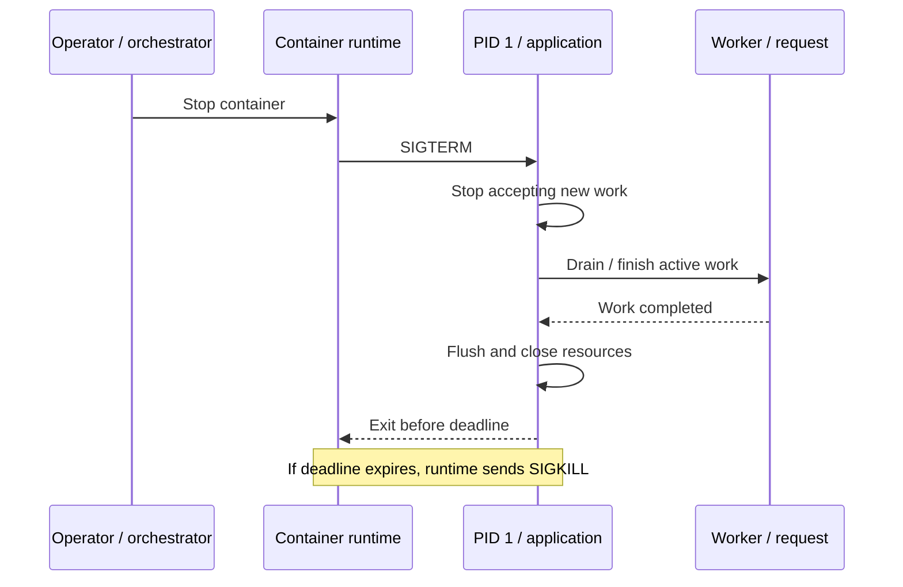
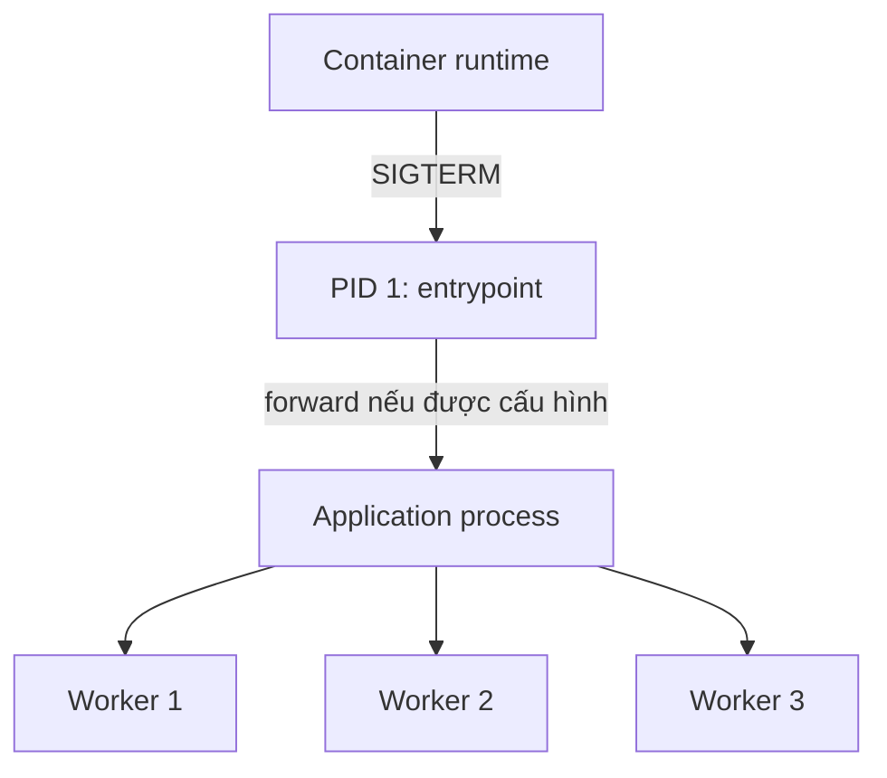

# Signal, PID 1 và dừng container đúng cách

## Bối cảnh: container kết thúc không có nghĩa là tiến trình đã dừng an toàn

Container thường được tạo để chạy một ứng dụng hoặc một nhóm tiến trình liên quan. Khi container bị stop, runtime gửi signal đến tiến trình chính để yêu cầu ứng dụng kết thúc. Nếu ứng dụng không nhận được signal, không chuyển signal đến worker con hoặc không hoàn tất việc ghi dữ liệu trước thời hạn, runtime có thể buộc dừng bằng `SIGKILL`. Hậu quả có thể là request đang xử lý bị ngắt, message bị xử lý lặp, file chưa flush, kết nối không được đóng và dữ liệu ở trạng thái không nhất quán.

Trong Linux container, tiến trình chính thường mang PID 1 trong PID namespace của container. PID 1 có vai trò đặc biệt: nó nhận signal từ runtime, quản lý vòng đời tiến trình con và phải thu hồi tiến trình con đã kết thúc (reap zombie). Cách viết `ENTRYPOINT`/`CMD`, cách shell khởi chạy ứng dụng và cách ứng dụng xử lý `SIGTERM` quyết định container có dừng đúng cách hay không.

Trong module **CLOUD_CORE_SERVICES_COMPUTE**, hiểu signal và PID 1 giúp xây dựng image đúng, vận hành container ổn định trên Docker và Kubernetes, giảm lỗi khi deploy/scale-in và bảo vệ dữ liệu trong quá trình shutdown.

## 1. Process và signal trong Linux

Process là một instance đang thực thi của chương trình. Mỗi process có PID (Process ID), trạng thái, không gian địa chỉ, file descriptor, quyền và quan hệ với process cha/con. Một process có thể tạo nhiều process con để thực hiện worker, shell command hoặc tác vụ phụ.

Signal là cơ chế thông báo bất đồng bộ từ kernel hoặc process khác đến một process/thread. Signal có thể yêu cầu process kết thúc, tạm dừng, tiếp tục hoặc xử lý một sự kiện. Một số signal có thể được ứng dụng bắt (catch), chặn (block) hoặc bỏ qua (ignore); một số signal như `SIGKILL` và `SIGSTOP` không thể bị bắt hoặc bỏ qua.

Các signal thường gặp khi vận hành container:

| Signal | Số thường gặp trên Linux | Ý nghĩa | Có thể xử lý tùy chỉnh? |
|---|---:|---|---|
| `SIGTERM` | 15 | Yêu cầu kết thúc có trật tự | Có |
| `SIGINT` | 2 | Ngắt, thường tương ứng Ctrl+C | Có |
| `SIGQUIT` | 3 | Yêu cầu kết thúc và thường tạo core dump theo mặc định | Có |
| `SIGKILL` | 9 | Buộc kết thúc ngay | Không |
| `SIGSTOP` | 19 (x86/Linux) | Tạm dừng process | Không |
| `SIGCONT` | 18 (x86/Linux) | Tiếp tục process đang dừng | Có thể bắt, nhưng không ngăn được việc tiếp tục |
| `SIGHUP` | 1 | Hangup; nhiều ứng dụng dùng để reload cấu hình | Có |
| `SIGCHLD` | 17 (x86/Linux) | Báo process con thay đổi trạng thái | Có |

Số signal có thể khác giữa kiến trúc hoặc hệ điều hành; dùng tên signal thay vì hard-code số. Hành vi mặc định phụ thuộc từng signal. Ví dụ `SIGTERM` mặc định kết thúc process, còn `SIGCHLD` mặc định được bỏ qua về mặt hành động nhưng vẫn có ý nghĩa cho việc thu hồi child process.

### 1.1. Gửi signal bằng lệnh

Trên Linux, có thể dùng `kill` để gửi signal đến PID:

```bash
# Yêu cầu process 123 kết thúc có trật tự
kill -TERM 123

# Cách viết tương đương thường dùng
kill -15 123

# Buộc kết thúc nếu process không phản hồi
kill -KILL 123

# Xem process và quan hệ PID/PPID
ps -o pid,ppid,stat,cmd -p 1
ps -ef
```

Tên lệnh `kill` có thể gửi signal; nó không nhất thiết có nghĩa là “xóa process ngay”. `SIGTERM` là yêu cầu kết thúc và process có thể thực hiện cleanup. `SIGKILL` kết thúc process mà không cho ứng dụng chạy cleanup handler.

### 1.2. Signal không phải lời gọi hàm đồng bộ

Signal có thể đến vào thời điểm ứng dụng đang thực hiện bất kỳ đoạn code nào. Handler cần làm việc an toàn và ngắn gọn. Trong nhiều runtime, handler chỉ nên đánh dấu trạng thái shutdown hoặc đánh thức event loop; việc flush dữ liệu, đóng kết nối và chờ worker nên diễn ra trong luồng xử lý bình thường.

Không nên thực hiện thao tác phức tạp, blocking hoặc không an toàn trong signal handler cấp thấp. Ví dụ, trong C/C++, nhiều hàm thư viện không async-signal-safe; gọi chúng trực tiếp từ handler có thể gây deadlock hoặc trạng thái không xác định.

## 2. PID namespace và vai trò của PID 1

Container thường chạy trong PID namespace riêng. Process nhìn thấy bên trong namespace có PID riêng; process đầu tiên của namespace thường có PID 1. Trên host, cùng process đó có thể mang PID khác.

Ví dụ:

```text
Host PID namespace                 Container PID namespace
-------------------               ------------------------
PID 1: host init                   PID 1: application/init
PID 820: container runtime shim
PID 945: container process  ------> PID 1: app
PID 946: app worker                PID 2: worker
```

PID trong container không nhất thiết bằng PID trên host. PID namespace cung cấp góc nhìn và phạm vi process riêng, nhưng process vẫn chia sẻ kernel của host. Vì vậy, PID 1 trong container có các trách nhiệm đặc biệt trong namespace đó.

### 2.1. PID 1 có hai trách nhiệm quan trọng

**Nhận và xử lý signal:** runtime thường gửi signal đến process chính của container. Nếu process PID 1 không cài handler phù hợp hoặc không chuyển signal cho tiến trình con, ứng dụng có thể tiếp tục chạy đến khi hết thời gian grace period và bị `SIGKILL`.

**Thu hồi process con:** khi process cha kết thúc trước process con, process con còn sống trở thành orphan và được một process nhận nuôi (adopted) trong PID namespace. PID 1 hoặc subreaper phù hợp phải `wait()` để thu hồi process con đã kết thúc. Nếu không, process đã kết thúc có thể tồn tại ở trạng thái zombie.

### 2.2. Hành vi signal đặc biệt của PID 1

Linux áp dụng quy tắc đặc biệt cho process có PID 1 trong một PID namespace: các signal có hành động mặc định là kết thúc process không nhất thiết làm PID 1 kết thúc nếu process không cài handler để xử lý; `SIGKILL` và `SIGSTOP` vẫn là các ngoại lệ không thể bắt hoặc bỏ qua. Đây là cơ chế bảo vệ init process khỏi bị kết thúc ngoài ý muốn. Vì vậy, một ứng dụng chạy trực tiếp làm PID 1 nhưng không cài handler `SIGTERM` có thể không kết thúc như kỳ vọng khi container runtime gửi signal.

Không nên dựa vào hành vi mặc định để thiết kế shutdown. Ứng dụng chạy làm PID 1 cần xử lý signal rõ ràng hoặc được đặt sau một init process nhỏ có khả năng chuyển tiếp signal và reap child process.

### 2.3. Zombie và orphan process

- **Orphan process:** process con vẫn đang chạy sau khi process cha kết thúc. Nó được một process khác nhận nuôi, thường là PID 1 hoặc subreaper.
- **Zombie process:** process con đã kết thúc nhưng entry của nó còn trong process table vì process cha chưa gọi `wait()`/`waitpid()` để thu hồi exit status.

Zombie không còn thực thi và thường không tiêu thụ CPU, nhưng vẫn giữ một process table entry. Nhiều zombie tích tụ có thể làm cạn giới hạn process/PID. Một PID 1 không reap child process đúng cách có thể khiến container lâu dài tích tụ zombie.

Kiểm tra process zombie:

```bash
ps -eo pid,ppid,stat,cmd | awk '$3 ~ /Z/ { print }'
```

Trong output `ps`, trạng thái `Z` biểu thị zombie. Cách xử lý đúng là sửa process cha/PID 1 để thu hồi child; gửi `SIGKILL` cho zombie không giúp vì process đó đã kết thúc.

## 3. Vì sao PID 1 cần chuyển tiếp signal và reap child process?

Một container có thể chạy ứng dụng trực tiếp hoặc chạy một shell/script làm process cha rồi mới khởi chạy ứng dụng. Khi runtime gửi signal, signal thường được gửi đến process chính. Nếu process chính chỉ là shell và không chuyển tiếp signal, ứng dụng con có thể không nhận được yêu cầu shutdown.

### 3.1. Mẫu khởi chạy dễ gây lỗi

Ví dụ shell script:

```sh
#!/bin/sh

./start-server &
./start-metrics-agent
wait
```

Nếu script là PID 1, server là process con. Khi container nhận `SIGTERM`, shell có thể nhận signal nhưng không tự động chuyển tiếp đến mọi process con. Nếu script không có trap/forward logic phù hợp, server có thể tiếp tục chạy cho đến khi runtime buộc kết thúc container.

Một lỗi khác là khởi chạy ứng dụng bằng shell mà không dùng `exec`:

```sh
#!/bin/sh
node server.js
```

Trong trường hợp này shell vẫn là process cha và Node.js là child. Nếu không có signal forwarding, runtime gửi signal đến shell chứ không trực tiếp đến Node.js.

### 3.2. Dùng `exec` để thay shell bằng ứng dụng

Trong shell script, `exec` thay thế process shell hiện tại bằng chương trình được chỉ định. PID không đổi, vì vậy ứng dụng trở thành process chính:

```sh
#!/bin/sh
set -e

# Chuẩn bị cấu hình hoặc thư mục cần thiết tại đây
exec node server.js
```

Sau `exec`, shell không còn là process riêng. Node.js nhận PID 1 và nhận signal trực tiếp từ runtime. Ứng dụng vẫn phải có logic xử lý `SIGTERM` và dừng worker/kết nối đúng cách.

### 3.3. Dùng exec form trong Dockerfile

Dockerfile hỗ trợ hai dạng chính cho `ENTRYPOINT` và `CMD`:

**Exec form** dùng mảng JSON:

```dockerfile
FROM node:22-alpine
WORKDIR /app
COPY package*.json ./
RUN npm ci --omit=dev
COPY . .

ENTRYPOINT ["node", "server.js"]
```

Ở dạng này, runtime chạy executable trực tiếp; Node.js trở thành process chính của container. Đây thường là lựa chọn phù hợp cho ứng dụng container.

**Shell form** chạy thông qua shell mặc định:

```dockerfile
FROM node:22-alpine
WORKDIR /app
COPY . .

ENTRYPOINT node server.js
```

Shell form thường tương đương khởi chạy qua `/bin/sh -c`. Shell có thể trở thành PID 1, còn ứng dụng là child process. Signal forwarding phụ thuộc shell và cách command được thực thi; không nên giả định signal sẽ luôn đến ứng dụng.

Nếu cần shell để mở rộng biến môi trường hoặc chạy nhiều bước, có thể dùng script và `exec` ở lệnh cuối:

```dockerfile
COPY docker-entrypoint.sh /usr/local/bin/
RUN chmod +x /usr/local/bin/docker-entrypoint.sh
ENTRYPOINT ["/usr/local/bin/docker-entrypoint.sh"]
CMD ["node", "server.js"]
```

```sh
#!/bin/sh
set -eu

# Thực hiện bước chuẩn bị ngắn nếu cần
exec "$@"
```

Script này thay thế chính nó bằng command được truyền từ `CMD` hoặc đối số lúc chạy. Nhờ vậy ứng dụng trở thành PID 1.

### 3.4. Phân biệt ENTRYPOINT và CMD

- `ENTRYPOINT` xác định executable chính của image.
- `CMD` cung cấp command mặc định hoặc đối số mặc định cho `ENTRYPOINT`.
- Với exec form, `ENTRYPOINT ["app"]` và `CMD ["--port", "8080"]` thường kết hợp thành `app --port 8080`.
- Đối số truyền khi `docker run image ...` có thể thay thế `CMD`.

Ví dụ:

```dockerfile
ENTRYPOINT ["python", "-m", "http.server"]
CMD ["8080"]
```

Ứng dụng Python được chạy trực tiếp làm process chính. Khi runtime gửi `SIGTERM`, Python nhận signal và có thể xử lý theo logic ứng dụng.

## 4. Init process nhỏ trong container

Không phải ứng dụng nào cũng được thiết kế để làm PID 1 hoặc quản lý nhiều child process. Khi container cần chạy một chương trình tạo process con, có thể đặt một init process nhỏ phía trước ứng dụng.

Init process phù hợp thường cung cấp:

- Chuyển tiếp signal đến process con hoặc process group theo thiết kế.
- Reap orphan/zombie child process.
- Theo dõi exit status và kết thúc đúng khi ứng dụng chính dừng.
- Có footprint nhỏ và hành vi dễ dự đoán.

Các công cụ thường gặp gồm `tini` và `dumb-init`. Docker cũng có tùy chọn `--init` để chạy một init process nhỏ do runtime cung cấp, tùy nền tảng triển khai.

### 4.1. Ví dụ dùng Tini

```dockerfile
FROM node:22-alpine
RUN apk add --no-cache tini
WORKDIR /app
COPY package*.json ./
RUN npm ci --omit=dev
COPY . .

ENTRYPOINT ["/sbin/tini", "--"]
CMD ["node", "server.js"]
```

Trong ví dụ, Tini làm PID 1, quản lý child process và chuyển tiếp signal theo cách nó hỗ trợ; Node.js chạy làm child. Đường dẫn Tini phụ thuộc image/package. Hãy kiểm tra vị trí executable trong base image đã chọn.

### 4.2. Khi nào cần init shim?

Nên cân nhắc init shim khi:

- Ứng dụng tạo nhiều process con và không tự reap chúng.
- Container chạy shell wrapper hoặc nhiều child process.
- Ứng dụng legacy không được thiết kế làm PID 1.
- Cần xử lý orphan process và zombie một cách nhất quán.

Nếu container chỉ chạy một ứng dụng foreground đã xử lý signal và child process đúng cách, init shim có thể không cần thiết. Tránh thêm nhiều lớp supervisor phức tạp nếu không có nhu cầu rõ ràng.

### 4.3. Init shim không thay thế graceful shutdown của ứng dụng

Init process có thể chuyển signal và reap process, nhưng không hiểu nghiệp vụ của ứng dụng. Nó không tự biết cần ngừng nhận request, commit transaction, drain queue hoặc flush buffer như thế nào. Ứng dụng vẫn phải triển khai shutdown lifecycle phù hợp.

## 5. Graceful shutdown: kết thúc có trật tự

Graceful shutdown là quá trình ứng dụng dừng nhận công việc mới, hoàn tất hoặc hủy có kiểm soát công việc đang chạy, giải phóng tài nguyên và thoát trước deadline. Mục tiêu là giảm request lỗi, dữ liệu dở dang và message bị xử lý trùng khi container bị thay thế hoặc scale-in.

Một trình tự phổ biến:

1. Nhận `SIGTERM` và chuyển trạng thái ứng dụng sang `SHUTTING_DOWN`.
2. Đánh dấu instance không còn readiness để load balancer/orchestrator ngừng gửi request mới.
3. Ngừng nhận message hoặc job mới từ queue/scheduler.
4. Chờ request đang xử lý hoàn tất trong giới hạn thời gian.
5. Commit/rollback transaction theo đúng quy tắc nghiệp vụ.
6. Flush buffer, checkpoint hoặc lưu state cần thiết.
7. Đóng connection pool, listener, consumer và client.
8. Dừng worker con và thu hồi process.
9. Ghi log trạng thái cuối và thoát với exit code phù hợp.

Không phải mọi ứng dụng đều cần đúng thứ tự trên. Ví dụ worker có thể dừng nhận message trước, hoàn tất message hiện tại rồi mới đóng database pool. Web server có thể ngừng nhận connection mới nhưng giữ connection đang hoạt động trong một khoảng drain.

### 5.1. Idempotency và công việc đang xử lý

Graceful shutdown không thể bảo đảm mọi công việc đều hoàn tất: process có thể bị kill, host có thể mất điện hoặc grace period có thể hết. Vì vậy, job/message cần được thiết kế an toàn khi retry:

- Dùng idempotency key hoặc deduplication cho thao tác có side effect.
- Chỉ ACK message sau khi kết quả được commit bền vững.
- Đặt visibility timeout/lease phù hợp với thời gian xử lý.
- Lưu checkpoint cho job dài nếu có thể.
- Dùng transaction hoặc outbox pattern khi cập nhật database và phát event.
- Có dead-letter queue và giới hạn retry cho payload lỗi.

## 6. SIGTERM và SIGKILL trong vòng đời container

`SIGTERM` là yêu cầu dừng có trật tự. Runtime thường chờ một khoảng thời gian cấu hình trước khi gửi `SIGKILL`. `SIGKILL` kết thúc process ngay mà không cho ứng dụng chạy cleanup handler, `finally` block hoặc hook shutdown thông thường.



### 6.1. Timeout dừng

Grace period cần đủ dài để ứng dụng drain công việc bình thường nhưng không quá dài khiến rollout hoặc scale-in bị treo. Có thể ước lượng từ:

```text
shutdown_budget = readiness_propagation
                + max_inflight_work_drain
                + resource_cleanup
                + safety_margin
```

Ví dụ, ứng dụng cần 5 giây để ngừng nhận traffic, tối đa 20 giây để hoàn tất request đang chạy và 5 giây để đóng kết nối. Có thể bắt đầu thử nghiệm với grace period lớn hơn tổng 30 giây một khoảng an toàn, rồi đo lại bằng tải thực tế.

Nếu timeout ngắn hơn thời gian xử lý hợp lệ, request đang chạy có thể bị ngắt. Nếu timeout quá dài, deploy/scale-in chậm và rollout có thể vượt ngân sách thời gian. Cần đo p95/p99 của thời gian drain, không chỉ dùng một giá trị mặc định.

### 6.2. STOPSIGNAL trong Dockerfile

Docker image có thể khai báo signal gửi khi stop:

```dockerfile
STOPSIGNAL SIGTERM
ENTRYPOINT ["/app/server"]
```

`SIGTERM` là lựa chọn phổ biến. Chỉ dùng signal khác nếu ứng dụng và runtime được cấu hình thống nhất. `STOPSIGNAL` không thay thế handler của ứng dụng; nếu process không xử lý signal đó, container vẫn có thể bị buộc kết thúc sau timeout.

### 6.3. Docker stop và kill

```bash
# Gửi signal stop mặc định và chờ timeout mặc định của runtime
docker stop orders-api

# Chờ tối đa 45 giây trước khi buộc kết thúc
docker stop --time 45 orders-api

# Gửi signal cụ thể, ví dụ SIGTERM
docker kill --signal=SIGTERM orders-api

# Buộc kết thúc ngay; chỉ dùng khi cần thiết
docker kill --signal=SIGKILL orders-api
```

`docker stop` gửi stop signal được cấu hình (mặc định thường là `SIGTERM`), chờ khoảng thời gian grace period, sau đó gửi `SIGKILL` nếu container chưa thoát. `docker kill` mặc định gửi `SIGKILL`, nhưng có thể chỉ định signal khác bằng `--signal`.

Không dùng `docker kill` mặc định như cách deploy bình thường cho ứng dụng stateful. Dùng `docker stop` hoặc cơ chế orchestrator có graceful termination và kiểm tra log/exit code sau khi dừng.

## 7. Triển khai signal handler trong ứng dụng

Signal handler cần phối hợp với vòng đời ứng dụng. Handler không nên chỉ gọi `exit()` ngay khi nhận `SIGTERM`; cần chuyển trạng thái, dừng nhận công việc mới và chờ cleanup trong thời hạn.

### 7.1. Ví dụ Node.js HTTP server

Ví dụ dưới đây minh họa các ý chính: readiness chuyển sang false, server ngừng nhận kết nối mới, queue consumer ngừng nhận message, công việc đang chạy được drain và database pool được đóng.

```javascript
let shuttingDown = false;

app.get("/ready", (_req, res) => {
  if (shuttingDown) {
    return res.status(503).send("shutting down");
  }
  res.status(200).send("ready");
});

async function shutdown(signal) {
  if (shuttingDown) return;
  shuttingDown = true;
  console.log(`received ${signal}; starting graceful shutdown`);

  // Cho load balancer/orchestrator thời gian cập nhật readiness.
  await new Promise((resolve) => setTimeout(resolve, 3000));

  // Ngừng nhận job mới trước khi chờ các công việc đang chạy.
  await queueConsumer.stopReceiving();

  // Ngừng nhận HTTP connection mới và chờ request đang chạy.
  await new Promise((resolve, reject) => {
    server.close((error) => error ? reject(error) : resolve());
  });

  // Chờ job đang xử lý và đóng dependency.
  await queueConsumer.drain({ timeoutMs: 15000 });
  await databasePool.end();

  console.log("graceful shutdown complete");
}

process.on("SIGTERM", () => {
  shutdown("SIGTERM").catch((error) => {
    console.error("shutdown failed", error);
    process.exitCode = 1;
  });
});

process.on("SIGINT", () => {
  shutdown("SIGINT").catch((error) => {
    console.error("shutdown failed", error);
    process.exitCode = 1;
  });
});
```

Đây là skeleton cần điều chỉnh theo phiên bản Node.js, HTTP server, queue client và database driver. Phải có deadline tổng thể: nếu drain không kết thúc trước grace period, runtime vẫn có thể gửi `SIGKILL`. Trong ứng dụng thật, nên thêm timeout/cancellation cho từng bước và bảo đảm cleanup không bị gọi lặp.

### 7.2. Ví dụ Python với shutdown event

Với Python, handler có thể đặt cờ hoặc `Event`; vòng lặp chính kiểm tra cờ rồi thực hiện cleanup trong luồng điều khiển bình thường:

```python
import signal
import threading

shutdown_requested = threading.Event()

def request_shutdown(signum, _frame):
    print(f"received signal {signum}")
    shutdown_requested.set()

signal.signal(signal.SIGTERM, request_shutdown)
signal.signal(signal.SIGINT, request_shutdown)

def main():
    start_http_server()
    start_workers()

    while not shutdown_requested.wait(timeout=0.5):
        run_periodic_tasks()

    mark_not_ready()
    stop_accepting_new_jobs()
    drain_inflight_jobs(timeout_seconds=20)
    close_database_pool()
    close_message_consumer()

if __name__ == "__main__":
    main()
```

Không thực hiện toàn bộ cleanup trong signal handler. Với server framework, hãy dùng lifecycle hook hoặc API shutdown chính thức của framework để dừng listener và worker đúng cách.

### 7.3. Ví dụ Go HTTP server

Go có thể dùng `signal.NotifyContext` để hủy context khi nhận signal và `http.Server.Shutdown` để chờ request đang hoạt động:

```go
ctx, stop := signal.NotifyContext(
    context.Background(), syscall.SIGTERM, syscall.SIGINT,
)
defer stop()

server := &http.Server{Addr: ":8080", Handler: handler}
go func() {
    if err := server.ListenAndServe(); err != nil && err != http.ErrServerClosed {
        log.Printf("server error: %v", err)
    }
}()

<-ctx.Done()

shutdownCtx, cancel := context.WithTimeout(context.Background(), 25*time.Second)
defer cancel()

if err := server.Shutdown(shutdownCtx); err != nil {
    log.Printf("graceful shutdown failed: %v", err)
    _ = server.Close()
}
```

Đoạn code cần các import tương ứng (`context`, `log`, `net/http`, `os/signal`, `syscall`, `time`). Trong hệ thống thực tế, cần dừng background worker và dependency trước khi process thoát; `Server.Shutdown` chỉ xử lý HTTP server.

## 8. Kubernetes termination lifecycle

Kubernetes quản lý vòng đời Pod và container thông qua kubelet. Khi Pod bị xóa hoặc thay thế trong rollout, Kubernetes thực hiện quy trình termination có grace period.

Ở mức khái niệm, trình tự gồm:

1. Pod được đánh dấu đang terminating; endpoint controller cập nhật trạng thái endpoint để tránh gửi traffic mới đến Pod theo cơ chế của Service.
2. Nếu cấu hình `preStop`, kubelet chạy hook trong container.
3. Sau hook, kubelet gửi stop signal (thường là `SIGTERM`) đến process chính trong container.
4. Ứng dụng thực hiện graceful shutdown trong phần thời gian còn lại.
5. Khi `terminationGracePeriodSeconds` hết mà process vẫn chạy, kubelet/runtime buộc kết thúc bằng `SIGKILL`.

Việc cập nhật EndpointSlice/load balancer và chạy hook diễn ra phân tán; không nên giả định traffic ngừng ngay đúng thời điểm ứng dụng nhận `SIGTERM`. Ứng dụng cần readiness/drain logic và timeout phù hợp.

### 8.1. terminationGracePeriodSeconds

Pod có thể khai báo thời gian grace period:

```yaml
apiVersion: v1
kind: Pod
metadata:
  name: orders-api
spec:
  terminationGracePeriodSeconds: 45
  containers:
    - name: app
      image: example/orders-api:1.4.0
      ports:
        - name: http
          containerPort: 8080
```

Giá trị mặc định thường là 30 giây nếu không chỉ định. Thời gian này bao gồm thời gian chạy `preStop` hook; hook tiêu thụ grace period chứ không được cộng thêm một khoảng riêng. Nếu hook còn chạy khi grace period gần hết, kubelet có thể cấp một khoảng gia hạn ngắn trong một số trường hợp, nhưng không nên dựa vào điều đó.

### 8.2. preStop hook

`preStop` phù hợp để báo cho ứng dụng bắt đầu drain trước khi kubelet gửi stop signal. Ví dụ hook HTTP gọi endpoint quản trị nội bộ:

```yaml
apiVersion: v1
kind: Pod
metadata:
  name: orders-api
spec:
  terminationGracePeriodSeconds: 45
  containers:
    - name: app
      image: example/orders-api:1.4.0
      lifecycle:
        preStop:
          httpGet:
            path: /internal/drain
            port: 8081
            scheme: HTTP
```

Endpoint `/internal/drain` cần được bảo vệ và chỉ cho phép gọi từ môi trường container/lifecycle đã tin cậy. Nó có thể chuyển readiness sang false, ngừng nhận công việc mới và bắt đầu drain. Sau khi hook hoàn tất, kubelet gửi `SIGTERM`; ứng dụng nên xử lý signal idempotently và tiếp tục cleanup nếu chưa hoàn tất.

Không dùng `preStop: sleep 30` như giải pháp mặc định. Sleep chỉ trì hoãn việc gửi `SIGTERM`, tiêu thụ grace period và không tự bảo đảm load balancer đã ngừng traffic. Nếu cần chờ propagation, hãy đo thời gian thực tế và phối hợp readiness/endpoint drain.

### 8.3. Readiness, liveness và shutdown

- Readiness trả về không sẵn sàng khi ứng dụng đang shutdown để Service ngừng chọn Pod làm backend.
- Liveness kiểm tra process có còn hoạt động; không nên thất bại chỉ vì ứng dụng đang drain, nếu điều đó khiến kubelet restart container giữa quá trình shutdown.
- Startup probe có thể bảo vệ ứng dụng khởi động chậm khỏi bị liveness probe đánh giá quá sớm.

Probe cần timeout, period và failure threshold hợp lý. Nếu readiness phụ thuộc quá nhiều vào dependency tạm thời, một lỗi dependency có thể làm toàn bộ replica bị loại khỏi Service. Thiết kế probe phải phản ánh khả năng nhận request của ứng dụng.

### 8.4. Rolling update và PodDisruptionBudget

Trong rolling update, Kubernetes thay Pod theo chiến lược Deployment. Ứng dụng cần hoàn tất drain trong grace period để giảm request lỗi. `maxUnavailable`, `maxSurge`, readiness probe và PodDisruptionBudget (PDB) ảnh hưởng số replica có thể bị gián đoạn cùng lúc.

PDB chủ yếu giới hạn voluntary disruption thông qua eviction API; nó không ngăn mọi dạng sự cố như node crash hoặc zone outage. Không nên coi PDB là cơ chế thay thế capacity dư hoặc graceful shutdown.

## 9. Signal đến process nào trong container?

Container runtime thường gửi stop signal đến process chính (PID 1) của container. Runtime không tự động hiểu cây process của ứng dụng và không nhất thiết gửi signal đến mọi process con.



Nếu PID 1 là ứng dụng và ứng dụng quản lý worker, ứng dụng cần dừng worker đúng cách. Nếu PID 1 là init shim, shim chuyển signal theo cơ chế của nó và thu hồi child process. Nếu PID 1 là shell wrapper, cần bảo đảm wrapper dùng `exec`, trap/forward hoặc một init process phù hợp.

### 9.1. Process group và nhiều tiến trình

Linux tổ chức process theo session và process group. Một số ứng dụng quản lý nhiều child process và cần gửi signal đến cả process group. Tuy nhiên, runtime gửi signal đến PID 1 không có nghĩa toàn bộ process group tự động nhận cùng signal.

Khi container thực sự cần nhiều tiến trình độc lập, hãy dùng một process supervisor/init được thiết kế cho mục đích đó hoặc tách các vai trò thành container riêng. Nếu dùng init shim có tùy chọn forward đến process group, cần đọc tài liệu của đúng phiên bản và kiểm thử hành vi khi có child process mới.

### 9.2. Chạy Docker với init process

Với Docker CLI, có thể yêu cầu runtime thêm init process nhỏ:

```bash
docker run --init --name worker worker-image:1.0
```

Tùy chọn `--init` giúp xử lý một số vấn đề signal forwarding và zombie reaping. Ứng dụng vẫn phải có logic graceful shutdown; `--init` không tự dừng nhận request, flush dữ liệu hoặc hoàn tất transaction thay cho ứng dụng.

## 10. Graceful shutdown cho từng loại workload

### 10.1. HTTP/API server

- Chuyển readiness sang false để ngừng nhận traffic mới.
- Dừng accept connection mới nhưng cho request đang xử lý hoàn tất trong thời hạn.
- Với keep-alive/HTTP/2, xử lý connection draining và stream đang mở.
- Đóng WebSocket hoặc gửi thông báo reconnect nếu giao thức yêu cầu.
- Đóng database/cache/client pool sau khi request hoàn tất.
- Trả exit code phản ánh kết quả shutdown.

Request dài hơn grace period cần có deadline, cancellation hoặc cơ chế tiếp tục ở background. Không giữ container mãi chỉ vì một client không đóng connection.

### 10.2. Queue consumer và worker

- Ngừng poll/subscribe message mới.
- Không ACK message đang xử lý trước khi kết quả được commit.
- Chờ công việc đang chạy hoàn tất trong giới hạn.
- Nếu hết thời gian, để lease/visibility timeout cho phép message được retry.
- Bảo đảm handler idempotent để retry không tạo side effect trùng.
- Đóng consumer và connection sau khi drain.

### 10.3. Batch job và scheduled task

Batch job có thể cần checkpoint để tiếp tục từ vị trí gần nhất sau khi bị ngắt. Với job không thể checkpoint, hãy dùng deadline đủ dài hoặc chạy trong workload có khả năng hoàn tất trước thời điểm termination. Tránh tạo job dài hơn thời gian shutdown cho phép nếu không có cơ chế resume.

### 10.4. Stateful service

Database, broker hoặc service giữ state cần shutdown theo protocol riêng của sản phẩm. Cần flush WAL/journal, đồng bộ replica, đóng listener và xác minh quorum/leader state. Không nên gửi `SIGKILL` như thao tác thường lệ hoặc tự xóa file dữ liệu khi process chưa hoàn tất shutdown.

## 11. Thiết kế timeout và phối hợp với load balancer

Shutdown timeout cần phối hợp giữa các lớp:

| Lớp | Cấu hình liên quan | Mục tiêu |
|---|---|---|
| Application | Request deadline, drain timeout, worker timeout | Hoàn tất hoặc hủy công việc có kiểm soát |
| Readiness | Probe period, timeout, failure threshold | Đánh dấu instance không nhận việc mới |
| Load balancer | Deregistration delay, connection draining | Ngừng gửi request mới và xử lý connection đang mở |
| Container runtime | Stop timeout / grace period | Cho ứng dụng thời gian thoát trước SIGKILL |
| Kubernetes Pod | `terminationGracePeriodSeconds`, `preStop` | Điều phối lifecycle và thời gian kết thúc |

Các timeout phải có quan hệ hợp lý. Ví dụ, nếu load balancer giữ connection 60 giây nhưng container chỉ có 30 giây grace period, ứng dụng có thể bị kill khi connection vẫn đang được drain. Ngược lại, nếu application timeout dài hơn toàn bộ grace period, công việc có thể không hoàn tất.

Một cấu hình minh họa cho API:

```text
Readiness propagation:       5 seconds
Load balancer drain window:  25 seconds
Application request drain:   20 seconds
Resource cleanup:             5 seconds
Pod termination grace:       40 seconds
```

Đây chỉ là ví dụ để minh họa quan hệ timeout. Thực tế cần đo thời gian cập nhật endpoint, thời gian request dài nhất được hỗ trợ, số kết nối đồng thời và chi phí giữ Pod terminating.

### 11.1. Không dựa hoàn toàn vào sleep

Một đoạn `sleep` trong entrypoint hoặc `preStop` có thể tạo khoảng đệm, nhưng không chứng minh traffic đã ngừng hoặc worker đã drain. Tốt hơn là dùng readiness, endpoint drain và tín hiệu ứng dụng có thể xác nhận. Nếu buộc phải chờ propagation, đo thời gian thực tế rồi đặt khoảng chờ có giới hạn.

## 12. Exit code và chẩn đoán container bị kill

Khi container dừng, kiểm tra exit code, OOM status, event và log để phân biệt ứng dụng tự thoát, bị runtime kill hay bị kernel OOM killer kết thúc.

```bash
# Xem trạng thái, exit code và cờ OOMKilled
docker inspect --format '{{.State.Status}} {{.State.ExitCode}} {{.State.OOMKilled}}' orders-api

# Xem log gần thời điểm dừng
docker logs --tail 200 orders-api

# Xem sự kiện runtime gần đây
docker events --since 10m
```

Một số exit code thường gặp:

- `0`: process kết thúc thành công theo quy ước của ứng dụng.
- `143`: thường tương ứng `128 + 15`, tức process kết thúc do `SIGTERM`.
- `137`: thường tương ứng `128 + 9`, tức process bị `SIGKILL`; nguyên nhân có thể là hết grace period hoặc OOM kill.

Exit code chỉ là manh mối. `137` không tự chứng minh OOM; cần kiểm tra `OOMKilled`, kernel log, container event và memory metric. `143` cũng không chứng minh shutdown đã hoàn tất nghiệp vụ; cần kiểm tra log cleanup và dữ liệu.

Với Kubernetes:

```bash
# Xem trạng thái và lý do container restart
kubectl describe pod orders-api-xxxxx

# Xem log container hiện tại và lần chạy trước
kubectl logs orders-api-xxxxx -c app
kubectl logs orders-api-xxxxx -c app --previous

# Xem event trong namespace
kubectl get events --sort-by=.lastTimestamp
```

Tìm `OOMKilled`, `Error`, `Killing`, probe failure, eviction và thời gian Pod chuyển sang Terminating. Đối chiếu timestamp với application log để biết handler đã nhận signal hay chưa.

## 13. Các lỗi thường gặp và cách khắc phục

| Triệu chứng | Nguyên nhân có thể | Hướng xử lý |
|---|---|---|
| Container mất đủ timeout rồi mới dừng | PID 1 không xử lý/forward `SIGTERM` hoặc ứng dụng không thoát | Kiểm tra PID tree, dùng exec form/`exec`, thêm handler và đo cleanup |
| App không nhận SIGTERM | Shell đang là PID 1 và không forward signal | Dùng exec form, `exec` trong wrapper hoặc init shim |
| Worker con còn chạy sau khi app thoát | Không quản lý child process/process group | Dừng worker rõ ràng, dùng supervisor/init phù hợp và reap child |
| Zombie process tăng | PID 1 không `wait()` child đã kết thúc | Sửa ứng dụng hoặc dùng init shim có reaping |
| Exit code 137 | `SIGKILL` do timeout, OOM hoặc thao tác kill | Kiểm tra `OOMKilled`, grace period, memory và event |
| Request lỗi trong rollout | Readiness/connection draining không đủ hoặc app thoát sớm | Đánh dấu not-ready, phối hợp LB drain và tăng grace period theo số đo |
| Queue message bị xử lý lặp | Worker bị kill trước ACK/commit hoặc handler không idempotent | ACK sau commit, idempotency key, visibility timeout và DLQ |
| Database báo transaction dang dở | Process bị kill khi transaction chưa kết thúc | Graceful transaction handling, deadline và recovery protocol |
| Pod Terminating quá lâu | Hook hoặc request drain bị treo, grace period quá lớn | Kiểm tra hook, in-flight request, finalizer và timeout từng bước |
| Liveness probe restart Pod khi drain | Probe đánh giá shutdown là lỗi liveness | Giữ liveness phản ánh process health; readiness xử lý traffic admission |

## 14. Kiểm thử shutdown trước khi production

Shutdown cần được kiểm thử như một đường đi vận hành bình thường, không chỉ kiểm tra khi ứng dụng đang idle.

### 14.1. Kịch bản kiểm thử

1. Khởi động container và xác minh ứng dụng là PID 1 hoặc init shim là PID 1.
2. Gửi request dài có thời gian xử lý đã biết.
3. Trong lúc request đang chạy, gọi `docker stop --time` hoặc xóa Pod theo grace period dự kiến.
4. Xác minh ứng dụng ngừng nhận request mới và request hiện tại hoàn tất hoặc bị hủy theo policy.
5. Xác minh queue consumer không nhận job mới, message đang xử lý không bị ACK sai.
6. Kiểm tra database transaction, log flush và connection close.
7. Xác minh process con không bị bỏ lại và không có zombie tăng dần.
8. Kiểm tra exit code, thời gian shutdown và metric lỗi.
9. Lặp lại khi tải cao, có dependency chậm và khi cleanup gần hết grace period.
10. Thử trường hợp timeout hết để xác minh hệ thống phục hồi an toàn sau `SIGKILL`.

### 14.2. Tiêu chí chấp nhận

- Ứng dụng nhận được stop signal và ghi nhận thời điểm bắt đầu shutdown.
- Readiness chuyển sang false trước khi instance bị loại khỏi traffic pool.
- Request/job đang chạy hoàn tất hoặc được retry an toàn.
- Process thoát trước grace period trong điều kiện tải được hỗ trợ.
- Không tăng zombie hoặc orphan process ngoài dự kiến.
- Không mất dữ liệu đã xác nhận commit.
- Container/Pod được thay thế và instance mới trở lại Ready.
- Có metric/log để xác định shutdown chậm hoặc bị buộc kill.

### 14.3. Đo thời gian shutdown

Ghi nhận các mốc:

- `t0`: runtime/orchestrator bắt đầu termination.
- `t1`: ứng dụng nhận `SIGTERM`.
- `t2`: readiness false và traffic drain bắt đầu.
- `t3`: request/job cuối cùng hoàn tất hoặc được chuyển giao.
- `t4`: dependency đóng và process thoát.

Từ đó có thể tính thời gian signal delivery (`t1 - t0`), drain (`t3 - t2`) và cleanup (`t4 - t3`). Nếu `t4` vượt grace period, cần tối ưu hoặc điều chỉnh timeout sau khi xác minh tác động.

## 15. Những anti-pattern cần tránh

**Chạy shell làm PID 1 mà không forward signal.** Runtime gửi `SIGTERM` đến shell, còn ứng dụng con không nhận được yêu cầu dừng. Dùng exec form hoặc `exec` ở cuối entrypoint.

**Dùng `SIGKILL` làm cơ chế shutdown thông thường.** `SIGKILL` không cho ứng dụng cleanup. Chỉ dùng khi process không thoát sau grace period hoặc trong thao tác khẩn cấp đã đánh giá.

**Gọi `process.exit()` ngay khi nhận signal.** Việc thoát ngay có thể bỏ qua request đang chạy, buffer, transaction và worker. Hãy bắt đầu quy trình drain và chỉ thoát sau cleanup.

**Cho rằng init shim sẽ xử lý nghiệp vụ.** Init shim chuyển signal và reap child process; ứng dụng vẫn phải dừng nhận việc, hoàn tất transaction và đóng dependency.

**Dùng `sleep` dài trong entrypoint hoặc preStop.** Sleep tiêu thụ thời gian grace period mà không chứng minh traffic đã ngừng hoặc công việc đã drain. Dùng readiness và endpoint drain có thể quan sát.

**Để worker ACK trước khi commit dữ liệu.** Nếu process bị kill sau ACK nhưng trước commit, message có thể mất. Chỉ ACK khi kết quả đã được lưu bền vững theo semantics của hệ thống.

**Tăng grace period vô hạn để che lỗi shutdown.** Thời gian dài có thể làm rollout treo và giữ tài nguyên. Tìm bước cleanup bị block, thêm deadline và theo dõi thời gian drain.

**Dùng liveness probe thay readiness để điều khiển traffic.** Liveness failure có thể khiến container restart trong lúc đang drain. Readiness quyết định nhận traffic; liveness phản ánh process có cần restart hay không.

**Cho rằng PID 1 bằng PID host.** PID namespace tạo góc nhìn riêng; cần kiểm tra cả bên trong container và trên host khi điều tra.

## 16. Runbook khi container không dừng đúng cách

Khi container hoặc Pod mất hết grace period và bị buộc kill, có thể điều tra theo trình tự:

1. Xác định container, Pod, image version, node và thời điểm termination.
2. Kiểm tra PID 1 bên trong image hoặc process tree nếu container còn chạy được.
3. Xác minh `ENTRYPOINT`, `CMD`, shell wrapper và việc dùng `exec`.
4. Kiểm tra log xem ứng dụng có ghi nhận `SIGTERM`/`SIGINT` không.
5. Xác định bước shutdown đang chờ: request, queue, transaction, thread, child process hay dependency.
6. Kiểm tra grace period, `preStop`, load balancer drain và request timeout.
7. Kiểm tra exit code, OOM status, runtime event và kernel event.
8. Đối chiếu thời gian drain với tải và loại request thực tế.
9. Sửa handler/timeout hoặc dùng init shim nếu lỗi nằm ở PID 1/child reaping.
10. Chạy lại kiểm thử shutdown trước khi triển khai rộng.

Không chỉ tăng timeout mà không xác định nguyên nhân. Nếu một dependency treo vô hạn, timeout dài hơn chỉ trì hoãn lỗi; cần deadline và cancellation cho từng thao tác cleanup.

## 17. Checklist thiết kế và vận hành

### Process và PID 1

- [ ] Xác định process nào là PID 1 trong container.
- [ ] `ENTRYPOINT`/`CMD` dùng exec form hoặc wrapper kết thúc bằng `exec`.
- [ ] PID 1 cài handler cho signal dừng cần thiết.
- [ ] Process con được quản lý, signal được forward và child process được reap.
- [ ] Dùng init shim khi ứng dụng không tự quản lý child process phù hợp.

### Graceful shutdown

- [ ] `SIGTERM` bắt đầu shutdown state và được ghi log.
- [ ] Readiness chuyển sang false trước khi ngừng phục vụ.
- [ ] Request, stream và job đang chạy được drain hoặc hủy có kiểm soát.
- [ ] Queue message chỉ ACK sau commit và handler có idempotency.
- [ ] Transaction, buffer, file và connection pool được đóng đúng thứ tự.
- [ ] Mỗi bước có timeout; tổng thời gian nằm trong grace period.
- [ ] `SIGKILL` chỉ là cơ chế cuối khi hết deadline.

### Docker/Kubernetes

- [ ] Docker stop signal và timeout phù hợp với ứng dụng.
- [ ] `STOPSIGNAL` được cấu hình đúng nếu ứng dụng cần signal khác mặc định.
- [ ] Kubernetes `terminationGracePeriodSeconds` đủ cho preStop, drain và cleanup.
- [ ] `preStop` có mục đích cụ thể và không tiêu thụ grace period bằng sleep không cần thiết.
- [ ] Readiness/liveness/startup probe có trách nhiệm riêng và ngưỡng phù hợp.
- [ ] Load balancer connection draining tương thích với thời gian shutdown.
- [ ] Rolling update/PDB và capacity đủ để Pod khác phục vụ khi một Pod terminating.

### Kiểm thử và quan sát

- [ ] Đã thử stop trong lúc có request/job đang chạy.
- [ ] Đã kiểm tra exit code, OOMKilled, runtime event và application log.
- [ ] Không có zombie/orphan process tích tụ.
- [ ] Đã đo thời gian từ signal đến process exit.
- [ ] Đã thử trường hợp dependency chậm và grace period hết hạn.
- [ ] Có alert cho shutdown timeout, restart loop và termination kéo dài.

## Kết luận

Signal là cơ chế Linux dùng để thông báo cho process; `SIGTERM` cho phép ứng dụng kết thúc có trật tự, còn `SIGKILL` buộc process dừng ngay. Process PID 1 trong PID namespace nhận stop signal từ runtime và chịu trách nhiệm quan trọng trong việc quản lý child process; shell wrapper không dùng `exec` hoặc không forward signal có thể khiến ứng dụng con không dừng đúng cách. Một container an toàn cần xử lý graceful shutdown: chuyển readiness, ngừng nhận việc mới, drain request/job, hoàn tất transaction, đóng dependency và thoát trước grace period. Docker stop timeout, Kubernetes `preStop`, `terminationGracePeriodSeconds`, readiness probe và load balancer draining phải được phối hợp. Kiểm thử shutdown dưới tải và quan sát exit code/log giúp phát hiện sớm lỗi trước khi rollout production.
