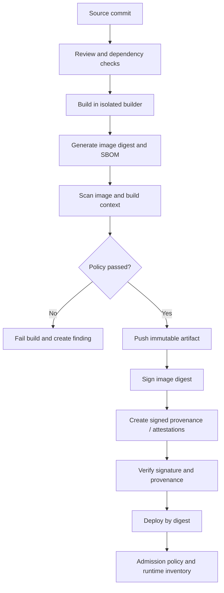

# Registry, quét image, chữ ký và nguồn gốc phần mềm

## 1. Vì sao cần bảo vệ container image?

Container image là đơn vị đóng gói ứng dụng cùng runtime, thư viện và các tệp cần thiết để chạy workload. Một image có thể được build một lần rồi triển khai lên nhiều môi trường: máy phát triển, CI, staging, production hoặc nhiều cluster. Vì image đi qua nhiều hệ thống và có thể được tái sử dụng trong thời gian dài, nó trở thành một phần quan trọng của chuỗi cung ứng phần mềm.

Nếu image lấy từ registry không đáng tin cậy, chứa lỗ hổng nghiêm trọng, vô tình đóng gói secret hoặc bị thay thế sau khi kiểm tra, workload có thể chạy mã độc hoặc bị khai thác. Nếu không biết image được build từ source nào, bằng công cụ nào và ai tạo ra, đội vận hành khó xác minh tính toàn vẹn khi có sự cố.

Quy trình bảo vệ image cần kết hợp nhiều lớp:

- **Registry:** lưu trữ, phân phối và kiểm soát quyền truy cập image.
- **Scanning:** phát hiện lỗ hổng, secret, cấu hình nguy hiểm và thành phần có rủi ro.
- **SBOM:** ghi lại danh sách thành phần phần mềm có trong artifact.
- **Signing:** xác nhận digest của image được ký bởi danh tính hoặc khóa được tin cậy.
- **Provenance/attestation:** ghi bằng chứng image được tạo từ source, builder và quy trình nào.
- **Policy enforcement:** chỉ cho phép image đáp ứng chính sách được triển khai.

Trong module **CLOUD_CORE_SERVICES_COMPUTE**, các cơ chế này bảo vệ image được dùng để triển khai VM/container workload, mở rộng dịch vụ và vận hành compute trên cloud. Bài học tập trung vào registry, quét image, chữ ký và nguồn gốc phần mềm để đảm bảo image được đưa vào production có thể truy xuất và xác minh.

Sau bài học, người học có thể:

- Giải thích vai trò của OCI image, registry, tag và digest.
- Thiết kế registry có xác thực, phân quyền, TLS, retention và audit.
- Quét image để phát hiện CVE, secret và thành phần không phù hợp.
- Tạo và sử dụng SBOM cho image.
- Ký image theo digest và xác minh chữ ký trước khi triển khai.
- Kiểm tra provenance/attestation và ràng buộc image với source/build identity.
- Đưa policy kiểm tra vào CI/CD và admission control của cluster.
- Xử lý lỗ hổng mới phát hiện, thu hồi artifact và điều tra image đáng ngờ.

## 2. Image, registry, tag và digest

### 2.1. OCI image là gì?

OCI (Open Container Initiative) định nghĩa các đặc tả mở cho container image và runtime. Một OCI image thường được mô tả bởi manifest, config và một tập layer. Manifest tham chiếu đến các blob theo digest; config lưu metadata như entrypoint, environment, user và lịch sử build; layer chứa các thay đổi filesystem.

Registry phân phối các manifest và blob này. Khi container runtime pull image, nó lấy manifest rồi tải những layer cần thiết. Các layer có thể được dùng chung giữa nhiều image để giảm dung lượng truyền và lưu trữ.

### 2.2. Registry là nơi lưu và phân phối artifact

Container registry có thể là:

- Registry riêng của tổ chức hoặc cloud provider.
- Registry công khai để chia sẻ image.
- Proxy/cache registry để lưu bản sao các image upstream.
- Registry chạy trong môi trường nội bộ hoặc air-gapped.
- Dịch vụ artifact registry hỗ trợ cả container image và OCI artifact như SBOM, chữ ký hoặc attestation.

Registry thường cung cấp namespace/repository, authentication, authorization, TLS, audit log, retention, replication, vulnerability scanning và cơ chế kiểm soát tag. Các tính năng cụ thể phụ thuộc sản phẩm; không nên mặc định mọi registry hỗ trợ cùng loại policy.

### 2.3. Tag có thể thay đổi, digest xác định nội dung

Ví dụ một image reference:

```text
registry.example.com/platform/orders-api:1.8.2
```

`1.8.2` là tag. Registry có thể cho phép tag này được cập nhật để trỏ đến manifest khác, trừ khi bật chính sách immutable tag. Vì vậy, tag thuận tiện cho con người nhưng không đủ để chứng minh nội dung không thay đổi.

Digest là mã băm của manifest hoặc index, thường có dạng:

```text
registry.example.com/platform/orders-api@sha256:0123456789abcdef...
```

Khi triển khai bằng digest, runtime lấy đúng nội dung có digest đó. Nếu tag được di chuyển sang image khác, reference theo digest vẫn xác định artifact ban đầu.

Quy tắc vận hành:

- Dùng tag có ý nghĩa để tra cứu, ví dụ version hoặc build number.
- Dùng digest trong manifest triển khai production để cố định nội dung.
- Bật immutable tag nếu quy trình phát hành yêu cầu tag không bị ghi đè.
- Lưu mapping giữa source commit, build ID, tag và digest.
- Không dùng `latest` làm định danh duy nhất của production release.

### 2.4. Multi-architecture image

Một tag có thể trỏ đến image index/manifest list chứa nhiều manifest theo kiến trúc, ví dụ `linux/amd64` và `linux/arm64`. Runtime chọn manifest phù hợp với node.

Khi ký, quét hoặc triển khai multi-architecture image, cần hiểu đang thao tác trên digest của index hay digest của từng platform manifest. Một số công cụ hiển thị nhiều digest; policy cần xác minh đúng đối tượng được tham chiếu khi deploy. Kiểm tra image trên từng kiến trúc có trong fleet, vì dependency native hoặc binary có thể khác nhau.

### 2.5. Image không chỉ là filesystem cuối cùng

Layer có tính bất biến và các layer sau có thể che hoặc xóa tệp được tạo ở layer trước. Ví dụ, một secret được thêm ở layer đầu rồi xóa ở layer sau vẫn có thể tồn tại trong layer lịch sử của image. Vì vậy, tránh đưa secret vào build context hoặc bất kỳ layer nào; xóa tệp ở layer sau không phải biện pháp xử lý an toàn.

Tương tự, package đã bị xóa khỏi filesystem cuối cùng có thể vẫn xuất hiện trong layer cũ. Công cụ scanning có thể phân tích metadata và layer theo cách khác nhau. Cần kiểm tra khả năng phát hiện của công cụ và không dựa vào một kết quả scan duy nhất để kết luận mọi nội dung lịch sử đã sạch.

## 3. Thiết kế và vận hành registry

### 3.1. Tổ chức repository và namespace

Nên tổ chức repository theo nhóm sở hữu hoặc ranh giới triển khai, ví dụ:

```text
registry.example.com/
  platform/orders-api
  platform/payment-worker
  data/etl-runner
  base/java-runtime
  base/python-runtime
```

Tên repository nên ổn định và thể hiện owner. Tránh tạo repository mới cho từng lần build; version/build ID nên nằm ở tag và digest. Quy định rõ image nào là base image, image ứng dụng và image dùng cho công cụ nội bộ.

### 3.2. Authentication và authorization

Authentication xác định ai hoặc workload nào đang truy cập registry. Authorization quyết định danh tính đó được thực hiện thao tác gì.

Áp dụng nguyên tắc least privilege:

- Developer có thể pull image cần thiết; quyền push nên giới hạn theo repository hoặc nhóm.
- CI builder chỉ được push vào namespace của dự án và tạo metadata cần thiết.
- Production cluster chỉ cần pull image đã được phê duyệt.
- Tài khoản quản trị registry có phạm vi nhỏ, MFA và audit.
- Robot account hoặc token tự động có vòng đời, scope và cơ chế rotation rõ ràng.

Không dùng chung một credential có quyền push rộng cho developer, CI và production node. Nếu credential bị lộ, tách quyền sẽ giới hạn phạm vi ảnh hưởng.

### 3.3. TLS và kết nối mạng

Sử dụng HTTPS/TLS khi client kết nối registry. Nếu registry nội bộ dùng CA riêng, cài trust chain vào builder và node runtime theo quy trình quản lý certificate. Không tắt xác minh TLS để xử lý lỗi certificate trong production.

Kiểm tra đường mạng từ:

- CI runner đến registry để push image.
- Kubernetes node hoặc VM runtime đến registry để pull image.
- Scanner và signing service đến registry để đọc manifest/blob và ghi kết quả.
- Registry đến object storage hoặc backend storage của nó.

Với private registry, xác minh DNS, route, firewall, proxy, private endpoint và giới hạn egress. Nếu node không pull được image, cần phân biệt lỗi xác thực, TLS, DNS, quota/rate limit và thiếu network route.

### 3.4. Retention, immutability và garbage collection

Registry cần chính sách retention để cân bằng khả năng rollback với dung lượng lưu trữ. Không xóa image chỉ dựa trên tuổi nếu image đó còn được triển khai hoặc cần cho phục hồi.

Một chính sách có thể giữ:

- Các release production hiện hành và một số phiên bản rollback gần nhất.
- Image được tham chiếu bởi deployment hoặc release đang được hỗ trợ.
- SBOM, chữ ký và provenance liên quan đến artifact còn được giữ.
- Image base được pin và dùng trong quy trình build được hỗ trợ.

Immutable tag giúp tránh ghi đè tag release. Garbage collection cần hiểu manifest, blob dùng chung và artifact liên quan; xóa nhầm có thể làm image đang chạy không thể pull lại khi node được tạo mới.

### 3.5. Replication và availability

Với workload đa vùng, xem xét replication hoặc pull-through cache để giảm độ trễ và phụ thuộc vào một registry endpoint. Xác minh replication có bao gồm OCI referrers, chữ ký, SBOM và attestation hay chỉ image manifest/layer.

Đặt registry và cache trong kế hoạch DR. Một cluster có thể tiếp tục chạy container đã pull, nhưng khi scale-out hoặc thay node, nó cần pull image mới. Registry gián đoạn có thể khiến rollout và autoscaling thất bại dù pod hiện tại vẫn đang chạy.

### 3.6. Audit và kiểm soát thay đổi

Ghi nhận ai push, pull, delete, đổi tag, đổi policy hoặc tạo token. Với image production, lưu thời điểm, digest, actor, source repository và build ID. Audit log giúp điều tra khi tag bị thay đổi hoặc image lạ xuất hiện.

## 4. Quét image và quản lý lỗ hổng

### 4.1. Các nhóm vấn đề cần quét

Image scanning có thể phát hiện nhiều loại rủi ro:

| Nhóm | Ví dụ | Hướng xử lý |
|---|---|---|
| OS package CVE | OpenSSL, glibc hoặc package hệ điều hành có lỗ hổng | Cập nhật base image/package và rebuild |
| Language dependency | Thư viện Java, npm, Python, Go có CVE | Nâng phiên bản, thay dependency hoặc áp dụng biện pháp giảm thiểu |
| Secret | API key, private key, token, password trong layer hoặc file | Thu hồi/rotate secret, xóa khỏi source và build context, rebuild image |
| Misconfiguration | Chạy bằng root, package/debug tool thừa, quyền file quá rộng | Sửa Dockerfile và runtime policy |
| Malware/suspicious file | Binary không mong muốn hoặc dấu hiệu mã độc | Cô lập image, điều tra source/build và thay bằng artifact sạch |
| License/compliance | Dependency có license không được phép | Thay dependency hoặc xin phê duyệt theo chính sách |

Scanner không thể chứng minh ứng dụng hoàn toàn an toàn. Nó chỉ phát hiện vấn đề trong phạm vi dữ liệu, feed, rule và phương pháp phân tích của công cụ.

### 4.2. CVE và mức độ nghiêm trọng

CVE là mã định danh cho một lỗ hổng đã được công bố. Công cụ có thể kết hợp CVE với severity, package version, trạng thái bản vá và thông tin khai thác. Không nên chỉ dựa vào điểm CVSS để quyết định ưu tiên.

Khi triage, xem xét:

- Package có thực sự hiện diện và được sử dụng trong runtime không?
- Phiên bản có nằm trong dải bị ảnh hưởng không?
- Có exploit công khai hoặc dấu hiệu khai thác thực tế không?
- Thành phần có thể truy cập từ mạng hoặc dữ liệu không tin cậy không?
- Có bản vá hoặc phiên bản thay thế không?
- Lỗ hổng có ảnh hưởng đến chức năng đang dùng không?
- Image đang chạy ở môi trường nào và có mức phơi nhiễm ra sao?

Một CVE severity cao trong package không được gọi có thể có rủi ro thực tế khác với lỗ hổng remote code execution trong thư viện xử lý request công khai. Tuy nhiên, không bỏ qua chỉ vì package có vẻ ít được dùng; cần có bằng chứng về khả năng khai thác và phạm vi ảnh hưởng.

### 4.3. Quét ở nhiều thời điểm

Nên quét ở nhiều giai đoạn:

1. **Source/dependency scan:** kiểm tra dependency manifest và lockfile trước build.
2. **Build-context scan:** tìm secret, cấu hình nguy hiểm và file không nên đóng gói.
3. **Image scan:** quét image sau build, trước khi phát hành.
4. **Registry rescan:** quét lại image đã lưu khi vulnerability database cập nhật hoặc xuất hiện CVE mới.
5. **Deployment/runtime inventory:** xác định digest nào đang chạy ở cluster hoặc VM để ưu tiên xử lý.

Image sạch ở thời điểm build có thể trở nên dễ tổn thương khi một CVE mới được công bố. Vì vậy, scanning phải tiếp tục sau khi push và sau khi triển khai.

### 4.4. Ví dụ quét bằng Trivy

Một lệnh minh họa để quét image:

```bash
trivy image --scanners vuln,secret --severity HIGH,CRITICAL --exit-code 1 \
  registry.example.com/platform/orders-api:1.8.2
```

Lệnh trên yêu cầu công cụ trả mã thoát khác 0 khi phát hiện vấn đề thuộc mức severity được chọn. Tùy phiên bản Trivy, cấu hình và nguồn dữ liệu, option có thể khác; cần kiểm tra phiên bản công cụ trong CI và pin tool version để kết quả có thể tái lập.

Có thể quét filesystem hoặc IaC riêng để tìm secret và misconfiguration trước khi tạo image. Đừng chỉ quét image cuối rồi cho rằng secret trong build context đã được phát hiện.

### 4.5. Ví dụ quét bằng Grype

```bash
grype registry.example.com/platform/orders-api:1.8.2 \
  --fail-on high
```

Đây là ví dụ minh họa cách đặt ngưỡng fail pipeline. Grype và các scanner khác có nguồn dữ liệu, cách nhận diện package và kết quả khác nhau. Nên lưu report ở dạng máy đọc được, chẳng hạn JSON hoặc SARIF nếu công cụ hỗ trợ, để so sánh theo thời gian.

### 4.6. False positive và exception

Scanner có thể báo lỗ hổng không áp dụng do package được backport patch, binary không được nhận diện đúng hoặc dependency không nằm trong đường chạy. Exception cần:

- Chỉ rõ image digest, package, CVE và lý do.
- Có người phê duyệt và thời hạn hết hiệu lực.
- Ghi biện pháp giảm thiểu và bằng chứng.
- Được xem xét lại khi scanner database hoặc image thay đổi.

Không tạo allowlist vĩnh viễn theo tên package hoặc bỏ qua toàn bộ severity cao. Exception cần hẹp và có thể audit.

### 4.7. Secret scanning

Secret có thể xuất hiện trong source, `.env`, build argument, environment metadata, file cấu hình hoặc layer. Nếu secret từng được commit hoặc đóng vào image, xóa nó khỏi filesystem hiện tại không làm credential cũ an toàn.

Khi phát hiện secret:

1. Xác định loại credential, phạm vi và thời gian có thể đã bị lộ.
2. Thu hồi hoặc rotate credential tại hệ thống cấp phát.
3. Kiểm tra audit log để xác định dấu hiệu sử dụng trái phép.
4. Loại secret khỏi source/build context và Dockerfile.
5. Rebuild image sạch, scan lại và phát hành digest mới.
6. Xóa hoặc hạn chế truy cập artifact cũ theo quy trình, đồng thời giữ bằng chứng điều tra cần thiết.

Không chỉ xóa dòng chứa secret rồi tiếp tục dùng credential cũ.

## 5. Giảm bề mặt tấn công của image

### 5.1. Chọn base image có chủ đích

Chọn base image từ nguồn đáng tin cậy, có lịch cập nhật và chính sách hỗ trợ rõ. Cân nhắc image tối giản hoặc distroless nếu ứng dụng không cần shell và package manager trong runtime. Image nhỏ giúp giảm số thành phần cần bảo trì nhưng không tự động bảo đảm an toàn.

Kiểm tra:

- Nguồn phát hành và danh tính publisher.
- Kiến trúc và runtime compatibility.
- Lịch cập nhật security patch.
- SBOM và scan report nếu có.
- Digest/version được pin trong build.
- Chính sách support và thời gian end-of-life.

Không dùng tag `latest` cho base image production build nếu cần tái lập. Pin digest hoặc version được quản lý, sau đó cập nhật có chủ đích khi có bản vá.

### 5.2. Multi-stage build

Multi-stage build giữ compiler, package manager và build tool ở stage build, chỉ copy artifact cần thiết sang runtime stage. Điều này giảm kích thước và bề mặt tấn công.

```dockerfile
FROM golang:1.24 AS build
WORKDIR /src
COPY go.mod go.sum ./
RUN go mod download
COPY . .
RUN CGO_ENABLED=0 go build -trimpath -o /out/orders-api ./cmd/orders-api

FROM gcr.io/distroless/static-debian12:nonroot
COPY --from=build /out/orders-api /orders-api
USER nonroot:nonroot
ENTRYPOINT ["/orders-api"]
```

Đây là ví dụ minh họa; trong pipeline thực tế cần pin digest cho cả build image và runtime image, chọn phiên bản Go phù hợp với dự án và xác minh binary tương thích. Không đưa file secret hoặc toàn bộ repository không cần thiết vào build context.

### 5.3. Chạy non-root

Nếu ứng dụng không cần quyền root, đặt user không đặc quyền trong image hoặc runtime security context. Kiểm tra quyền ghi của thư mục, port, capability và volume. Chạy non-root giúp giảm tác động nếu ứng dụng bị khai thác.

### 5.4. Giảm package và công cụ không cần thiết

Không cài compiler, debugger, shell tiện ích hoặc package manager vào runtime image nếu không cần. Với image cần chẩn đoán, dùng ephemeral debug container hoặc công cụ riêng được phê duyệt thay vì giữ nhiều công cụ trong production image.

### 5.5. Không đóng secret vào image

Không dùng `ARG` hoặc `ENV` để đóng credential vào image. Build secret nên được truyền qua cơ chế secret mount của builder, chỉ tồn tại trong bước cần thiết và không được ghi vào layer. Runtime secret nên được cấp qua secret manager hoặc workload identity.

`.dockerignore` cần loại bỏ file không cần thiết như `.git`, `.env`, private key, credential file, cache và artifact cục bộ. Đây là lớp giảm nguy cơ; CI vẫn cần secret scanning.

## 6. SBOM – Software Bill of Materials

### 6.1. SBOM là gì?

SBOM là danh mục thành phần phần mềm được dùng trong một artifact. Với container image, SBOM có thể ghi package hệ điều hành, thư viện ngôn ngữ, phiên bản, nguồn và quan hệ dependency. SBOM giúp đội vận hành biết image chứa gì khi có CVE mới, license issue hoặc yêu cầu điều tra.

Hai định dạng phổ biến là SPDX và CycloneDX. Chúng có schema, mức chi tiết và hệ sinh thái công cụ khác nhau. Chọn định dạng phù hợp với scanner, registry, compliance và công cụ phân tích của tổ chức.

### 6.2. SBOM cần gắn với image digest

SBOM chỉ hữu ích nếu biết chính xác nó mô tả artifact nào. Gắn SBOM với digest của image, thời điểm tạo, công cụ/version và build identity. Nếu tag được cập nhật sang image khác, SBOM cũ không được dùng để đại diện cho image mới.

Một SBOM có thể được lưu như file trong release artifact hoặc OCI artifact/referrer gắn với image. Cần xác minh registry có hỗ trợ lưu trữ và replication các artifact liên quan hay không.

### 6.3. Tạo SBOM

Ví dụ tạo SBOM bằng Syft:

```bash
syft registry.example.com/platform/orders-api:1.8.2 \
  -o cyclonedx-json=orders-api.sbom.json
```

Có thể dùng SPDX output nếu quy trình yêu cầu. Pin phiên bản Syft và lưu metadata của lần tạo để kết quả có thể tái lập. SBOM phụ thuộc vào khả năng nhận diện package của công cụ; binary tĩnh, package tự build hoặc thành phần bị strip metadata có thể không được nhận diện đầy đủ.

### 6.4. Dùng SBOM để phản ứng với CVE mới

Khi có CVE mới, có thể truy vấn SBOM để xác định digest nào chứa package bị ảnh hưởng. Sau đó đối chiếu image digest với inventory workload đang chạy, ưu tiên image production hoặc có thể truy cập từ mạng.

SBOM không chứng minh image an toàn. Nó cung cấp inventory để kết hợp với vulnerability database, runtime context và policy.

## 7. Ký image và xác minh chữ ký

### 7.1. Chữ ký giải quyết vấn đề gì?

Chữ ký số gắn bằng chứng xác thực với digest của artifact. Nếu nội dung image thay đổi, digest thay đổi và chữ ký cho digest cũ không còn xác minh được cho image mới.

Chữ ký giúp người nhận kiểm tra:

- Image có được ký bởi danh tính hoặc khóa được tin cậy không?
- Chữ ký có khớp với digest đang triển khai không?
- Chứng thư hoặc key có hợp lệ theo trust policy không?
- Artifact có được tạo bởi workflow hoặc identity được phép không, nếu policy ràng buộc danh tính đó?

Chữ ký không tự chứng minh source code an toàn, scanner không bỏ sót lỗ hổng hay builder không bị xâm nhập. Nó chứng minh một artifact cụ thể được ký bởi một danh tính/khóa cụ thể theo cơ chế đã cấu hình.

### 7.2. Ký theo digest

Nên ký digest sau khi image được build và push. Không ký một tag có thể thay đổi mà không xác định digest thực tế. Quy trình phát hành nên lưu digest cùng release record.

Ví dụ với Cosign:

```bash
cosign sign --yes registry.example.com/platform/orders-api@sha256:0123456789abcdef...
```

Digest trên là placeholder. Trong pipeline thật, lấy digest do registry/build tool trả về, không tự gõ hoặc suy ra từ tag. Cách ký cụ thể phụ thuộc chế độ key-based, keyless và trust configuration.

### 7.3. Key-based signing

Với key-based signing, private key cần được bảo vệ trong KMS, HSM hoặc hệ thống secret chuyên dụng. Không lưu private key trong source repository, image, log hoặc biến môi trường dạng rõ kéo dài.

Quản lý:

- Quyền sử dụng key và danh tính được phép ký.
- Rotation, backup và thu hồi key.
- Audit log cho mỗi lần ký.
- Quy trình khi key bị lộ hoặc signer bị xâm nhập.
- Trust root và public key được phân phối đến hệ thống xác minh.

Nếu key bị compromise, cần xác định artifact được ký trong khoảng thời gian ảnh hưởng, thu hồi trust theo quy trình và phát hành lại artifact sạch.

### 7.4. Keyless signing

Keyless signing sử dụng danh tính được xác thực qua hệ thống identity/OIDC để tạo chứng thư ngắn hạn thay cho việc quản lý private key dài hạn. Verifier cần kiểm tra certificate identity, issuer và transparency log hoặc cơ chế bằng chứng tương ứng.

Không chỉ kiểm tra “chữ ký hợp lệ”. Policy phải ràng buộc danh tính cụ thể, ví dụ repository, workflow, branch hoặc issuer được phép. Một chữ ký từ workflow khác hoặc repository không được tin cậy không nên được chấp nhận.

### 7.5. Xác minh chữ ký

Ví dụ xác minh image đã ký bằng Cosign keyless:

```bash
cosign verify \
  --certificate-identity "https://github.com/example-org/orders-api/.github/workflows/release.yml@refs/heads/main" \
  --certificate-oidc-issuer "https://token.actions.githubusercontent.com" \
  registry.example.com/platform/orders-api@sha256:0123456789abcdef...
```

Identity và issuer ở đây là ví dụ. Thay bằng giá trị thực của CI identity được tổ chức tin cậy. Cú pháp và yêu cầu xác minh có thể khác theo phiên bản Cosign và loại chứng thư.

Nếu dùng key-based signing, cấu hình public key hoặc trust bundle theo quy trình của tổ chức. Không chấp nhận chữ ký chỉ vì image có metadata signature; cần xác minh cryptographic signature và trust policy.

### 7.6. Quản lý chữ ký khi copy/replicate image

Khi copy image sang registry khác hoặc region khác, chữ ký và attestation có thể không tự động đi theo. Một số registry lưu chúng dưới dạng OCI referrers/artifacts; một số quy trình cần copy riêng. Sau replication, xác minh lại digest, chữ ký, SBOM và provenance ở registry đích.

## 8. Provenance và attestation

### 8.1. Provenance là gì?

Provenance mô tả cách một artifact được tạo ra. Một bản provenance có thể ghi:

- Source repository và commit.
- Builder hoặc CI workflow đã thực hiện build.
- Thời điểm và tham số build.
- Base image và dependency/materials đầu vào.
- Các bước hoặc loại quy trình build.
- Digest của artifact đầu ra.
- Danh tính thực hiện build và môi trường thực thi.

Thông tin này giúp truy xuất từ image về source và quy trình tạo ra nó. Khi có image lạ trong production, đội bảo mật có thể đối chiếu digest với release record và build identity.

### 8.2. Attestation

Attestation là một tuyên bố có cấu trúc về artifact, được gắn với subject digest và thường được ký. Các loại attestation có thể mô tả SBOM, provenance, kết quả kiểm tra hoặc chính sách build.

Attestation cần được kiểm tra cả chữ ký lẫn nội dung. Một attestation được ký bởi identity tin cậy nhưng chứa source commit không được phép vẫn phải bị từ chối theo policy.

### 8.3. SLSA và in-toto

SLSA là một khung thực hành nhằm tăng độ tin cậy của chuỗi cung ứng phần mềm, trong đó provenance là một thành phần quan trọng. In-toto cung cấp mô hình mô tả và xác minh các bước trong chuỗi cung ứng.

Không nên chỉ gắn nhãn “SLSA compliant” nếu chưa xác định level, yêu cầu builder và bằng chứng đáp ứng. Mức bảo đảm phụ thuộc cách tổ chức build, bảo vệ source, cô lập builder, quản lý dependency và xác minh provenance.

### 8.4. Xác minh provenance

Khi nhận image, policy có thể yêu cầu:

- Subject digest trùng với image được deploy.
- Source repository thuộc tổ chức cho phép.
- Commit nằm trên branch/tag được bảo vệ hoặc release đã phê duyệt.
- Builder identity thuộc CI workflow tin cậy.
- Build không chạy từ môi trường tùy ý hoặc runner không được quản lý.
- Materials/base image đáp ứng allowlist hoặc policy.
- Attestation được ký và chưa bị thu hồi theo trust policy.

Chỉ xác minh provenance mà không ràng buộc digest hoặc identity sẽ không đủ để ngăn thay thế image.

## 9. Đưa scanning, signing và provenance vào CI/CD

### 9.1. Pipeline đề xuất



Thứ tự thực tế có thể thay đổi tùy builder và registry. Điều quan trọng là mọi bằng chứng phải gắn với digest cuối cùng và được xác minh trước khi image được sử dụng ở môi trường nhạy cảm.

### 9.2. Kiểm soát đầu vào

Trước build:

- Review source và thay đổi Dockerfile.
- Pin dependency bằng lockfile hoặc checksum.
- Pin base image bằng version/digest theo policy.
- Quét source, dependency và build context.
- Kiểm tra secret, license và IaC.
- Giới hạn quyền của CI token và runner.

### 9.3. Build trong môi trường cô lập

Builder nên có quyền tối thiểu, workspace tách biệt và không dùng credential của production. Hạn chế chạy build script không tin cậy trên runner có quyền push image chính thức hoặc ký artifact.

Tách build từ pull request không tin cậy với release workflow. Chỉ workflow được bảo vệ mới được cấp quyền ký và publish artifact production.

### 9.4. Scan và policy gate

Policy có thể yêu cầu:

- Không có CVE Critical chưa được xử lý.
- CVE High phải có bản vá hoặc exception có thời hạn.
- Không có secret đã biết trong image.
- Image chạy non-root hoặc có lý do được phê duyệt.
- Base image thuộc allowlist và chưa end-of-life.
- SBOM được tạo và gắn với digest.
- Build provenance hợp lệ.

Ngưỡng cần phù hợp với rủi ro và khả năng vận hành. Nếu chặn mọi CVE ngay lập tức mà không có quy trình exception, nhóm có thể tìm cách vô hiệu hóa scanner. Cần có owner, SLA khắc phục và quy trình xử lý false positive.

### 9.5. Push, sign và publish release record

Sau khi scan đạt, push image vào repository phát hành, lấy digest thực tế và ký digest đó. Tạo provenance/attestation, SBOM và release record tham chiếu cùng digest. Không phát hành chỉ bằng tag nếu tag có thể bị thay đổi.

### 9.6. Verify trước deploy

Pipeline deploy cần xác minh:

1. Image reference là digest được phê duyệt.
2. Chữ ký hợp lệ và signer identity được tin cậy.
3. Provenance trỏ đến source/commit/builder được cho phép.
4. SBOM hoặc scan report phù hợp với digest.
5. Image không bị policy thu hồi hoặc block sau khi có CVE mới.

Kết quả verify cần được lưu trong deployment record để truy xuất khi audit.

## 10. Admission control trong Kubernetes

### 10.1. Vì sao cần kiểm tra tại cluster?

CI/CD có thể xác minh image trước khi deploy, nhưng cluster còn có thể nhận workload từ kubectl thủ công, GitOps controller khác hoặc hệ thống bên ngoài. Admission control kiểm tra yêu cầu tạo/cập nhật workload trước khi Kubernetes lưu object.

Policy có thể từ chối image không dùng digest, image từ registry không được phép, image không có chữ ký hợp lệ hoặc provenance không đáp ứng yêu cầu.

### 10.2. Các cách triển khai policy

Tùy kiến trúc, có thể dùng:

- Admission controller chuyên xác minh chữ ký/attestation.
- Policy engine như Kyverno hoặc OPA Gatekeeper với integration phù hợp.
- Registry policy kết hợp với deployment controller.
- Runtime security platform có image verification hoặc inventory.

Không giả định Kubernetes tự xác minh chữ ký OCI mặc định. Cần cài và cấu hình admission component, trust roots, identity policy, cache và failure behavior.

### 10.3. Policy nên kiểm tra gì?

- Chỉ cho phép registry/repository đã phê duyệt.
- Production image phải được tham chiếu bằng digest.
- Chữ ký phải khớp digest và signer identity cho phép.
- Provenance phải đến từ repository, commit và builder tin cậy.
- SBOM và scan evidence phải tồn tại theo policy.
- Image bị thu hồi hoặc có lỗ hổng vượt ngưỡng phải bị chặn theo quy trình.

### 10.4. Fail-closed và fail-open

Fail-closed từ chối deploy khi admission verifier không thể xác minh; tăng bảo vệ nhưng có thể làm rollout bị dừng khi registry hoặc verifier gián đoạn. Fail-open cho phép deploy khi verifier lỗi; tăng khả năng triển khai nhưng có thể bỏ qua policy.

Chọn hành vi theo mức rủi ro và có kế hoạch availability: verifier nhiều replica, cache kết quả có thời hạn, registry redundancy, alert và quy trình break-glass được audit. Break-glass cần thời hạn, phạm vi hẹp và hậu kiểm.

### 10.5. Kiểm tra cả init container và sidecar

Policy cần áp dụng cho mọi container image trong PodSpec, gồm application container, init container, sidecar và ephemeral/debug container theo khả năng của admission solution. Chỉ kiểm tra container chính có thể để image không tin cậy đi vào cùng Pod.

## 11. Theo dõi image sau khi triển khai

### 11.1. Inventory theo digest

Duy trì inventory gồm cluster/namespace/workload, image reference, digest, node architecture, deployment time, source commit và release ID. Dùng digest để nhận diện chính xác image đang chạy.

Inventory giúp trả lời nhanh: image nào đang chứa package có CVE mới, workload nào dùng base image đã hết hỗ trợ và cluster nào đang chạy digest bị thu hồi.

### 11.2. Continuous vulnerability management

Khi vulnerability database cập nhật:

1. Quét lại image trong registry.
2. Tìm digest có package bị ảnh hưởng.
3. Đối chiếu với inventory runtime.
4. Đánh giá severity, exploitability và mức phơi nhiễm.
5. Tạo ticket/incident theo SLA.
6. Rebuild image từ base/dependency đã vá.
7. Scan, ký và phát hành digest mới.
8. Rollout theo chiến lược an toàn và xác minh phiên bản cũ đã được thay thế.

Không chỉ xóa image khỏi registry rồi cho rằng workload đang chạy đã được xử lý. Container hiện tại có thể tiếp tục chạy image cũ cho đến khi được thay thế.

### 11.3. Thu hồi image và signer

Nếu phát hiện image độc hại hoặc signer bị compromise, cần block digest/repository hoặc signer theo policy, dừng rollout, xác định workload đang chạy và triển khai bản sạch. Thu hồi chữ ký không tự động dừng container đã chạy; cần hành động ở orchestration/runtime layer.

Giữ bằng chứng về digest, signature, provenance, build log và registry audit theo quy trình điều tra. Không xóa artifact trước khi xác định yêu cầu forensic và retention.

### 11.4. Drift và image cũ

Theo dõi workload còn dùng digest cũ sau khi release mới đã phát hành. Kiểm tra image bị pin quá lâu, tag trỏ sai digest hoặc deployment ngoài GitOps. Policy nên có thời hạn hỗ trợ cho image và quy trình cập nhật định kỳ.

## 12. Ví dụ thực hành end-to-end

### 12.1. Build và push image

Ví dụ dùng Docker Buildx:

```bash
docker buildx build \
  --platform linux/amd64,linux/arm64 \
  --tag registry.example.com/platform/orders-api:1.8.2 \
  --push .
```

Lệnh tạo image multi-platform và push lên registry. Trong pipeline thực tế, cần pin builder version, base image digest và dependency; bật tạo SBOM/provenance nếu builder hỗ trợ; lưu digest index trả về từ registry.

### 12.2. Quét image và lưu SBOM

```bash
trivy image --severity HIGH,CRITICAL --exit-code 1 \
  registry.example.com/platform/orders-api:1.8.2

syft registry.example.com/platform/orders-api:1.8.2 \
  -o spdx-json=orders-api.spdx.json
```

Pipeline cần đảm bảo hai lệnh phân tích cùng một digest. Trong quy trình nghiêm ngặt, resolve tag thành digest trước, sau đó dùng digest cho scan, SBOM, signing và deploy.

### 12.3. Ký digest và xác minh

```bash
cosign sign --yes registry.example.com/platform/orders-api@sha256:0123456789abcdef...

cosign verify \
  --certificate-identity "https://github.com/example-org/orders-api/.github/workflows/release.yml@refs/heads/main" \
  --certificate-oidc-issuer "https://token.actions.githubusercontent.com" \
  registry.example.com/platform/orders-api@sha256:0123456789abcdef...
```

Digest, identity và issuer là giá trị minh họa. Trong thực tế, lấy digest từ kết quả push, dùng identity của release workflow được bảo vệ và pin phiên bản Cosign.

### 12.4. Deploy bằng digest

```yaml
apiVersion: apps/v1
kind: Deployment
metadata:
  name: orders-api
spec:
  replicas: 3
  selector:
    matchLabels:
      app: orders-api
  template:
    metadata:
      labels:
        app: orders-api
    spec:
      containers:
        - name: orders-api
          image: registry.example.com/platform/orders-api@sha256:0123456789abcdef...
          ports:
            - name: http
              containerPort: 8080
          securityContext:
            runAsNonRoot: true
            allowPrivilegeEscalation: false
            readOnlyRootFilesystem: true
```

Manifest minh họa cách pin image bằng digest và một số security context cơ bản. Digest phải là digest thật của image/index đã được ký và xác minh. Ứng dụng có thể cần writable volume cho `/tmp` hoặc thư mục dữ liệu; không bật `readOnlyRootFilesystem` nếu chưa thiết kế các mount cần thiết.

### 12.5. Kết quả release record

Một release record có thể chứa:

| Trường | Ví dụ |
|---|---|
| Repository | `platform/orders-api` |
| Tag | `1.8.2` |
| Digest | `sha256:...` |
| Source commit | Commit đã review |
| Builder identity | Release workflow được bảo vệ |
| SBOM | SPDX/CycloneDX artifact gắn với digest |
| Scan result | Report và policy decision |
| Signature | Signer identity/key reference |
| Provenance | Attestation tham chiếu subject digest |
| Deployment | Cluster, namespace, release ID và thời điểm |

Không đưa secret hoặc private key vào release record. Lưu liên kết đến hệ thống lưu trữ bằng chứng có quyền truy cập phù hợp.

## 13. Xử lý sự cố thường gặp

### 13.1. Pod báo ImagePullBackOff

Kiểm tra theo thứ tự:

1. Image reference, repository, tag/digest có tồn tại không?
2. Node có DNS và route đến registry không?
3. TLS certificate và trust chain có hợp lệ không?
4. `imagePullSecret` hoặc node identity có quyền pull không?
5. Registry có rate limit, quota hoặc outage không?
6. Image có kiến trúc phù hợp với node không?

Không đưa credential registry vào manifest công khai. Dùng secret hoặc workload/node identity được quản lý và giới hạn scope pull.

### 13.2. Scan phát hiện CVE Critical

Xác định digest đang chạy, package và phiên bản bị ảnh hưởng; đánh giá exploitability và mức phơi nhiễm. Nếu có bản vá, cập nhật base/dependency, rebuild và scan lại. Nếu chưa có bản vá, áp dụng biện pháp giảm thiểu có thời hạn, theo dõi upstream và xác định workload cần ưu tiên.

Không chỉ sửa tag hoặc đánh dấu finding false positive mà không có bằng chứng. Khi cần exception, gắn với digest/package/CVE và thời hạn cụ thể.

### 13.3. Chữ ký không xác minh được

Kiểm tra digest có đúng image được ký không; signature/referrer có được copy sang registry đích không; signer identity và OIDC issuer có khớp policy không; certificate/rekor hoặc trust root có thể truy cập không; key có bị rotate hoặc thu hồi không.

Không bỏ qua verify trong production chỉ để rollout tiếp tục. Dùng break-glass theo policy nếu có tình huống khẩn cấp và ghi đầy đủ bằng chứng, người phê duyệt, thời hạn.

### 13.4. Provenance thiếu hoặc không đáng tin

Kiểm tra builder có tạo provenance không, attestation có gắn đúng digest không, workflow có chạy từ source/branch được bảo vệ không và signer identity có được tin cậy không. Nếu thiếu bằng chứng, build lại qua pipeline được quản lý thay vì tự thêm metadata không có nguồn xác thực.

### 13.5. Registry không có sẵn

Kiểm tra registry endpoint, DNS, TLS, storage backend, quota và authentication. Với hệ thống quan trọng, dùng replication/cache đã kiểm thử và giữ các image cần thiết ở vùng gần workload. Không phụ thuộc vào cache không có retention hoặc không biết digest đang lưu.

## 14. Quản trị policy và trách nhiệm

### 14.1. Phân vai

- **Developer:** chọn dependency, cập nhật Dockerfile, xử lý finding của ứng dụng và không đóng secret vào image.
- **Build/platform team:** quản lý builder, base image, registry, signing identity và provenance.
- **Security team:** định nghĩa severity policy, trust roots, exception và incident response.
- **Operations/SRE:** kiểm soát admission, deployment inventory, rollout và xử lý image bị thu hồi.
- **Service owner:** xác nhận ảnh hưởng nghiệp vụ và ưu tiên vá theo SLO.

### 14.2. Chính sách tối thiểu cho production

Một baseline policy có thể yêu cầu:

1. Chỉ pull từ registry/repository được phê duyệt.
2. Production deploy dùng digest, không chỉ tag mutable.
3. Image có chữ ký hợp lệ từ signer được tin cậy.
4. Provenance gắn với digest và đến từ release workflow được bảo vệ.
5. SBOM được tạo và lưu cùng release.
6. Không có secret đã biết trong artifact.
7. CVE vượt ngưỡng phải được vá hoặc có exception có thời hạn.
8. Image runtime chạy non-root và hạn chế capability khi ứng dụng cho phép.
9. Registry audit, deployment inventory và scan rescan được bật.
10. Có quy trình thu hồi digest/signer và thay thế workload đang chạy.

Điều chỉnh baseline theo loại workload, nền tảng và mức rủi ro. Policy phải có owner và quy trình thay đổi được review.

### 14.3. Exception có kiểm soát

Exception nên ghi:

- Rule hoặc finding được miễn.
- Image digest và môi trường áp dụng.
- Lý do kỹ thuật và bằng chứng.
- Biện pháp giảm thiểu.
- Người phê duyệt và owner khắc phục.
- Ngày hết hạn và điều kiện thu hồi.

Không tạo exception chung cho repository hoặc signer để tránh làm mất hiệu lực của toàn bộ policy.

## 15. Những sai lầm thường gặp

- **Chỉ dùng tag:** tag có thể bị di chuyển, làm deployment không tái lập.
- **Tin mọi image trong registry nội bộ:** registry riêng vẫn có thể bị credential compromise hoặc push nhầm.
- **Chỉ scan lúc build:** CVE mới có thể xuất hiện sau khi image được phát hành.
- **Chỉ nhìn severity:** bỏ qua exploitability, exposure và runtime context.
- **Chỉ scan filesystem cuối:** secret hoặc package có thể còn trong layer lịch sử.
- **Xóa secret khỏi Dockerfile nhưng không rotate:** credential cũ có thể đã bị lộ.
- **Ký tag thay vì digest:** không ràng buộc chữ ký với nội dung cố định.
- **Chỉ kiểm tra có chữ ký:** không xác minh signer identity và trust policy.
- **Tin provenance không kiểm tra nội dung:** attestation có thể đến từ builder hoặc source không được phép.
- **SBOM không gắn digest:** không biết danh sách thành phần mô tả image nào.
- **Copy image nhưng quên referrers:** chữ ký, SBOM hoặc provenance không có ở registry đích.
- **Chỉ kiểm tra container chính:** bỏ sót init container hoặc sidecar không tin cậy.
- **Admission verifier là điểm lỗi đơn:** registry/verifier outage có thể chặn rollout toàn cluster.
- **Xóa image khỏi registry để xử lý sự cố:** container đang chạy vẫn có thể tiếp tục hoạt động và bằng chứng điều tra có thể mất.
- **Không có inventory theo digest:** không xác định được workload nào đang chạy artifact bị ảnh hưởng.

## 16. Checklist triển khai

### Registry

- [ ] Repository có owner, namespace và naming convention rõ ràng.
- [ ] TLS, authentication và authorization được bật.
- [ ] CI, developer và production pull dùng credential/identity riêng.
- [ ] Tag release được bảo vệ khỏi ghi đè khi cần.
- [ ] Retention giữ image đang triển khai và phiên bản rollback.
- [ ] Replication/cache đã kiểm tra cả image lẫn signature/attestation liên quan.
- [ ] Audit log cho push, pull, delete, tag và policy được lưu.

### Image và scanning

- [ ] Base image đến từ nguồn được phê duyệt và được pin version/digest.
- [ ] Build context loại secret và file không cần thiết.
- [ ] Image dùng multi-stage/minimal runtime phù hợp.
- [ ] Image được quét CVE và secret trước phát hành.
- [ ] Finding có owner, SLA, exception và bằng chứng.
- [ ] Registry image được rescan khi vulnerability database cập nhật.
- [ ] SBOM được tạo, lưu và gắn với image digest.

### Signing và provenance

- [ ] Image được ký theo digest thực tế sau build/push.
- [ ] Signing key hoặc keyless identity được bảo vệ.
- [ ] Trust policy ràng buộc signer identity và issuer.
- [ ] Provenance ghi source, commit, builder và materials.
- [ ] Attestation được ký và gắn đúng subject digest.
- [ ] Quy trình copy/replication giữ được bằng chứng hoặc xác minh lại.

### Deployment và runtime

- [ ] Production manifest tham chiếu image bằng digest.
- [ ] CI/CD xác minh signature, provenance, SBOM và scan policy.
- [ ] Admission control áp dụng cho mọi container trong PodSpec.
- [ ] Có inventory runtime theo digest và cluster/namespace.
- [ ] Có quy trình thu hồi image/signer và rollout bản sạch.
- [ ] Có kế hoạch availability cho registry và admission verifier.

## 17. Kết luận

Registry bảo đảm image được lưu và phân phối có kiểm soát; scanning phát hiện lỗ hổng và nội dung rủi ro; SBOM cho biết image chứa những thành phần nào; chữ ký xác nhận digest được ký bởi danh tính/khóa được tin cậy; provenance cho biết artifact được tạo từ source và quy trình nào. Các bằng chứng này cần được liên kết với cùng một digest để có thể xác minh.

Đưa kiểm tra vào CI/CD giúp ngăn artifact không đạt policy được phát hành. Admission control bảo vệ cluster trước các đường triển khai ngoài pipeline. Sau khi deploy, inventory và rescanning giúp xác định workload bị ảnh hưởng khi lỗ hổng mới xuất hiện. Kết hợp registry security, image scanning, signing, provenance và runtime enforcement tạo thành quy trình quản lý container image có thể truy xuất, kiểm chứng và cải thiện liên tục.
