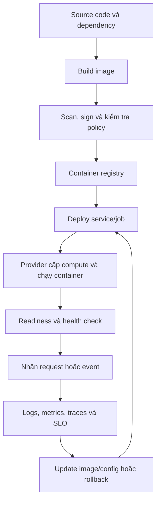

# Ranh giới trách nhiệm vận hành của mô hình container serverless

Container serverless là mô hình chạy container mà người dùng không phải tự quản lý máy chủ hoặc node worker theo cách truyền thống. Người dùng cung cấp image, cấu hình chạy và yêu cầu tài nguyên; nền tảng chịu trách nhiệm cấp phát compute, điều phối container, thay thế hạ tầng lỗi và thường tự mở rộng số instance theo tải. Mô hình này giảm công việc vận hành máy chủ, nhưng không loại bỏ trách nhiệm vận hành ứng dụng.

Ranh giới trách nhiệm cần được xác định rõ: **nhà cung cấp quản lý hạ tầng được trừu tượng hóa; đội nền tảng quản lý cấu hình và guardrail của dịch vụ; đội ứng dụng chịu trách nhiệm về image, mã nguồn, dữ liệu, quyền truy cập và hành vi workload**. Phạm vi chính xác tùy sản phẩm. Một dịch vụ có thể quản lý cả node và runtime, trong khi dịch vụ khác vẫn yêu cầu khách hàng quản lý cluster, network hoặc một số thành phần bảo mật.

## 1. Container serverless là gì?

Container serverless cho phép triển khai ứng dụng dưới dạng container image mà không cần trực tiếp tạo, vá lỗi và vận hành VM worker. Nền tảng có thể tự động:

- Cấp phát compute khi có request, event hoặc workload.
- Khởi chạy container từ image đã chỉ định.
- Điều chỉnh số bản chạy theo concurrency, request hoặc metric.
- Thay thế instance/container bị lỗi.
- Tích hợp với logging, monitoring, registry, network và identity.
- Thu hồi capacity khi workload không còn cần tài nguyên.

Một số nền tảng chỉ khởi chạy container khi có request và scale về zero; một số nền tảng giữ capacity tối thiểu hoặc chạy service liên tục. Một số hỗ trợ job/task chạy đến khi hoàn tất, trong khi dịch vụ khác chủ yếu dành cho HTTP request hoặc event ngắn. Vì vậy, cần kiểm tra giới hạn thời gian chạy, CPU/RAM, concurrency, filesystem, network và cách tính phí của sản phẩm cụ thể.

### Serverless không có nghĩa là không có server

Compute vẫn chạy trên máy chủ vật lý hoặc VM ở phía nhà cung cấp. Điểm thay đổi là khách hàng không trực tiếp quản lý vòng đời node. Nhà cung cấp chịu trách nhiệm cho lớp hạ tầng đã được dịch vụ bao phủ; khách hàng vẫn cần thiết kế ứng dụng để xử lý lỗi, scale, bảo mật và chi phí.

### Container serverless và các mô hình gần kề

| Mô hình | Người dùng thường quản lý | Nền tảng thường quản lý |
|---|---|---|
| VM tự quản lý | OS, patch, runtime, container engine, scheduler và ứng dụng | Hạ tầng vật lý và virtualization |
| Kubernetes tự quản lý | Cluster, node, control plane hoặc phần lớn cấu hình vận hành, workload | Tùy dịch vụ; có thể chỉ quản lý hạ tầng VM |
| Kubernetes managed | Workload, policy, node pool và cấu hình được giao | Control plane và một phần lifecycle cluster/node |
| Container serverless | Image, app config, identity, dữ liệu và hành vi workload | Compute provisioning, runtime orchestration và scaling trong phạm vi dịch vụ |
| Function serverless | Function code, event binding, quyền và dữ liệu | Runtime function, host provisioning và scale theo mô hình function |

Đây là mô hình khái quát. Một số dịch vụ có tên gọi tương tự nhưng ranh giới trách nhiệm và mức kiểm soát khác nhau.

## 2. Mô hình shared responsibility

Shared responsibility là cách phân chia nghĩa vụ bảo mật và vận hành giữa nhà cung cấp cloud, đội platform và đội ứng dụng. Không nên chỉ dựa vào nhãn “serverless” để suy ra provider chịu trách nhiệm cho mọi thứ.

### Nhà cung cấp cloud

Nhà cung cấp thường chịu trách nhiệm cho các thành phần nền tảng mà dịch vụ quản lý, chẳng hạn:

- Data center, nguồn điện, làm mát và phần cứng.
- Host, virtualization hoặc lớp compute nền.
- Runtime orchestration và scheduler do dịch vụ cung cấp.
- Khả năng thay thế host/container infrastructure bị lỗi.
- Vá lỗi và bảo vệ thành phần managed service theo cam kết dịch vụ.
- Cô lập tenant và bảo vệ control plane trong phạm vi sản phẩm.
- Hạ tầng mạng và lưu trữ managed được dịch vụ sử dụng.

Khách hàng vẫn cần đọc SLA, security documentation và responsibility matrix của dịch vụ. Ví dụ, provider có thể quản lý host OS nhưng không chịu trách nhiệm cập nhật thư viện trong image của khách hàng.

### Đội platform hoặc cloud foundation

Trong tổ chức có platform team, đội này thường chịu trách nhiệm:

- Chọn dịch vụ container serverless phù hợp và thiết lập baseline.
- Cấu hình project/account, region, network integration và policy.
- Tạo template/IaC, pipeline, registry và quy trình phát hành chuẩn.
- Quản lý IAM/RBAC, secret integration, logging và monitoring mặc định.
- Đặt quota, budget, concurrency limit và guardrail chi phí.
- Xác định image scanning, signing, provenance và quy trình xử lý lỗ hổng.
- Duy trì tài liệu, runbook và hỗ trợ nhóm ứng dụng.

Platform team không tự động sở hữu mọi ứng dụng được triển khai trên nền tảng. Cần xác định rõ ai là service owner và ai xử lý incident ở tầng ứng dụng.

### Đội ứng dụng/workload owner

Đội ứng dụng thường chịu trách nhiệm:

- Mã nguồn, dependency, thư viện và container image.
- Cấu hình process, port, command, environment variable và health endpoint.
- CPU/RAM request, concurrency, timeout và giới hạn xử lý.
- Quyền truy cập dữ liệu, secret, identity của workload và logic authorization.
- Input validation, xử lý lỗi, retry, idempotency và graceful shutdown.
- Schema, backup, retention và phục hồi dữ liệu mà ứng dụng sở hữu.
- Log, metric, trace và cảnh báo phản ánh SLO của ứng dụng.
- Kiểm thử hiệu năng, tương thích runtime và bảo mật trước phát hành.

### Ma trận trách nhiệm tham khảo

| Hạng mục | Provider | Platform team | Application owner |
|---|---|---|---|
| Data center và host hardware | Chịu trách nhiệm | Theo dõi cam kết | Không quản lý trực tiếp |
| Host OS/managed runtime | Theo dịch vụ | Cấu hình theo khả năng cung cấp | Theo dõi tương thích ứng dụng |
| Container image | Cung cấp cơ chế chạy | Cung cấp registry/pipeline/scan baseline | Build, vá, kiểm thử và phát hành |
| App code và dependency | Không quản lý | Cung cấp tiêu chuẩn | Chịu trách nhiệm |
| Network nền tảng | Managed layer theo sản phẩm | VPC/VNet, connector, policy và route được giao | Port, protocol và luồng ứng dụng |
| IAM và workload identity | Cung cấp primitive | Thiết kế role/baseline và cấp quyền | Yêu cầu quyền tối thiểu và bảo vệ logic truy cập |
| Secret | Cung cấp dịch vụ lưu trữ nếu có | Cấu hình tích hợp và policy | Dùng secret an toàn, rotation và không ghi vào log |
| Autoscaling | Cung cấp cơ chế | Đặt quota/guardrail và cấu hình mặc định | Chọn concurrency, timeout và kiểm thử hành vi |
| Dữ liệu ứng dụng | Bảo vệ managed service theo hợp đồng | Thiết lập policy/backup platform nếu được giao | Data model, backup requirement và restore test |
| Observability | Metric hạ tầng dịch vụ | Nền tảng log/metric và retention chung | App telemetry, SLO và alert |
| Incident | Incident của dịch vụ nền | Điều phối platform/network/identity | Phân tích app, dữ liệu và khôi phục chức năng |

Ma trận này phải được điều chỉnh theo hợp đồng, dịch vụ và mô hình tổ chức. Một hạng mục có thể có nhiều bên cùng tham gia nhưng cần một owner chịu trách nhiệm cuối cùng.

## 3. Ranh giới theo từng lớp kỹ thuật

### Hạ tầng và host

Với container serverless, provider thường quản lý server vật lý, host OS và lớp virtualization/container runtime nền. Khách hàng không chọn kernel patch từng node hoặc đăng nhập vào host để cài agent tùy ý. Đổi lại, khách hàng phải chấp nhận các giới hạn về kernel capability, privileged mode, device access, filesystem và khả năng tùy chỉnh host.

Platform team cần kiểm tra region, availability, quota, network boundary và SLA. Application owner cần biết những giới hạn này để chọn thư viện native, image architecture và cách lưu state.

### Container runtime và image

Provider có thể chạy container theo runtime được quản lý, nhưng image do khách hàng cung cấp vẫn là trách nhiệm của khách hàng. Image cần:

- Dùng base image còn được hỗ trợ và cập nhật bảo mật.
- Chứa đúng binary, dependency và kiến trúc CPU mà dịch vụ hỗ trợ.
- Không đóng gói secret hoặc credential dài hạn.
- Chạy bằng user không có quyền cao nếu ứng dụng cho phép.
- Khai báo port, command, health behavior và signal handling đúng.
- Được scan lỗ hổng, ký hoặc xác minh provenance theo policy.
- Có kích thước phù hợp để giảm thời gian pull và cold start.

Platform team có thể cung cấp base image đã được phê duyệt và pipeline scan; application owner chịu trách nhiệm cập nhật dependency và phát hành image mới khi có lỗ hổng.

### Network

Provider quản lý network fabric và một số thành phần kết nối nội bộ. Platform team thường thiết kế VPC/VNet, subnet, egress, private endpoint, DNS integration và firewall policy. Application owner khai báo port lắng nghe, protocol, hostname, TLS behavior và dependency mà ứng dụng cần gọi.

Không nên giả định container có IP cố định hoặc có thể nhận kết nối inbound trực tiếp. Nhiều dịch vụ cấp endpoint thông qua ingress, load balancer, gateway hoặc service URL. Ứng dụng nên xử lý connection reset, DNS refresh và timeout.

### Storage và filesystem

Filesystem ghi trong container thường là ephemeral hoặc chỉ tồn tại trong vòng đời instance. Khi scale to zero, restart hoặc thay container, dữ liệu local có thể mất. Provider có thể cung cấp volume mount hoặc shared filesystem, nhưng semantics về durability, performance và concurrent access phụ thuộc dịch vụ.

Application owner phải quyết định dữ liệu nào cần bền vững và dùng database, object storage hoặc volume phù hợp. Platform team cung cấp policy, encryption, network access và backup integration theo phạm vi quản lý.

### Identity và secret

Provider cung cấp identity primitive và metadata/service identity. Platform team cấu hình role, trust boundary và secret manager integration. Application owner chỉ yêu cầu quyền cần thiết, không nhúng access key vào image, source code hoặc environment variable không được bảo vệ.

Phân biệt quyền của người triển khai với quyền runtime của container. Pipeline có thể cần quyền push image và cập nhật service; container chỉ cần quyền đọc một bucket hoặc gọi một API cụ thể.

## 4. Vòng đời triển khai và trách nhiệm ở mỗi bước

Ở giai đoạn build, application owner quản lý dependency và nội dung image; platform team cung cấp pipeline, registry và policy. Khi deploy, platform team quản lý template, IAM và network baseline; application owner khai báo cấu hình runtime và xác nhận smoke test. Khi chạy, provider quản lý hạ tầng; application owner theo dõi hành vi workload và xử lý lỗi logic. Khi phát hành phiên bản mới, đội ứng dụng chịu trách nhiệm rollback ứng dụng, còn platform hỗ trợ rollback cấu hình nền tảng nếu thay đổi thuộc phạm vi của họ.

## 5. Image, supply chain và lỗ hổng bảo mật

Việc provider quản lý host không có nghĩa image của khách hàng tự an toàn. Image có thể chứa package lỗi thời, dependency độc hại, user mặc định hoặc secret bị commit.

### Trách nhiệm của application owner

- Dùng base image có nguồn gốc rõ ràng.
- Cập nhật OS package, runtime và thư viện trong image.
- Khóa phiên bản dependency và tạo build có thể tái lập.
- Loại bỏ compiler/cache/tool không cần thiết khỏi production image nếu phù hợp.
- Không chạy container bằng root nếu không cần.
- Scan image trước khi deploy và xử lý lỗ hổng theo mức độ nghiêm trọng.
- Tái build image khi có bản vá; không chỉ vá container đang chạy.

### Trách nhiệm của platform team

- Cung cấp registry được kiểm soát và phân quyền push/pull.
- Thiết lập image scanning, signature verification hoặc admission policy khi dịch vụ hỗ trợ.
- Quản lý base image chuẩn và thông báo khi image hết hỗ trợ.
- Theo dõi image không rõ nguồn gốc hoặc deployment dùng tag mutable không phù hợp.
- Định nghĩa quy trình exception có owner và thời hạn.

### Dùng image digest

Tag như `latest` có thể trỏ tới nội dung khác ở lần pull sau. Trong production, pin image bằng digest hoặc tag bất biến theo policy để biết chính xác artifact đã triển khai. Khi cập nhật, phát hành digest mới qua pipeline và giữ thông tin phiên bản để rollback.

## 6. Scaling, concurrency và cold start

Provider thường chịu trách nhiệm thực hiện scaling mechanism, nhưng khách hàng quyết định cấu hình và hành vi ứng dụng.

### Những gì nền tảng có thể quản lý

- Tạo hoặc thu hồi container instance.
- Điều phối request/event tới instance đang hoạt động.
- Theo dõi concurrency và metric theo khả năng dịch vụ.
- Cấp phát capacity trong quota và region còn khả dụng.
- Thay instance/container bị lỗi theo cơ chế managed.

### Những gì application owner phải thiết kế

- Xác định concurrency an toàn mỗi instance.
- Xử lý request đồng thời, shared state và connection pool.
- Đặt timeout, retry và backpressure.
- Làm startup nhanh và readiness chính xác.
- Tránh lưu session hoặc dữ liệu quan trọng duy nhất trong RAM/local disk.
- Xử lý scale-in, SIGTERM và request đang chạy.
- Kiểm thử burst, cold start và scale-to-zero.

### Cold start

Cold start là độ trễ khi dịch vụ cần khởi chạy container mới trước khi xử lý request. Nó có thể gồm thời gian cấp compute, pull image, mount filesystem, khởi tạo runtime, tải secret/config, mở connection và warm cache.

Có thể giảm cold start bằng cách:

- Giảm kích thước image và số layer không cần thiết.
- Tránh thực hiện công việc nặng ở startup nếu có thể trì hoãn an toàn.
- Dùng dependency connection có timeout và retry phù hợp.
- Giữ min instances/capacity khi SLO yêu cầu latency thấp và chi phí cho phép.
- Chọn region gần dependency và người dùng.
- Đo riêng thời gian provision, image pull và application initialization.

### Concurrency và dependency

Tăng concurrency có thể giảm số container cần chạy nhưng tăng số request đồng thời lên database, cache hoặc API bên ngoài. Application owner cần benchmark concurrency an toàn và đặt pool/limit; platform team cần đặt quota tổng để tránh một service gây cạn capacity dùng chung.

## 7. Availability và xử lý lỗi

Managed container service có thể tự thay container hoặc host, nhưng không tự bảo đảm ứng dụng có tính sẵn sàng cao. Availability phụ thuộc số replica, zone distribution, dependency, dữ liệu và quy trình release.

### Trách nhiệm của provider

- Duy trì hạ tầng và control plane theo SLA.
- Thực hiện cơ chế restart/replace theo thiết kế dịch vụ.
- Công bố maintenance, quota và giới hạn dịch vụ.
- Cung cấp metric/event trạng thái nền tảng.

### Trách nhiệm của platform team

- Cấu hình region, zone, ingress và network baseline.
- Đặt quota, min/max capacity và policy deployment.
- Thiết kế log/metric tập trung và cảnh báo platform.
- Duy trì runbook cho lỗi quota, network, identity và registry.

### Trách nhiệm của application owner

- Thiết kế stateless hoặc lưu state ngoài container.
- Xử lý retry, idempotency và duplicate event.
- Dùng readiness/liveness đúng mục đích.
- Có timeout, graceful shutdown và backpressure.
- Đặt SLO, alert và kiểm thử failover.
- Quản lý migration dữ liệu tương thích khi rolling deployment.

### Health check không thay thế kiểm thử nghiệp vụ

Endpoint trả `200 OK` chỉ cho biết một phép kiểm tra đã thành công. Nó không chứng minh người dùng có thể đăng nhập, thanh toán hoặc hoàn tất giao dịch. Kết hợp readiness ở mức instance với synthetic transaction ở mức dịch vụ và metric SLO ở mức trải nghiệm.

## 8. Dữ liệu, backup và phục hồi

Container thường được xem là có thể thay thế. Dữ liệu ứng dụng cần được lưu ở hệ thống có durability và backup phù hợp.

Application owner cần xác định:

- Dữ liệu nào là source of truth.
- Dữ liệu nào chỉ là cache hoặc có thể tái tạo.
- RPO/RTO và retention cho database, object và file.
- Cách xử lý transaction khi container bị terminate.
- Cách khôi phục dữ liệu và kiểm thử restore.
- Schema compatibility giữa các phiên bản ứng dụng.

Platform team có thể cung cấp database, object storage, volume service, backup vault và policy mã hóa. Tuy nhiên, trách nhiệm phục hồi logic dữ liệu và xác nhận tính nhất quán thường thuộc service owner, trừ khi hợp đồng managed database quy định rõ dịch vụ restore do provider thực hiện.

Không lưu dữ liệu quan trọng trong writable container layer với giả định nó sẽ tồn tại qua restart. Với job dài, cần checkpoint ra durable storage và xử lý retry/idempotency.

## 9. Observability: ai theo dõi điều gì?

Provider thường phát metric về số instance, trạng thái service, quota hoặc lỗi control plane. Platform team tổng hợp telemetry hạ tầng và cung cấp công cụ quan sát. Application owner phải tạo telemetry mô tả chức năng và chất lượng dịch vụ.

| Tín hiệu | Provider/platform | Application owner |
|---|---|---|
| Service/instance state | Trạng thái managed service và container | Kiểm tra app thực sự sẵn sàng |
| CPU/RAM/concurrency | Metric nền tảng theo khả năng dịch vụ | Đánh giá saturation và đặt giới hạn |
| Request latency | Một số metric ingress/target | Phân tích app processing, p95/p99 và SLO |
| Application errors | Có thể cung cấp status/transport errors | Phân loại exception, business error và dependency failure |
| Logs | Cung cấp pipeline/retention nền | Ghi log có cấu trúc, correlation ID, không lộ secret |
| Traces | Hạ tầng thu thập nếu được cấu hình | Instrument code và propagation context |
| Cost | Billing và usage data | Gắn service metadata, cost per request/job |

### Tối thiểu cần đo

- Request rate, error rate và p95/p99 latency.
- Container startup time, cold start và restart count.
- CPU, memory, throttling và concurrency.
- Queue depth, oldest message age nếu xử lý event.
- Dependency latency, connection pool và retry rate.
- Số instance đang chạy, min/max và quota utilization.
- Chi phí theo request, job hoặc workload unit.

Không chỉ dựa vào trạng thái `Running` hoặc số container. Một container có thể chạy nhưng ứng dụng trả lỗi; một service có thể healthy nhưng latency vượt SLO.

## 10. Identity, network và secret management

Container serverless thường chạy bằng workload identity hoặc service account do provider cấp. Quyền runtime cần được tách khỏi quyền triển khai.

### Workload identity

Platform team thiết lập trust relationship và role baseline. Application owner xác định tài nguyên cần truy cập và yêu cầu quyền tối thiểu. Tránh dùng key dài hạn nhúng vào image hoặc cấu hình. Nếu provider hỗ trợ token ngắn hạn, ưu tiên cơ chế đó.

### Secret

Secret nên được lấy từ secret manager hoặc cơ chế tích hợp an toàn. Không ghi secret vào Dockerfile `ARG`, image layer, source code, log hoặc metric label. Application owner chịu trách nhiệm rotation tương thích với connection; platform team quản lý quyền và khả năng truy cập secret service.

### Network egress và ingress

Platform team quản lý network boundary, private access, firewall, DNS và egress policy theo kiến trúc. Application owner khai báo destination, port và protocol thực sự cần. Egress mở rộng có thể làm tăng rủi ro data exfiltration và chi phí network.

Nếu workload cần truy cập database private, xác minh connector/VPC integration, route, DNS, TLS và security rule. Không giả định mọi container serverless có thể truy cập subnet private mặc định.

## 11. Quota, giới hạn dịch vụ và capacity planning

Provider đặt quota về số instance, CPU/RAM, concurrency, request rate, network hoặc số lần tạo resource. Platform team quản lý quota cấp tổ chức và capacity strategy; application owner ước lượng nhu cầu theo tải và kiểm thử giới hạn.

Trước khi production:

- Kiểm tra quota theo region/project/account.
- Xác định giới hạn CPU/RAM mỗi container và số replica tối đa.
- Kiểm tra thời gian chạy tối đa và kích thước image.
- Xác minh giới hạn ephemeral storage, volume mount và network.
- Kiểm tra concurrency, request timeout và request body size.
- Xác định hành vi khi hết quota hoặc provider thiếu capacity.

Không nên coi autoscaling là vô hạn. Khi đạt max capacity hoặc quota, ứng dụng cần backpressure, queue, graceful degradation hoặc trả lỗi có kiểm soát.

## 12. Chi phí và trách nhiệm tối ưu

Container serverless thường tính phí theo tài nguyên được cấp, thời gian thực thi, request, concurrency hoặc các thành phần liên quan. Scale-to-zero có thể giảm chi phí idle nhưng tăng cold start; giữ min instances cải thiện latency nhưng phát sinh chi phí khi ít tải.

### Provider

Provider công bố cách đo usage, SKU, discount, free tier, network charge và billing export. Provider chịu trách nhiệm tính hóa đơn theo mô hình dịch vụ đã công bố.

### Platform team

Platform team thiết lập budget, quota, tag policy, dashboard và guardrail. Đội này có thể cung cấp template mặc định để tránh memory/CPU allocation quá lớn hoặc log retention không cần thiết.

### Application owner

Application owner tối ưu image size, startup time, memory footprint, concurrency, request duration và số lần gọi dependency. Theo dõi cost per request/job để đánh giá hiệu quả. Không tăng memory chỉ để giảm CPU time nếu tổng chi phí và latency không cải thiện.

### Những nguồn chi phí dễ bị bỏ sót

- Container runtime duration hoặc provisioned concurrency.
- Image registry storage và image transfer.
- Log/trace volume và retention.
- Egress, inter-region transfer và private connectivity.
- Database connection, cache và queue do scale-out tạo thêm tải.
- Persistent storage, snapshot và backup.
- Idle minimum instances hoặc warm pool.

## 13. Triển khai và phát hành an toàn

Container serverless không tự đảm bảo release an toàn. Cần pipeline có thể xác minh artifact, cấu hình và rollback.

### Pipeline tham khảo

1. Build image từ source đã review.
2. Pin dependency và base image.
3. Scan lỗ hổng và tạo provenance/signature nếu policy yêu cầu.
4. Push image vào registry được kiểm soát.
5. Deploy vào môi trường test/staging bằng digest xác định.
6. Chạy smoke test, load test và kiểm tra network/identity.
7. Triển khai canary hoặc traffic split nếu dịch vụ hỗ trợ.
8. Theo dõi error rate, latency, restart và cost.
9. Promote hoặc rollback theo tiêu chí đã định.

### Rollback ứng dụng và rollback nền tảng

Rollback image/config ứng dụng thường do application owner thực hiện qua pipeline. Rollback network policy, runtime configuration hoặc service-level change có thể cần platform team. Nếu thay đổi schema dữ liệu không tương thích, rollback image có thể không đủ; cần migration strategy hỗ trợ cả phiên bản cũ và mới trong thời gian chuyển tiếp.

## 14. Incident management và escalation

Khi xảy ra sự cố, cần xác định lỗi thuộc provider, platform hay application. Việc phân loại sai có thể làm chậm khôi phục.

| Dấu hiệu | Hướng điều tra đầu tiên | Owner chính thường gặp |
|---|---|---|
| Provider báo outage hoặc control plane error | Service health, status event, request ID | Provider phối hợp platform |
| Nhiều workload cùng mất kết nối private network | Route, connector, DNS, firewall và network change | Platform/network team |
| Một image mới crash ngay khi start | Entrypoint, architecture, dependency, permission | Application owner |
| Container OOM hoặc CPU throttling | Memory profile, resource allocation và workload pattern | Application owner, platform hỗ trợ quota |
| Scale không lên dù request tăng | Max capacity, quota, metric và autoscaling config | Platform và application owner |
| Database chậm sau khi container scale out | Connection pool, query, downstream saturation | Database/service owner và application owner |
| Secret không truy cập được | Identity binding, role, secret policy và audit | Platform/security và application owner |
| Log mất hoặc không có trace | Telemetry pipeline và instrumentation | Platform/observability và application owner |

### Thông tin cần thu thập khi mở ticket provider

- Project/account, region và service/resource ID.
- Thời điểm bắt đầu, timezone và phạm vi ảnh hưởng.
- Request ID, operation ID và error code nếu có.
- Deployment revision/image digest và thay đổi gần nhất.
- Metric, log đã loại bỏ dữ liệu nhạy cảm và các bước tái hiện.
- Tác động tới SLO, request và dữ liệu.

Application owner không nên gửi secret, dữ liệu khách hàng hoặc token trong ticket. Platform team cần xác định kênh hỗ trợ và mức độ ưu tiên phù hợp SLA.

## 15. Những điều không nên mặc định provider chịu trách nhiệm

Một số hiểu nhầm thường gặp:

- **“Serverless thì provider vá mọi package.”** Provider vá managed host/runtime; package bên trong image thường do khách hàng cập nhật.
- **“Container bị lỗi thì provider tự sửa ứng dụng.”** Nền tảng có thể restart hoặc thay instance; lỗi code và cấu hình vẫn thuộc application owner.
- **“Dữ liệu trong container luôn được giữ.”** Writable layer có thể ephemeral; dữ liệu cần lưu bền vững phải ở storage phù hợp.
- **“Autoscaling tự bảo vệ database.”** Tăng container có thể làm database quá tải; app owner cần giới hạn concurrency và connection.
- **“IAM của project đủ cho mọi container.”** Runtime identity cần quyền riêng và tối thiểu.
- **“Provider tự đảm bảo SLO ứng dụng.”** SLA dịch vụ nền không thay thế SLO end-to-end của ứng dụng.
- **“Logs mặc định đủ để debug.”** App cần log có cấu trúc, trace và business metric.
- **“Scale-to-zero không có đánh đổi.”** Có thể tăng cold start và thời gian xử lý event đầu tiên.

## 16. Ví dụ phân chia trách nhiệm cho một API container serverless

Một đội sản phẩm triển khai API xử lý đơn hàng. Image được build từ pipeline, chạy trên dịch vụ container serverless, truy cập database private và object storage.

| Công việc | Owner | Cách phối hợp |
|---|---|---|
| Host, runtime nền và thay host lỗi | Provider | Theo dõi status và SLA |
| Project, network connector và private route | Platform | Cấp endpoint và policy cho service |
| Container image và dependency | Application | Build, scan, pin digest và vá lỗi |
| Workload identity | Platform + application | Platform tạo role; app yêu cầu quyền tối thiểu và kiểm thử |
| Database backup/PITR | Database/platform theo mô hình quản lý | Application xác nhận RPO/RTO và restore nghiệp vụ |
| Readiness, timeout và concurrency | Application | Platform cung cấp template và giới hạn tổng |
| Log pipeline | Platform | Application phát log/trace có cấu trúc |
| SLO và alert API | Application | Platform cung cấp metric hạ tầng bổ trợ |
| Budget, quota và cost dashboard | Platform + application | Platform thiết lập guardrail; app tối ưu cost per request |
| Incident provider/network/app | Theo lớp lỗi | Một incident commander điều phối các owner |

### Quy trình xử lý lỗi minh họa

Nếu API trả 5xx sau một bản phát hành:

1. Application owner kiểm tra image digest, log, trace và thay đổi gần nhất.
2. Nếu lỗi chỉ xuất hiện ở revision mới, rollback image/config qua pipeline.
3. Nếu mọi revision cùng mất kết nối database, kiểm tra dependency, identity và network.
4. Platform team xác minh private route, connector, secret policy và event dịch vụ.
5. Nếu provider xác nhận lỗi managed service, platform mở ticket với request ID và phối hợp workaround.
6. Sau khi phục hồi, application owner chạy smoke test và xác nhận SLO; platform cập nhật incident timeline.

Việc container được provider thay thế không kết thúc incident nếu API vẫn trả lỗi hoặc dữ liệu giao dịch chưa nhất quán.

## 17. Checklist xác định ranh giới trách nhiệm

**Trước khi chọn dịch vụ:**

- [ ] Đã xác định dịch vụ quản lý host, runtime, node và control plane tới mức nào.
- [ ] Đã đọc SLA, quota, giới hạn CPU/RAM, timeout và filesystem.
- [ ] Đã xác định network, storage và identity nào khách hàng vẫn phải cấu hình.
- [ ] Đã xác định ai chịu trách nhiệm provider support và incident.

**Trước khi triển khai workload:**

- [ ] Có owner, service, environment và kênh on-call.
- [ ] Image có base image, dependency và architecture tương thích.
- [ ] Image được scan, pin digest và không chứa secret.
- [ ] Runtime identity có quyền tối thiểu.
- [ ] Dữ liệu bền vững nằm ngoài writable container layer.
- [ ] Readiness/liveness, timeout, concurrency và graceful shutdown được cấu hình.
- [ ] Network path, DNS, TLS và egress được kiểm tra.

**Khi vận hành:**

- [ ] Có SLO, log, metric, trace và alert theo ứng dụng.
- [ ] Có budget, quota và dashboard cost per unit.
- [ ] Có backup/restore và kiểm thử dữ liệu theo RPO/RTO.
- [ ] Có pipeline release, canary và rollback.
- [ ] Có runbook phân loại provider/platform/application incident.
- [ ] Ma trận trách nhiệm được rà soát khi dịch vụ hoặc tổ chức thay đổi.

## Kết luận

Container serverless giảm trách nhiệm quản lý host và vòng đời compute, nhưng không chuyển toàn bộ trách nhiệm vận hành ứng dụng cho nhà cung cấp. Provider quản lý hạ tầng và runtime trong phạm vi dịch vụ; platform team thiết lập network, identity, pipeline, quota, guardrail và observability nền; application owner quản lý image, dependency, dữ liệu, quyền runtime, health behavior, SLO và chi phí theo workload. Hãy ghi rõ owner cho từng lớp, kiểm chứng bằng SLA và tài liệu sản phẩm, rồi thiết kế pipeline, backup, scaling và incident runbook theo ranh giới đó. Khi mỗi bên hiểu phần việc của mình, đội ứng dụng có thể tận dụng sự đơn giản của serverless mà vẫn giữ được bảo mật, độ tin cậy và khả năng kiểm soát chi phí.
