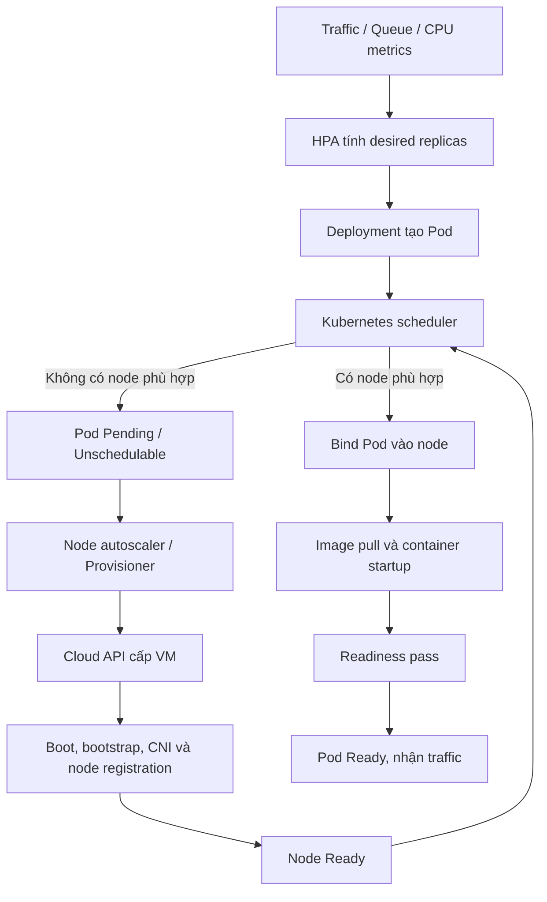
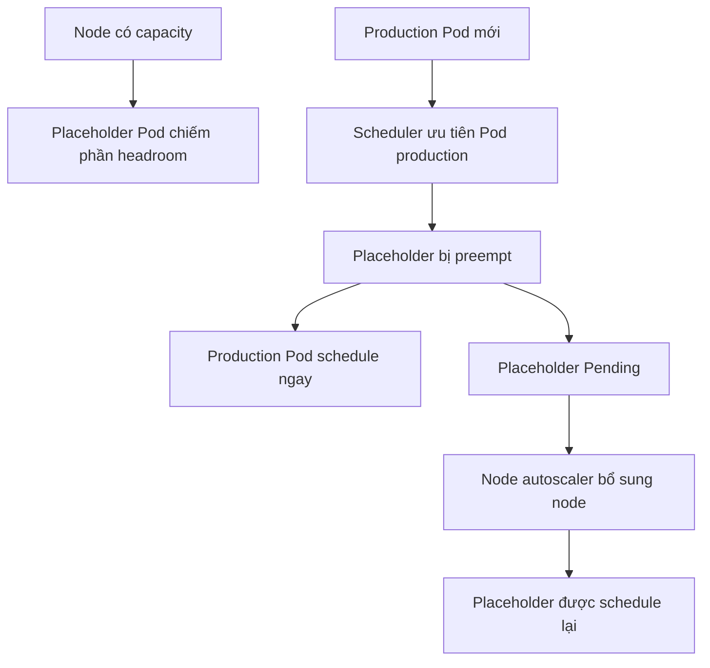

# Đồng bộ tốc độ co giãn pod với thời gian cấp phát node

Kubernetes có thể tạo thêm Pod trong vài giây, nhưng nếu cluster không còn CPU hoặc memory phù hợp thì Pod mới phải chờ node được cấp phát. Thời gian từ lúc phát hiện thiếu capacity đến khi Pod thực sự Ready có thể kéo dài do autoscaler, cloud API, boot máy, bootstrap node, CNI, image pull và startup ứng dụng. Nếu chỉ tăng replica theo tải hiện tại mà không tính độ trễ này, hệ thống có thể liên tục tạo Pod Pending trong khi API vẫn quá tải hoặc queue backlog tiếp tục tăng.

Trong module **CLOUD_CORE_SERVICES_COMPUTE**, khả năng mở rộng của Kubernetes phụ thuộc vào sự phối hợp giữa Horizontal Pod Autoscaler (HPA), scheduler, Cluster Autoscaler hoặc node provisioner như Karpenter, cloud provider và readiness của ứng dụng. Bài học này giải thích các vòng điều khiển đó, cách đo end-to-end scaling latency, cách giữ headroom, điều chỉnh tốc độ scale-up/scale-down và kiểm thử workload tăng nhanh để Pod sẵn sàng đúng lúc.

## Mục tiêu học tập

Sau bài này, bạn có thể:

- Mô tả chuỗi điều khiển từ metric tải đến Pod Ready trên node mới.
- Phân biệt HPA, Kubernetes scheduler, Cluster Autoscaler và node provisioner.
- Phân tích các thành phần tạo nên node provisioning time và Pod startup time.
- Ước tính capacity gap và backlog phát sinh trong lúc chờ node mới.
- Cấu hình HPA behavior, minimum replicas, stabilization window và scaling policy.
- Thiết kế node headroom, overprovisioning, warm pool, scheduled scaling và predictive capacity.
- Tối ưu Pod requests, topology, image, bootstrap và readiness để giảm thời gian scale-out.
- Phân biệt hành vi scale-up và scale-down; tránh autoscaling dao động hoặc loại node quá sớm.
- Theo dõi HPA, Pod Pending, node provisioning, queue backlog và thời gian từ trigger đến Ready.
- Xây dựng load test và runbook để xác minh scaling đáp ứng SLO.

## 1. Vì sao tốc độ scale Pod phải đồng bộ với tốc độ cấp node?

Kubernetes có nhiều thành phần cùng tham gia vào quá trình mở rộng. Mỗi thành phần có trạng thái và thời gian phản hồi riêng:

- HPA điều chỉnh số replica mong muốn dựa trên metric.
- Controller tạo Pod mới theo replica count.
- Scheduler tìm node phù hợp dựa trên requests, affinity, taints, topology và tài nguyên allocatable.
- Nếu không có node phù hợp, Pod ở trạng thái Pending/unschedulable.
- Node autoscaler phát hiện Pod không thể schedule và yêu cầu thêm capacity.
- Cloud provider tạo VM/node; node khởi động, đăng ký với cluster và chạy các thành phần hệ thống.
- Scheduler đặt Pod lên node mới; kubelet kéo image và khởi chạy container.
- Readiness probe xác nhận ứng dụng đã sẵn sàng nhận traffic.

HPA có thể tăng desired replicas nhanh hơn nhiều so với tốc độ tạo node. Điều này không nhất thiết là lỗi: Pod Pending chính là tín hiệu để node autoscaler bổ sung capacity. Vấn đề xuất hiện khi độ trễ này dài hơn khoảng thời gian hệ thống có thể chịu tải vượt capacity hiện tại.

### 1.1. Các vòng điều khiển độc lập



HPA không trực tiếp cấp node. Node autoscaler không tự biết mọi yêu cầu nghiệp vụ; nó phản ứng với Pod unschedulable hoặc chính sách capacity. Vì vậy, HPA, scheduler và node autoscaler phải có cấu hình tương thích.

### 1.2. Desired replicas khác Ready replicas

Các trạng thái cần phân biệt:

- **Desired replicas:** số Pod mà Deployment/ReplicaSet/HPA muốn có.
- **Scheduled/Bound Pods:** Pod đã được scheduler gán vào node.
- **Running Pods:** container đã khởi chạy, nhưng ứng dụng có thể chưa sẵn sàng.
- **Ready Pods:** Pod vượt readiness check và có thể nhận traffic theo cơ chế Service/EndpointSlice.

Một dashboard chỉ hiển thị desired replicas có thể khiến đội vận hành nghĩ rằng capacity đã tăng. Hãy theo dõi cả số Ready replicas và thời gian từ khi replica được yêu cầu đến khi Pod Ready.

## 2. Độ trễ từ autoscaling trigger đến Pod Ready

Thời gian mở rộng end-to-end không chỉ là thời gian VM boot. Nó gồm nhiều giai đoạn nối tiếp, một số giai đoạn có thể chạy song song hoặc lặp lại khi thất bại.

### 2.1. Các thành phần của scaling latency

| Giai đoạn | Điều gì xảy ra? | Nguyên nhân làm chậm |
|---|---|---|
| Metric collection | Metrics adapter/metrics server thu thập dữ liệu | Scrape interval, metric delay, query chậm |
| HPA evaluation | HPA tính replica mong muốn | Sync period, tolerance, stabilization và policy |
| Pod creation | Deployment/ReplicaSet tạo Pod | API server load, admission webhook, quota |
| Scheduling detection | Scheduler thử đặt Pod | Scheduler queue, filter plugin, topology constraint |
| Node provisioning | Autoscaler yêu cầu node mới | Cloud API, quota, capacity shortage, rate limit |
| VM boot/bootstrap | VM boot, cài node agent, cấu hình runtime | Image, startup script, package download, disk initialization |
| Node registration | Kubelet đăng ký và node chuyển Ready | CNI, kube-proxy, CSI, certificate, network |
| Pod scheduling | Scheduler đặt Pod lên node mới | Requests, taints, affinity, IP và volume constraints |
| Image pull | Kéo image và giải nén layer | Image lớn, registry chậm, thiếu cache, throttling |
| Application startup | Process khởi động, kết nối dependency, warm cache | Runtime initialization, migration, DNS/TLS, dependency |
| Readiness | Probe thành công và endpoint được publish | Startup quá dài, probe sai, dependency chưa sẵn sàng |

Có thể mô hình hóa gần đúng:

\[
T_{ready}=T_{metric}+T_{HPA}+T_{schedule-detect}+T_{provision}+T_{node-ready}+T_{image}+T_{app}
\]

Trong thực tế, một số thời gian chồng lấp. Công thức giúp xác định thành phần cần đo, không phải giả định mọi bước luôn tuần tự tuyệt đối.

### 2.2. Đo node provisioning time và Pod startup time riêng

Đo hai khoảng thời gian khác nhau:

- **Node provisioning time:** từ khi autoscaler yêu cầu node đến khi node Ready và có thể nhận Pod.
- **Pod startup time:** từ khi Pod được tạo hoặc schedule đến khi container/ứng dụng Ready.

Nếu node Ready nhanh nhưng Pod vẫn Pending, nguyên nhân có thể là requests, taints, affinity, volume, subnet IP hoặc resource fragmentation. Nếu Pod đã Bound nhưng Ready chậm, xem image pull, init container, startup probe, ứng dụng và dependency.

### 2.3. Dùng percentile thay vì chỉ nhìn trung bình

Node boot và image pull có thể biến động theo instance family, zone, registry và thời điểm. Trung bình 45 giây không bảo đảm p95 cũng gần 45 giây. Hãy ghi p50/p95/p99 của:

- Trigger-to-node-Ready.
- Trigger-to-Pod-Scheduled.
- Pod-created-to-container-started.
- Container-started-to-Ready.
- HPA metric-observed-to-desired-replica-updated.

Sizing headroom nên dựa trên độ trễ cao ở các kịch bản tải quan trọng, không chỉ số trung bình trong môi trường rảnh.

## 3. HPA điều khiển số Pod như thế nào?

HPA điều chỉnh replica count của một workload dựa trên metric. Với resource metric như CPU utilization, HPA so sánh mức sử dụng hiện tại với target tương đối so với request.

### 3.1. Công thức replica cơ bản

Với một metric utilization đơn giản, HPA có thể ước tính:

\[
DesiredReplicas=\left\lceil CurrentReplicas\times\frac{CurrentMetric}{TargetMetric}\right\rceil
\]

Ví dụ Deployment có 4 Pod, CPU utilization trung bình 90%, target 60%:

```text
Desired = ceil(4 × 90 / 60)
        = ceil(6)
        = 6 replicas
```

Đây là công thức khái quát. HPA còn áp dụng tolerance, giới hạn min/max, missing metrics, readiness handling và scaling behavior. Khi có nhiều metric, HPA thường chọn kết quả replica lớn nhất trong các metric hợp lệ.

### 3.2. CPU utilization phụ thuộc CPU request

Nếu container request `500m` và dùng `400m`, utilization là khoảng 80% request. Nếu request đổi thành `1` CPU mà usage giữ nguyên, utilization còn khoảng 40%. Do đó, thay request có thể làm HPA scale khác đi dù tải ứng dụng không đổi.

Không có CPU request phù hợp thì HPA không thể tính CPU utilization như mong đợi cho container tương ứng. Hãy xác minh resource request của tất cả container liên quan và metrics API đang hoạt động.

### 3.3. Chọn metric đúng với workload

| Workload | Metric gợi ý | Lý do |
|---|---|---|
| API CPU-bound | CPU utilization hoặc CPU per Pod | CPU thường phản ánh năng lực xử lý |
| API latency-sensitive | Request rate per Pod, concurrency, custom metric | CPU có thể tăng muộn hơn queueing/latency |
| Queue worker | Queue depth, oldest message age, arrival/completion rate | Backlog cho biết tốc độ tiêu thụ không theo kịp |
| Stream consumer | Consumer lag/partition lag | Số replica cần phù hợp số partition và throughput |
| Memory-heavy service | Memory working set hoặc metric nghiệp vụ | CPU thấp không có nghĩa còn capacity memory |
| Batch job | Pending jobs, job duration, deadline | Mục tiêu là hoàn thành backlog đúng hạn |

Latency có thể là tín hiệu quan trọng nhưng cần tránh autoscale quá mức theo latency do downstream chậm. Nếu database là bottleneck, thêm Pod có thể làm database quá tải hơn.

### 3.4. HPA không biết node mới mất bao lâu để sẵn sàng

HPA tính số replica theo metric và policy; nó không có cơ chế mặc định để chờ node mới Ready trước khi tăng replica tiếp. Nếu tải tiếp tục tăng, HPA có thể tiếp tục tăng desired replicas trong khi Pod trước đó vẫn Pending.

Đây là lý do cần kết hợp:

- Min replicas đủ lớn cho tải nền và burst ngắn.
- Node headroom hoặc warm capacity.
- Scaling policy có tốc độ phù hợp với workload.
- Queue/backpressure để hấp thụ khoảng thời gian thiếu capacity.
- Node autoscaler có thể nhận diện Pod unschedulable.
- Alert khi desired/ready gap kéo dài.

## 4. Node autoscaler: Cluster Autoscaler và Karpenter

Node autoscaler mở rộng hạ tầng worker node để Pod có nơi chạy. Hai cách triển khai phổ biến là Cluster Autoscaler và Karpenter. Chi tiết tùy cloud/provider và phiên bản, nhưng vai trò tổng quát là chuyển nhu cầu Pod thành capacity node.

### 4.1. Cluster Autoscaler

Cluster Autoscaler thường theo dõi Pod không thể schedule và đánh giá liệu tăng một node group có giúp đặt Pod hay không. Nếu có, nó yêu cầu cloud provider tăng số node trong nhóm tương ứng.

Đặc điểm thường gặp:

- Scale theo node group đã cấu hình.
- Cần khai báo min/max size và node template tương ứng.
- Pod phải được xác định là unschedulable vì thiếu tài nguyên hoặc điều kiện node phù hợp.
- Có thể dùng expander để chọn node group khi nhiều nhóm có thể đáp ứng Pod.
- Scale-down cần xác định node có thể drain và di chuyển Pod an toàn không.

Nếu node group không có instance type phù hợp, quota hết hoặc zone thiếu capacity, Cluster Autoscaler không thể tạo node mong muốn. Cần kiểm tra autoscaler logs/events và trạng thái cloud provider.

### 4.2. Karpenter

Karpenter quan sát Pod chưa schedule và có thể tạo node phù hợp từ các lựa chọn instance/capacity đã khai báo trong NodePool/NodeClass theo provider. Cách chọn có thể linh hoạt theo CPU, memory, architecture, zone, capacity type và yêu cầu Pod.

Đặc điểm thường gặp:

- Có thể chọn từ nhiều instance type đáp ứng Pod thay vì chỉ tăng một node group cố định.
- NodePool requirements và limits định nghĩa loại capacity được phép tạo.
- Provisioning chịu ảnh hưởng của cloud quota, instance availability, subnet, security group và provider API.
- Disruption/consolidation có thể thay node để tối ưu utilization và chi phí.
- PodDisruptionBudget, termination grace period và workload constraints ảnh hưởng việc thay node.

Karpenter không xóa bỏ độ trễ boot hoặc image pull. Node mới vẫn cần khởi tạo và đăng ký trước khi nhận Pod. Hãy theo dõi thời gian provision thực tế thay vì coi việc tạo NodeClaim/Node object là đã có capacity.

### 4.3. So sánh định hướng

| Tiêu chí | Cluster Autoscaler | Karpenter |
|---|---|---|
| Đơn vị scale | Node group/managed group | Node được provision theo NodePool/NodeClass |
| Lựa chọn instance | Thường dựa trên cấu hình node group | Có thể chọn linh hoạt trong tập instance đáp ứng yêu cầu |
| Trigger | Pod unschedulable và node group có thể đáp ứng | Pod unschedulable phù hợp với NodePool |
| Scale-down | Xóa node ít sử dụng nếu Pod có thể di chuyển | Consolidation/disruption theo policy |
| Phụ thuộc | Provider integration, node group và quota | Provider API, NodePool/NodeClass, quota và capacity |
| Điểm cần kiểm tra | Node group max, expander, scale-down blockers | Requirements, limits, disruption budget, instance flexibility |

Không chọn công cụ chỉ theo tốc độ quảng cáo. Đo end-to-end latency trong cluster và workload của tổ chức, bao gồm cả thời gian provider cấp tài nguyên.

## 5. Tính capacity gap trong thời gian chờ node

Nếu tải tăng nhanh hơn capacity đang sẵn sàng, hệ thống có một khoảng thiếu hụt. Với queue worker, thiếu hụt biểu hiện thành backlog; với API đồng bộ, nó có thể biểu hiện thành queueing, latency, timeout và lỗi.

### 5.1. Công thức capacity

Giả sử một Pod xử lý an toàn `μ` request/giây và cần phục vụ arrival rate `λ`. Số Pod tối thiểu để đáp ứng tải ở mức utilization mục tiêu `U`:

\[
N_{required}=\left\lceil\frac{\lambda}{\mu\times U}\right\rceil
\]

Trong đó `U` nhỏ hơn 1 để giữ headroom. `μ` phải được đo tại latency/error target, không dùng throughput tối đa khi hệ thống đã bão hòa.

### 5.2. Backlog phát sinh trong thời gian provisioning

Với queue-driven workload, nếu arrival rate `λ` lớn hơn completion rate hiện tại `S`, backlog tăng xấp xỉ:

\[
\Delta Q=\max(0,\lambda-S)\times T_{delay}
\]

`T_delay` là thời gian từ lúc phát hiện thiếu capacity đến khi Pod mới thực sự Ready và xử lý được job. Công thức bỏ qua burst thay đổi theo thời gian, retry và giới hạn queue; dùng để ước lượng ban đầu.

### 5.3. Ví dụ worker xử lý queue

Một Pod xử lý an toàn 20 job/giây. Arrival rate tăng từ 100 lên 300 job/giây. Hiện có 5 Pod, nên service rate hiện tại khoảng 100 job/giây. Node provisioning cùng image pull/startup mất 90 giây.

```text
Arrival rate mới:        300 job/s
Service rate hiện tại:   100 job/s
Capacity gap:            200 job/s
Provisioning delay:      90 s

Backlog tăng xấp xỉ:
200 × 90 = 18.000 jobs
```

Sau khi thêm 10 Pod, tổng 15 Pod có service rate lý thuyết 300 job/giây. Nhưng nếu cần giữ headroom 20%, capacity cần lớn hơn 300 job/giây; cần ít nhất 19 Pod theo công thức `ceil(300 / (20 × 0,8))`. Ngoài ra, queue phải có khả năng lưu 18.000 job và consumer/downstream phải chịu được tốc độ drain sau khi capacity đến.

### 5.4. API đồng bộ không có queue

Với API, không thể giả định mọi request đều chờ được 90 giây. Khi capacity gap xuất hiện:

- Request queue trong load balancer/proxy/application tăng.
- p95/p99 latency tăng trước khi CPU đạt 100%.
- Timeout/retry làm tải hiệu dụng tăng thêm.
- Connection pool và database có thể bị bão hòa.

Giải pháp thường là giữ baseline replica/headroom đủ cho burst ngắn, rate limit/admission control, tối ưu startup và dùng queue cho tác vụ có thể xử lý bất đồng bộ.

## 6. Giữ sẵn headroom để không phải chờ mọi node mới

Node autoscaling là cần thiết cho tăng trưởng dài hạn, nhưng không phải lúc nào cũng đủ nhanh cho burst. Headroom cho phép Pod mới được schedule ngay trong lúc node provisioner đang bổ sung capacity.

### 6.1. Minimum replicas

Đặt `minReplicas` của HPA đủ để xử lý tải nền và burst ngắn thường gặp. Min replicas cũng giữ runtime/cache warm và giảm cold start. Tuy nhiên, quá cao làm tăng chi phí idle và có thể giữ nhiều kết nối database.

Xác định minimum từ:

- Tải nền thấp nhất theo giờ/ngày.
- Capacity cần khi mất một Pod hoặc một zone.
- Thời gian node provisioning p95.
- Mức burst trong khoảng thời gian đó.
- SLO và chi phí chấp nhận được.

### 6.2. Overprovisioning bằng placeholder Pods

Một số cluster dùng Pod placeholder ưu tiên thấp để chiếm trước một phần capacity node. Khi Pod production ưu tiên cao xuất hiện, scheduler có thể preempt placeholder; placeholder trở thành Pending và kích hoạt node autoscaler để bổ sung node.

Ý tưởng:



Placeholder giúp giảm thời gian chờ cho workload quan trọng nhưng phải kiểm soát priority, quota, chi phí và tài nguyên bị giữ. Không dùng placeholder để vượt qua giới hạn quota hoặc thay thế capacity planning.

### 6.3. Warm pool và node pool dự phòng

Warm pool giữ sẵn VM/node đã provision hoặc gần hoàn tất bootstrap nhưng chưa nhận workload đầy đủ. Khi cần, chúng có thể được đưa vào cluster nhanh hơn so với tạo VM mới từ đầu.

Kiểm tra:

- Node trong warm pool có còn đăng ký và Ready không?
- CNI, CSI, security agent và certificate đã sẵn sàng chưa?
- Có thể nhận Pod workload ngay hay cần thay đổi label/taint?
- Có đủ subnet IP và quota cho pool dự phòng không?
- Chi phí giữ node idle có thấp hơn rủi ro thiếu capacity không?

Warm pool có thể lỗi thời nếu image/node configuration không được cập nhật. Cần quy trình refresh và kiểm tra drift.

### 6.4. Scheduled và predictive scaling

Nếu tải có lịch, tăng node/replica trước giờ cao điểm. Ví dụ, batch chạy lúc 08:00 thì bắt đầu chuẩn bị capacity từ 07:30 dựa trên p95 provisioning time và thời gian warm-up.

Predictive scaling có thể dự báo tải từ lịch sử, nhưng cần fallback khi forecast sai. Không scale về đúng capacity dự báo; giữ safety margin và metric-based reactive scaling.

## 7. Tối ưu Pod để scheduler và node autoscaler có thể đáp ứng

Node autoscaler chỉ có thể chọn node nếu Pod có thể được schedule trên node đó. Cấu hình Pod quá chặt hoặc thiếu chính xác có thể khiến autoscaler không tìm được loại node phù hợp.

### 7.1. Resource requests phải đúng

Scheduler dùng requests để tính tài nguyên cần thiết. Nếu request quá cao, node có thể không đủ chỗ dù usage thực tế thấp. Nếu request quá thấp, nhiều Pod được đặt lên node nhưng khi tải tăng chúng tranh chấp CPU/memory.

Đo requests bằng benchmark và production metrics. Tính cả sidecar, init container, ephemeral storage và các giới hạn đặc thù của workload.

### 7.2. Affinity, taints và topology spread

Các ràng buộc sau có thể giới hạn node đủ điều kiện:

- `nodeSelector` và required node affinity.
- Taints/tolerations.
- Pod anti-affinity và topology spread constraints.
- Zone/region requirements.
- Architecture, GPU, local SSD hoặc accelerator.
- PVC zone binding và storage topology.

Nếu Pod chỉ chạy được trên một instance family hoặc một zone, autoscaler không thể chọn node khác dù còn capacity tổng thể. Dùng preferred affinity khi không cần ràng buộc tuyệt đối; chuẩn bị node pool tương thích cho workload chuyên biệt.

### 7.3. Quota, IP và storage

Node mới có thể không được tạo hoặc không nhận Pod nếu:

- Hết quota vCPU/instance family/GPU.
- Subnet hết địa chỉ IP.
- Thiếu network interface hoặc pod IP capacity.
- Storage class/PVC không hỗ trợ zone mới.
- Cloud API bị rate limit hoặc instance type hết capacity.
- NodePool/NodeGroup max size đã đạt.

Capacity plan phải bao gồm quota và network, không chỉ tổng CPU/RAM.

## 8. Giảm thời gian node boot và bootstrap

Node provisioning latency có thể giảm bằng cách chuẩn bị image và cấu hình trước, tránh tải dependency trong lúc scale-out.

### 8.1. Golden image và node image

Chuẩn bị image node đã có runtime, agent, certificate bootstrap cần thiết và package cơ bản. Golden image giúp giảm thời gian cài đặt từ internet trong startup script.

Quản lý:

- Phiên bản image và lịch cập nhật bảo mật.
- Cấu hình kubelet/container runtime tương thích cluster.
- Agent monitoring, logging, security và CNI prerequisites.
- Khả năng rollback image khi node mới không Ready.
- Rebuild định kỳ để tránh image cũ hoặc package drift.

### 8.2. Bootstrap idempotent và ngắn

Bootstrap nên có thể chạy lặp an toàn và chỉ thực hiện phần bắt buộc để node gia nhập cluster. Tránh tải hàng trăm MB package hoặc chạy tác vụ không cần thiết mỗi lần node khởi động.

Đẩy cài đặt không thiết yếu vào image build hoặc DaemonSet có kiểm soát. Theo dõi thời gian từng bước trong cloud-init/user-data và node initialization logs.

### 8.3. CNI, CSI và node readiness

Node Ready không chỉ phụ thuộc VM boot. CNI cần cấp network cho Pod; CSI có thể cần attach/mount volume; kubelet cần đăng ký và cập nhật node condition. Nếu node báo Ready nhưng CNI chưa cấp Pod IP, workload vẫn không phục vụ được.

Theo dõi:

- Node Ready transition.
- CNI DaemonSet readiness và IPAM allocation.
- CSI attach/mount latency.
- kube-proxy/eBPF dataplane readiness.
- DNS/service discovery reachability.

## 9. Giảm thời gian image pull và application startup

Sau khi node Ready, Pod vẫn cần tải image và khởi động ứng dụng.

### 9.1. Tối ưu image

- Dùng multi-stage build để bỏ compiler/build tools khỏi runtime image.
- Giảm layer và dependency không cần thiết.
- Chọn base image phù hợp, cập nhật bảo mật và pin version.
- Tránh image quá lớn hoặc thay đổi toàn bộ layer ở mỗi release.
- Dùng registry gần cluster và cấu hình authentication/cache hợp lý.
- Theo dõi registry throttling và image pull errors.

### 9.2. Pre-pull image

DaemonSet hoặc node initialization có thể kéo trước image thường dùng. Cách này giảm image pull delay khi Pod được tạo, nhưng tăng thời gian/chi phí chuẩn bị node và sử dụng disk. Chỉ pre-pull image cần thiết, xóa image cũ và tính dung lượng container filesystem.

### 9.3. Startup và readiness

Ứng dụng nên:

- Tránh migration schema nặng trong startup path của từng replica.
- Kết nối dependency theo retry có backoff/jitter.
- Warm cache theo cách giới hạn tải lên backend.
- Dùng startup probe cho ứng dụng khởi động lâu.
- Readiness chỉ pass khi instance thật sự có thể phục vụ.
- Không dùng liveness probe quá nhạy khiến Pod restart liên tục khi dependency chậm.

Readiness quá sớm làm traffic vào instance chưa warm; readiness quá muộn làm capacity thực tế đến chậm. Đo từ container start đến readiness success và điều chỉnh probe theo hành vi ứng dụng.

## 10. Cấu hình HPA để phản ứng đúng tốc độ

HPA `behavior` cho phép điều chỉnh tốc độ scale-up và scale-down bằng stabilization window và scaling policies.

### 10.1. Ví dụ HPA với scale-up nhanh và scale-down thận trọng

```yaml
apiVersion: autoscaling/v2
kind: HorizontalPodAutoscaler
metadata:
  name: orders-api
  namespace: production
spec:
  scaleTargetRef:
    apiVersion: apps/v1
    kind: Deployment
    name: orders-api
  minReplicas: 6
  maxReplicas: 60
  metrics:
    - type: Resource
      resource:
        name: cpu
        target:
          type: Utilization
          averageUtilization: 60
  behavior:
    scaleUp:
      stabilizationWindowSeconds: 0
      selectPolicy: Max
      policies:
        - type: Percent
          value: 100
          periodSeconds: 30
        - type: Pods
          value: 10
          periodSeconds: 30
    scaleDown:
      stabilizationWindowSeconds: 300
      selectPolicy: Min
      policies:
        - type: Percent
          value: 20
          periodSeconds: 60
```

Trong ví dụ, HPA giữ tối thiểu 6 replica, có thể tăng theo policy nhanh hơn và chờ 300 giây ổn định trước khi scale-down. Đây là cấu hình minh họa; cần điều chỉnh theo HPA sync period, metric delay, node provisioning time, tải và chi phí.

### 10.2. Không tăng replica nhanh hơn mức hệ thống có thể hấp thụ

Scale-up nhanh có thể tạo nhiều Pod Pending và kích hoạt node provisioning hàng loạt. Điều này hợp lý nếu autoscaler và cloud quota đáp ứng được, nhưng có thể tạo burst lên registry, API server, database và network.

Hãy kết hợp policy với:

- Min replicas/headroom.
- NodePool/NodeGroup limits và quota.
- Rate limit cho bootstrap, image pull và dependency connection.
- Queue/backpressure.
- Alert khi Pending pods hoặc provisioning time vượt ngưỡng.

### 10.3. Nhiều metric và metric external

HPA có thể dùng nhiều metric; metric có thể là resource, custom hoặc external. Với queue worker, scale theo queue depth hoặc oldest message age thường phản ánh nhu cầu trực tiếp hơn CPU.

Nếu dùng custom metric, kiểm tra metrics adapter, metric freshness, label cardinality và hành vi khi metric bị thiếu. Metric stale có thể làm HPA không phản ứng hoặc giữ replica sai mức.

## 11. Scale-down phải đồng bộ với vòng đời node

Scale-down nhanh quá có thể loại Pod khi tải sắp tăng trở lại hoặc node vừa được provision. Nếu HPA giảm replica đồng thời Cluster Autoscaler/Karpenter xóa node, cluster có thể dao động giữa thiếu và thừa capacity.

### 11.1. HPA stabilization window

Scale-down stabilization window giữ lại mức replica cao hơn trong một khoảng thời gian sau khi metric giảm. Nó giúp lọc các đợt giảm tải ngắn và giảm oscillation.

Chọn window theo:

- Chu kỳ traffic/batch.
- Thời gian node provisioning và startup.
- Độ trễ metric.
- Thời gian drain request/job.
- Chi phí idle capacity chấp nhận được.

### 11.2. Node scale-down và consolidation

Cluster Autoscaler có thể loại node ít sử dụng nếu Pod có thể được di chuyển. Karpenter có thể consolidation hoặc thay node theo disruption policy. Trước khi xóa node, cần đảm bảo Pod có thể schedule lại và không vi phạm PDB/stateful constraints.

Các blocker thường gặp:

- PodDisruptionBudget không cho phép eviction.
- Pod dùng local storage hoặc node-local state.
- Required anti-affinity/topology constraints.
- DaemonSet hoặc system Pod không được phép di chuyển theo policy.
- PVC hoặc volume zone-bound.
- Node bị đánh dấu không thể drain an toàn.

### 11.3. Graceful termination

Khi Pod bị terminate:

1. Endpoint/readiness chuyển sang trạng thái không nhận traffic mới.
2. Service/load balancer ngừng gửi request mới theo propagation delay.
3. Ứng dụng hoàn tất request đang chạy trong termination grace period.
4. Worker dừng nhận job mới, hoàn tất hoặc trả job về queue.
5. Ứng dụng flush dữ liệu/log và đóng kết nối.
6. Node được drain và xóa sau khi Pod đã rời đi an toàn.

Đặt `terminationGracePeriodSeconds`, preStop hook và application shutdown timeout phù hợp. Không để hook ngủ cố định quá lâu mà không đo; cần tính cả thời gian propagation của endpoint và long-lived connection.

## 12. Đồng bộ HPA với node autoscaler

Hai bộ điều khiển có mục tiêu khác nhau. HPA quyết định số Pod; node autoscaler quyết định số node. Cấu hình cần đảm bảo Pod được tạo ra có thể kích hoạt đúng node pool và node mới có thể đáp ứng Pod.

### 12.1. Kiểm tra node pool có thể đáp ứng Pod

- CPU/memory allocatable đủ sau khi trừ system reserved và DaemonSet.
- Instance type có architecture/GPU/local storage phù hợp.
- Labels, taints và tolerations khớp.
- Zone/subnet có IP và capacity.
- Node group/NodePool min/max không chặn scale-up.
- Cloud quota và provider capacity còn đủ.
- PVC/storage topology tương thích.

### 12.2. Không đặt requests quá sát node capacity

Nếu một node có 8 CPU allocatable và mỗi Pod request 4 CPU, chỉ hai Pod có thể được đặt. Nhưng DaemonSet, system workload và topology constraint có thể làm số thực tế thấp hơn. Tính allocatable sau overhead, không dùng số vCPU danh nghĩa của VM.

### 12.3. Tránh node fragmentation

Node fragmentation xảy ra khi tổng CPU/RAM còn trống nhưng không có node nào đủ tài nguyên liên tục cho Pod. Ví dụ còn 2 CPU rải trên nhiều node, trong khi Pod cần 3 CPU. Node autoscaler có thể tạo node mới nếu xác định được nhu cầu, nhưng Pod constraints hoặc giới hạn node pool có thể làm provisioning thất bại.

Giảm fragmentation bằng:

- Chuẩn hóa một số profile requests phổ biến.
- Dùng instance family phù hợp với workload mix.
- Tránh requests quá lớn so với usage thực tế.
- Dùng consolidation có kiểm soát.
- Tách workload GPU/memory-heavy khỏi node pool general purpose.

## 13. Capacity buffers và chính sách cho workload khác nhau

Không phải mọi workload cần cùng một tốc độ scale. Hãy phân loại theo latency objective và khả năng queue.

| Workload | Chiến lược capacity |
|---|---|
| API giao dịch latency thấp | Min replicas cao hơn, warm nodes, scale-up nhanh, queue/limit bảo vệ dependency |
| Web stateless thông thường | HPA theo request/CPU, node autoscaling, một phần headroom |
| Queue worker | Scale theo backlog/oldest age, cho phép queue hấp thụ provisioning delay |
| Batch có deadline | Scheduled capacity trước giờ chạy, worker pool dự phòng |
| GPU inference | Giữ sẵn GPU capacity hoặc reservation nếu cần, scale theo concurrency và model warm-up |
| CI/ephemeral | Scale linh hoạt, chấp nhận startup lâu hơn, dùng Spot khi phù hợp |
| Memory-heavy stateful | Baseline ổn định, scale có kiểm soát, không dựa vào burst node nhanh |

### 13.1. Tách critical và best-effort workloads

Dùng PriorityClass, node pool riêng, quota và admission control để critical workload có thể nhận capacity khi cần. Best-effort/batch workload có thể bị preempt hoặc chờ lâu hơn.

Priority không tạo thêm tài nguyên. Nếu toàn cluster thiếu capacity và không có quota/headroom, ưu tiên chỉ quyết định ai được chạy trước.

### 13.2. Giới hạn tổng concurrency

Khi HPA tăng Pod, tổng connection hoặc concurrency đến dependency tăng theo. Ví dụ 20 Pod, mỗi Pod mở 50 database connections có thể tạo 1.000 connection. Hãy đặt connection pool/concurrency budget theo tổng replica tối đa và capacity database.

## 14. Observability cho quá trình scale

Dashboard cần trả lời: HPA đã yêu cầu thêm bao nhiêu Pod, Pod có schedule được không, node provision mất bao lâu và khi nào capacity mới thực sự phục vụ tải?

### 14.1. HPA và Pod metrics

- HPA current replicas và desired replicas.
- Current metric, target metric và metric freshness.
- Số Pod Pending, unschedulable và thời gian Pending.
- Scheduled, Running, Ready và available replicas.
- Pod startup duration và readiness failure.
- Container restarts, image pull errors và init container duration.

### 14.2. Node autoscaler metrics

- Node group/NodePool desired, current, min và max.
- Số scale-up/scale-down events.
- Provisioning requests, failures và retry.
- Time-to-node-Ready p50/p95/p99.
- Node allocatable, utilization và fragmentation.
- Quota, capacity shortage, subnet IP và cloud API errors.
- Node disruption, drain duration và consolidation events.

### 14.3. Application và queue metrics

- Request arrival rate và completion rate.
- p50/p95/p99 latency và error rate.
- In-flight requests, concurrency và connection pool wait.
- Queue depth, oldest message age và consumer lag.
- Job completion time và deadline miss.
- Database/cache saturation và retry rate.

### 14.4. Scaling SLO

Có thể định nghĩa SLO nội bộ như:

- 95% Pod scale-out requests trở thành Ready trong một khoảng thời gian đã đo.
- Pending Pod không vượt ngưỡng tuổi trong thời gian dài.
- Queue oldest-message age không vượt deadline nghiệp vụ.
- API p99 không vượt ngưỡng trong lúc node provision.
- Node scale-up failure rate dưới giới hạn vận hành.

Ngưỡng cụ thể phải dựa trên cluster và workload. Không lấy một con số phổ biến trên Internet làm SLO mặc định.

## 15. Quy trình điều tra khi Pod Pending trong lúc tải tăng

Khi HPA đã tăng desired replicas nhưng Pod không Ready:

1. Kiểm tra HPA: current/desired replicas, metric, target, events và conditions.
2. Kiểm tra Pod Pending: `kubectl describe pod` để xem scheduler events.
3. Nếu `Insufficient cpu/memory`, xác minh node allocatable, requests và fragmentation.
4. Nếu taint/affinity/topology không phù hợp, kiểm tra node pool/NodePool requirements.
5. Kiểm tra node autoscaler có nhận Pod unschedulable không và lý do không scale.
6. Kiểm tra cloud quota, instance capacity, subnet IP và provider API errors.
7. Nếu node đã Ready nhưng Pod vẫn Pending, kiểm tra CNI, PVC, volume zone và scheduler constraints.
8. Nếu Pod đã Running nhưng chưa Ready, kiểm tra image pull, init container, startup/readiness probe và dependency.
9. So sánh thời gian từng bước với p95 provisioning/startup baseline.
10. Áp dụng headroom, scheduled capacity hoặc giảm startup latency nếu provisioning delay là nguyên nhân chính.

Lệnh kiểm tra thường dùng:

```bash
kubectl get hpa -n production
kubectl describe hpa orders-api -n production
kubectl get pods -n production -o wide
kubectl describe pod <pending-pod> -n production
kubectl get events -n production --sort-by=.lastTimestamp
kubectl get nodes -o wide
kubectl describe node <node-name>
```

Tên resource, namespace và quyền truy cập cần điều chỉnh theo cluster. Log của Cluster Autoscaler/Karpenter và cloud provider thường cần xem ở namespace/hệ thống tương ứng.

## 16. Ví dụ thực hành: HPA và node provisioning cho API

Một API có tải nền 500 request/giây, peak dự báo 2.000 request/giây. Một Pod xử lý an toàn 100 request/giây ở mức latency mục tiêu. HPA dùng CPU hoặc request rate để tăng replica; node mới mất p95 120 giây từ lúc được yêu cầu đến khi Pod Ready.

### 16.1. Tính baseline và peak

Giữ utilization mục tiêu 70%:

```text
Pod capacity an toàn theo kế hoạch = 100 × 0,70 = 70 req/s

Baseline replicas = ceil(500 / 70) = 8
Peak replicas     = ceil(2.000 / 70) = 29
```

Nếu chỉ giữ 8 Pod, phần thiếu capacity trong 120 giây có thể làm API latency/error tăng mạnh. Có thể đặt min replicas cao hơn baseline nếu traffic có burst đột ngột, hoặc duy trì warm node capacity để tạo Pod mới nhanh hơn.

### 16.2. Tính node headroom

Giả sử mỗi node có thể chạy 4 Pod API sau khi trừ system/DaemonSet overhead. Để tăng từ 8 lên 29 Pod cần thêm 21 Pod, tương đương ít nhất 6 node nếu các node đều có 4 slot trống. Nếu chỉ có 2 slot trống trong cluster, cần provision thêm node cho 19 Pod còn lại.

Đừng chỉ chia tổng CPU cho node vCPU. Phải tính requests của Pod, sidecar, DaemonSet, memory, topology spread và IP capacity.

### 16.3. Kế hoạch phản ứng

- Duy trì 8 Pod hoặc baseline đã được benchmark.
- Giữ node headroom tương đương một phần peak nếu chi phí cho phép.
- HPA scale-up nhanh khi request rate vượt target.
- Node autoscaler bổ sung node khi Pod không schedule được.
- Warm image và tối ưu bootstrap để giảm p95 Pod Ready.
- Rate limit hoặc queue các tác vụ không critical trong capacity gap.
- Scale-down chậm hơn scale-up và chỉ khi tải ổn định.

### 16.4. Kiểm chứng

Chạy load test tăng traffic đột ngột, ghi thời gian HPA cập nhật desired replicas, Pod Pending duration, node Ready time và Pod Ready time. Xác minh p95/p99 API trong 120 giây đầu và sau khi capacity mới đến. Lặp lại ở zone/instance type khác để phát hiện biến động provider capacity.

## 17. Những sai lầm thường gặp

| Sai lầm | Hậu quả | Cách khắc phục |
|---|---|---|
| Chỉ tăng HPA max replicas | Pod Pending vì không có node | Đồng bộ HPA với node autoscaler và quota |
| Cho rằng node Ready nghĩa là Pod Ready | Image/startup/readiness vẫn có thể chậm | Đo từng mốc end-to-end |
| Dùng CPU metric cho queue worker | Scale muộn khi backlog tăng nhưng CPU chưa cao | Dùng queue depth/oldest age hoặc custom metric |
| Min replicas quá thấp | Phải chờ node mới trong mọi burst | Giữ baseline/headroom phù hợp SLO |
| Requests quá cao | Node fragmentation và scale-up không hiệu quả | Rightsize từ benchmark |
| Requests quá thấp | Node overcommit và contention khi peak | Đặt request theo nhu cầu ổn định |
| NodePool/NodeGroup max quá thấp | Autoscaler không thể thêm capacity | Kiểm tra max và quota trước peak |
| Quên subnet IP hoặc CNI | VM có thể Ready nhưng Pod không có network | Tính IP capacity và CNI readiness |
| Image quá lớn | Pod startup delay kéo dài | Tối ưu image, registry và pre-pull |
| Readiness probe quá sớm | Traffic vào Pod chưa warm | Readiness theo khả năng phục vụ thực tế |
| Scale-down quá nhanh | Node bị xóa ngay trước burst tiếp theo | Stabilization window và cooldown |
| PDB quá chặt | Node không drain được, scale-down bị kẹt | Thiết kế PDB theo availability và replica count |
| Không tính dependency connections | Database/cache quá tải sau scale-out | Budget concurrency theo max replicas |
| Không đo p95 provisioning | Headroom dựa trên trung bình không đủ | Theo dõi p50/p95/p99 theo zone và instance type |

## 18. Checklist production

**Thiết kế autoscaling**

- [ ] HPA metric phản ánh đúng bottleneck/workload.
- [ ] CPU requests có giá trị hợp lý nếu HPA dùng CPU utilization.
- [ ] Min/max replicas và scale-up/down behavior đã xác định.
- [ ] Có headroom hoặc warm capacity cho burst trong provisioning delay.
- [ ] Queue/backpressure/rate limit phù hợp với thời gian chờ capacity.

**Node provisioning**

- [ ] Cluster Autoscaler/Karpenter nhận diện Pod unschedulable.
- [ ] NodeGroup/NodePool min/max, requirements và disruption policy phù hợp.
- [ ] Cloud quota, instance availability và capacity reservation đã kiểm tra.
- [ ] Subnet IP, CNI, CSI và storage topology đủ capacity.
- [ ] Bootstrap, node image và node registration đã đo.

**Pod startup**

- [ ] Requests/limits và scheduling constraints chính xác.
- [ ] Image size/registry pull time đã tối ưu.
- [ ] Startup/readiness/liveness probe đúng semantics.
- [ ] Ứng dụng warm-up và kết nối dependency có backoff.
- [ ] Sidecar, init container và volume mount nằm trong startup budget.

**Scale-down và vận hành**

- [ ] HPA stabilization và node consolidation không xung đột.
- [ ] PDB và graceful termination cho phép drain an toàn.
- [ ] Worker dừng nhận job mới và xử lý job đang chạy đúng cách.
- [ ] Có dashboard desired/ready, Pending age và node provisioning latency.
- [ ] Có alert khi quota, autoscaler hoặc node provisioning thất bại.

**Kiểm thử**

- [ ] Đã test gradual ramp và sudden burst.
- [ ] Đã đo p50/p95/p99 từ trigger đến Pod Ready.
- [ ] Đã test node pool hết quota/capacity và subnet gần cạn.
- [ ] Đã xác minh queue backlog hoặc API SLO trong thời gian chờ node.
- [ ] Đã test scale-down, drain và tải quay lại ngay sau scale-down.

## 19. Kết luận

HPA có thể tạo Pod nhanh, nhưng năng lực phục vụ chỉ tăng khi Pod được schedule, node Ready, image được tải, ứng dụng khởi động và readiness thành công. Vì vậy, cần đo toàn bộ khoảng thời gian từ metric trigger đến Pod Ready và hiểu vai trò riêng của HPA, scheduler, Cluster Autoscaler/Karpenter, cloud provider và ứng dụng.

Để đáp ứng burst, giữ baseline/min replicas và node headroom phù hợp, dùng scheduled/predictive capacity khi tải có lịch, tối ưu requests, bootstrap, image và readiness. Scale-down nên thận trọng, phối hợp với drain, PDB và consolidation. Cuối cùng, kiểm chứng bằng load test và dashboard desired-versus-ready, Pending age, provisioning p95/p99, queue backlog, latency và error rate để bảo đảm tốc độ co giãn Pod theo kịp tốc độ cấp phát node.

## Thuật ngữ cần nhớ

| Thuật ngữ | Ý nghĩa |
|---|---|
| HPA | Horizontal Pod Autoscaler; điều chỉnh số replica theo metric. |
| Cluster Autoscaler | Thành phần điều chỉnh số node trong node group khi Pod không thể schedule hoặc node có thể scale-down. |
| Karpenter | Node provisioner có thể chọn và tạo node theo yêu cầu Pod và cấu hình NodePool/NodeClass. |
| Node provisioning time | Thời gian từ yêu cầu tạo node đến khi node Ready và có thể nhận Pod. |
| Pod startup time | Thời gian từ lúc Pod được tạo/schedule đến khi ứng dụng Ready. |
| Desired replicas | Số replica mà controller/HPA mong muốn. |
| Ready replicas | Số Pod đã sẵn sàng nhận traffic. |
| Unschedulable Pod | Pod chưa thể được scheduler gán vào node phù hợp. |
| Capacity gap | Khoảng thiếu năng lực giữa tải yêu cầu và capacity đang sẵn sàng. |
| Headroom | Capacity dự phòng để hấp thụ burst hoặc lỗi trong thời gian scale-out. |
| Overprovisioning | Giữ sẵn capacity lớn hơn nhu cầu tức thời để giảm thời gian chờ. |
| Warm pool | Nhóm node/VM đã được chuẩn bị trước để đưa vào phục vụ nhanh hơn. |
| Placeholder Pod | Pod ưu tiên thấp dùng để giữ trước capacity và nhường chỗ cho workload ưu tiên cao. |
| Stabilization window | Khoảng thời gian lọc biến động trước khi thay đổi replica, thường hữu ích cho scale-down. |
| Node fragmentation | Tài nguyên còn trống nhưng phân mảnh khiến Pod không vừa node hiện có. |
| Readiness probe | Kiểm tra ứng dụng có sẵn sàng nhận traffic hay không. |
| PDB | PodDisruptionBudget; giới hạn số Pod bị gián đoạn đồng thời do voluntary disruption. |
| Consolidation | Tái bố trí workload và loại node dư thừa để tối ưu capacity/chi phí. |
