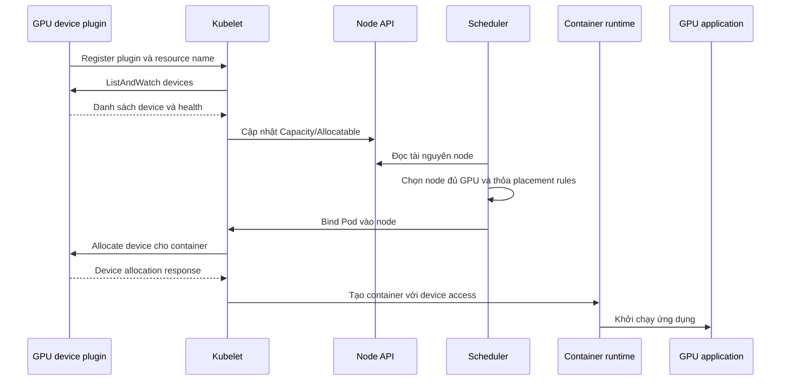

# GPU, device plugin và lập lịch bộ tăng tốc

## Mục tiêu học tập

Sau bài học, bạn có thể:

- Giải thích cách Kubernetes nhận diện GPU và thiết bị tăng tốc thông qua device plugin.
- Mô tả vòng đời đăng ký thiết bị giữa plugin, kubelet, Node và scheduler.
- Phân biệt driver, container runtime, device plugin và GPU Operator.
- Khai báo extended resource trong Pod và hiểu quy tắc request/limit đối với GPU.
- Lập lịch Pod lên đúng node dựa trên tài nguyên, nhãn, taint, toleration và topology.
- Phân biệt cấp phát GPU nguyên chiếc, MIG, time-slicing và các cách chia sẻ thiết bị.
- Xác định yêu cầu cho workload nhiều GPU hoặc huấn luyện phân tán.
- Kiểm tra trạng thái thiết bị, metric, lỗi cấp phát và sự cố GPU trong cluster.
- Thiết kế chính sách bảo mật, quota, ưu tiên và chi phí cho workload dùng accelerator.

## 1. GPU trong Kubernetes dùng để làm gì?

GPU (Graphics Processing Unit) là bộ xử lý có khả năng thực hiện song song nhiều phép tính. Ngoài đồ họa, GPU được dùng trong machine learning, inference, xử lý ảnh/video, mô phỏng khoa học, phân tích dữ liệu và các workload tính toán chuyên biệt.

Kubernetes có thể lập lịch workload sử dụng GPU hoặc accelerator khác như FPGA, thiết bị mã hóa, NIC chuyên dụng hay bộ xử lý AI. Để làm được điều đó, cluster cần biết:

- Node nào có thiết bị.
- Có bao nhiêu đơn vị tài nguyên thiết bị có thể cấp phát.
- Container nào yêu cầu thiết bị.
- Thiết bị nào đã được cấp cho container.
- Thiết bị có khỏe và sẵn sàng không.
- Workload có phù hợp với loại thiết bị, driver, topology và phần mềm hay không.

CPU và memory là tài nguyên phổ biến được Kubernetes quản lý trực tiếp thông qua scheduler và kubelet. GPU thường được đưa vào cluster dưới dạng **extended resource** do vendor device plugin quảng bá. Plugin kết nối phần cứng của nhà cung cấp với kubelet, còn scheduler sử dụng số lượng tài nguyên đã được node công bố để chọn node phù hợp.

### 1.1. Vì sao không chỉ khai báo GPU như CPU?

GPU không đơn thuần là một lượng CPU có thể chia theo millicore. Thiết bị có các đặc điểm riêng:

- Một GPU vật lý có thể được cấp nguyên chiếc cho một container.
- Một số GPU hỗ trợ chia thành partition phần cứng, ví dụ MIG trên các dòng NVIDIA tương thích.
- Một số plugin hỗ trợ time-slicing hoặc chia sẻ theo cơ chế riêng.
- GPU có bộ nhớ thiết bị, compute capability, driver và runtime tương thích.
- Nhiều GPU trên cùng node có thể có kết nối NVLink, PCIe hoặc topology NUMA khác nhau.
- Một workload có thể cần nhiều GPU cùng lúc hoặc cần nhiều node phối hợp.

Kubernetes scheduler cơ bản nhìn thấy tên và số lượng extended resource, không tự hiểu toàn bộ dung lượng VRAM, mức sử dụng GPU, khả năng tương thích CUDA hay hiệu năng liên kết giữa các thiết bị. Những yêu cầu đó cần được biểu diễn qua nhãn, cấu hình plugin, policy, scheduler extension hoặc hệ thống điều phối phù hợp.

## 2. Kiến trúc cấp phát GPU trong cluster

Một triển khai GPU thường có các thành phần:

1. **GPU hardware:** GPU hoặc accelerator gắn vào node.
2. **Host driver:** driver của nhà sản xuất được cài trên node và tương thích kernel.
3. **Container runtime integration:** cấu hình runtime để container có thể truy cập thiết bị và thư viện cần thiết.
4. **Device plugin:** tiến trình chạy trên node, phát hiện thiết bị và đăng ký extended resource với kubelet.
5. **Kubelet:** quản lý thiết bị trên node, nhận thông tin plugin và thực hiện cấp phát khi khởi chạy container.
6. **Node status:** công bố Capacity và Allocatable cho scheduler.
7. **Scheduler:** chọn node còn đủ tài nguyên, đồng thời xét các ràng buộc khác của Pod.
8. **Application container:** chạy workload sử dụng GPU.

### 2.1. Luồng đăng ký và cấp phát



Đây là luồng khái niệm. Chi tiết giao tiếp và cấu hình phụ thuộc phiên bản Kubernetes, runtime và vendor plugin. Điểm quan trọng là scheduler quyết định node dựa trên tài nguyên đã được công bố; device plugin tham gia phát hiện và cấp thiết bị ở node đó.

### 2.2. Device plugin làm gì?

Kubernetes Device Plugin API cho phép vendor hoặc bên triển khai cung cấp plugin chạy trên từng node có thiết bị. Plugin thường được triển khai dưới dạng DaemonSet và thực hiện các việc:

- Phát hiện thiết bị phù hợp trên host.
- Đăng ký với kubelet qua Unix domain socket trong thư mục device-plugin của kubelet.
- Công bố tên tài nguyên, ví dụ nvidia.com/gpu.
- Cung cấp danh sách thiết bị qua cơ chế ListAndWatch.
- Báo trạng thái thiết bị như Healthy hoặc Unhealthy.
- Xử lý yêu cầu cấp thiết bị cho container qua Allocate.
- Có thể triển khai hook chuẩn bị thiết bị trước khi khởi chạy container nếu plugin và API hỗ trợ.

Kubelet dùng thông tin plugin để cập nhật tài nguyên node và phối hợp với runtime khi tạo container. Device plugin không phải scheduler riêng và cũng không tự quyết định Pod nào được chạy trước.

### 2.3. Device plugin không thay thế driver

Cần phân biệt các thành phần:

| Thành phần | Vai trò |
|---|---|
| GPU driver | Cho kernel host và thiết bị giao tiếp |
| Container runtime/toolkit | Cấu hình container truy cập device node và thư viện cần thiết |
| Device plugin | Phát hiện thiết bị, đăng ký resource và cấp thiết bị cho kubelet |
| GPU Operator hoặc node management stack | Có thể tự động cài/quản lý driver, toolkit, plugin, monitoring và các thành phần liên quan |
| Kubernetes scheduler | Chọn node dựa trên tài nguyên và các ràng buộc của Pod |
| Framework trong ứng dụng | Sử dụng GPU qua thư viện như CUDA, ROCm hoặc runtime tương ứng |

Cài device plugin nhưng thiếu driver hoặc runtime integration phù hợp sẽ không làm GPU hoạt động. Ngược lại, host chạy được nvidia-smi chưa chắc Pod đã được cấp GPU đúng cách.

## 3. Extended resource và cách Kubernetes biểu diễn GPU

Device plugin đăng ký một tên tài nguyên dạng domain-qualified, ví dụ:

- nvidia.com/gpu
- amd.com/gpu
- vendor.example/accelerator

Tên cụ thể do plugin và nhà cung cấp định nghĩa. Tài nguyên này xuất hiện trong trạng thái Node dưới dạng Capacity và Allocatable.

### 3.1. Capacity và Allocatable

- **Capacity:** tổng lượng tài nguyên node công bố.
- **Allocatable:** lượng tài nguyên node có thể cấp cho Pod sau khi tính phần dành cho hệ thống hoặc giới hạn vận hành.

Ví dụ một node có thể công bố:

```text
Capacity:
  cpu: 64
  memory: 512Gi
  nvidia.com/gpu: 4

Allocatable:
  cpu: 60
  memory: 480Gi
  nvidia.com/gpu: 4
```

Số liệu chỉ minh họa. GPU allocatable có thể nhỏ hơn capacity nếu plugin chỉ công bố một phần thiết bị hoặc cấu hình chia sẻ. CPU và memory có thể bị giảm do system reserved, kube reserved hoặc eviction reservation.

### 3.2. Quy tắc request và limit của extended resource

Với extended resource kiểu thiết bị, Kubernetes không overcommit theo cách CPU có thể overcommit. Thông thường:

- Pod khai báo GPU trong limits.
- Nếu chỉ khai báo limits, Kubernetes dùng giá trị đó làm request.
- Nếu khai báo cả requests và limits, hai giá trị phải bằng nhau đối với extended resource.
- Số lượng thiết bị thường là số nguyên.
- Scheduler chỉ đặt Pod lên node có đủ tài nguyên chưa được cấp phát.

Ví dụ, một container yêu cầu nvidia.com/gpu: 1 sẽ cần một đơn vị tài nguyên GPU mà plugin đã quảng bá. Hai Pod cùng yêu cầu một GPU sẽ không được xếp lên node có tổng allocatable chỉ một GPU, trừ khi plugin cấu hình một mô hình chia sẻ và công bố số đơn vị tài nguyên tương ứng.

Không nhầm GPU resource count với GPU memory. nvidia.com/gpu: 1 thường biểu thị một đơn vị thiết bị theo cách plugin công bố, không có nghĩa Kubernetes tự biết Pod cần bao nhiêu GiB VRAM.

## 4. Khai báo Pod sử dụng GPU

Ví dụ Job dùng một GPU NVIDIA trên node có nhãn accelerator phù hợp:

```yaml
apiVersion: batch/v1
kind: Job
metadata:
  name: gpu-inference-test
spec:
  backoffLimit: 2
  template:
    metadata:
      labels:
        app: gpu-inference-test
    spec:
      restartPolicy: Never
      nodeSelector:
        accelerator: nvidia-a100
      tolerations:
        - key: accelerator
          operator: Equal
          value: nvidia
          effect: NoSchedule
      containers:
        - name: inference
          image: registry.example.com/ml/inference:1.0
          command: ["python", "serve.py"]
          resources:
            requests:
              cpu: "4"
              memory: "16Gi"
            limits:
              cpu: "8"
              memory: "24Gi"
              nvidia.com/gpu: 1
```

Các giá trị và image là ví dụ, cần thay bằng image đã kiểm thử và nhãn thực tế của cluster.

Trong manifest này:

- nvidia.com/gpu: 1 yêu cầu một đơn vị GPU do device plugin quảng bá.
- CPU và memory có request/limit riêng.
- nodeSelector giới hạn Pod vào node có nhãn accelerator=nvidia-a100.
- tolerations cho phép Pod chạy trên node có taint tương ứng.
- backoffLimit giới hạn số lần Job retry khi thất bại.

Nhãn accelerator là nhãn do quản trị cluster tự quy ước trong ví dụ. Không mặc định mọi cluster đều có nhãn này. Cần xem label thực tế do Node Feature Discovery, GPU Operator hoặc quy trình quản trị node cung cấp.

### 4.1. Vì sao chỉ khai báo GPU trong limits?

Với extended resource, limit được dùng như request nếu request không được khai báo riêng. Cấu hình sau là hợp lệ theo quy tắc phổ biến:

```yaml
resources:
  limits:
    nvidia.com/gpu: 1
```

Nếu muốn khai báo cả hai, giá trị phải bằng nhau:

```yaml
resources:
  requests:
    nvidia.com/gpu: 1
  limits:
    nvidia.com/gpu: 1
```

Không khai báo requests: nvidia.com/gpu: 0.5 để yêu cầu nửa GPU theo mô hình extended resource nguyên bản. Muốn chia sẻ hoặc phân vùng, cần cấu hình plugin và cơ chế thiết bị tương ứng như MIG hoặc time-slicing.

## 5. Lập lịch GPU: scheduler xét những gì?

Scheduler phải tìm node đáp ứng tài nguyên GPU và mọi ràng buộc khác của Pod. Một node có GPU chưa chắc phù hợp với workload.

Các điều kiện thường gặp:

- Node có đủ extended resource còn trống.
- Node label phù hợp với loại GPU, kiến trúc hoặc driver.
- Taint của node được Pod tolerate.
- Node affinity hoặc topology rule được thỏa mãn.
- CPU, RAM, ephemeral storage và các tài nguyên khác còn đủ.
- Node không bị cordon hoặc không ở trạng thái không sẵn sàng.
- Runtime, plugin và driver đã sẵn sàng.
- Policy quota và admission cho phép Pod sử dụng accelerator.

### 5.1. Node label và node affinity

Có thể gắn label để phân loại node theo loại GPU, ví dụ:

```bash
kubectl label node gpu-node-01 accelerator=nvidia-a100
kubectl get nodes -L accelerator
```

Trong production, nhãn phần cứng nên được quản lý bằng Node Feature Discovery, GPU Operator hoặc quy trình provisioning có kiểm soát. Không để người dùng workload tùy ý gắn nhãn đặc quyền nhằm vượt qua policy chọn node.

Nếu cần điều kiện phức tạp hơn nodeSelector, dùng nodeAffinity để chọn nhóm node theo label, ví dụ ưu tiên GPU memory lớn hoặc một kiến trúc phù hợp. Label chỉ là metadata; nó không chứng minh driver và thiết bị đang healthy. Cần kết hợp với resource allocatable và health check.

### 5.2. Taint và toleration

GPU node thường đắt và được dành cho workload đặc thù. Quản trị viên có thể đặt taint để Pod thông thường không vô tình chiếm node:

```bash
kubectl taint nodes gpu-node-01 accelerator=nvidia:NoSchedule
```

Pod có toleration tương ứng mới được scheduler cân nhắc trên node đó. Toleration chỉ cho phép Pod đi qua rào cản taint; nó không buộc Pod phải chạy trên node. Cần kết hợp nodeSelector hoặc nodeAffinity để chỉ định đúng nhóm node.

Các effect thường gặp:

- NoSchedule: không lập lịch Pod mới nếu không tolerate.
- PreferNoSchedule: cố gắng tránh node, nhưng không phải lệnh cấm tuyệt đối.
- NoExecute: có thể ảnh hưởng cả Pod đang chạy, tùy toleration và thời gian toleration.

Không thêm toleration quá rộng như tolerate mọi taint nếu workload không cần.

### 5.3. Scheduler không tự hiểu mọi đặc tính GPU

Kubernetes scheduler cơ bản biết số lượng extended resource và các ràng buộc đã khai báo. Nó không nhất thiết biết:

- VRAM còn trống ở thời điểm chạy.
- GPU utilization hiện tại.
- CUDA compute capability mà ứng dụng yêu cầu.
- GPU có NVLink với GPU khác hay không.
- Băng thông PCIe/NUMA thực tế.
- GPU có đang bị chia sẻ theo time-slicing.
- Model có vừa bộ nhớ GPU hay không.

Nếu các đặc tính đó ảnh hưởng việc chạy workload, cần biểu diễn bằng label/resource class, policy, device plugin, topology-aware allocation hoặc scheduler extension phù hợp. Không dùng metric GPU utilization như thể đó là tài nguyên scheduler tự động đặt chỗ, trừ khi cluster đã triển khai cơ chế tích hợp rõ ràng.

## 6. Từ Pod được lập lịch tới container thấy GPU

Khi Pod được bind vào node, kubelet phối hợp với device plugin để cấp thiết bị cho container.

Luồng tổng quát:

1. Scheduler chọn node có GPU allocatable còn đủ.
2. Pod được bind vào node.
3. Kubelet kiểm tra yêu cầu thiết bị của container.
4. Kubelet gọi device plugin để lấy allocation.
5. Plugin trả thông tin cần thiết để runtime cấu hình thiết bị cho container.
6. Runtime khởi chạy container với device node, mount, environment hoặc cấu hình cần thiết.
7. Ứng dụng tải thư viện và truy cập GPU.

Một số plugin có thể trả về device nodes, mounts, environment variables hoặc annotations. Hình thức cụ thể phụ thuộc API và runtime integration.

### 6.1. Kiểm tra từ trong container

Với image đã có NVIDIA utilities và runtime tương thích, có thể kiểm tra:

```bash
nvidia-smi
```

Nếu nvidia-smi chạy trong container và hiển thị thiết bị được cấp, đó là dấu hiệu tốt nhưng chưa chứng minh workload đạt hiệu năng mong muốn. Tiếp tục kiểm tra framework có nhận GPU, driver/runtime compatibility, VRAM, compute utilization và kết quả inference/training.

Không phải mọi image ứng dụng đều chứa nvidia-smi. Thiếu lệnh trong image không đồng nghĩa chắc chắn GPU không được cấp. Có thể kiểm tra bằng framework hoặc image chẩn đoán được quản trị viên phê duyệt.

## 7. Device plugin health và trạng thái Node

Device plugin theo dõi thiết bị và thông báo trạng thái. Khi thiết bị chuyển sang Unhealthy, kubelet có thể cập nhật tài nguyên node để scheduler không cấp thiết bị đó cho workload mới.

Các trạng thái cần phân biệt:

- Plugin chưa đăng ký: tài nguyên GPU có thể chưa xuất hiện trên Node.
- Plugin đã đăng ký nhưng không phát hiện thiết bị: resource count có thể bằng 0.
- Thiết bị unhealthy: thiết bị có thể bị loại khỏi allocatable hoặc không được cấp phát.
- Driver lỗi: plugin có thể không khởi tạo hoặc không truy cập được device.
- Plugin restart: kubelet có thể cần đăng ký lại và đồng bộ trạng thái.
- Node mất kết nối: trạng thái resource có thể cũ cho tới khi control plane nhận được cập nhật.

Device plugin health không thay thế kiểm tra sức khỏe ứng dụng. GPU có thể được báo Healthy nhưng model vẫn lỗi do thiếu VRAM, driver mismatch hoặc lỗi thư viện.

### 7.1. Kiểm tra tài nguyên node

```bash
kubectl describe node gpu-node-01
```

Trong phần Capacity và Allocatable, tìm resource name mà plugin công bố, ví dụ nvidia.com/gpu. Cũng kiểm tra Conditions, Events, taints và labels.

Để xem nhanh nhóm node có label accelerator:

```bash
kubectl get nodes -L accelerator
```

Nếu resource không xuất hiện, kiểm tra plugin Pod, log plugin, driver và socket đăng ký với kubelet trước khi chỉnh manifest workload.

## 8. GPU nguyên chiếc, MIG và time-slicing

Không phải mọi workload cần toàn bộ GPU vật lý. Một số nền tảng hỗ trợ phân vùng hoặc chia sẻ, nhưng semantics và mức cô lập khác nhau.

### 8.1. Cấp GPU nguyên chiếc

Đây là cách đơn giản: một đơn vị GPU được cấp cho một container tại một thời điểm theo resource count của plugin.

Ưu điểm:

- Cách lập lịch và kiểm soát tương đối dễ hiểu.
- Tránh cạnh tranh trực tiếp giữa nhiều container trên cùng GPU theo cơ chế chia sẻ.
- Phù hợp workload cần toàn bộ bộ nhớ hoặc compute capacity của thiết bị.

Hạn chế:

- Workload nhỏ có thể không sử dụng hết GPU.
- Số Pod đồng thời bị giới hạn bởi số thiết bị.
- GPU đắt có thể bị idle nếu job không liên tục.

### 8.2. MIG (Multi-Instance GPU)

Một số GPU NVIDIA hỗ trợ MIG, cho phép phân chia GPU vật lý thành nhiều GPU instance có tài nguyên phần cứng được phân vùng theo profile mà thiết bị hỗ trợ.

Tùy model GPU và cấu hình, MIG có thể cung cấp các phân vùng compute và memory với mức cô lập phần cứng tốt hơn time-slicing. Device plugin có thể công bố các partition như các extended resource riêng hoặc theo chế độ cấu hình đã chọn.

Cần lưu ý:

- MIG chỉ có trên các GPU hỗ trợ và profile được phép.
- Không phải mọi kích thước partition đều tương đương về compute hoặc memory.
- Thay đổi MIG layout có thể yêu cầu drain workload và tái cấu hình node.
- Ứng dụng phải phù hợp với dung lượng memory và compute của partition.
- Resource name và cách quảng bá phụ thuộc plugin/operator version.

MIG hữu ích khi cần chia GPU thành đơn vị nhỏ hơn với ranh giới phần cứng rõ hơn, nhưng cần quản lý profile và capacity cẩn thận.

### 8.3. Time-slicing

Time-slicing cho phép nhiều workload dùng chung GPU bằng cách chia thời gian thực thi hoặc dùng cơ chế chia sẻ do vendor/runtime hỗ trợ. Plugin có thể quảng bá nhiều đơn vị tài nguyên logic trên một GPU vật lý.

Ưu điểm:

- Tăng mức sử dụng GPU với workload nhỏ hoặc không liên tục.
- Có thể tăng số Pod được xếp lên node.
- Giảm tình trạng GPU idle khi một job chỉ dùng ít compute.

Hạn chế:

- Nhiều workload cạnh tranh compute và memory bandwidth.
- Không nhất thiết có cô lập VRAM hoặc fault isolation như phân vùng phần cứng.
- Một workload có thể ảnh hưởng latency của workload khác.
- Scheduler có thể nhìn thấy nhiều đơn vị logic nhưng không hiểu mức contention thực tế.
- Cần đo throughput và tail latency dưới tải đồng thời.

Time-slicing không tự biến một GPU 80 GiB thành nhiều GPU độc lập 20 GiB. Không giả định bộ nhớ thiết bị được chia cứng hoặc được bảo đảm riêng nếu cơ chế đang dùng không cung cấp điều đó.

### 8.4. MIG, time-slicing và GPU nguyên chiếc

| Tiêu chí | GPU nguyên chiếc | MIG | Time-slicing |
|---|---|---|---|
| Đơn vị cấp phát | GPU vật lý | GPU partition theo profile | Đơn vị logic do plugin công bố |
| Cô lập phần cứng | Theo thiết bị | Có phân vùng phần cứng trên GPU hỗ trợ | Thường thấp hơn MIG |
| Chia sẻ compute | Không chia sẻ cùng thiết bị theo policy cơ bản | Mỗi partition có tài nguyên riêng theo profile | Nhiều workload chia sẻ thời gian |
| VRAM | Theo GPU được cấp | Theo dung lượng partition | Không mặc định có VRAM riêng |
| Mật độ Pod | Thấp hơn | Cao hơn tùy layout | Có thể cao |
| Phù hợp | Training/inference lớn, cần capacity ổn định | Nhiều workload nhỏ cần partition rõ | Workload nhẹ, bursty, chấp nhận contention |
| Rủi ro chính | Lãng phí khi utilization thấp | Quản lý profile và tương thích | Contention và latency không ổn định |

MPS (Multi-Process Service) là một cơ chế chia sẻ thực thi của NVIDIA trong một số môi trường. Nó khác với MIG và time-slicing; khả năng tích hợp với Kubernetes phụ thuộc runtime, plugin và cấu hình cụ thể. Cần kiểm tra tài liệu vendor trước khi chọn.

## 9. Lập lịch theo loại GPU và đặc tính phần cứng

Cluster có thể có nhiều thế hệ và loại accelerator. Một workload có thể cần:

- GPU memory tối thiểu.
- Compute capability hoặc kiến trúc cụ thể.
- Driver và CUDA/ROCm version tương thích.
- NVLink hoặc kết nối tốc độ cao.
- GPU số lượng lớn trên cùng node.
- RDMA hoặc network bandwidth cao giữa các node.
- CPU và RAM đủ để feed dữ liệu cho GPU.

### 9.1. Node Feature Discovery và nhãn phần cứng

Node Feature Discovery (NFD) có thể phát hiện và gắn label về đặc tính phần cứng. Vendor operator cũng có thể thêm label về GPU model, driver hoặc trạng thái thiết bị.

Ví dụ nhãn tùy môi trường:

```text
accelerator.vendor=nvidia
accelerator.model=a100
accelerator.memory=80gb
accelerator.partition=mig
```

Các nhãn trên chỉ minh họa quy ước. Tên nhãn thực tế phải lấy từ cluster. Không tự tạo label về VRAM hoặc capability nếu không có quy trình xác minh, vì scheduler sẽ tin metadata đó.

### 9.2. Node affinity

Có thể dùng nodeAffinity để chọn node theo model hoặc đặc tính phần cứng. Kết hợp với extended resource để bảo đảm node có GPU còn khả dụng.

Ví dụ khái niệm:

```yaml
affinity:
  nodeAffinity:
    requiredDuringSchedulingIgnoredDuringExecution:
      nodeSelectorTerms:
        - matchExpressions:
            - key: accelerator.model
              operator: In
              values:
                - a100
                - h100
```

Affinity chỉ kiểm tra label. Nó không thay thế việc yêu cầu nvidia.com/gpu, cũng không kiểm tra ứng dụng tương thích driver. Cần dùng label do hệ thống quản lý đáng tin cậy cung cấp.

### 9.3. Topology và NUMA

Trên node có nhiều socket CPU, NUMA node và nhiều GPU, vị trí thiết bị ảnh hưởng độ trễ truy cập bộ nhớ và băng thông. Một GPU có thể gắn gần một NUMA node hơn GPU khác.

Các cơ chế liên quan gồm:

- CPU Manager policy để cấp CPU theo cấu hình phù hợp.
- Topology Manager để phối hợp hint từ CPU, device và memory manager.
- Device plugin cung cấp topology information khi hỗ trợ.
- Node affinity và workload placement để chọn node có topology phù hợp.

Topology-aware allocation có thể cải thiện hiệu năng cho workload nhạy với băng thông PCIe/NUMA. Tuy nhiên, việc bật một policy không tự bảo đảm tối ưu; cần đo latency, throughput và cấu hình phần cứng thực tế.

## 10. Workload nhiều GPU và huấn luyện phân tán

Một Pod có thể yêu cầu nhiều GPU trên cùng node, ví dụ:

```yaml
resources:
  limits:
    nvidia.com/gpu: 4
```

Điều này yêu cầu node có đủ bốn đơn vị tài nguyên cùng lúc. Scheduler cơ bản không tự đảm bảo các GPU đó có liên kết NVLink hoặc topology tối ưu nếu thông tin đó không được biểu diễn qua plugin/policy.

### 10.1. Multi-GPU trên một node

Các framework có thể dùng nhiều GPU để chia model hoặc batch. Cần kiểm tra:

- Số GPU thực sự được cấp cho container.
- Device visibility và thứ tự thiết bị.
- VRAM mỗi GPU.
- Kết nối NVLink/PCIe.
- CPU và memory host đủ để nạp dữ liệu.
- NCCL hoặc thư viện collective tương thích nếu dùng NVIDIA.
- Container image có driver/runtime compatibility phù hợp.

Không nên mặc định nvidia.com/gpu: 4 bảo đảm bốn GPU cùng một topology tối ưu. Nếu hiệu năng phụ thuộc liên kết, cần kiểm tra topology trên node và dùng cơ chế placement phù hợp.

### 10.2. Distributed training qua nhiều node

Huấn luyện phân tán cần nhiều hơn GPU:

- Scheduler hoặc queue phải cấp đủ Pod/worker theo nhóm.
- Network giữa node cần throughput và latency phù hợp.
- Có thể cần RDMA hoặc fabric chuyên dụng.
- Workload cần rendezvous, rank, world size và xử lý node failure.
- Dữ liệu và checkpoint phải được lưu ở nơi dùng chung hoặc có thể truy cập.
- Gang scheduling hoặc cơ chế admission theo nhóm giúp tránh cấp một phần worker rồi chờ vô hạn.

Kubernetes scheduler mặc định lập lịch từng Pod; nó không bảo đảm tất cả Pod trong một distributed job được cấp đồng thời theo semantics gang scheduling. Có thể dùng Job controller/operator, batch scheduler hoặc queue/admission framework có hỗ trợ nhóm workload. Kiểm tra semantics của công cụ trước khi dùng trong production.

### 10.3. GPU sharing giữa tenant

Nếu nhiều nhóm cùng dùng GPU, cần quy định:

- Ai được dùng GPU nguyên chiếc hoặc partition.
- Namespace/resource quota cho extended resource.
- PriorityClass và chính sách preemption.
- Taint/toleration để tách nhóm node.
- Giới hạn số job và thời gian chạy.
- Cơ chế queue, fairness và chargeback.
- Cách xử lý Pod giữ GPU nhưng không sử dụng.

ResourceQuota có thể giới hạn extended resource theo namespace nếu cluster cấu hình hỗ trợ. Quota không tự chia GPU vật lý; nó kiểm soát lượng tài nguyên khai báo được phép yêu cầu.

## 11. GPU Operator và quản lý vòng đời node

Vận hành GPU cluster cần giữ tương thích giữa kernel, driver, runtime, plugin và thư viện ứng dụng. Khi một thành phần thay đổi, workload có thể không khởi động hoặc GPU không được nhận diện.

Một operator của vendor có thể tự động hóa một số việc:

- Cài hoặc quản lý driver.
- Cấu hình container toolkit/runtime.
- Triển khai device plugin.
- Triển khai node feature discovery.
- Cung cấp GPU monitoring exporter.
- Quản lý MIG hoặc các tính năng GPU theo khả năng sản phẩm.

Không phải operator nào cũng quản lý tất cả thành phần trong mọi môi trường. Một số cluster cài driver sẵn trong node image và chỉ dùng operator cho plugin/monitoring. Xác định rõ thành phần nào do node image, operator hay đội nền tảng quản lý.

### 11.1. Quy trình nâng cấp an toàn

1. Kiểm tra compatibility matrix giữa kernel, driver, runtime, plugin và framework.
2. Thử nghiệm trên một node GPU riêng.
3. Cordon node để ngăn Pod mới.
4. Drain workload theo chính sách checkpoint và disruption.
5. Cập nhật driver/runtime/plugin theo thứ tự được vendor hỗ trợ.
6. Reboot nếu quy trình yêu cầu.
7. Xác minh device plugin đăng ký và resource allocatable.
8. Chạy smoke test GPU.
9. Uncordon node và quan sát metric.
10. Triển khai dần sang các node còn lại.

Nâng cấp driver có thể làm gián đoạn mọi workload dùng GPU trên node. Cần tính thời gian drain, checkpoint và capacity dự phòng.

## 12. Kiểm tra và giám sát GPU

### 12.1. Kiểm tra node và plugin

Một số lệnh hữu ích:

```bash
# Liệt kê node và label GPU
kubectl get nodes -L accelerator

# Xem Capacity, Allocatable, taint và event của node
kubectl describe node gpu-node-01

# Xem Pod hệ thống trên node
kubectl get pods -n kube-system -o wide

# Xem Pod GPU và trạng thái scheduling
kubectl get pods -A -o wide
```

Tên namespace và DaemonSet của plugin tùy cách cài đặt. Xem Pod plugin thực tế trước khi lấy log:

```bash
kubectl get daemonsets -A
kubectl get pods -A | grep -i device-plugin
```

Sau khi biết tên DaemonSet hoặc Pod, đọc log của đúng thành phần:

```bash
kubectl logs -n <namespace> <device-plugin-pod> --tail=200
```

Không giả định plugin luôn chạy trong kube-system hoặc có cùng tên giữa các vendor.

### 12.2. Kiểm tra từ node

Trên node GPU, quản trị viên có thể kiểm tra:

```bash
nvidia-smi
ls -l /var/lib/kubelet/device-plugins/
```

nvidia-smi là công cụ dành cho NVIDIA; accelerator khác có công cụ riêng. Thư mục device-plugin thường chứa socket giao tiếp plugin/kubelet và có thể thay đổi theo phiên bản. Không xóa socket đang hoạt động để reset plugin nếu chưa theo runbook.

### 12.3. Metric GPU

Các metric nên theo dõi:

- GPU utilization.
- Memory utilization và VRAM used/free.
- Power draw và temperature.
- GPU clock và throttling.
- ECC error hoặc lỗi phần cứng nếu thiết bị hỗ trợ.
- Encoder/decoder utilization cho workload media.
- PCIe/NVLink throughput và error nếu có.
- Số GPU được cấp phát và số GPU đang idle.
- Pod pending vì thiếu accelerator.
- Job success, duration và retry.
- GPU utilization theo namespace, team hoặc workload.

Kubernetes kubectl top thường cung cấp CPU và memory, không tự động cung cấp đầy đủ GPU utilization. Cần exporter và monitoring stack của vendor hoặc giải pháp tương thích, ví dụ DCGM Exporter trong môi trường NVIDIA.

### 12.4. Đo hiệu quả sử dụng

Một node có GPU allocatable cao nhưng utilization thấp có thể do:

- Job quá nhỏ hoặc không liên tục.
- Pod yêu cầu GPU nhưng ứng dụng không dùng thiết bị.
- CPU hoặc storage không cấp dữ liệu đủ nhanh.
- Model không phù hợp với VRAM.
- Scheduler không phân phối workload tốt.
- GPU được chia sẻ nhưng contention làm throughput thấp.
- Job đang chờ input, checkpoint hoặc network.

Theo dõi GPU utilization cùng CPU, RAM, disk, network, queue và ứng dụng. Không tối ưu bằng cách tăng số Pod nếu bottleneck nằm ở dữ liệu hoặc CPU.

## 13. Troubleshooting GPU workload

| Triệu chứng | Nguyên nhân có thể | Hướng kiểm tra |
|---|---|---|
| Node không có nvidia.com/gpu | Plugin chưa chạy/đăng ký, driver lỗi hoặc không phát hiện thiết bị | Kiểm tra DaemonSet, log plugin, driver và node status |
| Pod Pending với Insufficient nvidia.com/gpu | Hết GPU allocatable hoặc node không thỏa placement | Kiểm tra describe pod, describe node, label/taint và Pod khác đang giữ GPU |
| Pod được schedule nhưng container không thấy GPU | Runtime/toolkit hoặc device allocation lỗi | Kiểm tra plugin Allocate, runtime config, device node và image |
| nvidia-smi lỗi trong container | Driver/library mismatch hoặc GPU không được mount | Đối chiếu host driver, toolkit, plugin và container runtime |
| Framework không nhận GPU | Image thiếu thư viện, CUDA/ROCm không tương thích hoặc device visibility sai | Kiểm tra phiên bản framework/runtime và log ứng dụng |
| GPU OOM | Model/batch lớn, VRAM không đủ hoặc nhiều process cùng dùng GPU | Xem VRAM, batch size, model footprint và sharing mode |
| Hiệu năng thấp dù GPU utilization thấp | CPU/data loader, disk, network hoặc batch size là bottleneck | Profile toàn pipeline, kiểm tra input throughput |
| Latency dao động mạnh khi chia sẻ GPU | Time-slicing contention hoặc workload cạnh tranh | Kiểm tra sharing policy, tenant và tail latency |
| GPU biến mất sau nâng cấp node | Driver/runtime/kernel không tương thích hoặc plugin chưa ready | Kiểm tra version matrix, node event và plugin logs |
| Pod không vào đúng node GPU | Label, affinity, taint/toleration không khớp | Xem Pod events và node labels/taints |
| Distributed job treo khi chờ worker | Không có gang scheduling, thiếu node/GPU hoặc network lỗi | Kiểm tra group admission, rank/world size, DNS và network |
| GPU node bị lãng phí | Job giữ GPU lâu, quota hoặc queue policy chưa phù hợp | Xem allocation age, utilization, queue và idle allocation |

### 13.1. Pod Pending vì thiếu GPU

Khi Pod Pending, xem sự kiện:

```bash
kubectl describe pod gpu-inference-test
```

Thông báo như Insufficient nvidia.com/gpu cho biết scheduler không tìm được node có đủ extended resource trong tập node hợp lệ. Nguyên nhân có thể là:

- Toàn bộ GPU đã được Pod khác yêu cầu.
- Node có GPU nhưng plugin chưa công bố resource.
- Node bị taint mà Pod không tolerate.
- Node affinity/selector loại hết node.
- Node đang cordon hoặc NotReady.
- GPU partition/resource name không khớp với manifest.

Không giải quyết bằng cách xóa Pod khác ngay. Trước hết xác định workload nào đang giữ thiết bị, mức ưu tiên, chính sách quota và capacity có thể mở rộng.

### 13.2. GPU OOM khác container memory OOM

GPU OOM thường là thiếu VRAM trên thiết bị, ví dụ framework báo CUDA out of memory. Nó khác với memory cgroup OOM của RAM host.

Cần kiểm tra riêng:

- VRAM đã dùng và còn trống.
- Model size, activation, batch size và sequence length.
- Số process/Pod cùng truy cập GPU.
- MIG partition hoặc sharing mode.
- CPU RAM và memory limit của container.
- Log framework và driver.

Tăng Kubernetes memory limit không làm tăng VRAM. Cần thay đổi model/batch, chọn GPU hoặc partition có bộ nhớ phù hợp, hoặc điều chỉnh cách chia sẻ.

## 14. Bảo mật khi cấp GPU cho workload

GPU workload có thể xử lý dữ liệu nhạy cảm hoặc chạy code từ nhiều nhóm. Cần quản lý quyền thiết bị cùng quyền truy cập dữ liệu.

Nguyên tắc:

- Chỉ cho phép workload được phê duyệt chạy trên GPU node.
- Dùng taint/toleration và admission policy để kiểm soát placement.
- Dùng ResourceQuota để giới hạn số accelerator theo namespace khi phù hợp.
- Không cấp privileged hoặc host device access rộng nếu không cần.
- Quản lý driver và plugin từ nguồn tin cậy, kiểm tra version và image signature.
- Giới hạn network egress, secret và volume mount.
- Tách workload có mức tin cậy khác nhau bằng node pool hoặc sandbox phù hợp.
- Audit ai đã yêu cầu GPU, loại thiết bị, thời gian sử dụng và namespace.
- Theo dõi lỗi thiết bị và sự kiện bất thường.

Device plugin có quyền tương tác với kubelet và thiết bị host. DaemonSet plugin thường cần quyền và mount đặc biệt; chỉ dùng plugin đã được kiểm chứng. Không cho người dùng workload tự triển khai device plugin tùy ý lên node production.

## 15. Chi phí và hiệu quả sử dụng accelerator

GPU thường có chi phí cao hơn CPU thông thường. Chi phí thực tế phụ thuộc:

- Giá node/instance GPU và thời gian chạy.
- Số GPU trong node và mức utilization.
- Thời gian Pod giữ GPU nhưng chờ input hoặc dependency.
- VRAM và compute capacity có bị sử dụng hết không.
- Dung lượng storage và data transfer.
- License phần mềm, framework hoặc model.
- Chi phí idle capacity để đáp ứng SLA.
- Chi phí vận hành driver, operator, monitoring và nâng cấp.

### 15.1. Chỉ số hiệu quả

Có thể theo dõi:

- Cost per inference hoặc cost per 1.000 request.
- Cost per training step hoặc epoch.
- Cost per model checkpoint.
- GPU-hours trên mỗi batch hoàn tất.
- Tỷ lệ GPU utilization trong thời gian allocation.
- Thời gian GPU idle khi Pod vẫn giữ thiết bị.
- Queue wait và job completion time.
- Tỷ lệ job retry hoặc thất bại do thiếu capacity.

Không tối ưu chỉ bằng cách tăng utilization. GPU utilization cao nhưng latency vượt SLO hoặc error rate tăng có thể làm chất lượng dịch vụ kém hơn.

### 15.2. Tối ưu phân bổ

- Chọn loại GPU đúng với model và batch.
- Dùng MIG cho workload nhỏ nếu thiết bị và phần mềm hỗ trợ.
- Dùng time-slicing chỉ khi workload chấp nhận contention.
- Đặt CPU/RAM đủ để GPU không bị đói dữ liệu.
- Dùng node affinity để tránh đặt workload lên GPU không tương thích.
- Dùng queue để gom job batch và giảm thời gian GPU idle.
- Kết thúc Pod/job khi hoàn tất, tránh giữ GPU không cần thiết.
- Theo dõi quota và lịch sử sử dụng để điều chỉnh capacity.

## 16. Dynamic Resource Allocation (DRA) và mô hình thiết bị nâng cao

Device plugin là cơ chế phổ biến để quảng bá extended resource kiểu đếm số lượng. Với thiết bị phức tạp, Kubernetes còn có mô hình Dynamic Resource Allocation (DRA) dựa trên các khái niệm như ResourceClass, ResourceClaim và driver DRA.

DRA có thể hỗ trợ mô tả yêu cầu thiết bị và lựa chọn cấu hình linh hoạt hơn, tùy phiên bản Kubernetes và driver. Cơ chế này hữu ích khi tài nguyên cần được mô tả theo thuộc tính hoặc được cấp phát động phức tạp hơn một số đếm GPU đơn giản.

Cần lưu ý:

- Không phải cluster nào cũng bật hoặc hỗ trợ cùng một phiên bản DRA.
- Driver vendor phải hỗ trợ DRA tương ứng.
- API và tính năng phụ thuộc phiên bản Kubernetes.
- DRA không tự cài driver hoặc bảo đảm framework tương thích.
- Không trộn ví dụ DRA với device plugin manifest nếu cluster chưa bật đúng API.

Trước khi dùng DRA, xác minh Kubernetes version, feature gate/API availability, driver và quy trình vận hành. Với cluster dùng device plugin truyền thống, extended resource vẫn là cách biểu diễn phổ biến.

## 17. Ví dụ thực tế: triển khai inference trên GPU node pool

Một nhóm vận hành API inference trên Kubernetes. Họ có:

- Node pool CPU cho API gateway và tác vụ nhẹ.
- Node pool GPU chứa accelerator tương thích với model.
- Device plugin quảng bá nvidia.com/gpu.
- GPU node được gắn label model và taint để hạn chế workload.
- Model artifact được lưu trong object storage.
- Monitoring thu thập latency, GPU utilization và VRAM.

Quy trình triển khai:

1. Cài driver và container toolkit tương thích trên GPU node image.
2. Triển khai device plugin dưới dạng DaemonSet trên node GPU.
3. Xác minh plugin đăng ký và Node công bố GPU trong Allocatable.
4. Gắn label model/architecture và taint cho GPU node pool.
5. Tạo namespace, quota và policy cho nhóm inference.
6. Tạo Deployment yêu cầu GPU trong limits và CPU/RAM phù hợp.
7. Dùng node affinity/selector và toleration để chọn node đúng.
8. Kiểm tra container thấy GPU và framework nạp model thành công.
9. Chạy smoke test và tải thử với batch size dự kiến.
10. Theo dõi p95/p99 latency, VRAM, utilization, error và queue.
11. Điều chỉnh replica, GPU count hoặc sharing mode dựa trên metric.
12. Thiết lập rollout và drain node an toàn khi nâng cấp driver.

Nếu Pod Pending do hết GPU, nhóm kiểm tra capacity và queue trước khi tăng replica. Nếu GPU utilization thấp nhưng latency cao, họ profile CPU preprocessing, data loading và network. Nếu VRAM OOM, họ điều chỉnh batch/model hoặc chọn partition/GPU có bộ nhớ phù hợp.

## 18. Checklist vận hành GPU trong Kubernetes

### Trước khi triển khai

- [ ] Xác định GPU model, memory, compute capability và driver requirement.
- [ ] Xác minh node image, kernel và driver tương thích.
- [ ] Cấu hình container runtime/toolkit.
- [ ] Triển khai device plugin hoặc operator đã được kiểm chứng.
- [ ] Xác nhận Node Capacity và Allocatable có extended resource.
- [ ] Xác định label, taint, toleration và affinity.
- [ ] Khai báo GPU trong limits theo đúng resource name.
- [ ] Kiểm tra CPU, memory, storage và network cần thiết.
- [ ] Xác định có dùng GPU nguyên chiếc, MIG hay time-slicing.
- [ ] Đặt ResourceQuota, priority và policy cho tenant.

### Khi vận hành

- [ ] Theo dõi device plugin health và Pod status.
- [ ] Theo dõi GPU utilization, VRAM, temperature và power.
- [ ] Theo dõi GPU allocation, idle time và queue wait.
- [ ] Kiểm tra framework/driver compatibility.
- [ ] Theo dõi GPU OOM và host memory OOM riêng biệt.
- [ ] Kiểm tra topology khi workload nhiều GPU.
- [ ] Xác minh gang scheduling cho distributed job nếu cần.
- [ ] Kiểm tra quota và chi phí theo namespace/team.
- [ ] Drain workload trước khi nâng cấp driver hoặc plugin.

### Khi xử lý sự cố

- [ ] Xem Pod events và lý do Pending.
- [ ] Kiểm tra node labels, taints và Allocatable.
- [ ] Kiểm tra log device plugin và kubelet.
- [ ] Kiểm tra driver trên host.
- [ ] Kiểm tra runtime/toolkit và device nodes trong container.
- [ ] Kiểm tra VRAM và lỗi framework.
- [ ] Kiểm tra network/collective library với distributed workload.
- [ ] Ghi nhận node, GPU UUID, Pod, container và thời điểm lỗi.

## 19. Những nhầm lẫn thường gặp

- **Device plugin là GPU driver.** Driver cho kernel giao tiếp với phần cứng; plugin đăng ký và cấp thiết bị cho kubelet.
- **GPU xuất hiện trong nvidia-smi trên host là Pod dùng được ngay.** Còn cần plugin, runtime integration, resource request và image tương thích.
- **Scheduler tự biết VRAM còn trống.** Scheduler cơ bản thường dùng extended resource count, không tự lập lịch theo VRAM/utilization.
- **GPU request có thể là số thập phân như CPU.** Extended resource thông thường được cấp theo đơn vị nguyên.
- **Khai báo GPU trong request/limit giống CPU.** Với extended resource, limit có thể ngầm làm request; nếu khai báo cả hai thì phải bằng nhau.
- **Một GPU có thể chia sẻ an toàn chỉ bằng cách tăng resource count.** Chia sẻ cần plugin và cơ chế như MIG/time-slicing được cấu hình rõ.
- **Time-slicing tạo VRAM riêng cho từng Pod.** Không mặc định có bộ nhớ GPU được phân vùng cứng hoặc bảo đảm riêng.
- **MIG và time-slicing giống nhau.** MIG phân vùng phần cứng trên GPU hỗ trợ; time-slicing chia sẻ thời gian thực thi.
- **Toleration buộc Pod chạy trên GPU node.** Nó chỉ cho phép đi qua taint; cần selector/affinity để chọn node.
- **Có nhiều GPU trên node nghĩa là topology luôn tối ưu.** Cần kiểm tra PCIe, NVLink, NUMA và plugin topology hints.
- **Kubernetes scheduler mặc định cấp cả nhóm Pod phân tán cùng lúc.** Gang scheduling cần cơ chế điều phối bổ sung phù hợp.
- **kubectl top hiển thị đầy đủ GPU metric.** Thường cần exporter và monitoring stack của vendor.
- **Tăng RAM container giải quyết GPU OOM.** GPU OOM là thiếu VRAM, cần xử lý model, batch, sharing hoặc loại GPU.
- **GPU node khỏe đồng nghĩa ứng dụng khỏe.** Driver/plugin có thể healthy nhưng framework, model hoặc dependency vẫn lỗi.

## 20. Tự kiểm tra

**Tình huống 1:** kubectl describe node không hiển thị nvidia.com/gpu, nhưng nvidia-smi trên host hoạt động. Bạn kiểm tra gì trước?

**Gợi ý:** Kiểm tra device plugin DaemonSet, log plugin, đăng ký với kubelet, runtime integration và trạng thái Node. Host driver hoạt động chưa đủ để Kubernetes quảng bá extended resource.

**Tình huống 2:** Pod Pending với thông báo Insufficient nvidia.com/gpu, dù node có GPU vật lý. Những nguyên nhân nào có thể xảy ra?

**Gợi ý:** GPU có thể đã được Pod khác yêu cầu, plugin chưa công bố allocatable, node bị taint, affinity không khớp, node không Ready hoặc resource name/partition không đúng.

**Tình huống 3:** Một container yêu cầu nvidia.com/gpu: 1. Điều đó có nghĩa Kubernetes bảo đảm container có 40 GiB VRAM không?

**Gợi ý:** Không. Resource count biểu diễn một đơn vị thiết bị do plugin quảng bá. VRAM phụ thuộc GPU hoặc partition thực tế; cần chọn node/resource phù hợp và xác minh bằng metadata/label tin cậy.

**Tình huống 4:** Một node có một GPU vật lý nhưng plugin time-slicing quảng bá nhiều đơn vị GPU logic. Có thể xem mỗi đơn vị là một GPU độc lập không?

**Gợi ý:** Không. Các workload có thể cạnh tranh compute và memory bandwidth. Time-slicing không mặc định tạo phân vùng VRAM hoặc fault isolation như MIG.

**Tình huống 5:** Pod đã được schedule lên GPU node nhưng framework báo CUDA out of memory. Tăng memory limit của container có giải quyết được không?

**Gợi ý:** Không nhất thiết. Đây thường là thiếu VRAM. Kiểm tra model, batch size, activation, số process chia sẻ GPU, MIG profile và GPU memory thực tế.

**Tình huống 6:** Một distributed training job có 8 Pod, mỗi Pod yêu cầu 1 GPU. Bốn Pod đã chạy, bốn Pod còn Pending và các worker đang chờ nhau. Cần xem xét gì?

**Gợi ý:** Kiểm tra capacity tổng, gang scheduling/admission theo nhóm, quota, topology và network. Cấp từng Pod độc lập có thể để job ở trạng thái chỉ chạy một phần mà không tạo được tiến độ.

## Kết luận

Kubernetes sử dụng device plugin để đưa GPU và accelerator vào mô hình extended resource. Plugin phát hiện thiết bị, đăng ký với kubelet, theo dõi health và cấp thiết bị cho container; scheduler dựa trên Capacity/Allocatable cùng label, taint, affinity và các ràng buộc tài nguyên để chọn node. Muốn workload chạy đúng, cần phối hợp driver, container runtime, plugin, image và framework. Việc chọn GPU nguyên chiếc, MIG hay time-slicing phải dựa trên yêu cầu VRAM, compute, mức cô lập và latency. Hãy giám sát cả thiết bị lẫn ứng dụng, kiểm thử topology và quy trình nâng cấp, đồng thời quản lý quota, ưu tiên và chi phí để GPU được sử dụng hiệu quả và an toàn.
