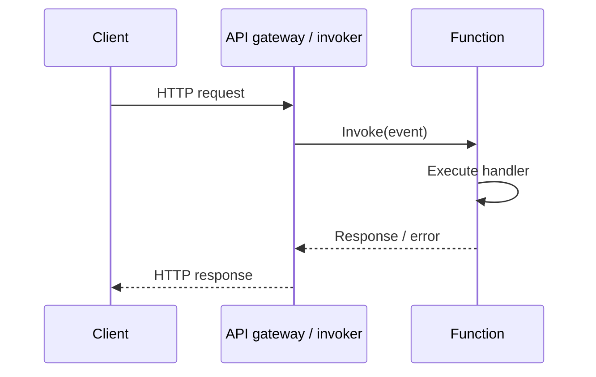
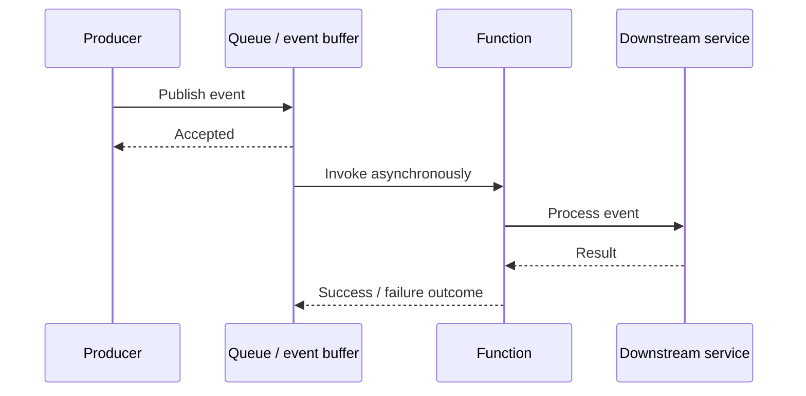
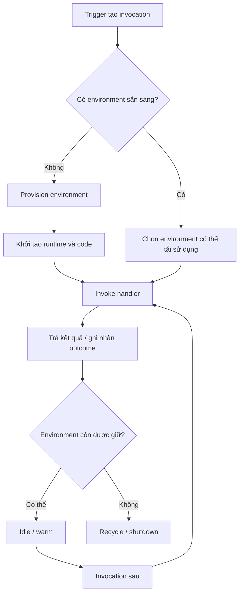
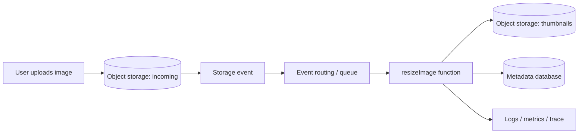

# Function, trigger, event và môi trường thực thi

## Bối cảnh: một hàm được gọi khi có sự kiện

Trong mô hình serverless function, nhà phát triển triển khai một đơn vị code có nhiệm vụ rõ ràng, còn nền tảng quản lý phần lớn hạ tầng chạy bên dưới. Hàm có thể được gọi trực tiếp qua HTTP, được kích hoạt khi một message đến queue, khi một object được tạo trong storage, khi có thay đổi dữ liệu, hoặc theo lịch. Mỗi lần gọi thường có một **event** mô tả điều đã xảy ra và một **runtime context** cung cấp thông tin về lần thực thi.

Mô hình này giúp xây dựng ứng dụng theo hướng event-driven: thay vì một server chạy liên tục chờ request, function được gọi khi có công việc. Tuy nhiên, “serverless” không có nghĩa là không có server hoặc không cần quan tâm đến compute. Nền tảng vẫn cấp CPU, memory, network và môi trường thực thi; nhà phát triển cần hiểu giới hạn invocation, concurrency, timeout, cold start, retry và vòng đời execution environment.

Trong module **CLOUD_CORE_SERVICES_COMPUTE**, function là một lựa chọn compute bên cạnh VM và container. Việc hiểu function, trigger, event và execution environment giúp chọn đúng mô hình cho API, xử lý bất đồng bộ, tích hợp hệ thống, automation và tác vụ theo lịch.

## 1. Function là gì?

Function trong serverless là đơn vị triển khai có thể được nền tảng gọi để xử lý một yêu cầu hoặc sự kiện. Một function thường gồm:

- **Handler:** điểm vào do runtime gọi khi có invocation.
- **Event:** dữ liệu đầu vào mô tả request hoặc sự kiện kích hoạt.
- **Context:** metadata về invocation và môi trường chạy, ví dụ request ID, deadline hoặc thông tin runtime.
- **Code và dependencies:** logic nghiệp vụ cùng thư viện cần thiết.
- **Configuration:** memory/CPU tier, timeout, biến môi trường, network, identity và các giới hạn khác.

Ví dụ, function `resizeImage` nhận event chứa bucket và object key, đọc ảnh gốc, tạo thumbnail rồi lưu kết quả. Function không cần tự quản lý máy chủ web, nhưng vẫn phải xử lý lỗi storage, quyền truy cập, định dạng ảnh, giới hạn memory và timeout.

### 1.1. Function và handler

Function là đơn vị logic được triển khai; handler là hàm hoặc phương thức runtime gọi để bắt đầu xử lý invocation. Tên, chữ ký và quy ước handler phụ thuộc ngôn ngữ và nền tảng.

Một handler về mặt khái niệm có dạng:

```text
handler(event, context) -> result
```

- `event` chứa input của invocation.
- `context` chứa thông tin điều khiển và môi trường.
- `result` có thể là response đồng bộ, trạng thái xử lý hoặc không có giá trị trả về đối với trigger bất đồng bộ.

Không phải nền tảng nào cũng truyền hai tham số đúng tên hoặc đúng hình thức trên. Một số runtime dùng object request, callback, stream hoặc API riêng. Cần đọc contract của runtime được chọn.

### 1.2. Function nên tập trung vào một trách nhiệm

Function thường hiệu quả khi có một trách nhiệm rõ ràng, ví dụ xác thực webhook, xử lý một loại event, chuyển đổi ảnh hoặc gửi thông báo. Một function quá lớn có thể tích tụ nhiều dependency, quyền và nhánh logic; một function quá nhỏ có thể tạo quá nhiều network hop, invocation và chi phí điều phối.

Phân ranh giới theo năng lực nghiệp vụ và ownership dữ liệu. Ví dụ, `validateOrder`, `reserveInventory` và `sendReceipt` có thể là các bước riêng trong workflow nếu mỗi bước có retry, timeout và quyền truy cập khác nhau. Không nên tách function chỉ vì muốn mỗi hàm có ít dòng code.

## 2. Trigger: điều gì làm function được gọi?

Trigger là cơ chế hoặc nguồn sự kiện khiến nền tảng tạo invocation cho function. Trigger xác định thời điểm gọi, cách chuyển dữ liệu đầu vào và một phần semantics giao nhận.

Các nhóm trigger phổ biến:

| Nhóm trigger | Ví dụ | Dạng xử lý thường gặp |
|---|---|---|
| HTTP/API | HTTP request, webhook, API gateway | Đồng bộ, cần response cho caller |
| Queue/message | Message từ queue hoặc broker | Bất đồng bộ, có retry và acknowledgement |
| Event bus | Event nghiệp vụ từ nhiều producer | Bất đồng bộ, routing theo rule/filter |
| Storage | Object được upload, file được tạo | Bất đồng bộ, xử lý theo object metadata |
| Database | Change stream, record change, CDC event | Bất đồng bộ, xử lý thay đổi dữ liệu |
| Schedule | Cron-like schedule, timer | Gọi theo thời gian |
| Stream | Record từ event/log stream | Theo batch hoặc record, có checkpoint/offset |
| Platform event | Resource lifecycle, audit event, deployment event | Automation và phản ứng vận hành |

Một function có thể có nhiều trigger nếu logic và security boundary phù hợp. Tuy nhiên, trigger khác nhau có thể có event schema, retry policy, timeout và quyền gọi khác nhau. Cần kiểm soát rõ function nào được phép gọi từ nguồn nào.

### 2.1. Push-based trigger

Với push-based trigger, nguồn sự kiện hoặc dịch vụ trung gian gửi request/event đến endpoint hoặc cơ chế invocation của function. Ví dụ API gateway gửi HTTP request đến function hoặc event bus đẩy event đến target.

Đặc điểm:

- Function được gọi khi nguồn gửi event.
- Có thể cần xác thực caller, chữ ký webhook hoặc quyền invoke.
- Hệ thống gửi cần xử lý lỗi delivery, timeout và retry theo contract.
- Cần bảo vệ endpoint trước traffic không hợp lệ và burst.

### 2.2. Pull-based trigger và event source mapping

Với pull-based trigger, nền tảng hoặc event source mapping đọc message/record từ nguồn như queue hoặc stream rồi gọi function theo batch. Function không nhất thiết có public endpoint để producer gọi trực tiếp.

Đặc điểm:

- Consumer/poller đọc message hoặc record theo cơ chế nền tảng.
- Có thể cấu hình batch size, polling window, concurrency và checkpoint.
- Thành công/thất bại của batch ảnh hưởng đến acknowledgement hoặc offset.
- Cần hiểu cách xử lý partial batch failure, poison message và retry.

Tên gọi và semantics của event source mapping khác nhau giữa provider. Cần phân biệt cơ chế trigger với code handler: trigger lấy dữ liệu từ nguồn và tạo invocation; handler thực hiện logic nghiệp vụ.

### 2.3. Trigger theo lịch

Schedule trigger phù hợp với báo cáo định kỳ, cleanup, đồng bộ dữ liệu hoặc kiểm tra trạng thái. Lịch có thể biểu diễn theo cron hoặc fixed interval tùy nền tảng.

Các yếu tố cần quyết định:

- Time zone và quy tắc daylight saving nếu có.
- Lịch có thể chạy trùng (overlap) khi invocation trước chưa xong không.
- Hành vi khi lịch bị bỏ lỡ do nền tảng gián đoạn.
- Retry và xử lý lần chạy trùng.
- Idempotency key hoặc business date để tránh xử lý cùng kỳ hai lần.

Không giả định schedule chỉ tạo đúng một invocation. Có thể có duplicate, delay hoặc retry tùy dịch vụ; handler nên an toàn khi nhận cùng kỳ công việc nhiều lần.

## 3. Event: dữ liệu đầu vào của invocation

Event là bản ghi dữ liệu mô tả điều đã xảy ra hoặc yêu cầu cần xử lý. Event có thể chứa dữ liệu nghiệp vụ, định danh resource, timestamp, metadata, trace context và thông tin nguồn phát.

Ví dụ event upload object:

```json
{
  "eventType": "storage.object.created",
  "eventId": "evt-7f3a2",
  "occurredAt": "2026-11-22T09:30:00Z",
  "source": "media-upload-service",
  "data": {
    "bucket": "incoming-media",
    "objectKey": "customers/42/photo.jpg",
    "version": "v18",
    "contentType": "image/jpeg",
    "sizeBytes": 2481930
  }
}
```

Đây là schema minh họa do ứng dụng tự định nghĩa, không phải payload chuẩn của một cloud provider. Trigger storage thực tế có thể đặt field ở cấu trúc khác và chứa encoding, region, bucket ARN hoặc sequencer riêng.

### 3.1. Các thành phần nên có trong event contract

Một event contract có thể định nghĩa:

- `eventId`: định danh duy nhất để trace và deduplicate.
- `eventType`: loại sự kiện và version semantics.
- `source`: hệ thống phát event.
- `occurredAt`: thời điểm sự kiện xảy ra theo UTC.
- `subject` hoặc resource identifier: đối tượng bị tác động.
- `data`: payload nghiệp vụ cần cho consumer.
- `schemaVersion`: phiên bản cấu trúc event.
- Correlation/trace ID: liên kết các bước xử lý.

Không phải event nào cũng cần tất cả field. Điều quan trọng là producer và consumer thống nhất schema, ý nghĩa, compatibility và cách xử lý field thiếu/không hợp lệ.

### 3.2. Event khác command và request

- **Event** mô tả điều đã xảy ra, ví dụ `OrderPlaced`; consumer có thể phản ứng độc lập.
- **Command** yêu cầu một thành phần thực hiện hành động, ví dụ `ReserveInventory`; thường có một owner chịu trách nhiệm thực thi.
- **Request** yêu cầu xử lý ngay và thường chờ response, ví dụ HTTP `POST /orders`.

Trong thực tế một message có thể mang tính chất lai, nhưng phân biệt ba khái niệm giúp thiết kế coupling và failure handling. Event thường được phát sau khi một sự kiện nghiệp vụ đã xảy ra; command biểu đạt ý định cần thực hiện.

### 3.3. Event nên bất biến và có version

Sau khi phát hành, event nên được xem như bản ghi bất biến. Nếu consumer cần field mới, hãy thêm theo cách tương thích hoặc tăng schema version theo policy. Tránh đổi ý nghĩa một field cũ mà không đổi version vì consumer đang chạy có thể diễn giải sai dữ liệu.

Các nguyên tắc thường dùng:

- Ưu tiên additive change và field optional có default rõ ràng.
- Không tái sử dụng tên field cũ cho ý nghĩa mới.
- Xác định quy tắc khi consumer gặp schema version chưa hỗ trợ.
- Dùng schema registry hoặc contract test nếu hệ thống có nhiều producer/consumer.
- Không đưa secret, token hoặc dữ liệu nhạy cảm không cần thiết vào event.

### 3.4. Event payload và kích thước

Payload lớn làm tăng chi phí truyền, thời gian parse, memory và nguy cơ vượt giới hạn invocation. Với file lớn hoặc dữ liệu nhị phân, event thường chỉ nên mang reference như object key, URI nội bộ hoặc resource ID; function đọc dữ liệu từ storage bằng identity được cấp quyền.

Reference cần có tính ổn định và kiểm soát truy cập. Nếu object có thể bị ghi đè, event nên kèm version ID, generation hoặc immutable key để function đọc đúng nội dung đã phát sinh sự kiện. Không đặt public URL có quyền truy cập rộng vào event chỉ để consumer dễ tải dữ liệu.

## 4. Context và metadata của invocation

Runtime context là thông tin nền tảng cung cấp cho handler về lần gọi hiện tại hoặc execution environment. Tùy runtime, context có thể bao gồm:

- Request/invocation ID để tra cứu log và trace.
- Deadline hoặc thời gian còn lại trước timeout.
- Function name, version, alias hoặc revision.
- Memory limit, runtime version và thông tin môi trường.
- Identity/metadata của trigger hoặc client, nếu nền tảng cung cấp.
- Cancellation token hoặc API ghi log/metric theo runtime.

Context không nên bị nhầm với event. Event là dữ liệu đầu vào của nghiệp vụ; context là metadata điều khiển invocation. Không đưa logic nghiệp vụ phụ thuộc vào field nội bộ của context nếu có thể dùng contract event rõ ràng hơn.

Ví dụ pseudocode:

```javascript
export async function handler(event, context) {
  const requestId = context.requestId;
  const deadline = context.deadline;

  logger.info({ requestId, eventType: event.eventType }, "invocation started");

  const result = await processEvent(event, { deadline });
  return { ok: true, result };
}
```

Tên `requestId` và `deadline` là tên minh họa. API thực tế phụ thuộc runtime; một số nền tảng cung cấp thời gian còn lại qua method thay vì property.

### 4.1. Dùng deadline thay vì giả định còn đủ thời gian

Function thường có timeout tối đa. Khi gần hết thời gian, việc gọi thêm dependency có thể khiến invocation bị terminate trước khi hoàn tất cleanup. Handler nên:

1. Đọc deadline hoặc thời gian còn lại từ context nếu runtime hỗ trợ.
2. Đặt timeout cho outbound request nhỏ hơn thời gian còn lại.
3. Không bắt đầu công việc không thể hoàn tất trước deadline.
4. Lưu checkpoint hoặc phát message tiếp theo nếu công việc cần chia nhỏ.
5. Tránh retry nội bộ kéo dài vượt timeout; dùng retry policy của queue/workflow khi phù hợp.

## 5. Các mô hình invocation

Invocation là một lần function được nền tảng gọi để xử lý input. Mô hình invocation ảnh hưởng cách caller nhận kết quả, cách lỗi được trả về và nơi quản lý retry.

### 5.1. Đồng bộ (synchronous invocation)

Caller gửi request và chờ function hoàn tất để nhận response. Mô hình này thường dùng cho HTTP/API, webhook hoặc lời gọi trực tiếp cần kết quả ngay.



Đặc điểm:

- Latency của function nằm trong response time mà caller quan sát.
- Timeout của gateway, client và function phải tương thích.
- Lỗi thường được trả về caller; caller có thể retry.
- Caller cần xử lý timeout không rõ kết quả: function có thể đã commit dữ liệu nhưng response bị mất.

Với thao tác tạo đơn hàng hoặc thanh toán, retry HTTP không được tạo side effect trùng. Dùng idempotency key và lưu trạng thái request để xác định kết quả khi caller không nhận được response.

### 5.2. Bất đồng bộ (asynchronous invocation)

Invoker tiếp nhận event, xếp hàng hoặc lưu tạm rồi trả lời rằng yêu cầu đã được chấp nhận. Function xử lý sau đó; caller không chờ kết quả nghiệp vụ cuối cùng.



Đặc điểm:

- Producer và consumer ít phụ thuộc thời gian vào nhau.
- Hệ thống có thể retry khi invocation lỗi theo policy.
- Event có thể đến trễ hoặc nhiều lần; cần idempotency.
- Cần giám sát backlog, age of oldest event, retry và dead-letter destination.
- Việc producer nhận “accepted” không đồng nghĩa nghiệp vụ đã hoàn tất.

### 5.3. Stream hoặc batch invocation

Với queue/stream, nền tảng có thể gom nhiều record thành một batch rồi gọi function. Handler xử lý batch và báo thành công/thất bại theo semantics của trigger.

Ưu điểm là giảm số invocation và overhead; đổi lại, một record lỗi có thể ảnh hưởng cả batch nếu không hỗ trợ partial batch response. Cần xác định:

- Batch size và maximum batching window.
- Thứ tự record và partition key.
- Cách xác nhận offset/acknowledgement.
- Retry toàn batch hay chỉ record lỗi.
- Cách xử lý poison message để tránh chặn partition/queue.

Với stream có thứ tự theo partition, một record lỗi có thể làm các record sau trong cùng partition bị giữ lại tùy dịch vụ. Cần có policy retry, checkpoint và DLQ phù hợp để không mất thứ tự hoặc chặn luồng vô hạn.

### 5.4. Chọn mô hình invocation

| Tiêu chí | Đồng bộ | Bất đồng bộ | Stream/batch |
|---|---|---|---|
| Caller chờ kết quả cuối? | Có | Không | Thường không |
| Độ trễ phản hồi | Thấp nếu xử lý nhanh | Chỉ xác nhận tiếp nhận | Phụ thuộc batching/lag |
| Retry owner | Caller/gateway và app | Invoker/queue theo policy | Event source/consumer |
| Throughput | Theo request/concurrency | Hấp thụ burst qua buffer | Hiệu quả với luồng record lớn |
| Phù hợp | API, validation, lookup | Notification, workflow step, background job | Analytics, ingestion, change stream |

Nếu tác vụ có thể kéo dài, cần retry bền vững hoặc phải tách khỏi latency của client, nên dùng queue/workflow/event bus thay vì giữ HTTP request mở lâu.

## 6. Execution environment: nơi function thực thi

Execution environment là môi trường compute được nền tảng chuẩn bị để chạy function. Nó thường gồm runtime, process, memory, filesystem tạm, network configuration, identity và các dependency được triển khai cùng function.

Một vòng đời khái niệm:



Sơ đồ là mô hình khái niệm. Nền tảng có thể tạo nhiều environment song song, tái sử dụng environment trong một khoảng thời gian không cam kết, hoặc thu hồi bất kỳ lúc nào theo capacity và policy.

### 6.1. Cold start và warm invocation

**Cold start** là thời gian bổ sung để chuẩn bị environment trước khi handler xử lý invocation. Công việc có thể gồm cấp phát compute, tải image/package, khởi tạo runtime, nạp code/dependency, thiết lập network và chạy initialization code.

**Warm invocation** dùng lại environment đã khởi tạo, thường tránh được một phần chi phí khởi tạo ban đầu. Warm không đồng nghĩa với latency cố định hoặc không có overhead: runtime vẫn cần dispatch invocation, deserialize event và gọi handler.

Cold start có thể tăng khi:

- Function ít được gọi và environment bị thu hồi.
- Package/image lớn hoặc dependency khởi tạo nặng.
- Function gắn VPC/network interface hoặc cần thiết lập kết nối riêng.
- Runtime cần JIT, load model hoặc khởi tạo SDK.
- Burst concurrency buộc nền tảng tạo nhiều environment mới cùng lúc.

### 6.2. Không dựa vào environment reuse để lưu state bền vững

Một số nền tảng có thể tái sử dụng process và module state giữa các invocation trong cùng environment. Điều này có thể hữu ích để cache cấu hình hoặc tái sử dụng connection, nhưng không được bảo đảm lâu dài.

Không lưu state nghiệp vụ duy nhất trong biến global, RAM hoặc filesystem tạm vì:

- Invocation tiếp theo có thể chạy ở environment khác.
- Environment có thể bị recycle mà không báo trước.
- Nhiều invocation đồng thời có thể chạy trên nhiều environment riêng.
- State global có thể bị chia sẻ giữa các invocation trong cùng process và gây race condition nếu runtime cho phép concurrency.
- Dữ liệu trong memory/temp storage không thay thế database hoặc object storage bền vững.

Hãy lưu state cần tồn tại qua invocation vào database, object storage, durable queue hoặc dịch vụ state phù hợp. Cache trong environment chỉ nên là tối ưu có thể tái tạo, có TTL/validation và không ảnh hưởng tính đúng đắn khi cache mất.

### 6.3. Initialization code và handler code

Có thể chia code thành hai phần:

- **Initialization:** nạp thư viện, đọc cấu hình, tạo client SDK, chuẩn bị model hoặc connection pool.
- **Invocation handler:** xác thực input, thực hiện nghiệp vụ và trả outcome cho lần gọi hiện tại.

Đặt khởi tạo nặng ở initialization có thể giúp warm invocation nhanh hơn, nhưng cũng làm cold start lâu hơn. Đặt mọi thứ trong handler có thể lặp lại việc tạo client cho từng invocation và tăng latency. Cần đo cả cold và warm path.

Client SDK hoặc connection pool có thể được tái sử dụng nếu thư viện và runtime hỗ trợ. Tuy nhiên, phải xử lý connection stale, credential rotation, DNS change và pool exhaustion. Không giữ transaction hoặc request-specific data trong biến global giữa các lần gọi.

## 7. Runtime và cách function được thực thi

Runtime là lớp thực thi hiểu cách nạp code, gọi handler, chuyển event/context và thu thập kết quả. Nền tảng có thể cung cấp managed runtime cho ngôn ngữ phổ biến hoặc cho phép đóng gói custom runtime/container image.

Các lựa chọn thường gặp:

- **Managed language runtime:** provider duy trì runtime và bản vá nền tảng; người dùng triển khai code/dependency.
- **Custom runtime:** người dùng cung cấp adapter để nhận invocation và trả kết quả theo runtime API của provider.
- **Container image:** đóng gói runtime, code và dependency trong image; nền tảng vẫn quản lý việc cấp phát và invocation.
- **WebAssembly hoặc runtime chuyên biệt:** có thể được một số nền tảng hỗ trợ cho workload đặc thù.

Tên và danh sách runtime được hỗ trợ thay đổi theo provider. Cần kiểm tra thời hạn hỗ trợ phiên bản, architecture (x86_64/ARM64), thư viện native, kích thước artifact và cơ chế cập nhật bảo mật.

### 7.1. Runtime contract

Runtime contract định nghĩa cách nền tảng giao invocation cho function và cách function trả outcome. Nó có thể quy định:

- Định dạng event và context.
- Tên handler hoặc entry point.
- Cách khởi động process và tải code.
- Cách trả HTTP response hoặc acknowledgement.
- Cách báo lỗi để nền tảng retry.
- Cách xử lý signal/shutdown và lifecycle hook.
- Các biến môi trường hệ thống được cung cấp.

Nếu dùng custom runtime, adapter phải tuân thủ giao thức invocation chính xác. Một lỗi nhỏ trong việc đọc request, giữ connection hoặc báo trạng thái hoàn tất có thể làm invocation treo hoặc bị retry.

### 7.2. Dependency và artifact

Function có thể được triển khai dưới dạng ZIP/package, layer, bundle hoặc container image. Cần tối ưu artifact để giảm thời gian tải/khởi tạo, đồng thời kiểm soát dependency:

- Chỉ đóng gói thư viện cần thiết.
- Pin phiên bản dependency và tạo lockfile.
- Quét lỗ hổng và license của package.
- Build artifact tái lập được từ source đã kiểm soát.
- Tách cấu hình môi trường khỏi binary/image khi có thể.
- Dùng image digest/version bất biến thay cho tag có thể bị ghi đè.
- Kiểm thử runtime mới trước khi nâng cấp production.

Dependency native phải tương thích với hệ điều hành, architecture và ABI của runtime. Một package build trên Windows hoặc glibc version khác có thể không chạy trong runtime Linux tối giản.

## 8. Concurrency và scaling

Concurrency là số invocation đang thực thi đồng thời. Nền tảng serverless thường tăng hoặc giảm số execution environment theo lượng invocation, nhưng có giới hạn theo function, account/project, region hoặc event source.

### 8.1. Quan hệ giữa arrival rate, duration và concurrency

Theo định luật Little, trong trạng thái ổn định:

\[
L=\lambda\times W
\]

Trong đó:

- `L` là số invocation đang chạy trung bình (concurrency).
- `λ` là tốc độ invocation đến mỗi giây.
- `W` là thời gian thực thi trung bình tính bằng giây.

Ví dụ, function nhận 120 invocation/giây và mỗi invocation chạy trung bình 0,5 giây:

\[
L=120\times0.5=60\text{ concurrent invocations}
\]

Đây là mức concurrency trung bình ước lượng. Peak, tail duration, retry và burst có thể làm concurrency thực tế cao hơn. Cần đo p95/p99 duration và arrival pattern.

### 8.2. Concurrency limit và throttling

Concurrency limit bảo vệ nền tảng và downstream khỏi lượng invocation vượt quá capacity. Khi chạm giới hạn, invocation mới có thể bị throttled, queue lại hoặc retry tùy mô hình trigger.

Các loại giới hạn thường gặp:

- Account/region concurrency quota.
- Reserved concurrency hoặc concurrency cap riêng cho function.
- Provisioned concurrency/minimum warm capacity.
- Event source maximum concurrency hoặc consumer parallelism.
- Downstream limit như database connection, API rate limit hoặc queue throughput.

Đặt concurrency quá cao có thể làm database hoặc API downstream quá tải. Đặt quá thấp có thể tạo backlog và tăng event age. Cần sizing theo cả function lẫn dependency.

### 8.3. Scale-out và scale-in

Khi tải tăng, nền tảng có thể tạo thêm execution environment; khi tải giảm, environment có thể được thu hồi. Tốc độ scaling và mức concurrency tăng mỗi khoảng thời gian phụ thuộc dịch vụ, region và trigger. Không nên giả định scale-out là tức thời hoặc vô hạn.

Với burst lớn, cân nhắc:

- Queue/buffer để làm phẳng burst.
- Batch size để giảm số invocation.
- Reserved/provisioned capacity cho workload cần latency ổn định.
- Concurrency cap để bảo vệ database và downstream.
- Backpressure và admission control khi hệ thống không theo kịp.
- Warm-up hoặc pre-scaling nếu nền tảng hỗ trợ và workload có lịch.

### 8.4. Concurrent execution và dữ liệu dùng chung

Không giả định chỉ có một invocation tại một thời điểm. Nhiều environment có thể chạy song song và xử lý event cùng lúc. Dữ liệu dùng chung phải được quản lý bằng database transaction, conditional write, lock/lease hoặc idempotency key phù hợp.

Biến global trong một environment có thể được giữ giữa các invocation, nhưng invocation concurrency trong cùng environment phụ thuộc runtime và model của provider. Một số môi trường xử lý tuần tự từng invocation; một số runtime có thể hỗ trợ concurrency trong cùng process. Hãy kiểm tra semantics cụ thể và viết code thread-safe nếu cần.

## 9. Statelessness và quản lý dữ liệu

Function thường được thiết kế stateless: mỗi invocation nhận đủ input để thực hiện công việc và không phụ thuộc vào RAM của lần gọi trước. Statelessness giúp nền tảng dễ scale, thay environment và retry.

Điều này không có nghĩa ứng dụng không có state. State được đặt trong dịch vụ bền vững bên ngoài execution environment:

| Loại state | Nơi lưu phù hợp | Lưu ý |
|---|---|---|
| Hồ sơ/nghiệp vụ | Database | Transaction, consistency và connection limits |
| File/object | Object storage | Versioning, encryption và lifecycle |
| Session/cache | Managed cache hoặc database | TTL, eviction và cache invalidation |
| Công việc chờ xử lý | Queue/event stream | Retry, visibility, ordering và DLQ |
| Workflow dài | Workflow/state machine hoặc durable store | Checkpoint và trạng thái từng bước |
| Secret/config | Secret manager/config service | IAM, rotation và audit |

### 9.1. Temporary storage

Execution environment có thể cung cấp filesystem tạm hoặc thư mục như `/tmp`. Dung lượng, độ bền và khả năng chia sẻ phụ thuộc provider/runtime. Dữ liệu tạm có thể tồn tại giữa các invocation trong cùng environment được tái sử dụng, nhưng có thể mất khi environment bị thu hồi.

Dùng temporary storage cho file trung gian, cache có thể tạo lại hoặc dữ liệu scratch; không dùng làm nơi lưu duy nhất cho đơn hàng, trạng thái workflow hoặc kết quả đã xác nhận. Xóa dữ liệu tạm nhạy cảm sau khi dùng và tránh giả định environment mới luôn có filesystem sạch nếu nền tảng tái sử dụng storage tạm.

### 9.2. Idempotency khi retry hoặc duplicate event

Một event có thể được giao nhiều lần vì timeout, network failure, acknowledgement bị mất hoặc retry policy. Handler nên xử lý duplicate an toàn.

Mẫu xử lý phổ biến:

1. Đọc `eventId` hoặc idempotency key.
2. Tạo/kiểm tra bản ghi xử lý trong database bằng unique constraint hoặc conditional write.
3. Nếu event đã hoàn tất, trả kết quả thành công mà không lặp side effect.
4. Nếu chưa xử lý, thực hiện nghiệp vụ trong transaction hoặc protocol có thể phục hồi.
5. Đánh dấu hoàn tất sau khi kết quả bền vững.

Không chỉ ghi event ID vào cache không bền vững rồi coi đó là deduplication đầy đủ nếu duplicate có thể đến sau khi cache hết hạn hoặc environment bị recycle.

## 10. Retry, acknowledgement và dead-letter handling

Retry là cơ chế gọi lại function khi invocation thất bại hoặc không nhận được acknowledgement. Cách retry phụ thuộc loại trigger:

- Với HTTP đồng bộ, caller/gateway có thể retry theo policy; function cần idempotency.
- Với invocation bất đồng bộ, invoker có thể retry và có thể gửi event đến dead-letter destination sau số lần/thời gian nhất định.
- Với queue, message thường được giữ cho đến khi được ACK/delete hoặc hết visibility timeout; message có thể xuất hiện lại.
- Với stream, checkpoint/offset quyết định record nào được đọc lại; lỗi có thể ảnh hưởng record sau trong partition.

### 10.1. Retry có backoff

Retry liên tục không giới hạn có thể làm tăng tải khi downstream đang lỗi. Dùng exponential backoff, jitter và giới hạn số lần/thời gian retry để tránh retry storm.

Ví dụ policy minh họa:

```text
attempt 1: retry after 1 s + jitter
attempt 2: retry after 2 s + jitter
attempt 3: retry after 4 s + jitter
after max attempts: send to dead-letter queue
```

Các giá trị chỉ là ví dụ. Chọn backoff theo timeout, tuổi tối đa của event và khả năng phục hồi của dependency.

### 10.2. Phân loại lỗi

- **Transient error:** timeout mạng, throttling hoặc dependency tạm thời không sẵn sàng; thường có thể retry.
- **Permanent/business error:** payload không hợp lệ, schema không hỗ trợ hoặc vi phạm quy tắc nghiệp vụ; retry thường không giúp.
- **Poison message:** một event luôn làm handler lỗi hoặc crash; cần cách ly để không chặn queue/partition.
- **Configuration/security error:** thiếu quyền, secret sai hoặc endpoint sai; retry liên tục có thể chỉ tạo log và chi phí.

Không bắt mọi exception rồi trả thành công vì điều đó có thể khiến event lỗi bị mất. Ngược lại, không retry vô hạn với lỗi vĩnh viễn. Hãy phân loại và trả outcome đúng contract trigger.

### 10.3. Partial batch failure

Nếu trigger giao nhiều record trong một batch, handler cần biết nền tảng hỗ trợ báo lỗi từng record hay chỉ báo toàn batch thất bại. Khi chỉ có batch-level acknowledgement, một record lỗi có thể khiến toàn bộ batch được giao lại, dẫn đến xử lý lặp các record đã thành công.

Nếu có partial batch response:

- Chỉ liệt kê record thất bại theo đúng schema nền tảng yêu cầu.
- Bảo đảm record đã thành công có thể được xử lý lặp mà không tạo side effect.
- Giữ đúng ordering nếu stream yêu cầu.
- Giám sát số lần retry và age của record đầu tiên chưa xử lý.

### 10.4. Dead-letter queue và replay

Dead-letter queue (DLQ) hoặc dead-letter destination giữ event không thể xử lý sau policy retry. Cần quy định:

- Ai theo dõi và xử lý DLQ.
- Retention và cảnh báo khi DLQ có message.
- Cách phân tích payload/lỗi mà không lộ dữ liệu nhạy cảm.
- Điều kiện sửa dữ liệu/code trước khi replay.
- Cách replay an toàn và chống side effect trùng.

DLQ không tự sửa dữ liệu hoặc tự khôi phục workflow. Nếu không có owner và runbook, DLQ chỉ trở thành nơi tích tụ lỗi bị quên.

## 11. Cấu hình môi trường thực thi

Mặc dù provider quản lý server, function vẫn có các tham số compute và runtime cần lựa chọn. Các tham số này ảnh hưởng latency, throughput, giới hạn và chi phí.

### 11.1. CPU và memory

Nhiều nền tảng liên kết CPU với mức memory được cấp hoặc cung cấp một số cấu hình compute tier. Tăng memory có thể đồng thời tăng CPU allocation, tùy provider. Workload CPU-bound, memory-bound và I/O-bound có đặc tính khác nhau:

- CPU-bound: parsing lớn, nén, mã hóa, xử lý ảnh hoặc tính toán số.
- Memory-bound: xử lý batch lớn, model inference hoặc giữ nhiều object trong RAM.
- I/O-bound: chờ database, object storage hoặc external API.

Không chọn memory chỉ theo kích thước input. Cần tính peak working set, runtime overhead, buffer, concurrency và library. Theo dõi OOM, memory peak, CPU duration và throttling nếu nền tảng cung cấp.

### 11.2. Timeout

Timeout là thời gian tối đa cho một invocation hoặc một lần xử lý theo giới hạn nền tảng. Đặt timeout quá thấp gây lỗi khi dependency chậm hoặc cold start; đặt quá cao có thể giữ concurrency lâu, tăng chi phí và làm backlog khó phục hồi.

Chọn timeout theo:

- Phân phối duration p95/p99 của workload.
- Timeout của gateway, client và downstream.
- Thời gian xử lý batch/job lớn nhất được hỗ trợ.
- Retry policy và tuổi tối đa của event.
- Graceful cancellation/cleanup nếu runtime hỗ trợ.

Timeout của function cần nhỏ hơn hoặc tương thích với timeout ở lớp gọi để caller có thể nhận lỗi có ý nghĩa. Với tác vụ dài, nên chia nhỏ hoặc chuyển sang workflow/batch compute thay vì tăng timeout vô hạn.

### 11.3. Environment variables và configuration

Biến môi trường phù hợp với cấu hình không bí mật như tên môi trường, endpoint nội bộ hoặc feature flag. Secret như password, API token và private key nên lấy từ secret manager hoặc cơ chế secret injection có kiểm soát.

Nguyên tắc:

- Tách cấu hình dev/staging/prod.
- Validate cấu hình khi initialization và fail fast nếu thiếu giá trị bắt buộc.
- Không log secret hoặc toàn bộ environment variables.
- Giới hạn quyền đọc secret theo function identity.
- Xác định cách refresh/rotation secret; environment warm có thể giữ client/config cũ.

### 11.4. Network và VPC connectivity

Function có thể chạy trong network do provider quản lý hoặc được gắn vào VPC/private network để truy cập database, cache và service nội bộ. Gắn VPC không tự động bảo đảm function có Internet egress; cần kiểm tra route, NAT, firewall, DNS và security group.

Các câu hỏi cần trả lời:

- Function cần truy cập resource nào và qua subnet/route nào?
- Có cần public Internet egress không?
- Có NAT gateway, private endpoint hoặc service endpoint cần cấu hình không?
- Security group/firewall cho phép đúng port và destination chưa?
- DNS nội bộ có phân giải được từ execution environment không?
- Cold start/network initialization có bị ảnh hưởng bởi cách gắn network không?

Chỉ cấp network access cần thiết. Không mở egress/ingress toàn bộ chỉ để khắc phục nhanh lỗi kết nối.

### 11.5. Temporary disk và filesystem

Function có thể được cấp vùng lưu trữ tạm với giới hạn dung lượng. Hãy dùng nó cho file trung gian, giải nén package hoặc scratch data. Đo dung lượng peak và dọn file sau khi xử lý; không coi vùng tạm là persistent volume.

Nếu xử lý file lớn, cần cân nhắc streaming thay vì tải toàn bộ vào RAM hoặc disk. Nếu phải tải về, kiểm tra cả payload size, disk capacity, memory và thời gian I/O trong timeout.

## 12. Identity và quyền truy cập

Function thường chạy dưới một service identity/role do nền tảng cấp. Identity này cho phép function gọi dịch vụ khác mà không cần nhúng access key cố định trong code.

Ví dụ, function xử lý ảnh chỉ cần:

- Đọc object trong prefix `incoming/` của bucket được chỉ định.
- Ghi thumbnail vào prefix `thumbnails/`.
- Ghi metric/log theo quyền cần thiết.
- Đọc secret của image-processing service nếu thật sự cần.

Không cấp quyền quản trị toàn bucket/account nếu function chỉ cần hai thao tác trên hai prefix.

### 12.1. Tách quyền invoke và quyền thực thi

Hai loại quyền cần được phân biệt:

- **Invoke permission:** ai hoặc dịch vụ nào được phép gọi function.
- **Execution role:** function được phép làm gì sau khi được gọi.

Ví dụ, event bus có quyền invoke function; function execution role có quyền đọc object và ghi thumbnail. Nếu gộp hai quyền, có thể vô tình cho caller quyền truy cập tài nguyên mà chỉ function cần.

### 12.2. Xác thực trigger và bảo vệ event

Với HTTP/webhook, cần xác minh caller bằng IAM/signature/token/mTLS hoặc cơ chế phù hợp. Không tin các field như `source`, `userId` hoặc `tenantId` chỉ vì chúng có trong JSON body; phải xác thực nguồn và authorization theo identity đã kiểm chứng.

Với event nội bộ, kiểm soát quyền publish vào event bus/queue, quyền invoke function và policy routing. Event payload có thể chứa dữ liệu do producer không tin cậy cung cấp; handler vẫn phải validate schema, kích thước và giá trị.

### 12.3. Secret và dữ liệu nhạy cảm

- Không hard-code secret trong source hoặc container image.
- Không đưa token/password vào event nếu consumer có thể lấy qua secret manager.
- Hạn chế log payload; che dữ liệu cá nhân và credential.
- Mã hóa dữ liệu khi truyền và khi lưu theo policy.
- Kiểm soát quyền đọc log, event archive, DLQ và replay tool.
- Rotation secret không nên yêu cầu rebuild code nếu có thể dùng secret reference.

## 13. Observability cho function và trigger

Function ngắn hạn hoặc được scale tự động có thể tạo nhiều invocation trên nhiều execution environment. Chỉ xem log của một process không đủ để hiểu toàn bộ hệ thống. Cần liên kết metrics, logs và traces qua invocation ID/correlation ID.

### 13.1. Metrics

Theo dõi ít nhất:

- Invocation count và invocation rate.
- Success/error/throttle count.
- Duration p50/p95/p99 và timeout count.
- Concurrent executions và concurrency utilization.
- Cold start count/rate và initialization duration nếu nền tảng cung cấp.
- Queue depth, age of oldest message, stream lag và batch failure.
- Retry count, DLQ count và partial batch failure.
- Downstream latency/error, connection count và rate limit.
- Memory usage/peak, CPU utilization/throttling nếu có metric.

### 13.2. Structured logs

Log nên có cấu trúc và trường định danh ổn định:

```json
{
  "level": "INFO",
  "message": "event processed",
  "function": "resize-image",
  "invocationId": "inv-82d1",
  "eventId": "evt-7f3a2",
  "eventType": "storage.object.created",
  "durationMs": 184,
  "outcome": "success"
}
```

Ví dụ minh họa. Không log toàn bộ payload nếu có thể chứa thông tin cá nhân, token hoặc dữ liệu nhạy cảm. Nên log resource ID đã chuẩn hóa, event ID và outcome để điều tra mà không sao chép nội dung bí mật.

### 13.3. Distributed tracing

Trong workflow nhiều function, truyền trace context hoặc correlation ID qua event/message để liên kết producer, queue, function và downstream. Với event bất đồng bộ, trace có thể nối theo quan hệ parent/child hoặc span link tùy mô hình tracing.

Không tạo một trace mới không liên quan ở mỗi bước nếu cần điều tra end-to-end. Đồng thời, không dùng event ID làm metric label có cardinality cao; event ID phù hợp cho log/trace, còn metric label nên có số giá trị giới hạn.

### 13.4. Alert theo triệu chứng nghiệp vụ

Alert chỉ dựa trên số invocation lỗi có thể gây nhiễu khi traffic thấp. Nên kết hợp:

- Tỷ lệ lỗi và số lỗi tuyệt đối.
- Event age/backlog vượt deadline nghiệp vụ.
- DLQ tăng hoặc poison message lặp.
- Throttling kéo dài.
- p95/p99 duration vượt latency objective.
- Tỷ lệ cold start cao nếu ảnh hưởng SLO.
- Dependency error hoặc connection pool gần cạn.

## 14. Ví dụ end-to-end: xử lý ảnh khi upload

Một ứng dụng cho phép người dùng upload ảnh lên object storage. Khi object được tạo, storage phát event; event trigger gọi function `resizeImage`.



### 14.1. Luồng xử lý

1. Client upload object vào prefix `incoming/`.
2. Storage tạo event chứa bucket, object key, version và metadata.
3. Event routing chuyển event đến queue hoặc function theo cấu hình.
4. Function xác thực schema, kiểm tra prefix và lấy object đúng version.
5. Function đọc/stream ảnh, tạo thumbnail theo kích thước cho phép.
6. Function ghi kết quả vào `thumbnails/` và metadata vào database.
7. Function ghi outcome có event ID và correlation ID.
8. Nếu xử lý thất bại, trigger retry theo policy; event lỗi lâu dài được đưa vào DLQ.

### 14.2. Handler minh họa

```python
def handler(event, context):
    record = validate_event(event)
    event_id = record["eventId"]
    bucket = record["data"]["bucket"]
    key = record["data"]["objectKey"]
    version = record["data"].get("version")

    # Bảo đảm xử lý lặp không tạo thumbnail hoặc metadata trùng.
    if already_processed(event_id):
        return {"status": "duplicate", "eventId": event_id}

    image = storage.read_object(bucket, key, version=version)
    thumbnail = create_thumbnail(image, max_width=640, max_height=640)
    output_key = build_thumbnail_key(key, version)

    storage.write_object("media-output", output_key, thumbnail)
    metadata.save_processed(event_id, output_key)

    return {"status": "processed", "outputKey": output_key}
```

Đây là pseudocode, không phải SDK cụ thể. Trong triển khai thực tế, bước đánh dấu event đã xử lý và ghi output cần thiết kế transaction/idempotency phù hợp. Nếu function ghi thumbnail thành công nhưng lỗi trước khi lưu metadata, lần retry phải phát hiện output hoặc ghi lại một cách an toàn.

### 14.3. Các giới hạn cần tính

- Kích thước ảnh tối đa và định dạng hợp lệ.
- Memory cần cho decode/resize; ảnh nén nhỏ có thể bung ra thành bitmap lớn.
- Temporary disk hoặc streaming để tránh memory spike.
- Timeout khi đọc/ghi object và tạo thumbnail.
- Concurrency tối đa để tránh vượt quota storage/database.
- Retry và DLQ cho object lỗi hoặc event duplicate.
- Quyền đọc prefix nguồn và ghi prefix đích.
- Tránh trigger vòng lặp nếu function ghi object vào cùng prefix đang theo dõi.

## 15. Ví dụ HTTP function

Một HTTP function có thể được đặt sau API gateway. Gateway xác thực request, áp dụng rate limit và chuyển event đến handler.

```javascript
export async function handler(event, context) {
  const request = parseHttpEvent(event);
  const identity = authenticate(request);

  if (!identity) {
    return {
      statusCode: 401,
      headers: { "content-type": "application/json" },
      body: JSON.stringify({ error: "unauthorized" })
    };
  }

  const input = validateOrderRequest(request.body);
  const order = await createOrder(input, identity);

  return {
    statusCode: 201,
    headers: { "content-type": "application/json" },
    body: JSON.stringify({ orderId: order.id })
  };
}
```

Schema HTTP event và response phụ thuộc API gateway/integration. Cần xác minh encoding body (ví dụ base64), multi-value headers, path parameters, request context và cách map status code. Không giả định mọi gateway truyền event cùng cấu trúc.

Với thao tác tạo order, nên nhận idempotency key từ client, lưu key cùng kết quả và trả lại kết quả cũ nếu client retry cùng request. Nếu function commit order nhưng response timeout, idempotency giúp tránh tạo hai order.

## 16. Khi nào chọn function thay cho VM hoặc container?

Function phù hợp khi workload có thể biểu diễn thành invocation có input/output rõ ràng, thời gian xử lý nằm trong giới hạn nền tảng và không cần kiểm soát host liên tục.

| Tiêu chí | Serverless function | Container service | VM |
|---|---|---|---|
| Quản lý host/OS | Provider quản lý phần lớn | Provider hoặc người dùng tùy dịch vụ | Người dùng thường quản lý guest OS |
| Đơn vị scale | Invocation/concurrency | Container/replica | VM/instance |
| Workload phù hợp | Event, API ngắn, automation, background task | Service chạy liên tục, worker dài hạn, nhiều process | Phần mềm legacy, OS/custom kernel needs, workload kiểm soát sâu |
| Runtime control | Theo runtime/platform contract | Linh hoạt hơn qua image | Rất linh hoạt ở guest OS |
| Cold start | Có thể đáng kể tùy runtime/config | Có thể có khi scale từ zero hoặc pull image | Boot VM thường dài hơn nhưng instance có thể chạy liên tục |
| State local | Tạm thời, không nên dựa vào | Có thể dùng volume nhưng cần quản lý lifecycle | Có thể dùng disk nhưng cần backup/HA |
| Scaling | Tự động theo trigger/concurrency, có quota | Orchestrator/autoscaler | Autoscaling group hoặc automation |

Function không phù hợp nếu workload cần chạy vô hạn, duy trì kết nối lâu dài ngoài giới hạn, cần quyền kernel/OS đặc biệt, dùng thiết bị phần cứng chuyên dụng không được hỗ trợ hoặc phụ thuộc mạnh vào local persistent state. Khi đó container hoặc VM có thể phù hợp hơn.

### 16.1. Workload có thể chia nhỏ

Một job dài có thể chia thành nhiều bước function nếu mỗi bước có thể checkpoint và giao tiếp qua queue/workflow. Ví dụ xử lý video có thể tách thành validate, transcode, generate preview và publish metadata. Cần cân nhắc overhead orchestration, số lần truyền dữ liệu, retry và consistency giữa các bước.

Không chia một job thành hàng trăm function nhỏ nếu chi phí network/orchestration và độ phức tạp lớn hơn lợi ích. Với tác vụ tính toán liên tục hoặc dữ liệu cần truy cập tuần tự lớn, container/batch service có thể hiệu quả hơn.

### 16.2. Function và workflow orchestration

Function xử lý một invocation; workflow engine/state machine điều phối nhiều bước, retry, timeout, wait, branch và compensation. Không nên tự viết một function dài giữ state trong memory để điều phối quy trình nhiều giờ.

Workflow có thể lưu trạng thái bền vững giữa các bước, trong khi function thực hiện từng đơn vị công việc. Khi một bước lỗi, workflow có thể retry hoặc chạy compensation theo định nghĩa. Cần phân biệt retry của workflow step với retry của trigger để tránh cùng một thao tác bị retry ở nhiều lớp ngoài dự kiến.

## 17. Kiểm thử function và event contract

Function có thể chạy nhanh ở local nhưng thất bại khi được trigger thực tế do event schema, identity, network hoặc runtime khác biệt. Kiểm thử nên bao phủ cả handler và đường đi trigger.

### 17.1. Unit test

- Kiểm tra logic nghiệp vụ với event hợp lệ.
- Kiểm tra field thiếu, sai kiểu, payload lớn và schema version chưa hỗ trợ.
- Kiểm tra duplicate event và idempotency.
- Kiểm tra timeout/cancellation và dependency error.
- Kiểm tra authorization theo identity và tenant.

### 17.2. Contract test

Contract test xác minh producer phát event đúng schema và consumer hiểu schema đó. Nên kiểm tra:

- Tên event type, schema version và required field.
- Định dạng timestamp/time zone và resource identifier.
- Compatibility khi thêm field hoặc đổi producer version.
- Kích thước payload và encoding.
- Quy tắc khi event không hợp lệ.

### 17.3. Integration test

Kiểm tra function với queue, storage, database, API gateway hoặc event bus trong môi trường test. Xác minh quyền invoke, execution role, network route, secret access và retry behavior.

### 17.4. Load và failure test

- Tăng arrival rate để đo concurrency, throttling và backlog.
- Tạo burst để đo scale-out và cold start.
- Làm chậm downstream để kiểm tra timeout, backpressure và connection pool.
- Gây lỗi một record trong batch để xác minh partial batch response.
- Gửi duplicate event để kiểm tra idempotency.
- Làm đầy DLQ hoặc tạo poison message để kiểm tra alert/runbook.
- Kiểm tra function khi runtime version hoặc dependency được cập nhật.

## 18. Những anti-pattern thường gặp

**Coi event là một object JSON bất kỳ.** Event cần contract, version, producer identity và semantics rõ ràng. Nếu producer thay cấu trúc mà không kiểm soát, consumer có thể lỗi hoặc xử lý sai nghiệp vụ.

**Giả định một event chỉ được xử lý đúng một lần.** Nhiều trigger cung cấp at-least-once hoặc có retry/duplicate. Thiết kế handler idempotent và kiểm soát side effect.

**Lưu state nghiệp vụ trong biến global hoặc `/tmp`.** Execution environment có thể bị recycle hoặc invocation sau chạy ở environment khác. Dùng database, durable store hoặc queue.

**Giả định warm environment luôn tồn tại.** Nền tảng có thể thu hồi environment bất cứ lúc nào. Code phải hoạt động đúng sau cold start.

**Đặt concurrency tối đa mà không kiểm tra downstream.** Function có thể scale nhanh hơn database/API phía sau và làm hệ thống phụ thuộc quá tải. Đặt concurrency cap, queue và backpressure.

**Retry mọi lỗi vô hạn.** Lỗi schema hoặc business error không tự biến mất; retry storm làm tăng chi phí và backlog. Phân loại transient/permanent, đặt backoff, giới hạn và DLQ.

**Đưa payload file lớn vào event.** Payload lớn tăng latency, memory và có thể vượt giới hạn. Event nên mang resource reference/version; function đọc dữ liệu bằng quyền phù hợp.

**Dùng timeout rất dài để chạy như server liên tục.** Function có giới hạn invocation và không thay thế mọi loại workload dài hạn. Chia job hoặc chọn container/VM/workflow.

**Nhúng credential trong code hoặc event.** Dùng execution role/service identity và secret manager; giới hạn quyền theo nguyên tắc tối thiểu.

**Chỉ đo số invocation thành công.** Cần đo duration, throttle, cold start, queue age, retry, DLQ và lỗi downstream để biết trải nghiệm thực tế.

## 19. Checklist thiết kế function

### Function và runtime

- [ ] Function có một trách nhiệm rõ và handler contract được xác định.
- [ ] Runtime/version/architecture được hỗ trợ và có kế hoạch cập nhật.
- [ ] Dependencies được pin, quét và đóng gói đúng môi trường.
- [ ] Initialization code và handler code được phân tách hợp lý.
- [ ] Không phụ thuộc vào environment reuse hoặc local state bền vững.

### Trigger và event

- [ ] Trigger source, push/pull và mô hình invocation đã rõ.
- [ ] Event schema có event ID, type, source, timestamp và version phù hợp.
- [ ] Producer/consumer có contract và compatibility policy.
- [ ] Payload có kích thước hợp lý; file lớn dùng resource reference.
- [ ] Duplicate, out-of-order và event trễ được xử lý theo nghiệp vụ.

### Execution environment và scaling

- [ ] CPU/memory/timeout/storage phù hợp workload và đã benchmark.
- [ ] Cold start, warm path và initialization duration được đo.
- [ ] Concurrency limit bảo vệ downstream và đáp ứng peak.
- [ ] Network route, DNS, egress và private connectivity được xác minh.
- [ ] Deadline/cancellation được áp dụng cho outbound call và cleanup.

### Reliability và security

- [ ] Handler idempotent với retry/duplicate event.
- [ ] Retry/backoff, acknowledgement, partial batch và DLQ được cấu hình.
- [ ] Invoke permission tách khỏi execution role.
- [ ] Secret được lấy từ secret manager và quyền tối thiểu.
- [ ] Event, log và DLQ không làm lộ dữ liệu nhạy cảm.

### Observability và kiểm thử

- [ ] Có invocation ID/event ID/correlation ID trong log.
- [ ] Theo dõi duration, errors, throttling, concurrency, cold start và backlog.
- [ ] Có alert cho DLQ, event age, timeout và dependency failure.
- [ ] Unit, contract, integration, load và failure test đã được chọn phù hợp.
- [ ] Có owner và runbook cho event lỗi hoặc replay.

## Kết luận

Serverless function là đơn vị compute được gọi thông qua handler khi có trigger. Trigger có thể là HTTP, queue, event bus, storage, database, stream hoặc schedule; mỗi loại tạo event và có semantics về acknowledgement, retry, ordering và batch khác nhau. Runtime chuyển event/context đến handler trong execution environment do nền tảng quản lý. Environment có thể được tái sử dụng nhưng không bảo đảm tồn tại lâu dài, vì vậy function nên stateless và lưu state nghiệp vụ ở dịch vụ bền vững. Khi thiết kế cần xác định invocation model, event contract, CPU/memory/timeout, network, identity, concurrency, cold start, retry và observability. Idempotency, backoff, DLQ và kiểm thử trigger thực tế giúp function hoạt động tin cậy khi có duplicate, burst hoặc dependency failure. Function phù hợp với workload event-driven và invocation có giới hạn; container hoặc VM phù hợp hơn khi cần tiến trình chạy liên tục, quyền kiểm soát hệ điều hành hoặc state cục bộ lâu dài.
