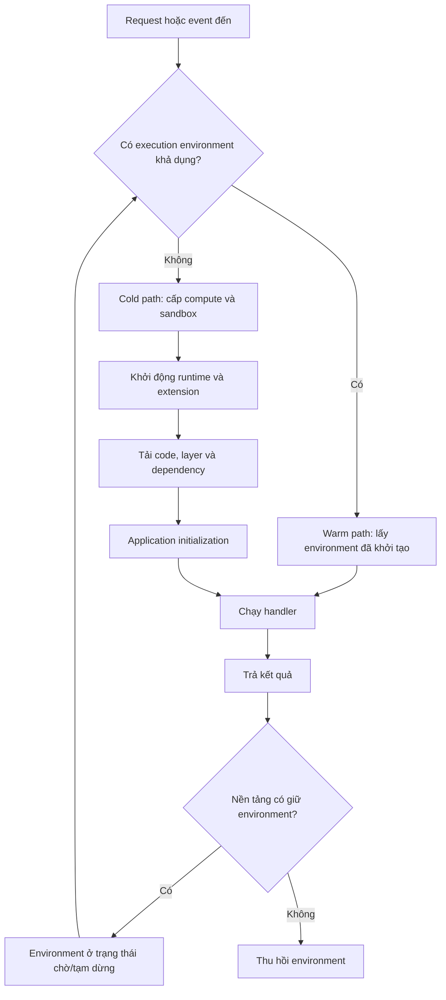

# Cold start, warm execution và tái sử dụng execution environment

Hàm serverless thường được khởi chạy để xử lý một request, event hoặc message. Nền tảng có thể giữ lại execution environment sau khi invocation hoàn tất để tái sử dụng cho lần gọi tiếp theo. Nếu đã có environment phù hợp, hàm thường bắt đầu nhanh hơn; nếu phải cấp phát environment mới, tải code và khởi tạo runtime, invocation có thể gặp **cold start**.

Cold start ảnh hưởng trực tiếp tới latency, đặc biệt với API đồng bộ, ứng dụng tương tác và workload có tải tăng đột ngột. Warm execution giúp giảm thời gian khởi động, nhưng vòng đời environment do nền tảng quyết định. Ứng dụng không được giả định một environment sẽ tồn tại bao lâu, lần gọi tiếp theo sẽ chạy trên cùng environment hay dữ liệu trong bộ nhớ sẽ luôn còn.

Trong module compute cloud, cần hiểu cold start như một phần của mô hình cấp phát tài nguyên theo nhu cầu. Tối ưu đúng cách đòi hỏi đo từng pha khởi động, giảm công việc initialization, quản lý trạng thái dùng chung an toàn và cân bằng giữa latency với chi phí giữ sẵn capacity.

## 1. Execution environment là gì?

Execution environment là môi trường mà nền tảng chuẩn bị để chạy một hoặc nhiều lần thực thi hàm. Tùy dịch vụ, môi trường có thể bao gồm:

- Compute capacity và sandbox/cô lập cho workload.
- Hệ điều hành hoặc lớp runtime được nhà cung cấp quản lý.
- Language runtime như Java, Node.js, Python, .NET hoặc runtime tùy chỉnh.
- Code package, container image, layer hoặc dependency của hàm.
- Cấu hình CPU, memory, environment variable và quyền runtime identity.
- Network interface, DNS, route và kết nối tới dịch vụ phụ trợ.
- Filesystem tạm và vùng nhớ của process.

Nền tảng có thể tái sử dụng environment sau invocation để giảm chi phí khởi tạo. Một số runtime giữ process và module đã nạp; một số nền tảng có thể đóng băng rồi tiếp tục environment; một số dịch vụ quản lý concurrency khác nhau trên từng environment. Chi tiết phụ thuộc nhà cung cấp, runtime và cấu hình concurrency.

### Invocation

Invocation là một lần gọi hàm. Nguồn kích hoạt có thể là HTTP request, queue message, object upload, database event, timer hoặc event bus. Một invocation có input, context, thời gian chạy và kết quả hoặc lỗi.

### Cold execution và warm execution

- **Cold execution:** invocation cần một environment mới hoặc phải thực hiện lại một phần khởi tạo runtime/application.
- **Warm execution:** invocation được xử lý trên environment đã khởi tạo và còn khả dụng, nhờ đó có thể tái sử dụng runtime, code và tài nguyên đã chuẩn bị.

Warm không có nghĩa là hàm luôn chạy ngay lập tức. Environment có thể cần resume, khởi tạo một phần, làm mới connection hoặc tải lại dữ liệu hết hạn. Cũng không có bảo đảm invocation tiếp theo sẽ dùng environment cũ.

## 2. Các pha của một cold start

Một cold start có thể gồm nhiều pha. Tên và thứ tự cụ thể thay đổi theo nền tảng, nhưng có thể phân tích theo mô hình tổng quát:

1. **Scheduling và cấp capacity:** nền tảng tìm compute phù hợp và cấp environment.
2. **Provisioning/isolation:** tạo sandbox, container hoặc môi trường thực thi được cô lập.
3. **Runtime initialization:** khởi động language runtime và nạp runtime extension.
4. **Code và dependency loading:** tải code package, layer, thư viện hoặc image.
5. **Application initialization:** chạy module initialization, static initializer, dependency injection, đọc cấu hình và tạo client.
6. **Invocation:** gọi handler với input cụ thể.

Một số nền tảng tải code song song với việc cấp compute; một số tích hợp runtime và application initialization thành một pha. Vì vậy, hãy dùng metric/tracing của dịch vụ để xác định pha thực tế thay vì cộng các khoảng thời gian giả định.



### Thời gian cold start và thời gian handler

Latency tổng của một invocation đồng bộ có thể được biểu diễn khái quát:

\[
T_{total} = T_{queue} + T_{startup} + T_{handler} + T_{response}
\]

Trong đó `T_startup` có thể bao gồm provisioning, runtime initialization, code loading và application initialization. `T_queue` là thời gian chờ trước khi invocation được xử lý; `T_handler` là thời gian thực thi logic hàm. Với warm invocation, một phần hoặc phần lớn `T_startup` có thể không xuất hiện.

Khi đo latency, cần tách thời gian chờ, startup và handler. Nếu chỉ nhìn thời gian handler, cold start có thể bị bỏ sót; nếu chỉ nhìn latency tổng, khó biết nên tối ưu image, runtime, network hay code.

## 3. Vì sao cold start xảy ra?

Nền tảng có thể tạo environment mới khi:

- Dịch vụ nhận request đầu tiên sau khi scale về zero.
- Tải tăng và các environment hiện tại không đủ concurrency.
- Một environment bị thu hồi do idle timeout, maintenance hoặc quản lý capacity.
- Hàm được deploy phiên bản mới hoặc thay đổi cấu hình khiến environment cũ không còn dùng được.
- Runtime hoặc host được cập nhật theo cơ chế của nhà cung cấp.
- Một environment gặp lỗi hoặc bị thay thế.
- Tải chuyển sang vùng/nhóm capacity khác theo thiết kế dịch vụ.

Cold start không nhất thiết chỉ xảy ra ở lần gọi đầu tiên sau deploy. Một workload có thể đang chạy warm nhưng burst request lớn làm nền tảng tạo thêm nhiều environment mới; một phần invocation trong burst đó sẽ gặp startup latency.

### Scale-out tạo thêm cold environment

Giả sử một function hiện có hai environment và mỗi environment xử lý một concurrency nhất định. Khi số request đồng thời tăng vượt capacity hiện có, nền tảng có thể tạo thêm environment. Các invocation được gán vào environment mới phải chờ startup.

Do đó, một function có p50 latency tốt nhưng p95/p99 tăng mạnh trong burst. Chỉ đo một request đơn lẻ sau khi environment đã warm sẽ không phản ánh trải nghiệm khi scale-out.

### Deploy và cấu hình mới

Thay đổi code, runtime, layer, environment variable, memory hoặc network configuration có thể khiến nền tảng tạo environment mới. Sau mỗi lần deploy, cần kiểm tra cold start và khả năng scale của phiên bản mới; không dựa vào warm cache từ phiên bản trước.

## 4. Những yếu tố làm cold start dài

| Yếu tố | Tác động có thể có | Hướng tối ưu |
|---|---|---|
| Package/image lớn | Tốn thời gian tải và giải nén | Loại dependency không dùng, giảm layer và artifact |
| Runtime nặng | Thời gian khởi tạo runtime dài | Chọn runtime phù hợp, dùng build tối ưu |
| Static initialization nhiều | Chạy trước handler và kéo dài startup | Trì hoãn phần không cần thiết, giảm công việc khởi tạo |
| Dependency injection phức tạp | Quét class và tạo nhiều object | Dùng wiring tối giản hoặc generated metadata nếu phù hợp |
| Kết nối database khi startup | DNS/TLS/auth/connection handshake kéo dài | Khởi tạo lazy hoặc dùng connection proxy/pool phù hợp |
| Gọi API ngoài khi startup | Startup phụ thuộc dịch vụ bên ngoài | Tránh gọi đồng bộ nếu không cần cho invocation |
| VPC/network integration | Có thể thêm thời gian cấp network hoặc route | Đo riêng, giảm dependency và chọn cấu hình phù hợp |
| Secret/config fetch | Nhiều lần gọi secret/config service | Gộp truy vấn cần thiết, cache có TTL và rotation |
| Certificate/crypto initialization | Tính toán hoặc đọc key mất thời gian | Tái sử dụng object an toàn, tối ưu key retrieval |
| Logging/monitoring extension | Extension khởi tạo và gửi telemetry | Dùng extension cần thiết, kiểm soát timeout |
| Memory quá thấp | CPU/runtime bị giới hạn hoặc GC nhiều | Benchmark nhiều mức memory/CPU |
| Runtime compile/JIT | Một số runtime cần warm-up | Tối ưu startup hoặc giữ capacity cho latency nhạy cảm |

Không phải mọi yếu tố đều tồn tại trên mọi serverless platform. Hãy đối chiếu với metric và tài liệu dịch vụ cụ thể.

## 5. Warm execution và tái sử dụng environment

Khi invocation hoàn tất, nền tảng có thể giữ execution environment trong một khoảng thời gian để xử lý invocation sau. Việc tái sử dụng có thể giúp giữ lại:

- Runtime đã khởi động.
- Module/package đã được import hoặc class đã được load.
- Object khởi tạo ở phạm vi process/module.
- Connection pool hoặc client tới dịch vụ ngoài, nếu còn hợp lệ.
- Cache dữ liệu tham chiếu không nhạy cảm và còn hiệu lực.
- JIT-compiled code hoặc metadata đã được runtime chuẩn bị.

Ví dụ, một hàm Node.js có thể tạo SDK client ở phạm vi module; invocation tiếp theo trên cùng process có thể dùng lại client đó. Một hàm Java có thể giữ static object hoặc connection pool sau lần khởi tạo đầu tiên. Một hàm Python có thể giữ module đã import trong process.

### Warm reuse là tối ưu, không phải hợp đồng về vòng đời

Nền tảng có thể thu hồi environment bất kỳ lúc nào theo chính sách dịch vụ. Không có bảo đảm về:

- Thời gian environment được giữ sau invocation.
- Invocation tiếp theo chạy trên cùng environment.
- Thứ tự hoặc tính liên tục giữa các request.
- Dữ liệu RAM/local filesystem còn tồn tại sau lần gọi.
- Một environment chỉ xử lý một invocation tại một thời điểm, trừ khi dịch vụ quy định rõ.

Thiết kế ứng dụng phải đúng cả khi mọi invocation đều chạy trên environment mới. Nếu warm reuse xảy ra, nó chỉ cải thiện hiệu năng.

## 6. Khởi tạo toàn cục và dữ liệu theo invocation

Nhiều runtime cho phép đặt code ngoài handler để chỉ chạy khi process/environment khởi tạo. Đây là vị trí phù hợp cho các object bất biến hoặc client có thể tái sử dụng an toàn.

### Có thể đặt ngoài handler

- Import module và load class.
- Tạo SDK client hoặc HTTP client dùng chung nếu thread-safe.
- Nạp cấu hình không nhạy cảm và ít thay đổi.
- Biên dịch regex hoặc schema validator.
- Tạo connection pool có giới hạn và lifecycle rõ ràng.
- Nạp dữ liệu tham chiếu nhỏ, không nhạy cảm và có TTL/refresh.

### Không nên giữ ở biến global

- User ID, access token hoặc quyền đã xác thực của một invocation.
- Request body, dữ liệu khách hàng hoặc state giao dịch chưa commit.
- Transaction đang mở hoặc lock gắn với một request.
- Context trace/request nếu không được reset.
- Kết quả phụ thuộc tenant nhưng không có key cách ly rõ ràng.
- Secret đã hết hạn hoặc credential không được refresh.

Nếu environment được tái sử dụng, global mutable state có thể sống lâu hơn một invocation và vô tình rò dữ liệu giữa các request. Hãy giữ dữ liệu request trong biến cục bộ, context truyền rõ ràng hoặc object được tạo mới theo invocation.

### Ví dụ lỗi state dùng chung

```python
# Không an toàn: biến global lưu dữ liệu của request trước
current_user = None

def handler(event, context):
    global current_user
    current_user = event["user_id"]
    return process_for_user(current_user)
```

Nếu runtime xử lý nhiều invocation đồng thời hoặc code có luồng bất đồng bộ, giá trị global có thể bị ghi đè và làm sai ngữ cảnh. Ngay cả khi mỗi environment chỉ xử lý tuần tự, biến global vẫn có thể giữ dữ liệu request cũ.

Phiên bản an toàn hơn:

```python
def handler(event, context):
    user_id = event["user_id"]
    return process_for_user(user_id)
```

Đối với dữ liệu dùng chung, dùng cache có key theo tenant, quyền truy cập và TTL rõ ràng; không dựa vào biến global để làm nguồn dữ liệu chuẩn.

## 7. Tái sử dụng connection và client

Khởi tạo TCP/TLS/database connection trong mỗi invocation có thể làm tăng latency và số kết nối. Giữ client hoặc pool ở phạm vi environment có thể giảm handshake và overhead.

### Lợi ích

- Giảm thời gian DNS, TCP và TLS handshake.
- Giảm số lần xác thực hoặc tạo client.
- Tái sử dụng connection pool và connection metadata.
- Giảm tải khởi tạo lên database hoặc API ngoài.

### Rủi ro

- Connection có thể bị server đóng khi environment idle.
- DNS hoặc endpoint có thể thay đổi.
- Credential/secret có thể hết hạn hoặc bị rotate.
- Pool mỗi environment nhân lên theo số environment, gây vượt connection limit.
- Socket có thể ở trạng thái half-open sau network interruption.
- Connection dùng chung có thể không an toàn nếu client không thread-safe.

### Cách quản lý

- Dùng connection pool có giới hạn phù hợp với concurrency.
- Kiểm tra connection trước khi dùng hoặc bật keepalive/validation phù hợp.
- Thiết lập connect/read timeout và retry có giới hạn.
- Làm mới credential theo cơ chế an toàn.
- Xử lý lỗi connection bằng cách tạo lại client/connection khi cần.
- Theo dõi số environment nhân với pool size để bảo vệ database.
- Cân nhắc database proxy hoặc pooling service nếu nền tảng hỗ trợ.

Không mở một pool rất lớn trong mỗi environment chỉ vì warm reuse giúp giữ pool đó. Nếu có 100 environment và mỗi environment mở 50 connection, database có thể phải chịu tới 5.000 connection trong trường hợp tất cả pool hoạt động.

## 8. Cache trong execution environment

Cache in-memory có thể giảm số lần đọc dữ liệu tham chiếu hoặc tải model/config. Tuy nhiên, cache trong một environment chỉ được chia sẻ với invocation chạy trên environment đó. Khi nền tảng scale-out, mỗi environment có cache riêng; khi environment bị thu hồi, cache mất.

### Dữ liệu phù hợp để cache

- Metadata công khai hoặc cấu hình ít thay đổi.
- Schema, lookup table nhỏ và không nhạy cảm.
- Certificate chain hoặc public key nếu có cơ chế refresh.
- Model artifact hoặc dữ liệu tham chiếu có version.

### Dữ liệu không nên chỉ cache cục bộ

- Trạng thái giao dịch cần nhất quán.
- Số dư, quyền truy cập hoặc dữ liệu authorization cần cập nhật tức thì.
- Distributed lock hoặc counter dùng làm nguồn sự thật.
- Secret không có cơ chế rotation/expiry.

### Cache cần TTL và version

Đặt TTL dựa trên mức độ chấp nhận dữ liệu cũ. Nếu config được cập nhật, có thể dùng version key, ETag hoặc timestamp để xác định lúc cần refresh. Cache miss phải có đường tải lại an toàn và timeout. Nếu cache refresh thất bại, quyết định dùng stale data hay fail closed tùy tính chất dữ liệu.

Không giả định mọi environment sẽ nhận cùng một thời điểm refresh. Nếu cần invalidation tức thì hoặc consistency mạnh, dùng cache/shared store được quản lý bên ngoài.

## 9. Filesystem tạm và giới hạn của state cục bộ

Một số function runtime cung cấp thư mục tạm có thể ghi, ví dụ vùng `/tmp` hoặc scratch storage tương đương. Dữ liệu có thể còn lại giữa các invocation trên cùng environment, nhưng thường không có cam kết durability.

Có thể dùng filesystem tạm cho:

- File trung gian khi xử lý ảnh/tài liệu.
- Cache artifact có thể tải lại.
- Tệp giải nén hoặc dữ liệu scratch.
- Socket hoặc file tạm cần trong một invocation.

Không dùng filesystem tạm làm nơi duy nhất lưu kết quả giao dịch, checkpoint quan trọng hoặc dữ liệu người dùng. Khi environment bị thu hồi, nội dung có thể biến mất; khi environment được tái sử dụng, file cũ có thể còn lại và gây rò dữ liệu nếu không dọn.

### Dọn dẹp dữ liệu tạm

- Dùng tên file riêng theo invocation hoặc task ID.
- Không tin rằng thư mục tạm luôn trống khi handler bắt đầu.
- Xóa file chứa dữ liệu nhạy cảm sau khi xử lý.
- Giới hạn dung lượng và xử lý disk full.
- Không ghi secret hoặc token vào file tạm nếu không cần.
- Upload kết quả tới durable storage trước khi trả thành công.

## 10. Concurrency và số lượng execution environment

Concurrency là số invocation đang được xử lý đồng thời. Nền tảng có thể tạo thêm environment khi concurrency tăng vượt khả năng hiện tại, tùy mô hình dịch vụ.

### Concurrency per environment

Một số function runtime thường xử lý một invocation tại một thời điểm trên mỗi environment; một số dịch vụ/runtime hỗ trợ nhiều request đồng thời trong cùng instance. Không được suy đoán hành vi này từ ngôn ngữ lập trình. Kiểm tra concurrency model của dịch vụ và runtime cụ thể.

### Ảnh hưởng đến warm reuse

Khi concurrency tăng, nền tảng có thể cần thêm environment mới. Environment mới có cold start; các environment cũ có thể tiếp tục xử lý request. Vì vậy, cùng một burst có thể chứa cả warm và cold invocation.

### Giới hạn concurrency

Giới hạn concurrency giúp bảo vệ dependency và kiểm soát chi phí. Nếu đặt quá thấp, request có thể chờ lâu hoặc bị throttle. Nếu đặt quá cao, database/API ngoài có thể quá tải và số environment tăng nhanh.

Chọn concurrency bằng load test, quan sát CPU/RAM, connection pool, p95/p99 latency, error rate và capacity của dependency. Đặt reserved/per-function concurrency hoặc quota nếu nền tảng hỗ trợ.

### Queue và backpressure

Với event/queue workload, có thể giới hạn số invocation đồng thời và để backlog nằm trong queue. Cần theo dõi queue age, retry và visibility timeout. Nếu function chạy lâu hơn visibility timeout, message có thể được giao lại trong khi invocation cũ vẫn còn hoạt động; phải có idempotency và cấu hình timeout phù hợp.

## 11. Tối ưu application initialization

Application initialization là phần code chạy trước handler, thường ở module scope, static initializer hoặc framework bootstrap. Mọi thao tác ở đây có thể làm cold start dài hơn.

### Chỉ khởi tạo những gì cần thiết

Không tạo tất cả client, load mọi model hoặc gọi mọi API trong startup nếu chỉ một phần invocation cần dùng. Có thể dùng lazy initialization: tạo dependency khi lần đầu cần và tái sử dụng sau đó.

Tuy nhiên, lazy initialization chuyển thời gian từ startup sang invocation đầu tiên cần dependency. Nếu dependency được dùng trong hầu hết request, khởi tạo sớm có thể giúp latency ổn định hơn. Đo cả cold path lẫn warm path để quyết định.

### Giảm công việc đồng bộ

- Tránh gọi nhiều API ngoài tuần tự trong initialization.
- Gộp truy vấn config khi có thể.
- Dùng timeout rõ ràng cho DNS, secret manager và dependency.
- Không chạy migration database trong mỗi environment startup.
- Không tải dataset lớn nếu handler chỉ cần một phần.
- Tách công việc one-time provisioning khỏi invocation path.

### Tối ưu framework và dependency

Framework lớn có thể quét package, reflection, annotation hoặc plugin ở startup. Có thể giảm dependency, bật chế độ startup tối ưu, dùng compile-time metadata hoặc build artifact phù hợp. Cần cân bằng giữa tốc độ startup, maintainability và khả năng tương thích.

## 12. Khác biệt giữa các language runtime

Cold start phụ thuộc runtime, framework, kích thước code và cách khởi tạo. Không có thứ hạng cố định áp dụng cho mọi workload.

| Runtime | Công việc startup thường gặp | Điểm cần chú ý |
|---|---|---|
| Node.js | Load module, tạo client, parse package | CommonJS/ESM graph, package size, async init |
| Python | Import module, load native library/model | Import graph, native extension, package footprint |
| Java | JVM startup, class loading, framework context, JIT | Framework bootstrap, reflection, memory/CPU allocation |
| .NET | Runtime startup, assembly loading, dependency injection | Assembly size, trimming/AOT compatibility, static init |
| Custom runtime/container | Runtime bootstrap, image pull, process startup | Image size, entrypoint, native dependencies và platform contract |

### Node.js

Đặt SDK client và module bất biến ở phạm vi module nếu client an toàn để tái sử dụng. Tránh tạo client mới cho mọi request nếu không cần. Kiểm tra top-level await hoặc asynchronous initialization vì chúng có thể kéo dài startup.

### Python

Import thư viện lớn và native package có thể tốn thời gian. Chỉ import module nặng trong nhánh cần dùng nếu điều đó cải thiện cold path tổng thể. Với model hoặc data lớn, cân nhắc tải theo nhu cầu và cache có version.

### Java

JVM và framework có thể tạo startup overhead đáng kể. Giảm số bean/module khởi tạo, tối ưu classpath và cân nhắc compile/AOT hoặc runtime được tối ưu cho serverless nếu dịch vụ hỗ trợ. Kiểm tra heap, GC và memory setting; cấu hình memory ảnh hưởng tới CPU trên một số nền tảng.

### .NET

Kiểm tra assembly loading, dependency injection và static initialization. Trimming hoặc Native AOT có thể giảm startup/size trong workload tương thích, nhưng cần kiểm thử reflection, serializer và thư viện native.

Không chọn ngôn ngữ chỉ dựa trên một benchmark cold start tổng quát. Hãy đo với dependency, image, framework và request thực tế của ứng dụng.

## 13. Tối ưu memory và CPU allocation

Trên một số nền tảng, memory allocation có liên hệ với CPU capacity hoặc network throughput. Tăng memory có thể làm runtime khởi động và xử lý nhanh hơn dù ứng dụng không dùng hết RAM.

Benchmark nhiều mức cấu hình:

- Cold start duration.
- Warm handler duration.
- p50/p95/p99 end-to-end latency.
- Peak memory và OOM rate.
- CPU time và throttling.
- Số invocation mỗi giây trên mỗi environment.
- Cost per invocation hoặc cost per completed task.

Không tối ưu một chỉ số riêng. Memory cao hơn có thể giảm latency nhưng tăng giá mỗi giây; nếu thời gian chạy giảm đủ nhiều, tổng chi phí có thể thấp hơn. Cần tính tổng cost theo workload và traffic pattern.

## 14. Provisioned concurrency, minimum instances và warm pool

Một số nền tảng cung cấp cơ chế giữ sẵn execution environment hoặc capacity trước khi request tới. Tên gọi có thể là provisioned concurrency, minimum instances, always-ready instances hoặc warm pool.

### Cách hoạt động

Nền tảng duy trì một số environment đã được chuẩn bị. Invocation có thể được gán vào capacity sẵn sàng thay vì phải khởi tạo mới. Điều này giúp giảm biến động cold start trong khoảng capacity được giữ.

### Khi phù hợp

- API đồng bộ có SLO latency nghiêm ngặt.
- Tải có chu kỳ dự đoán được, như giờ làm việc hoặc chiến dịch.
- Runtime/framework có startup dài.
- Workload cần khởi tạo model/config lớn.
- Một số endpoint quan trọng cần latency ổn định.

### Đánh đổi chi phí

Capacity giữ sẵn có thể bị tính phí ngay cả khi không có invocation hoặc tính theo mức giá riêng. Nếu giữ quá nhiều, chi phí idle tăng; nếu giữ quá ít, burst vẫn tạo cold start.

Ước lượng capacity theo concurrency baseline và phân phối tải. Có thể tăng trước giờ cao điểm và giảm khi nhu cầu thấp nếu nền tảng hỗ trợ scheduled adjustment. Luôn giữ cơ chế scale động cho phần tải vượt mức dự báo.

### Provisioned capacity không thay thế tối ưu code

Nếu application initialization có lỗi hoặc mất nhiều thời gian, giữ sẵn environment chỉ che bớt ảnh hưởng trong một phần traffic. Deploy phiên bản mới, scale vượt mức hoặc environment bị thay vẫn có thể tạo cold start. Tối ưu startup vẫn cần thiết.

## 15. SnapStart, snapshot runtime và cơ chế khởi tạo nâng cao

Một số nền tảng hỗ trợ chụp trạng thái runtime sau khi khởi tạo rồi khôi phục từ snapshot để giảm thời gian startup. Tên và giới hạn tùy provider/runtime.

Snapshot có thể chứa heap/process state tại thời điểm tạo. Điều này giúp tránh lặp lại một phần class loading hoặc initialization, nhưng tạo yêu cầu đặc biệt:

- Không snapshot credential hoặc token ngắn hạn rồi dùng sau khi hết hạn.
- Không giả định socket/network connection trong snapshot còn hợp lệ.
- Tạo lại entropy, random seed hoặc identifier theo yêu cầu runtime khi resume.
- Làm mới timestamp, lease và cache có hạn sử dụng.
- Tránh snapshot state riêng của một invocation hoặc tenant.
- Kiểm thử hook sau restore để tái lập tài nguyên cần thiết.

Nếu snapshot được tạo từ một environment có dữ liệu nhạy cảm trong memory, cần hiểu ai có thể truy cập artifact và cách mã hóa/bảo vệ nó. Không dùng snapshot như cách thay thế quản lý secret.

## 16. Bảo mật khi tái sử dụng environment

Warm reuse có thể làm state trong process tồn tại qua nhiều invocation. Điều này tạo lợi ích hiệu năng nhưng cũng mở ra rủi ro rò rỉ dữ liệu giữa request nếu state không được cách ly.

### Quy tắc bảo mật

- Không giữ user-specific authorization context trong biến global.
- Xóa hoặc reset request context sau mỗi invocation.
- Cache dữ liệu theo tenant và quyền truy cập, không dùng một key chung nếu dữ liệu khác nhau.
- Không lưu token trong global mà không kiểm tra expiry/rotation.
- Không ghi request body hoặc secret vào file tạm tồn tại qua invocation.
- Giới hạn quyền runtime identity theo đúng function.
- Xem xét memory dump, snapshot và log như tài sản có thể chứa dữ liệu nhạy cảm.

### Multi-tenant function

Nếu một function xử lý nhiều tenant, mọi cache và object tái sử dụng phải được phân vùng theo tenant hoặc chỉ chứa dữ liệu công khai. Một bug trong cache key có thể làm trả dữ liệu của tenant A cho tenant B. Kiểm thử trường hợp invocation nối tiếp trên cùng environment với tenant khác nhau.

### Credential rotation

Environment warm có thể giữ client đã khởi tạo bằng credential cũ. Thiết kế client để refresh token hoặc tái xác thực khi nhận lỗi credential hết hạn. Không giả định environment mới sẽ được tạo ngay sau khi secret rotate.

## 17. Observability: đo cold start và warm path

Để tối ưu có cơ sở, cần phân biệt cold invocation với warm invocation và theo dõi các pha khởi tạo.

### Metric cần có

| Metric | Ý nghĩa |
|---|---|
| Cold start count/rate | Số lượng hoặc tỷ lệ invocation cần khởi tạo mới |
| Init duration | Thời gian runtime/application initialization |
| Provisioning duration | Thời gian cấp compute nếu nền tảng công bố |
| Handler duration | Thời gian xử lý logic của hàm |
| End-to-end latency | Thời gian client hoặc trigger quan sát |
| p50/p95/p99 | Phân phối latency và tail behavior |
| Concurrent executions | Số invocation chạy đồng thời |
| Throttle count | Request bị giới hạn do concurrency/quota |
| Environment reuse indicator | Tín hiệu cold/warm nếu dịch vụ cung cấp |
| Memory/CPU utilization | Tài nguyên sử dụng và giới hạn |
| Error/timeout rate | Lỗi trong startup hoặc handler |
| Cost per invocation | Chi phí trên mỗi lần gọi hoặc công việc hoàn tất |

Không phải provider nào cũng cung cấp metric cho từng pha. Nếu thiếu, thêm timestamp ở application initialization và handler, dùng trace span hoặc log có cấu trúc. Tránh ghi dữ liệu nhạy cảm.

### Phân tích percentile

Cold start có thể chỉ chiếm tỷ lệ nhỏ nhưng ảnh hưởng lớn tới p99. So sánh latency theo cold/warm cohort, runtime, version, memory size, region và trigger source. Một p50 thấp không chứng minh SLO tail latency đạt yêu cầu.

### Correlation ID

Gắn invocation ID hoặc trace ID vào log để nối event trigger, startup, handler và dependency. Không dùng environment ID làm khóa định danh nghiệp vụ; environment có thể biến mất hoặc được thay thế.

## 18. Kiểm thử cold start đúng cách

Benchmark chỉ gửi nhiều request liên tục vào cùng một environment thường đo warm performance, không đo cold start. Cần tạo điều kiện để quan sát environment mới.

### Kịch bản kiểm thử

1. **First invocation:** deploy phiên bản mới rồi gọi lần đầu.
2. **Warm sequence:** gọi liên tiếp để đo warm path.
3. **Idle gap:** chờ một khoảng thời gian rồi gọi lại; lưu ý không thể đảm bảo nền tảng đã thu hồi environment.
4. **Burst scale-out:** tăng concurrency nhanh để buộc nền tảng tạo thêm capacity.
5. **Deployment churn:** phát hành version/config mới rồi đo startup.
6. **Runtime update:** kiểm thử khi thay runtime hoặc dependency lớn.
7. **Dependency degradation:** mô phỏng secret manager/database/API chậm để đánh giá startup.
8. **Provisioned capacity:** so sánh latency và cost khi giữ sẵn các mức capacity khác nhau.

### Đo lường

- Ghi rõ region, runtime, memory/CPU, package/image version và concurrency.
- Thu thập đủ mẫu để p95/p99 có ý nghĩa.
- Tách cold start, handler và dependency latency.
- Lặp lại trong nhiều thời điểm vì host placement và tải nền có thể khác nhau.
- So sánh cost per invocation và tỷ lệ cold start, không chỉ latency tốt nhất.

Không dùng một khoảng idle cố định để khẳng định environment chắc chắn đã bị thu hồi; đó là quyết định nội bộ của nền tảng. Dùng tín hiệu cold-start thực tế hoặc deploy mới để tạo điều kiện cold path rõ ràng hơn.

## 19. Chiến lược tối ưu theo loại workload

| Workload | Ưu tiên | Cách tiếp cận |
|---|---|---|
| API latency nhạy cảm | p95/p99 ổn định | Giảm init, giữ capacity tối thiểu, kiểm soát concurrency |
| Event xử lý nền | Throughput và cost | Cho phép queue buffer, giới hạn concurrency, tối ưu batch |
| Tải burst ngắn | Scale-out nhanh | Image nhỏ, startup nhanh, queue/backpressure và capacity buffer |
| ML inference | Model load và GPU readiness | Cache/model artifact, giữ sẵn capacity cho endpoint quan trọng |
| Batch job dài | Hoàn tất và phục hồi | Checkpoint, retry, chia chunk; cold start ít quan trọng hơn correctness |
| Dev/test ít traffic | Chi phí thấp | Scale-to-zero nếu chấp nhận cold start |
| Multi-tenant API | Cách ly và bảo mật | Không giữ request state trong global; cache theo tenant |

### API đồng bộ

Đo cold-start tail latency và xác định mức capacity cần giữ. Nếu endpoint quan trọng, provisioned capacity có thể phù hợp. Giảm startup dependency và đặt timeout để cold start không khiến client retry đồng loạt.

### Queue/event worker

Queue có thể hấp thụ burst và làm mượt tốc độ invocation. Chọn batch size, concurrency và visibility timeout phù hợp. Cold start làm giảm tốc độ tiêu thụ queue trong thời gian đầu; theo dõi oldest message age và scale policy.

### ML inference

Model loading thường chiếm phần lớn startup. Có thể dùng artifact tối ưu, lazy load theo model/version, cache ở environment hoặc giữ sẵn một số instance. Cache cần được làm mới khi model version thay đổi.

## 20. Chi phí và trade-off

Cold start không chỉ là vấn đề latency. Tối ưu startup có thể giảm thời gian tính phí cho invocation, nhưng một số giải pháp như provisioned concurrency, minimum instances hoặc warm pool làm tăng chi phí capacity nhàn rỗi.

### Các lựa chọn

| Biện pháp | Tác động latency | Tác động chi phí/độ phức tạp |
|---|---|---|
| Giảm package/image | Giảm tải và startup | Công việc build/maintenance thấp đến vừa |
| Lazy initialization | Giảm startup nếu dependency không cần ngay | Invocation đầu tiên dùng dependency có thể chậm hơn |
| Tối ưu runtime/framework | Giảm init | Có thể tăng công sức build và kiểm thử |
| Tăng memory/CPU | Có thể rút ngắn startup và handler | Giá mỗi đơn vị thời gian có thể tăng |
| Cache client/config | Giảm init và request latency | Cần xử lý expiry, consistency và security |
| Provisioned capacity | Giảm cold start trong capacity giữ sẵn | Tăng chi phí idle/always-ready |
| Scale-to-zero | Không cải thiện cold path | Giảm chi phí khi idle, đổi lại startup latency |
| Queue/batch | Hấp thụ burst và amortize startup | Có thể tăng thời gian chờ hoàn tất |

### Cost per successful operation

Đánh giá chi phí trên mỗi request hoặc job thành công, không chỉ chi phí mỗi invocation. Retry do timeout, cold start hoặc lỗi dependency có thể làm một thao tác nghiệp vụ tạo nhiều invocation.

\[
\text{Cost per success} =
\frac{\text{Tổng compute và dịch vụ liên quan}}
{\text{Số thao tác hoàn tất thành công}}
\]

Khi so sánh cấu hình, tính cả request bị retry, log/trace, network, storage, provisioned capacity và dependency. Một cấu hình đắt hơn mỗi giây vẫn có thể rẻ hơn trên mỗi thao tác nếu xử lý nhanh hơn đủ nhiều.

## 21. Troubleshooting cold start và warm reuse

| Triệu chứng | Nguyên nhân có thể | Hướng kiểm tra |
|---|---|---|
| Invocation đầu tiên rất chậm | Runtime/application initialization dài | Đo init duration, import, DI và startup log |
| Sau deploy p95 tăng | Environment mới, code/package lớn hoặc init mới | So sánh version, image size và cold-start rate |
| Burst có nhiều timeout | Scale-out cần tạo environment, quota hoặc concurrency limit | Kiểm tra concurrent execution, throttle và startup duration |
| Warm invocation vẫn chậm | Handler/dependency bottleneck, environment resume hoặc connection stale | Tách handler và dependency latency |
| Database connection lỗi sau idle | Connection bị server đóng hoặc credential hết hạn | Thêm validation, refresh và reconnect có giới hạn |
| Dữ liệu request trước xuất hiện ở request sau | Global mutable state hoặc file tạm không được dọn | Kiểm tra state scope và tenant isolation |
| Cache không nhất quán giữa invocation | Nhiều environment có cache riêng | Dùng version/TTL hoặc shared cache phù hợp |
| Memory tăng theo thời gian | Cache không giới hạn hoặc memory leak | Theo dõi memory theo environment và đặt eviction |
| Provisioned capacity vẫn có cold start | Burst vượt capacity giữ sẵn hoặc deploy tạo environment mới | So sánh concurrency với mức provisioned và deployment event |
| Startup phụ thuộc secret/API chậm | Initialization gọi dependency đồng bộ | Đo outbound call, timeout và cache config |

### Quy trình điều tra

1. Xác định function version, runtime, region và cấu hình memory/CPU.
2. Tách invocation cold/warm dựa trên telemetry có sẵn.
3. So sánh init duration với handler duration.
4. Kiểm tra kích thước package/layer/image và dependency graph.
5. Đo thời gian gọi secret manager, DNS, database và API ngoài.
6. Kiểm tra concurrency, throttling, quota và số environment mới.
7. Kiểm tra global state, cache, connection và file tạm giữa các invocation.
8. Thử một thay đổi trên môi trường test rồi đo lại p50/p95/p99 và cost per success.

## 22. Ví dụ tối ưu một function API

Một API serverless xử lý yêu cầu tra cứu đơn hàng. Sau khi deploy, p50 latency là 80 ms nhưng p99 lên tới 1,8 giây. Log cho thấy invocation đầu tiên thường chậm.

Điều tra phát hiện:

- Framework tạo nhiều object và quét package trong application initialization.
- Hàm tạo database client mới ở mỗi invocation.
- Startup gọi đồng bộ secret manager và hai API metadata.
- Burst request tạo nhiều environment mới, làm database connection tăng đột biến.

Các thay đổi có thể thực hiện:

1. Giảm dependency không dùng và tối ưu framework bootstrap.
2. Tạo client dùng chung ở phạm vi environment nếu client an toàn để tái sử dụng.
3. Cache config không nhạy cảm có TTL và refresh; credential được làm mới đúng hạn.
4. Dùng database proxy hoặc pool có giới hạn để kiểm soát connection.
5. Đặt concurrency tối đa theo capacity database.
6. Giữ mức provisioned capacity phù hợp nếu SLO p99 yêu cầu, sau khi đo chi phí.
7. Kiểm thử burst và deployment mới để xác minh cold path.

Sau thay đổi, so sánh cold-start duration, warm latency, p99, throttle, connection count và cost per successful lookup. Không kết luận thành công chỉ vì p50 giảm.

## 23. Checklist thiết kế và vận hành

**Hiểu nền tảng:**

- [ ] Đã xác định cách provider tạo, giữ, freeze/resume và thu hồi environment.
- [ ] Đã đọc concurrency model và giới hạn runtime của dịch vụ.
- [ ] Đã xác định những pha startup được cung cấp metric.
- [ ] Đã biết filesystem nào ephemeral và giới hạn dung lượng.

**Tối ưu startup:**

- [ ] Image/package chỉ chứa dependency cần thiết.
- [ ] Application initialization không gọi dependency ngoài không cần thiết.
- [ ] Đã đo import, runtime, framework và client initialization.
- [ ] Memory/CPU được benchmark theo latency và cost.
- [ ] Lazy initialization được dùng có chủ đích.

**Tái sử dụng an toàn:**

- [ ] Global state chỉ chứa object bất biến hoặc tài nguyên dùng chung an toàn.
- [ ] Request/tenant state không rò qua invocation.
- [ ] Connection được validate, refresh và giới hạn pool.
- [ ] Cache có TTL/version và xử lý invalidation.
- [ ] File tạm được dọn và không chứa dữ liệu nhạy cảm tồn dư.
- [ ] Secret và credential được refresh theo vòng đời.

**Latency, scaling và chi phí:**

- [ ] Đã đo cold/warm path và p50/p95/p99.
- [ ] Đã thử burst scale-out và deploy version mới.
- [ ] Concurrency phù hợp với capacity dependency.
- [ ] Provisioned/minimum capacity được cân đối với SLO và budget.
- [ ] Theo dõi throttle, cold-start rate và cost per success.

**Bảo mật và vận hành:**

- [ ] Runtime identity có quyền tối thiểu.
- [ ] Cache và state được cách ly theo tenant.
- [ ] Log/trace không chứa secret hoặc dữ liệu nhạy cảm.
- [ ] Có alert cho startup regression, timeout và dependency failure.
- [ ] Có runbook khi cold start tăng sau deploy hoặc runtime update.

## Kết luận

Cold start xảy ra khi function cần một execution environment mới hoặc phải thực hiện lại các bước khởi tạo; warm execution có thể tái sử dụng runtime, module, client và cache của environment còn khả dụng. Warm reuse giúp giảm latency nhưng không bảo đảm environment tồn tại hoặc được dùng lại ở invocation tiếp theo. Hãy giảm công việc startup, đo riêng provisioning/init/handler, tái sử dụng an toàn các client dùng chung, giới hạn global state và làm mới connection/secret/cache theo vòng đời. Với API nhạy latency, cân nhắc provisioned capacity; với workload bất đồng bộ, dùng queue và backpressure để hấp thụ burst. Cuối cùng, kiểm thử cả cold path, warm path, burst và deploy mới, rồi đánh giá p95/p99 cùng chi phí trên mỗi thao tác thành công.
