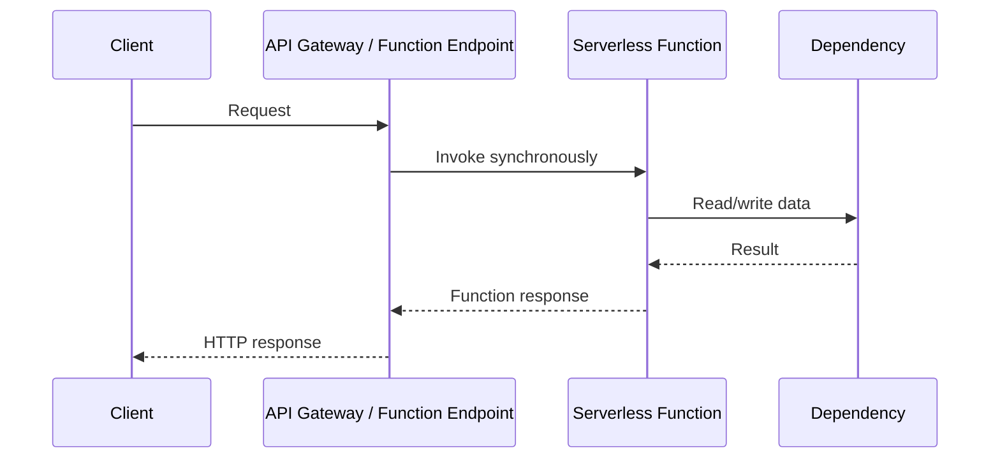
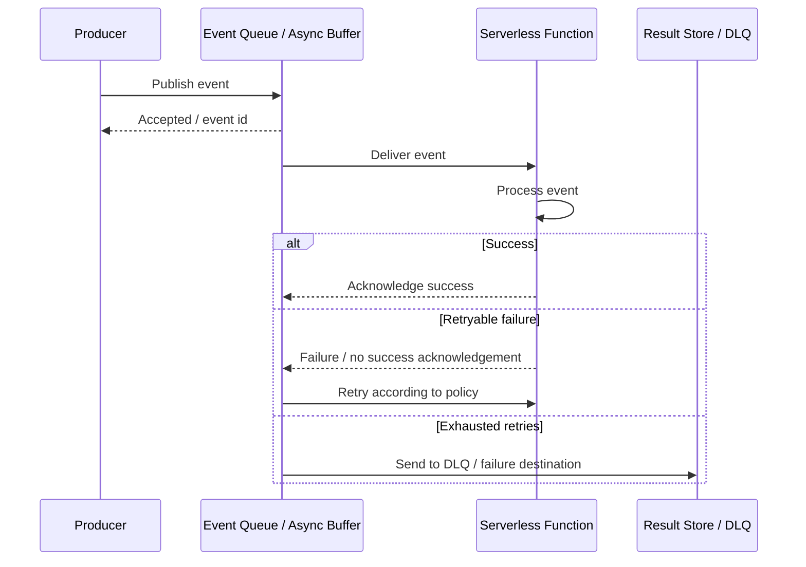
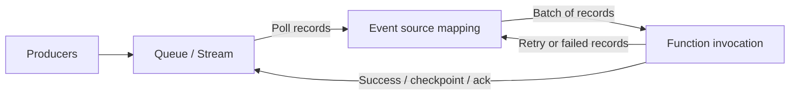
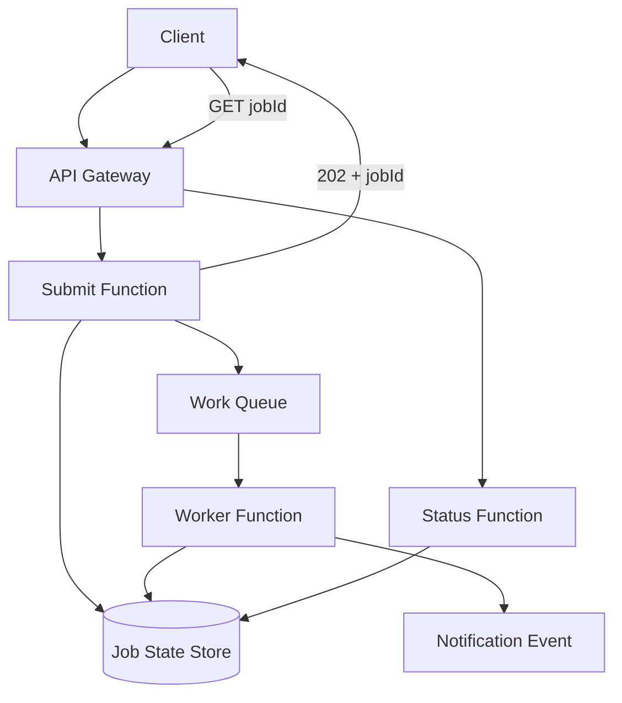

# Phân biệt gọi đồng bộ, bất đồng bộ và nhận sự kiện theo lô

Hàm serverless có thể được kích hoạt theo nhiều cách. Một client có thể gọi hàm và chờ kết quả ngay trong cùng request; một hệ thống có thể gửi sự kiện vào hàng đợi để hàm xử lý sau; hoặc nền tảng có thể đọc message từ queue/stream theo từng lô rồi chuyển cả lô cho hàm. Ba cách này khác nhau về thời gian phản hồi, cách xác nhận thành công, retry, thứ tự xử lý, khả năng chịu lỗi và cách tính concurrency.

Chọn đúng kiểu invocation giúp thiết kế ứng dụng phù hợp với yêu cầu nghiệp vụ. Gọi đồng bộ phù hợp khi caller cần kết quả tức thời. Gọi bất đồng bộ phù hợp khi có thể tách thời điểm tiếp nhận khỏi thời điểm hoàn tất. Nhận sự kiện theo lô phù hợp khi cần xử lý thông lượng lớn hoặc gom nhiều bản ghi để giảm overhead. Một hệ thống thực tế thường kết hợp cả ba.

## 1. Ba kiểu kích hoạt hàm serverless

| Kiểu | Cách hoạt động | Caller nhận được gì? | Trường hợp phù hợp |
|---|---|---|---|
| Đồng bộ (synchronous) | Caller gửi request và giữ kết nối chờ hàm chạy xong | Kết quả hoặc lỗi của lần thực thi trong giới hạn timeout | API, xác thực, tra cứu, tính toán cần phản hồi ngay |
| Bất đồng bộ (asynchronous) | Hệ thống nhận sự kiện, lưu/đưa vào hàng đợi rồi kích hoạt hàm sau | Xác nhận đã tiếp nhận sự kiện, không phải kết quả xử lý cuối cùng | Gửi email, xử lý ảnh, workflow nền, thông báo |
| Nhận sự kiện theo lô (batch/event source polling) | Nền tảng đọc nhiều bản ghi từ queue/stream rồi gửi một batch cho hàm | Thường là trạng thái xử lý/ack của batch hoặc checkpoint theo cơ chế nguồn sự kiện | ETL, telemetry, log, event stream, queue worker |

Không nên nhầm gọi bất đồng bộ với xử lý theo lô. Một sự kiện bất đồng bộ có thể kích hoạt một lần thực thi riêng; một event source mapping có thể gom nhiều message thành batch. Một nền tảng cũng có thể hỗ trợ cả hai cách cho cùng một nguồn dữ liệu, nhưng semantics về retry và xác nhận khác nhau.

## 2. Luồng gọi đồng bộ

Trong mô hình đồng bộ, caller gọi trực tiếp function endpoint hoặc SDK invocation và chờ function trả response. Luồng cơ bản:



Caller giữ một request đang chờ cho đến khi function hoàn tất hoặc timeout. Function thường trả dữ liệu, status hoặc lỗi về đường gọi ban đầu. Với HTTP API, gateway có thể chuyển response của function thành HTTP response theo contract đã cấu hình.

### Ưu điểm

- Caller nhận được kết quả ngay để tiếp tục luồng nghiệp vụ.
- Dễ biểu diễn thành API request-response quen thuộc.
- Lỗi thực thi có thể được trả trực tiếp để caller quyết định hiển thị hoặc xử lý.
- Phù hợp với thao tác ngắn, có giới hạn thời gian rõ và cần phản hồi cho người dùng.

### Hạn chế

- Caller phải chờ; thời gian function chạy cộng thời gian dependency ảnh hưởng latency đầu cuối.
- Timeout ở client, gateway và function phải được phối hợp.
- Caller bị phụ thuộc vào khả năng sẵn sàng và latency của function/dependency.
- Nếu caller retry sau timeout, function có thể đã thực hiện side effect dù response bị mất.
- Request đồng bộ dài có thể giữ connection và tài nguyên phía client/gateway lâu.

Ví dụ phù hợp là API kiểm tra trạng thái đơn hàng, tính phí vận chuyển hoặc xác thực dữ liệu đầu vào. Nếu công việc có thể mất nhiều phút, nên cân nhắc trả mã job ngay rồi xử lý nền thay vì giữ kết nối mở.

## 3. Timeout và lỗi trong gọi đồng bộ

Một request đồng bộ có thể timeout ở nhiều lớp:

- Client timeout: client ngừng chờ hoặc đóng kết nối.
- API gateway/proxy timeout: lớp trung gian ngừng chờ function.
- Function timeout: nền tảng dừng lần thực thi khi vượt thời lượng tối đa.
- Dependency timeout: database, HTTP API hoặc dịch vụ khác không trả lời kịp.

Timeout của caller ngắn hơn timeout của function có thể khiến caller báo lỗi trong khi function vẫn đang chạy. Khi caller retry, side effect có thể bị thực hiện hai lần. Vì vậy, timeout không đồng nghĩa với việc chắc chắn function chưa làm gì.

Thiết kế cần:

1. Đặt deadline tổng ở caller.
2. Đặt timeout cho từng dependency thấp hơn phần thời gian còn lại của deadline.
3. Đảm bảo function có thời gian đóng kết nối và ghi nhận kết quả trước deadline.
4. Dùng idempotency key cho thao tác có side effect.
5. Trả lỗi có cấu trúc, phân biệt lỗi đầu vào, lỗi nghiệp vụ, lỗi tạm thời và timeout.
6. Không retry vô hạn ở client; dùng backoff và giới hạn số lần thử.

Nếu function xử lý yêu cầu tạo đơn hàng, caller có thể gửi `Idempotency-Key` duy nhất cho thao tác. Function lưu trạng thái xử lý của key cùng kết quả nghiệp vụ; request lặp lại với cùng key trả kết quả đã có thay vì tạo đơn hàng mới. Cách lưu key cần có transaction hoặc conditional write để tránh hai request đồng thời cùng tạo side effect.

## 4. Luồng gọi bất đồng bộ

Trong mô hình bất đồng bộ, producer gửi event tới dịch vụ nhận sự kiện hoặc hàng đợi. Nền tảng tiếp nhận event, sau đó kích hoạt function ở thời điểm phù hợp. Producer không giữ kết nối để chờ toàn bộ công việc hoàn tất.



Producer thường nhận xác nhận rằng event đã được tiếp nhận hoặc lưu vào buffer. Xác nhận này không chứng minh function đã xử lý thành công, database đã commit hoặc người dùng đã nhận kết quả cuối cùng.

### Ưu điểm

- Tách producer khỏi thời gian xử lý của consumer.
- Hấp thụ burst ngắn bằng buffer hoặc queue.
- Có thể retry khi lỗi tạm thời mà không bắt người dùng gửi lại request.
- Cho phép scale worker độc lập với API tiếp nhận.
- Dễ bổ sung DLQ, failure destination và quy trình redrive.

### Hạn chế

- Caller không nhận kết quả nghiệp vụ ngay; cần cơ chế tra cứu trạng thái hoặc thông báo hoàn tất.
- Có thể có độ trễ từ lúc publish đến lúc xử lý.
- Event có thể được giao nhiều lần; consumer phải xử lý duplicate an toàn.
- Thứ tự event có thể không được bảo đảm nếu dịch vụ không cung cấp ordering.
- Cần vận hành queue, retry, DLQ, retention và giám sát backlog.

Ví dụ: API nhận yêu cầu tạo báo cáo, lưu job record rồi phát event. Function xử lý báo cáo ở nền và cập nhật trạng thái `COMPLETED` hoặc `FAILED`. Client nhận `202 Accepted` cùng job ID và dùng API khác để tra cứu.

## 5. Phân biệt xác nhận tiếp nhận và xác nhận hoàn tất

Trong hệ thống bất đồng bộ, có hai thời điểm khác nhau:

- **Accepted:** nền tảng hoặc broker đã tiếp nhận event theo semantics của dịch vụ.
- **Processed/committed:** function đã thực hiện xử lý và ghi kết quả theo yêu cầu nghiệp vụ.

Producer chỉ nhận `Accepted` thì không nên hiển thị thông báo “đã hoàn tất”. Có thể hiển thị “đã nhận yêu cầu” và trả một mã theo dõi.

Một job record có thể có các trạng thái:

| Trạng thái | Ý nghĩa |
|---|---|
| `ACCEPTED` | Yêu cầu đã được ghi nhận |
| `QUEUED` | Event đang chờ consumer |
| `RUNNING` | Function đang xử lý |
| `SUCCEEDED` | Kết quả đã được commit |
| `RETRYING` | Lỗi tạm thời và đang chờ thử lại |
| `FAILED` | Đã hết retry hoặc gặp lỗi không thể tự phục hồi |
| `CANCELLED` | Công việc bị hủy theo cơ chế nghiệp vụ |

Trạng thái phải được cập nhật có kiểm soát. Nếu worker bị restart sau khi ghi kết quả nhưng trước khi ack message, event có thể được giao lại. Lần chạy sau cần nhận ra công việc đã hoàn tất để không tạo side effect lần nữa.

## 6. Nhận sự kiện theo lô từ queue hoặc stream

Với event source mapping hoặc cơ chế polling tương đương, nền tảng đọc nhiều record từ nguồn rồi gọi function một lần với một batch. Một batch có thể chứa nhiều message, event hoặc record; function lặp qua từng record và xử lý.



Batching giúp giảm số lần khởi tạo invocation và overhead điều phối. Ví dụ, thay vì gọi function 1.000 lần cho 1.000 message, nền tảng có thể gửi 10 batch, mỗi batch 100 message, nếu kích thước và thời gian gom batch cho phép.

Batch có thể được tạo theo:

- **Batch size:** số record tối đa trong một lần gọi.
- **Batch window:** khoảng thời gian tối đa gom record trước khi gửi batch, nếu nguồn và dịch vụ hỗ trợ.
- **Payload limit:** giới hạn kích thước event/request của nền tảng.
- **Partition/shard:** với stream, mỗi batch thường lấy từ một partition hoặc shard theo cơ chế nguồn.
- **Concurrency limit:** số batch có thể xử lý đồng thời.

Batch size lớn giảm overhead nhưng tăng memory, thời gian xử lý, độ trễ record đầu tiên và phạm vi retry khi batch thất bại. Batch size nhỏ giảm thời gian chờ nhưng có thể làm tăng số invocation và chi phí điều phối.

## 7. Queue và stream có semantics khác nhau

Không phải mọi event source đều xác nhận record giống nhau.

| Đặc điểm | Queue | Stream/log phân vùng |
|---|---|---|
| Mô hình | Message chờ được consumer nhận và ack/delete | Record được lưu theo thứ tự trong partition/shard, consumer theo dõi vị trí đọc |
| Xác nhận xử lý | Thường xóa message hoặc ack sau khi xử lý thành công | Thường cập nhật checkpoint/offset/sequence sau khi xử lý |
| Retry | Message có thể hiển thị lại sau visibility timeout hoặc theo broker policy | Có thể đọc lại từ checkpoint trước đó; record lỗi có thể chặn tiến trình shard tùy cơ chế |
| Ordering | Chỉ bảo đảm nếu loại queue/cấu hình cung cấp; có thể theo nhóm message | Thường có thứ tự trong một partition/shard, không nhất thiết toàn stream |
| Scaling | Theo số message, throughput và consumer concurrency | Theo partition/shard, parallelization factor và giới hạn consumer |
| Trường hợp dùng | Task queue, lệnh xử lý nền, công việc độc lập | Event log, telemetry, clickstream, CDC và dữ liệu cần replay |

Queue thường phù hợp khi mỗi message là một công việc độc lập và có thể xóa sau khi xử lý. Stream phù hợp khi cần giữ lịch sử record, nhiều consumer đọc độc lập hoặc replay từ offset. Cần xem retention, ordering, delivery guarantee và giới hạn throughput của nguồn cụ thể.

## 8. Xử lý batch: thành công toàn bộ hay từng record?

Một số nền tảng coi batch là một đơn vị xác nhận. Nếu function xử lý 99 record thành công nhưng record thứ 100 lỗi và function báo thất bại chung, nền tảng có thể gửi lại cả batch. 99 record trước có thể bị xử lý lặp.

Có hai cách thiết kế phổ biến:

- **All-or-nothing:** chỉ ack batch khi tất cả record xử lý thành công; phù hợp khi có transaction bao trùm hoặc xử lý batch phải nguyên tử.
- **Partial batch response:** function trả danh sách record lỗi hoặc checkpoint phù hợp để nền tảng chỉ retry phần thất bại, nếu dịch vụ nguồn hỗ trợ.

Partial batch response giảm công xử lý lặp nhưng cần tuân thủ đúng format và semantics của event source. Với stream, một số dịch vụ yêu cầu trả sequence number đầu tiên bị lỗi để giữ thứ tự; với queue, có thể trả danh sách message identifier thất bại. Không dùng một response format chung cho mọi provider.

Ví dụ logic xử lý batch ở mức khái niệm:

```python
def handler(event, context):
    failed_ids = []

    for record in event["records"]:
        try:
            process_idempotently(record)
        except TemporaryError:
            failed_ids.append(record["id"])
        except PermanentError as exc:
            send_to_quarantine(record, reason=str(exc))

    return {"failedRecordIds": failed_ids}
```

Đây là pseudocode minh họa, không phải contract trực tiếp của một cloud provider. Adapter ở tầng handler cần chuyển `failed_ids` sang đúng response schema của queue hoặc stream đang sử dụng. Với lỗi vĩnh viễn, chỉ đưa record vào quarantine rồi báo thành công nếu việc lưu quarantine đã bền vững và chính sách nghiệp vụ cho phép loại record khỏi luồng chính.

## 9. Retry và delivery guarantee

Hệ thống serverless bất đồng bộ thường ưu tiên giao event ít nhất một lần (at-least-once) trong nhiều trường hợp. Điều này có nghĩa event có thể được giao lại nếu nền tảng không xác định chắc chắn lần xử lý trước đã hoàn tất. Một số dịch vụ hoặc chế độ có thể cung cấp semantics khác; phải đọc đúng tài liệu của nguồn sự kiện.

Các tình huống gây duplicate:

- Function xử lý xong nhưng response/ack bị mất.
- Function ghi database thành công rồi bị timeout trước khi xác nhận.
- Consumer bị restart trước khi checkpoint được commit.
- Visibility timeout của queue ngắn hơn thời gian xử lý, khiến message xuất hiện lại.
- Retry từ producer hoặc broker gửi lại cùng event.
- Một event được phát hai lần do upstream không có idempotency.

Vì vậy, consumer cần idempotent: xử lý một event nhiều lần vẫn tạo ra cùng kết quả nghiệp vụ như xử lý một lần.

### Các kỹ thuật idempotency

- Dùng event ID hoặc idempotency key duy nhất.
- Lưu key đã xử lý cùng kết quả trong kho bền vững.
- Dùng unique constraint hoặc conditional write để ngăn tạo bản ghi trùng.
- Gộp cập nhật trạng thái và ghi dấu idempotency trong cùng transaction khi có thể.
- Với side effect bên ngoài, dùng API hỗ trợ idempotency hoặc một outbox/workflow có trạng thái.
- Đặt retention của idempotency record dài hơn cửa sổ retry/replay có thể xảy ra.

Chỉ kiểm tra key trong cache rồi mới ghi database có race condition: hai invocation đồng thời có thể cùng thấy key chưa tồn tại và cùng thực hiện side effect. Việc claim key phải có tính nguyên tử, chẳng hạn unique insert hoặc conditional transaction.

## 10. Retry, backoff và dead-letter queue

Không phải lỗi nào cũng nên retry:

- **Lỗi tạm thời:** timeout mạng, throttling, dependency quá tải; thường có thể retry với backoff.
- **Lỗi vĩnh viễn:** schema không hợp lệ, thiếu trường bắt buộc, dữ liệu không thể xử lý; retry không sửa được nguyên nhân.
- **Lỗi không xác định:** cần phân loại và giới hạn số lần thử để tránh retry storm.

Exponential backoff tăng khoảng chờ giữa các lần thử; jitter thêm độ ngẫu nhiên để nhiều consumer không retry cùng lúc. Có thể biểu diễn khoảng chờ khái niệm:

\[
Delay_n = \min(Delay_{max}, Delay_{base} \times 2^n) + Jitter
\]

Giá trị cụ thể cần giới hạn và phù hợp với deadline, retry window cùng throughput. Một số nền tảng quản lý retry tự động bằng cấu hình maximum attempts, maximum event age hoặc visibility timeout.

**Dead-letter queue (DLQ)** hoặc failure destination lưu event không xử lý được sau chính sách retry. DLQ giúp tách message lỗi khỏi luồng chính để điều tra, sửa dữ liệu hoặc redrive sau này.

DLQ cần có:

- Quyền truy cập giới hạn và mã hóa phù hợp.
- Retention đủ dài cho quy trình xử lý sự cố.
- Alert khi message đầu tiên hoặc số lượng vượt ngưỡng xuất hiện.
- Lưu error metadata, thời điểm, số lần thử và correlation ID.
- Quy trình phân loại, sửa, replay và ngăn duplicate.
- Quyết định rõ message được redrive toàn bộ hay theo từng record.

DLQ không phải kho lưu trữ vô hạn. Nếu không có owner và quy trình redrive, message có thể nằm đó mãi và dữ liệu nghiệp vụ không được hoàn tất.

## 11. Thứ tự xử lý và concurrency

Đồng bộ request thường giữ quan hệ request-response riêng. Bất đồng bộ và batch có thể chạy nhiều invocation song song, nên thứ tự hoàn tất không nhất thiết trùng thứ tự phát event.

Ví dụ, event `OrderCreated` và `PaymentAuthorized` được gửi theo thứ tự nhưng hai function invocation có thời gian xử lý khác nhau; `PaymentAuthorized` có thể hoàn tất trước. Nếu nghiệp vụ yêu cầu thứ tự, cần:

- Partition theo aggregate/entity key để các event cùng đối tượng vào cùng nhóm thứ tự.
- Dùng FIFO queue hoặc stream partition có ordering phù hợp.
- Kiểm tra sequence/version trước khi cập nhật trạng thái.
- Thiết kế consumer xử lý event đến muộn hoặc lặp.
- Tránh xử lý đồng thời hai event có phụ thuộc thứ tự cho cùng entity.

Concurrency của function thường bị giới hạn bởi quota tài khoản, cấu hình reserved/provisioned concurrency, số partition/shard, batch size và nguồn event. Nếu function scale nhanh hơn database có thể phục vụ, hệ thống sẽ tạo connection storm hoặc làm dependency quá tải.

Đặt giới hạn concurrency phù hợp với capacity của downstream. Queue có thể hấp thụ burst, nhưng backlog chỉ giảm khi tốc độ xử lý trung bình lớn hơn tốc độ event đến. Nếu tốc độ đến luôn cao hơn tốc độ xử lý, backlog sẽ tăng liên tục dù function scale tới maximum.

## 12. Batch size và batch window ảnh hưởng thế nào?

Hai tham số thường gặp:

- **Batch size:** số record tối đa một invocation nhận.
- **Maximum batching window:** thời gian tối đa chờ gom thêm record trước khi gửi batch, nếu nền tảng hỗ trợ.

Batch size lớn:

- Giảm số invocation và overhead cố định.
- Có thể tăng throughput nếu xử lý vectorized/bulk hiệu quả.
- Tăng memory cần thiết và thời gian xử lý mỗi invocation.
- Tăng số record có thể phải retry khi batch thất bại nếu không có partial response.
- Có thể làm record đầu tiên chờ lâu hơn nếu batch window dài.

Batch size nhỏ:

- Giảm latency cho từng record và phạm vi lỗi.
- Dễ phân bổ memory hơn.
- Tăng số invocation và overhead điều phối.
- Có thể làm giảm hiệu quả bulk operation.

Nên benchmark với kích thước record thực tế, phân bố lỗi, memory limit và thời gian dependency. Đừng chọn batch size chỉ theo số record; payload lớn có thể khiến batch đạt giới hạn byte trước khi đạt số lượng tối đa.

## 13. Payload lớn và truyền dữ liệu qua tham chiếu

Event thường nên chứa metadata cần định tuyến và một tham chiếu tới dữ liệu thay vì toàn bộ payload lớn. Ví dụ, event upload ảnh có thể chứa bucket, object key, version ID, kích thước, checksum và tenant ID. Function tải object từ storage khi xử lý.

Ưu điểm:

- Giảm kích thước message và nguy cơ vượt giới hạn payload.
- Tránh sao chép cùng dữ liệu qua nhiều tầng queue/function.
- Có thể dùng object storage làm nơi lưu dữ liệu bền vững.
- Cho phép retry event mà không cần producer upload lại nội dung.

Phải kiểm tra object tồn tại, version đúng và quyền truy cập của function. Nếu object key có thể bị ghi đè, event cũ có thể xử lý nội dung mới ngoài ý muốn; dùng version ID hoặc immutable object key khi cần.

Không đặt secret, access token hoặc dữ liệu cá nhân không cần thiết vào event body vì event có thể được lưu trong queue, log, DLQ hoặc trace.

## 14. Event schema, validation và versioning

Producer và consumer thường được triển khai độc lập. Nếu schema event thay đổi mà consumer cũ không tương thích, việc xử lý bất đồng bộ có thể thất bại sau khi event đã được lưu.

Một event nên có các trường chung:

```json
{
  "id": "evt-01J9X8M3Q2",
  "type": "com.example.order.created",
  "schemaVersion": 2,
  "occurredAt": "2026-11-22T09:30:00Z",
  "source": "orders-service",
  "correlationId": "req-7f8a",
  "aggregateId": "order-5821",
  "sequence": 17,
  "data": {
    "orderId": "order-5821",
    "customerRef": "customer-204"
  }
}
```

Đây là ví dụ schema trung lập. `id` hỗ trợ deduplication; `type` định tuyến handler; `schemaVersion` quản lý tương thích; `occurredAt` hỗ trợ điều tra; `correlationId` nối log/trace; `aggregateId` và `sequence` hỗ trợ ordering theo entity.

Consumer nên validate schema trước khi xử lý side effect. Khi thay đổi schema:

- Ưu tiên thay đổi tương thích ngược như thêm field optional.
- Không đổi ý nghĩa field hiện có mà giữ nguyên version.
- Có kế hoạch cho consumer cũ và event tồn đọng trong queue.
- Duy trì thời gian hỗ trợ nhiều version nếu cần rolling deployment.
- Đưa event không hợp lệ vào quarantine/DLQ với thông tin lỗi an toàn.

## 15. Bảo mật và quyền truy cập theo kiểu invocation

Mỗi kiểu invocation có đường tin cậy riêng:

- Với đồng bộ HTTP, xác thực caller, phân quyền route, giới hạn request, validate input và bảo vệ endpoint.
- Với async publish, chỉ producer được phép gửi event tới queue/event bus cần thiết.
- Với event source mapping, role của function cần quyền đọc/consume nguồn và quyền ack/checkpoint theo cơ chế dịch vụ.
- Function chỉ nên có quyền tối thiểu tới database, object storage, secret và downstream API.
- Mã hóa event và DLQ khi chứa dữ liệu nhạy cảm; kiểm soát retention và truy cập.
- Xác minh nguồn event để tránh giả mạo, replay không hợp lệ hoặc event injection.
- Không ghi toàn bộ payload nhạy cảm vào log.

Event có thể đến trễ hoặc bị replay. Với thao tác nhạy cảm như thanh toán hoặc cấp quyền, consumer phải xác minh trạng thái nghiệp vụ hiện tại và quyền thực hiện, không tin tuyệt đối vào nội dung event cũ.

## 16. Quan sát và vận hành ba kiểu xử lý

Không nên chỉ theo dõi số invocation. Mỗi kiểu cần metric riêng.

| Nhóm | Metric nên theo dõi |
|---|---|
| Synchronous | Request rate, p50/p95/p99 latency, timeout, error rate, throttling và concurrency |
| Asynchronous | Accepted events, event age, queue depth, processing duration, retry count, failure destination/DLQ depth |
| Batch/event source | Batch size thực tế, records per invocation, iterator/consumer lag, checkpoint age, partial failures và throttling |
| Dependency | Database connections, pool wait, API latency, storage errors và downstream throttling |
| Cost/capacity | Invocation count, execution duration, memory/CPU allocation, data transfer và provisioned concurrency |

Gắn correlation ID/event ID xuyên producer, queue, function và downstream. Log cần phân biệt thời điểm event được tạo, được nhận, bắt đầu xử lý và hoàn tất. Chênh lệch giữa các thời điểm cho biết event đang chờ lâu hay function chạy chậm.

Alert nên dựa trên tác động nghiệp vụ: queue age vượt SLA, DLQ tăng, consumer lag không giảm, sync timeout tăng hoặc batch failure liên tục. Một queue depth cao nhưng event age thấp có thể là burst bình thường; event age tăng liên tục là dấu hiệu backlog không được xử lý kịp.

## 17. Ví dụ 1: API đồng bộ kiểm tra giá

Một website cần hiển thị giá vận chuyển trước khi khách xác nhận đơn. API gateway gọi function `quoteShipping` đồng bộ. Function xác thực địa chỉ, gọi dịch vụ tính phí và trả về mức giá cùng thời hạn hiệu lực.

Thiết kế:

1. Client gửi request có request ID và dữ liệu địa chỉ đã validate.
2. Gateway xác thực caller, áp dụng rate limit và timeout.
3. Function kiểm tra input, gọi dependency với deadline ngắn hơn deadline tổng.
4. Function trả quote ID, amount, currency và expiry.
5. Client hiển thị kết quả; nếu timeout, client có thể retry bằng idempotency key hoặc báo thử lại.

Đồng bộ phù hợp vì người dùng cần kết quả để quyết định ngay. Nếu hệ thống tính phí cần xử lý nhiều phút hoặc phụ thuộc batch dữ liệu lớn, nên chuyển thành job bất đồng bộ.

## 18. Ví dụ 2: Xử lý ảnh bất đồng bộ sau khi upload

Người dùng upload ảnh lên object storage. Storage phát event object-created tới event bus hoặc queue. Function nhận event, đọc object, tạo thumbnail và lưu kết quả.

Thiết kế:

1. API cấp URL upload có thời hạn; client upload trực tiếp vào bucket.
2. Object storage phát event chứa bucket, key và version.
3. Queue lưu event và kích hoạt function.
4. Function kiểm tra event ID và object version, sau đó tạo thumbnail.
5. Function ghi trạng thái xử lý và phát event `ImageReady`.
6. Nếu lỗi tạm thời, event được retry; nếu hết retry, chuyển sang DLQ.

Consumer cần idempotency vì cùng một object event có thể được giao lại. Tên thumbnail nên xác định từ object key/version để lần chạy lặp không tạo nhiều kết quả khác nhau. Nếu xử lý ảnh lâu, cần tính function timeout, memory và concurrency theo kích thước ảnh.

## 19. Ví dụ 3: Nhận batch telemetry từ stream

Thiết bị gửi telemetry liên tục vào stream chia thành nhiều partition. Function được kích hoạt theo batch để chuẩn hóa record và ghi vào kho phân tích.

Thiết kế:

1. Producer gửi event có device ID, timestamp, sequence và schema version.
2. Stream phân partition theo device ID để giữ thứ tự trong phạm vi thiết bị nếu partition key và dịch vụ hỗ trợ.
3. Event source mapping đọc batch từ từng shard/partition.
4. Function validate và transform từng record, sau đó ghi theo bulk operation.
5. Khi thành công, consumer checkpoint vị trí đã xử lý.
6. Khi có record lỗi, handler báo partial failure theo contract nguồn; record độc hại được quarantine.

Batch size và parallelization phải cân bằng throughput, latency và thứ tự. Nếu function xử lý một batch chậm, consumer lag tăng. Nếu scale concurrency quá cao, kho dữ liệu đích có thể bị quá tải.

## 20. Chọn kiểu invocation theo yêu cầu

| Yêu cầu | Lựa chọn thường phù hợp | Điều kiện cần xác minh |
|---|---|---|
| Người dùng cần kết quả ngay | Đồng bộ | Thời gian xử lý ngắn, timeout tổng phù hợp, side effect có idempotency |
| Công việc lâu hoặc có thể chạy sau | Bất đồng bộ | Có job status, queue, retry, DLQ và thông báo hoàn tất |
| Tải đến theo burst | Bất đồng bộ qua buffer/queue | Queue có đủ retention và consumer scale theo backlog |
| Hàng triệu record cần xử lý liên tục | Batch từ stream/queue | Batch size, partition, checkpoint, ordering và concurrency phù hợp |
| Cần giữ thứ tự theo một entity | FIFO/group key hoặc partitioned stream | Ordering scope và hành vi retry của dịch vụ |
| Record có thể lỗi độc lập | Batch có partial failure | Event source hỗ trợ partial acknowledgement và handler trả đúng schema |
| Cần replay lịch sử | Stream/event log có retention | Offset/checkpoint, retention và khả năng xử lý duplicate |
| Gọi API bên ngoài có latency không ổn định | Thường tách async | Có trạng thái công việc và cơ chế timeout/retry |

Đây là hướng dẫn lựa chọn, không phải quy tắc cứng. Một luồng có thể kết hợp: API đồng bộ xác nhận yêu cầu, queue bất đồng bộ xử lý nghiệp vụ, stream batch phân tích sự kiện sau khi giao dịch hoàn tất.

## 21. Kết hợp sync và async trong một workflow

Một mẫu kiến trúc phổ biến là **sync acceptance, async execution**:



Submit Function chỉ validate, tạo job ID, ghi trạng thái và publish message. Worker Function thực hiện công việc dài. Status Function trả tiến độ cho client. Notification có thể gửi khi job hoàn tất.

Để tránh trường hợp job record đã tạo nhưng message chưa publish, có thể dùng transactional outbox: ghi job và outbox event trong cùng transaction; một publisher riêng gửi outbox event tới queue rồi đánh dấu đã phát. Nếu database và queue không hỗ trợ transaction chung, outbox giúp giảm cửa sổ mất sự kiện nhưng publisher vẫn cần idempotency.

## 22. Kiểm thử và tối ưu

Kiểm thử nên bao gồm cả đường thành công và tình huống lỗi:

1. Request đồng bộ hoàn tất trong deadline và trả đúng contract.
2. Dependency chậm hoặc timeout; xác minh deadline được truyền và caller không retry vô hạn.
3. Producer publish thành công nhưng worker chưa chạy; trạng thái accepted/queued được hiển thị đúng.
4. Function xử lý thành công nhưng ack/checkpoint thất bại; xác minh duplicate không tạo side effect lặp.
5. Một record trong batch lỗi; kiểm tra partial failure hoặc retry toàn batch theo semantics nguồn.
6. Queue backlog tăng; kiểm tra autoscaling và giới hạn downstream concurrency.
7. Poison message lặp; xác minh DLQ, alert và redrive.
8. Event đến sai thứ tự hoặc đến trễ; xác minh version/sequence và business rule.
9. Payload gần giới hạn; kiểm tra batch byte size và tham chiếu object storage.
10. Replay event cũ; xác minh idempotency retention và schema compatibility.

Tối ưu theo số liệu:

- Điều chỉnh batch size/window dựa trên throughput, latency và memory.
- Điều chỉnh concurrency theo capacity downstream.
- Dùng bulk API cho database khi phù hợp.
- Giảm payload bằng reference và schema gọn.
- Dùng retry/backoff phù hợp, tránh retry storm.
- Giữ function đủ nhỏ để cold start và startup không làm trễ SLA.
- Tách workload có yêu cầu timeout, memory hoặc scaling khác nhau.
- Theo dõi chi phí trên mỗi event hoặc mỗi công việc thành công.

## 23. Những sai lầm thường gặp

- **Coi async accepted là processed:** producer báo hoàn tất quá sớm. Phân biệt accepted, running và succeeded.
- **Dùng sync cho công việc dài:** caller giữ kết nối và dễ timeout. Chuyển sang job bất đồng bộ khi phù hợp.
- **Giả định event chỉ được giao một lần:** duplicate làm side effect lặp. Thiết kế consumer idempotent.
- **Không đặt DLQ hoặc failure destination:** event lỗi bị retry mãi hoặc mất dấu. Có retention, alert và redrive runbook.
- **Batch quá lớn:** tăng memory, latency và phạm vi retry. Benchmark theo byte size và thời gian xử lý.
- **Retry toàn batch khi một record lỗi:** record tốt bị xử lý lại. Dùng partial batch response nếu nguồn hỗ trợ.
- **Giả định thứ tự toàn cục:** concurrency làm event hoàn tất sai thứ tự. Partition/group theo entity và kiểm tra sequence.
- **Scale function không giới hạn:** database hoặc API downstream bị quá tải. Đặt concurrency cap và backpressure.
- **Visibility timeout ngắn hơn thời gian xử lý:** message xuất hiện lại khi invocation cũ còn chạy. Sizing timeout và heartbeat/extension theo dịch vụ.
- **Không quản lý schema:** event cũ không tương thích consumer mới. Version schema và giữ backward compatibility.
- **Đưa payload lớn hoặc secret vào event:** vượt giới hạn hoặc rò rỉ dữ liệu. Dùng object reference và quyền tối thiểu.
- **Không đo event age/consumer lag:** queue depth có thể che giấu việc event cũ bị kẹt. Theo dõi tuổi event và thời gian xử lý.

## 24. Checklist thiết kế

- [ ] Đã xác định caller cần kết quả ngay, chỉ cần xác nhận tiếp nhận hay cần xử lý nhiều record theo lô.
- [ ] Timeout ở client, gateway, function và dependency được phối hợp.
- [ ] Async flow phân biệt accepted với processed/committed và có job status khi cần.
- [ ] Producer/consumer có event ID, correlation ID và schema version.
- [ ] Consumer idempotent và việc claim idempotency key có tính nguyên tử.
- [ ] Retry có giới hạn, backoff/jitter và phân loại lỗi tạm thời/vĩnh viễn.
- [ ] DLQ/failure destination có retention, owner, alert và quy trình redrive.
- [ ] Batch size/window phù hợp payload, memory, latency và throughput.
- [ ] Partial batch response được dùng đúng contract nếu event source hỗ trợ.
- [ ] Ordering scope, partition key, sequence và concurrency được xác định.
- [ ] Concurrency không vượt capacity của database/API downstream.
- [ ] Payload lớn được lưu ở object storage và event chỉ mang reference cần thiết.
- [ ] IAM, event source permission, encryption và log redaction được cấu hình.
- [ ] Theo dõi invocation latency, error, retry, event age, queue depth, consumer lag và DLQ.
- [ ] Đã kiểm thử duplicate, timeout, poison message, partial failure, replay và downstream outage.

Gọi đồng bộ, bất đồng bộ và nhận sự kiện theo lô là ba cách tổ chức luồng thực thi với những trade-off khác nhau. Đồng bộ tối ưu cho phản hồi tức thời; bất đồng bộ tách tiếp nhận khỏi hoàn tất và hấp thụ tải bằng queue; batch tăng hiệu quả xử lý nhiều record nhưng cần quản lý checkpoint, partial failure và ordering. Khi chọn theo SLA, thiết kế idempotency, retry, DLQ, concurrency và quan sát đầy đủ, function serverless có thể xử lý workload linh hoạt mà vẫn giữ được tính đúng đắn và khả năng phục hồi.
