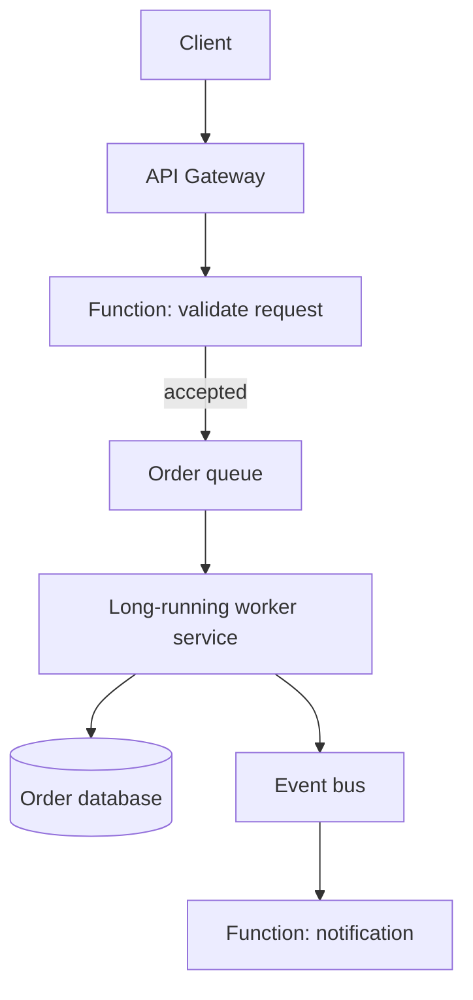

# Tiêu chí lựa chọn giữa hàm serverless và dịch vụ chạy dài hạn

Khi triển khai một workload trên cloud, một quyết định quan trọng là nên chạy logic dưới dạng **hàm serverless được kích hoạt theo request/event** hay **dịch vụ chạy liên tục** trên container, VM hoặc nền tảng điều phối. Hai mô hình có thể cùng xử lý HTTP request, event và tác vụ nền, nhưng khác nhau về vòng đời compute, cách scale, giới hạn runtime, trạng thái, chi phí và trách nhiệm vận hành.

Hàm serverless phù hợp với công việc có điểm bắt đầu/kết thúc rõ ràng, có thể kích hoạt theo sự kiện và không cần giữ process hoạt động liên tục. Dịch vụ chạy dài hạn phù hợp với process cần tồn tại lâu, giữ kết nối, phục vụ luồng dữ liệu liên tục, xử lý tác vụ kéo dài hoặc cần kiểm soát runtime sâu hơn. Đây là xu hướng lựa chọn, không phải quy tắc tuyệt đối: giới hạn thời gian, concurrency và khả năng giữ capacity của mỗi dịch vụ serverless khác nhau; container service cũng có thể scale về zero hoặc chỉ chạy theo job.

Trong phạm vi compute cloud, cần chọn mô hình dựa trên đặc tính workload và SLO, sau đó mới chọn CPU, memory, network, runtime và cách tính phí. Một hệ thống thực tế thường kết hợp cả hai: function nhận request hoặc event, còn dịch vụ chạy dài hạn xử lý kết nối hoặc công việc nền cần tồn tại liên tục.

## 1. Hai mô hình thực thi

### Hàm serverless

Hàm serverless là đơn vị thực thi được nền tảng gọi khi có trigger như HTTP request, queue message, object upload, timer, database event hoặc event bus. Nhà cung cấp quản lý phần lớn việc cấp compute và vòng đời execution environment. Người phát triển tập trung vào handler, dependency, cấu hình, identity và hành vi xử lý.

Đặc điểm thường gặp:

- Invocation có điểm bắt đầu và kết thúc.
- Nền tảng có thể tạo nhiều execution environment để xử lý concurrency.
- Có thể scale về zero khi không có tải, tùy dịch vụ.
- Tài nguyên được tính phí theo invocation, thời gian chạy, memory/CPU hoặc cấu hình capacity.
- Runtime, thời lượng, memory, payload, network và concurrency có giới hạn theo sản phẩm.
- Process hoặc environment có thể bị thu hồi sau khi hoàn tất hoặc idle.

Hàm serverless không có nghĩa là không có máy chủ. Compute vẫn chạy trên hạ tầng provider; người dùng được giải phóng khỏi phần lớn công việc quản lý host và scheduler.

### Dịch vụ chạy dài hạn

Dịch vụ chạy dài hạn là process hoặc tập hợp process được duy trì để nhận request, giữ kết nối hoặc thực hiện công việc trong thời gian dài. Nó thường chạy trên VM, container service, Kubernetes Deployment, managed instance group hoặc nền tảng tương tự.

Đặc điểm thường gặp:

- Process khởi động và tiếp tục chạy cho tới khi được dừng, thay thế hoặc scale-in.
- Có thể giữ connection pool, cache, thread, actor, consumer loop hoặc model trong memory.
- Có thể phục vụ nhiều request trên cùng process và giữ kết nối lâu.
- Người vận hành kiểm soát nhiều hơn về runtime, process model, sidecar, daemon và resource lifecycle.
- Cần quản lý replica, health check, rollout, autoscaling, patching và capacity.
- Chi phí có thể tiếp tục phát sinh khi process idle, trừ khi nền tảng có scale-to-zero hoặc cơ chế scale theo nhu cầu.

“Chạy dài hạn” không nhất thiết là một VM đơn lẻ luôn bật. Một dịch vụ container managed có thể tự thay instance, scale theo tải hoặc giảm về zero nhưng vẫn cung cấp abstraction dạng service.

## 2. So sánh tổng quan

| Tiêu chí | Hàm serverless | Dịch vụ chạy dài hạn |
|---|---|---|
| Đơn vị thực thi | Invocation/handler | Process, container hoặc VM |
| Vòng đời | Theo request/event/task | Duy trì qua nhiều request hoặc phiên làm việc |
| Khởi tạo | Có thể có cold start | Startup khi deploy/scale/restart; process sau đó tiếp tục chạy |
| Scale | Thường theo event, request hoặc concurrency | Theo replica, CPU, memory, queue hoặc metric tùy nền tảng |
| Scale về zero | Thường được hỗ trợ ở nhiều sản phẩm | Có thể có ở một số container service; không phổ biến với mọi dịch vụ |
| Kết nối lâu | Bị giới hạn bởi timeout/runtime hoặc trigger model | Thường phù hợp hơn với WebSocket, stream và session dài |
| State trong process | Có thể bị mất khi environment bị thu hồi | Có thể tồn tại lâu hơn nhưng vẫn mất khi restart/replace |
| Runtime control | Giới hạn theo runtime và dịch vụ | Thường kiểm soát runtime/process sâu hơn |
| Công việc nền dài | Chỉ phù hợp nếu nằm trong giới hạn và có checkpoint | Phù hợp hơn với worker/consumer liên tục hoặc job dài |
| Vận hành hạ tầng | Provider quản lý nhiều hơn | Đội platform/app quản lý replica, capacity và lifecycle nhiều hơn |
| Chi phí idle | Có thể thấp khi scale-to-zero | Có thể phải trả cho replica/capacity đang chờ |
| Phù hợp nổi bật | Event handler, API ngắn, glue logic, automation | API liên tục, streaming, worker dài, service cần process resident |

Không nên chọn chỉ theo nhãn “serverless” hoặc “container”. Cần kiểm tra giới hạn thực tế của dịch vụ cụ thể, nhất là timeout, concurrency, startup latency, networking, filesystem, GPU và chi phí khi giữ capacity.

## 3. Thời lượng và hình dạng của workload

Thời gian chạy là tiêu chí đầu tiên cần đo. Hãy xem cả thời lượng trung bình, p95/p99, thời gian tối đa và độ biến thiên.

### Workload ngắn, có ranh giới rõ

Hàm serverless thường phù hợp khi một lần xử lý:

- Bắt đầu từ một request hoặc event xác định.
- Thực hiện một đơn vị công việc hữu hạn.
- Có thể hoàn tất trong giới hạn timeout của nền tảng.
- Trả kết quả hoặc ghi output rồi kết thúc.
- Có thể retry an toàn nếu invocation thất bại.

Ví dụ: xác thực webhook, tạo thumbnail, chuẩn hóa event, gửi thông báo, cập nhật chỉ mục, kiểm tra file mới tải lên hoặc gọi một API để hoàn thành một bước workflow.

### Workload kéo dài hoặc không có điểm kết thúc tự nhiên

Dịch vụ chạy dài hạn thường phù hợp hơn khi process:

- Chạy liên tục để tiêu thụ queue hoặc stream.
- Duy trì WebSocket, TCP session hoặc kết nối hai chiều.
- Thực hiện xử lý kéo dài vượt timeout của function.
- Cần giữ model lớn hoặc cache nóng trong memory.
- Chạy loop điều khiển, scheduler nội bộ hoặc agent resident.
- Cần streaming output liên tục trong thời gian dài.

Ví dụ: media streaming gateway, game session server, MQTT broker adapter, consumer Kafka liên tục, worker điều phối tác vụ nhiều giờ hoặc dịch vụ inference giữ model trong memory.

### Job dài không nhất thiết cần service luôn chạy

Một tác vụ kéo dài có thể chạy trên batch service, container job hoặc workflow orchestration thay vì function hoặc service thường trực. Hãy phân biệt:

- **Function invocation:** một lần gọi handler có timeout của dịch vụ.
- **Batch/container job:** một process chạy đến khi hoàn tất, có thể kéo dài và được scheduler quản lý.
- **Long-running service:** process duy trì để nhận nhiều request/event hoặc giữ kết nối.

Nếu workload chỉ cần chạy một lần trong 40 phút rồi kết thúc, batch/container job có thể phù hợp hơn một service luôn bật. Không nên giữ một API service chỉ để chạy một tác vụ hữu hạn.

## 4. Trigger, giao thức và kiểu tương tác

### Event/request có thể phân tách

Hàm serverless phù hợp với mô hình trigger-based: request đến, message được giao, timer kích hoạt hoặc event được phát. Trigger tạo một đơn vị công việc có thể định danh và quan sát.

### Kết nối liên tục

Dịch vụ chạy dài hạn phù hợp hơn với giao thức cần kết nối tồn tại lâu, ví dụ:

- WebSocket cho giao tiếp hai chiều.
- TCP connection tùy chỉnh.
- Streaming protocol hoặc media relay.
- Consumer cần giữ session tới broker.
- Long polling hoặc giao thức có heartbeat liên tục.

Một số nền tảng serverless hỗ trợ WebSocket API hoặc streaming response, nhưng cần phân biệt giữa gateway giữ kết nối và function xử lý từng event. Việc gateway duy trì kết nối không có nghĩa một function invocation có thể sống vô hạn.

### Request-response và asynchronous workflow

Nếu client cần phản hồi ngay, function có thể xử lý phần xác thực/validation ngắn rồi trả kết quả. Công việc dài hơn có thể được đưa vào queue và xử lý bất đồng bộ. Nếu client cần theo dõi tiến độ, API trả job ID và cung cấp endpoint truy vấn trạng thái.

Không giữ HTTP request mở trong thời gian dài nếu client, gateway hoặc load balancer có timeout ngắn hơn. Chọn asynchronous workflow hoặc dịch vụ streaming có kiểm soát khi nghiệp vụ yêu cầu.

## 5. Concurrency và mô hình xử lý đồng thời

Hàm serverless thường tạo thêm execution environment khi concurrency tăng. Dịch vụ chạy dài hạn thường tăng số replica hoặc số worker trong mỗi replica. Hai mô hình có thể tạo tải lớn lên dependency theo cách khác nhau.

### Hàm serverless

- Scale-out nhanh theo request/event trong giới hạn quota và capacity.
- Mỗi environment có concurrency model riêng tùy runtime/service.
- Burst có thể tạo nhiều cold start.
- Nếu không đặt concurrency limit, database hoặc API downstream có thể bị quá tải.
- Retry của trigger có thể làm tải tăng thêm trong lúc dependency đang lỗi.

### Dịch vụ chạy dài hạn

- Một process có thể phục vụ nhiều request bằng thread, async event loop hoặc worker pool.
- Replica count thường tăng chậm hơn hoặc cần thời gian startup.
- Connection pool và cache được giữ qua nhiều request.
- Có thể kiểm soát backpressure tại process hoặc consumer.
- Cần sizing số replica và concurrency an toàn trên mỗi replica.

### Ví dụ về áp lực dependency

Giả sử database chịu được tối đa 500 kết nối. Nếu mỗi function environment mở 20 connection và scale lên 40 environment, tổng connection có thể đạt 800. Một dịch vụ dài hạn có 5 replica, mỗi replica pool 40 connection, chỉ tạo khoảng 200 connection. Đây là ví dụ minh họa; tải thực tế còn phụ thuộc pooling, reuse, concurrency và cách client mở kết nối.

Dù chọn mô hình nào, phải giới hạn tổng concurrency theo capacity của database/API, dùng queue hoặc rate limit khi cần và đo saturation của dependency.

## 6. Latency, cold start và yêu cầu phản hồi

Hàm serverless có thể gặp cold start khi nền tảng cần tạo execution environment mới. Cold start gồm các bước cấp compute, khởi động runtime, tải code/dependency và application initialization. Dịch vụ chạy dài hạn thường chịu startup khi deploy hoặc scale-out, nhưng process đang chạy có thể xử lý request tiếp theo mà không phải khởi tạo lại toàn bộ ứng dụng.

### Khi function phù hợp

- Latency budget cho phép cold start hoặc có cơ chế giữ sẵn capacity.
- Request không yêu cầu latency cực thấp ổn định ở mọi lần gọi.
- Startup có thể tối ưu bằng image/package nhỏ và initialization gọn.
- Tải không đều, có khoảng idle dài.

### Khi service phù hợp

- Cần latency ổn định ở p95/p99.
- Có request liên tục và process có thể warm lâu dài.
- Model hoặc cache cần thời gian tải lớn.
- Kết nối tới dependency cần được giữ và quản lý lâu.

### Cách đánh giá

Đo riêng:

- Client-to-edge/network latency.
- Queue wait hoặc trigger delivery delay.
- Cold start/runtime initialization.
- Handler hoặc application processing.
- Dependency latency.
- Response/stream completion time.

Không so sánh function và service chỉ bằng một request warm. Cần thử first invocation, warm sequence, burst scale-out, idle period và deploy mới. Dùng p50/p95/p99 cùng error rate và cost per successful operation.

## 7. Trạng thái, session và dữ liệu

### Function nên ưu tiên stateless

Execution environment có thể bị thu hồi bất kỳ lúc nào. Vì vậy, function nên lấy state từ request/event hoặc hệ thống lưu trữ bền vững. Global variable có thể được tái sử dụng giữa invocation nhưng không phải nơi lưu trạng thái nghiệp vụ.

State phù hợp để đặt ngoài function:

- Database cho dữ liệu giao dịch.
- Object storage cho file và artifact.
- Cache phân tán cho dữ liệu có thể tái tạo.
- Queue/event log cho công việc chưa xử lý.
- Workflow store cho tiến độ tác vụ dài.

### Service có thể giữ state tạm trong process

Dịch vụ dài hạn có thể giữ session, cache hoặc connection pool trong memory để tăng hiệu năng. Tuy nhiên, process vẫn có thể restart, scale-in hoặc bị thay thế. Nếu state ảnh hưởng tới correctness, phải lưu bền vững hoặc có replication/rehydration.

### Session affinity

Nếu ứng dụng cần session gắn với một process, phải xem xét sticky session và failure behavior. Sticky session không thay thế persistent session store vì replica có thể mất. Với function, thường nên dùng token/session store bên ngoài thay vì dựa vào cùng execution environment.

## 8. Runtime, dependency và quyền kiểm soát hệ thống

Hàm serverless phù hợp khi runtime được provider hỗ trợ và workload không cần quyền hệ thống đặc biệt. Dịch vụ chạy dài hạn phù hợp hơn khi cần tùy chỉnh OS package, kernel capability, daemon, sidecar hoặc process topology.

### Kiểm tra giới hạn của function

- Ngôn ngữ/runtime và phiên bản được hỗ trợ.
- Thời gian timeout tối đa.
- Memory/CPU và ephemeral storage.
- Kích thước package, layer hoặc image.
- Concurrency và quota.
- Network egress/ingress, VPC connector và DNS.
- Quyền truy cập thiết bị, filesystem và process.
- Khả năng chạy background thread sau khi handler kết thúc.

Không giả định thread hoặc subprocess sẽ tiếp tục chạy sau khi function trả kết quả. Mọi công việc cần hoàn tất phải được await/commit trong invocation hoặc chuyển sang hệ thống job/queue.

### Kiểm tra yêu cầu của service

- Có cần custom OS image hoặc native library đặc biệt không?
- Có cần sidecar/proxy/agent chạy cùng process không?
- Có cần GPU, local NVMe hoặc device passthrough không?
- Có cần process supervisor hoặc nhiều process trong cùng container không?
- Có cần truy cập filesystem hoặc protocol đặc thù không?
- Có cần giữ listener hoặc socket lâu dài không?

Nếu có yêu cầu mà function platform không hỗ trợ, container/VM service hoặc batch runtime có thể là lựa chọn phù hợp hơn.

## 9. Resource sizing: CPU, memory và network

Không nên chọn function chỉ vì không phải quản lý server, hoặc chọn service chỉ vì có thể cấp nhiều CPU hơn. Cần benchmark tài nguyên theo workload.

### CPU-bound

Ví dụ: mã hóa video, nén dữ liệu, tính toán số học hoặc inference. Kiểm tra CPU allocation, instruction set, throttling và thời gian xử lý. Một số function platform gắn CPU với memory; tăng memory có thể tăng CPU capacity nhưng cũng tăng giá mỗi đơn vị thời gian.

### Memory-bound

Ví dụ: xử lý file lớn, parse JSON lớn, load model hoặc cache. Function có memory limit theo invocation/environment. Service có thể đặt memory cho container/VM và dùng profiling để điều chỉnh. Theo dõi peak memory, GC, OOM và memory leak.

### Network-bound

Ví dụ: gọi nhiều API, stream dữ liệu hoặc transfer object. Đo DNS/TLS handshake, throughput, connection reuse và egress. Function scale-out có thể mở nhiều kết nối đồng thời; service có thể tái sử dụng connection pool. Chọn giới hạn concurrency theo downstream.

### GPU/accelerator

Nếu cần GPU hoặc accelerator liên tục, model lớn và tải ổn định, dịch vụ chạy dài hạn hoặc managed inference endpoint thường phù hợp hơn. Một số nền tảng có function hỗ trợ accelerator, nhưng cần kiểm tra khả năng cung cấp, thời lượng, startup, memory và billing cụ thể.

### Benchmark chung

Đo trên cùng workload:

- Throughput và latency distribution.
- CPU time, peak memory và throttling.
- Startup/cold-start time.
- Connection count và dependency saturation.
- Cost per request/job thành công.
- Error, retry và timeout rate.

## 10. Chi phí: trả theo invocation hay theo capacity

### Hàm serverless

Chi phí có thể phụ thuộc số invocation, thời gian thực thi, memory/CPU allocation, request count, provisioned concurrency và các dịch vụ đi kèm. Scale-to-zero giúp giảm chi phí compute khi không có tải, nhưng cold start hoặc giữ sẵn capacity có thể tạo đánh đổi.

### Dịch vụ chạy dài hạn

Chi phí thường phụ thuộc số replica/VM, kích thước CPU/RAM, thời gian tồn tại, storage, network và managed control plane. Process idle vẫn có thể tiêu thụ capacity và phát sinh phí. Đổi lại, khi tải đều, việc giữ process nóng và tái sử dụng connection có thể giảm overhead trên mỗi request.

### Mô hình chi phí đơn giản

Với function:

\[
C_{function} = N_{invocation} \times T_{avg} \times R_{allocated} + C_{request} + C_{dependency}
\]

Với service:

\[
C_{service} = N_{replica} \times R_{replica} \times T_{running} + C_{storage} + C_{network} + C_{dependency}
\]

Đây là mô hình khái quát. Billing thực tế có thể có free tier, minimum duration, request charge, provisioned capacity, license, log, egress và discount.

### Điểm hòa vốn

Không có một ngưỡng request cố định áp dụng cho mọi hệ thống. Điểm hòa vốn phụ thuộc:

- Traffic volume và phân phối theo thời gian.
- Thời lượng handler và tỷ lệ cold start.
- Memory/CPU cần thiết.
- Số replica tối thiểu của service.
- Mức utilization của service.
- Chi phí connection, network, logging và dependency.
- Discount/commitment và chi phí capacity idle.

Hãy dựng cost model theo traffic profile thực tế: idle, steady, burst và seasonal. So sánh chi phí trên cùng số request/job thành công và cùng SLO.

## 11. Autoscaling và capacity management

### Function scaling

Nền tảng thường tăng số execution environment theo invocation/concurrency. Người dùng cần đặt quota, reserved concurrency hoặc giới hạn tương đương để bảo vệ dependency. Nếu đạt quota, request có thể bị throttle hoặc queue backlog tăng.

### Service scaling

Service thường scale theo CPU, memory, request rate, queue depth hoặc custom metric. Cần xác định:

- Min/max replica.
- Startup/readiness time.
- Scale-out threshold và cooldown.
- Scale-in stabilization để tránh flapping.
- Capacity headroom cho burst.
- Hành vi khi đạt max replica hoặc quota.

### Queue làm bộ đệm

Queue giúp tách tốc độ producer và consumer. Function có thể xử lý message theo batch/concurrency; service worker có thể chạy consumer loop. Trong cả hai trường hợp, cần theo dõi queue age, backlog, retry và dead-letter queue.

Không scale consumer chỉ theo queue depth nếu dependency downstream đã bão hòa. Có thể cần rate limit, backpressure và giới hạn số connection.

## 12. Reliability, retry và xử lý lỗi

### Hàm serverless

Function invocation có thể thất bại do timeout, cold start, throttling, dependency hoặc lỗi runtime. Trigger có thể retry theo semantics của dịch vụ. Nhiều nguồn event có at-least-once delivery, vì vậy handler cần idempotency và deduplication.

### Dịch vụ chạy dài hạn

Process có thể crash, bị OOM, mất node hoặc deploy lỗi. Nền tảng có thể restart/replace replica, nhưng ứng dụng cần readiness/liveness, graceful shutdown, rolling update và xử lý request đang chạy.

### Cả hai mô hình đều cần

- Timeout cho dependency và request.
- Retry có backoff/jitter và giới hạn.
- Idempotency cho side effect có thể lặp.
- Circuit breaker hoặc bulkhead khi dependency lỗi.
- Durable queue/checkpoint cho công việc không được mất.
- Alert theo SLO và runbook phục hồi.

## 13. Observability và trách nhiệm vận hành

Function serverless giảm trách nhiệm quản lý host nhưng không loại bỏ trách nhiệm về code, dependency, dữ liệu và SLO. Service dài hạn cho phép kiểm soát process nhiều hơn nhưng đòi hỏi theo dõi replica, resource và lifecycle.

| Hạng mục | Hàm serverless | Dịch vụ chạy dài hạn |
|---|---|---|
| Runtime/host | Provider quản lý nhiều hơn | Tùy managed service; team thường quản lý image/runtime nhiều hơn |
| Application logs | App owner instrument | App owner instrument |
| Invocation/request metrics | Nền tảng thường cung cấp một phần | Cần kết hợp ingress và app metrics |
| CPU/memory | Metric theo execution environment nếu có | Metric container/VM và process |
| Startup | Cold start/init duration | Deployment startup/readiness |
| Scaling | Invocation/concurrency/quota | Replica/worker/queue/CPU |
| Deployment | Version/alias/traffic routing theo dịch vụ | Rolling/canary/blue-green tùy platform |
| Incident | Trigger, quota, runtime, dependency và code | Replica, node, process, network và dependency |

Metric nên gồm request/event rate, error rate, p95/p99 latency, duration, concurrency, throttle, queue age, CPU, memory, restart và cost per successful operation.

## 14. Bảo mật và danh tính workload

### Function

Function thường có execution role/service identity riêng. Cấp quyền tối thiểu theo từng function, tách quyền deploy khỏi quyền runtime và lấy secret từ secret manager. Không nhúng credential vào package hoặc log.

### Service dài hạn

Container/VM service cần workload identity hoặc service account, image scanning, patching, network segmentation, secret rotation và quản lý runtime. Nếu có sidecar hoặc agent, cần đánh giá quyền và attack surface của từng thành phần.

### Cả hai

- Phân tách dev/test/prod và quyền theo environment.
- Mã hóa dữ liệu truyền và lưu.
- Không log token, secret hoặc payload nhạy cảm.
- Theo dõi dependency và image vulnerability.
- Có audit cho deploy, permission change và secret access.

## 15. Các kiểu workload và mô hình nên cân nhắc

| Workload | Mô hình thường phù hợp | Lý do/điều kiện |
|---|---|---|
| Webhook handler ngắn | Function | Trigger rõ, xử lý hữu hạn, scale theo event |
| API stateless, traffic không đều | Function hoặc service | So sánh cold start với mức sử dụng nền |
| API traffic đều, latency thấp | Service dài hạn | Tái sử dụng process/connection và giữ capacity nóng |
| Resize ảnh sau upload | Function hoặc job | Chia file/task, kiểm soát kích thước và timeout |
| Consumer queue liên tục | Service worker hoặc function trigger | Chọn theo batch/concurrency, queue semantics và duration |
| Kafka consumer cần giữ session | Service dài hạn | Consumer group, rebalance và connection tồn tại liên tục |
| Batch job 30-90 phút | Batch/container job | Job hữu hạn nhưng vượt giới hạn function có thể phù hợp |
| WebSocket gateway | Service/gateway managed | Cần giữ kết nối; function có thể xử lý event riêng lẻ |
| Streaming media relay | Service dài hạn | Luồng dữ liệu liên tục và session dài |
| Scheduled cleanup ngắn | Function | Chạy theo lịch, không cần process thường trực |
| Model inference nhẹ, tải burst | Function hoặc managed endpoint | Kiểm tra model load, accelerator và cold start |
| Model lớn, tải ổn định | Service/inference endpoint | Giữ model resident và capacity ổn định |
| Agent/daemon theo dõi thiết bị | Service dài hạn | Process cần kết nối và giám sát liên tục |
| Workflow nhiều bước | Orchestrator + function/job/service | Tách bước, retry, timeout và trạng thái bền vững |

## 16. Kiến trúc kết hợp: function phía trước, service phía sau

Không cần ép toàn bộ ứng dụng vào một mô hình. Có thể dùng function cho bước kích hoạt ngắn và service/job cho phần xử lý dài.

### Ví dụ xử lý đơn hàng

Trong mô hình này:

- Function validate request và ghi nhận job nhanh.
- Queue lưu công việc bền vững, tách client khỏi thời gian xử lý.
- Worker service xử lý bước dài, giữ connection pool và kiểm soát concurrency.
- Function notification chạy khi có event hoàn tất.
- Database lưu trạng thái nghiệp vụ; không dựa vào memory của function hoặc worker.

### Ví dụ ingest telemetry

Function nhận webhook hoặc event nhỏ, xác thực và chuẩn hóa metadata. Một stream processor hoặc worker service xử lý dữ liệu liên tục, aggregate theo cửa sổ thời gian và ghi kết quả. Function có thể phát cảnh báo khi metric vượt ngưỡng.

### Ví dụ ML inference

Function tiếp nhận request, kiểm tra quyền và route tới model endpoint chạy dài hạn. Với tác vụ batch lớn, function tạo job và worker GPU xử lý. Cách này tránh việc function phải tải model lớn ở mỗi cold start.

## 17. Quy trình ra quyết định

Đánh giá workload theo các bước sau:

1. Xác định trigger: HTTP, event, schedule, queue, stream hay process liên tục.
2. Đo duration: trung bình, p95/p99, maximum và thời gian có thể kéo dài.
3. Xác định protocol: request-response, streaming, WebSocket, TCP hay consumer session.
4. Xác định state: stateless, session, cache, connection pool hay durable workflow state.
5. Đo traffic profile: idle, steady, burst, seasonal và concurrency.
6. Kiểm tra resource: CPU, memory, GPU, disk, network và native dependency.
7. Kiểm tra giới hạn platform: timeout, payload, concurrency, quota và filesystem.
8. Xác định SLO: latency, availability, completion time và recovery.
9. Tính cost model cho cả invocation và capacity chạy nền.
10. Xác định năng lực vận hành: ai quản lý runtime, scaling, patching, rollout và incident.
11. Thử nghiệm với tải thực, cold start, burst, dependency failure và deploy.
12. Chọn mô hình đơn giản đáp ứng yêu cầu; tách thành phần nếu các phần có đặc tính khác nhau.

### Ma trận chấm điểm

Có thể chấm từng tiêu chí từ 1 đến 5 cho mỗi mô hình, với trọng số theo mức quan trọng của hệ thống.

| Tiêu chí | Trọng số gợi ý | Function serverless có lợi khi | Service dài hạn có lợi khi |
|---|---:|---|---|
| Traffic biến động | 15% | Burst và idle rõ rệt | Tải đều, baseline cao |
| Latency tail | 15% | Cold start chấp nhận được/đã xử lý | Cần process nóng và latency ổn định |
| Duration/protocol | 15% | Invocation ngắn, trigger rõ | Process dài, stream hoặc session liên tục |
| State/connection | 10% | Stateless, dependency ngoài | Cache/connection pool resident |
| Resource/runtime | 10% | Runtime được hỗ trợ, resource vừa phải | Custom runtime, daemon, GPU hoặc quyền sâu |
| Chi phí | 15% | Ít invocation, scale-to-zero có lợi | Utilization cao, giữ process hiệu quả |
| Vận hành | 10% | Muốn giảm quản lý host/replica | Có platform team và cần kiểm soát process |
| Reliability | 10% | Retry/idempotency theo event phù hợp | Cần session/consumer liên tục và điều khiển lifecycle |

Trọng số chỉ là điểm khởi đầu. Với hệ thống y tế, tài chính hoặc điều khiển công nghiệp, security, compliance và failure impact có thể cần trọng số cao hơn.

## 18. Ví dụ tính chi phí đơn giản

Giả sử một API có 10 triệu request mỗi tháng. Mỗi request cần 150 ms CPU-bound work, traffic tập trung vào giờ làm việc và ban đêm gần như idle.

### Phương án function

Ước lượng theo số invocation, thời gian tính phí, memory/CPU allocation và request charge. Scale-to-zero ban đêm có thể giảm compute idle. Cần tính cold start, provisioned capacity nếu có SLO nghiêm ngặt, logging và downstream connection.

### Phương án service

Ước lượng số replica tối thiểu cần chạy 24/7, cấu hình CPU/RAM và mức utilization. Khi tải thấp ban đêm, replica vẫn có thể phải duy trì để đáp ứng minimum capacity. Nếu service có thể scale-to-zero an toàn, chi phí idle có thể giảm.

### Cách so sánh

1. Dùng cùng request mix và SLO.
2. Tính tổng compute, network, storage, log và dependency.
3. Tính cold start và startup ảnh hưởng tới p95/p99.
4. Tính số replica tối thiểu và thời gian scale-out.
5. Tính cost per successful request.
6. Mô phỏng traffic tăng gấp 3 và giảm 50%.

Không kết luận function luôn rẻ hơn vì traffic thấp, hoặc service luôn rẻ hơn vì request nhiều. Điểm hòa vốn phụ thuộc cấu hình, thời gian chạy, mức utilization và giá của region/provider.

## 19. Những sai lầm thường gặp

- **Chọn function cho mọi API:** một API traffic liên tục, latency nghiêm ngặt hoặc cần kết nối dài có thể phù hợp với service hơn.
- **Chọn service cho mọi tác vụ nền:** tác vụ event ngắn, không đều có thể không cần process thường trực.
- **Giả định function không có giới hạn thời gian:** mọi sản phẩm đều có timeout/runtime contract cụ thể.
- **Chạy background thread rồi trả handler:** process có thể bị freeze hoặc thu hồi; công việc có thể không hoàn tất.
- **Dùng global memory làm database:** environment function và service process đều có thể restart.
- **Scale không giới hạn:** function concurrency hoặc replica count có thể làm downstream quá tải.
- **So sánh giá không cùng SLO:** phương án rẻ hơn nhưng timeout nhiều không phải phương án tương đương.
- **Bỏ qua cold start và startup:** benchmark warm-only che mất tail latency.
- **Bỏ qua scale-in:** service bị terminate khi đang xử lý nếu không có graceful shutdown/checkpoint.
- **Đưa model lớn vào function mà không đo:** initialization và memory có thể làm latency/cost tăng.
- **Không phân tách control plane và worker:** request path có thể bị ảnh hưởng bởi batch workload.
- **Không có owner:** provider quản lý compute không đồng nghĩa provider chịu trách nhiệm logic ứng dụng.

## 20. Checklist lựa chọn

**Chọn hàm serverless khi:**

- [ ] Công việc được kích hoạt bởi request/event/schedule rõ ràng.
- [ ] Một invocation hoàn tất trong giới hạn runtime và timeout.
- [ ] Workload có thể stateless hoặc lưu state bên ngoài.
- [ ] Traffic biến động và scale-to-zero đem lại giá trị.
- [ ] Cold start phù hợp SLO hoặc có giải pháp giữ sẵn capacity.
- [ ] Retry/idempotency và concurrency limit đã được thiết kế.
- [ ] Runtime, memory, network và dependency phù hợp giới hạn dịch vụ.

**Chọn dịch vụ chạy dài hạn khi:**

- [ ] Process cần tồn tại liên tục hoặc giữ kết nối lâu.
- [ ] Workload cần stream, consumer loop hoặc session dài.
- [ ] Tác vụ vượt giới hạn invocation hoặc cần process resident.
- [ ] Cần custom runtime, daemon, sidecar, GPU hoặc quyền hệ thống phù hợp.
- [ ] Connection pool/model/cache resident giúp cải thiện latency/cost.
- [ ] Có cơ chế health check, rollout, autoscaling và graceful shutdown.
- [ ] Đội vận hành có khả năng quản lý capacity, patching và incident.

**Cân nhắc mô hình kết hợp khi:**

- [ ] Request ingress ngắn nhưng xử lý nghiệp vụ dài.
- [ ] Một phần workload event-driven, phần khác cần consumer liên tục.
- [ ] API cần scale-to-zero nhưng model/worker cần giữ nóng.
- [ ] Có batch, stream hoặc GPU workload riêng biệt.
- [ ] Tách workload giúp bảo vệ SLO và dependency.

## Kết luận

Hàm serverless phù hợp với invocation hữu hạn, trigger rõ ràng, tải biến động và workload có thể retry an toàn trong giới hạn runtime. Dịch vụ chạy dài hạn phù hợp với process resident, kết nối liên tục, streaming, consumer loop, tác vụ kéo dài hoặc yêu cầu kiểm soát runtime sâu. Quyết định cần dựa trên duration, protocol, concurrency, state, latency, resource, chi phí và năng lực vận hành. Với hệ thống có nhiều kiểu workload, kiến trúc kết hợp thường cho phép dùng function ở ranh giới sự kiện và service/job cho phần cần process lâu dài. Hãy benchmark theo cùng SLO, traffic profile và cost per successful operation trước khi chốt mô hình.
