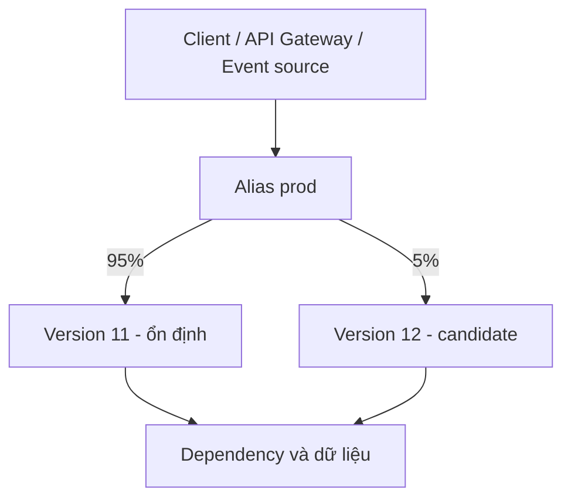
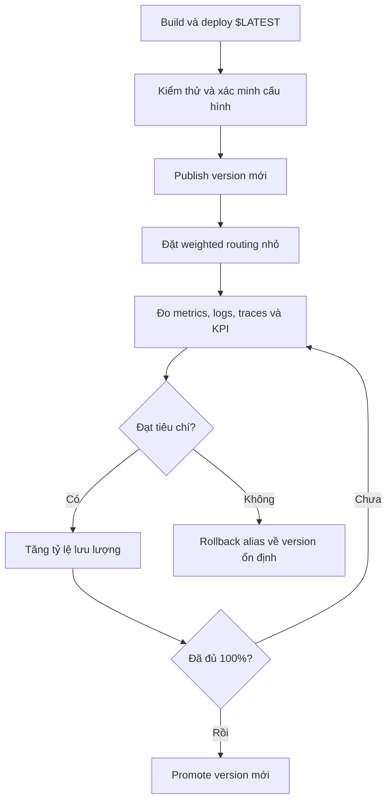

# Version, alias và phát hành hàm theo tỷ lệ lưu lượng

Trong serverless, một lần cập nhật function có thể ảnh hưởng ngay đến mọi request nếu production gọi trực tiếp phiên bản đang phát triển. Cơ chế version và alias giúp tách việc triển khai code khỏi điểm gọi production: mỗi version đã phát hành là một bản chụp ổn định, còn alias là tên logic có thể chuyển giữa các version hoặc chia lưu lượng cho nhiều version. Nhờ đó, đội vận hành có thể phát hành từng phần, đo lường tác động, tăng dần tỷ lệ người dùng và quay lại bản ổn định khi có sự cố.

Bài học thuộc chương **Vận hành và tối ưu serverless** của module **CLOUD_CORE_SERVICES_COMPUTE**. Nội dung tập trung vào vòng đời version, alias, phát hành theo tỷ lệ lưu lượng và các quyết định vận hành liên quan đến độ tin cậy, khả năng mở rộng và chi phí của function trên nền tảng đám mây. Ví dụ lệnh sử dụng AWS Lambda vì đây là nền tảng có thuật ngữ version và alias cụ thể; các nguyên tắc triển khai theo từng giai đoạn cũng áp dụng cho những dịch vụ function khác có cơ chế tương đương.

Sau bài học, người học có thể:

- Phân biệt `$LATEST`, version đã publish và alias.
- Thiết kế luồng phát hành để production luôn gọi qua alias ổn định.
- Cấu hình weighted routing để chia lưu lượng giữa bản đang chạy và bản mới.
- Chọn chiến lược canary, linear hoặc all-at-once theo mức độ rủi ro và lưu lượng.
- Theo dõi chỉ số, log, trace và tín hiệu nghiệp vụ để quyết định tiếp tục hay rollback.
- Thực hiện promotion hoặc rollback mà không phải thay đổi endpoint của client.

## 1. Version và alias giải quyết vấn đề gì?

Function serverless thường được cập nhật nhiều lần trong ngày. Nếu client gọi function không có version qualifier, request thường đi đến `$LATEST` trong AWS Lambda. Đây là bản làm việc có thể thay đổi sau mỗi lần deploy. Khi một lần cập nhật có lỗi, mọi client đang gọi `$LATEST` có thể chịu ảnh hưởng ngay lập tức; việc xác định chính xác request nào chạy code nào cũng khó hơn.

Version và alias tạo ra một lớp kiểm soát giữa quá trình phát triển và lưu lượng thực tế:

- **`$LATEST`:** bản function có thể chỉnh sửa. Đây thường là nơi triển khai code và cấu hình mới trước khi kiểm thử.
- **Published version:** bản chụp có số phiên bản, ví dụ `11` hoặc `12`. Code và cấu hình thuộc phạm vi version được cố định tại thời điểm publish. Không thể chỉnh sửa nội dung của version đã phát hành; muốn thay đổi phải tạo version mới.
- **Alias:** tên có thể thay đổi, ví dụ `dev`, `staging` hoặc `prod`. Alias trỏ đến một published version và có thể cấu hình thêm tỷ lệ lưu lượng đến một version khác.

Ví dụ, alias `prod` ban đầu trỏ đến version `11`. Khi version `12` sẵn sàng, alias có thể gửi 95% request đến version `11` và 5% đến version `12`. Nếu các chỉ số ổn định, đội vận hành chuyển alias để version `12` nhận toàn bộ request. Nếu có lỗi, alias có thể được đưa về version `11`.



Alias giữ cho client dùng một tên ổn định trong khi đội triển khai thay đổi version ở phía sau. Client không cần cập nhật ARN hoặc endpoint sau mỗi lần phát hành, miễn là integration và quyền gọi đã được cấu hình để sử dụng alias.

## 2. Phân biệt bản function, version và alias

| Thành phần | Có thể thay đổi? | Vai trò | Ví dụ |
|---|---|---|---|
| `$LATEST` | Có | Nơi cập nhật code và cấu hình trước khi phát hành | `orders-handler` |
| Published version | Không sau khi publish | Bản phát hành có thể kiểm thử, so sánh và khôi phục | `orders-handler:11` |
| Alias | Có thể đổi version đích và tỷ lệ routing | Điểm gọi ổn định cho môi trường hoặc nhóm lưu lượng | `orders-handler:prod` |
| Weighted routing | Có thể điều chỉnh trên alias | Chia request giữa version chính và version phụ | `prod`: 95% version 11, 5% version 12 |

Một published version là bản chụp code và cấu hình function thuộc phạm vi quản lý phiên bản. Tuy nhiên, không phải mọi thứ mà function phụ thuộc đều được đóng băng theo version. Chính sách IAM gắn với execution role, giá trị secret được đọc từ dịch vụ bên ngoài, schema database, API đối tác, queue và dữ liệu dùng chung có thể thay đổi độc lập. Vì vậy, hai version cùng chạy trong một đợt canary vẫn có thể tương tác với cùng dependency hoặc cùng dữ liệu. Cần đánh giá khả năng tương thích ngược của các thay đổi đó.

Alias không phải một bản sao function và cũng không lưu code. Nó là một tên tham chiếu đến version. Nếu alias bị cập nhật, mọi client gọi alias sẽ chịu tác động theo cấu hình mới. Hãy giới hạn quyền `UpdateAlias` cho pipeline hoặc nhóm phát hành có trách nhiệm.

## 3. Thiết kế điểm gọi production qua alias

Một quy ước dễ vận hành là tạo alias riêng cho từng môi trường, chẳng hạn `dev`, `staging` và `prod`. Production integration gọi ARN có qualifier alias, ví dụ `arn:aws:lambda:ap-southeast-1:123456789012:function:orders-handler:prod`.

Các client có thể gọi function theo nhiều cách: API Gateway, Lambda function URL, Step Functions, event source mapping hoặc một function khác. Hãy kiểm tra cấu hình tích hợp cụ thể để bảo đảm nó tham chiếu alias mong muốn. Nếu một integration vẫn gọi ARN không qualifier hoặc `$LATEST`, integration đó sẽ bỏ qua quy trình weighted routing trên alias `prod`.

Quyền invoke cũng phải khớp với cách gọi. Khi dùng resource-based policy cho một alias, hãy cấp quyền cho đúng qualified ARN và đúng principal cần thiết. Kiểm tra cả quyền của service gọi, policy của function và quyền truy cập dependency; một alias trỏ đúng version vẫn có thể thất bại nếu quyền hoặc cấu hình mạng của version không phù hợp.

Không nên dùng alias `prod` làm nơi thử nghiệm thủ công. Dùng alias riêng hoặc gọi version cụ thể trong kiểm thử có kiểm soát. Điều này tránh việc hoạt động kiểm thử vô tình làm tăng tỷ lệ request đến candidate trong production.

## 4. Quy trình phát hành một version mới

Quy trình mẫu có thể chia thành các bước sau:

1. **Build và deploy vào `$LATEST`:** tạo artifact có thể truy vết, cập nhật code và cấu hình cần thiết.
2. **Kiểm thử trước phát hành:** chạy unit test, integration test, kiểm tra quyền, timeout, memory, biến môi trường và dependency.
3. **Publish version:** tạo version bất biến sau khi nội dung đã đạt yêu cầu. Gắn mô tả hoặc thông tin release để truy lại commit và build.
4. **Đưa candidate vào alias:** cấu hình một tỷ lệ nhỏ lưu lượng đến version mới.
5. **Quan sát:** so sánh lỗi, độ trễ, throttling, cold start và chỉ số nghiệp vụ của candidate với version ổn định.
6. **Tăng tỷ lệ hoặc rollback:** tăng theo từng bước khi các tiêu chí đạt yêu cầu; dừng và quay lại version ổn định khi có dấu hiệu bất thường.
7. **Hoàn tất phát hành:** chuyển alias trỏ hoàn toàn đến version mới, xác minh lại và lưu thông tin triển khai.



Điểm kiểm soát quan trọng là chỉ publish sau khi code và cấu hình cần thiết đã được cập nhật. Nếu thay đổi code sau khi publish, version cũ vẫn giữ nội dung cũ; cần publish version mới khác. Nên lưu version number, commit SHA, build ID, người hoặc pipeline phát hành, thời gian và kết quả kiểm thử trong hệ thống quản lý release.

## 5. Chia lưu lượng bằng weighted alias routing

Với AWS Lambda, alias có thể trỏ đến một version chính và cấu hình một version phụ nhận một tỷ lệ lưu lượng. Ví dụ alias `prod` trỏ chính đến version `11`, đồng thời gửi 5% request đến version `12`:

```json
{
  "FunctionVersion": "11",
  "RoutingConfig": {
    "AdditionalVersionWeights": {
      "12": 0.05
    }
  }
}
```

Tỷ lệ `0.05` tương đương 5%. Phần còn lại đi đến version chính. Weighted routing là phân phối theo xác suất trong tập request, không phải bộ đếm bảo đảm chính xác cứ 100 request sẽ có đúng 5 request đến candidate. Khi lưu lượng thấp, tỷ lệ thực tế trong một cửa sổ ngắn có thể dao động đáng kể. Hãy đánh giá trên đủ số request và đủ thời gian để có tín hiệu đáng tin cậy.

Một ví dụ tăng dần có thể là:

| Giai đoạn | Version ổn định | Version mới | Điều kiện tiếp tục |
|---|---:|---:|---|
| Canary ban đầu | 99% | 1% | Không có lỗi nghiêm trọng; log và trace hợp lệ |
| Mở rộng lần 1 | 95% | 5% | Error rate và p95 không xấu hơn ngưỡng cho phép |
| Mở rộng lần 2 | 90% | 10% | Không tăng throttling, timeout hoặc lỗi nghiệp vụ |
| Mở rộng lần 3 | 50% | 50% | Candidate duy trì ổn định ở tải lớn hơn |
| Hoàn tất | 0% | 100% | Đạt thời gian quan sát và tiêu chí phát hành |

Các tỷ lệ trên chỉ là ví dụ. Với hệ thống có lưu lượng lớn, 1% có thể đã tạo đủ mẫu kiểm tra. Với hệ thống ít request, cần kéo dài cửa sổ quan sát hoặc dùng kiểm thử tải riêng trước khi tăng tỷ lệ. Không nên quyết định chỉ dựa trên phần trăm lưu lượng nếu candidate chưa nhận đủ số request đại diện cho các loại tác vụ quan trọng.

### Cấu hình bằng AWS CLI

Giả sử function `orders-handler` đã có version `11`, version `12` vừa được publish và alias `prod` đang trỏ đến version `11`.

```bash
# Publish một version sau khi đã cập nhật và kiểm thử $LATEST
aws lambda publish-version \
  --function-name orders-handler \
  --description "release-2026-11-22-build-1842"

# Tạo alias lần đầu nếu alias prod chưa tồn tại
aws lambda create-alias \
  --function-name orders-handler \
  --name prod \
  --function-version 11

# Chuyển 5% lưu lượng của alias prod sang version 12
aws lambda update-alias \
  --function-name orders-handler \
  --name prod \
  --function-version 11 \
  --routing-config '{"AdditionalVersionWeights":{"12":0.05}}'

# Xác minh version chính và tỷ lệ routing hiện tại
aws lambda get-alias \
  --function-name orders-handler \
  --name prod
```

Lệnh `create-alias` chỉ dùng khi alias chưa tồn tại. Trong pipeline thực tế, cần đọc trạng thái hiện tại trước khi tạo hoặc cập nhật để tránh lỗi do alias đã có. Cũng cần lấy version number thực tế trả về từ lệnh publish; không giả định version mới luôn là `12`.

Khi candidate đạt tiêu chí, chuyển alias hoàn toàn sang version `12`:

```bash
aws lambda update-alias \
  --function-name orders-handler \
  --name prod \
  --function-version 12 \
  --routing-config '{"AdditionalVersionWeights":{}}'
```

Nếu version `12` có lỗi trong giai đoạn canary, xóa phần routing phụ và giữ version `11` làm version chính:

```bash
aws lambda update-alias \
  --function-name orders-handler \
  --name prod \
  --function-version 11 \
  --routing-config '{"AdditionalVersionWeights":{}}'
```

Các lệnh trên minh họa thao tác với alias. Pipeline cần kiểm tra kết quả lệnh, ghi nhận alias ARN và version thực tế, đồng thời xác minh một request thử nghiệm sau khi cập nhật. Không coi việc API trả về thành công là bằng chứng duy nhất rằng toàn bộ luồng production đã hoạt động.

## 6. Chọn chiến lược phát hành

| Chiến lược | Cách hoạt động | Phù hợp khi | Đánh đổi |
|---|---|---|---|
| All-at-once | Chuyển toàn bộ alias sang version mới trong một lần | Thay đổi nhỏ, đã kiểm thử tốt, có khả năng rollback nhanh | Phạm vi ảnh hưởng ban đầu lớn |
| Canary | Gửi một tỷ lệ nhỏ đến candidate, quan sát rồi tăng hoặc promote | Muốn phát hiện lỗi trên lưu lượng thật với phạm vi ảnh hưởng ban đầu nhỏ | Cần đủ lưu lượng và thời gian quan sát |
| Linear | Tăng tỷ lệ theo các bước đều đặn trong một khoảng thời gian | Muốn tăng tải từ từ và có các điểm kiểm tra định kỳ | Có nhiều giai đoạn cần giám sát và điều phối |
| Blue/green | Duy trì hai phiên bản/môi trường và chuyển điểm vào sang môi trường mới khi sẵn sàng | Thay đổi lớn, cần kiểm thử môi trường mới tương đối độc lập | Có thể tốn thêm tài nguyên và phải quản lý dữ liệu tương thích |

Trong AWS, CodeDeploy hỗ trợ triển khai Lambda theo các cấu hình như `LambdaCanary10Percent5Minutes`, `LambdaCanary10Percent30Minutes`, `LambdaLinear10PercentEvery1Minute`, `LambdaLinear10PercentEvery2Minutes` và `LambdaAllAtOnce`. Các cấu hình này giúp tự động điều chỉnh alias theo lịch triển khai. Có thể kết hợp CloudWatch alarms và hook trước/sau traffic để kiểm tra điều kiện, dừng rollout hoặc thực hiện tác vụ xác minh. Tên deployment configuration là cấu hình có sẵn của CodeDeploy; cần chọn đúng cấu hình phù hợp với lưu lượng và thời gian quan sát của ứng dụng.

Canary và linear giảm phạm vi ảnh hưởng ban đầu nhưng không loại bỏ rủi ro. Một request lỗi vẫn có thể ghi dữ liệu sai hoặc kích hoạt side effect trước khi rollback. Với thao tác thanh toán, gửi thông báo, tạo đơn hàng hoặc cập nhật dữ liệu, cần idempotency key, kiểm soát trùng lặp và quy tắc tương thích dữ liệu để tránh phát sinh hậu quả không thể đảo ngược chỉ bằng cách đổi alias.

## 7. Quan sát candidate trước khi tăng tỷ lệ

Không nên promote chỉ vì function trả mã thành công trong vài lần kiểm thử. Cần so sánh candidate và version ổn định theo cùng loại lưu lượng, cùng cửa sổ thời gian và các chỉ số có ý nghĩa với người dùng.

### Chỉ số kỹ thuật

- **Invocations:** số lần function được gọi, giúp kiểm tra candidate thực sự nhận lưu lượng.
- **Errors và error rate:** số lỗi và tỷ lệ lỗi trên tổng invocation. Nên xem cả lỗi tuyệt đối lẫn tỷ lệ vì tỷ lệ có thể dao động khi mẫu nhỏ.
- **Duration:** thời gian xử lý; theo dõi p50, p95 và p99 nếu hệ thống thu thập được phân vị phù hợp.
- **Throttles:** số request bị giới hạn do vượt concurrency hoặc quota.
- **Concurrent executions:** mức đồng thời, giúp phát hiện áp lực năng lực khi tăng tỷ lệ.
- **Init duration/cold start:** thời gian khởi tạo môi trường thực thi, đặc biệt khi thay đổi runtime, package hoặc cấu hình khởi tạo.
- **Async event age và iterator age:** độ trễ xử lý event bất đồng bộ hoặc bản ghi stream; tên và cách đo phụ thuộc trigger.
- **DLQ và retry:** số message thất bại, số lần thử lại và lượng sự kiện chuyển sang dead-letter queue.

Với Lambda, có thể dùng dimension version thực thi (chẳng hạn `ExecutedVersion` trên các metric hỗ trợ dimension này) để so sánh các bản. Cần xác nhận metric và dimension có sẵn cho loại function, trigger và cấu hình quan sát đang sử dụng. Nếu dashboard chỉ tổng hợp ở cấp function, lỗi của candidate có thể bị hòa vào tín hiệu của version ổn định.

### Log có cấu trúc

Log nên ghi đủ thông tin để xác định request đã chạy ở version nào, nhưng tránh ghi token, mật khẩu, dữ liệu cá nhân hoặc payload nhạy cảm. Ví dụ một log JSON:

```json
{
  "level": "INFO",
  "event": "order_validation_completed",
  "function": "orders-handler",
  "executedVersion": "12",
  "alias": "prod",
  "requestId": "a1b2c3d4",
  "traceId": "1-655f0000-1234567890abcdef12345678",
  "durationMs": 42,
  "result": "success"
}
```

Không phải runtime nào cũng tự cung cấp alias trong context log. Có thể truyền thông tin release hoặc alias qua cấu hình triển khai, metadata hoặc lớp gọi, nhưng phải phân biệt dữ liệu do ứng dụng tự ghi với version thực tế do nền tảng báo cáo. Request ID và trace ID nên được truyền xuyên suốt các lời gọi downstream để liên kết log của nhiều service.

### Trace phân tán

Trace cho biết request đi qua những thành phần nào và thời gian tiêu tốn ở từng đoạn. Khi một candidate tăng latency, trace giúp xác định nguyên nhân đến từ thời gian khởi tạo function, truy vấn database, gọi API bên ngoài, retry hay xử lý nội bộ. Với AWS, có thể dùng AWS X-Ray hoặc chuẩn OpenTelemetry thông qua cơ chế instrumentation tương thích với runtime và nền tảng.

Khi so sánh hai version, hãy kiểm tra cùng một nhóm span và thuộc tính như function name, executed version, route, dependency và status. Sampling quá thấp có thể khiến lỗi hiếm không xuất hiện trong trace; sampling quá cao trên hệ thống nhiều request có thể làm tăng chi phí lưu trữ và xử lý. Cần chọn tỷ lệ lấy mẫu phù hợp và có cơ chế tăng sampling khi điều tra sự cố.

### Chỉ số nghiệp vụ

Metric kỹ thuật không đủ để xác định một bản phát hành có đúng về nghiệp vụ hay không. Theo dõi thêm các chỉ số như tỷ lệ đơn hàng được tạo thành công, tỷ lệ thanh toán hoàn tất, số giao dịch bị từ chối, số sự kiện xử lý trùng và tỷ lệ yêu cầu phải hỗ trợ thủ công. Một function có thể trả HTTP 200 nhưng vẫn ghi sai trạng thái hoặc tạo dữ liệu không hợp lệ.

Đặt ngưỡng cảnh báo trước khi bắt đầu rollout. Ví dụ: dừng tăng tỷ lệ nếu error rate candidate vượt ngưỡng tuyệt đối hoặc cao hơn baseline một mức đã định, p95 tăng quá giới hạn, xuất hiện lỗi nghiệp vụ nghiêm trọng, hoặc async event age tăng liên tục. Ngưỡng cụ thể phải dựa trên SLO, baseline và đặc điểm lưu lượng của ứng dụng; không dùng một con số chung cho mọi function.

## 8. Rollback và phục hồi sau phát hành

Rollback bằng alias thường nhanh vì chỉ cần thay đổi version đích. Tuy nhiên, việc chuyển alias không xóa các side effect đã xảy ra, không tự khôi phục schema database và không hủy các message đã được gửi đến hệ thống khác.

Quy trình rollback nên được chuẩn bị trước khi mở canary:

1. Xác định version ổn định gần nhất và xác minh version đó vẫn có thể chạy với dependency hiện tại.
2. Đặt alias về version ổn định và xóa weighted routing đến candidate.
3. Gửi request kiểm tra qua chính alias production để xác nhận request mới chạy trên version mong muốn.
4. Theo dõi error rate, duration, throttling, event age và chỉ số nghiệp vụ sau rollback.
5. Kiểm tra message tồn đọng, retry, DLQ và side effect được tạo trong thời gian candidate hoạt động.
6. Tạm dừng pipeline phát hành tự động cho đến khi xác định nguyên nhân và có bản sửa đã kiểm thử.

Rollback không nên phụ thuộc vào việc sửa tay một lệnh trong lúc sự cố. Pipeline cần có thao tác rollback đã chuẩn bị, quyền cần thiết, version ổn định được lưu lại và cảnh báo xác nhận sau khi alias đổi. Với hệ thống có yêu cầu phục hồi nghiêm ngặt, cần diễn tập rollback trong môi trường staging và ghi nhận thời gian phục hồi thực tế.

## 9. Những lưu ý khi phát hành theo tỷ lệ

### Tương thích dữ liệu và dependency

Trong giai đoạn weighted routing, hai version cùng chạy song song. Nếu version mới thay đổi schema database, format message hoặc giao thức giữa các service, version cũ có thể không đọc được dữ liệu do version mới tạo ra. Áp dụng mô hình thay đổi theo nhiều bước: mở rộng schema tương thích ngược, phát hành code có thể đọc cả định dạng cũ và mới, chuyển đổi dữ liệu, sau đó mới loại bỏ cấu trúc cũ ở một release riêng.

### Concurrency và cold start

Tăng tỷ lệ candidate làm thay đổi phân bố tải nhưng không bảo đảm tổng concurrency giảm. Một version mới có thể có thời gian xử lý dài hơn, tạo thêm request đồng thời hoặc cần nhiều tài nguyên khởi tạo hơn. Kiểm tra reserved concurrency, quota tài khoản, provisioned concurrency nếu sử dụng và dấu hiệu throttling trước khi tăng tỷ lệ. Với workload có burst, cần kiểm tra cả khả năng scale và thời gian khởi tạo chứ không chỉ tải trung bình.

### Trigger và endpoint

Xác minh từng nguồn gọi đều sử dụng alias production. Một API Gateway đã tích hợp với alias `prod` có thể nhận weighted routing, trong khi một event source mapping hoặc function khác vẫn có thể gọi ARN không qualifier nếu cấu hình cũ chưa được cập nhật. Tạo inventory các integration, permission và event source mapping để tránh phát hành chỉ một phần hệ thống.

### Bảo mật và quyền phát hành

Pipeline phát hành cần quyền deploy code, publish version và cập nhật alias theo phạm vi function được quản lý. Tách quyền triển khai khỏi quyền thay đổi policy hoặc secret nếu quy trình tổ chức yêu cầu. Ghi lại người thực hiện, pipeline run, commit và lý do rollback để có thể kiểm toán thay đổi production.

### Chi phí

Trong thời gian canary, version cũ và mới cùng tiêu thụ invocation, compute duration, log, trace và có thể cả provisioned concurrency. Một release có lỗi retry nhiều lần có thể làm tăng invocation và chi phí downstream. Theo dõi chi phí theo function, môi trường và release; đặt giới hạn retry và thời gian rollout hợp lý. Canary giảm phạm vi rủi ro nhưng cũng tạo thêm thời gian vận hành hai version song song.

## 10. Bài tập thực hành

Giả lập một lần phát hành function xử lý đơn hàng bằng AWS Lambda:

1. Tạo function `orders-handler` với endpoint kiểm tra sức khỏe và một thao tác nghiệp vụ đơn giản. Deploy code ban đầu, kiểm thử và publish version `11`.
2. Tạo alias `prod` trỏ đến version `11`. Cấu hình integration thử nghiệm gọi qualified ARN của alias.
3. Cập nhật code trong `$LATEST` để tạo candidate, ví dụ bổ sung validation cho mã đơn hàng. Chạy unit test và integration test trước khi publish version mới.
4. Publish version mới (giả sử là `12`) và cấu hình alias `prod` gửi 5% request đến version `12`.
5. Gửi đủ request thử nghiệm qua alias. Thu thập invocation, error rate, duration, log có executed version và trace của request.
6. Mô phỏng lỗi ở version `12`, chẳng hạn trả lỗi cho một nhóm input thử nghiệm. Xác minh cảnh báo kích hoạt và alias có thể được đưa về version `11`.
7. Gửi request sau rollback, xác nhận version thực thi là `11` và kiểm tra không còn tỷ lệ routing đến `12`.
8. Khôi phục code candidate, phát hành lại sau khi sửa, tăng tỷ lệ theo từng bước và promote khi các tiêu chí đều đạt.

Trong bài thực hành, không dùng dữ liệu khách hàng thật và không gửi thao tác có side effect đến hệ thống production. Nếu chỉ có môi trường lab, có thể mô phỏng tỷ lệ lưu lượng bằng script gửi request đến alias và so sánh version được ghi trong log. Kết quả quan sát thực tế có thể dao động quanh tỷ lệ cấu hình vì weighted routing phân phối theo xác suất.

## 11. Checklist trước, trong và sau phát hành

**Trước phát hành**

- [ ] Code và cấu hình đã được kiểm thử trên `$LATEST` hoặc môi trường staging.
- [ ] Artifact, commit SHA, build ID và version ổn định hiện tại được ghi nhận.
- [ ] Candidate đã được publish và không còn thay đổi sau publish.
- [ ] Client production, trigger, permission và integration đã được kiểm tra để gọi alias.
- [ ] Dependency và schema tương thích khi hai version chạy đồng thời.
- [ ] Dashboard, log, trace, business metric và cảnh báo đã sẵn sàng.
- [ ] Ngưỡng dừng rollout và lệnh rollback đã được xác định.

**Trong khi phát hành**

- [ ] Bắt đầu với tỷ lệ nhỏ phù hợp lưu lượng và rủi ro.
- [ ] Xác nhận candidate thực sự nhận request qua alias.
- [ ] So sánh error rate, duration, throttling, concurrency và cold start với baseline.
- [ ] Theo dõi retry, event age, DLQ và các chỉ số nghiệp vụ.
- [ ] Chỉ tăng tỷ lệ khi đã có đủ request đại diện và cửa sổ quan sát đạt yêu cầu.
- [ ] Dừng tăng và rollback nếu vượt ngưỡng hoặc xuất hiện lỗi nghiêm trọng.

**Sau phát hành**

- [ ] Alias trỏ hoàn toàn đến version mới và không còn weighted routing ngoài kế hoạch.
- [ ] Request kiểm tra qua alias xác nhận đúng version.
- [ ] Dashboard và cảnh báo tiếp tục theo dõi sau khi promote.
- [ ] Release record lưu version, commit, thời điểm, kết quả và người/pipeline phát hành.
- [ ] Theo dõi message tồn đọng, side effect và chi phí phát sinh trong thời gian rollout.
- [ ] Giữ version trước đó sẵn sàng cho rollback theo chính sách lưu giữ của tổ chức.

Version giúp đóng băng một bản phát hành có thể kiểm chứng; alias tạo điểm gọi ổn định và weighted routing cho phép mở rộng lưu lượng theo từng bước. Khi kết hợp quy trình phát hành có kiểm soát với metrics, logs, traces, tiêu chí nghiệp vụ và rollback đã chuẩn bị, đội vận hành có thể giảm phạm vi ảnh hưởng của lỗi, phát hiện vấn đề sớm và duy trì tính sẵn sàng của ứng dụng serverless.
