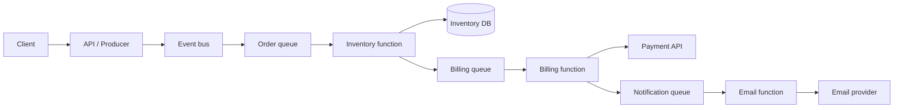

# Log, trace và chẩn đoán lỗi trong chuỗi xử lý sự kiện

Ứng dụng serverless thường xử lý một nghiệp vụ qua nhiều thành phần: API gateway, event bus, queue, function, database, object storage và dịch vụ bên ngoài. Một request ban đầu có thể tạo ra nhiều event; mỗi event lại kích hoạt một hoặc nhiều function chạy ở thời điểm và execution environment khác nhau. Vì vậy, khi nghiệp vụ thất bại, chỉ xem log của function cuối cùng thường không đủ để biết lỗi bắt đầu ở đâu.

Observability cho chuỗi sự kiện cần kết hợp ba loại tín hiệu: **log** ghi lại sự kiện và ngữ cảnh tại từng bước; **trace** mô tả quan hệ và thời gian giữa các bước; **metric** cho biết xu hướng, tỷ lệ lỗi và mức độ ảnh hưởng trên toàn hệ thống. Các tín hiệu cần mang định danh tương quan xuyên suốt, nhưng vẫn phải tôn trọng ranh giới bất đồng bộ, retry, fan-out và bảo vệ dữ liệu nhạy cảm.

## 1. Vì sao chẩn đoán event-driven serverless khó hơn một request đơn lẻ?

Trong ứng dụng đồng bộ đơn giản, một request thường đi qua một chuỗi call có thể quan sát trong cùng process. Với hệ thống event-driven, công việc có thể bị tách thành nhiều execution độc lập:

- Producer nhận request và phát event.
- Event bus lọc rule rồi chuyển event tới queue hoặc subscriber.
- Queue giữ event cho tới khi consumer có capacity.
- Function được khởi chạy để xử lý event.
- Function gọi database, object storage hoặc API bên ngoài.
- Function phát event tiếp theo để kích hoạt một chuỗi xử lý khác.
- Retry, redrive hoặc dead-letter queue có thể khiến event được xử lý lại sau nhiều phút hoặc nhiều giờ.

Các bước có thể chạy ở nhiều region, account, runtime và thời điểm khác nhau. Một event có thể được giao nhiều lần; nhiều event có thể cùng xuất phát từ một nghiệp vụ; một function có thể xử lý batch gồm nhiều event. Do đó, cần phân biệt định danh nghiệp vụ, định danh event, định danh invocation và định danh trace.

### Ví dụ chuỗi xử lý

Một khách hàng gửi yêu cầu tạo đơn hàng. API phát `OrderCreated`; event bus chuyển event tới queue; function kiểm tra tồn kho; function khác tạo hóa đơn; dịch vụ notification gửi email.



Nếu email không được gửi, cần xác định event có được phát hay không, queue có nhận message không, function có được invoke không, provider có từ chối request không và retry đã xảy ra bao nhiêu lần. Một trace và bộ log có tương quan giúp trả lời các câu hỏi này mà không phải đoán từ một dòng lỗi riêng lẻ.

## 2. Phân biệt log, trace và metric

| Tín hiệu | Trả lời câu hỏi | Dùng trong chẩn đoán |
|---|---|---|
| Log | Điều gì đã xảy ra tại một thời điểm? | Đọc chi tiết input đã được chuẩn hóa, quyết định, lỗi và kết quả |
| Trace | Các bước liên quan với nhau như thế nào và mất bao lâu? | Theo dõi luồng qua producer, queue, function và dependency |
| Metric | Tình trạng hệ thống thay đổi ra sao theo thời gian? | Phát hiện spike lỗi, queue backlog, latency và saturation |

Ba tín hiệu bổ sung cho nhau. Metric cho biết queue age đang tăng; trace cho thấy function mất thời gian ở database; log chỉ ra query timeout hoặc mã lỗi cụ thể. Không nên dùng log làm công cụ duy nhất để đo xu hướng hoặc dùng trace thay cho audit log.

### Log

Log là bản ghi có thời gian về một sự kiện trong ứng dụng hoặc nền tảng. Log tốt có cấu trúc, chứa các trường nhất quán và có thể tìm kiếm bằng event ID, trace ID, function name hoặc request ID.

### Trace

Trace là tập hợp span biểu diễn một hành trình xử lý. Mỗi span có thời điểm bắt đầu/kết thúc, operation name, status, attributes và quan hệ với span khác. Trace cho biết bước nào gọi bước nào, bước nào chạy song song và nơi phát sinh độ trễ.

### Metric

Metric là dữ liệu số được tổng hợp theo thời gian, chẳng hạn invocation count, error count, duration histogram, queue depth, oldest message age và retry count. Metric có cardinality được kiểm soát để phục vụ dashboard và alert hiệu quả.

## 3. Định danh tương quan trong chuỗi sự kiện

Một thiết kế observability cần nhiều loại ID vì mỗi ID trả lời một câu hỏi khác nhau.

| Định danh | Phạm vi | Mục đích |
|---|---|---|
| `request_id` | Một request đồng bộ từ client hoặc gateway | Tra cứu request ban đầu |
| `correlation_id` | Một nghiệp vụ hoặc workflow xuyên nhiều thành phần | Gom các bước thuộc cùng một nghiệp vụ |
| `event_id` | Một event cụ thể | Nhận diện message và phát hiện giao lặp |
| `trace_id` | Một trace phân tán | Nối các span thuộc cùng hành trình quan sát |
| `span_id` | Một operation trong trace | Xác định bước cụ thể |
| `invocation_id` | Một lần function được runtime thực thi | Phân biệt các lần chạy/retry |
| `attempt` | Số lần xử lý một event/task | Theo dõi retry và redrive |
| `business_id` | Định danh nghiệp vụ như order ID | Tra cứu trạng thái nghiệp vụ theo quyền phù hợp |

Không dùng một trường duy nhất thay cho tất cả. Ví dụ, một event có thể được giao ba lần: cả ba attempt giữ cùng `event_id`, nhưng có `invocation_id` khác nhau và có thể có span/trace khác nhau tùy mô hình tracing. `correlation_id` có thể giữ nguyên để gom cả workflow.

### Tạo correlation ID

Correlation ID nên được tạo tại ranh giới đầu tiên nếu client chưa cung cấp giá trị hợp lệ. Nếu client gửi ID, cần giới hạn độ dài, ký tự và không cho phép giá trị chứa dữ liệu nhạy cảm hoặc nội dung điều khiển log. Một ID ngẫu nhiên khó đoán hoặc UUID thường phù hợp hơn việc dùng email, số điện thoại hay thông tin cá nhân.

### Truyền ID qua event envelope

Khi producer phát event, đặt metadata tương quan vào envelope hoặc message attributes theo schema được thống nhất.

```json
{
  "event_id": "evt-7f3a91",
  "event_type": "OrderCreated",
  "event_version": 2,
  "correlation_id": "wf-91c24d",
  "occurred_at": "2026-11-22T08:30:00Z",
  "traceparent": "00-4bf92f3577b34da6a3ce929d0e0e4736-00f067aa0ba902b7-01",
  "data": {
    "order_id": "ord-10482"
  }
}
```

Đây là envelope minh họa. Schema thực tế cần quy định version, kích thước tối đa, trường bắt buộc và cách truyền metadata theo dịch vụ event/queue đang sử dụng. Không đưa access token, secret hoặc toàn bộ payload nghiệp vụ vào correlation metadata.

### Event ID không phải idempotency key trong mọi trường hợp

`event_id` nhận diện một thông điệp. Idempotency key nhận diện một thao tác có thể bị thử lại mà không được tạo side effect trùng. Thường có thể dùng event ID làm thành phần của idempotency key, nhưng nếu cùng nghiệp vụ có thể phát nhiều event tương đương thì cần khóa theo business operation và version thích hợp.

## 4. Structured logging cho function

Structured logging ghi log dưới dạng các trường có tên thay vì chỉ nối chuỗi tự do. JSON là định dạng phổ biến vì dễ parse, lọc và chuyển tới hệ thống log tập trung.

Một bản ghi có thể gồm:

- Timestamp theo UTC và mức log.
- Service/function name, version và environment.
- Event type, event ID, correlation ID và trace/span ID.
- Invocation ID, attempt number và source queue/topic.
- Operation name và kết quả xử lý.
- Duration, dependency name và error code.
- Region hoặc resource identifier không nhạy cảm.

Ví dụ:

```json
{
  "timestamp": "2026-11-22T08:30:01.125Z",
  "severity": "ERROR",
  "service": "inventory-consumer",
  "environment": "production",
  "function_version": "42",
  "event_type": "OrderCreated",
  "event_id": "evt-7f3a91",
  "correlation_id": "wf-91c24d",
  "trace_id": "4bf92f3577b34da6a3ce929d0e0e4736",
  "span_id": "00f067aa0ba902b7",
  "invocation_id": "inv-8831",
  "attempt": 2,
  "operation": "reserve_inventory",
  "duration_ms": 1830,
  "error_code": "DEPENDENCY_TIMEOUT",
  "message": "Inventory database request timed out"
}
```

### Log theo ranh giới xử lý

Nên có log cho các mốc quan trọng:

1. Invocation bắt đầu và xác định nguồn event.
2. Event được parse và validate.
3. Task được claim hoặc message được nhận.
4. Dependency call bắt đầu/kết thúc nếu cần chẩn đoán.
5. Quyết định retry, acknowledge, reject hoặc gửi DLQ.
6. Output được commit và xử lý hoàn tất.

Không nhất thiết log mọi dòng code hoặc toàn bộ payload. Chọn mốc có giá trị chẩn đoán để tránh tăng chi phí, tạo nhiễu và ghi dữ liệu nhạy cảm.

### Severity nhất quán

| Level | Dùng khi |
|---|---|
| `DEBUG` | Chi tiết phát triển hoặc điều tra tạm thời, thường tắt ở production |
| `INFO` | Invocation bắt đầu/kết thúc, event commit, trạng thái bình thường quan trọng |
| `WARN` | Retry, fallback, throttling hoặc tình trạng có thể tự phục hồi |
| `ERROR` | Một operation thất bại và cần xử lý/điều tra |
| `FATAL` | Process hoặc runtime không thể tiếp tục; chỉ dùng khi thực sự nghiêm trọng |

Không ghi cùng một lỗi ở mọi lớp như `ERROR` nếu lỗi đã được xử lý thành công bằng retry. Có thể ghi lần thử đầu ở `WARN`, sau đó ghi kết quả cuối cùng ở `INFO` hoặc `ERROR` tùy trạng thái nghiệp vụ.

## 5. Truyền trace context qua ranh giới bất đồng bộ

Distributed tracing thường dùng trace context để liên kết operation giữa nhiều service. W3C Trace Context định nghĩa các header như `traceparent` và `tracestate` cho việc truyền context giữa thành phần hỗ trợ chuẩn này.

Với HTTP đồng bộ, instrumentation có thể tự truyền context qua header. Với queue hoặc event bus, context cần được ghi vào message attributes/envelope khi publish và được consumer trích xuất khi xử lý. Không phải mọi broker hoặc trigger tự động bảo toàn header; cần xác minh integration và cấu hình cụ thể.

### Producer

Producer tạo hoặc tiếp tục một trace, tạo span cho thao tác publish và inject context vào message metadata. Span publish nên ghi nhận topic/queue hoặc event destination ở dạng attribute không nhạy cảm.

### Broker/event bus

Broker có thể cung cấp metric riêng như publish latency, delivery count, age, throttling hoặc rule failure. Không phải broker nào cũng tạo span distributed đầy đủ. Nếu không có span, vẫn cần log/metric và event ID để xác định khoảng trống giữa publish và consume.

### Consumer

Consumer extract trace context từ message và tạo span xử lý. Với message được giao sau thời gian chờ dài hoặc xử lý theo batch, cần chọn quan hệ trace phù hợp. Có thể dùng parent-child khi một message là phần tiếp nối rõ ràng của operation trước; với batch hoặc fan-in nhiều message từ nhiều trace, span links thường biểu đạt quan hệ tốt hơn việc ép một parent duy nhất.

### Retry và redrive

Retry có thể tiếp tục cùng trace hoặc tạo trace mới có liên kết tới trace gốc, tùy khả năng instrumentation và thời gian tồn tại của workflow. Dù chọn cách nào, log phải giữ `event_id`, `correlation_id` và `attempt` để người vận hành tìm được toàn bộ lịch sử.

Không tạo trace mới rồi bỏ mất correlation ID; cũng không kéo một trace bất tận qua workflow kéo dài nhiều ngày nếu backend tracing có giới hạn retention. Với workflow dài, correlation ID và event history có thể là lớp liên kết bền vững hơn trace.

## 6. Trace span cho event-driven workflow

Một trace có thể gồm các span như:

- `http.server`: nhận request ban đầu.
- `event.publish`: phát event tới bus.
- `messaging.receive`: nhận message từ queue.
- `function.invoke`: bắt đầu function invocation.
- `inventory.reserve`: gọi database hoặc service tồn kho.
- `event.publish`: phát event tiếp theo.
- `payment.authorize`: gọi payment provider.
- `notification.send`: gửi thông báo.

Span cần có tên operation ổn định và attributes có giới hạn cardinality. Không dùng order ID hoặc user ID làm tên span; đặt các ID đó vào log hoặc trace attribute có kiểm soát nếu chính sách cho phép.

### Span duration và queue wait

Đối với event processing, tổng thời gian nghiệp vụ không chỉ là thời gian function chạy. Cần đo:

- Publish-to-delivery latency.
- Queue wait time.
- Function startup/init duration nếu nền tảng cung cấp.
- Handler duration.
- Dependency latency.
- Retry delay và thời gian chờ redrive.
- End-to-end workflow duration.

Nếu chỉ đo function duration, queue có thể giữ message 30 phút mà dashboard vẫn cho thấy function chạy nhanh. Queue age/oldest message age là metric quan trọng để phát hiện vấn đề này.

### Fan-out và fan-in

Một event có thể kích hoạt nhiều subscriber song song. Khi đó, workflow hoàn tất khi các nhánh cần thiết hoàn tất hoặc có quyết định nghiệp vụ tương ứng. Trace nên thể hiện quan hệ fan-out/fan-in; correlation ID liên kết các nhánh, còn mỗi nhánh có span và event ID riêng.

Nếu một function xử lý batch gồm nhiều event, không gán toàn bộ batch vào một event ID. Ghi batch ID riêng và giữ danh sách event ID ở log hoặc trace event phù hợp, có giới hạn kích thước.

## 7. Instrumentation với OpenTelemetry

OpenTelemetry cung cấp API, SDK và semantic conventions để instrument traces, metrics và logs. Với serverless, cần chọn cách tích hợp tương thích runtime và nền tảng: auto-instrumentation, wrapper/extension hoặc instrumentation thủ công.

### Nguyên tắc instrument

- Khởi tạo SDK/exporter theo hướng dẫn của runtime và provider.
- Dùng instrumentation cho HTTP client, database client và messaging library khi tương thích.
- Tạo span thủ công cho operation nghiệp vụ quan trọng.
- Inject/extract trace context qua message attributes.
- Ghi exception và status cho span khi operation thất bại.
- Flush telemetry trước khi runtime đóng environment nếu nền tảng yêu cầu; dùng timeout để không làm chậm handler vô hạn.
- Kiểm tra sampling và exporter behavior khi concurrency tăng.

### Ví dụ pseudocode producer

```python
def publish_order_created(order, tracer, producer):
    with tracer.start_as_current_span("order.publish") as span:
        span.set_attribute("messaging.destination.name", "orders")
        span.set_attribute("app.event.type", "OrderCreated")

        envelope = {
            "event_id": new_event_id(),
            "correlation_id": order.workflow_id,
            "event_type": "OrderCreated",
            "data": {"order_id": order.id}
        }

        inject_current_trace_context(envelope)
        producer.send(envelope)
        span.set_attribute("app.publish.result", "accepted")
```

Các hàm trong ví dụ là pseudocode. API thực tế phụ thuộc SDK, messaging client và provider. Việc broker chấp nhận publish không đồng nghĩa consumer đã xử lý thành công; cần theo dõi delivery và consumer outcome riêng.

### Ví dụ pseudocode consumer

```python
def handle_message(message, tracer, consumer):
    context = extract_trace_context(message.attributes)
    with tracer.start_as_current_span(
        "order.consume", context=context
    ) as span:
        event = validate_envelope(message.body)
        span.set_attribute("app.event.type", event["event_type"])
        span.set_attribute("messaging.message.id", event["event_id"])

        try:
            process_idempotently(event)
            consumer.ack(message)
            span.set_status("OK")
        except RetryableError:
            span.record_exception()
            span.set_status("ERROR")
            raise
```

Đây cũng là pseudocode. Ack/retry semantics phụ thuộc trigger. Một số runtime yêu cầu trả batch item failure hoặc throw exception thay vì gọi `ack` trực tiếp. Với batch partial failure, chỉ đánh dấu các record thất bại theo cơ chế được hỗ trợ để tránh xử lý lại toàn bộ batch không cần thiết.

## 8. Correlation trong queue, event bus và workflow dài

Mỗi loại nguồn event có semantics khác nhau. Observability cần ghi lại đủ thông tin để nối producer với consumer.

### Queue

Log và metric cần có:

- Queue/topic name.
- Message/event ID.
- Receive count hoặc attempt number nếu provider cung cấp.
- Enqueue time và message age.
- Visibility timeout/lease behavior.
- Ack/delete outcome.
- DLQ destination và redrive status.

Không ghi toàn bộ payload vào log mặc định. Dùng message ID và correlation ID để truy xuất payload qua kho dữ liệu có quyền kiểm soát khi cần.

### Event bus

Ghi event source, event type, rule/route, destination và publish result. Nếu event bị drop do filter hoặc schema mismatch, cần metric/log từ broker hoặc dead-letter mechanism tương ứng. Producer success chỉ xác nhận publish được chấp nhận theo semantics của API, không chứng minh mọi subscriber đã xử lý.

### Workflow orchestration

Với workflow nhiều bước, ghi workflow execution ID, step name, state transition, retry count và thời gian chờ. Workflow ID là correlation key bền vững cho nghiệp vụ; trace ID có thể thay đổi theo từng đoạn thực thi.

### Scheduled event

Với timer/schedule, ghi scheduled time, actual start time, lateness và execution ID. Điều này giúp phân biệt function chậm với scheduler kích hoạt trễ.

## 9. Metric cho event-driven serverless

Metric nên được thiết kế theo cả độ tin cậy của function và độ trễ của toàn chuỗi sự kiện.

| Nhóm | Metric gợi ý | Câu hỏi vận hành |
|---|---|---|
| Invocation | Invocations, errors, throttles, duration | Function có chạy và hoàn tất không? |
| Startup | Cold starts, init duration | Cold start có làm tăng latency không? |
| Queue | Depth, oldest age, enqueue/dequeue rate | Event có bị tồn đọng không? |
| Retry | Receive count, retry rate, redrive count | Có message nào liên tục thất bại không? |
| DLQ | DLQ depth, oldest DLQ age | Có event bị bỏ khỏi luồng xử lý chính không? |
| Dependency | Request rate, latency, errors, connection saturation | Database/API ngoài có đang là bottleneck không? |
| Workflow | End-to-end completion time, success rate | Nghiệp vụ hoàn tất trong SLO không? |
| Cost | Cost per invocation/successful event | Retry và telemetry có làm tăng chi phí không? |

### RED cho service

RED là cách theo dõi Rate, Errors và Duration:

- **Rate:** số request hoặc event được xử lý mỗi giây.
- **Errors:** tỷ lệ xử lý thất bại.
- **Duration:** thời gian xử lý, thường xem p50/p95/p99.

Với event-driven system, bổ sung queue age, backlog và completion rate vì thời gian chờ trước invocation cũng ảnh hưởng end-to-end latency.

### USE cho tài nguyên

USE là Utilization, Saturation và Errors. Với serverless, một số metric host không được hiển thị cho khách hàng; vẫn có thể theo dõi concurrency, throttling, memory, CPU, network và quota ở mức dịch vụ cung cấp.

### Tránh cardinality bùng nổ

Không dùng event ID, correlation ID, user ID hoặc order ID làm label/dimension của metric. Các giá trị này tạo cardinality rất cao, làm tăng chi phí và khiến hệ thống metrics khó vận hành. Dùng ID trong log/trace; metric dùng dimension giới hạn như service, function, event type, environment, region và outcome.

## 10. Sampling và lưu giữ trace

Trace volume có thể tăng nhanh khi mỗi request tạo nhiều event và mỗi event tạo nhiều span. Sampling giúp kiểm soát chi phí, nhưng cần tránh bỏ mất dấu vết của lỗi hiếm hoặc sự cố quan trọng.

### Head-based sampling

Head-based sampling quyết định lấy trace từ đầu, thường dựa trên tỷ lệ hoặc rule ban đầu. Cách này đơn giản và giảm overhead, nhưng có thể không giữ lại trace của lỗi chỉ xuất hiện ở cuối workflow.

### Tail-based sampling

Tail-based sampling quyết định sau khi đã quan sát trace, có thể ưu tiên giữ trace có error, latency cao hoặc attribute quan trọng. Cách này hữu ích cho chẩn đoán nhưng cần collector/buffer và tài nguyên để giữ span trước khi quyết định.

### Quy tắc thực tế

- Giữ tỷ lệ mẫu baseline đủ để thấy hoạt động bình thường.
- Ưu tiên giữ trace có error, timeout hoặc latency vượt ngưỡng nếu hạ tầng hỗ trợ.
- Dùng log/metric để phát hiện lỗi ngay cả khi trace không được sample.
- Đặt retention theo mục đích vận hành, kiểm toán và ngân sách.
- Không giả định mọi span của workflow dài đều được lưu cùng lúc.

Sampling phải được cấu hình nhất quán giữa service để tránh trace bị đứt đoạn. Nếu producer sample out nhưng consumer sample in độc lập, backend có thể hiển thị trace rời rạc. Propagate sampling decision trong trace context theo chuẩn được sử dụng.

## 11. Bảo vệ dữ liệu trong log và trace

Event payload có thể chứa thông tin cá nhân, dữ liệu thanh toán, token, địa chỉ, thông tin khách hàng hoặc dữ liệu nội bộ. Log/trace thường được truy cập rộng hơn database nghiệp vụ, vì vậy không được sao chép toàn bộ payload vào telemetry.

### Không ghi

- Password, API key, access token, refresh token hoặc private key.
- Số thẻ, dữ liệu xác thực thanh toán hoặc thông tin cá nhân không cần thiết.
- Toàn bộ request/response body khi có dữ liệu nhạy cảm.
- Secret trong environment variable hoặc connection string.
- Payload message đầy đủ nếu chỉ cần event ID và loại event.

### Nên ghi

- Event ID và correlation ID không chứa dữ liệu cá nhân.
- Event type, schema version và outcome.
- Mã lỗi đã chuẩn hóa.
- Dependency name, duration và retry count.
- Các thuộc tính nghiệp vụ đã được phân loại và cho phép log.

### Redaction và access control

Áp dụng redaction ở logger hoặc telemetry pipeline, nhưng không dựa hoàn toàn vào việc lọc sau khi dữ liệu đã được gửi. Tốt nhất là không tạo log nhạy cảm ngay từ ứng dụng. Giới hạn quyền truy cập theo role, mã hóa khi truyền/lưu, audit truy vấn và đặt retention phù hợp.

### Correlation ID không phải bí mật

Correlation ID có thể xuất hiện trong log, trace và ticket. Không dùng nó làm credential hoặc quyền truy cập. Endpoint tra cứu theo ID vẫn phải xác thực và kiểm tra authorization theo tenant/user.

## 12. Alert theo tác động nghiệp vụ

Alert nên phản ánh sự cố mà người dùng hoặc workflow chịu tác động, thay vì cảnh báo mọi exception đơn lẻ.

Các alert hữu ích:

- Tỷ lệ event xử lý thành công giảm dưới ngưỡng.
- Oldest message age vượt SLO.
- DLQ tăng nhanh hoặc có message cũ vượt thời hạn.
- Function throttling tăng và queue backlog tiếp tục lớn.
- End-to-end workflow completion time vượt mục tiêu.
- Dependency timeout hoặc error rate tăng.
- Retry attempts trung bình tăng bất thường.
- Không có consumer invocation dù queue có message.
- Event publish thành công nhưng subscriber không nhận được trong thời gian kỳ vọng.

### Alert theo multi-window

Với metric tỷ lệ lỗi hoặc latency, có thể dùng cửa sổ ngắn để phát hiện spike và cửa sổ dài để tránh alert do nhiễu. Với queue age, cảnh báo theo thời gian message lâu nhất chờ có thể gần với SLO hơn queue depth đơn thuần.

Không đặt alert chỉ dựa trên số DLQ message tuyệt đối nếu traffic thay đổi rất lớn. Có thể theo dõi cả tỷ lệ DLQ trên tổng event và số lượng tuyệt đối để hiểu tác động.

## 13. Chẩn đoán theo từng đoạn của event chain

Khi một nghiệp vụ thất bại, đi theo thứ tự từ producer tới consumer và dependency. Dùng event ID/correlation ID để xác định điểm cuối cùng có bằng chứng thành công.

### Bước 1: Producer có nhận request không?

Kiểm tra API access log, request ID, validation error và response. Xác định producer đã commit nghiệp vụ hay chỉ nhận request tạm thời. Nếu request bị từ chối trước khi phát event, điều tra ở API/application layer.

### Bước 2: Event có được publish không?

Kiểm tra publish span/log, broker response, event ID, schema version và destination. Phân biệt request publish bị timeout với trường hợp broker đã nhận nhưng producer không nhận được acknowledgement. Đây là tình huống có thể tạo publish lặp, cần idempotency.

### Bước 3: Event bus có route đúng không?

Kiểm tra rule/filter, event pattern, permission, target configuration và delivery failure. Nếu event không match rule, nó có thể không tới queue dù publish thành công. Kiểm tra metric của bus và dead-letter destination nếu có.

### Bước 4: Queue có message và consumer có nhận không?

Kiểm tra queue depth, oldest age, receive count, visibility/lease, consumer mapping, batch size và concurrency. Nếu queue có message nhưng không có invocation, xem trigger disabled, permission, quota hoặc throttling.

### Bước 5: Function có bắt đầu và hoàn tất không?

Tra invocation ID, cold-start/init duration, timeout, memory, runtime error, handler exception và batch failure response. Nếu chỉ một record trong batch lỗi, kiểm tra cơ chế partial batch response để tránh retry toàn bộ batch.

### Bước 6: Dependency có phản hồi không?

Dùng trace span và dependency metric để kiểm tra database, cache, storage hoặc API ngoài. So sánh latency, connection pool, throttling, DNS, TLS và timeout. Nếu dependency lỗi, tránh tăng concurrency vô hạn.

### Bước 7: Output đã commit và event đã ack chưa?

Kiểm tra transaction, output reference, idempotency record, acknowledgement và trạng thái workflow. Một log “handler returned success” chưa chứng minh output đã bền vững nếu commit bất đồng bộ hoặc lỗi xảy ra sau log.

## 14. Ma trận triệu chứng và nguyên nhân

| Triệu chứng | Nguyên nhân có thể | Bằng chứng cần xem |
|---|---|---|
| Producer trả success nhưng không có consumer | Rule không match, destination permission hoặc trigger tắt | Publish log, event bus metrics, rule/delivery logs |
| Queue depth tăng liên tục | Consumer thiếu capacity, function lỗi hoặc dependency chậm | Queue age, concurrency, throttles, function duration |
| Function không có log dù queue có message | Trigger mapping/permission/quota hoặc log setup | Service event, trigger state, invocation metrics |
| Function timeout | Handler chậm, dependency timeout, batch quá lớn | Trace span, duration, memory/CPU và dependency logs |
| Event được xử lý nhiều lần | At-least-once delivery, ack thất bại hoặc visibility timeout | Event ID, attempt, invocation ID, idempotency record |
| DLQ tăng | Poison message, schema mismatch hoặc lỗi permanent | DLQ payload reference, error code, receive count |
| Trace bị đứt sau queue | Context không được inject/extract hoặc backend không liên kết | Message attributes, traceparent, instrumentation |
| p99 workflow tăng nhưng function duration ổn định | Queue wait hoặc scheduler delay | Enqueue time, oldest age, delivery latency |
| Một event type lỗi nhiều hơn | Schema/version hoặc consumer logic theo event type | Event type/version, validation log và error rate |
| Database chậm khi scale-out | Connection storm hoặc query saturation | DB connections, query latency, function concurrency |
| Log không tìm thấy correlation ID | Context không được truyền hoặc field mapping sai | Producer envelope, consumer extraction và log schema |
| DLQ redrive lại lỗi ngay | Nguyên nhân gốc chưa sửa hoặc message vẫn không tương thích | Error fingerprint, deployment version, redrive attempt |

## 15. Quy trình runbook điều tra một event thất bại

1. Lấy `correlation_id`, `event_id`, event type và thời điểm phát sinh từ ticket hoặc hệ thống nghiệp vụ.
2. Tra producer log/trace để xác định event đã được tạo và publish hay chưa.
3. Kiểm tra event bus rule, delivery outcome và destination.
4. Tìm message trong queue hoặc DLQ bằng event ID; kiểm tra enqueue time và receive count.
5. Tra function invocation theo event ID, correlation ID và attempt.
6. Mở trace để tìm span lỗi hoặc khoảng thời gian chờ dài.
7. Kiểm tra log/metric của dependency tại cùng thời điểm.
8. Xác định output đã commit chưa và event đã ack chưa.
9. Phân loại lỗi transient/permanent; quyết định retry, redrive, sửa dữ liệu hoặc rollback.
10. Xác minh kết quả nghiệp vụ sau phục hồi và ghi incident timeline.

### Thu thập bằng chứng trước redrive

Trước khi redrive DLQ hoặc replay event, lưu metadata cần thiết: event ID, correlation ID, error fingerprint, receive count, first/last failure time, consumer version và payload reference được bảo vệ. Không redrive hàng loạt trước khi hiểu nguyên nhân; điều đó có thể tạo một đợt lỗi thứ hai và làm dependency quá tải.

## 16. Xử lý retry, poison message và DLQ

Retry phù hợp với lỗi tạm thời như timeout ngắn, throttling hoặc network reset. Poison message là event luôn thất bại do dữ liệu, schema hoặc logic không hợp lệ. Nếu poison message được retry vô hạn, nó chiếm capacity và tạo log noise.

### Retry policy

- Đặt maximum receive count hoặc retry limit.
- Dùng backoff và jitter nếu cơ chế hỗ trợ.
- Đặt timeout phù hợp với thời gian xử lý và visibility/lease.
- Phân loại lỗi retryable và permanent.
- Dùng idempotency để xử lý delivery lặp.
- Cảnh báo khi attempt tăng hoặc queue age vượt SLO.

### Dead-letter queue

DLQ giữ event không thể xử lý sau số lần thử quy định. DLQ cần có owner, retention, alert, quy trình phân loại và chính sách redrive. Nó không phải nơi lưu trữ lâu dài cho mọi message thất bại.

Khi redrive:

1. Xác định và sửa nguyên nhân gốc.
2. Kiểm tra schema/event version và tương thích consumer.
3. Xác nhận dependency đã phục hồi và còn capacity.
4. Chọn batch/rate redrive có giới hạn.
5. Theo dõi error rate, queue age và duplicate suppression.
6. Xác minh business outcome trước khi xóa hoặc đóng DLQ item.

### Partial batch failure

Với trigger batch, nếu một record lỗi, một số dịch vụ có thể retry cả batch trừ khi consumer trả danh sách record thất bại theo cơ chế partial batch response. Điều này có thể làm record đã xử lý thành công bị giao lại. Instrument từng record bằng event ID và attempt, nhưng không tạo metric label có cardinality theo record.

## 17. Chẩn đoán cold start và lỗi runtime bằng telemetry

Cold start có thể làm một số invocation chậm hơn trong chuỗi event. Cần phân biệt thời gian queue chờ với thời gian runtime khởi tạo.

Các trường hữu ích:

- Function version/alias và runtime version.
- Cold-start indicator nếu provider cung cấp.
- Init duration và handler duration.
- Memory allocation, peak memory và timeout.
- Concurrency, throttling và số execution environment.
- Image/package version và deployment timestamp.

Nếu queue age tăng trong khi handler duration ổn định nhưng init duration tăng, xem xét cold-start regression hoặc scale-out. Nếu init ổn định nhưng handler duration tăng, tập trung vào code và dependency. Nếu function duration thấp nhưng queue age cao, điều tra consumer capacity, trigger mapping và delivery.

## 18. Tối ưu log và trace mà vẫn kiểm soát chi phí

Telemetry có chi phí ingest, lưu trữ, truy vấn và export. Event-driven system có thể tạo nhiều log/span hơn số request ban đầu vì mỗi event fan-out thành nhiều invocation.

### Giảm log noise

- Dùng `INFO` cho các mốc quan trọng, `DEBUG` chỉ bật có thời hạn.
- Không log mỗi polling attempt thành một dòng nếu metric đủ để theo dõi.
- Không log toàn bộ payload hoặc object lớn.
- Dùng error fingerprint để gom lỗi lặp.
- Tránh ghi cùng stack trace ở nhiều lớp khi lỗi đã được xử lý.
- Dùng sampling hoặc rate limit cho log lặp có kiểm soát; không bỏ log audit bắt buộc.

### Sampling trace

Giữ trace baseline theo tỷ lệ, tăng ưu tiên cho trace lỗi/slow nếu tail sampling hỗ trợ. Kiểm tra sampling decision được truyền qua message. Với workflow dài, giữ correlation ID và event history để không phụ thuộc hoàn toàn vào trace retention.

### Retention

Chia retention theo mục đích: debug ngắn hạn, vận hành/SLO, bảo mật/audit và yêu cầu pháp lý. Không giữ mọi trace chi tiết trong thời gian dài nếu không có nhu cầu. Giữ metric tổng hợp lâu hơn raw log/trace nếu phù hợp chính sách.

### Không tối ưu bằng cách xóa bằng chứng quan trọng

Giảm telemetry phải giữ được khả năng xác định event nào thất bại, ở bước nào và do dependency nào. Trước khi thay đổi sampling hoặc retention, kiểm tra runbook và yêu cầu điều tra sự cố.

## 19. Ví dụ điều tra: đơn hàng không gửi được email

Một khách hàng báo đơn hàng đã được tạo nhưng không nhận email xác nhận. API trả HTTP 202.

### Bằng chứng ban đầu

- `correlation_id`: `wf-91c24d`.
- `event_id` của `OrderCreated`: `evt-7f3a91`.
- Producer log ghi publish được broker chấp nhận.
- Billing function đã xử lý và phát `OrderReadyForNotification`.
- Notification queue có message nhưng oldest age tăng.
- Notification function có nhiều invocation timeout.

### Trace và log

Trace cho thấy notification function mất phần lớn thời gian khi gọi email provider. Log có error code `UPSTREAM_TIMEOUT`; retry attempt tăng từ 1 tới 5. Database và event bus vẫn hoạt động bình thường.

### Hành động

1. Xác nhận email provider đang chậm và kiểm tra quota/rate limit.
2. Giới hạn concurrency của notification function để tránh tạo thêm request dồn dập.
3. Dùng exponential backoff và jitter theo retry policy.
4. Bảo đảm idempotency key theo notification ID để không gửi email trùng khi provider đã nhận request nhưng response bị timeout.
5. Theo dõi queue age và DLQ; chỉ redrive sau khi provider phục hồi.
6. Kiểm tra trạng thái cuối cùng theo notification ID và xác nhận email đã được gửi đúng một lần theo nghiệp vụ.

Nếu chỉ xem log của API, hệ thống có vẻ thành công vì trả 202. Trace và queue metrics mới cho thấy workflow chưa hoàn tất.

## 20. Ví dụ điều tra: event bị xử lý hai lần

Một consumer cập nhật trạng thái shipment hai lần. Hai invocation có cùng `event_id` nhưng `invocation_id` khác nhau. Log đầu tiên cho thấy database commit thành công, nhưng consumer timeout trước khi acknowledgement được xác nhận. Queue giao lại message.

Hướng xử lý:

1. Dùng event ID và idempotency key để tra hai invocation.
2. Xác minh transaction đầu tiên đã commit.
3. Thêm deduplication/conditional update để lần xử lý sau nhận biết event đã hoàn tất.
4. Chỉ ack sau khi output và trạng thái commit được xác nhận.
5. Theo dõi duplicate suppression count và retry rate.

Không nên chỉ tăng timeout nếu nguyên nhân là ack bị mất sau commit. Timeout lớn hơn có thể giảm một số lần giao lặp nhưng không loại bỏ semantics at-least-once.

## 21. Ví dụ điều tra: trace bị đứt sau event bus

Producer có trace đầy đủ tới span publish, nhưng consumer tạo trace mới không liên kết với trace ban đầu.

Kiểm tra:

- Producer có inject `traceparent` vào message attribute/envelope không?
- Event bus có giữ metadata đó khi route không?
- Consumer có extract context đúng trường và đúng encoding không?
- Có wrapper/instrumentation khác tạo root span trước khi extract không?
- Batch consumer có nhận nhiều parent context và cần span link không?
- Sampling decision có khiến một phần span bị loại không?

Sau khi sửa propagation, phát event thử nghiệm và xác nhận trace hoặc span link xuất hiện xuyên producer-consumer. Giữ correlation ID như phương án tìm kiếm bổ sung nếu broker không hỗ trợ truyền trace context đầy đủ.

## 22. Checklist triển khai observability

**Định danh và schema:**

- [ ] Có `correlation_id`, `event_id`, `invocation_id` và attempt phù hợp.
- [ ] Event envelope có schema/version và metadata tương quan.
- [ ] Trace context được inject/extract qua message khi integration hỗ trợ.
- [ ] Batch/fan-out/fan-in có cách liên kết rõ ràng.
- [ ] ID không chứa secret hoặc dữ liệu cá nhân.

**Logging:**

- [ ] Log có cấu trúc và timestamp UTC.
- [ ] Có service, environment, version, event type và outcome.
- [ ] Có error code, dependency và duration cần thiết.
- [ ] Severity nhất quán; không log trùng stack trace vô ích.
- [ ] Payload và secret được loại bỏ hoặc redacted.

**Tracing:**

- [ ] Span bao phủ publish, receive, handler và dependency.
- [ ] Queue wait và end-to-end duration được đo riêng.
- [ ] Retry và redrive giữ được quan hệ tới event/workflow gốc.
- [ ] Có span link cho batch/fan-in khi cần.
- [ ] Sampling không làm mất toàn bộ dấu vết lỗi.

**Metrics và alert:**

- [ ] Có invocation, error, throttle, duration và cold-start metric.
- [ ] Có queue depth, oldest age, retry và DLQ metric.
- [ ] Có dependency latency/error và workflow completion metric.
- [ ] Metric label có cardinality giới hạn.
- [ ] Alert phản ánh SLO và tác động nghiệp vụ.

**Runbook và bảo mật:**

- [ ] Có quy trình truy từ correlation ID tới producer, broker, consumer và dependency.
- [ ] Có bước kiểm tra commit/ack trước retry hoặc redrive.
- [ ] Có owner và quy trình xử lý DLQ.
- [ ] Log/trace được mã hóa, phân quyền và đặt retention phù hợp.
- [ ] Có diễn tập event bị mất, giao lặp, poison message và dependency timeout.

## Kết luận

Chẩn đoán event-driven serverless cần liên kết được request ban đầu với event, queue, invocation, dependency và kết quả nghiệp vụ. Dùng structured log để ghi mốc xử lý, correlation/event ID để tìm xuyên hệ thống, trace context để nối span qua ranh giới bất đồng bộ và metric để phát hiện backlog, retry, lỗi cùng độ trễ end-to-end. Đo riêng queue wait, cold start, handler và dependency; bảo vệ dữ liệu nhạy cảm và kiểm soát cardinality/sampling để telemetry vừa hữu ích vừa có chi phí hợp lý. Khi có sự cố, lần theo bằng chứng từ producer tới commit/ack, kiểm tra DLQ và idempotency trước khi redrive. Một runbook dựa trên các tín hiệu này giúp xác định đúng lớp lỗi, khôi phục workflow an toàn và giảm thời gian điều tra.
