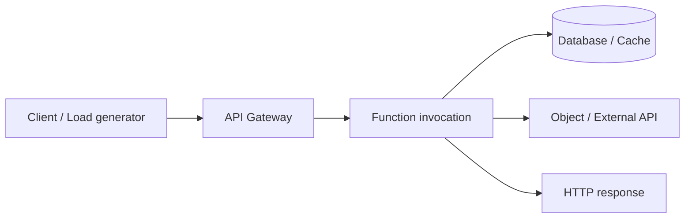
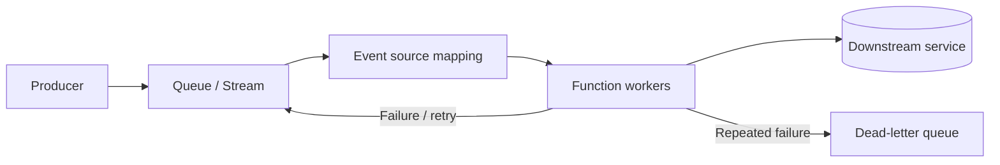

# Kiểm thử tải và diễn tập lỗi cho ứng dụng serverless

Ứng dụng serverless có thể tự tăng số execution environment theo lượng request hoặc event, nhưng khả năng tự co giãn không đồng nghĩa hệ thống luôn chịu được mọi đợt tải. Function có thể bị giới hạn concurrency, API gateway có thể throttling, queue có thể tích backlog, database có thể hết connection và retry có thể khuếch đại một lỗi nhỏ thành sự cố lớn. Một function chạy tốt ở tải thấp chưa chứng minh toàn bộ luồng serverless đáp ứng được traffic burst hoặc dependency failure.

Trong module **CLOUD_CORE_SERVICES_COMPUTE**, kiểm thử tải và diễn tập lỗi giúp xác định giới hạn thực tế của function, trigger, queue, storage, network và dịch vụ phía sau. Bài học này trình bày cách thiết kế load test, đo cold start và concurrency, kiểm tra throttling/backpressure, diễn tập lỗi dependency và event delivery, xác định ngưỡng dừng, cũng như biến kết quả thành capacity limit, retry policy, alert và runbook vận hành.

## Mục tiêu học tập

Sau bài này, bạn có thể:

- Phân biệt load test, stress test, spike test, soak test và breakpoint test.
- Xác định phạm vi cần kiểm thử trong một luồng serverless đồng bộ hoặc bất đồng bộ.
- Ước tính concurrency từ arrival rate và thời gian thực thi.
- Thiết kế kịch bản warm/cold start, burst traffic, queue backlog và downstream saturation.
- Đo latency p50/p95/p99, error rate, throttling, concurrency, init duration và cost.
- Kiểm tra retry, timeout, idempotency, partial batch failure và dead-letter queue.
- Diễn tập lỗi dependency, network, secret, queue và giới hạn quota theo cách có kiểm soát.
- Định nghĩa SLO, ngưỡng Go/No-Go, abort condition và tiêu chí phục hồi.
- Tạo dashboard, alert và runbook từ bằng chứng kiểm thử.

## 1. Vì sao ứng dụng serverless vẫn cần kiểm thử tải?

Serverless chuyển phần lớn việc cấp phát máy chủ và mở rộng runtime cho nền tảng cloud. Đội phát triển vẫn chịu trách nhiệm về logic function, cấu hình concurrency, timeout, memory/CPU, trigger, dữ liệu và dependency. Khi tải tăng, nhiều tầng cùng thay đổi:

- API gateway hoặc event source nhận thêm request/event.
- Nền tảng tăng số invocation hoặc execution environment.
- Function khởi tạo runtime, tải code/configuration và chạy handler.
- Function mở kết nối tới database, cache, object storage hoặc API khác.
- Queue/stream phân phối event và consumer xử lý theo concurrency/batch policy.
- Logging, tracing, metrics và billing tăng theo số invocation và thời gian chạy.

Một function có thể scale nhanh hơn database phía sau. Khi đó function không phải bottleneck nhưng lại tạo quá nhiều connection, làm database bão hòa. Tương tự, queue có thể hấp thụ burst nhưng backlog và tuổi message tăng vượt deadline nghiệp vụ.

Kiểm thử cần trả lời bốn câu hỏi:

1. **Capacity:** hệ thống xử lý được bao nhiêu request/event trong khi vẫn đạt SLO?
2. **Elasticity:** từ lúc tải tăng đến lúc capacity mới sẵn sàng mất bao lâu?
3. **Resilience:** khi dependency chậm hoặc lỗi, hệ thống suy giảm có kiểm soát hay tạo retry storm?
4. **Cost:** chi phí tăng theo traffic như dự đoán hay bị khuếch đại bởi retry, logging, provisioned capacity hoặc downstream work?

## 2. Xác định phạm vi và luồng xử lý cần test

Không nên chỉ benchmark handler trong một process rồi kết luận function production đủ capacity. Cần xác định đường đi thực tế của request/event.

### 2.1. Luồng đồng bộ

Ví dụ HTTP API gọi function:



Latency end-to-end bao gồm thời gian gateway, invocation scheduling, cold start nếu có, handler, network tới dependency và serialize response. Nếu chỉ đo thời gian handler, kết quả sẽ thấp hơn trải nghiệm thực tế của client.

### 2.2. Luồng bất đồng bộ

Ví dụ event được đưa vào queue rồi function tiêu thụ:



Ở luồng này, response của producer thường chỉ xác nhận event đã được nhận hoặc lưu vào queue. Thời gian hoàn tất nghiệp vụ phải đo từ lúc publish đến lúc xử lý thành công, cùng queue age, consumer lag, retry và DLQ count.

### 2.3. Lập bản đồ dependency

Trước test, liệt kê:

- Function, version, alias, runtime và cấu hình memory/CPU/timeout.
- Trigger: HTTP, queue, event bus, object storage, stream, schedule hoặc database event.
- Concurrency limit, reserved/provisioned concurrency hoặc giới hạn tương đương.
- API gateway, load balancer, authorizer và network path.
- Database, cache, queue, stream, storage và external API.
- Secret manager, KMS, VPC connector, NAT và DNS.
- Logging, metrics, tracing và billing dimension.

Ghi rõ dependency nào nằm trong phạm vi test, dependency nào dùng sandbox/mock, và dependency nào có quota/chi phí thật. Một sơ đồ đơn giản giúp xác định nơi có thể bão hòa và nơi cần fault injection.

## 3. Các loại kiểm thử tải

Mỗi loại test trả lời một câu hỏi khác nhau. Một chiến dịch thường kết hợp nhiều loại thay vì chỉ chạy một bài load test dài.

| Loại test | Mục đích | Ví dụ kịch bản |
|---|---|---|
| Baseline test | Đo hiệu năng ở tải bình thường | 50 request/giây trong 10 phút |
| Load test | Xác minh tải dự kiến production | Ramp lên 500 request/giây và giữ 30 phút |
| Stress test | Tìm giới hạn và hành vi khi quá tải | Tăng dần đến khi throttling/error vượt ngưỡng |
| Spike test | Kiểm tra phản ứng với burst đột ngột | Từ 20 lên 800 request/giây trong vài giây |
| Soak test | Phát hiện leak, tích lũy backlog hoặc suy giảm theo thời gian | Giữ tải ổn định 4 giờ |
| Breakpoint test | Xác định điểm SLO bắt đầu thất bại | Tăng từng nấc và đo p99/error rate |
| Recovery test | Kiểm tra hệ thống phục hồi sau quá tải | Hạ tải rồi quan sát queue drain và concurrency |
| Cold-start test | Đo startup khi environment mới được tạo | Tạo đợt invocation sau thời gian idle hoặc dùng version/environment mới |

### 3.1. Baseline test

Baseline là mốc so sánh trước và sau thay đổi. Ghi lại throughput, latency, error rate, concurrency, duration, init duration, memory, dependency metrics và chi phí. Nếu không có baseline, khó xác định một thay đổi đã cải thiện hay làm xấu hệ thống.

### 3.2. Load test

Load test mô phỏng traffic dự kiến trong điều kiện thực tế. Bao gồm request mix, payload size, authentication, cache hit/miss, tenant distribution và thời lượng đủ để runtime/queue ổn định.

### 3.3. Stress và breakpoint test

Stress test tăng tải vượt mức dự kiến để xác định giới hạn, nhưng phải có ngưỡng dừng rõ. Không tiếp tục tăng chỉ để tìm mức sập nếu dependency dùng chung hoặc môi trường có dữ liệu thật.

Breakpoint là điểm mà SLO không còn đạt, ví dụ p99 vượt deadline, error rate tăng, queue age vượt SLA hoặc function bị throttling liên tục. Ghi nhận cả giới hạn của function lẫn giới hạn downstream.

### 3.4. Spike và soak test

Spike test phát hiện khoảng trễ scale-out, cold start, burst quota và connection storm. Soak test phát hiện memory leak, connection leak, log growth, retry accumulation, queue retention và cost drift.

## 4. Thiết kế workload đại diện

Kết quả chỉ có ý nghĩa nếu tải test gần với production. Một endpoint nhẹ chỉ đọc cache không đại diện cho function tạo đơn hàng, gọi database và phát event.

### 4.1. Request mix

Phân loại request theo hành vi:

- Read-heavy và write-heavy.
- Payload nhỏ và payload lớn.
- Cache hit và cache miss.
- Request có một dependency và request gọi nhiều dependency.
- Thành công, validation error và retryable failure.
- Tenant nhỏ và tenant có dữ liệu lớn.
- Request đồng bộ và event bất đồng bộ.

Gán tỷ lệ cho từng nhóm dựa trên telemetry hoặc dự báo. Tránh dùng duy nhất một request path dễ nhất để đại diện cho toàn bộ ứng dụng.

### 4.2. Dữ liệu test và side effect

Dùng dữ liệu tổng hợp, đã ẩn danh hoặc sandbox khi có thể. Với thao tác ghi:

- Dùng tenant/test account riêng.
- Tạo namespace hoặc prefix cho object test.
- Dùng idempotency key để tránh tạo bản ghi trùng.
- Không phát email, SMS, thanh toán hoặc webhook thật nếu chưa được cô lập.
- Đặt TTL hoặc quy trình dọn dữ liệu sau test.
- Ghi nhận mọi dữ liệu được tạo để có thể đối soát.

Load generator phải tránh làm bẩn production data hoặc tạo chi phí bên thứ ba ngoài dự kiến.

### 4.3. Tốc độ tăng tải

Chọn ramp-up phản ánh cách traffic thật đến. Ramp tuyến tính phù hợp để tìm ngưỡng capacity; spike phù hợp với flash sale/webhook burst; arrival-rate model phù hợp khi cần giữ tốc độ request cố định bất kể response time.

Nếu dùng closed-loop load generator (chỉ gửi request mới khi request cũ hoàn tất), khi hệ thống chậm thì tốc độ gửi cũng tự giảm. Điều này có thể che giấu overload. Với API cần kiểm tra arrival rate, cân nhắc open-model/rate-based load generation và theo dõi dropped iterations.

### 4.4. Đảm bảo load generator không phải bottleneck

Phân tán generator khi cần, kiểm tra CPU/network của máy phát tải, số socket, DNS và giới hạn connection. Đối chiếu số request generator dự kiến gửi với số request gateway/function thực sự nhận. Nếu generator không đạt target rate, test chưa chứng minh được capacity của hệ thống.

## 5. Ước tính concurrency và capacity

Concurrency là số invocation đang chạy đồng thời. Với function đồng bộ, ước lượng ban đầu theo định luật Little:

\[
Concurrency \approx Arrival\ rate \times Average\ execution\ duration
\]

Nếu arrival rate tính bằng request/giây và duration bằng giây, kết quả là số invocation đồng thời.

### 5.1. Ví dụ tính concurrency

Một function nhận 400 request/giây và thời gian thực thi trung bình là 250 ms (0,25 giây):

```text
Concurrency trung bình ≈ 400 × 0,25
                       = 100 invocation
```

Nếu muốn giữ mức sử dụng concurrency mục tiêu 70% để có headroom:

```text
Concurrency planning ≈ 100 / 0,70
                     ≈ 143
```

Con số này là ước lượng cho tải ổn định. Burst, duration tail, retry, batch size và phân phối request có thể làm peak concurrency cao hơn.

### 5.2. Duration tăng làm concurrency tăng

Nếu dependency chậm khiến duration tăng từ 250 ms lên 1 giây, cùng arrival rate 400 request/giây có thể cần khoảng 400 invocation đồng thời. Khi đó một sự cố database không chỉ làm request chậm mà còn làm concurrency tăng gấp bốn, khiến function chạm limit và gateway throttling.

Đây là lý do phải test dependency latency/failure cùng concurrency, không chỉ tăng request rate khi dependency khỏe.

### 5.3. Function concurrency khác với instance count

Một execution environment có thể xử lý một hoặc nhiều invocation đồng thời tùy runtime/model nền tảng. Một số runtime xử lý invocation tuần tự trong environment; một số mô hình hỗ trợ concurrency nội bộ. Đừng đồng nhất concurrency tổng với số VM hoặc số container.

Kiểm tra semantics của nhà cung cấp và runtime: concurrency limit ở account/region, function-level reserved concurrency, provisioned capacity, maximum instances và giới hạn trigger có thể áp dụng đồng thời.

### 5.4. Async queue và event source mapping

Với queue/stream, concurrency phụ thuộc số message/partition, batch size, polling, maximum concurrency và tốc độ downstream. Tăng số function invocation không đảm bảo throughput tăng tuyến tính nếu:

- Số partition ít hơn số consumer mong muốn.
- Một batch có message xử lý lâu hoặc poison message.
- Database connection pool đã bão hòa.
- Function bị giới hạn bởi account/function concurrency.
- Visibility timeout hoặc retry policy không phù hợp.

Tính throughput từ số batch/giây × số record/batch × tỷ lệ xử lý thành công, đồng thời theo dõi oldest message age và backlog.

## 6. Cold start và warm invocation trong load test

Cold start là thời gian bổ sung khi nền tảng cần chuẩn bị execution environment mới trước khi handler chạy. Warm invocation tái sử dụng environment đã sẵn sàng, nếu nền tảng còn giữ và chọn environment đó.

### 6.1. Những phần có thể nằm trong cold start

- Provision execution environment.
- Tải hoặc mount package/container image.
- Khởi tạo runtime và extension.
- Chạy module/global initialization.
- Thiết lập connection/client/cache.
- Khởi chạy handler cho invocation đầu tiên.

Các nền tảng không nhất thiết báo một metric cold start duy nhất. Cần phân biệt init duration, handler duration và end-to-end latency.

### 6.2. Warm environment không phải bảo đảm

Không giả định environment sẽ tồn tại mãi hoặc invocation tiếp theo luôn được gửi vào cùng environment. Scale-out, idle cleanup, deployment, runtime update hoặc platform maintenance có thể tạo environment mới.

Load test cần có cả:

- Warm steady-state để đo hiệu năng khi environment đã khởi tạo.
- Cold-start-biased scenario để quan sát startup khi tạo environment mới.
- Burst scenario để buộc hệ thống scale-out và tạo thêm environment.
- Deployment/version switch để đánh giá init lại sau release.

Không dựa vào một lần gọi function sau vài phút idle để kết luận cold-start distribution của production. Lặp lại nhiều lần và dùng telemetry nền tảng/runtime khi có.

### 6.3. Những cách làm cold start nặng hơn

- Package hoặc container image lớn.
- Import nhiều thư viện không dùng.
- Global initialization gọi nhiều API hoặc đọc secret tuần tự.
- Runtime/compiler khởi động chậm.
- VPC/network attachment hoặc DNS/TLS setup.
- Kết nối database tạo mới cho từng environment.
- Model/ML artifact lớn phải tải khi khởi động.

Đo riêng thời gian từng phần để tối ưu đúng bottleneck. Không chuyển mọi thao tác vào global initialization nếu nó làm cold start nặng hơn hoặc tạo side effect khi environment được tái sử dụng.

## 7. Đo hiệu năng và xác định SLO

SLO phải mô tả kết quả người dùng hoặc nghiệp vụ cần nhận. Metric platform chỉ là bằng chứng hỗ trợ.

### 7.1. Các chỉ số quan trọng

| Nhóm | Metric | Ý nghĩa |
|---|---|---|
| Latency | p50, p95, p99 end-to-end | Trải nghiệm điển hình và tail latency |
| Reliability | Success rate, 4xx/5xx, timeout | Request có hoàn tất đúng không |
| Capacity | Invocations, requests/s, concurrency | Mức tải function đang xử lý |
| Platform | Throttles, max concurrency, init duration | Giới hạn và chi phí startup |
| Runtime | Duration, memory used, CPU utilization nếu có | Hiệu năng handler và sizing |
| Async | Queue depth, oldest age, consumer lag, DLQ | Khả năng tiêu thụ event |
| Dependency | DB connections, query latency, cache hit, API errors | Bottleneck phía sau function |
| Cost | Invocations, billed duration, memory allocation, provisioned capacity | Chi phí theo tải và retry |

### 7.2. Latency percentile

- p50 cho biết một nửa request nhanh hơn giá trị đó.
- p95 phản ánh tail latency của nhóm chậm hơn.
- p99 giúp thấy các request rất chậm, thường quan trọng với API có deadline ngắn.

Không chỉ báo cáo average latency. Một số cold start hoặc dependency timeout có thể bị che khuất trong trung bình nhưng vẫn ảnh hưởng nhiều người dùng.

### 7.3. Tách latency theo span

Với distributed tracing, tách:

- Gateway/authorizer.
- Invocation scheduling và initialization.
- Handler logic.
- Database/cache calls.
- External API calls.
- Queue publish/consume và retry.
- Serialization/response transfer.

Gắn correlation ID và trace context xuyên qua event nếu nền tảng hỗ trợ. Với async, giữ event ID/correlation ID để nối producer với consumer và retry attempt.

### 7.4. Định nghĩa ngưỡng đạt

Ví dụ một API nội bộ có thể đặt mục tiêu:

- p95 end-to-end dưới 300 ms ở tải dự kiến.
- p99 dưới 800 ms trong steady-state.
- Success rate ít nhất 99,9% trong cửa sổ đo.
- Không có throttling kéo dài ở mức tải bình thường.
- Concurrency có headroom so với giới hạn đã cấu hình.
- Cost per 1.000 request không vượt ngân sách.

Đây chỉ là ví dụ. Ngưỡng thật phải đến từ yêu cầu sản phẩm, deadline nghiệp vụ, error budget và hợp đồng dịch vụ.

## 8. Kiểm thử concurrency, throttling và quota

Serverless thường có nhiều lớp giới hạn. Khi vượt giới hạn, nền tảng có thể từ chối invocation, queue event, giảm tốc độ polling hoặc trả lỗi throttling tùy trigger/service.

### 8.1. Phân biệt các giới hạn

- Account/region concurrency quota.
- Reserved concurrency ở cấp function hoặc workload.
- Provisioned concurrency/minimum warm capacity.
- Maximum instance/task/replica count.
- API gateway requests-per-second/burst quota.
- Queue polling/consumer concurrency.
- Database connection và API downstream quota.

Một giới hạn không thay thế giới hạn khác. Tăng function concurrency có thể làm database connection tăng vượt giới hạn trước khi function đạt throughput mục tiêu.

### 8.2. Test gần ngưỡng và vượt ngưỡng có kiểm soát

Chạy theo nấc, ví dụ 25%, 50%, 75%, 90% và 100% concurrency mục tiêu. Chỉ thử vượt ngưỡng trong môi trường được phê duyệt, có cost cap và abort condition.

Quan sát:

- Throttling bắt đầu ở ngưỡng nào?
- Request bị từ chối, retry hay queue lại?
- Thời gian phục hồi sau khi giảm tải?
- Có retry storm hoặc duplicate side effect không?
- Dependency có bị quá tải trước function không?
- Cost tăng ra sao khi retry và duration tăng?

### 8.3. Giới hạn concurrency để bảo vệ downstream

Giới hạn concurrency ở function hoạt động như một bulkhead/admission guard: nó giới hạn số invocation đồng thời để bảo vệ dependency phía sau. Tuy nhiên, phần request vượt mức có thể bị throttling hoặc chờ theo semantics của trigger. Với async source, event có thể được retry/giữ lại; với sync HTTP, client có thể nhận lỗi và retry. Đây không thay thế circuit breaker ở tầng gọi dependency.

Chọn limit từ capacity downstream, không chỉ từ khả năng scale của function. Cần test hành vi ở cả hai phía giới hạn và xác định thông điệp/error response phù hợp.

## 9. Kiểm thử timeout, retry và idempotency

Timeout và retry là một phần của semantics serverless. Khi dependency chậm, function có thể hết thời gian chạy, trigger có thể gửi lại event và cùng một nghiệp vụ có thể được thực hiện nhiều lần.

### 9.1. Timeout budget

Timeout của function phải nhỏ hơn hoặc tương thích với timeout của trigger/client và dependency. Thiết kế budget theo tổng thời gian:

\[
T_{total}=T_{init}+T_{handler}+T_{dependency}+T_{retry}+T_{response}
\]

Không đặt timeout lớn để che giấu dependency bị treo. Timeout dài làm invocation giữ concurrency lâu hơn, tăng concurrency demand và chi phí.

### 9.2. Retry amplification

Nếu mỗi request thất bại được retry ở nhiều tầng, số attempt có thể tăng theo tích số lần thử của từng tầng. Ví dụ client có tối đa 3 attempt, gateway có tối đa 2 attempt cho mỗi request và worker có tối đa 3 attempt cho mỗi event có thể tạo ra nhiều lần xử lý cho cùng một nghiệp vụ.

Quy tắc:

- Chỉ retry lỗi tạm thời có khả năng phục hồi.
- Dùng exponential backoff và jitter.
- Đặt retry budget/maximum attempts.
- Tránh retry đồng thời ở mọi tầng mà không có coordination.
- Tách lỗi validation/permanent khỏi lỗi transient.
- Đưa message lỗi lặp vào DLQ hoặc quarantine theo policy.

### 9.3. Idempotency

Function có thể nhận cùng event nhiều lần do at-least-once delivery, timeout hoặc retry. Idempotency key giúp đảm bảo một nghiệp vụ chỉ được áp dụng một lần về mặt kết quả.

Ví dụ:

```text
event_id = evt-123
idempotency_key = tenant-42:order-9001

1. Kiểm tra key đã được xử lý chưa.
2. Nếu đã xử lý, trả kết quả đã lưu.
3. Nếu chưa, ghi trạng thái processing với điều kiện atomic/unique.
4. Thực hiện side effect trong transaction/outbox phù hợp.
5. Lưu kết quả completed và key.
6. Retry cùng key sẽ không tạo thêm side effect.
```

Store idempotency phải có TTL/retention phù hợp với thời gian retry/replay và bảo đảm atomicity giữa việc claim key và ghi kết quả. Chỉ lưu key trong RAM của execution environment không đủ vì environment có thể bị thay thế.

### 9.4. Partial batch failure

Với queue/stream trigger, một invocation có thể xử lý nhiều record. Nếu một record lỗi, behavior retry có thể làm cả batch được gửi lại, tùy event source và cấu hình partial batch response.

Kiểm thử:

- Một record poison trong batch.
- Một record timeout trong khi các record khác thành công.
- Retry cùng batch và duplicate processing.
- Batch size lớn làm duration vượt timeout.
- DLQ/redrive sau nhiều lần thất bại.
- Ordering và checkpoint/offset khi xử lý stream.

## 10. Diễn tập lỗi dependency

Fault drill xác minh hệ thống phản ứng thế nào khi một thành phần cần thiết chậm, lỗi hoặc không truy cập được. Nên bắt đầu ở staging hoặc môi trường thử nghiệm cô lập, sau đó mới cân nhắc production game day có phê duyệt và phạm vi giới hạn.

### 10.1. Các lỗi nên mô phỏng

| Fault | Cách mô phỏng an toàn | Điều cần quan sát |
|---|---|---|
| Dependency timeout | Mock endpoint trì hoãn response | Function duration, concurrency, timeout và retry |
| HTTP 5xx | Stub trả lỗi có tỷ lệ định trước | Retry budget, error classification, DLQ |
| Connection refused | Chặn route tới sandbox endpoint | Connection timeout, fallback và alert |
| Slow database | Query có delay hoặc DB test instance bị giới hạn | Pool wait, query latency, connection exhaustion |
| Cache unavailable | Tắt cache sandbox hoặc trả lỗi | Cache fallback và tải chuyển sang database |
| Queue backlog | Tăng producer rate trong môi trường test | Oldest message age, consumer scaling và drain time |
| Poison message | Gửi record không hợp lệ có chủ đích | Retry count, partial batch và DLQ |
| Secret unavailable | Dùng secret test không tồn tại hoặc quyền bị thu hồi | Startup/runtime error, alert và recovery |
| DNS/network delay | Proxy hoặc fault injector trong test VPC | DNS timeout, connection retry và end-to-end latency |
| Concurrency throttling | Đặt limit test thấp có kiểm soát | 429/throttle, queue behavior và client retry |

Không giả định có thể hoặc nên tắt một managed cloud service production để tạo lỗi. Khi không kiểm soát được failure domain của provider, mô phỏng lỗi ở ranh giới ứng dụng bằng mock, proxy, test endpoint hoặc fault injection được hỗ trợ.

### 10.2. Dependency chậm nguy hiểm hơn dependency fail-fast

Khi dependency trả lỗi ngay, function có thể giải phóng concurrency nhanh. Khi dependency treo hoặc phản hồi rất chậm, invocation giữ slot lâu, connection bị chiếm và concurrency tăng. Vì vậy, fault drill cần cả latency injection và hard failure.

Đặt timeout cho connect/read, connection pool, circuit breaker và bulkhead. Kiểm tra khi dependency phục hồi để tránh mọi invocation đồng loạt retry.

### 10.3. Circuit breaker và fallback

Circuit breaker tạm ngừng gọi dependency khi lỗi vượt ngưỡng, sau đó cho phép một số request thử lại trong half-open state. Fallback có thể dùng cache/stale data, response degraded hoặc queue công việc để xử lý sau.

Không fallback một cách âm thầm cho giao dịch yêu cầu tính đúng đắn tuyệt đối. Ghi rõ trạng thái degraded và theo dõi số request dùng fallback.

## 11. Diễn tập lỗi cho queue và event-driven function

Queue giúp tách producer và consumer, nhưng cần kiểm tra khả năng phục hồi của cả luồng.

### 11.1. Backlog và drain time

Nếu arrival rate là `λ` message/giây và consumer hoàn tất `μ` message/giây, backlog tăng khi `λ > μ`. Khi producer giảm hoặc consumer capacity tăng, thời gian drain gần đúng:

\[
T_{drain}\approx\frac{Backlog}{Consumer\ rate-Arrival\ rate}
\]

Điều kiện là consumer rate lớn hơn arrival rate và giữ ổn định. Nếu hai tốc độ gần bằng nhau, queue có thể mất rất lâu để drain.

Ví dụ queue có 60.000 message, consumer xử lý 500 message/giây, producer vẫn gửi 100 message/giây:

```text
Net drain rate = 500 - 100 = 400 message/s
Drain time     = 60.000 / 400 = 150 giây
```

Thực tế cần cộng thời gian retry, batch, rate limit, partition imbalance và downstream latency.

### 11.2. Visibility timeout và duplicate delivery

Với queue có visibility timeout, message chưa được acknowledge trước khi timeout có thể xuất hiện lại. Visibility timeout quá ngắn tạo duplicate khi function xử lý hợp lệ nhưng chưa xong; quá dài làm message lỗi bị giữ lâu trước retry.

Kiểm tra quan hệ giữa:

- Function timeout.
- Batch processing duration.
- Visibility timeout.
- Retry delay/redrive policy.
- Maximum receive count.
- DLQ retention và source queue retention.

Các quy tắc cụ thể phụ thuộc loại queue/stream và provider. Đọc semantics của trigger đang dùng và test với message xử lý gần timeout.

### 11.3. DLQ và replay

DLQ giữ message không xử lý thành công theo policy. Kiểm thử:

- Message được chuyển vào DLQ đúng số lần thất bại.
- Alert khi DLQ có message mới hoặc tăng bất thường.
- Quy trình phân loại poison message.
- Replay có rate limit và idempotency.
- Replay không làm quá tải database hoặc gửi side effect trùng.
- Có thể khôi phục ordering/tenant boundary nếu nghiệp vụ yêu cầu.

DLQ không phải nơi lưu lỗi vô thời hạn mà không có owner. Đặt retention, dashboard, escalation và quy trình xử lý.

## 12. Diễn tập cold start, deployment và cấu hình

Cold start có thể tăng sau deployment, đổi runtime, đổi package hoặc tăng concurrency đột ngột. Một bài test cần mô phỏng cả warm steady-state lẫn các lần khởi tạo mới.

### 12.1. Các tình huống

- Tăng traffic sau thời gian idle.
- Tạo nhiều execution environment cùng lúc.
- Deploy version mới và chuyển alias/traffic.
- Thay đổi memory/CPU/runtime/package size.
- Secret rotation hoặc config cache refresh.
- Network/VPC endpoint vừa được thay đổi.
- Provisioned capacity tăng/giảm hoặc hết mức cấu hình.

### 12.2. Quan sát initialization

Ghi init duration, runtime initialization error, extension startup, secret fetch, DNS/TLS, database connection và handler start. So sánh p50/p95/p99 của cold invocation với warm invocation.

Nếu platform không cung cấp metric init duration chi tiết, instrument phần global initialization và handler bằng structured log/span có timestamp. Không ghi secret hoặc dữ liệu nhạy cảm vào log.

### 12.3. Deployment safety

Với version/alias traffic shifting:

- Chuyển một tỷ lệ nhỏ trước.
- Gắn version/alias vào metric và trace.
- Theo dõi error rate, latency, init duration và cost riêng từng version.
- Tăng traffic theo checkpoint.
- Tự động hoặc thủ công rollback khi ngưỡng vi phạm.
- Xác minh event source mapping và permission sau deployment.

Không chỉ kiểm tra HTTP endpoint; function được gọi qua queue, schedule hoặc storage trigger cũng cần xác minh.

## 13. Thiết kế fault drill an toàn

Fault drill phải có phạm vi, người chịu trách nhiệm và điều kiện dừng. Mục tiêu là kiểm chứng giả thuyết phục hồi, không phải gây gián đoạn không kiểm soát.

### 13.1. Trước khi diễn tập

- Xác định hypothesis: ví dụ “khi database chậm 2 giây, function vẫn kết thúc trong timeout budget và không tạo retry storm”.
- Chọn environment, tenant, function alias và dependency sandbox.
- Xác định request/event volume, concurrency cap và thời lượng.
- Chuẩn bị dashboard, alert, trace và log.
- Xác nhận rollback/kill switch hoạt động.
- Thông báo owner và người quan sát.
- Đặt cost cap, quota guardrail và abort threshold.
- Kiểm tra không có side effect production ngoài phạm vi.

### 13.2. Trong khi diễn tập

1. Ghi baseline trước khi inject fault.
2. Bắt đầu với một phần nhỏ traffic hoặc một tenant test.
3. Inject một fault tại một thời điểm để giữ khả năng quy nguyên nhân.
4. Quan sát function, trigger, dependency và business outcome.
5. Tăng phạm vi theo từng checkpoint nếu an toàn.
6. Dừng ngay khi chạm abort condition.
7. Gỡ fault và xác nhận hệ thống phục hồi.
8. Đối soát event, giao dịch và side effect sau test.

### 13.3. Abort condition

Ví dụ:

- Error rate vượt ngưỡng đã phê duyệt.
- p99 vượt deadline trong nhiều cửa sổ liên tiếp.
- Database connection/CPU đạt mức bảo vệ.
- Queue age hoặc DLQ vượt giới hạn.
- Throttling tăng đến mức ảnh hưởng tenant khác.
- Cost vượt budget test.
- Phát hiện side effect đi tới hệ thống production không nằm trong phạm vi.
- Không thể gỡ fault hoặc không còn quan sát được trạng thái hệ thống.

Ngưỡng cụ thể phải được owner xác định trước. Không tiếp tục thử chỉ để thu thập thêm số liệu khi đã vượt ngưỡng an toàn.

### 13.4. Sau diễn tập

- Gỡ cấu hình fault injection và test credentials.
- Xác nhận queue backlog đã drain hoặc được xử lý theo kế hoạch.
- Kiểm tra DLQ, retry và duplicate.
- Đối chiếu dữ liệu nghiệp vụ và dọn dữ liệu test.
- Xác nhận alert trở về trạng thái bình thường.
- Ghi timeline, metric, ảnh hưởng và quyết định.
- Tạo action item có owner/deadline cho mọi điểm yếu.

## 14. Kiểm thử bảo vệ downstream và backpressure

Serverless có thể scale-out nhanh hơn nhiều hệ thống truyền thống. Cần chứng minh function không làm downstream vượt capacity.

### 14.1. Connection budget

Nếu mỗi execution environment tạo một connection pool tối đa `P` và có `E` environment, số connection tiềm năng:

\[
Connections_{max}\approx E\times P
\]

Ví dụ 150 environment, mỗi environment mở tối đa 8 connection có thể tạo 1.200 connection. Nếu database chỉ hỗ trợ 500 connection cho workload này, cần giảm pool, dùng proxy/pooling phù hợp hoặc giới hạn function concurrency.

### 14.2. Backpressure

Backpressure ngăn producer hoặc function đẩy công việc nhanh hơn downstream có thể xử lý. Biện pháp:

- Giới hạn concurrency hoặc maximum pollers.
- Giới hạn batch size và tốc độ publish.
- Dùng queue làm buffer với retention và max age rõ ràng.
- Rate limit theo tenant/API.
- Circuit breaker khi dependency lỗi.
- Giảm tải không critical và ưu tiên transaction quan trọng.

Kiểm thử khi downstream capacity giảm 50%, không chỉ khi nó hoàn toàn offline. Hệ thống cần suy giảm từ từ thay vì chuyển từ healthy sang outage.

### 14.3. Bulkhead và tenant isolation

Bulkhead tách concurrency/resource pool giữa các nhóm workload hoặc tenant. Nếu một tenant tạo burst, nó không nên chiếm hết concurrency và quota của các tenant khác.

Kiểm tra fairness, reserved capacity, per-tenant rate limit và cách tính quota. Ghi metric theo tenant ở mức cardinality có kiểm soát, tránh tạo hàng triệu label riêng lẻ.

## 15. Kiểm thử chi phí dưới tải

Serverless billing thường phụ thuộc số invocation, thời gian thực thi, memory/CPU được cấp và các dịch vụ đi kèm. Retry, cold start, log volume và provisioned capacity đều có thể làm chi phí tăng.

### 15.1. Cost per operation

Đo:

- Cost per 1.000 successful invocation.
- Cost per completed business transaction.
- Billed duration so với handler duration.
- Tỷ lệ invocation thất bại/retry.
- Log/trace volume và retention.
- Queue, API gateway, storage và data transfer cost.
- Provisioned/minimum capacity idle cost.

Đếm theo successful business operation quan trọng hơn cost per invocation nếu một giao dịch có thể tạo nhiều invocation do retry hoặc fan-out.

### 15.2. Cost amplification

Một dependency chậm có thể làm duration tăng; duration tăng làm concurrency và billed duration tăng; retry làm số invocation tăng; logging chi tiết làm ingestion cost tăng. Vì vậy, fault test cần quan sát cả cost trong trạng thái lỗi.

### 15.3. Cost guardrail cho test

- Dùng account/project/subscription test riêng khi có thể.
- Đặt budget alert và quota cap.
- Giới hạn thời lượng và số request.
- Tắt load generator tự động khi đạt target hoặc abort threshold.
- Dùng mock cho API tính phí hoặc side effect thật.
- Dọn resource, queue, object và log test theo retention.

## 16. Công cụ và ví dụ load test

Có thể dùng k6, Locust, JMeter, Gatling hoặc công cụ nội bộ. Chọn công cụ có thể tạo arrival rate cần thiết, hỗ trợ authentication, payload và phân phối request thực tế.

### 16.1. Ví dụ k6 cho HTTP function endpoint

```javascript
import http from 'k6/http';
import { check } from 'k6';

export const options = {
  scenarios: {
    serverless_load: {
      executor: 'ramping-arrival-rate',
      startRate: 20,
      timeUnit: '1s',
      preAllocatedVUs: 50,
      maxVUs: 500,
      stages: [
        { target: 50, duration: '2m' },
        { target: 150, duration: '3m' },
        { target: 300, duration: '5m' },
        { target: 300, duration: '5m' },
        { target: 20, duration: '2m' },
      ],
    },
  },
  thresholds: {
    http_req_failed: ['rate<0.01'],
    http_req_duration: ['p(95)<500', 'p(99)<1000'],
  },
};

export default function () {
  const response = http.post(
    __ENV.FUNCTION_URL,
    JSON.stringify({ testRun: __ENV.TEST_RUN_ID, operation: 'validate' }),
    { headers: { 'Content-Type': 'application/json' } },
  );

  check(response, {
    'status is successful': (r) => r.status >= 200 && r.status < 300,
  });
}
```

Đây là khung minh họa. Cần cung cấp URL test, authentication, test run ID và dữ liệu phù hợp; không hardcode secret vào script hoặc repository. `ramping-arrival-rate` cố gắng giữ arrival rate, nhưng cần theo dõi dropped iterations và tài nguyên load generator. Threshold phải khớp SLO thật.

### 16.2. Ví dụ event queue test

Với queue, tạo producer riêng để publish event có `testRunId`, `eventId` và timestamp. Sau đó đo:

```text
publish_time = thời điểm producer gửi event
complete_time = thời điểm consumer ghi nhận xử lý thành công
end_to_end_age = complete_time - publish_time
```

Tổng hợp p50/p95/p99 age, số message còn lại, số retry, DLQ count và tỷ lệ duplicate. Chạy producer ở các tốc độ tăng dần và giữ một giai đoạn steady-state để xác minh consumer rate lớn hơn arrival rate.

### 16.3. Ví dụ fault injection ở dependency

Trong staging, cấu hình mock service trả latency 2 giây cho 20% request và HTTP 503 cho 5% request trong 3 phút. Kiểm tra:

- Function timeout và p99.
- Circuit breaker mở/đóng đúng ngưỡng.
- Retry có backoff/jitter và không vượt budget.
- Concurrency có chạm limit không.
- Queue/DLQ có tăng không.
- Database không bị connection storm.
- Sau khi gỡ fault, backlog drain và SLO phục hồi.

## 17. Ví dụ chiến dịch kiểm thử cho hệ thống đặt hàng

Một hệ thống nhận HTTP request tạo đơn hàng, function ghi database, phát event sang queue và function khác gửi thông báo. Mục tiêu là xử lý burst trong chương trình khuyến mãi mà không tạo đơn trùng hoặc làm database quá tải.

### 17.1. Kịch bản

| Kịch bản | Tải/fault | Mục tiêu |
|---|---|---|
| Baseline | 50 request/s trong 15 phút | Xác định latency và cost nền |
| Expected load | 300 request/s trong 30 phút | Xác minh SLO tải dự kiến |
| Spike | 50 lên 800 request/s trong 30 giây | Đo scale-out và throttling |
| Dependency slow | Database delay 1,5 giây cho 10% query | Kiểm tra timeout, pool và circuit breaker |
| Dependency unavailable | Database sandbox trả lỗi 503 | Kiểm tra fail-fast, retry và response |
| Queue backlog | Producer tăng gấp 3 consumer rate | Đo oldest message age và drain time |
| Duplicate delivery | Phát lại một phần event ID | Kiểm tra idempotency và duplicate side effect |
| Recovery | Gỡ fault và giảm tải về baseline | Đo thời gian phục hồi và backlog drain |

### 17.2. Tiêu chí đạt

- API đạt p95/p99 theo SLO ở expected load.
- Error rate không vượt error budget đã định.
- Concurrency không vượt giới hạn downstream.
- Spike không làm phát sinh duplicate order.
- Queue backlog nằm trong retention và deadline nghiệp vụ.
- Poison message đi vào DLQ theo policy và có alert.
- Sau fault, hệ thống phục hồi trong RTO đã thống nhất.
- Cost per successful order nằm trong ngân sách.

### 17.3. Hành động sau test

Nếu p99 tăng do cold start, tối ưu package/runtime hoặc duy trì warm capacity phù hợp. Nếu concurrency làm database quá tải, giảm pool/concurrency và tăng backpressure. Nếu queue drain quá chậm, điều chỉnh batch/consumer capacity sau khi xác nhận downstream chịu được. Nếu retry tạo duplicate, sửa idempotency trước khi tăng traffic.

## 18. Dashboard, alert và runbook

Dashboard nên chia theo function, trigger, dependency và business operation.

### 18.1. Dashboard function

- Invocations, success/error và throttles.
- Concurrent executions và configured concurrency limit.
- Duration p50/p95/p99 và timeout count.
- Init/cold-start duration.
- Memory used, configured memory và runtime errors.
- Version/alias distribution.

### 18.2. Dashboard event pipeline

- Producer rate và consumer completion rate.
- Queue depth, oldest message age và stream lag.
- Batch size, partial failure và retry count.
- DLQ count, redrive rate và poison message.
- Time-to-process từ publish đến completion.

### 18.3. Dashboard dependency và cost

- Database connections, pool wait, query latency và errors.
- Cache hit/miss, latency và eviction.
- External API latency, status code và quota.
- Network timeout, DNS error và NAT usage nếu liên quan.
- Cost per invocation và cost per business transaction.
- Log/trace ingestion và provisioned capacity usage.

### 18.4. Alert nên gắn với hành động

Ví dụ:

- Throttles tăng: kiểm tra concurrency quota, burst và downstream capacity.
- p99 tăng cùng duration: kiểm tra cold start hoặc dependency latency.
- Queue age tăng: kiểm tra consumer rate, concurrency, poison message và downstream.
- DLQ tăng: dừng replay tự động, phân loại lỗi và thông báo owner.
- OOM/timeout tăng: kiểm tra memory sizing, payload, batch size và handler.
- Cost tăng bất thường: kiểm tra retry loop, log volume, fan-out và provisioned capacity.

Alert cần có owner, severity, link dashboard và bước đầu tiên trong runbook. Tránh cảnh báo chỉ dựa trên một metric mà không gắn với tác động dịch vụ.

## 19. Những sai lầm thường gặp

| Sai lầm | Hậu quả | Cách khắc phục |
|---|---|---|
| Chỉ test handler local | Bỏ qua gateway, cold start, queue và network | Test end-to-end trên môi trường gần production |
| Chỉ nhìn average latency | Che giấu cold start và tail latency | Theo dõi p50/p95/p99 và phân nhóm warm/cold |
| Tăng tải nhưng generator không đủ năng lực | Kết quả capacity thấp giả tạo | Đo dropped iterations và scale load generator |
| Không giới hạn test cost | Phát sinh hóa đơn ngoài dự kiến | Budget, quota, time cap và kill switch |
| Không dùng dữ liệu đại diện | Bỏ sót payload lớn, cache miss và write path | Mô phỏng request mix và dữ liệu gần thực tế |
| Bỏ qua concurrency downstream | Database/cache bị quá tải khi function scale | Tính connection budget và đặt concurrency cap |
| Retry mọi lỗi | Retry storm và duplicate side effect | Phân loại lỗi, backoff, jitter và retry budget |
| Không kiểm tra idempotency | Event giao lại tạo giao dịch trùng | Idempotency key bền vững và atomic claim |
| Visibility timeout quá ngắn | Message được giao lại khi xử lý hợp lệ | Căn chỉnh timeout với batch duration |
| Không theo dõi DLQ | Message lỗi bị bỏ quên | Alert, owner, retention và replay policy |
| Fault injection quá rộng | Ảnh hưởng tenant hoặc dependency ngoài phạm vi | Canary scope, abort condition và sandbox |
| Chỉ test dependency hard failure | Bỏ sót nguy cơ dependency chậm giữ concurrency | Test latency injection và timeout |
| Không kiểm tra recovery | Queue/backlog tiếp tục tăng sau khi fault được gỡ | Đo drain time, retry recovery và SLO return |
| Không đo cost khi lỗi | Retry/duration/log làm cost tăng mạnh | Theo dõi cost per successful operation |

## 20. Checklist trước khi đưa serverless workload vào production

**Thiết kế test**

- [ ] Đã xác định luồng đồng bộ/bất đồng bộ và dependency.
- [ ] Request mix, payload, tenant và dữ liệu test đại diện.
- [ ] Load generator đạt arrival rate yêu cầu.
- [ ] Có baseline, load, spike, stress, soak và recovery scenario phù hợp.
- [ ] Có SLO, error budget, cost cap và abort condition.

**Capacity và scaling**

- [ ] Đã tính concurrency từ arrival rate và execution duration.
- [ ] Đã kiểm tra account/function/API/queue quota.
- [ ] Đã đặt concurrency cap theo capacity downstream.
- [ ] Đã đo cold-start và warm invocation.
- [ ] Đã kiểm tra queue backlog, batch size và consumer scaling.

**Resilience**

- [ ] Timeout budget phù hợp với client/trigger và dependency.
- [ ] Retry có phân loại lỗi, backoff, jitter và giới hạn.
- [ ] Side effect có idempotency và deduplication.
- [ ] Partial batch failure và DLQ đã được test.
- [ ] Dependency latency/failure và network error đã được diễn tập.
- [ ] Circuit breaker, fallback và backpressure hoạt động đúng.

**Observability và vận hành**

- [ ] Có p50/p95/p99, error rate, concurrency, throttles và init duration.
- [ ] Có queue age, consumer lag, retry và DLQ dashboard.
- [ ] Có dependency metrics và cost per successful operation.
- [ ] Alert có owner, severity và runbook.
- [ ] Có quy trình gỡ fault, đối soát dữ liệu và dọn test artifacts.
- [ ] Kết quả test, giới hạn capacity và action item được lưu lại.

## 21. Kết luận

Kiểm thử serverless phải bao phủ cả function và đường đi của request/event. Load, spike, stress và soak test cho biết capacity, cold-start distribution, tail latency và cost; fault drill cho biết hệ thống phản ứng thế nào khi dependency chậm, queue backlog tăng, quota bị chạm hoặc event được giao lại.

Hãy tính concurrency từ arrival rate và duration, giới hạn function theo capacity downstream, dùng timeout/retry/idempotency có chủ đích và quan sát queue age cùng DLQ. Mọi fault drill cần có phạm vi, người chịu trách nhiệm, cost cap và abort condition. Sau mỗi chiến dịch, chuyển kết quả thành SLO, scaling limit, alert và runbook để ứng dụng serverless có thể mở rộng và phục hồi một cách dự đoán được.

## Thuật ngữ cần nhớ

| Thuật ngữ | Ý nghĩa |
|---|---|
| Load test | Kiểm thử hệ thống ở mức tải dự kiến. |
| Stress test | Tăng tải vượt mức dự kiến để tìm giới hạn và hành vi quá tải. |
| Spike test | Kiểm thử phản ứng trước đợt tăng tải đột ngột. |
| Soak test | Giữ tải trong thời gian dài để phát hiện suy giảm tích lũy. |
| Breakpoint | Điểm mà hệ thống không còn đáp ứng SLO hoặc điều kiện vận hành. |
| Cold start | Quá trình khởi tạo execution environment trước invocation. |
| Warm invocation | Invocation chạy trên environment đã được khởi tạo và tái sử dụng. |
| Concurrency | Số invocation đang chạy đồng thời. |
| Throttling | Nền tảng giới hạn hoặc từ chối invocation khi chạm quota/concurrency cap. |
| Backpressure | Cơ chế giới hạn tốc độ producer/consumer để bảo vệ downstream. |
| Retry amplification | Tải tăng thêm do nhiều tầng retry cùng hoạt động. |
| Idempotency | Cùng một thao tác được gửi nhiều lần nhưng chỉ tạo một kết quả nghiệp vụ. |
| Partial batch failure | Chỉ một số record trong batch thất bại và cần được retry riêng nếu trigger hỗ trợ. |
| DLQ | Dead-letter queue; nơi giữ message không xử lý thành công theo policy. |
| Queue age | Thời gian message đã chờ trong queue hoặc từ lúc publish đến xử lý. |
| Fault injection | Chủ động tạo lỗi/độ trễ có kiểm soát để kiểm tra khả năng phục hồi. |
| Circuit breaker | Cơ chế tạm ngừng gọi dependency đang lỗi để tránh khuếch đại sự cố. |
| Bulkhead | Tách tài nguyên/concurrency để một workload không chiếm hết capacity của workload khác. |
| Abort condition | Điều kiện bắt buộc dừng bài test hoặc diễn tập để bảo vệ hệ thống. |
