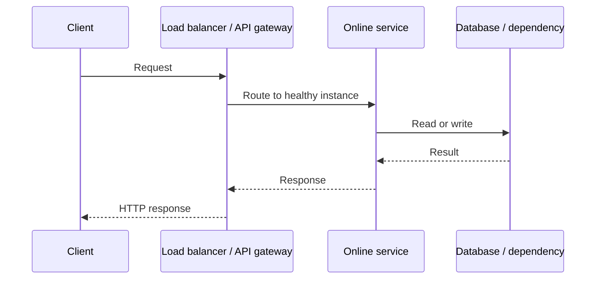
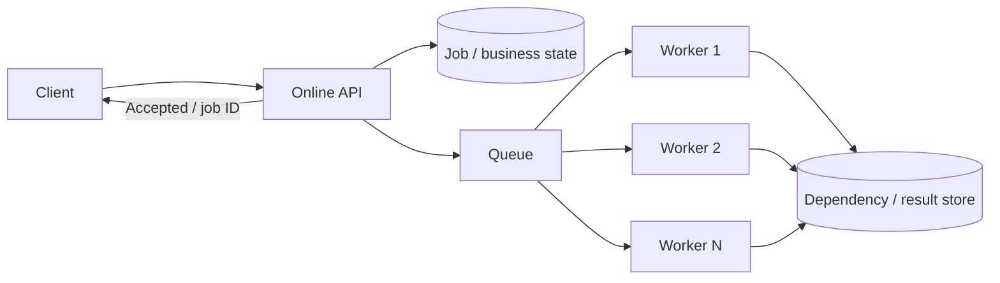
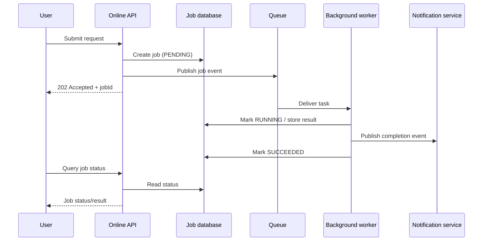
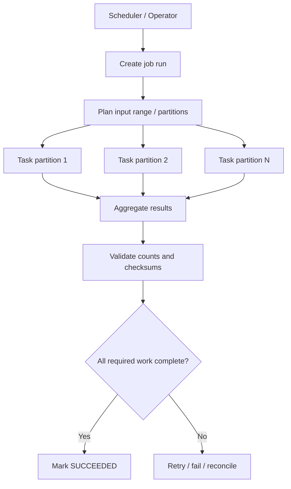

# Phân biệt background worker, batch job và dịch vụ phục vụ trực tiếp

Một hệ thống compute thường có nhiều loại workload cùng tồn tại. API cần phản hồi người dùng trong vài trăm mili giây; worker cần xử lý email, ảnh hoặc message sau khi request đã được tiếp nhận; batch job cần quét và xử lý một tập dữ liệu lớn theo lịch hoặc theo đợt. Dù cả ba có thể chạy trên VM, container hoặc nền tảng serverless, cách tổ chức vòng đời, mở rộng, xử lý lỗi và đo hiệu năng của chúng khác nhau.

Phân biệt đúng **dịch vụ phục vụ trực tiếp (online service)**, **background worker** và **batch job** giúp chọn đúng mô hình compute. Online service tối ưu thời gian phản hồi và khả năng phục vụ liên tục. Background worker tối ưu tốc độ tiêu thụ công việc đang chờ và khả năng phục hồi từng tác vụ. Batch job tối ưu việc hoàn thành một tập công việc hữu hạn, có điểm bắt đầu/kết thúc, tiến độ và kết quả có thể đối soát.

## 1. Ba loại workload trong một hệ thống

| Loại workload | Cách nhận việc | Vòng đời | Mục tiêu chính | Ví dụ |
|---|---|---|---|---|
| Dịch vụ phục vụ trực tiếp (online service) | Nhận request trực tiếp từ client hoặc upstream | Chạy liên tục, sẵn sàng nhận request | Latency, availability, throughput và SLO | HTTP API, web backend, authentication service |
| Background worker | Lấy message/task từ queue, stream hoặc scheduler | Chạy liên tục hoặc scale theo lượng việc chờ | Xử lý task đáng tin cậy, giảm backlog, retry an toàn | Gửi email, xử lý ảnh, đồng bộ đơn hàng, gửi webhook |
| Batch job | Nhận một tập dữ liệu/phạm vi công việc xác định | Bắt đầu, chạy, hoàn tất hoặc thất bại | Throughput tổng, thời gian hoàn thành, tính đầy đủ dữ liệu | Đối soát cuối ngày, ETL, tổng hợp báo cáo, import dữ liệu |

Ba loại này mô tả **mô hình xử lý**, không bắt buộc tương ứng với ba sản phẩm hạ tầng khác nhau. Một container có thể chạy API, worker hoặc batch command. Một nền tảng serverless có thể phục vụ HTTP request, xử lý message hoặc chạy job theo lịch. Cùng một ứng dụng có thể có online service và worker dùng chung thư viện nghiệp vụ nhưng được triển khai thành các workload riêng.

## 2. Dịch vụ phục vụ trực tiếp (online service)

Online service nhận request và trả response trong cùng một luồng tương tác. Client thường cần kết quả để hiển thị hoặc quyết định bước tiếp theo. Ví dụ là API tra cứu đơn hàng, xác thực người dùng, kiểm tra giá hoặc cập nhật một trường dữ liệu.

Luồng cơ bản:



Online service thường có các đặc điểm:

- Tiến trình tồn tại lâu dài và liên tục nhận request.
- Có listener, endpoint hoặc giao thức phục vụ client.
- Thường chạy nhiều replica để chịu lỗi và phân phối tải.
- Cần readiness/health check để load balancer chỉ gửi request tới instance sẵn sàng.
- Được scale theo request rate, concurrency, CPU, latency hoặc metric nghiệp vụ.
- Cần giới hạn request, connection, thread và thời gian xử lý để bảo vệ dependency.

Online service thường có SLO về latency p95/p99, availability và error rate. Nếu request phải thực hiện công việc kéo dài, giữ kết nối tới khi hoàn tất có thể gây timeout và tiêu thụ tài nguyên. Khi đó, service có thể xác nhận yêu cầu rồi chuyển phần việc dài sang worker.

## 3. Background worker là gì?

Background worker là tiến trình thực hiện công việc không cần hoàn tất trong request-response ban đầu. Worker thường lấy task từ queue, broker, stream hoặc một bảng công việc; xử lý; sau đó ack, cập nhật trạng thái hoặc checkpoint theo giao thức của nguồn.

Ví dụ:

- Gửi email xác nhận sau khi tạo đơn hàng.
- Tạo thumbnail sau khi người dùng tải ảnh lên.
- Gửi webhook tới đối tác và retry khi endpoint tạm lỗi.
- Đồng bộ trạng thái với hệ thống ERP.
- Xử lý message từ queue để cập nhật dữ liệu phân tích.
- Thực hiện tác vụ nền do người dùng yêu cầu nhưng có thể mất vài phút.

Luồng điển hình:



Worker có thể chạy liên tục để chờ message, hoặc được nền tảng kích hoạt theo event. Worker thường xử lý một task hoặc một batch nhỏ, sau đó tiếp tục nhận việc mới. Số worker có thể tăng/giảm theo queue depth, message age, throughput và capacity của dependency.

### Đặc điểm của background worker

- Công việc thường được biểu diễn thành message hoặc task có ID.
- Producer và worker tách rời thời gian hoạt động; producer không phải chờ task hoàn tất.
- Có thể retry lỗi tạm thời và đưa task lỗi kéo dài vào dead-letter queue.
- Cần xử lý duplicate vì message có thể được giao nhiều lần.
- Có thể scale ngang bằng cách tăng consumer/worker concurrency.
- Cần backpressure và giới hạn concurrency để không làm quá tải database hoặc API downstream.
- Cần theo dõi tuổi message, queue depth, processing time và tỷ lệ task thất bại.

Worker không nhất thiết phải có HTTP endpoint. Nếu cần health check hoặc metric endpoint, có thể cung cấp endpoint quản trị riêng; endpoint đó không đồng nghĩa worker là online service phục vụ nghiệp vụ.

## 4. Batch job là gì?

Batch job xử lý một tập công việc hữu hạn hoặc một phạm vi dữ liệu xác định. Job có điểm bắt đầu, đầu vào, tiến độ, kết quả và trạng thái kết thúc. Job thường được kích hoạt theo lịch, theo yêu cầu vận hành hoặc khi một tập dữ liệu đã sẵn sàng.

Ví dụ:

- Tổng hợp giao dịch cuối ngày.
- Tính hóa đơn hàng tháng.
- Import một file CSV lớn vào database.
- ETL dữ liệu từ object storage sang kho phân tích.
- Tạo báo cáo cho một khoảng thời gian.
- Re-index dữ liệu hoặc chạy backfill sau khi sửa logic.

Batch job thường có đặc điểm:

- Xử lý một tập record, file, partition hoặc khoảng thời gian cụ thể.
- Có trạng thái `PENDING`, `RUNNING`, `SUCCEEDED`, `FAILED` hoặc `CANCELLED`.
- Có thể chia thành nhiều partition/task con để chạy song song.
- Cần checkpoint để tiếp tục sau lỗi nếu thời gian chạy dài.
- Cần đối soát số lượng đầu vào, số lượng thành công, bỏ qua và thất bại.
- Thường ưu tiên throughput tổng và deadline hoàn tất hơn latency của từng record.
- Có thể chạy trên compute riêng, node pool riêng hoặc môi trường ephemeral.

Batch job có thể chạy một lần rồi kết thúc; scheduler hoặc controller chịu trách nhiệm tạo lần chạy tiếp theo. Không nên giữ một batch process chạy vô hạn nếu công việc thực tế là các lần xử lý hữu hạn có thể theo dõi riêng.

## 5. Background worker và batch job khác nhau thế nào?

Hai mô hình đều xử lý công việc ngoài request trực tiếp, nhưng cách quản lý đơn vị công việc khác nhau.

| Tiêu chí | Background worker | Batch job |
|---|---|---|
| Đầu vào | Task/message phát sinh liên tục hoặc theo sự kiện | Tập dữ liệu hoặc phạm vi công việc xác định |
| Kích hoạt | Queue event, stream, scheduler hoặc polling | Cron/scheduler, người vận hành, workflow hoặc event báo dữ liệu sẵn sàng |
| Vòng đời process | Thường chạy liên tục và lặp lấy task | Thường có start/end cho từng lần chạy |
| Đơn vị theo dõi | Message/task | Job/run, partition và task con |
| Điều kiện hoàn tất | Ack/commit một task hoặc record | Hoàn thành toàn bộ phạm vi hoặc báo lỗi theo chính sách |
| Mở rộng | Số consumer/worker theo backlog và downstream capacity | Số job/partition/task chạy song song theo deadline và quota |
| Retry | Thường theo từng message/task | Theo job, partition, chunk hoặc record tùy thiết kế |
| Tiến độ | Queue depth, oldest message age, task throughput | Processed/total, checkpoint, partition status, ETA |
| Ví dụ | Gửi email, xử lý webhook, xử lý ảnh mới | Đối soát ngày, import file, ETL, backfill |

Một batch job có thể tạo ra nhiều message để background worker xử lý. Ngược lại, một worker có thể gom nhiều message thành batch nhỏ để giảm overhead. Điều quyết định là **đơn vị quản lý, cách kích hoạt và điều kiện hoàn tất** của workload.

## 6. Chọn mô hình theo yêu cầu thời gian

Thời gian phản hồi và deadline hoàn tất là hai khái niệm khác nhau.

- Online service thường có deadline theo request, ví dụ response trong 300 ms hoặc 2 giây.
- Background worker thường có mục tiêu về thời gian từ lúc event được tạo tới lúc task hoàn tất, ví dụ email được gửi trong 1 phút.
- Batch job thường có deadline theo cửa sổ xử lý, ví dụ đối soát xong trước 06:00 hoặc import 10 triệu record trong 2 giờ.

| Câu hỏi | Online service | Background worker | Batch job |
|---|---|---|---|
| Người dùng đang chờ response? | Có | Thường không | Thường không |
| Có thể xếp hàng chờ? | Hạn chế, thường chỉ queue ngắn | Có, đây là cơ chế phổ biến | Có thể chờ lịch/cửa sổ chạy |
| Đo latency từng request? | Rất quan trọng | Đo processing time và queue wait | Đo thời gian job và throughput |
| Có điểm kết thúc hữu hạn? | Process thường không | Mỗi task có | Mỗi job/run có |
| Deadline chính | Request SLO | Event/task completion SLO | Job completion deadline |

Không dùng một timeout dài để biến online service thành batch processor. Nếu công việc không thể hoàn tất trong thời gian request hợp lý, hãy trả mã công việc và chuyển xử lý sang nền.

## 7. Kiến trúc kết hợp online service và background worker

Một mô hình phổ biến là online service xác thực và ghi nhận yêu cầu, sau đó phát message để worker thực hiện phần việc dài.



API phản hồi nhanh bằng `202 Accepted` khi đã tiếp nhận yêu cầu. Worker thực hiện phần việc nền. Client có thể polling trạng thái, nhận webhook hoặc notification khi hoàn tất.

Nếu database ghi job thành công nhưng publish message thất bại, job có thể bị kẹt ở `PENDING`. Nếu publish thành công nhưng API timeout trước khi trả response, client có thể gửi lại yêu cầu. Cần thiết kế idempotency và cơ chế bảo đảm event được phát.

Một giải pháp phổ biến là transactional outbox: ghi job và outbox event trong cùng transaction database; publisher đọc outbox và gửi message, sau đó đánh dấu event đã phát. Publisher có thể gửi lặp nên consumer vẫn cần idempotency.

## 8. Queue, task và trạng thái công việc

Queue là bộ đệm giữa producer và consumer. Queue giúp tách tốc độ phát sinh công việc khỏi tốc độ xử lý, nhưng không làm tăng năng lực xử lý vô hạn. Nếu tốc độ message đến lâu dài lớn hơn tốc độ worker xử lý, backlog sẽ tăng.

Một task nên mang đủ metadata để xử lý và điều tra:

```json
{
  "taskId": "task-8f31",
  "taskType": "generate-invoice",
  "schemaVersion": 1,
  "createdAt": "2026-11-22T09:30:00Z",
  "correlationId": "request-42c1",
  "idempotencyKey": "invoice-order-5821-v1",
  "payloadRef": {
    "type": "database-record",
    "id": "order-5821"
  },
  "attempt": 0
}
```

Đây là cấu trúc minh họa. Không đưa secret hoặc payload lớn vào message nếu có thể truyền tham chiếu an toàn. Worker cần xác thực task type/schema, kiểm tra quyền truy cập dữ liệu và xử lý message không hợp lệ theo chính sách.

Job state có thể được lưu riêng trong database:

| Trạng thái | Ý nghĩa |
|---|---|
| `PENDING` | Đã tạo, đang chờ đưa vào xử lý |
| `QUEUED` | Đã đưa vào hàng đợi |
| `RUNNING` | Worker/job đang thực hiện |
| `RETRYING` | Lỗi tạm thời, sẽ thử lại |
| `SUCCEEDED` | Hoàn tất và kết quả đã được ghi bền vững |
| `FAILED` | Thất bại cuối cùng theo retry policy |
| `CANCELLED` | Đã hủy theo yêu cầu hoặc chính sách |

Trạng thái cần có transition hợp lệ. Ví dụ, job `SUCCEEDED` không nên bị chuyển ngược về `RUNNING` chỉ vì message duplicate được giao lại. Cập nhật trạng thái nên có điều kiện version hoặc transaction để tránh hai worker cùng chiếm một job.

## 9. Worker loop và xử lý task an toàn

Worker thường lặp qua các bước: lấy task, xác nhận quyền xử lý, thực hiện, ghi kết quả và ack. Thứ tự ghi kết quả và ack rất quan trọng.

```python
def worker_loop(queue):
    while True:
        message = queue.receive(timeout=20)
        if message is None:
            continue

        try:
            claim = claim_idempotency_key(message.task_id)
            if claim.already_completed:
                queue.ack(message)
                continue

            result = process_task(message.payload)
            persist_result_and_mark_completed(message.task_id, result)
            queue.ack(message)
        except TemporaryError:
            queue.retry_later(message)
        except PermanentError as error:
            persist_failure(message.task_id, error)
            queue.send_to_dlq(message)
```

Đây là pseudocode; API nhận message, ack, visibility timeout và DLQ khác nhau theo broker. `claim_idempotency_key`, lưu kết quả và đánh dấu hoàn tất phải được thiết kế có tính nguyên tử hoặc có trạng thái trung gian phục hồi được. Không giả định queue và database có một transaction phân tán chung.

### Vì sao cần idempotency?

At-least-once delivery có thể giao một message nhiều lần. Ví dụ worker đã tạo hóa đơn trong database nhưng bị kill trước khi ack; message xuất hiện lại và worker thứ hai có thể tạo hóa đơn trùng.

Các cách giảm duplicate:

- Dùng task ID hoặc idempotency key duy nhất.
- Tạo unique constraint/conditional write trong database.
- Ghi dấu hoàn tất cùng transaction với kết quả nghiệp vụ.
- Dùng API downstream có hỗ trợ idempotency key.
- Với side effect không thể đảo ngược, lưu intent và kết quả để đối soát.
- Thiết kế retry không tạo lại tài nguyên hoặc giao dịch đã hoàn tất.

Chỉ kiểm tra key trong cache rồi mới thực hiện side effect có thể bị race condition khi hai worker nhận cùng message gần như đồng thời. Cần claim nguyên tử ở kho dữ liệu hoặc cơ chế khóa có fencing phù hợp.

## 10. Retry, poison message và dead-letter queue

Lỗi tạm thời như timeout, throttling hoặc network reset có thể được retry. Lỗi dữ liệu vĩnh viễn như schema không hợp lệ thường không thể sửa bằng retry.

Một chính sách retry cần xác định:

- Số lần thử tối đa.
- Khoảng chờ giữa các lần thử, thường dùng exponential backoff và jitter.
- Visibility timeout hoặc lease đủ dài cho một lần xử lý.
- Điều kiện phân loại lỗi retryable/permanent.
- Hành vi khi worker bị terminate giữa chừng.
- Nơi lưu task đã hết retry và quy trình xử lý lại.

**Poison message** là message luôn làm worker thất bại, ví dụ payload hỏng hoặc dữ liệu kích hoạt bug. Nếu message được retry vô hạn, worker có thể tiêu tốn capacity mà không tạo tiến triển. DLQ tách message lỗi ra khỏi luồng chính để điều tra và redrive sau khi sửa nguyên nhân.

DLQ cần có owner, retention, alert, quyền truy cập, thông tin lỗi và quy trình redrive. Redrive phải giữ idempotency để message cũ không lặp side effect đã thực hiện.

## 11. Batch job: lập kế hoạch, chạy và kết thúc

Batch job thường bắt đầu từ scheduler hoặc workflow controller. Job có thể chạy một tiến trình đơn, hoặc chia thành nhiều task con để xử lý song song.



Job controller chịu trách nhiệm tạo run, phân công task, theo dõi trạng thái và xác định khi nào toàn bộ phạm vi đã hoàn tất. Worker hoặc task runner thực hiện từng partition. Với batch lớn, không nên chỉ lưu một biến đếm trong RAM của tiến trình chính; trạng thái cần được lưu bền vững để phục hồi khi node hoặc process lỗi.

### Thành phần của một batch job

- **Input definition:** file, table, partition, ngày dữ liệu hoặc query snapshot.
- **Run ID:** định danh duy nhất cho lần chạy.
- **Partition plan:** chia dữ liệu thành các chunk độc lập.
- **Worker/task:** xử lý một phần dữ liệu.
- **Checkpoint:** lưu vị trí hoặc chunk đã hoàn thành.
- **Output:** kết quả, bảng đích, file hoặc report.
- **Validation:** đối soát record count, checksum, business invariant.
- **Completion state:** thành công, thất bại, hủy hoặc hoàn tất một phần theo chính sách.

## 12. Chia partition và xử lý song song

Batch job lớn có thể chia thành partition theo:

- Khoảng ID hoặc key.
- Khoảng thời gian.
- Tenant hoặc customer group.
- File/object prefix.
- Database partition hoặc stream shard.
- Hash bucket.

Partition nên có kích thước đủ lớn để giảm overhead nhưng đủ nhỏ để retry riêng lẻ và phân phối đều. Nếu partition quá lớn, một task lỗi làm mất nhiều thời gian xử lý; nếu quá nhỏ, scheduler và metadata overhead tăng.

Ví dụ, import 100 triệu record có thể chia thành 100 partition, mỗi partition khoảng 1 triệu record. Con số này chỉ minh họa. Kích thước phù hợp phụ thuộc record size, throughput storage, memory, transaction size và thời gian retry.

Tránh partition lệch (skew). Nếu một tenant chiếm 70% dữ liệu, chia theo tenant có thể tạo một task rất lớn và nhiều task nhỏ. Có thể chia thêm theo hash hoặc key range để cân bằng, nhưng phải giữ quy tắc tránh ghi đè và bảo đảm thứ tự nếu nghiệp vụ yêu cầu.

## 13. Checkpoint và khả năng tiếp tục sau lỗi

Checkpoint ghi nhận tiến độ bền vững để job không phải bắt đầu lại từ đầu sau khi process bị restart. Với batch đọc file, checkpoint có thể là byte offset hoặc record number. Với database, có thể là key range/partition đã hoàn thành. Với stream, thường là offset/sequence hoặc checkpoint do consumer framework quản lý.

Checkpoint cần được ghi sau khi kết quả của phần việc đã được commit. Nếu checkpoint được ghi trước dữ liệu, crash có thể khiến job bỏ qua record chưa xử lý. Nếu dữ liệu commit nhưng checkpoint chưa ghi, job có thể chạy lại phần đó; do vậy, xử lý cần idempotent hoặc có cơ chế transaction/manifest phù hợp.

Một cách lưu trạng thái partition:

| Trường | Ý nghĩa |
|---|---|
| `run_id` | Lần chạy batch |
| `partition_id` | Phần dữ liệu được giao |
| `input_start` / `input_end` | Phạm vi đầu vào |
| `status` | PENDING, RUNNING, SUCCEEDED, FAILED |
| `attempt` | Số lần thử |
| `checkpoint` | Vị trí hoàn tất gần nhất |
| `processed_count` | Số record đã xử lý |
| `output_ref` | Vị trí kết quả |
| `updated_at` | Thời điểm cập nhật |

Khi retry partition, controller cần kiểm tra lease/owner để không có hai worker cùng ghi một output. Nếu worker cũ bị pause rồi tiếp tục sau khi lease hết hạn, fencing token hoặc conditional update có thể ngăn nó ghi đè kết quả của worker mới.

## 14. Scheduled batch, ad hoc batch và continuous worker

| Kiểu kích hoạt | Mô tả | Ví dụ |
|---|---|---|
| Scheduled batch | Chạy theo lịch cố định hoặc cron | Đối soát mỗi đêm, tổng hợp báo cáo mỗi giờ |
| Ad hoc batch | Người vận hành hoặc hệ thống tạo run khi cần | Re-index, backfill, import một file mới |
| Event-triggered job | Event báo một tập dữ liệu đã sẵn sàng | Khi upload xong file, tạo job xử lý toàn bộ file |
| Continuous worker | Tiến trình liên tục nhận task mới | Consumer gửi email, webhook hoặc xử lý event |
| Micro-batch | Gom dữ liệu trong một khoảng thời gian ngắn rồi xử lý | Tổng hợp telemetry mỗi 30 giây |

Scheduled batch không nên bắt đầu run mới khi run trước vẫn đang xử lý cùng phạm vi nếu điều đó tạo xung đột. Có thể dùng distributed lock, unique run key hoặc scheduler concurrency policy. Nếu bỏ lỡ lịch, cần xác định chạy bù (catch-up), bỏ qua hay gộp các khoảng thời gian.

## 15. Chọn VM, container hoặc serverless cho từng loại workload

Ba mô hình xử lý có thể chạy trên nhiều nền tảng compute:

| Nền tảng | Online service | Background worker | Batch job |
|---|---|---|---|
| VM | Service chạy lâu dài sau load balancer | Daemon/process tiêu thụ queue | Script/command chạy theo scheduler |
| Container | Deployment/service với replica và readiness | Worker Deployment hoặc consumer service | Job/CronJob hoặc task container |
| Serverless function | HTTP/request invocation đồng bộ | Event-triggered function hoặc queue consumer | Scheduled invocation, map/batch source hoặc workflow |
| Managed batch/orchestration | Ít phù hợp cho API request liên tục | Có thể điều phối task nền | Phù hợp job nhiều bước, dependency và partition |

Chọn nền tảng theo thời lượng chạy, yêu cầu network, state, concurrency, thời gian khởi động, khả năng checkpoint, giới hạn timeout và chi phí. Một function có giới hạn thời gian thực thi không phù hợp với batch kéo dài hàng giờ nếu không chia nhỏ thành task hoặc dùng dịch vụ batch/container job.

## 16. Sizing tài nguyên theo loại workload

Mỗi loại workload có profile tài nguyên khác nhau.

### Online service

- Sizing CPU/RAM theo request concurrency, latency và working set.
- Giữ capacity dự phòng để chịu mất một replica hoặc zone.
- Đặt giới hạn connection, thread và request queue.
- Theo dõi CPU throttling, memory pressure và dependency pool.
- Scale theo request rate hoặc concurrency cùng CPU/latency.

### Background worker

- Sizing theo chi phí xử lý mỗi task, payload và số task đồng thời.
- Giới hạn concurrency theo capacity của database/API downstream.
- Dùng queue để hấp thụ burst nhưng đặt max backlog age.
- Scale theo queue depth, oldest message age và processing rate.
- Dành memory đủ cho payload/batch và kiểm soát retry.

### Batch job

- Sizing theo tổng dữ liệu, thời hạn hoàn thành và mức song song.
- Dùng node/instance phù hợp CPU-bound, memory-bound hoặc I/O-bound.
- Chia partition để scale ngang và retry cục bộ.
- Có thể dùng ephemeral compute hoặc Spot nếu checkpoint/retry đáp ứng yêu cầu.
- Theo dõi throughput, processed count, checkpoint, disk spill và ETA.

Không dùng CPU utilization làm metric duy nhất. Worker có thể CPU thấp vì chờ database; batch có thể bị giới hạn bởi storage throughput; online service có thể latency cao do connection pool dù CPU còn rảnh.

## 17. Autoscaling và backpressure

Online service thường scale theo request rate, active request hoặc CPU. Worker scale theo queue depth, event age hoặc số task đang chờ. Batch scale theo số partition còn lại, deadline và quota compute.

Với worker, chỉ scale theo queue depth có thể gây quá tải dependency. Ví dụ queue có 100.000 message; nếu tăng 500 worker cùng lúc, database có thể nhận quá nhiều connection. Cần giới hạn max concurrency, rate limit và batch size.

Backpressure làm chậm tốc độ nhận việc khi consumer hoặc downstream không đủ capacity. Các cách phổ biến:

- Giới hạn số message đang xử lý đồng thời.
- Dùng bounded queue hoặc semaphore.
- Giảm tốc độ poll/consume khi downstream latency tăng.
- Dùng rate limit theo tenant hoặc loại task.
- Tạm dừng consumer hoặc đưa message về sau theo cơ chế broker.
- Từ chối request mới hoặc trả `429/503` ở lớp online khi cần bảo vệ hệ thống.

Queue chỉ hấp thụ burst tạm thời. Nếu tốc độ đến trung bình lớn hơn tốc độ xử lý trong thời gian dài, backlog vẫn tăng. Cần tăng năng lực xử lý, giảm lượng công việc, tối ưu task hoặc điều chỉnh SLA.

## 18. Độ tin cậy và xử lý lỗi theo loại workload

| Tình huống | Online service | Background worker | Batch job |
|---|---|---|---|
| Process crash | Load balancer chuyển request mới sang replica khác; request đang xử lý có thể lỗi | Message có thể được giao lại sau visibility/lease; worker khác xử lý | Task/partition được retry từ checkpoint hoặc job chạy lại |
| Dependency timeout | Trả lỗi có kiểm soát, timeout và circuit breaker | Retry có backoff; không giữ worker vô hạn | Retry partition hoặc bước workflow |
| Dữ liệu đầu vào lỗi | Trả 4xx/validation error | Đưa message vào quarantine/DLQ | Đánh dấu record lỗi, báo cáo và quyết định fail/partial |
| Duplicate | Idempotency key cho request có side effect | Idempotent consumer theo task ID | Idempotent partition/output hoặc dedup record |
| Deploy mới | Rolling/canary, readiness và drain | Rolling deploy, stop consuming rồi drain task | Version hóa job và kiểm soát run đang hoạt động |
| Mất node/zone | Duy trì replica và capacity N-1 | Queue giữ việc; worker khác tiếp tục | Scheduler tạo task mới ở compute còn khả dụng |

Không phải mọi workload đều có thể retry toàn bộ. Với payment, gửi email hoặc cập nhật trạng thái bên ngoài, retry có thể tạo side effect trùng. Với batch import, chạy lại toàn bộ file có thể ghi đè dữ liệu đã được người dùng cập nhật sau lần chạy trước. Cần định nghĩa phạm vi retry và cách đối soát.

## 19. Observability: đo đúng thứ cần tối ưu

### Online service

- Request rate, error rate và latency p50/p95/p99.
- Số request đang xử lý, connection pool và queue nội bộ.
- Availability/readiness, replica count và restart.
- CPU, memory, network, storage và dependency latency.

### Background worker

- Queue depth và tuổi message lâu nhất.
- Task received, started, succeeded, failed và retried.
- Processing duration p50/p95/p99.
- Worker concurrency, utilization và throughput.
- DLQ count, duplicate rate và downstream throttling.

### Batch job

- Run status, start/end time và duration.
- Input count, processed count, skipped count và failed count.
- Partition progress, checkpoint age và retry count.
- Records/bytes per second và estimated completion time.
- Data validation, reconciliation và output location.

Correlation ID, task ID, job ID và run ID nên xuyên suốt producer, queue, worker, batch controller và dependency. Tránh dùng task ID hoặc customer ID làm label metric có cardinality quá cao; có thể đưa vào log/trace thay vì metric dimension.

## 20. Chi phí và hiệu quả vận hành

Online service thường cần capacity nền để đáp ứng request bất kỳ lúc nào. Worker có thể scale về mức tối thiểu khi queue trống, nhưng cần cân bằng cold start và event completion SLA. Batch job có thể dùng compute ngắn hạn, instance phù hợp throughput và Spot/preemptible nếu có checkpoint.

| Chi phí cần xem | Online service | Background worker | Batch job |
|---|---|---|---|
| Capacity idle | Replica tối thiểu và HA headroom | Worker chờ queue hoặc minimum consumer | Thường có thể dừng sau khi job hoàn tất |
| Burst | Autoscaling theo request | Queue hấp thụ burst rồi scale worker | Chia partition hoặc tăng compute trong cửa sổ job |
| Compute model | VM/container/serverless request | Container worker/serverless event consumer | Batch service, VM/container job, serverless task ngắn |
| Tối ưu chính | Cost per successful request | Cost per task/event hoàn tất | Cost per record/job và deadline |
| Rủi ro tiết kiệm quá mức | Latency tăng, thiếu HA capacity | Backlog age tăng, task trễ | Không kịp deadline hoặc retry kéo dài |

Một metric unit economics hữu ích:

\[
\text{Cost per useful unit} = \frac{\text{Total compute and platform cost}}{\text{Successful requests, tasks, or records}}
\]

Chọn mẫu số phù hợp: request thành công, task hoàn tất hoặc record được đối soát. Tổng request/record nhận vào không phản ánh hiệu quả nếu tỷ lệ lỗi hoặc dữ liệu bỏ qua tăng.

## 21. Ví dụ: hệ thống xử lý đơn hàng

Một cửa hàng trực tuyến có ba loại công việc:

1. Người dùng xem giỏ hàng và xác nhận đơn; cần phản hồi nhanh.
2. Sau khi đơn được tạo, hệ thống gửi email, cập nhật CRM và phát webhook đối tác.
3. Mỗi đêm, hệ thống tổng hợp doanh thu, đối soát thanh toán và tạo báo cáo.

Thiết kế có thể là:

| Công việc | Workload | Vì sao |
|---|---|---|
| API tạo đơn và tra cứu | Online service | Người dùng cần response và validation ngay |
| Gửi email/webhook/đồng bộ CRM | Background worker | Có thể xử lý sau, retry độc lập và không giữ request người dùng |
| Đối soát và báo cáo cuối ngày | Batch job | Xử lý một phạm vi dữ liệu theo ngày, có tiến độ và kết quả đối chiếu |

API tạo đơn ghi transaction nghiệp vụ và outbox event. Worker nhận event, gửi email hoặc webhook theo từng task với idempotency key. Batch job chạy theo ngày, đọc tập giao dịch đã đóng, chia partition theo ngày/merchant, tính tổng và đối soát với dữ liệu thanh toán.

Nếu email provider tạm lỗi, worker retry mà không làm API tạo đơn thất bại. Nếu batch đối soát lỗi ở partition merchant X, có thể retry partition đó thay vì chạy lại toàn bộ ngày, miễn là output và checkpoint được thiết kế idempotent.

## 22. Ví dụ: chọn workload cho container platform

Một cluster Kubernetes có thể chạy ba loại workload bằng các controller khác nhau:

```yaml
apiVersion: apps/v1
kind: Deployment
metadata:
  name: orders-api
spec:
  replicas: 3
  selector:
    matchLabels:
      app: orders-api
  template:
    metadata:
      labels:
        app: orders-api
    spec:
      containers:
        - name: api
          image: registry.example.com/orders-api:1.0.0
          ports:
            - containerPort: 8080
          readinessProbe:
            httpGet:
              path: /health/ready
              port: 8080
---
apiVersion: apps/v1
kind: Deployment
metadata:
  name: email-worker
spec:
  replicas: 2
  selector:
    matchLabels:
      app: email-worker
  template:
    metadata:
      labels:
        app: email-worker
    spec:
      containers:
        - name: worker
          image: registry.example.com/email-worker:1.0.0
          env:
            - name: QUEUE_NAME
              value: email-tasks
---
apiVersion: batch/v1
kind: CronJob
metadata:
  name: nightly-reconciliation
spec:
  schedule: "0 2 * * *"
  concurrencyPolicy: Forbid
  jobTemplate:
    spec:
      backoffLimit: 2
      template:
        spec:
          restartPolicy: Never
          containers:
            - name: reconcile
              image: registry.example.com/reconcile-job:1.0.0
```

Đây là ví dụ rút gọn để minh họa controller: Deployment giữ replica cho service và worker; CronJob tạo Job theo lịch. Cấu hình production cần bổ sung resource requests/limits, security context, image pinning, secret, network policy, probes phù hợp, service account và monitoring. Worker Deployment cần tự quản lý consume/ack và graceful shutdown; CronJob cần xử lý job chạy trùng, missed schedule và output idempotent.

`concurrencyPolicy: Forbid` ngăn CronJob tạo run mới khi run trước còn hoạt động trong phạm vi controller đó. Nó không thay thế khóa phân tán nếu cùng một job có thể được khởi chạy từ nguồn khác.

## 23. Ví dụ: batch job có checkpoint

Giả sử cần xử lý một file lớn theo từng chunk. Mỗi chunk được đánh dấu hoàn tất sau khi kết quả được ghi bền vững.

```python
def run_batch(run_id, input_file, chunk_size=10_000):
    for chunk_id, rows in read_chunks(input_file, chunk_size):
        if checkpoint_exists(run_id, chunk_id):
            continue

        result = transform(rows)
        write_output_idempotently(run_id, chunk_id, result)
        mark_checkpoint_completed(run_id, chunk_id)

    validate_run_output(run_id)
    mark_run_succeeded(run_id)
```

Ví dụ giả định `write_output_idempotently` bảo đảm chạy lặp không tạo bản ghi trùng và checkpoint chỉ được ghi sau khi output đã commit. Nếu output và checkpoint nằm ở hai hệ thống không có transaction chung, cần thiết kế reconciliation hoặc trạng thái trung gian để xử lý trường hợp output đã ghi nhưng checkpoint chưa cập nhật.

Với file lớn, có thể lưu chunk metadata trong database và chạy nhiều task song song. Cần bảo đảm hai worker không cùng claim một chunk và kết quả cuối chỉ được công bố sau khi tất cả partition bắt buộc đã hoàn tất.

## 24. Quy trình chọn mô hình workload

Khi thiết kế một chức năng mới, có thể đi qua các câu hỏi:

1. Người dùng hoặc hệ thống gọi có cần kết quả ngay trong request không?
2. Công việc có thể hoàn tất trong timeout và latency budget của request không?
3. Nếu caller mất kết nối, công việc có cần tiếp tục không?
4. Công việc phát sinh liên tục theo từng event hay xử lý một tập dữ liệu hữu hạn?
5. Có cần thứ tự, deduplication hoặc transaction theo entity không?
6. Có thể chia thành task/partition độc lập không?
7. Retry toàn bộ hay retry từng task/record/partition?
8. Có cần checkpoint và resume sau khi process bị dừng không?
9. Dependency downstream chịu được bao nhiêu concurrency?
10. Mục tiêu là latency từng request, thời gian xử lý event hay deadline hoàn thành batch?

Gợi ý lựa chọn:

- Cần response ngay, công việc ngắn và có timeout rõ: online service.
- Công việc phát sinh từng task, có thể chờ và retry độc lập: background worker.
- Tập dữ liệu hữu hạn, cần tiến độ, đối soát và deadline: batch job.
- Công việc vừa có API tiếp nhận vừa xử lý dài: kết hợp online service với queue và worker.
- Batch lớn cần xử lý song song: batch controller tạo partition/task, worker thực thi.

## 25. Những sai lầm thường gặp

- **Đưa công việc dài vào request đồng bộ:** giữ connection lâu, dễ timeout và retry trùng. Tách thành job nền khi phù hợp.
- **Gọi worker là batch job chỉ vì chạy nền:** không có run ID, input range hoặc completion criteria. Xác định đơn vị quản lý rõ.
- **Chạy batch vô hạn như daemon:** khó biết run nào hoàn tất và khó đối soát. Tạo run/job hữu hạn hoặc dùng continuous worker đúng nghĩa.
- **Dùng queue nhưng không giới hạn concurrency:** worker làm database/API downstream quá tải. Đặt max concurrency và backpressure.
- **Ack message trước khi ghi kết quả:** crash sau ack có thể làm mất công việc. Ghi kết quả bền vững rồi ack theo semantics nguồn.
- **Không có idempotency:** duplicate delivery tạo side effect lặp. Dùng task ID, unique constraint và conditional write.
- **Retry vô hạn poison message:** worker liên tục xử lý cùng dữ liệu lỗi. Phân loại lỗi, giới hạn retry và dùng DLQ.
- **Batch không có checkpoint:** lỗi gần cuối buộc chạy lại toàn bộ. Lưu checkpoint sau khi output đã commit.
- **Chia partition không cân bằng:** một task kéo dài hơn nhiều task khác. Đo skew và chọn partition key phù hợp.
- **Không có job status:** người dùng không biết yêu cầu đã chạy hay chưa. Lưu trạng thái và cung cấp cách tra cứu.
- **Dùng CPU làm metric duy nhất:** bỏ qua queue age, dependency wait hoặc I/O bottleneck. Theo dõi metric đặc thù workload.
- **Không kiểm thử deploy/shutdown:** task đang xử lý bị cắt và message được giao lại. Drain worker và làm handler idempotent.

## 26. Checklist thiết kế và vận hành

**Online service**

- [ ] Có SLO latency, availability và error rate.
- [ ] Có nhiều replica/health check phù hợp với yêu cầu HA.
- [ ] Timeout, rate limit, connection pool và concurrency được giới hạn.
- [ ] Request dài được chuyển sang job nền khi phù hợp.

**Background worker**

- [ ] Task có ID, schema version, correlation ID và idempotency key.
- [ ] Queue có retention, visibility/lease, retry policy và DLQ.
- [ ] Worker ghi kết quả bền vững trước khi ack theo semantics của broker.
- [ ] Có max concurrency, backpressure và graceful shutdown.
- [ ] Theo dõi queue depth, oldest message age, throughput, failure và retry.

**Batch job**

- [ ] Có run ID, input scope, deadline và completion criteria.
- [ ] Có partition plan, checkpoint và trạng thái từng task.
- [ ] Output và checkpoint hỗ trợ retry/idempotency.
- [ ] Có đối soát input, processed, skipped, failed và output.
- [ ] Có chính sách xử lý missed schedule, overlapping run, cancel và rerun.
- [ ] Theo dõi tiến độ, throughput, ETA, retry và resource usage.

**Nền tảng và bảo mật**

- [ ] Chọn VM/container/serverless theo thời lượng, tài nguyên và giới hạn runtime.
- [ ] Tách resource profile và scaling policy của API, worker và batch.
- [ ] IAM/service identity chỉ có quyền cần thiết tới queue, database và storage.
- [ ] Secret được cấp qua secret manager hoặc cơ chế runtime phù hợp.
- [ ] Log/metric/trace có correlation và không lộ dữ liệu nhạy cảm.
- [ ] Có kiểm thử process crash, node loss, duplicate, poison message và downstream outage.
- [ ] Chi phí được đo theo request/task/job hoặc record hoàn tất.

Online service, background worker và batch job đều là workload compute nhưng phục vụ mục tiêu khác nhau. Online service giữ đường phản hồi cho client; worker tiêu thụ các task phát sinh liên tục; batch job hoàn thành một phạm vi dữ liệu hữu hạn và cần tiến độ, checkpoint cùng đối soát. Khi tách đúng trách nhiệm, giới hạn concurrency, thiết kế retry/idempotency và theo dõi đúng SLO, hệ thống có thể mở rộng từng phần, phục hồi tốt hơn và sử dụng tài nguyên compute hiệu quả.
