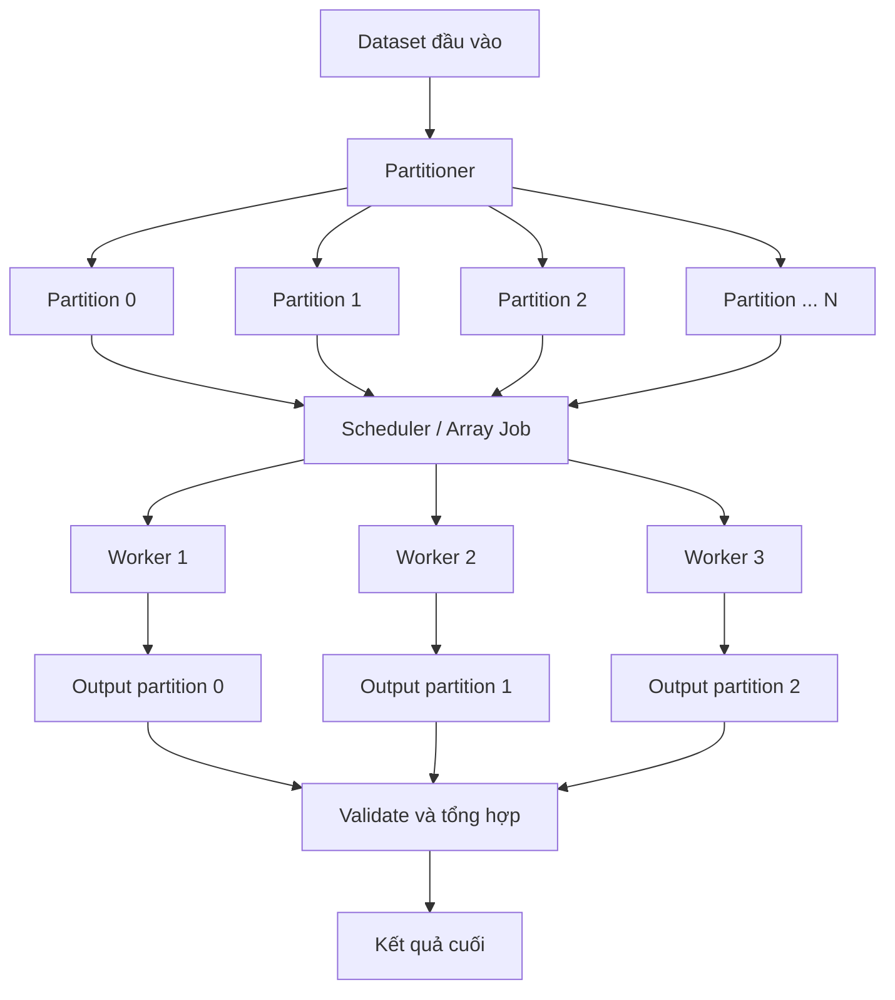
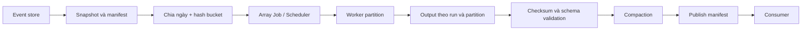

# Chia nhỏ dữ liệu, array job và xử lý song song

## Mục tiêu học tập

Sau bài học, bạn có thể:

- Giải thích vì sao cần chia một workload lớn thành các partition hoặc task nhỏ có thể xử lý độc lập.
- Chọn chiến lược chia dữ liệu theo khoảng, khóa, hash, thời gian, file hoặc kích thước.
- Thiết kế array job để chạy cùng một mẫu chương trình với nhiều chỉ số task.
- Phân biệt parallelism, concurrency, throughput và mức độ đồng thời được cấp phát thực tế.
- Ước lượng số worker phù hợp dựa trên tài nguyên, kích thước partition và giới hạn dependency.
- Thiết kế retry, idempotency, checkpoint và cách commit output để tránh mất hoặc nhân đôi kết quả.
- Xử lý data skew, straggler, task quá nhỏ và task quá lớn.
- Chọn giữa array job tĩnh và queue worker động.
- Theo dõi tiến độ, hiệu năng, chi phí và tính đúng đắn của batch workload.
- Triển khai và vận hành xử lý song song an toàn trên Kubernetes hoặc hệ thống batch scheduler.

## 1. Vì sao phải chia nhỏ dữ liệu?

Một workload batch thường xử lý một lượng dữ liệu lớn hoặc một tập công việc lặp lại. Nếu chạy toàn bộ trên một tiến trình duy nhất, thời gian hoàn thành có thể dài, khó tận dụng nhiều máy và khi lỗi xảy ra có thể phải chạy lại từ đầu.

Chia nhỏ workload (partitioning hoặc task decomposition) biến công việc lớn thành nhiều phần nhỏ hơn. Mỗi phần có đầu vào, phạm vi xử lý và kết quả có thể xác định. Các phần độc lập có thể chạy đồng thời trên nhiều CPU, VM hoặc container.

Ví dụ:

- Một pipeline ETL cần xử lý 10 TB dữ liệu có thể chia theo ngày, tenant hoặc dải khóa.
- Một hệ thống render có thể chia video thành các frame hoặc đoạn.
- Một pipeline ML có thể chạy inference theo batch dữ liệu.
- Một bộ kiểm thử có thể chia theo test suite hoặc nhóm test case.
- Một tác vụ nén có thể chia theo file hoặc object.
- Một báo cáo tổng hợp có thể xử lý từng khu vực rồi ghép kết quả.

Việc chia nhỏ đem lại lợi ích khi các phần có thể xử lý độc lập hoặc có thể phối hợp với chi phí hợp lý. Nếu các phần phụ thuộc tuần tự chặt chẽ, chạy nhiều worker có thể không tăng tốc mà còn làm tăng giao tiếp và điều phối.

### 1.1. Từ một job lớn thành nhiều task

Giả sử cần xử lý 1.000.000 bản ghi. Thay vì một tiến trình đọc và xử lý tất cả, ta chia thành 100 partition, mỗi partition chứa khoảng 10.000 bản ghi.

Mỗi task nhận một partition ID, đọc đúng phạm vi dữ liệu, thực hiện biến đổi và ghi output riêng. Khi task hoàn tất, hệ thống đánh dấu partition đó thành công. Nếu task 37 thất bại, chỉ cần chạy lại partition 37.

Các thành phần cơ bản:

- **Dataset:** tập dữ liệu đầu vào cần xử lý.
- **Partition:** một phần dữ liệu được chia theo quy tắc xác định.
- **Task:** đơn vị công việc có thể lập lịch, retry và theo dõi.
- **Worker:** tiến trình hoặc container thực thi task.
- **Coordinator/scheduler:** tạo task, phân phối, theo dõi và tổng hợp trạng thái.
- **Output:** kết quả bền vững của task.
- **Manifest/checkpoint:** metadata ghi nhận phạm vi và tiến độ.

Partition là cách chia dữ liệu; task là đơn vị thực thi. Một task có thể xử lý một hoặc nhiều partition. Ngược lại, một partition lớn có thể được chia thành nhiều task con nếu cách xử lý cho phép.

### 1.2. Mô hình xử lý song song



Sơ đồ minh họa một luồng xử lý. Scheduler có thể chỉ chạy một phần task tại cùng thời điểm; các task còn lại chờ capacity hoặc quota. Khi tất cả partition bắt buộc hoàn tất và output hợp lệ, bước tổng hợp mới được phép chạy.

## 2. Nguyên tắc thiết kế partition

Một partition tốt cần có phạm vi rõ ràng, có thể xác định lại khi retry và không gây tranh chấp output với partition khác.

Các nguyên tắc quan trọng:

1. **Deterministic:** cùng dataset version và partition ID phải tạo ra cùng phạm vi dữ liệu.
2. **Bounded:** kích thước hoặc thời gian xử lý nằm trong giới hạn có thể dự đoán.
3. **Independent:** hạn chế phụ thuộc giữa các partition.
4. **Retryable:** có thể chạy lại mà không làm sai dữ liệu.
5. **Observable:** biết partition nào đang chạy, đã xong hay thất bại.
6. **Balanced:** thời gian và tài nguyên giữa các partition không chênh lệch quá lớn.
7. **Durable output:** kết quả được lưu bền vững trước khi task được đánh dấu hoàn tất.
8. **Versioned input:** biết task đã xử lý phiên bản dữ liệu nào.

Nếu partition chỉ được xác định bằng vị trí trong một danh sách có thể thay đổi, retry sau khi dataset thay đổi có thể xử lý nhầm dữ liệu. Hãy gắn partition với snapshot, manifest hoặc version đầu vào.

### 2.1. Chọn kích thước partition

Partition quá lớn:

- Task chạy lâu và có thể vượt timeout.
- Khi lỗi, lượng công việc phải chạy lại lớn.
- Ít task khiến khả năng song song thấp.
- Một partition chậm có thể giữ toàn bộ pipeline chờ.

Partition quá nhỏ:

- Tốn chi phí tạo task, scheduling và khởi động worker.
- Tạo nhiều metadata và request tới queue/storage.
- Overhead có thể lớn hơn thời gian xử lý.
- Hệ thống điều phối có thể trở thành bottleneck.

Kích thước phù hợp phụ thuộc thời gian startup, tốc độ xử lý, kích thước dữ liệu, giới hạn API và deadline. Có thể bắt đầu bằng benchmark vài kích thước khác nhau, sau đó chọn mức cân bằng giữa thời gian xử lý, retry cost và overhead.

### 2.2. Dùng thời gian xử lý làm tiêu chí

Nếu mỗi task mất vài giây nhưng container cần 30 giây để khởi động, tạo một container cho mỗi task là không hiệu quả. Có thể gom nhiều partition vào một task hoặc dùng worker sống lâu lấy nhiều message từ queue.

Nếu task mất hàng giờ, cần xem xét chia nhỏ hơn hoặc checkpoint để giảm lượng công việc mất khi bị gián đoạn.

Một mục tiêu thực tế là thời gian hữu ích của task phải đủ lớn so với startup và scheduling overhead, nhưng không lớn tới mức retry trở nên quá đắt.

## 3. Các chiến lược chia dữ liệu

Không có một chiến lược partition phù hợp với mọi dataset. Hãy chọn dựa trên cấu trúc dữ liệu, truy vấn, phân bố khóa và cách ghi output.

### 3.1. Chia theo khoảng (range partitioning)

Chia dữ liệu theo một trường có thứ tự như ID, timestamp hoặc số thứ tự.

Ví dụ:

| Partition | Phạm vi ID | Số bản ghi dự kiến |
|---|---|---:|
| 0 | 0–99.999 | 100.000 |
| 1 | 100.000–199.999 | 100.000 |
| 2 | 200.000–299.999 | 100.000 |
| 3 | 300.000–399.999 | 100.000 |

Ưu điểm:

- Phạm vi dễ hiểu và dễ truy vấn.
- Có thể tạo partition theo khoảng thời gian hoặc ID.
- Output và retry dễ xác định.

Rủi ro:

- Dữ liệu có thể phân bố không đều.
- Một khoảng có nhiều bản ghi hoặc bản ghi nặng hơn.
- ID tăng dần có thể tạo hotspot ở một số storage/index.
- Dữ liệu đến muộn có thể nằm ngoài range dự kiến.

Cần thống kê phân bố trước khi chọn ranh giới. Không chia đều số lượng ID nếu dữ liệu thực tế không đều.

### 3.2. Chia theo hash

Dùng hàm hash ổn định trên khóa để gán bản ghi vào một trong N partition:

\[
partition(key) = hash(key) \bmod N
\]

Ưu điểm:

- Phân phối khóa tương đối đều nếu hash tốt và dữ liệu phù hợp.
- Dễ xác định partition cho một bản ghi.
- Hữu ích khi muốn gom các bản ghi cùng khóa vào cùng partition.

Rủi ro:

- Thay đổi N có thể làm hầu hết khóa chuyển partition.
- Một số khóa rất nóng vẫn có thể tạo skew.
- Hash function hoặc serialization thay đổi sẽ làm kết quả phân phối khác.
- Không thuận lợi cho truy vấn theo khoảng.

Nếu cần thay đổi số partition mà muốn giảm dịch chuyển khóa, có thể dùng consistent hashing hoặc một partition map versioned. Ghi lại hash algorithm và partition count trong manifest.

### 3.3. Chia theo khóa hoặc tenant

Có thể chia theo customer, tenant, account, region hoặc nhóm nghiệp vụ.

Ưu điểm:

- Dễ áp dụng quota và giới hạn song song theo tenant.
- Dữ liệu cùng tenant có thể được xử lý cùng nhau.
- Dễ đối soát và phân bổ chi phí.

Rủi ro:

- Tenant lớn có thể tạo một partition rất lớn.
- Một tenant hoạt động mạnh có thể làm hotspot.
- Một số tenant có dữ liệu ít, task xử lý xong rất nhanh trong khi tenant lớn kéo dài.

Có thể chia tenant lớn thành subpartition theo thời gian hoặc khóa phụ, trong khi tenant nhỏ được gom nhóm.

### 3.4. Chia theo thời gian

Dữ liệu log, event và telemetry thường được chia theo giờ, ngày hoặc tháng.

Ví dụ:

- Một task xử lý một ngày log.
- Một task xử lý một giờ event.
- Một task xử lý một cửa sổ thời gian trong stream đã lưu.

Cần xác định timezone, ranh giới inclusive/exclusive và xử lý event đến muộn. Với dữ liệu timestamp, nên quy định rõ UTC hoặc timezone nghiệp vụ để tránh bỏ sót hay xử lý trùng ở ranh giới ngày.

### 3.5. Chia theo file hoặc object

Nếu dữ liệu đã lưu thành nhiều file/object độc lập, có thể tạo một task cho mỗi file hoặc nhóm file.

Cách này đơn giản khi file có kích thước tương đối đồng đều. Nếu file có kích thước chênh lệch lớn, một task xử lý file 5 GB có thể lâu hơn hàng trăm task xử lý file nhỏ.

Có thể tạo manifest chứa object key, version, size và checksum rồi đóng gói các file theo tổng dung lượng hoặc thời gian xử lý dự kiến.

### 3.6. Chia theo kích thước hoặc khối lượng công việc

Không phải mọi bản ghi có chi phí xử lý như nhau. Một ảnh 4K có thể tốn nhiều CPU/GPU hơn ảnh thumbnail; một JSON lớn có thể tốn nhiều RAM hơn một record nhỏ.

Thay vì chia đều số record, có thể ước lượng cost weight cho từng phần:

\[
W_i = \sum_{r \in partition_i} estimatedCost(r)
\]

Mục tiêu là làm cho tổng trọng số \(W_i\) giữa các partition gần nhau. Ước lượng có thể dựa trên bytes, số pixel, số token, số phép tính hoặc lịch sử xử lý.

## 4. Data skew và cách cân bằng partition

Data skew xảy ra khi số lượng hoặc chi phí xử lý giữa các partition chênh lệch lớn. Dù có nhiều worker, pipeline vẫn phải chờ partition chậm nhất.

Ví dụ, 9 partition mất 2 phút nhưng một partition chứa tenant lớn mất 40 phút. Thêm worker không giúp nếu partition nặng không thể chia tiếp.

Dấu hiệu:

- Một số worker hoàn tất rất sớm, một số chạy kéo dài.
- CPU/GPU utilization giảm khi gần cuối job.
- Thời gian tổng thể bị quyết định bởi vài task cuối.
- Retry của một partition làm pipeline chậm đáng kể.
- Tổng số record mỗi partition bằng nhau nhưng thời gian xử lý khác nhau.

### 4.1. Cách giảm skew

- Dùng histogram hoặc thống kê phân bố trước khi chia.
- Chia tenant/key nóng thành nhiều subpartition.
- Dùng cost-based partitioning thay vì chỉ đếm record.
- Dùng dynamic work queue để worker lấy task tiếp theo khi rảnh.
- Dùng speculative execution cho task bị chậm bất thường nếu output có thể commit an toàn.
- Đặt giới hạn thời gian và retry cho task bị treo.
- Theo dõi thời gian p50/p95/p99 theo partition.

Không nên chia nhỏ một khóa nếu logic yêu cầu mọi bản ghi cùng khóa được xử lý tuần tự hoặc cùng transaction. Cần giữ invariant nghiệp vụ.

### 4.2. Static partition và dynamic work assignment

**Static partitioning:** chia trước toàn bộ phạm vi và gán partition ID cố định cho từng task. Phù hợp khi số phần biết trước, kích thước ổn định và dễ lập lịch.

**Dynamic work assignment:** worker lấy task từ queue khi sẵn sàng. Phù hợp khi thời gian xử lý không đồng đều hoặc số task lớn, biến động.

| Tiêu chí | Static partition | Dynamic queue |
|---|---|---|
| Xác định task | Trước khi chạy | Khi worker nhận task |
| Cân bằng tải | Phụ thuộc chất lượng partition | Worker rảnh có thể lấy task tiếp |
| Điều phối | Đơn giản hơn với số task cố định | Cần queue, lease và ack |
| Retry | Chạy lại partition cụ thể | Message/task được giao lại |
| Phù hợp | Batch có phạm vi rõ và ổn định | Task không đồng đều hoặc liên tục phát sinh |
| Overhead | Có thể thấp | Có thêm queue và coordination overhead |

Có thể kết hợp: tạo các partition lớn tĩnh, rồi chia thành subtask động khi xử lý.

## 5. Array job là gì?

Array job là cách khai báo một mẫu job và yêu cầu hệ thống chạy nhiều bản sao của mẫu đó, mỗi bản sao có một chỉ số hoặc tham số riêng. Thay vì viết hàng trăm manifest/job riêng lẻ, người vận hành khai báo số task và giới hạn song song.

Một array job thường có:

- Job template chung.
- Tổng số task hoặc completion count.
- Task index duy nhất.
- Cách ánh xạ index sang partition/input.
- Giới hạn số task chạy đồng thời.
- Chính sách retry và timeout.
- Output path riêng cho từng task.
- Bước tổng hợp sau khi toàn bộ task hoàn tất.

Ví dụ, array có 100 task, index từ 0 đến 99. Task 0 xử lý partition 0, task 1 xử lý partition 1 và cứ thế. Scheduler có thể chỉ cho 10 task chạy đồng thời; phần còn lại chờ tài nguyên.

### 5.1. Vì sao array job hữu ích?

- Giảm số cấu hình phải duy trì.
- Dùng chung image, command và resource profile.
- Mỗi task có index rõ ràng để xác định input/output.
- Dễ retry task thất bại.
- Có thể giới hạn concurrency để bảo vệ database hoặc storage.
- Theo dõi tiến độ theo chỉ số và tổng completion count.

Array job phù hợp khi các task có cùng cách thực thi và chỉ khác input hoặc tham số. Nếu mỗi task có dependency, tài nguyên hoặc thời gian chạy khác nhau đáng kể, cần template linh hoạt hơn hoặc queue-based scheduler.

### 5.2. Index không phải thứ tự hoàn tất

Task index 7 không nhất thiết hoàn tất trước task index 8. Scheduler cấp tài nguyên theo capacity, priority và policy. Không dùng index để suy ra thứ tự chạy hoặc thứ tự commit.

Nếu bước tổng hợp cần dữ liệu theo thứ tự, hãy sắp xếp theo metadata/partition ID ở bước cuối. Không dựa vào thời điểm worker kết thúc.

## 6. Ví dụ array job trên Kubernetes Indexed Job

Kubernetes Job hỗ trợ chế độ Indexed completion. Mỗi Pod nhận một completion index và có thể dùng biến môi trường JOB_COMPLETION_INDEX để xác định partition cần xử lý.

Ví dụ:

```yaml
apiVersion: batch/v1
kind: Job
metadata:
  name: etl-array
spec:
  completions: 100
  parallelism: 10
  completionMode: Indexed
  backoffLimit: 3
  template:
    metadata:
      labels:
        app: etl-array
    spec:
      restartPolicy: Never
      containers:
        - name: worker
          image: registry.example.com/data/etl-worker:2.1
          command: ["python", "/app/worker.py"]
          env:
            - name: DATASET_VERSION
              value: "snapshot-2026-11-22"
          resources:
            requests:
              cpu: "1"
              memory: "2Gi"
            limits:
              cpu: "2"
              memory: "4Gi"
```

Các giá trị trên là ví dụ. Job tạo 100 completion có index, nhưng tối đa 10 Pod được chạy song song theo cấu hình. Mỗi worker phải đọc JOB_COMPLETION_INDEX, tra manifest và xử lý đúng partition. Image cần có code tương ứng.

### 6.1. Lấy index trong ứng dụng

Ví dụ Python:

```python
import os
import json

index = int(os.environ["JOB_COMPLETION_INDEX"])
dataset_version = os.environ["DATASET_VERSION"]

with open("/app/partition-manifest.json", encoding="utf-8") as f:
    manifest = json.load(f)

partition = manifest["partitions"][index]

process_partition(
    dataset_version=dataset_version,
    partition=partition,
)
```

Đoạn mã là khung minh họa; process_partition cần được triển khai theo định dạng dữ liệu. Phải kiểm tra index nằm trong phạm vi manifest và version dữ liệu khớp với manifest trước khi xử lý.

### 6.2. Giới hạn concurrency

parallelism: 10 giới hạn số Pod chạy đồng thời cho Job. Đây là giới hạn của Job controller, không bảo đảm 10 Pod luôn được chạy nếu cluster thiếu CPU, memory, GPU, quota hoặc node phù hợp.

Nên chọn parallelism theo:

- Số CPU và RAM thực tế.
- Throughput của database/object storage.
- Giới hạn API và rate limit.
- Số kết nối tối đa.
- I/O và network bandwidth.
- Chi phí capacity.
- Deadline của batch.

Nếu tăng parallelism làm database quá tải, tổng thời gian hoàn thành có thể tăng thay vì giảm.

### 6.3. Theo dõi Indexed Job

Một số lệnh quan sát:

```bash
kubectl get job etl-array
kubectl describe job etl-array
kubectl get pods -l job-name=etl-array -o wide
kubectl get pods -l job-name=etl-array
kubectl logs job/etl-array
```

Tên label và khả năng lấy log tổng hợp phụ thuộc cách triển khai. Khi điều tra một partition cụ thể, tìm Pod có annotation completion index hoặc đọc metadata của Pod theo phiên bản Kubernetes.

Không xóa Job ngay sau khi một số Pod hoàn tất nếu còn cần log, trạng thái hoặc output để đối soát. Dùng TTL cleanup sau khi đã xác nhận kết quả và retention cần thiết.

## 7. Array job trên batch scheduler

Array job không chỉ có trong Kubernetes. Các batch scheduler và cloud batch service cũng có khái niệm job array hoặc array task.

Ví dụ với Slurm:

```bash
#!/bin/bash
#SBATCH --job-name=partition-etl
#SBATCH --array=0-99%10
#SBATCH --cpus-per-task=2
#SBATCH --mem=4G
#SBATCH --time=00:30:00

python worker.py --partition "$SLURM_ARRAY_TASK_ID"
```

Trong ví dụ, scheduler tạo task index 0 đến 99 và giới hạn tối đa 10 task chạy đồng thời theo cú pháp Slurm. Mỗi task gọi cùng chương trình với partition ID riêng.

Tên biến index và cú pháp concurrency khác nhau giữa các scheduler. Với dịch vụ cloud batch, hãy đọc API/SDK cụ thể để xác định cách truyền array index, giới hạn số child job và trạng thái retry.

### 7.1. So sánh các cách triển khai

| Mô hình | Cách biểu diễn | Phù hợp |
|---|---|---|
| Kubernetes Indexed Job | completions, parallelism, completionMode: Indexed | Batch chạy trong cluster Kubernetes |
| Slurm Job Array | --array và task ID | HPC, research và cluster scheduler |
| Cloud Batch Array | Job definition và array size/index | Batch trên cloud provider |
| Queue workers | Task/message trong durable queue | Workload động, task không đồng đều |
| Workflow DAG | Các step có dependency | Pipeline nhiều giai đoạn và nhánh |

Không nên chọn công cụ chỉ theo số lượng task. Hãy xét nơi dữ liệu nằm, cách cấp compute, dependency giữa task, yêu cầu retry, quan sát và chi phí vận hành.

## 8. Xử lý output và tránh ghi đè lẫn nhau

Mỗi task cần output path hoặc key riêng. Nếu mọi worker ghi cùng một file mà không có cơ chế phối hợp, kết quả có thể bị ghi đè hoặc hỏng.

Ví dụ cấu trúc:

```text
s3://data-results/run-2026-11-22/
  manifest.json
  partitions/
    part-00000/
      result.parquet
      metadata.json
    part-00001/
      result.parquet
      metadata.json
    part-00002/
      result.parquet
      metadata.json
  _SUCCESS
```

Mỗi partition có một vùng output riêng. Bước tổng hợp đọc manifest và các output đã xác minh, sau đó tạo kết quả cuối.

### 8.1. Commit output an toàn

Một worker có thể chết sau khi ghi file nhưng trước khi đánh dấu task hoàn tất. Khi retry, worker khác sẽ chạy lại cùng partition. Cần quy trình commit:

1. Ghi output vào đường dẫn tạm riêng của attempt.
2. Flush/close và xác minh checksum hoặc định dạng.
3. Ghi metadata gồm partition ID, dataset version, attempt ID và code version.
4. Publish output bằng thao tác nguyên tử nếu storage hỗ trợ, hoặc cập nhật manifest/commit record có điều kiện.
5. Chỉ sau commit mới đánh dấu task thành công.
6. Dọn output tạm của attempt thất bại theo retention.

Object storage không phải lúc nào cũng hỗ trợ rename nguyên tử như filesystem. Có thể dùng immutable object key theo attempt và một manifest pointer/conditional write để công bố phiên bản thắng cuộc.

### 8.2. Idempotency

Idempotent nghĩa là chạy lại cùng task không làm thay đổi kết quả cuối ngoài ý muốn. Có thể thiết kế bằng:

- Partition ID và dataset version làm idempotency key.
- Unique constraint ở database.
- Upsert có điều kiện.
- Output path versioned.
- Commit marker ghi một lần.
- Giao dịch hoặc compare-and-swap khi cập nhật trạng thái.

Nếu task gửi email, trừ tiền hoặc gọi API có side effect, chỉ ghi output file riêng chưa đủ. Cần idempotency key ở dịch vụ đích hoặc transactional outbox/command log để tránh side effect lặp.

## 9. Retry, timeout và checkpoint

Task có thể thất bại vì lỗi dữ liệu, network, thiếu tài nguyên, interruption hoặc bug. Retry giúp phục hồi lỗi tạm thời nhưng không nên chạy lại vô hạn.

### 9.1. Phân loại lỗi

| Loại lỗi | Ví dụ | Hướng xử lý |
|---|---|---|
| Transient | Timeout storage, rate limit, network reset | Retry với exponential backoff và jitter |
| Capacity | Không cấp được VM, quota tạm thời | Chờ capacity, giảm concurrency hoặc chuyển pool |
| Data-specific | Record lỗi, schema không hợp lệ | Cách ly record/partition và báo lỗi |
| Permanent | Sai cấu hình, thiếu quyền, image không tồn tại | Dừng retry và sửa nguyên nhân |
| Resource | OOM, disk full, CPU timeout | Điều chỉnh sizing hoặc chia nhỏ task |
| Duplicate execution | Lease hết hạn, worker chạy trùng | Idempotency và conditional commit |

### 9.2. Exponential backoff và jitter

Khi nhiều task cùng thất bại vì một dependency, retry ngay lập tức có thể tạo retry storm. Dùng backoff tăng dần và thêm jitter để phân tán thời điểm retry.

Ví dụ công thức:

\[
delay_n = \min(delay_{max}, base \times 2^n) + jitter
\]

Giá trị base, max và jitter cần được chọn theo timeout và SLA. Với rate limit, tôn trọng Retry-After nếu API cung cấp.

### 9.3. Timeout theo từng lớp

Phân biệt:

- Task timeout: thời gian tối đa cho một partition.
- Worker shutdown grace period: thời gian worker hoàn tất hoặc checkpoint khi bị dừng.
- Queue visibility/lease timeout: thời gian message không được giao cho worker khác.
- API/database timeout: thời gian chờ dependency.
- Workflow deadline: thời điểm toàn bộ pipeline phải hoàn tất.

Nếu lease ngắn hơn thời gian xử lý, message có thể được giao lại trong khi worker đầu vẫn chạy. Nếu task timeout quá dài, lỗi treo giữ tài nguyên và làm chậm pipeline. Các timeout cần được phối hợp.

### 9.4. Checkpoint

Với task dài, checkpoint ghi lại tiến độ ở một điểm an toàn. Khi retry, worker có thể tiếp tục thay vì xử lý lại từ đầu.

Checkpoint nên có:

- Task/partition ID.
- Dataset version và schema version.
- Code/model version.
- Offset hoặc cursor đã xử lý.
- Output đã commit.
- Checksum và timestamp.
- Trạng thái transaction cần phục hồi.

Không ghi checkpoint trước khi dữ liệu tương ứng được commit bền vững. Nếu checkpoint nói đã xử lý đến offset 10.000 nhưng output chỉ lưu đến 9.500, phần dữ liệu còn lại có thể bị bỏ sót.

## 10. Xử lý task chạy trùng và lease

Trong hệ thống phân tán, worker có thể bị pause, mất kết nối hoặc chậm phản hồi. Coordinator có thể cho rằng worker đã chết và giao lại task, trong khi worker cũ vẫn tiếp tục chạy.

Đây là tình huống duplicate execution. Cần thiết kế để hai worker không cùng ghi đè kết quả hoặc tạo side effect trùng.

Các kỹ thuật:

- Lease có thời hạn và heartbeat.
- Fencing token/generation number tăng theo lần cấp lease.
- Conditional commit chỉ chấp nhận token mới nhất.
- Idempotency key ở hệ thống đích.
- Output theo attempt ID và bước publish duy nhất.
- Timeout và cancellation để worker cũ dừng khi mất lease.

Lease chỉ là cơ chế điều phối; nó không tự dừng process cũ. Fencing token giúp storage hoặc database từ chối thao tác từ worker có token cũ.

## 11. Tính song song, concurrency và throughput

Các thuật ngữ cần phân biệt:

- **Parallelism:** số công việc thực sự chạy đồng thời trên nhiều đơn vị thực thi.
- **Concurrency:** số công việc đang tiến triển hoặc được quản lý cùng lúc; không nhất thiết chạy cùng một thời điểm.
- **Throughput:** số đơn vị công việc hoàn tất trong một khoảng thời gian.
- **Latency:** thời gian một task hoặc request hoàn thành.
- **Utilization:** mức sử dụng tài nguyên được cấp.
- **Queue wait:** thời gian task chờ trước khi bắt đầu.

Tăng concurrency có thể làm tăng throughput cho đến khi một tài nguyên trở thành bottleneck. Sau điểm đó, tăng thêm worker chỉ làm contention và latency tăng.

### 11.1. Ước lượng thời gian lý tưởng

Nếu có N partition bằng nhau, mỗi partition cần thời gian t và có P worker, thời gian lý tưởng gần đúng là:

\[
T \approx \left\lceil \frac{N}{P} \right\rceil \times t
\]

Công thức giả định worker giống nhau, partition cân bằng, không có overhead, không có dependency bottleneck và không có lỗi.

Thực tế còn có startup, queue wait, data transfer, coordination, retry và straggler. Do đó cần đo wall-clock completion thay vì chỉ chia tổng CPU time cho số worker.

### 11.2. Giới hạn bởi Amdahl's Law

Nếu phần tuần tự chiếm tỷ lệ s của workload, phần còn lại có thể song song hóa, speedup tối đa với P worker được xấp xỉ:

\[
Speedup(P) = \frac{1}{s + \frac{1-s}{P}}
\]

Nếu 20% công việc bắt buộc tuần tự, dù số worker tăng vô hạn, speedup tối đa chỉ là 5 lần theo mô hình này. Phần tuần tự có thể là đọc manifest, tạo partition, merge output hoặc cập nhật metadata.

Để tăng tốc, tối ưu cả bước chuẩn bị và tổng hợp, không chỉ tăng số worker.

### 11.3. Khi nào thêm worker không giúp?

- Database đã đạt giới hạn connection hoặc IOPS.
- Object storage/API bị rate limit.
- Network bandwidth đã bão hòa.
- Tất cả task cùng tranh chấp một khóa hoặc một file.
- Partition quá nhỏ, overhead scheduler chiếm phần lớn.
- Partition quá lệch, phần lớn worker idle chờ straggler.
- CPU worker không đủ RAM hoặc disk.
- Bước merge cuối là tuần tự.

Xác định bottleneck bằng metric trước khi tăng parallelism.

## 12. Backpressure và bảo vệ dependency

Một batch system có thể tạo hàng nghìn worker và gửi tải đột biến tới database, object storage hoặc API. Nếu dependency không chịu được tải, pipeline có thể làm hỏng dịch vụ dùng chung.

Backpressure điều chỉnh tốc độ tạo hoặc xử lý task theo khả năng downstream.

Các cách thực hiện:

- Giới hạn parallelism của array job.
- Dùng queue có giới hạn tốc độ nhận message.
- Áp dụng concurrency limit theo tenant hoặc dependency.
- Dùng token bucket/rate limiter.
- Tạm dừng producer khi backlog hoặc error tăng.
- Dùng circuit breaker khi dependency không khỏe.
- Ưu tiên task quan trọng và giới hạn batch size.

Không chỉ đặt giới hạn toàn cục. Một tenant hoặc partition nóng có thể chiếm hết capacity; cần fairness hoặc quota theo nhóm khi phù hợp.

## 13. Dữ liệu lớn, data locality và truyền dữ liệu

Khi chạy batch trên cloud, thời gian đọc dữ liệu và truyền output có thể lớn hơn thời gian tính toán. Đặt worker gần dữ liệu có thể giảm network cost và latency.

Cân nhắc:

- Cùng region với object storage/database.
- Dùng local cache cho dữ liệu được đọc lặp lại.
- Chọn định dạng cột và compression phù hợp.
- Đọc theo range hoặc prefix để tránh scan toàn bộ dataset.
- Tránh tải cùng một file lớn cho hàng trăm worker.
- Tạo manifest và checksum để giảm việc liệt kê storage lặp lại.
- Ghi output theo partition và kích thước file phù hợp.

Data locality không được đánh đổi tính đúng đắn. Cache cần version hoặc invalidation rõ ràng; không để worker đọc dữ liệu cũ nhưng ghi kết quả vào run mới.

### 13.1. Tránh small files problem

Nếu mỗi task tạo hàng nghìn file rất nhỏ, object storage hoặc metadata service có thể chịu overhead lớn. Có thể:

- Ghi file trung gian lớn hơn.
- Gom output theo batch.
- Dùng manifest để quản lý file.
- Chạy compaction sau khi task hoàn tất.
- Chọn target file size theo engine và format.

Không gom file bằng cách tạo một writer duy nhất nếu điều đó biến bước cuối thành bottleneck. Có thể dùng nhiều compaction task theo nhóm partition.

## 14. Tổng hợp kết quả và kiểm tra tính đầy đủ

Khi các task hoàn tất, bước tổng hợp cần biết partition nào đã được xử lý và output nào hợp lệ.

Một manifest có thể lưu:

```json
{
  "run_id": "etl-2026-11-22-001",
  "dataset_version": "snapshot-2026-11-22",
  "partition_count": 3,
  "partitions": [
    {
      "id": 0,
      "input": "source/date=2026-11-20/part-0",
      "output": "results/run-001/part-0.parquet",
      "status": "SUCCEEDED",
      "checksum": "sha256:..."
    },
    {
      "id": 1,
      "input": "source/date=2026-11-20/part-1",
      "output": "results/run-001/part-1.parquet",
      "status": "SUCCEEDED",
      "checksum": "sha256:..."
    },
    {
      "id": 2,
      "input": "source/date=2026-11-20/part-2",
      "output": "results/run-001/part-2.parquet",
      "status": "SUCCEEDED",
      "checksum": "sha256:..."
    }
  ]
}
```

Đây là cấu trúc minh họa. Trong thực tế có thể lưu trạng thái trong database hoặc metadata store để cập nhật có điều kiện.

Trước khi publish kết quả:

1. Xác nhận đủ partition bắt buộc.
2. Kiểm tra mọi output có version đúng.
3. Xác minh checksum hoặc schema.
4. Đối chiếu số record đầu vào/đầu ra nếu có invariant.
5. Kiểm tra không có partition bị chạy trùng và publish hai lần.
6. Tổng hợp theo đúng thứ tự hoặc logic nghiệp vụ.
7. Ghi manifest run hoàn tất.
8. Chỉ sau đó công bố output cho consumer.

Nếu một partition thất bại, cần quyết định pipeline fail, retry hoặc publish partial result theo hợp đồng nghiệp vụ. Không tự đánh dấu thành công chỉ vì phần lớn task đã hoàn tất.

## 15. Ví dụ thực tế: ETL chia theo ngày và hash bucket

Một hệ thống cần xử lý event trong 30 ngày. Mỗi ngày có lượng event khác nhau và một số tenant rất lớn.

Thiết kế:

- Tạo 30 partition theo ngày UTC.
- Với ngày có nhiều dữ liệu, chia tiếp thành 16 hash bucket theo tenant ID.
- Lưu manifest gồm dataset snapshot, ngày, bucket, số byte ước tính và input prefix.
- Tạo array job cho các partition đã xác định.
- Giới hạn parallelism ban đầu ở 12 để bảo vệ database nguồn.
- Mỗi worker ghi output vào prefix riêng theo run ID và partition ID.
- Worker commit output cùng checksum rồi mới đánh dấu success.
- Task lỗi transient retry có backoff; lỗi schema được đưa vào quarantine.
- Bước validate kiểm tra số record, schema và checksum.
- Bước compaction hợp nhất các file nhỏ.
- Bước publish cập nhật pointer tới run mới sau khi tất cả partition đạt yêu cầu.

Nếu ngày 12 có tenant lớn khiến bucket 7 chạy lâu, nhóm có thể chia riêng tenant đó thành subpartition theo hash của event ID. Manifest mới phải có version để retry và tổng hợp không trộn partition map cũ với mới.

### 15.1. Sơ đồ pipeline



## 16. Theo dõi và đo hiệu quả batch

Không chỉ theo dõi CPU và RAM. Cần theo dõi tiến độ nghiệp vụ và hành vi task.

| Nhóm | Metric | Ý nghĩa |
|---|---|---|
| Volume | Total partitions, completed, pending, failed | Mức tiến độ |
| Throughput | Records/second, bytes/second, tasks/minute | Tốc độ xử lý |
| Latency | Task duration p50/p95/p99, wall-clock run time | Thời gian hoàn tất |
| Queue | Queue depth, oldest task age, wait time | Backlog và khả năng cấp worker |
| Balance | Duration theo partition, straggler count | Data skew |
| Reliability | Retry count, failure rate, duplicate attempt | Độ tin cậy |
| Data quality | Record count, checksum, validation failures | Tính đúng đắn |
| Resource | CPU, memory, disk, network, throttling | Bottleneck |
| Dependency | DB connections, API rate limit, storage latency | Tác động downstream |
| Cost | Compute hours, storage, transfer, cost per output | Hiệu quả kinh tế |

### 16.1. Theo dõi task cuối cùng (straggler)

Khi 99% task đã xong nhưng một số task còn chạy, pipeline vẫn chưa thể publish. Hãy so sánh duration theo partition và xem input size, record count, tenant hoặc lỗi retry.

Có thể dùng speculative execution: nếu một task chạy lâu bất thường, tạo một attempt khác trên worker khác. Chỉ một attempt được phép commit output. Cách này có thể giảm tail latency nhưng làm tăng compute cost và có thể tăng tải dependency; chỉ dùng khi output idempotent và có cơ chế fencing/conditional commit.

### 16.2. Cost per output

Một chỉ số hữu ích là:

\[
CostPerUnit =
\frac{Compute + Storage + Transfer + Orchestration}
{ValidatedOutputUnits}
\]

Đơn vị đầu ra có thể là một triệu record hợp lệ, một GB dữ liệu đã xử lý hoặc một file/video hoàn tất. So sánh cùng dataset version, chất lượng và deadline.

## 17. Bảo mật và quyền truy cập trong xử lý song song

Array job có thể tạo nhiều Pod/VM cùng lúc. Nếu mỗi worker có quyền rộng như nhau, một lỗi trong một task có thể ảnh hưởng toàn bộ dataset hoặc tenant khác.

Nguyên tắc:

- Dùng service account/workload identity riêng cho job.
- Cấp quyền đọc đúng input prefix và ghi đúng output prefix.
- Tách quyền publish kết quả cuối khỏi quyền ghi output tạm.
- Không đóng secret vào image hoặc command line.
- Dùng secret manager và rotation.
- Mã hóa dữ liệu khi truyền và khi lưu.
- Giới hạn network egress và dependency được phép truy cập.
- Dùng namespace, quota và policy theo team/tenant.
- Audit job ID, partition ID, image digest và identity.
- Xóa output tạm và checkpoint theo retention.

Nếu dữ liệu được chia theo tenant, cần bảo đảm partitioner và authorization không cho worker của tenant A đọc dữ liệu tenant B. Partition ID không phải cơ chế phân quyền.

## 18. Các lỗi thiết kế thường gặp

- **Chia đều số record là đủ cân bằng.** Chi phí xử lý mỗi record có thể khác nhau; cần đo duration hoặc cost weight.
- **Một task tương ứng một container luôn tốt.** Với task rất nhỏ, startup/scheduling overhead có thể lớn hơn công việc.
- **Tăng parallelism luôn giảm thời gian.** Dependency hoặc storage có thể trở thành bottleneck.
- **Array index là thứ tự hoàn tất.** Index chỉ định danh task; scheduler không bảo đảm thứ tự chạy.
- **Retry đồng nghĩa an toàn.** Retry có thể nhân đôi side effect nếu không idempotent.
- **Worker ghi output rồi chết thì task đã thành công.** Cần commit marker/manifest để coordinator biết output hợp lệ.
- **Lease hết hạn nghĩa worker cũ đã dừng.** Worker cũ có thể tiếp tục chạy; cần fencing và conditional commit.
- **Queue tự bảo đảm exactly-once.** Nhiều queue cung cấp at-least-once; ứng dụng phải chống xử lý trùng.
- **Một file output chung giúp tổng hợp dễ hơn.** Nhiều worker ghi đồng thời có thể gây race và corruption.
- **Task cuối chạy lâu chỉ cần thêm worker.** Cần xử lý skew, partition nặng và straggler.
- **Tất cả partition phải cùng kích thước byte.** Số byte không luôn tương ứng thời gian xử lý; dùng cost estimate phù hợp.
- **Dữ liệu đầu vào có thể thay đổi trong lúc job chạy.** Cần snapshot/version hoặc manifest ổn định để tránh task xử lý các trạng thái khác nhau.
- **Publish từng partition ngay khi xong luôn an toàn.** Consumer có thể thấy kết quả chưa đầy đủ; cần contract cho partial output.
- **Log stdout là đủ để theo dõi.** Cần structured log và metric theo run ID, partition ID, attempt ID.
- **Chỉ đo compute cost.** Storage, transfer, retry, orchestration và chi phí dependency cũng ảnh hưởng tổng chi phí.

## 19. Quy trình thiết kế và triển khai

1. Xác định kết quả cuối, chất lượng và deadline.
2. Chốt dataset snapshot/version.
3. Chọn khóa hoặc chiều chia dữ liệu.
4. Đo phân bố và ước lượng cost theo partition.
5. Chọn số partition và kích thước task.
6. Chọn array job tĩnh hoặc queue động.
7. Xác định parallelism theo CPU, RAM và capacity dependency.
8. Thiết kế output riêng, manifest và commit protocol.
9. Thiết kế idempotency, retry, timeout và checkpoint.
10. Thử nghiệm với dữ liệu đại diện và fault injection.
11. Đo throughput, p95/p99, skew, failure và cost.
12. Điều chỉnh partition size và concurrency.
13. Chạy production theo batch window và theo dõi.
14. Validate đầy đủ trước khi publish.
15. Retain log/manifest đủ lâu để audit và phục hồi.

### 19.1. Bắt đầu với baseline nhỏ

Một cách triển khai an toàn là:

- Chạy 4–8 partition trước.
- Giới hạn 2–4 worker.
- Xác minh input/output và retry.
- Tăng số partition hoặc parallelism từng bước.
- Theo dõi dependency latency và error.
- Dừng tăng khi throughput không cải thiện hoặc p95 tăng mạnh.

Các con số trên chỉ là điểm khởi đầu cho thử nghiệm. Capacity thực tế và giới hạn dịch vụ quyết định giá trị phù hợp.

## 20. Checklist vận hành

### Trước khi chạy

- [ ] Dataset có snapshot/version ổn định.
- [ ] Partition manifest có ID, input range và version.
- [ ] Partition size đã được benchmark.
- [ ] Data skew và hot key đã được đánh giá.
- [ ] Task có thể retry hoặc resume an toàn.
- [ ] Output path riêng theo run/partition/attempt.
- [ ] Có idempotency key và commit protocol.
- [ ] Parallelism phù hợp capacity và rate limit dependency.
- [ ] Timeout, retry, backoff và deadline được phối hợp.
- [ ] Service account chỉ có quyền cần thiết.
- [ ] Có điều kiện dừng khi error hoặc dependency pressure tăng.

### Trong khi chạy

- [ ] Theo dõi completed/pending/failed partition.
- [ ] Theo dõi queue wait và task duration.
- [ ] Theo dõi p95/p99 và straggler.
- [ ] Theo dõi CPU, memory, disk và network.
- [ ] Theo dõi dependency connection và rate limit.
- [ ] Theo dõi retry, duplicate attempt và checkpoint age.
- [ ] Kiểm tra output checksum/schema.
- [ ] Kiểm soát concurrency và backpressure.
- [ ] Ghi log có run ID, partition ID và attempt ID.

### Sau khi chạy

- [ ] Xác nhận đủ partition bắt buộc.
- [ ] Kiểm tra record count, checksum và schema.
- [ ] Tổng hợp/compact output.
- [ ] Publish manifest hoặc pointer của run hoàn chỉnh.
- [ ] Không còn worker hoặc task bị bỏ dở.
- [ ] Xóa output tạm theo retention.
- [ ] Tính cost per output và thời gian p95.
- [ ] Ghi lại partition skew và lỗi cần xử lý.
- [ ] Cập nhật sizing, parallelism và runbook.

## 21. Tự kiểm tra

**Tình huống 1:** Một ETL chia 100 partition, mỗi partition có 10.000 record. Một partition mất 30 phút trong khi các partition khác mất 2 phút. Vấn đề có thể là gì?

**Gợi ý:** Có thể data skew hoặc một partition chứa record có cost xử lý cao. Kiểm tra bytes, key distribution và duration; chia tiếp partition nặng nếu logic cho phép.

**Tình huống 2:** Kubernetes Indexed Job có 100 completions và parallelism 20. Vì sao chỉ thấy 8 Pod chạy?

**Gợi ý:** Parallelism là mức tối đa do Job controller mong muốn, không phải capacity được bảo đảm. Có thể cluster thiếu CPU/RAM/GPU, quota, node phù hợp hoặc Pod bị scheduler từ chối.

**Tình huống 3:** Worker ghi output thành công rồi mất kết nối trước khi báo task complete. Queue giao lại task cho worker khác. Làm sao tránh kết quả bị ghi hai lần?

**Gợi ý:** Dùng idempotency key, output theo attempt, conditional commit hoặc unique constraint. Chỉ publish một output hợp lệ và acknowledge sau commit bền vững.

**Tình huống 4:** Tăng parallelism từ 10 lên 50 làm throughput giảm và database latency tăng. Cần làm gì?

**Gợi ý:** Database là bottleneck hoặc đang bị quá tải. Giảm concurrency, đặt rate limit/backpressure, tối ưu query và đo throughput trước khi tăng worker lại.

**Tình huống 5:** Một task array index 5 hoàn tất sau index 9. Điều đó có phải scheduler lỗi không?

**Gợi ý:** Không. Index chỉ định danh completion; scheduler chạy theo capacity và policy, không bảo đảm thứ tự hoàn tất.

**Tình huống 6:** Dataset thay đổi trong lúc 100 task đang chạy, một số task đọc bản mới và số khác đọc bản cũ. Rủi ro là gì?

**Gợi ý:** Output có thể không nhất quán vì các partition xử lý snapshot khác nhau. Cần cố định dataset version hoặc snapshot trong manifest và truyền cùng version cho mọi task.

## Kết luận

Chia nhỏ dữ liệu và xử lý song song giúp rút ngắn batch workload, tăng khả năng retry và tận dụng nhiều compute worker. Hiệu quả phụ thuộc vào cách chọn partition, mức cân bằng, task granularity, giới hạn concurrency và khả năng bảo vệ dependency. Array job phù hợp với tập task có cấu trúc cố định; queue động phù hợp với workload không đồng đều hoặc phát sinh liên tục. Mỗi task cần input version rõ ràng, output riêng, idempotency và commit an toàn để retry không làm sai kết quả. Hãy đo throughput, p95/p99, data skew, failure, dependency pressure và cost per output trước khi tăng parallelism hoặc mở rộng quy mô.
