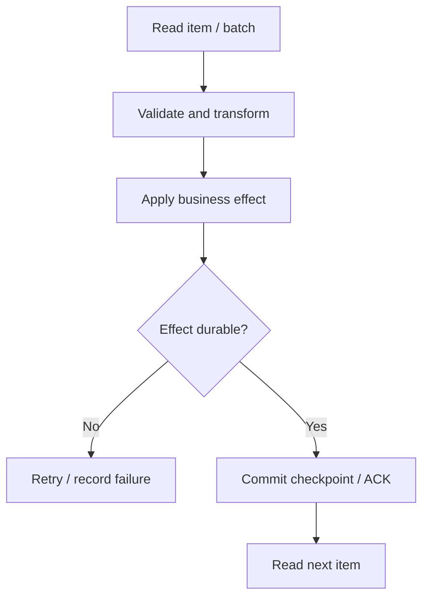
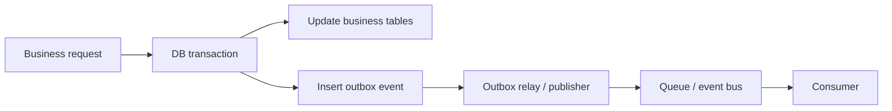
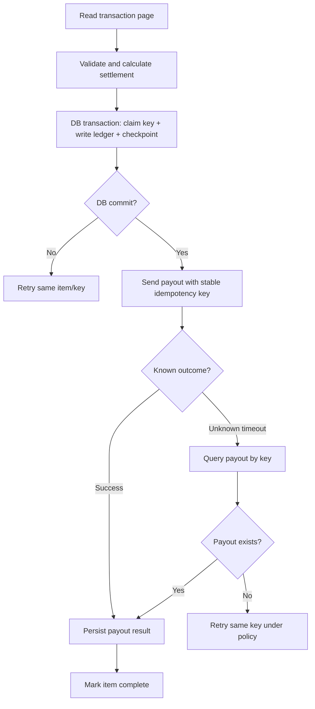

# Checkpoint và bảo đảm không làm trùng tác động nghiệp vụ

## Bối cảnh: batch có thể chạy lại sau khi đã tạo ra một phần kết quả

Một batch job thường đọc nhiều record, thực hiện biến đổi rồi ghi kết quả vào database, object storage hoặc gọi một dịch vụ khác. Nếu job bị dừng giữa chừng do VM restart, container bị thay thế, function timeout hoặc network lỗi, hệ thống cần biết đã xử lý đến đâu để tiếp tục. Cơ chế lưu lại tiến độ đó gọi là **checkpoint**.

Checkpoint giúp tránh đọc và tính toán lại toàn bộ dữ liệu, nhưng bản thân nó không bảo đảm tác động nghiệp vụ chỉ xảy ra một lần. Hãy xét tình huống worker đã chuyển tiền hoặc tạo hóa đơn thành công, nhưng bị crash trước khi lưu checkpoint. Khi job chạy lại, cùng record có thể được xử lý lần nữa. Ngược lại, nếu worker lưu checkpoint trước khi ghi kết quả rồi crash, record có thể bị bỏ qua dù tác động chưa hoàn tất.

Do đó, batch processing cần kết hợp hai cơ chế:

- **Checkpoint/progress tracking:** ghi nhận vị trí hoặc đơn vị công việc đã hoàn tất để có thể tiếp tục.
- **Idempotency/deduplication:** bảo đảm xử lý lại cùng một đơn vị công việc không tạo thêm tác động nghiệp vụ ngoài ý muốn.

Trong module **CLOUD_CORE_SERVICES_COMPUTE**, các cơ chế này áp dụng cho VM worker, container job, Kubernetes Job, serverless function, queue consumer, stream processor và pipeline ETL. Mục tiêu là phục hồi được sau lỗi, có thể replay khi cần và giữ dữ liệu đúng dù một batch hoặc message được giao nhiều lần.

## 1. Checkpoint là gì?

Checkpoint là bản ghi bền vững mô tả tiến độ xử lý tại một ranh giới có thể tiếp tục. Nó có thể lưu vị trí đọc, ID record cuối đã commit, partition offset, số trang đã xử lý, file/chunk đang làm hoặc trạng thái từng item.

Một checkpoint tốt cần trả lời:

1. Job hoặc run nào đang được theo dõi?
2. Nguồn dữ liệu và phiên bản input nào đang được xử lý?
3. Đơn vị công việc nào đã hoàn tất bền vững?
4. Đơn vị tiếp theo cần xử lý là gì?
5. Checkpoint được cập nhật bởi worker/attempt nào và vào thời điểm nào?
6. Có thể resume hoặc replay từ checkpoint đó bằng cách nào?

### 1.1. Checkpoint khác log

Log mô tả điều đã xảy ra để con người điều tra; checkpoint là state có cấu trúc mà chương trình dùng để tiếp tục. Một dòng log “processed record 500” không đủ làm checkpoint nếu không biết run, input version, partition, transaction outcome và liệu record đó đã được ghi bền vững hay chưa.

Checkpoint nên được lưu trong hệ thống bền vững phù hợp như database, object storage metadata, workflow state store hoặc offset store của stream platform. Không lưu checkpoint duy nhất trong RAM hoặc filesystem tạm của container/VM có thể bị thay thế.

### 1.2. Checkpoint theo vị trí và theo trạng thái

Hai cách biểu diễn phổ biến:

- **Position-based:** lưu offset, cursor, page token, file row number hoặc sequence number kế tiếp.
- **State-based:** lưu trạng thái từng item như `PENDING`, `IN_PROGRESS`, `SUCCEEDED`, `FAILED` cùng attempt, lease và kết quả.

Position-based gọn và hiệu quả khi nguồn có thứ tự ổn định, chẳng hạn partition log. State-based phù hợp khi item độc lập, xử lý song song hoặc có thời gian xử lý khác nhau. Hệ thống lớn có thể kết hợp: checkpoint offset theo partition và bảng trạng thái cho các item có side effect phức tạp.

### 1.3. Xác định đúng đơn vị checkpoint

Đơn vị checkpoint có thể là:

| Đơn vị | Ví dụ | Đánh đổi |
|---|---|---|
| Mỗi record | Một dòng CSV hoặc một message | Resume chính xác, nhưng nhiều lần ghi checkpoint |
| Một batch nhỏ | 100 record hoặc một page | Ít overhead hơn, có thể phải chạy lại phần cuối batch |
| Một partition | Offset đã commit trong partition | Hợp với stream có thứ tự theo partition |
| Một file/chunk | File ID và byte/row range | Hợp với ETL file lớn, cần input ổn định |
| Một stage | Validate, transform, export | Phù hợp workflow nhiều bước, độ hạt thô hơn |

Chọn checkpoint granularity dựa trên chi phí ghi tiến độ, thời gian xử lý lại chấp nhận được và khả năng tạo side effect trùng. Nếu một batch kéo dài 30 phút nhưng chỉ checkpoint sau mỗi batch, lỗi cuối batch có thể buộc chạy lại gần 30 phút công việc.

## 2. Offset, cursor và checkpoint trong các kiểu nguồn dữ liệu

Checkpoint phải phù hợp với semantics của nguồn. Không phải mọi nguồn đều có một offset tuần tự toàn cục.

### 2.1. Queue

Với queue, message thường được nhận trong một khoảng visibility/lease. Worker xử lý rồi ACK/delete khi hoàn tất. Nếu worker crash trước ACK, message có thể xuất hiện lại sau visibility timeout. Đây là hành vi giao nhận ít nhất một lần ở nhiều hệ thống queue.

Trong trường hợp này, checkpoint thường được biểu diễn qua acknowledgement của message hoặc trạng thái item riêng. Không nên ACK trước khi tác động nghiệp vụ đã được lưu bền vững, trừ khi message đã được chuyển giao an toàn sang một hệ thống durable khác.

### 2.2. Stream và partition offset

Stream thường chia thành partition/shard, mỗi partition có thứ tự record riêng. Consumer lưu offset/sequence đã xử lý. Khi restart, consumer tiếp tục từ vị trí đã commit.

Offset cần được hiểu chính xác: có hệ thống lưu “offset cuối đã xử lý”, hệ thống khác lưu “offset tiếp theo cần đọc”. Nhầm hai quy ước có thể bỏ sót hoặc đọc trùng record. Với nhiều partition, checkpoint phải lưu tiến độ riêng cho từng partition.

### 2.3. Database pagination và change stream

Batch đọc database có thể dùng keyset pagination, cursor hoặc change sequence. Offset theo số dòng (`OFFSET n`) có thể không ổn định khi dữ liệu thay đổi giữa các lần chạy. Keyset pagination theo khóa sắp xếp duy nhất thường an toàn hơn cho dữ liệu lớn:

```sql
SELECT id, updated_at, payload
FROM source_records
WHERE (updated_at, id) > (:last_updated_at, :last_id)
ORDER BY updated_at, id
LIMIT 500;
```

Checkpoint cần lưu cả khóa sắp xếp cuối cùng, không chỉ `updated_at`, vì nhiều record có thể cùng timestamp. Nếu nguồn thay đổi trong khi batch chạy, cần xác định snapshot boundary hoặc watermark để không bỏ sót record được cập nhật muộn.

### 2.4. File và object storage

Với file lớn, checkpoint có thể lưu object key, version/generation, checksum và chunk đã xử lý. Nếu file có thể bị ghi đè, chỉ lưu key là chưa đủ: lần resume có thể đọc nội dung khác với lần đầu. Hãy dùng version ID, immutable object key hoặc checksum để khóa input của run.

Với CSV/JSONL, row number chỉ ổn định nếu file bất biến và parser có thể tiếp tục đúng boundary. Với file nén hoặc format nhị phân, resume theo byte offset có thể không khả thi; chia file thành chunk độc lập hoặc tạo manifest trước khi xử lý.

## 3. Quy tắc quan trọng: chỉ checkpoint sau khi kết quả đã bền vững

Một nguyên tắc phổ biến là **commit output trước, rồi mới advance checkpoint**. Nếu checkpoint tiến lên trước output, crash có thể làm mất công việc. Nếu output commit trước checkpoint, crash có thể gây xử lý lặp, vì vậy output phải idempotent hoặc output và checkpoint phải nằm trong cùng transaction.



### 3.1. Hai crash window cơ bản

| Thứ tự thao tác | Điểm crash | Hậu quả |
|---|---|---|
| Checkpoint trước, output sau | Sau checkpoint, trước output | Record bị bỏ qua khi resume; mất tác động |
| Output trước, checkpoint sau | Sau output, trước checkpoint | Record được đọc lại; có nguy cơ tạo tác động trùng |

Nếu output và checkpoint cùng nằm trong một database, có thể commit cả hai trong một transaction. Nếu output nằm ở hệ thống khác, transaction nguyên tử xuyên hệ thống thường không có sẵn; khi đó cần idempotency key, inbox/outbox, trạng thái workflow hoặc reconciliation.

### 3.2. Transactional checkpoint

Khi kết quả nghiệp vụ và checkpoint cùng nằm trong một database hỗ trợ transaction, cập nhật chúng trong cùng transaction:

```sql
BEGIN;

-- Ứng dụng đọc kết quả RETURNING để biết item có được claim mới không.
INSERT INTO processed_items (job_id, item_id, processed_at)
VALUES (:job_id, :item_id, CURRENT_TIMESTAMP)
ON CONFLICT (job_id, item_id) DO NOTHING
RETURNING item_id;

-- Chỉ chạy các lệnh dưới đây nếu INSERT trả về đúng một row.
-- Nếu không có row, kiểm tra marker đã SUCCEEDED và bỏ qua side effect.
UPDATE account_balances
SET balance = balance - :amount
WHERE account_id = :source_account;

UPDATE account_balances
SET balance = balance + :amount
WHERE account_id = :destination_account;

UPDATE job_checkpoints
SET last_item_id = :item_id, updated_at = CURRENT_TIMESTAMP
WHERE job_id = :job_id;

COMMIT;
```

Đây là luồng SQL/pseudocode minh họa: ứng dụng phải kiểm tra số row do `INSERT ... RETURNING` trả về và chỉ thực hiện hai business update cùng checkpoint khi marker được tạo mới. Nếu marker đã tồn tại, đọc trạng thái operation; khi đã `SUCCEEDED`, bỏ qua side effect. Không chạy các câu `UPDATE` vô điều kiện sau một lần insert conflict. Trong triển khai thật, cần kiểm tra số dư/điều kiện nghiệp vụ, xử lý hai tài khoản trong cùng transaction và bảo đảm checkpoint chỉ advance theo thứ tự an toàn.

### 3.3. Không advance checkpoint qua item chưa hoàn tất

Với batch song song, item số 12 có thể hoàn tất trước item số 10. Không thể đơn giản lưu “đã xong đến 12” nếu 10 và 11 vẫn đang chạy. Cần một trong các cách:

- Chỉ advance contiguous offset: chỉ ghi đến vị trí lớn nhất mà mọi item trước đó đã hoàn tất.
- Lưu trạng thái từng item và tính lại contiguous frontier.
- Chia partition/sequence để các worker độc lập checkpoint riêng.
- Dùng batch boundary chỉ khi toàn bộ batch commit thành công.

Nếu nguồn đảm bảo thứ tự theo partition, tránh commit offset vượt qua record chưa hoàn tất trong cùng partition.

## 4. Idempotency: xử lý lặp nhưng kết quả nghiệp vụ không đổi

Một thao tác là **idempotent** nếu thực hiện nhiều lần với cùng định danh và cùng ý nghĩa vẫn cho kết quả nghiệp vụ tương đương một lần thực hiện. Idempotency không có nghĩa code chỉ chạy một lần; code có thể được gọi lại, nhưng side effect được kiểm soát để không nhân đôi.

Ví dụ:

- `SET account_status = 'CLOSED'` có thể idempotent nếu cập nhật đúng account và không tạo thêm side effect.
- `balance = balance - 100` không idempotent nếu chạy lại sẽ trừ thêm 100.
- `INSERT invoice` không idempotent nếu mỗi lần retry tạo một invoice ID mới.
- `PUT object` vào một key xác định có thể idempotent về trạng thái cuối nếu nội dung và key không đổi; nhưng versioning, notification hoặc audit side effect vẫn có thể phát sinh nhiều lần.

### 4.1. Idempotency key phải ổn định qua retry

Idempotency key là định danh duy nhất cho một ý định nghiệp vụ hoặc một đơn vị xử lý. Key phải được tạo từ dữ liệu ổn định và được giữ nguyên trong mọi lần retry.

Ví dụ key cho batch:

```text
idempotency_key = job_id + input_version + item_id + operation_name
```

Ví dụ: `daily-settlement-2026-11-22:v18:payment-9281:post-ledger`. Nếu cùng payment được xử lý lại trong cùng job/input version/operation, key vẫn giống nhau và hệ thống nhận ra đây là lần thử lại.

Không nên tạo key mới bằng UUID ngẫu nhiên ở mỗi attempt; như vậy retry sẽ trông như một tác vụ hoàn toàn mới. Cũng không nên chỉ hash payload nếu hai nghiệp vụ hợp lệ có payload giống hệt nhau nhưng phải được ghi nhận riêng. Ưu tiên event ID, transaction ID, source record ID hoặc business operation ID do producer cấp.

### 4.2. Lưu idempotency key bằng ràng buộc duy nhất

Database có thể dùng unique constraint để bảo đảm hai worker đồng thời không cùng claim một tác vụ:

```sql
CREATE TABLE processed_operations (
    idempotency_key TEXT PRIMARY KEY,
    status TEXT NOT NULL,
    result_reference TEXT,
    completed_at TIMESTAMP,
    created_at TIMESTAMP NOT NULL DEFAULT CURRENT_TIMESTAMP
);
```

Khi xử lý, worker mở transaction và thử insert key. Chỉ worker insert thành công mới được áp dụng business effect trong transaction đó. Nếu key đã tồn tại với trạng thái `SUCCEEDED`, worker trả lại kết quả đã lưu; nếu `IN_PROGRESS`, cần kiểm tra lease/owner thay vì chạy song song mù quáng.

```python
def process_item(db, item):
    key = make_idempotency_key(item)

    with db.transaction():
        claimed = db.fetch_one(
            """
            INSERT INTO processed_operations (idempotency_key, status)
            VALUES (%s, 'IN_PROGRESS')
            ON CONFLICT (idempotency_key) DO NOTHING
            RETURNING idempotency_key
            """,
            [key],
        )

        if claimed is None:
            existing = db.fetch_one(
                "SELECT status, result_reference FROM processed_operations "
                "WHERE idempotency_key = %s FOR UPDATE",
                [key],
            )
            if existing["status"] == "SUCCEEDED":
                return existing["result_reference"]
            raise RetryableInProgress(key)

        result = apply_business_change(db, item)
        db.execute(
            "UPDATE processed_operations "
            "SET status='SUCCEEDED', result_reference=%s, completed_at=CURRENT_TIMESTAMP "
            "WHERE idempotency_key=%s",
            [result.reference, key],
        )
        advance_checkpoint_in_same_transaction(db, item)

    return result.reference
```

Đây là pseudocode theo kiểu SQL transaction; cần xử lý đúng transaction isolation, lock timeout và exception của database đang dùng. Vì marker, business update và checkpoint cùng transaction, nếu transaction rollback thì cả ba cùng rollback. Nếu commit thành công nhưng worker mất response, lần retry đọc marker `SUCCEEDED` và không áp dụng lại side effect.

### 4.3. Trạng thái `IN_PROGRESS` cần lease hoặc timeout

Nếu marker `IN_PROGRESS` được commit riêng trước khi gọi dịch vụ ngoài, worker có thể crash và để lại trạng thái treo. Thiết kế cần có:

- `owner_id` hoặc worker ID.
- `lease_until`/`expires_at` để biết claim đã hết hạn.
- `attempt` và `updated_at` để điều tra.
- Fencing token/epoch nếu nhiều worker có thể tiếp quản cùng item.
- Quy tắc recovery khi lease hết hạn.

Không xóa marker `IN_PROGRESS` ngay khi gặp timeout nếu chưa biết side effect bên ngoài đã xảy ra hay chưa. Trước khi claim lại, hãy truy vấn trạng thái nghiệp vụ hoặc gọi API theo cùng idempotency key để xác định kết quả.

### 4.4. Idempotency ở phía API bên ngoài

Nếu batch gọi payment gateway, email provider hoặc external API, hãy dùng idempotency key do API đó hỗ trợ nếu có. Gửi cùng key trong mọi lần retry để phía nhận trả lại kết quả của thao tác đã thực hiện thay vì tạo thao tác mới.

Nếu API không hỗ trợ idempotency:

- Lưu operation ID và trạng thái request/response ở hệ thống của mình.
- Dùng client reference duy nhất nếu API cho phép tra cứu.
- Sau timeout không rõ kết quả, query trạng thái trước khi gửi lại.
- Tạo reconciliation job để đối chiếu kết quả nội bộ và bên ngoài.
- Không coi lỗi network là bằng chứng giao dịch chưa xảy ra.

## 5. Exactly-once processing và giới hạn thực tế

Các nền tảng có thể cung cấp delivery at-least-once, at-most-once hoặc transaction/stream semantics riêng. Cần phân biệt **message delivery**, **handler execution** và **business effect**:

- At-most-once: message có thể bị mất nhưng không được giao lại sau một số loại lỗi.
- At-least-once: message không bị mất trong điều kiện dịch vụ cam kết, nhưng có thể được giao nhiều lần.
- Exactly-once delivery/processing: một số nền tảng bảo đảm trong phạm vi cụ thể, thường gắn với transaction hoặc read-process-write path của chính nền tảng.
- Effectively-once business outcome: dù invocation có thể chạy nhiều lần, hệ thống dùng idempotency/deduplication để tạo một kết quả nghiệp vụ duy nhất trong phạm vi định nghĩa.

Không nên tuyên bố “exactly once” cho toàn bộ workflow nếu database, queue và external API không cùng tham gia một transaction nguyên tử. Một broker có thể commit offset chính xác một lần trong transaction của nó, nhưng email đã gửi hoặc payment đã gọi ra ngoài không tự động nằm trong transaction đó.

### 5.1. Vì sao exactly-once xuyên hệ thống khó?

Giả sử worker ghi database rồi commit offset trên broker. Nếu database commit thành công nhưng worker crash trước khi commit offset, record sẽ được đọc lại. Nếu worker commit offset trước rồi database rollback, record có thể bị bỏ qua. Nếu database và broker không hỗ trợ một transaction chung, không thể loại bỏ cả hai crash window chỉ bằng thứ tự lệnh.

Giải pháp thường là:

1. Chọn một nguồn sự thật (source of truth) cho trạng thái nghiệp vụ.
2. Ghi side effect cùng idempotency marker trong transaction nội bộ nếu có thể.
3. Chỉ ACK/commit offset sau khi kết quả nội bộ bền vững.
4. Dùng outbox để phát event sau transaction database.
5. Consumer dùng inbox/deduplication để xử lý event lặp.
6. Reconcile các hệ thống ngoài khi không có transaction chung.

## 6. Inbox và outbox pattern

Inbox/outbox giúp đồng bộ thay đổi database với việc phát/nhận message mà không giả định có distributed transaction.

### 6.1. Transactional outbox

Một service vừa cập nhật business data vừa cần phát event. Nếu ghi database thành công nhưng publish message thất bại, consumer không biết thay đổi đã xảy ra. Nếu publish trước rồi database rollback, consumer nhận event cho một thay đổi không tồn tại.

Transactional outbox ghi business change và một outbox record trong cùng transaction:



Relay đọc các outbox record chưa publish và gửi đến broker. Nếu relay publish thành công nhưng crash trước khi đánh dấu outbox đã gửi, nó có thể publish lại. Vì vậy consumer vẫn cần idempotency/inbox.

Ví dụ schema:

```sql
CREATE TABLE outbox_events (
    event_id TEXT PRIMARY KEY,
    aggregate_id TEXT NOT NULL,
    event_type TEXT NOT NULL,
    payload JSON NOT NULL,
    created_at TIMESTAMP NOT NULL DEFAULT CURRENT_TIMESTAMP,
    published_at TIMESTAMP
);
```

### 6.2. Transactional inbox

Consumer ghi event ID vào inbox cùng transaction với business update. Unique key trên `event_id` ngăn cùng event áp dụng side effect nhiều lần:

```sql
CREATE TABLE inbox_events (
    consumer_name TEXT NOT NULL,
    event_id TEXT NOT NULL,
    processed_at TIMESTAMP NOT NULL DEFAULT CURRENT_TIMESTAMP,
    PRIMARY KEY (consumer_name, event_id)
);
```

Trong một transaction, consumer insert inbox event; nếu insert mới thành công thì thực hiện business update. Nếu key đã tồn tại, consumer bỏ qua side effect và ACK message. Inbox record cần retention đủ dài để bao phủ khoảng thời gian message có thể replay; nếu xóa quá sớm, event cũ có thể tạo tác động lại.

### 6.3. Khi nào dùng inbox/outbox?

- Outbox: service cập nhật database và cần phát event đáng tin cậy.
- Inbox: consumer nhận message có thể lặp và cần deduplicate cùng business update.
- Cả hai: workflow event-driven quan trọng, nhiều service và yêu cầu audit/replay rõ.

Pattern này không thay thế schema governance, retry, DLQ hoặc reconciliation. Nó cung cấp ranh giới transaction rõ ràng để giảm lỗi giữa database và broker.

## 7. Checkpoint khi xử lý song song

Batch thường được chia cho nhiều worker để tăng throughput. Khi đó checkpoint không thể chỉ là một con số “record cuối cùng đã xong” nếu các record hoàn tất không theo thứ tự.

### 7.1. Contiguous completion frontier

Giả sử một partition có offset 100 đến 105. Worker xử lý song song và hoàn tất 100, 101, 103, 104, 105; offset 102 vẫn lỗi. Checkpoint an toàn theo thứ tự chỉ có thể advance đến 101. Nếu commit 105, lần restart có thể bỏ qua 102.

```text
Offset:       100  101  102  103  104  105
Status:       OK   OK   FAIL OK   OK   OK
Safe commit:  ----------------^
               contiguous frontier = 101
```

Các offset sau frontier có thể đã hoàn tất nhưng cần giữ trạng thái hoặc dedup marker để không làm lại side effect khi consumer tiếp tục từ 102. Một số stream processor quản lý offset và in-flight record theo cơ chế riêng; cần tuân thủ contract của nền tảng.

### 7.2. Partition ownership và fencing token

Khi worker A mất kết nối, worker B có thể được giao cùng partition. Nếu A vẫn chạy nhưng không còn quyền sở hữu, cả hai có thể ghi cùng dữ liệu hoặc commit checkpoint lẫn nhau.

Có thể dùng lease/epoch:

- Mỗi lần cấp ownership tạo một generation/epoch tăng dần.
- Worker chỉ được cập nhật checkpoint nếu epoch vẫn khớp.
- Worker cũ với epoch thấp bị từ chối khi cố ghi.
- Lease có thời hạn để hệ thống có thể thu hồi ownership khi worker chết.

Fencing token bảo vệ checkpoint khỏi stale worker; nó không tự rollback side effect mà worker cũ đã thực hiện ở hệ thống khác. Business operation vẫn cần idempotency hoặc fencing được áp dụng ở chính resource nhận ghi.

### 7.3. Không dùng timestamp làm checkpoint duy nhất

Timestamp có thể trùng, đến muộn hoặc thay đổi do clock skew. Nếu dùng timestamp làm watermark, cần tie-breaker duy nhất như `(event_time, event_id)` và quy tắc xử lý late arrival. Với stream có offset/sequence do nguồn cấp, ưu tiên dùng sequence đó thay vì tự suy ra từ thời gian.

## 8. Thiết kế checkpoint store

Checkpoint store là nơi lưu tiến độ bền vững. Thiết kế nên hỗ trợ cập nhật nguyên tử, truy vấn nhanh, lock/lease khi có nhiều worker và audit khi cần.

### 8.1. Schema checkpoint gợi ý

```sql
CREATE TABLE batch_checkpoints (
    job_id TEXT NOT NULL,
    input_id TEXT NOT NULL,
    input_version TEXT NOT NULL,
    partition_id TEXT NOT NULL DEFAULT '0',
    next_position TEXT,
    status TEXT NOT NULL,
    owner_id TEXT,
    lease_until TIMESTAMP,
    epoch BIGINT NOT NULL DEFAULT 0,
    attempt INTEGER NOT NULL DEFAULT 0,
    updated_at TIMESTAMP NOT NULL DEFAULT CURRENT_TIMESTAMP,
    PRIMARY KEY (job_id, input_id, input_version, partition_id)
);
```

Đây là schema khái niệm; `next_position` có thể là số, offset, cursor hoặc token tùy nguồn. `input_version` khóa checkpoint vào đúng snapshot/file/version. `epoch` hỗ trợ fencing khi worker được chuyển ownership.

### 8.2. Atomic compare-and-set

Khi nhiều worker có thể cập nhật cùng checkpoint, dùng compare-and-set hoặc optimistic concurrency để tránh ghi đè tiến độ mới bằng giá trị cũ:

```sql
UPDATE batch_checkpoints
SET next_position = :new_position,
    updated_at = CURRENT_TIMESTAMP
WHERE job_id = :job_id
  AND input_id = :input_id
  AND input_version = :input_version
  AND partition_id = :partition_id
  AND epoch = :worker_epoch
  AND next_position = :expected_position;
```

Worker cần kiểm tra số row được cập nhật. Nếu bằng 0, checkpoint đã thay đổi, epoch không còn hợp lệ hoặc worker không còn quyền sở hữu. Không tiếp tục giả định mình vẫn là owner.

### 8.3. Checkpoint không thay thế trạng thái job

Job có thể cần trạng thái tổng thể như `CREATED`, `RUNNING`, `PAUSED`, `SUCCEEDED`, `FAILED`, `CANCELLED` và `RETRYING`. Checkpoint theo partition/item là tiến độ chi tiết; job state mô tả lifecycle của cả run.

Nên lưu thêm:

- `run_id` duy nhất cho một lần chạy logic.
- `job_definition_version` hoặc code/config version.
- Input manifest/snapshot boundary.
- Số item đọc, thành công, lỗi và bỏ qua.
- Thời điểm bắt đầu/kết thúc, owner và reason.
- Link đến log, metrics và error report.

Một lần chạy lại từ đầu có thể là run mới nhưng vẫn dùng idempotency key nghiệp vụ giống run trước nếu mục tiêu là không lặp tác động. Nếu chủ đích là tái tạo kết quả theo logic mới, cần version operation rõ ràng để phân biệt.

## 9. Retry, replay và xử lý lỗi

Retry là thử lại cùng công việc sau lỗi có khả năng tạm thời. Replay là phát lại một event, record hoặc khoảng dữ liệu có chủ đích, thường để khôi phục sau bug, chạy lại pipeline hoặc tái tạo kết quả. Cả hai đều có thể tạo side effect lặp nếu không có idempotency.

### 9.1. Phân loại lỗi trước khi retry

| Loại lỗi | Ví dụ | Hành động phù hợp |
|---|---|---|
| Transient | Timeout mạng, throttling, dependency tạm ngừng | Retry có backoff và jitter |
| Permanent input | Schema sai, field bắt buộc thiếu, file hỏng | Cách ly record, báo lỗi dữ liệu, không retry vô hạn |
| Business rejection | Tài khoản đóng, trạng thái không cho phép | Ghi outcome nghiệp vụ và kết thúc theo policy |
| Resource exhaustion | Hết memory, disk, connection pool | Giảm batch/concurrency, tăng capacity hoặc sửa leak |
| Unknown outcome | Timeout sau khi gửi request ngoài | Tra cứu theo operation ID/idempotency key trước khi gửi lại |
| Code/config defect | Bug transform, quyền thiếu | Dừng/giới hạn retry, sửa lỗi rồi replay có kiểm soát |

### 9.2. Backoff và retry budget

Exponential backoff với jitter giúp giảm retry storm khi dependency phục hồi chậm. Cần giới hạn attempt, tổng thời gian retry và tuổi tối đa của item. Nếu retry budget hết, chuyển item sang trạng thái lỗi hoặc DLQ để xử lý riêng.

Ví dụ minh họa:

```text
delay(attempt) = min(max_delay, base_delay * 2^attempt) + random_jitter
```

Đây là công thức định hướng; cần giới hạn giá trị và tránh overflow. Retry không nên vượt deadline nghiệp vụ hoặc làm message hết retention trước khi được xử lý.

### 9.3. Partial failure trong một batch

Nếu batch gồm 500 record và chỉ 3 record lỗi, có ba lựa chọn:

- Retry cả batch: đơn giản nhưng 497 record thành công có thể được chạy lại.
- Báo partial failure: chỉ retry record lỗi nếu trigger hỗ trợ.
- Tách batch thành item state: lưu trạng thái từng record và chỉ resume item chưa hoàn tất.

Với tác động nghiệp vụ, dù retry toàn batch hay từng item, idempotency vẫn cần thiết vì worker có thể crash trước khi lưu checkpoint hoặc ACK.

### 9.4. DLQ và quarantine

Record không thể xử lý nên được đưa vào DLQ/quarantine kèm:

- Job/run ID, input ID/version và record ID.
- Lý do lỗi, error class và số attempt.
- Timestamp lần đầu/lần cuối thử.
- Correlation ID và phiên bản code/transform.
- Payload hoặc reference đến payload theo policy bảo mật.

DLQ phải có retention, alert, owner và quy trình replay. Không tự động replay toàn bộ DLQ sau khi deploy code mới mà chưa đánh giá side effect và version của input.

### 9.5. Replay an toàn

Trước khi replay:

1. Xác định nguyên nhân lỗi đã được sửa.
2. Chốt input version và khoảng record cần replay.
3. Xác định business operation nào đã xảy ra trước crash.
4. Dùng idempotency key ổn định hoặc tra cứu kết quả đã commit.
5. Chọn chế độ dry-run nếu replay có thể tác động tài chính hoặc dữ liệu quan trọng.
6. Giới hạn tốc độ replay để không làm quá tải downstream.
7. Ghi audit ai đã yêu cầu, phạm vi và kết quả replay.

Nếu muốn chạy lại với logic nghiệp vụ mới, không nên xóa dedup marker cũ một cách tùy tiện. Hãy định nghĩa operation version hoặc correction event riêng, có thể đảo/điều chỉnh kết quả cũ bằng nghiệp vụ bù trừ.

## 10. Ví dụ thực tế: batch quyết toán thanh toán

Giả sử job quyết toán đọc danh sách giao dịch đã capture, tạo ledger entry và gửi lệnh payout. Job chạy theo ngày, mỗi run có hàng trăm nghìn giao dịch. Yêu cầu là có thể resume sau crash và không ghi sổ hoặc payout hai lần.

### 10.1. Xác định định danh và ranh giới nghiệp vụ

- `run_id`: lần chạy quyết toán theo ngày và phiên bản input.
- `transaction_id`: định danh giao dịch nguồn.
- `operation`: `POST_LEDGER` hoặc `CREATE_PAYOUT`.
- `idempotency_key`: kết hợp transaction ID và operation, không thay đổi giữa retry.
- `checkpoint`: offset/page cuối đã commit theo partition.

Ledger posting và payout là hai side effect khác nhau, nên cần hai idempotency key. Ledger có thể commit thành công nhưng payout API timeout; lần resume không được ghi ledger lần nữa, đồng thời phải tra cứu payout theo cùng key.

### 10.2. Luồng xử lý



Sơ đồ minh họa hai ranh giới hệ thống. Checkpoint database có thể commit cùng ledger posting; payout bên ngoài không nằm trong transaction database, vì vậy cần idempotency key do payout API hỗ trợ hoặc trạng thái operation và reconciliation.

### 10.3. Bảng trạng thái item

| Trạng thái | Ý nghĩa | Hành động khi resume |
|---|---|---|
| `PENDING` | Chưa bắt đầu | Claim và xử lý |
| `IN_PROGRESS` | Worker đã claim, chưa biết kết quả cuối | Kiểm tra lease/attempt và side effect trước khi tiếp quản |
| `LEDGER_POSTED` | Ledger đã commit | Không ghi ledger lại; tiếp tục payout |
| `PAYOUT_PENDING` | Đã gửi payout nhưng chưa có kết quả chắc chắn | Query theo idempotency key trước khi retry |
| `SUCCEEDED` | Tất cả side effect cần thiết đã hoàn tất | Bỏ qua khi batch chạy lại |
| `FAILED_PERMANENT` | Lỗi nghiệp vụ/dữ liệu không thể retry tự động | Quarantine và xử lý theo nghiệp vụ |

State transition cần được ghi bền vững và có điều kiện. Ví dụ chỉ cho phép `PENDING -> IN_PROGRESS`, `LEDGER_POSTED -> PAYOUT_PENDING` và `PAYOUT_PENDING -> SUCCEEDED`; không cho một worker stale ghi lùi trạng thái từ `SUCCEEDED` về `IN_PROGRESS`.

### 10.4. Reconciliation

Với external payout, có thể có trường hợp API đã thực hiện payout nhưng response bị mất. Reconciliation job đối chiếu:

- Operation ID nội bộ và idempotency key.
- Trạng thái payout ở nhà cung cấp.
- Ledger entry nội bộ.
- Số tiền, currency, beneficiary và ngày quyết toán.
- Kết quả cuối: khớp, thiếu, trùng hoặc cần điều tra.

Không tự động tạo payout mới khi trạng thái chưa rõ. Hãy query trạng thái cũ và xử lý chênh lệch theo runbook tài chính.

## 11. Ví dụ ETL file lớn có checkpoint theo chunk

Một job đọc file JSONL 20 GB, chuẩn hóa record rồi ghi vào data warehouse. Thay vì lưu byte offset tùy ý, pipeline tạo manifest các chunk có ranh giới ổn định:

```json
{
  "inputId": "daily-orders-2026-11-22",
  "objectVersion": "generation-18",
  "checksum": "sha256:...",
  "chunks": [
    {"chunkId": "0001", "startLine": 1, "endLine": 100000},
    {"chunkId": "0002", "startLine": 100001, "endLine": 200000},
    {"chunkId": "0003", "startLine": 200001, "endLine": 300000}
  ]
}
```

Manifest là ví dụ do pipeline tạo. Nó khóa run vào object version và checksum; chunk ID không đổi khi job retry.

### 11.1. Ghi output theo partition/run

Có thể ghi output vào staging table với khóa duy nhất `(run_id, chunk_id, row_id)` rồi thực hiện merge/upsert vào bảng đích. Nếu chunk chạy lại, staging write có thể ghi đè cùng key thay vì append thêm bản sao.

Một cách triển khai:

1. Đọc chunk từ object version cố định.
2. Validate và transform record theo code version của run.
3. Ghi staging bằng deterministic key.
4. Kiểm tra số record đọc, hợp lệ, loại bỏ và ghi thành công.
5. Trong transaction, đánh dấu chunk `SUCCEEDED` và cập nhật checkpoint chunk.
6. Khi mọi chunk hoàn tất, chạy merge từ staging sang target theo business key.
7. Ghi manifest/output version và đánh dấu run hoàn tất.

Nếu merge không idempotent, retry bước merge có thể nhân đôi dữ liệu. Dùng `MERGE`/upsert theo business key, transaction hoặc output table version mới rồi atomic switch tùy khả năng warehouse.

### 11.2. Input snapshot và late data

Nếu file nguồn có thể bị thay đổi trong khi job chạy, resume từ chunk cũ có thể kết hợp dữ liệu từ hai phiên bản. Luôn khóa input version hoặc tạo immutable snapshot. Với dữ liệu đến muộn, xác định watermark và correction window; không chỉ dùng timestamp lớn nhất đã thấy để loại bỏ mọi record cũ hơn.

## 12. Batch song song, thứ tự và giới hạn tác động

Checkpoint và idempotency cần được thiết kế cùng concurrency. Tăng worker count có thể tăng throughput nhưng cũng tăng khả năng hai worker cùng claim item hoặc ghi cùng business entity.

### 12.1. Claim item có điều kiện

Có thể dùng atomic update để chỉ một worker claim được item:

```sql
UPDATE batch_items
SET status = 'IN_PROGRESS',
    owner_id = :worker_id,
    lease_until = :lease_until,
    attempt = attempt + 1
WHERE job_id = :job_id
  AND item_id = :item_id
  AND status = 'PENDING'
RETURNING item_id;
```

Worker chỉ xử lý khi nhận được một row. Nếu không có row, item có thể đã được claim hoặc hoàn tất. Cần transaction/lease policy để xử lý worker chết và claim hết hạn.

### 12.2. Lease renewal và fencing

Worker có thể gia hạn lease khi đang xử lý lâu. Nếu lease hết hạn và worker khác được cấp item, worker cũ có thể vẫn chạy do network partition hoặc pause dài. Dùng epoch tăng dần và yêu cầu mọi cập nhật state/side effect có thể kiểm tra epoch nếu hệ thống đích hỗ trợ.

Lease chỉ là cơ chế điều phối; nó không tự dừng worker cũ. Fencing token mới là cơ chế từ chối ghi từ owner cũ tại resource nhận thao tác. Với external API không hỗ trợ fencing, idempotency key và trạng thái operation vẫn cần thiết.

### 12.3. Ordering theo business key

Một số tác vụ cần thứ tự theo account, order hoặc customer. Ví dụ cập nhật số dư của cùng account không nên chạy đồng thời nếu phép tính phụ thuộc kết quả trước. Có thể partition theo business key, dùng per-key serialization hoặc transaction/locking phù hợp.

Không cần áp đặt thứ tự toàn cục nếu chỉ cần thứ tự trong từng entity. Partitioning theo key cho phép xử lý song song giữa các entity nhưng giữ thứ tự trong một entity, tăng throughput mà không phá semantics.

### 12.4. Giới hạn concurrency để bảo vệ downstream

Nếu batch worker tăng từ 10 lên 200, database connection, API rate limit hoặc storage request có thể bị vượt giới hạn. Đặt concurrency cap, batch size và rate limit theo capacity của dependency. Khi downstream chậm, backpressure giúp queue tăng có kiểm soát thay vì tạo hàng loạt timeout/retry làm tác động trùng khó kiểm soát.

## 13. Chọn chiến lược theo loại tác động nghiệp vụ

Không phải mọi batch đều cần cùng mức bảo vệ. Hãy phân loại tác động trước khi chọn checkpoint và idempotency.

| Tác động | Ví dụ | Cơ chế phù hợp |
|---|---|---|
| Chỉ đọc/tính toán | Tạo báo cáo, tính thống kê | Checkpoint theo page/chunk; output có thể tái tạo |
| Ghi dữ liệu nội bộ | Upsert hồ sơ, tạo aggregate | Unique key, upsert, transaction + checkpoint |
| Cập nhật số dư/trạng thái | Trừ tiền, đổi trạng thái đơn hàng | Idempotency key, transaction, version/condition và audit ledger |
| Gọi API bên ngoài | Payment, gửi email, tạo ticket | External idempotency key, operation state, query/reconciliation |
| Phát event tiếp theo | Publish notification hoặc downstream event | Transactional outbox và consumer inbox/dedup |
| Tạo artifact/file | Export CSV, thumbnail, archive | Deterministic output key, immutable version, manifest và atomic publish |

### 13.1. Side effect có thể đảo ngược và không thể đảo ngược

Một số thao tác có thể chạy lại an toàn bằng cách ghi đè kết quả tính toán. Một số thao tác như gửi email, chuyển tiền hoặc phát thông báo có thể không thể thu hồi. Với thao tác không thể đảo ngược, cần idempotency trước khi gọi và trạng thái operation để biết kết quả.

Nếu cần sửa một tác động đã hoàn tất, tạo nghiệp vụ bù trừ (compensation) hoặc correction record có audit; không xóa lịch sử idempotency để ép hệ thống thực hiện lại thao tác cũ.

### 13.2. Version hóa operation

Khi code transform thay đổi, cùng input có thể tạo output khác. Key có thể chứa `operation_version` để phân biệt lần chạy theo logic mới:

```text
key = source_event_id + operation_name + operation_version
```

Chỉ tăng version khi thật sự muốn một tác động nghiệp vụ mới. Nếu version thay đổi chỉ vì build number hoặc deploy metadata, cùng một operation có thể bị coi là mới và thực hiện side effect trùng.

## 14. Observability cho checkpoint và idempotency

Không chỉ đo số batch thành công. Cần quan sát tiến độ, độ mới của checkpoint, duplicate, retry và các item bị kẹt.

### 14.1. Metrics cần theo dõi

- `items_read`, `items_succeeded`, `items_failed`, `items_skipped`.
- `checkpoint_position` hoặc `checkpoint_lag` theo partition.
- Thời gian từ lần cập nhật checkpoint cuối.
- Số item `IN_PROGRESS` và tuổi của lease.
- Retry count, attempt distribution và DLQ/quarantine depth.
- Duplicate detected và số lần idempotency key conflict.
- Transaction rollback, unique constraint conflict và checkpoint CAS failure.
- External operation unknown outcome và reconciliation mismatch.
- Batch duration, throughput và thời gian xử lý lại sau resume.

### 14.2. Structured log

Mỗi log xử lý nên có các định danh có thể liên kết:

```json
{
  "jobId": "daily-settlement",
  "runId": "run-2026-11-22-v18",
  "partitionId": "p-03",
  "itemId": "payment-9281",
  "idempotencyKey": "payment-9281:post-ledger:v1",
  "attempt": 2,
  "checkpointBefore": "offset-1200",
  "checkpointAfter": "offset-1201",
  "outcome": "duplicate_skipped"
}
```

Ví dụ minh họa; tránh ghi payload nhạy cảm, token hoặc thông tin thanh toán đầy đủ. Có thể log hash/reference của payload nếu cần điều tra và policy cho phép.

### 14.3. Alert theo trạng thái bất thường

- Checkpoint không tiến triển trong khoảng thời gian dài dù backlog còn.
- Số item `IN_PROGRESS` quá hạn lease tăng.
- Duplicate rate tăng đột biến sau deploy hoặc replay.
- Retry/DLQ vượt ngưỡng hoặc một poison item chặn partition.
- Offset/checkpoint nhảy vượt contiguous completion frontier.
- Số business operation thành công không khớp số item đã commit.
- External operation ở trạng thái không rõ kết quả quá deadline.
- Reconciliation phát hiện ledger, payout hoặc output không khớp.

Alert cần kèm job/run/partition và vị trí checkpoint để on-call xác định phạm vi. Tránh dùng item ID làm label metric cardinality cao; giữ định danh chi tiết trong log/trace.

## 15. Quy trình resume sau crash

Khi worker hoặc node dừng bất ngờ, không khởi chạy lại toàn bộ batch một cách mù quáng. Quy trình resume nên:

1. Đọc job state, run ID, input version và checkpoint theo từng partition.
2. Xác minh worker cũ không còn quyền sở hữu hoặc lease đã hết hạn.
3. Lấy fencing epoch mới nếu có cơ chế lease.
4. Xác định item cuối đã commit bền vững; đối chiếu business marker nếu checkpoint chưa kịp cập nhật.
5. Tiếp tục từ vị trí an toàn (contiguous frontier) hoặc item chưa hoàn tất.
6. Với item có trạng thái `IN_PROGRESS`, tra cứu side effect trước khi claim lại.
7. Giữ nguyên idempotency key cho cùng operation và input version.
8. Theo dõi duplicate skip, retry, throughput và checkpoint progress.
9. Khi hoàn tất, xác minh số lượng input/output và đánh dấu run `SUCCEEDED`.

Nếu không thể xác định một side effect bên ngoài đã xảy ra hay chưa, đưa item vào trạng thái `UNKNOWN` để reconciliation; không tự động gửi lại thao tác có rủi ro nhân đôi.

## 16. Những lỗi thiết kế thường gặp

**Lưu checkpoint trước khi ghi output.** Crash sau checkpoint có thể làm mất tác động. Hãy commit output trước hoặc cùng transaction với checkpoint.

**Ghi output rồi mới checkpoint nhưng không idempotent.** Crash giữa hai bước làm record được xử lý lại và tạo side effect trùng. Dùng unique key, upsert hoặc operation marker.

**Tạo idempotency key mới cho mỗi attempt.** Retry bị coi là operation mới. Key phải được tạo từ định danh nghiệp vụ ổn định.

**Dùng timestamp làm checkpoint duy nhất.** Timestamp có thể trùng hoặc đến muộn. Dùng sequence/offset hoặc timestamp kèm tie-breaker duy nhất.

**Commit offset vượt qua record đang xử lý.** Resume sẽ bỏ qua record chưa hoàn tất. Chỉ commit contiguous frontier hoặc lưu state per item.

**ACK queue trước khi commit nghiệp vụ.** Worker crash sau ACK có thể làm mất message và tác động chưa hoàn tất. ACK sau khi side effect bền vững.

**Coi lease là bảo đảm worker cũ đã dừng.** Worker stale vẫn có thể chạy sau network partition. Dùng epoch/fencing và idempotency tại resource nhận ghi.

**Xóa dedup marker quá sớm.** Replay hoặc message trễ có thể tạo tác động lần nữa. Retention cần dài hơn cửa sổ retry/replay và yêu cầu audit.

**Retry mọi lỗi với cùng một policy.** Lỗi input vĩnh viễn không được giải quyết bằng retry. Phân loại lỗi, backoff, DLQ và quarantine.

**Cho rằng exactly-once của broker bao phủ API ngoài.** Transaction của broker không tự bao gồm database hoặc external API. Dùng outbox/inbox và reconciliation.

**Replay bằng cách xóa checkpoint và marker.** Cách này có thể lặp các tác động đã hoàn tất. Replay phải có phạm vi, input version, operation version và kiểm tra side effect.

## 17. Checklist thiết kế checkpoint và idempotency

### Nguồn và tiến độ

- [ ] Đã xác định job/run ID, input ID/version và đơn vị checkpoint.
- [ ] Offset/cursor/sequence có quy ước rõ ràng (last completed hay next to read).
- [ ] Checkpoint được lưu bền vững và có thể đọc lại sau restart.
- [ ] Với xử lý song song, checkpoint không vượt qua item chưa hoàn tất.
- [ ] Có lease/epoch/fencing nếu nhiều worker có thể sở hữu cùng partition/item.

### Business effect

- [ ] Mỗi operation có idempotency key ổn định qua retry.
- [ ] Dedup marker có unique constraint hoặc cơ chế atomic claim tương đương.
- [ ] Side effect và marker/checkpoint cùng transaction khi có thể.
- [ ] Nếu gọi hệ thống ngoài, có external idempotency key hoặc quy trình query/reconciliation.
- [ ] Có phân biệt `IN_PROGRESS`, `SUCCEEDED`, `FAILED` và `UNKNOWN`.
- [ ] Retention của idempotency record bao phủ retry và replay window.

### Retry và replay

- [ ] Retry có backoff, jitter, max attempts và deadline.
- [ ] Partial batch failure được xử lý đúng contract nguồn.
- [ ] Poison message có DLQ/quarantine và owner.
- [ ] Replay có input version, phạm vi, audit và dry-run khi cần.
- [ ] Correction dùng operation/compensation riêng, không xóa lịch sử tùy tiện.

### Vận hành

- [ ] Có metrics checkpoint lag, duplicate, retry, DLQ và item stuck.
- [ ] Có log liên kết job/run/partition/item/idempotency key.
- [ ] Có runbook resume sau crash và reconciliation unknown outcome.
- [ ] Đã test crash ở các điểm trước/sau commit output, checkpoint và ACK.
- [ ] Đã test hai worker tranh claim cùng item và worker stale sau lease expiry.

## 18. Bài tập tình huống: crash ở từng ranh giới

Giả sử worker xử lý một message `order-451` và tạo shipment record. Xem xét từng thời điểm crash:

| Điểm crash | Trạng thái có thể còn lại | Cách resume an toàn |
|---|---|---|
| Trước khi đọc message | Chưa có tác động | Đọc message bình thường |
| Sau khi đọc, trước khi claim | Chưa có business effect | Message/lease hết hạn rồi giao lại |
| Sau khi claim, trước business update | `IN_PROGRESS` | Lease hết hạn, worker mới claim với epoch mới |
| Sau business commit, trước checkpoint/ACK | Business effect đã có, progress chưa advance | Dedup marker nhận ra đã thành công; chỉ advance checkpoint/ACK |
| Sau checkpoint/ACK | Item đã hoàn tất | Không giao lại theo semantics nguồn; nếu replay thủ công, idempotency vẫn chặn duplicate |
| Sau gọi API ngoài, trước khi lưu response | Outcome chưa rõ | Query external API bằng operation ID/key; không tạo shipment lần hai |

Điểm quan trọng nhất là phân biệt “worker chưa nhận được response” với “business operation chưa xảy ra”. Network timeout chỉ cho biết caller không biết kết quả; nó không chứng minh phía nhận chưa commit.

## Kết luận

Checkpoint lưu tiến độ để batch có thể resume, còn idempotency bảo vệ tác động nghiệp vụ khi cùng record được xử lý lại. Checkpoint phải phản ánh kết quả đã bền vững và không được advance vượt qua item chưa hoàn tất; với dữ liệu song song cần contiguous frontier, partition ownership và fencing phù hợp. Khi output và checkpoint không thể commit trong cùng transaction, hãy dùng idempotency key ổn định, unique constraint, inbox/outbox hoặc operation state để xử lý crash window. Retry, DLQ và replay cần có giới hạn, audit và reconciliation, đặc biệt khi gọi API ngoài có kết quả không rõ. Kiểm thử crash ở từng ranh giới giúp chứng minh rằng job có thể tiếp tục mà không bỏ sót hoặc tạo trùng tác động.
