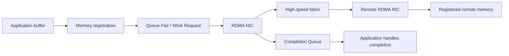
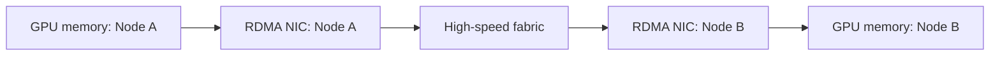

# RDMA, mạng tốc độ cao và bố trí cụm máy gần nhau

Trong điện toán hiệu năng cao (HPC), thời gian chạy của một workload phân tán không chỉ phụ thuộc vào tốc độ CPU hoặc GPU. Các node phải trao đổi dữ liệu, đồng bộ và phối hợp qua mạng. Nếu mỗi bước tính toán chỉ mất vài micro giây nhưng mỗi lần trao đổi dữ liệu lại mất nhiều thời gian hơn, cụm máy có thể dành phần lớn thời gian chờ mạng thay vì tính toán.

**RDMA (Remote Direct Memory Access)** cho phép một máy truy cập vùng bộ nhớ đã đăng ký trên máy khác qua NIC và fabric mạng với ít can thiệp của CPU/kernel trên đường dữ liệu hơn so với socket TCP truyền thống. Kết hợp RDMA với NIC tốc độ cao, topology mạng phù hợp và placement các node gần nhau có thể giảm latency, tăng throughput và cải thiện hiệu quả scale-out. Lợi ích chỉ xuất hiện khi ứng dụng, driver, NIC, switch, runtime và cấu hình placement đều hỗ trợ đúng đường truyền.

## 1. Vì sao mạng quan trọng với HPC?

Một workload HPC thường chia bài toán thành nhiều phần chạy song song trên nhiều CPU, GPU hoặc node. Các phần phải trao đổi dữ liệu đầu vào, kết quả trung gian, halo/boundary, gradient, tensor hoặc trạng thái đồng bộ.

Các kiểu giao tiếp thường gặp:

- **Point-to-point:** một rank/process gửi dữ liệu cho một rank/process khác.
- **Broadcast:** một node phân phối cùng dữ liệu tới nhiều node.
- **Reduce:** tổng hợp dữ liệu từ nhiều node thành một kết quả.
- **All-reduce:** mọi node đóng góp dữ liệu và nhận kết quả tổng hợp; phổ biến trong distributed training.
- **All-to-all:** mỗi node trao đổi dữ liệu với nhiều hoặc tất cả node còn lại; thường tạo áp lực lớn lên fabric.
- **Barrier/synchronization:** các node chờ nhau tới một điểm đồng bộ.

Nếu giao tiếp nằm trên critical path, latency mạng cộng dồn vào thời gian hoàn thành. Với nhiều bước trao đổi nhỏ, latency quan trọng hơn peak bandwidth. Với truyền tensor hoặc checkpoint lớn, throughput và băng thông tổng lại có ảnh hưởng lớn.

Một mô hình đơn giản cho thời gian truyền một message:

\[
T_{message} \approx L + \frac{S}{B}
\]

Trong đó `L` là latency cố định của đường truyền, `S` là kích thước dữ liệu và `B` là throughput hiệu dụng. Đây là mô hình gần đúng; thực tế còn có protocol overhead, queueing, congestion, copy, serialization, contention và thời gian xử lý ở hai đầu.

Với message nhỏ, thành phần `L` chi phối. Với message lớn, thành phần `S/B` chi phối. Vì thế, chỉ nhìn tốc độ NIC ghi trên thông số kỹ thuật không đủ để dự đoán thời gian của ứng dụng.

## 2. RDMA là gì?

RDMA cho phép NIC thực hiện thao tác truyền dữ liệu tới hoặc từ vùng memory đã được đăng ký trên máy từ xa. Trong mô hình phù hợp, dữ liệu có thể đi giữa memory của hai máy mà không cần CPU của máy đích sao chép từng byte qua kernel networking stack như cách socket truyền thống thường làm.

Các lợi ích chính:

- **Latency thấp:** giảm số lần chuyển context và xử lý trong kernel trên đường dữ liệu.
- **CPU overhead thấp:** NIC xử lý nhiều thao tác truyền dữ liệu, giải phóng CPU cho tính toán.
- **Throughput cao:** hỗ trợ truyền dữ liệu tốc độ cao và nhiều queue/operation đồng thời.
- **Ít copy hơn:** một số đường truyền cho phép dữ liệu đi trực tiếp giữa buffer ứng dụng và NIC hoặc memory đích; mức độ zero-copy phụ thuộc implementation và ứng dụng.
- **Scale tốt cho giao tiếp chặt:** có ích khi nhiều node trao đổi dữ liệu thường xuyên và đồng bộ với nhau.

RDMA không tự làm ứng dụng nhanh hơn nếu workload chủ yếu tính toán cục bộ, không trao đổi dữ liệu hoặc bị nghẽn ở storage, CPU, GPU hay thuật toán. Ứng dụng phải sử dụng thư viện/protocol hỗ trợ RDMA; cài NIC có khả năng RDMA không tự động chuyển mọi TCP socket thành RDMA.

## 3. RDMA hoạt động ở mức khái niệm

Ứng dụng chuẩn bị buffer trong memory, đăng ký vùng memory với RDMA subsystem, tạo queue pair và gửi work request. NIC dùng thông tin đã đăng ký để đọc/ghi dữ liệu theo quyền được cấp. Completion queue ghi nhận kết quả operation để ứng dụng biết khi nào có thể sử dụng buffer hoặc tiếp tục xử lý.



Các thành phần thường gặp trong RDMA verbs:

| Thành phần | Vai trò |
|---|---|
| Protection Domain (PD) | Nhóm tài nguyên và quyền truy cập RDMA liên quan |
| Memory Region (MR) | Vùng memory được đăng ký; có quyền và key để kiểm soát truy cập |
| Queue Pair (QP) | Kênh giao tiếp gồm send queue và receive queue theo transport phù hợp |
| Completion Queue (CQ) | Nhận completion event/entry của work request |
| Work Request (WR) | Mô tả thao tác gửi/nhận/read/write/atomic cần NIC thực hiện |
| Local/Remote Key | Thông tin xác thực quyền truy cập vùng memory trong phạm vi RDMA |
| Completion Queue Entry (CQE) | Kết quả hoàn tất hoặc lỗi của một operation |

Ứng dụng hoặc communication library quản lý vòng đời các tài nguyên này. Tạo và đăng ký quá nhiều vùng memory nhỏ có thể làm tăng overhead; nhiều ứng dụng hiệu năng cao dùng buffer pool được đăng ký trước và tái sử dụng.

## 4. Memory registration và vì sao không thể truy cập tùy ý

RDMA NIC cần biết vùng memory nào được phép truy cập và cách ánh xạ vùng đó cho thiết bị. Memory registration thường pin hoặc giữ mapping của trang memory trong thời gian vùng được đăng ký, tùy OS và driver. Điều này giúp NIC truy cập buffer an toàn trong khi operation đang diễn ra.

Các điểm cần chú ý:

- Chỉ vùng memory đã đăng ký và có quyền tương ứng mới được dùng cho operation RDMA.
- Registration/unregistration có chi phí; không nên thực hiện lặp lại cho từng message nhỏ nếu có thể tái sử dụng buffer.
- Pinning quá nhiều memory có thể làm giảm khả năng reclaim của OS và ảnh hưởng hệ thống.
- Kích thước page, IOMMU, DMA mapping, huge pages và giới hạn locked memory có thể ảnh hưởng hiệu năng hoặc khả năng đăng ký.
- Buffer không được giải phóng hoặc tái sử dụng trước khi operation hoàn tất.
- Ứng dụng phải quản lý lifetime, alignment và quyền truy cập chính xác.

Huge pages có thể giảm áp lực page translation/TLB trong một số workload, nhưng không phải điều kiện bắt buộc cho mọi RDMA deployment. Cần benchmark và kiểm tra hỗ trợ của OS, NIC driver, runtime và nền tảng cloud trước khi bật.

## 5. Các kiểu operation RDMA

Các API RDMA cung cấp một số kiểu operation phổ biến:

- **Send/Receive:** bên gửi đưa dữ liệu vào send queue; bên nhận chuẩn bị receive buffer. Cả hai phía phối hợp để chuyển message.
- **RDMA Write:** bên gửi ghi dữ liệu trực tiếp vào vùng memory đã đăng ký ở máy đích, theo quyền remote write đã cấp.
- **RDMA Read:** bên gửi đọc dữ liệu từ vùng memory đã đăng ký ở máy đích, theo quyền remote read.
- **Atomic operation:** một số transport/NIC hỗ trợ thao tác atomic trên vùng memory được cấp quyền, ví dụ compare-and-swap hoặc fetch-and-add.

Send/Receive thường phù hợp với message passing có sự phối hợp giữa hai phía. RDMA Read/Write có thể giảm số bước xử lý ở phía remote, nhưng yêu cầu quản lý memory key, quyền truy cập và đồng bộ rất cẩn thận. Atomic operation có giới hạn về loại dữ liệu, alignment, ordering và khả năng hỗ trợ của phần cứng.

RDMA one-sided không có nghĩa ứng dụng không cần protocol. Hai phía vẫn phải thống nhất địa chỉ/offset, key, trạng thái buffer, ownership và thời điểm dữ liệu hợp lệ. Sai đồng bộ có thể gây đọc dữ liệu cũ, ghi đè hoặc race condition.

## 6. Các công nghệ mạng hỗ trợ RDMA

RDMA có thể chạy trên nhiều loại fabric. Ba công nghệ thường được nhắc đến:

| Công nghệ | Môi trường truyền | Đặc điểm khái quát |
|---|---|---|
| InfiniBand | Fabric InfiniBand chuyên dụng | Hệ sinh thái HPC lâu đời, hỗ trợ RDMA và cơ chế quản lý fabric riêng |
| RoCE (RDMA over Converged Ethernet) | Ethernet | Đưa RDMA lên Ethernet; RoCEv2 chạy trên UDP/IP và có thể định tuyến qua mạng IP |
| iWARP | TCP/IP | RDMA trên TCP, có khả năng đi qua hạ tầng IP/TCP nhưng mức hỗ trợ triển khai khác nhau |

Không phải mọi Ethernet NIC đều hỗ trợ RoCE và không phải mọi cloud network đều cung cấp RDMA. Cần xác minh loại instance, NIC, driver, OS image, network fabric và dịch vụ cluster có hỗ trợ hay không.

### InfiniBand

InfiniBand thường được dùng trong cluster HPC và hệ thống AI có yêu cầu latency thấp, throughput cao và collective communication lớn. Fabric có cơ chế subnet manager và quản lý topology riêng. Hiệu năng phụ thuộc cấu hình switch, link, rail, firmware và cách ứng dụng sử dụng NIC.

### RoCE

RoCE tận dụng Ethernet nhưng cần thiết kế congestion control và loss behavior phù hợp. Trong nhiều deployment, PFC (Priority Flow Control) được dùng để hạn chế mất frame ở traffic class RDMA; ECN (Explicit Congestion Notification) và thuật toán điều khiển như DCQCN có thể giúp phản ứng với congestion. Cấu hình sai PFC có thể gây head-of-line blocking hoặc pause propagation; cấu hình sai ECN/congestion control có thể làm throughput dao động hoặc gây mất gói.

RoCEv1 thường bị giới hạn trong Layer 2 domain, trong khi RoCEv2 đóng gói qua UDP/IP và có thể route ở Layer 3. Tuy nhiên, khả năng định tuyến thực tế vẫn phụ thuộc thiết kế fabric, MTU, QoS, switch và cấu hình NIC.

### iWARP

iWARP dùng TCP/IP để mang RDMA, nhờ đó có thể tận dụng một số hạ tầng IP hiện hữu. Mức phổ biến và hỗ trợ trong các nền tảng HPC cloud có thể thấp hơn InfiniBand hoặc RoCE. Không nên chọn chỉ dựa trên khả năng đi qua TCP; cần kiểm tra hiệu năng, NIC, OS và thư viện ứng dụng.

## 7. RDMA so với TCP socket thông thường

| Tiêu chí | TCP socket | RDMA |
|---|---|---|
| API phổ biến | Berkeley sockets | RDMA verbs hoặc thư viện abstraction |
| Đường dữ liệu | Thường qua kernel networking stack | NIC xử lý trực tiếp nhiều thao tác trên registered memory |
| CPU overhead | Có thể cao hơn do protocol stack và copy | Thường thấp hơn với workload phù hợp |
| Latency | Phụ thuộc stack, congestion và cấu hình | Có thể thấp hơn đáng kể trên fabric hỗ trợ |
| Buffer | Buffer socket thông thường | Memory region phải đăng ký và quản lý quyền |
| Độ phức tạp ứng dụng | Thường dễ triển khai và debug hơn | Quản lý QP, CQ, MR, key và synchronization phức tạp hơn |
| Tính tương thích | Rộng, hoạt động trên nhiều mạng | Cần NIC, driver, fabric và runtime tương thích |
| Use case | API, web service, control plane, lưu lượng chung | MPI, distributed training, storage/HPC và trao đổi dữ liệu nhạy latency |

RDMA không nhất thiết thay thế TCP cho mọi traffic. Control plane, health check, metadata, logging và giao tiếp thông thường vẫn có thể dùng TCP/IP. Một cluster có thể sử dụng nhiều network path cho các loại traffic khác nhau.

## 8. MPI, UCX, libfabric và thư viện ứng dụng

Ứng dụng HPC thường không gọi RDMA verbs trực tiếp cho mọi thao tác. Các thư viện truyền thông cung cấp abstraction và chọn transport phù hợp:

- **MPI (Message Passing Interface):** mô hình giao tiếp phổ biến cho chương trình song song phân tán; implementation có thể dùng RDMA khi môi trường hỗ trợ.
- **UCX (Unified Communication X):** framework giao tiếp hiệu năng cao, cung cấp transport abstraction và hỗ trợ nhiều kiểu thiết bị/mạng.
- **libfabric:** API abstraction cho fabric, được nhiều HPC stack sử dụng.
- **NCCL:** thư viện collective communication cho GPU, có thể dùng các đường truyền GPU-aware và RDMA phù hợp.
- **GASNet và các runtime khác:** cung cấp communication abstraction cho một số mô hình parallel computing.

Việc cài thư viện chưa bảo đảm ứng dụng đang dùng RDMA. Runtime có thể fallback sang TCP nếu không tìm thấy NIC, provider hoặc cấu hình cần thiết. Cần kiểm tra log khởi tạo, transport được chọn, interface thực tế và benchmark để xác nhận data path.

## 9. GPUDirect RDMA và giao tiếp GPU liên node

Trong workload AI/HPC, dữ liệu có thể cần đi từ GPU của node này tới GPU của node khác. **GPUDirect RDMA** cho phép NIC truy cập memory của GPU trong các cấu hình phần cứng/phần mềm được hỗ trợ, giảm nhu cầu staging dữ liệu qua host memory.

Đường truyền khái niệm:



Lợi ích phụ thuộc GPU, NIC, PCIe topology, driver, CUDA/runtime, kernel module và thư viện collective. Không phải mọi GPU instance đều hỗ trợ GPUDirect RDMA; một số nền tảng chỉ hỗ trợ trong cùng host hoặc giới hạn theo instance family.

Phân biệt:

- **NVLink/NVSwitch:** kết nối tốc độ cao giữa GPU trong cùng máy hoặc domain phần cứng được hỗ trợ.
- **PCIe:** kết nối GPU, NIC và CPU trong host; topology/NUMA ảnh hưởng đường truyền.
- **RDMA fabric:** kết nối node khác nhau qua mạng cluster.
- **GPUDirect RDMA:** tối ưu đường đi giữa NIC và GPU memory qua fabric khi phần cứng/phần mềm hỗ trợ.

Không xem NVLink là mạng liên node mặc định, cũng không giả định RDMA tự động loại bỏ mọi host copy. Đo đường truyền thực tế của framework và kiểm tra topology bằng công cụ vendor.

## 10. Latency, bandwidth và message rate

Ba chỉ số cần phân biệt:

- **Latency:** thời gian từ lúc gửi tới lúc dữ liệu/hoàn tất operation được quan sát ở phía nhận. Với HPC, thường quan tâm microsecond và tail latency.
- **Bandwidth/throughput:** lượng dữ liệu truyền mỗi giây, thường đo bằng Gb/s hoặc GB/s.
- **Message rate/IOPS:** số message hoặc operation mỗi giây; quan trọng với message nhỏ và nhiều request.

Một NIC 200 Gb/s không có nghĩa ứng dụng luôn truyền được 25 GB/s. Throughput thực tế bị giới hạn bởi protocol overhead, PCIe, CPU, memory bandwidth, switch oversubscription, congestion, số queue và pattern truy cập.

Khi đo, cần ghi rõ:

- Kích thước message và số operation đồng thời.
- Một chiều hay hai chiều; một cặp node hay nhiều node.
- Latency trung bình, p95/p99 và độ biến thiên.
- Throughput theo từng flow và tổng throughput của cụm.
- CPU utilization, context switch và NIC utilization.
- Warm-up, số lần lặp và thời gian benchmark.
- Có dùng GPU, host memory hay buffer pinned không.

Microbenchmark có thể đạt kết quả cao nhưng ứng dụng thực tế vẫn chậm vì communication pattern, synchronization, imbalance hoặc serialization khác. Nên đo cả primitive mạng và end-to-end application.

## 11. Network topology và băng thông hai phân nửa (bisection bandwidth)

Cluster thường kết nối node qua leaf/spine hoặc Clos fabric. Một topology có oversubscription nghĩa là tổng bandwidth ở phía access lớn hơn bandwidth uplink có thể phục vụ đồng thời. Khi nhiều node cùng truyền qua uplink, throughput thực tế bị chia sẻ.

**Bisection bandwidth** mô tả tổng bandwidth tối thiểu giữa hai nửa của một network khi cắt topology thành hai nhóm node có kích thước tương đương. Chỉ số này giúp đánh giá khả năng phục vụ traffic all-to-all hoặc communication pattern phân tán rộng.

Các khái niệm:

- **Non-blocking fabric:** thiết kế có khả năng cung cấp bandwidth mục tiêu giữa các port theo giả định cấu hình.
- **Oversubscription ratio:** tỷ lệ tổng bandwidth phía server so với uplink bandwidth; ví dụ 4:1 nghĩa tổng bandwidth access gấp bốn lần uplink theo cách tính của thiết kế.
- **Leaf-spine:** mỗi leaf kết nối tới các spine; traffic giữa leaf đi qua spine.
- **Rail-optimized topology:** nhiều network rail độc lập hoặc song song để tăng băng thông và giảm contention cho HPC.
- **ECMP:** phân phối flow qua nhiều đường equal-cost; hiệu quả phụ thuộc hashing và pattern traffic.

Một cụm có node gần nhau nhưng fabric oversubscribed nặng vẫn có thể nghẽn. Ngược lại, một fabric tốt không thể bù hoàn toàn cho việc placement khiến traffic thường xuyên đi qua nhiều tầng hoặc nhiều miền mạng xa nhau.

## 12. Bố trí cụm máy gần nhau (placement locality)

Placement locality là việc đặt các node có trao đổi dữ liệu thường xuyên gần nhau về mặt topology hoặc fault domain để giảm hop, latency và contention. “Gần nhau” có thể mang nhiều nghĩa:

1. Cùng host: giao tiếp có thể đi qua shared memory, PCIe hoặc interconnect nội bộ thay vì fabric mạng.
2. Cùng rack/leaf switch: có thể giảm số hop và tránh một số uplink aggregation.
3. Cùng cluster/placement group: nền tảng cố gắng đặt instance theo topology phù hợp với workload latency thấp hoặc throughput cao.
4. Cùng availability zone: có thể giảm latency và phí truyền liên zone, tùy kiến trúc cloud.
5. Cùng region nhưng khác zone: tăng fault isolation nhưng có thể tăng latency và chi phí truyền dữ liệu.

Placement locality cần cân bằng với availability. Đặt toàn bộ node trong một rack có thể giảm latency nhưng tăng blast radius khi rack hoặc switch lỗi. Đặt toàn bộ node trong một AZ có thể làm giảm khả năng chịu lỗi AZ. Với workload HPC tightly coupled, một job thường cần node trong cùng nhóm placement; với dịch vụ stateful HA, replica lại cần được phân tán qua fault domain.

Không giả định người dùng cloud có quyền chọn rack hoặc switch vật lý. Nhiều nền tảng chỉ cung cấp placement group, cluster placement, dedicated host hoặc instance family có network performance xác định. Cần đọc cam kết placement của dịch vụ, không suy diễn từ tên tính năng.

## 13. Placement group và cluster placement trên cloud

Một số cloud provider cung cấp placement group hoặc cluster placement policy để cố gắng đặt các VM gần nhau về mặt hạ tầng. Mục tiêu có thể là giảm network latency, tăng khả năng đạt throughput cao hoặc cải thiện khả năng sử dụng network adapter hiệu năng cao.

Khi dùng placement feature, kiểm tra:

- Phạm vi hỗ trợ: zone, region, host group hoặc loại instance nào.
- Giới hạn số instance và loại máy được phép.
- Hành vi khi capacity không đủ; có thể cần retry hoặc thay đổi instance type.
- Có hỗ trợ RDMA/EFA/InfiniBand/RoCE hay chỉ tối ưu network thông thường.
- Có giới hạn về khả năng scale out sau khi nhóm đã gần đầy.
- Hành vi khi stop/start, replace hoặc resize instance.
- Tác động tới availability và failure domain.

Placement group có thể cải thiện locality nhưng không tự bảo đảm latency cố định hoặc bandwidth tuyệt đối. Hãy benchmark sau khi tạo cụm và theo dõi network performance khi tải đồng thời.

## 14. NUMA, PCIe và NIC affinity

Một máy nhiều socket có thể có nhiều NUMA node. CPU core, memory bank và PCIe device thường có locality nhất định. Nếu process chạy trên CPU thuộc NUMA node 0 nhưng buffer hoặc NIC nằm gần NUMA node 1, dữ liệu có thể đi qua inter-socket link, tăng latency và tiêu thụ băng thông nội bộ.

Các điểm cần quan sát:

- NIC gắn với PCIe root complex/NUMA node nào.
- CPU core chạy network thread và application thread thuộc NUMA node nào.
- Buffer memory được cấp phát ở node nào.
- IRQ/NAPI và queue affinity có phù hợp không.
- GPU và NIC có kết nối PCIe trực tiếp hay phải qua switch/root complex khác.
- Có oversubscription ở PCIe link hoặc memory controller không.

Trên Linux, các công cụ như `lscpu`, `numactl --hardware`, `lspci -tv`, `numastat` và `ethtool -i` có thể giúp xem topology. Việc pin CPU, memory hoặc IRQ nên dựa trên benchmark; pin sai có thể làm mất khả năng cân bằng scheduler hoặc tạo hotspot.

## 15. Bố trí rank/process và GPU theo topology

Trong MPI hoặc distributed training, placement process cần phù hợp với topology node:

- Đặt các rank giao tiếp thường xuyên trên cùng node nếu workload hưởng lợi từ shared memory.
- Map rank với NUMA node và NIC gần nhất khi có nhiều NIC/rail.
- Gắn GPU với CPU/NIC theo PCIe topology.
- Tránh để nhiều rank cạnh tranh cùng một NIC queue hoặc CPU core.
- Phân bố process theo số core, memory bandwidth và GPU thực tế, không chỉ theo số vCPU.
- Kiểm tra affinity sau khi scheduler/container runtime đặt workload.

Với MPI, mapping/binding option phụ thuộc implementation như Open MPI, MPICH hoặc vendor MPI. Với GPU collective, NCCL topology detection và transport selection có thể ảnh hưởng hiệu năng. Không sao chép một lệnh `--bind-to` hoặc cấu hình NCCL giữa các nền tảng mà chưa xác minh.

## 16. Congestion control và QoS

Khi nhiều flow cùng chia sẻ fabric, congestion có thể làm tăng latency và giảm throughput. RDMA không miễn nhiễm với congestion; thậm chí một số workload nhạy với tail latency hơn TCP thông thường.

Các cơ chế có thể gặp:

- **PFC:** Ethernet pause theo priority để hạn chế mất frame của traffic class cụ thể. Cần cấu hình end-to-end nhất quán và tránh lan truyền pause ngoài ý muốn.
- **ECN:** đánh dấu packet khi queue switch vượt ngưỡng để sender giảm tốc trước khi xảy ra mất gói.
- **DCQCN:** một cơ chế congestion control thường được dùng trong một số RoCE deployment.
- **QoS/traffic class:** phân loại traffic RDMA, control plane và traffic thông thường để quản lý ưu tiên.
- **Adaptive routing/ECMP:** phân phối flow qua nhiều đường, phụ thuộc khả năng của fabric.

PFC không phải giải pháp congestion hoàn chỉnh. Cấu hình sai có thể tạo head-of-line blocking, pause storm hoặc deadlock. ECN threshold, queue buffer, MTU và NIC rate control cần được cấu hình đồng bộ theo hướng dẫn của nhà cung cấp fabric.

Trong cloud managed network, người dùng có thể không truy cập switch để tự chỉnh PFC/ECN. Khi đó, cần dùng instance/NIC profile được hỗ trợ và thu thập metric được nền tảng cung cấp.

## 17. Security và isolation cho RDMA

RDMA trao quyền cho NIC truy cập vùng memory đã đăng ký. Vì vậy, quản lý quyền và isolation đặc biệt quan trọng:

- Dùng protection domain, memory key và quyền access đúng phạm vi.
- Chỉ expose vùng memory cần thiết; không cấp remote read/write rộng hơn nhu cầu.
- Xác thực và thiết lập QP theo cơ chế bảo mật của fabric/runtime.
- Cách ly workload tenant bằng network partition, security policy hoặc cơ chế cloud tương ứng.
- Bảo vệ control plane và metadata dùng để trao đổi address/key.
- Thu hồi key và deregister memory khi workload kết thúc.
- Giữ driver, firmware, kernel và communication library được cập nhật.
- Không coi RDMA fabric riêng là thay thế cho IAM, encryption hoặc kiểm soát truy cập ứng dụng.

Khả năng mã hóa trên wire phụ thuộc công nghệ NIC/fabric và dịch vụ cloud. Nếu dữ liệu nhạy cảm cần encryption, xác minh hỗ trợ hardware encryption hoặc mã hóa ở application layer; encryption có thể ảnh hưởng throughput/latency và cần benchmark.

## 18. Khi nào nên dùng RDMA?

RDMA thường có lợi khi:

- Nhiều node trao đổi dữ liệu thường xuyên và latency thấp có ảnh hưởng lớn tới thời gian hoàn thành.
- MPI collective, halo exchange hoặc distributed training chiếm phần lớn thời gian giao tiếp.
- CPU overhead của network stack đang giới hạn throughput.
- Workload truyền nhiều message nhỏ hoặc dữ liệu lớn với yêu cầu hiệu năng cao.
- Ứng dụng và thư viện đã hỗ trợ RDMA ổn định.

RDMA có thể không cần thiết khi:

- Workload chủ yếu tính toán cục bộ, giao tiếp ít.
- Traffic chủ yếu là HTTP/API thông thường.
- Node count nhỏ và TCP throughput đã đáp ứng SLO.
- Ứng dụng chưa hỗ trợ RDMA và chi phí porting/test lớn hơn lợi ích.
- Cloud region/instance hiện tại không cung cấp fabric phù hợp.
- Nút thắt thực sự nằm ở storage, GPU compute, serialization hoặc thuật toán.

Trước khi đầu tư, hãy đo tỷ lệ thời gian ứng dụng dành cho communication, CPU network overhead, latency và throughput. Nếu network chỉ chiếm 2% thời gian chạy, thay đổi fabric có thể không mang lại lợi ích tổng thể đáng kể.

## 19. Benchmark và xác minh đường RDMA

Nên thực hiện từ kiểm tra thiết bị tới kiểm thử ứng dụng:

1. Xác nhận instance/host có NIC và fabric hỗ trợ RDMA.
2. Kiểm tra driver, firmware, kernel module và device node.
3. Kiểm tra interface/link state, GID/port và MTU theo công nghệ.
4. Chạy microbenchmark latency, bandwidth và message rate giữa hai node.
5. Tăng số node/flow để kiểm tra fabric congestion và oversubscription.
6. Xác minh MPI/UCX/libfabric/NCCL chọn transport RDMA thay vì fallback TCP.
7. Chạy workload thực tế, đo communication time và end-to-end runtime.
8. So sánh placement trong cùng group với placement thông thường nếu nền tảng hỗ trợ.
9. Lặp lại ở nhiều thời điểm và tải đồng thời để phát hiện biến động.

Một số công cụ Linux có thể hữu ích, tùy driver và fabric:

```bash
# Kiem tra CPU va NUMA topology
lscpu
numactl --hardware

# Kiem tra PCIe va NIC driver
lspci -tv
ethtool -i eth0

# Kiem tra RDMA device va link (neu bo cong cu da cai)
ibv_devinfo
ibstat
rdma link

# Microbenchmark verbs (ten cong cu phu thuoc goi cai dat)
ib_write_bw
ib_read_lat
ib_send_lat
```

Tên interface, tool và quyền chạy khác nhau theo distribution và vendor. `ibstat`/`ibv_devinfo` không có sẵn trên mọi máy. Với RoCE, cần xem thêm GID, MTU, NIC counters, ECN/PFC counters và switch telemetry nếu được cấp quyền.

### Kiểm tra fallback sang TCP

Một benchmark chạy thành công chưa chứng minh đang dùng RDMA. Kiểm tra:

- Log khởi tạo communication library và transport/provider được chọn.
- Interface hoặc device RDMA thực tế được sử dụng.
- NIC counter và fabric counter tăng khi benchmark chạy.
- TCP interface có đang mang phần lớn data traffic hay không.
- So sánh kết quả khi tắt/loại transport RDMA trong môi trường test có kiểm soát.

Không tắt network interface production để thử fallback. Dùng staging hoặc node thử nghiệm.

## 20. Tối ưu placement theo communication pattern

Không phải mọi node trong một job đều giao tiếp giống nhau. Placement nên dựa trên graph giao tiếp:

- Với point-to-point thường xuyên giữa một số cặp rank, đặt các cặp đó gần nhau nếu không tạo hotspot.
- Với all-reduce, xem topology phù hợp với ring/tree algorithm và số rail.
- Với all-to-all, chú ý bisection bandwidth, oversubscription và congestion.
- Với dữ liệu partitioned, đặt compute gần storage hoặc shard dữ liệu nếu giảm được traffic.
- Với multi-GPU, map rank theo NVLink/PCIe/NUMA và NIC topology.

Một job có thể chia thành nhóm node giao tiếp dày đặc. Nếu platform hỗ trợ cluster placement group, có thể đặt nhóm đó trong một placement domain. Tuy nhiên, việc co cụm cũng làm giảm fault isolation. Với job có thể restart từ checkpoint, chấp nhận domain tập trung có thể hợp lý; với dịch vụ cần HA liên tục, cần cân nhắc placement phân tán hơn.

## 21. Ví dụ: MPI workload chạy trên nhiều node

Một mô phỏng CFD chạy trên 16 node. Mỗi node có nhiều core và ứng dụng chia domain thành các partition. Ở mỗi iteration, rank trao đổi halo data với các partition lân cận rồi tính toán bước tiếp theo.

Nếu các node dùng TCP thông thường và CPU phải xử lý nhiều packet/copy, communication overhead có thể tăng khi node count lớn. Một cấu hình có RDMA-capable NIC, MPI stack hỗ trợ RDMA và placement gần nhau có thể giảm latency và CPU overhead.

Quy trình thử nghiệm:

1. Chạy baseline bằng cấu hình mạng hiện tại; lưu runtime, CPU utilization và communication time.
2. Xác nhận tất cả node có cùng loại NIC/fabric được hỗ trợ.
3. Cài đúng driver và MPI/UCX/libfabric version tương thích.
4. Đặt node trong placement domain phù hợp nếu cloud hỗ trợ.
5. Kiểm tra process binding theo NUMA/NIC.
6. Chạy microbenchmark và xác nhận RDMA data path.
7. Chạy lại mô phỏng với cùng input, rank count và compiler flags.
8. So sánh runtime, tail latency, CPU overhead và scalability efficiency.
9. Kiểm thử khi tăng số node và khi một node/network path gặp lỗi.

Nếu runtime không cải thiện, kiểm tra partition imbalance, collective algorithm, memory bandwidth, storage I/O và số lần đồng bộ. RDMA không khắc phục được thuật toán phân chia công việc mất cân bằng.

## 22. Ví dụ: distributed AI training

Trong distributed training, mỗi GPU tính gradient trên mini-batch cục bộ. Các GPU sau đó cần collective communication để đồng bộ gradient hoặc parameter. Với nhiều node, all-reduce có thể trở thành nút thắt.

Một thiết kế hiệu năng cao có thể kết hợp:

- GPU và NIC có hỗ trợ GPUDirect RDMA.
- Fabric tốc độ cao, topology và congestion control được tối ưu.
- NCCL hoặc communication runtime phù hợp với driver/CUDA/NIC.
- Node placement trong cluster/placement group được hỗ trợ.
- GPU/NIC/CPU mapping phù hợp PCIe và NUMA.
- Batch size, gradient bucket và overlap compute/communication được tối ưu.

Đo các chỉ số như step time, all-reduce time, GPU utilization, NIC throughput và scaling efficiency. Nếu GPU utilization thấp trong lúc chờ all-reduce, network hoặc communication scheduling có thể là nguyên nhân. Nếu GPU utilization cao nhưng step time vẫn lớn, cần phân tích kernel, memory và input pipeline.

Không phải mọi training workload đều cần RDMA. Mô hình nhỏ, số GPU ít hoặc communication volume thấp có thể chạy tốt trên network thông thường.

## 23. Scaling efficiency và điểm nghẽn khi tăng node

Thêm node không bảo đảm thời gian chạy giảm tỷ lệ thuận. Một cách đo đơn giản:

\[
E_{scale} = \frac{T_1}{N \times T_N}
\]

Trong đó `T_1` là thời gian chạy với một đơn vị compute, `T_N` là thời gian chạy với `N` đơn vị compute; `E_scale` gần 1 biểu thị strong scaling efficiency cao theo định nghĩa này. Cần giữ input và cách đo nhất quán.

Khi tăng node, efficiency có thể giảm do:

- Communication volume tăng.
- Synchronization và barrier wait.
- Network oversubscription/congestion.
- Load imbalance giữa rank.
- Storage hoặc shared filesystem không theo kịp.
- CPU/NIC/PCIe/NUMA affinity không tối ưu.
- Startup, orchestration và checkpoint overhead.

RDMA và placement locality có thể giảm một số phần network overhead, nhưng không loại bỏ chi phí đồng bộ và imbalance của thuật toán.

## 24. Troubleshooting mạng RDMA và cụm HPC

Khi hiệu năng thấp hoặc kết nối RDMA lỗi, điều tra theo lớp:

**Thiết bị và driver**

- NIC có xuất hiện và đúng firmware không?
- Driver/kernel module có tương thích không?
- RDMA device/port có active và link speed đúng không?
- Có lỗi PCIe, reset hoặc firmware event không?

**Fabric và đường mạng**

- MTU/GID/VLAN/route có nhất quán không?
- Switch port có error, drop, pause hoặc congestion không?
- PFC/ECN/QoS có được cấu hình đồng bộ không?
- Có oversubscription hoặc ECMP imbalance không?
- Các node có ở cùng placement domain như dự kiến không?

**Ứng dụng và runtime**

- MPI/UCX/libfabric/NCCL có chọn đúng RDMA provider không?
- QP/CQ/MR có được tạo và đăng ký thành công không?
- Memory registration limit hoặc locked memory limit có bị chạm không?
- Buffer lifetime và synchronization có đúng không?
- Có fallback sang TCP không?
- Rank mapping, CPU affinity và NUMA placement có hợp lý không?

**Đo hiệu năng**

- Latency tăng ở message nhỏ hay bandwidth giảm ở message lớn?
- Một cặp node chậm hay toàn fabric chậm?
- Chỉ xảy ra khi nhiều job cùng chạy hay ngay cả khi rảnh?
- CPU/network thread có bị throttling hoặc contention không?
- Có thay đổi image, driver, firmware hoặc placement gần đây không?

Thay đổi một nhóm cấu hình tại một thời điểm và lưu baseline. Với fabric managed, cung cấp cho nhà cung cấp timestamp, node/instance ID, NIC counter, benchmark command và topology quan sát được; tránh suy đoán switch setting mà người dùng không quản lý.

## 25. Các sai lầm thường gặp

- **Cho rằng NIC tốc độ cao đồng nghĩa ứng dụng dùng RDMA:** runtime có thể đang fallback TCP. Xác minh transport và NIC counters.
- **Đo bandwidth rồi kết luận latency thấp:** hai chỉ số khác nhau. Đo latency với message size nhỏ và tail percentile.
- **Đăng ký memory cho từng message:** registration overhead tăng. Tái sử dụng buffer pool khi phù hợp.
- **Pin quá nhiều memory:** giảm khả năng reclaim của OS. Chỉ đăng ký vùng cần thiết và theo dõi locked memory.
- **Coi RDMA là zero-copy tuyệt đối:** một số đường vẫn có staging/copy. Kiểm tra implementation và profiler.
- **Cấu hình PFC mà không thiết kế congestion control:** có thể tạo pause storm hoặc head-of-line blocking. Dùng cấu hình fabric được hỗ trợ.
- **Đặt tất cả node cùng rack để giảm latency:** tăng blast radius. Cân bằng locality với failure domain.
- **Giả định placement group bảo đảm rack adjacency hoặc latency cố định:** semantics khác nhau theo provider. Xác minh phạm vi hỗ trợ.
- **Bỏ qua NUMA/PCIe:** NIC, CPU và buffer ở xa nhau làm tăng latency nội bộ. Kiểm tra topology và affinity.
- **Nhầm NVLink với RDMA liên node:** hai công nghệ phục vụ phạm vi kết nối khác nhau. Thiết kế đúng đường GPU-local và network.
- **Scale node count mà không đo fabric:** oversubscription và all-to-all congestion làm efficiency giảm. Đo end-to-end ở quy mô mục tiêu.
- **Chỉ benchmark microbenchmark:** kết quả không phản ánh workload thật. Chạy cả application benchmark.

## 26. Checklist thiết kế cụm HPC

- [ ] Đã phân tích communication pattern: point-to-point, broadcast, reduce, all-reduce, all-to-all và synchronization.
- [ ] Đã xác định RDMA có thực sự cần thiết dựa trên communication time và CPU overhead.
- [ ] NIC, driver, firmware, OS, fabric và cloud instance hỗ trợ cùng một RDMA technology.
- [ ] Đã xác định dùng InfiniBand, RoCE hay iWARP và semantics của fabric.
- [ ] Ứng dụng/library đã xác minh dùng đúng RDMA provider, không fallback ngoài dự kiến.
- [ ] Memory registration, buffer lifetime, locked memory và key permissions được quản lý đúng.
- [ ] Đã benchmark latency, bandwidth, message rate và tail latency.
- [ ] Đã kiểm tra NUMA, PCIe, NIC/GPU affinity và process binding.
- [ ] Placement locality phù hợp communication graph và không tạo failure domain quá tập trung.
- [ ] Đã tính bisection bandwidth, oversubscription, rail và congestion khi scale node.
- [ ] RoCE PFC/ECN/QoS hoặc fabric policy được cấu hình theo hướng dẫn hỗ trợ.
- [ ] Security isolation, memory access key, encryption và firmware update được kiểm soát.
- [ ] Đã kiểm thử với workload thực, nhiều node và nhiều job đồng thời.
- [ ] Đã theo dõi network counters, error/drop, congestion, application communication time và scaling efficiency.
- [ ] Có baseline, runbook troubleshooting và quy trình phối hợp với cloud/provider khi fabric managed.

RDMA, mạng tốc độ cao và placement locality có thể giúp cụm HPC giảm latency, tăng throughput và giảm CPU overhead cho giao tiếp liên node. Hiệu quả phụ thuộc vào toàn bộ đường đi từ buffer ứng dụng, runtime, NIC, PCIe/NUMA tới switch fabric và vị trí các node. Khi chọn đúng workload, xác minh data path RDMA, đo cả microbenchmark lẫn ứng dụng thật và cân bằng locality với fault isolation, cụm máy có thể mở rộng hiệu quả hơn mà vẫn kiểm soát được rủi ro vận hành.
