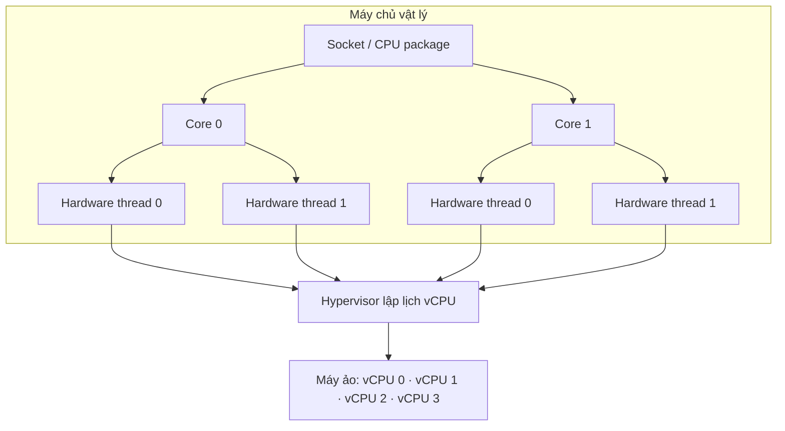

# vCPU, core, thread và cách diễn giải cấu hình máy ảo

Khi tạo một máy ảo trên cloud, cấu hình thường hiển thị các thông số như 2 vCPU, 8 vCPU hoặc 16 vCPU. Những con số này cho biết lượng năng lực xử lý logic mà máy ảo được cấp, nhưng không tự động cho biết máy đang sử dụng bao nhiêu lõi vật lý, có bao nhiêu luồng phần cứng hay mỗi vCPU được bảo đảm bao nhiêu năng lực CPU.

Để chọn cấu hình phù hợp, cần hiểu quan hệ giữa **socket, core, hardware thread và vCPU**; cách hypervisor lập lịch CPU; và cách nhà cung cấp mô tả loại instance. Một máy ảo có nhiều vCPU chưa chắc nhanh hơn một máy có ít vCPU nhưng dùng CPU thế hệ mới, xung nhịp cao hoặc tài nguyên được dành riêng. Quyết định cuối cùng cần dựa trên đặc tính workload và phép đo thực tế.

## 1. Cấu trúc CPU từ phần cứng đến máy ảo

### Socket và CPU package

Socket là vị trí kết nối một CPU package với bo mạch chủ. Một máy chủ có thể có một hoặc nhiều socket. CPU package hiện đại có thể chứa một hoặc nhiều die, bộ điều khiển bộ nhớ, các cụm cache và nhiều lõi xử lý. Trong tài liệu vận hành, từ *socket* thường được dùng để chỉ một CPU vật lý được lắp trên máy chủ.

Số socket có thể ảnh hưởng đến kiến trúc NUMA, băng thông bộ nhớ, độ trễ truy cập RAM và cách phần mềm thương mại tính giấy phép. Tuy nhiên, nhiều socket hơn không mặc nhiên làm một ứng dụng chạy nhanh hơn; hiệu năng còn phụ thuộc khả năng song song hóa và cách bố trí dữ liệu giữa các node.

### Core (lõi vật lý)

Core là một đơn vị xử lý vật lý bên trong CPU. Mỗi core có các tài nguyên thực thi để giải mã và chạy lệnh. Một CPU package có thể có nhiều core; ví dụ một máy chủ hai socket, mỗi socket có 24 core, có tổng cộng 48 core vật lý.

Khi một workload cần xử lý nhiều tác vụ độc lập cùng lúc, nhiều core có thể thực thi các luồng công việc song song. Tuy nhiên, một ứng dụng đơn luồng thường không tận dụng được toàn bộ số core. Với ứng dụng đó, tốc độ xử lý của một core, độ trễ bộ nhớ và hiệu năng mỗi chu kỳ có thể quan trọng hơn tổng số core.

### Hardware thread và SMT

Một core có thể cung cấp một hoặc nhiều hardware thread (luồng phần cứng). Công nghệ Simultaneous Multithreading (SMT), được Intel gọi là Hyper-Threading trên một số dòng CPU, cho phép một core duy trì trạng thái của nhiều luồng và chia sẻ các tài nguyên thực thi của core giữa chúng.

Ví dụ, CPU có 8 core và SMT 2-way có thể hiển thị 16 logical processor cho hệ điều hành. Hai logical processor trên cùng một core không tương đương hai core vật lý độc lập: chúng chia sẻ một phần tài nguyên như đơn vị thực thi và cache. SMT có thể cải thiện mức sử dụng core khi một luồng phải chờ dữ liệu, nhưng mức tăng hiệu năng phụ thuộc workload và có thể thấp hơn nhiều so với gấp đôi.

Các thuật ngữ cần phân biệt:

- **Core:** lõi xử lý vật lý.
- **Hardware thread:** ngữ cảnh thực thi phần cứng mà core có thể chạy; một core có thể có một hoặc nhiều hardware thread.
- **Logical processor:** đơn vị xử lý mà hệ điều hành nhìn thấy và lập lịch. Trên máy vật lý có SMT, mỗi hardware thread thường xuất hiện như một logical processor.

### vCPU (virtual CPU)

vCPU là đơn vị CPU logic mà hypervisor hoặc nền tảng ảo hóa trình bày cho một máy ảo. Guest OS nhìn thấy các bộ xử lý logic này và lập lịch tiến trình, luồng ứng dụng lên chúng như cách hệ điều hành chạy trên CPU.

Ở phía host, hypervisor lập lịch thời gian chạy của vCPU lên các bộ xử lý logic vật lý. Việc ánh xạ có thể thay đổi theo thời gian và chính sách của nền tảng. Một vCPU không nhất thiết được gắn cố định với một core vật lý, cũng không mặc nhiên được độc quyền một hardware thread.

Có thể hình dung các lớp như sau:



Sơ đồ chỉ minh họa một cách ánh xạ đơn giản. Trong môi trường thực tế, host có thể có nhiều socket, nhiều core và nhiều hardware thread hơn; một VM cũng có thể được lập lịch trên các logical processor khác nhau theo thời gian.

## 2. vCPU có tương đương core vật lý không?

Không có một quy ước duy nhất áp dụng cho mọi nhà cung cấp cloud. Cần đọc định nghĩa của loại instance và chính sách CPU của dịch vụ. Các mô hình phổ biến gồm:

1. **Một vCPU tương ứng một hardware thread.** Trên host có SMT 2-way, 2 vCPU có thể được ánh xạ tới hai hardware thread thuộc cùng một core vật lý. Vì vậy, 8 vCPU có thể tương ứng với 4 core vật lý có SMT 2-way trong một cấu hình minh họa.
2. **Một vCPU tương ứng một core vật lý.** Một số dịch vụ tắt SMT hoặc định nghĩa vCPU theo core để cung cấp năng lực CPU chuyên dụng. Trong trường hợp này, số vCPU và số core vật lý có thể bằng nhau theo cam kết của dịch vụ.
3. **vCPU dùng chung theo thời gian.** Nhiều VM có thể chia sẻ thời gian xử lý của cùng tài nguyên vật lý. Hypervisor phân bổ các khoảng thời gian CPU cho từng vCPU. Mức độ tranh chấp và giới hạn hiệu năng phụ thuộc chính sách của host và loại instance.

Vì vậy, câu “máy ảo có 8 vCPU” chỉ cho biết guest được trình bày 8 đơn vị xử lý logic. Để hiểu năng lực thực tế, cần kiểm tra thêm:

- vCPU là hardware thread, core hay đơn vị chia sẻ theo định nghĩa của dịch vụ;
- CPU được chia sẻ hay dành riêng, có pinning hoặc giới hạn thời gian chạy hay không;
- host có bật SMT hay không và cách nhà cung cấp phân bổ các sibling thread;
- loại CPU, thế hệ CPU, kiến trúc lệnh và mức xung nhịp được cung cấp;
- có cơ chế burst, CPU credit, giới hạn công suất hoặc chính sách giảm hiệu năng khi dùng lâu hay không.

Một dịch vụ có thể công bố rõ số vCPU nhưng không tiết lộ topology vật lý của host. Đây là lựa chọn thiết kế bình thường của cloud đa tenant. Nếu ứng dụng cần biết hoặc kiểm soát core vật lý, phải chọn đúng dịch vụ có cam kết về dedicated core, host placement hoặc bare metal và xác minh phạm vi cam kết trong tài liệu nhà cung cấp.

## 3. CPU dùng chung, CPU chuyên dụng và khả năng burst

### CPU dùng chung

Ở cấu hình shared CPU, nhiều VM có thể cùng sử dụng năng lực của host. Hypervisor chia thời gian xử lý giữa các vCPU theo bộ lập lịch và chính sách của nền tảng. Khi host ít tải, VM có thể đạt hiệu năng tốt; khi nhiều workload cùng hoạt động, thời gian chờ được lập lịch có thể tăng.

Trên Linux, chỉ số `%steal` trong một số môi trường ảo hóa cho biết thời gian vCPU sẵn sàng chạy nhưng phải chờ hypervisor cấp CPU. Trên các nền tảng khác, nhà cung cấp có thể hiển thị chỉ số CPU ready, CPU contention hoặc một metric tương đương. Tên và cách tính phụ thuộc hypervisor.

### CPU chuyên dụng

Với dedicated vCPU hoặc dedicated core, nhà cung cấp cam kết một mức phân bổ CPU riêng theo định nghĩa của dịch vụ. Cam kết có thể là thời gian CPU, core vật lý, hardware thread hoặc pinning. Các tên thương mại như *dedicated*, *reserved* hay *isolated* không đủ để suy ra chính xác mô hình; cần xem tài liệu kỹ thuật.

CPU chuyên dụng thường giúp hiệu năng dễ dự đoán hơn khi tải cao liên tục hoặc workload nhạy với độ trễ. Đổi lại, chi phí thường cao hơn và tài nguyên có thể bị lãng phí khi ứng dụng ít tải. Dedicated host cũng không mặc nhiên có nghĩa mọi vCPU của VM đều được pin vào core vật lý độc quyền; phạm vi cô lập phải được kiểm tra riêng.

### Burstable CPU và CPU credit

Một số instance được thiết kế để duy trì mức CPU cơ bản thấp, nhưng có thể tăng lên mức cao trong thời gian ngắn. Nền tảng có thể dùng cơ chế CPU credit: VM tích lũy credit khi chạy dưới baseline và tiêu thụ credit khi burst trên baseline. Khi hết credit, hiệu năng có thể bị giới hạn về mức cơ bản hoặc mức do nhà cung cấp quy định.

Instance burstable phù hợp với máy chủ phát triển, dịch vụ nền ít tải, website nhỏ hoặc workload có đỉnh ngắn và khoảng nghỉ dài. Nó có thể không phù hợp với xử lý video liên tục, phân tích dữ liệu chạy nhiều giờ hoặc cơ sở dữ liệu thường xuyên dùng CPU cao. Khi chọn instance loại này, phải xem baseline CPU, cách tích lũy/tiêu thụ credit, giới hạn burst và chế độ duy trì hiệu năng khi credit cạn.

## 4. Số lượng vCPU không phải toàn bộ hiệu năng CPU

Khi so sánh hai instance, không nên chỉ nhìn số vCPU. Hiệu năng còn chịu ảnh hưởng của các yếu tố sau:

| Yếu tố | Ý nghĩa khi chọn máy |
|---|---|
| Kiến trúc CPU | x86-64 và ARM64 có tập lệnh và khả năng tương thích khác nhau; cần kiểm tra image, binary, thư viện và agent giám sát |
| Thế hệ CPU | CPU mới có thể cải thiện hiệu năng mỗi chu kỳ, băng thông bộ nhớ và tập lệnh dù số vCPU bằng nhau |
| Xung nhịp | Tần số cơ bản và turbo thay đổi theo tải, nhiệt độ, giới hạn công suất và chính sách nhà cung cấp |
| SMT | Tăng số logical processor mà core cung cấp, nhưng các luồng trên cùng core chia sẻ tài nguyên |
| Cache | Kích thước và độ trễ cache ảnh hưởng workload có tập dữ liệu truy cập lặp lại |
| NUMA và bộ nhớ | Truy cập RAM ở node xa có thể tăng độ trễ; bố trí vCPU và RAM cần phù hợp topology |
| Tập lệnh tăng tốc | AVX2, AVX-512, AES-NI hoặc các mở rộng khác có thể tăng tốc một số tác vụ nếu phần mềm sử dụng được |
| Chính sách chia sẻ | CPU contention, giới hạn công suất và cơ chế burst tác động đến năng lực duy trì |

Một core chạy ở xung nhịp cao không phải lúc nào cũng nhanh hơn core có xung thấp hơn: kiến trúc, số lệnh hoàn thành mỗi chu kỳ (IPC), cache và khả năng vector hóa cũng quan trọng. Tương tự, thông số turbo tối đa không có nghĩa toàn bộ core sẽ duy trì tần số đó trong thời gian dài.

### NUMA và topology của VM

Máy chủ nhiều socket thường được tổ chức thành các node NUMA (Non-Uniform Memory Access). Mỗi node có nhóm core và vùng bộ nhớ gắn gần với nó. CPU truy cập bộ nhớ local thường có độ trễ thấp hơn truy cập bộ nhớ thuộc node khác.

Khi VM lớn có nhiều vCPU và RAM, hypervisor cần bố trí tài nguyên phù hợp trên host. Một số nền tảng cho phép chọn topology vCPU hoặc tối ưu NUMA; một số nền tảng tự động quản lý và không công bố chi tiết. Nếu VM có nhiều vCPU nhưng workload thường xuyên truy cập RAM từ xa, hiệu năng có thể giảm dù CPU utilization chưa đạt 100%.

Topology mà guest OS nhìn thấy cũng có thể ảnh hưởng đến bộ lập lịch và phần mềm có giới hạn theo socket hoặc core. Ví dụ, một VM 8 vCPU có thể được trình bày như 1 socket × 8 core × 1 thread hoặc 2 socket × 4 core × 1 thread. Tổng vCPU giống nhau, nhưng cách guest OS và một số phần mềm diễn giải topology có thể khác. Chỉ điều chỉnh topology khi hiểu yêu cầu của hệ điều hành, ứng dụng và điều khoản cấp phép.

## 5. Cách đọc cấu hình instance trên cloud

Trang chọn instance hoặc bảng cấu hình máy thường có nhiều trường. Hãy đọc chúng theo nhóm thay vì dựa vào tên instance.

| Trường thông tin | Cần hiểu gì? | Câu hỏi cần kiểm tra |
|---|---|---|
| Family / dòng máy | Mục đích tối ưu: general purpose, compute optimized, memory optimized, storage optimized, GPU | Workload có đúng đặc tính mà dòng máy tối ưu không? |
| Size / kích thước | Mức tài nguyên trong một family | Tăng size có tăng tuyến tính CPU và RAM không? |
| vCPU | Số bộ xử lý logic guest được cấp | vCPU dùng chung hay chuyên dụng? Định nghĩa vCPU là gì? |
| Memory | Dung lượng RAM được cấp | Có phù hợp working set và cache của ứng dụng không? |
| CPU model / architecture | Họ CPU, thế hệ, x86-64 hay ARM64 | Binary, thư viện và phần mềm có tương thích không? |
| CPU credits / baseline | Mức hiệu năng cơ bản và khả năng burst | Workload có chạy CPU cao liên tục không? |
| Network bandwidth | Băng thông mạng danh nghĩa hoặc tối đa | Đây là mức bảo đảm hay “up to”? Có giới hạn packet-per-second không? |
| Local storage / accelerator | NVMe cục bộ, GPU hoặc thiết bị tăng tốc | Dữ liệu có bền vững không? Có cần driver hoặc runtime riêng không? |
| Placement / tenancy | Host dùng chung, host riêng hoặc placement group | Có yêu cầu cô lập host hay topology cụ thể không? |
| Billing | Theo giây, giờ, tháng, reservation hoặc mức sử dụng | Chi phí khi chạy liên tục và khi nhàn rỗi là bao nhiêu? |

### Ví dụ diễn giải một cấu hình

Giả sử bảng dịch vụ mô tả một instance như sau:

| Thuộc tính | Giá trị ví dụ |
|---|---|
| Family | Compute optimized |
| CPU architecture | x86-64 |
| vCPU | 8 |
| Memory | 32 GiB |
| Network | Up to 10 Gbps |
| CPU allocation | Shared |
| Local disk | Không có |

Có thể rút ra rằng máy ảo được trình bày 8 vCPU và 32 GiB RAM, tương đương tỷ lệ 4 GiB RAM trên mỗi vCPU. Dòng compute optimized cho thấy nhà cung cấp định hướng instance này cho workload cần CPU tương đối nhiều. Tuy nhiên, bảng trên **không** chứng minh VM có 8 core vật lý, cũng không chứng minh mạng luôn đạt 10 Gbps. Từ “up to” thường biểu thị mức tối đa trong điều kiện nhất định; cần đọc giới hạn baseline, packet-per-second và chính sách chia sẻ để biết hiệu năng thực tế.

Khi so sánh với một instance 8 vCPU, 64 GiB RAM, số vCPU giống nhau nhưng tỷ lệ RAM trên vCPU gấp đôi. Máy thứ hai có thể phù hợp hơn cho cơ sở dữ liệu giữ working set lớn trong bộ nhớ; máy thứ nhất có thể kinh tế hơn cho xử lý tính toán ít tốn RAM. Dù vậy, cần so sánh cả CPU generation, benchmark, network và giá, vì cùng số vCPU không bảo đảm cùng năng lực xử lý.

## 6. Kiểm tra CPU mà hệ điều hành khách nhìn thấy

Các lệnh trong guest OS giúp xác minh số logical processor và topology mà máy ảo đang trình bày. Chúng không nhất thiết tiết lộ đầy đủ số core vật lý hoặc cách nhà cung cấp chia sẻ host.

### Linux

```bash
# Tổng số CPU logic mà hệ điều hành nhìn thấy
nproc

# Thông tin socket, core, thread và NUMA
lscpu

# Xem từng logical CPU và quan hệ core/socket/node
lscpu -e=CPU,CORE,SOCKET,NODE,ONLINE

# Theo dõi mức sử dụng CPU theo từng logical processor
mpstat -P ALL 1

# Quan sát tiến trình và mức CPU theo thời gian
pidstat -u 1
```

Trong kết quả `lscpu`, các trường `CPU(s)`, `Socket(s)`, `Core(s) per socket` và `Thread(s) per core` mô tả topology mà guest OS nhận được. Ví dụ, `CPU(s): 8`, `Socket(s): 1`, `Core(s) per socket: 4`, `Thread(s) per core: 2` cho thấy guest thấy 8 logical processor được trình bày thành 4 core và 2 thread/core. Đây là topology ảo mà VM công bố; không thể từ đó kết luận host vật lý có đúng 4 core dành riêng cho VM.

### Windows

```powershell
# Thông tin core và logical processor theo từng CPU được hệ điều hành nhận diện
Get-CimInstance Win32_Processor |
  Select-Object Name, NumberOfCores, NumberOfLogicalProcessors

# Tổng số logical processor của máy
Get-CimInstance Win32_ComputerSystem |
  Select-Object NumberOfLogicalProcessors
```

Tên CPU trong guest có thể là tên chung hoặc tên đã được hypervisor chuẩn hóa. Nếu cần xác minh CPU vật lý, mức cô lập hoặc quyền sử dụng core, hãy dùng thông tin và cam kết của nhà cung cấp cloud.

## 7. Định cỡ vCPU theo workload

Không nên chọn vCPU chỉ bằng cách sao chép cấu hình của một máy chủ cũ. Hãy xác định tải thực tế, đo lượng CPU mà một đơn vị công việc tiêu thụ và dự phòng cho biến động.

### Bước 1: Phân loại workload

- **CPU-bound:** nén, mã hóa, render, xử lý ảnh, biên dịch hoặc tính toán khoa học. Các tác vụ này thường cần nhiều năng lực CPU và có thể hưởng lợi từ core nhanh hoặc nhiều core.
- **I/O-bound:** ứng dụng thường chờ mạng, đĩa hoặc cơ sở dữ liệu. Tăng vCPU có thể không cải thiện throughput nếu CPU không phải nút thắt.
- **Latency-sensitive:** API giao dịch, hệ thống thời gian thực hoặc xử lý gói mạng. Cần chú ý p95/p99 latency, biến động CPU và mức headroom.
- **Batch / parallel:** xử lý theo lô, ETL, phân tích dữ liệu. Có thể dùng nhiều vCPU nếu thuật toán chia nhỏ công việc hiệu quả và chi phí mở rộng hợp lý.
- **Single-threaded hoặc ít song song:** ưu tiên hiệu năng mỗi core, xung nhịp duy trì và độ trễ bộ nhớ hơn số vCPU lớn.

### Bước 2: Đo mức tiêu thụ CPU

Với dịch vụ xử lý request, có thể ước lượng nhu cầu CPU từ thời gian CPU thực sự tiêu thụ cho mỗi request và số request mỗi giây:

\[
\text{CPU demand (core equivalents)} =
\text{CPU seconds/request} \times \text{requests/second}
\]

Ví dụ, nếu mỗi request dùng trung bình 40 ms CPU và hệ thống xử lý 150 request/giây:

\[
0.04 \times 150 = 6
\]

Hệ thống cần khoảng 6 core-equivalents ở mức tải đó, trước khi cộng headroom. Nếu muốn mức sử dụng trung bình quanh 65% để có chỗ cho đỉnh tải, phép ước lượng là:

\[
\text{vCPU estimate} = \frac{6}{0.65} \approx 9.23
\]

Có thể bắt đầu thử nghiệm với cấu hình 10 hoặc 12 vCPU tùy các size mà nhà cung cấp hỗ trợ. Đây chỉ là ước lượng ban đầu: nó giả định năng lực một vCPU tương đương đơn vị tham chiếu trong phép đo. Nếu vCPU là tài nguyên chia sẻ, CPU thế hệ khác nhau hoặc workload có mức song song hóa hạn chế, kết quả sẽ khác.

Với hệ thống đang chạy, hãy đo CPU utilization, CPU time, run queue, throttling, steal/ready time, iowait và latency trong cả giờ bình thường lẫn giờ cao điểm. Lấy số liệu đủ dài để thấy chu kỳ tải, tác vụ định kỳ và các đợt tăng đột biến.

### Bước 3: Kiểm tra mức song song hóa

Thêm vCPU chỉ giúp khi phần mềm có thể chạy nhiều luồng hữu ích cùng lúc. Nếu một tiến trình chỉ dùng một luồng, máy ảo 16 vCPU không nhất thiết chạy nhanh hơn máy ảo 4 vCPU. Cần kiểm tra thread pool, worker count, giới hạn concurrency, lock contention và khả năng phân chia công việc.

Một số workload mở rộng gần tuyến tính trong một khoảng core nhất định, nhưng sau đó bị giới hạn bởi bộ nhớ, I/O, đồng bộ hoặc chi phí điều phối. Hãy benchmark ở nhiều mức vCPU để tìm điểm mà throughput tăng chậm trong khi chi phí tiếp tục tăng.

### Bước 4: Chọn mức dự phòng phù hợp

Headroom là phần năng lực còn trống để xử lý tải tăng, tác vụ nền và biến động. Dịch vụ quan trọng hoặc nhạy với độ trễ thường cần nhiều headroom hơn batch job có thể xếp hàng và chạy bù sau. Không có một tỷ lệ cố định đúng cho mọi hệ thống; cần dựa trên SLA, thời gian tăng tải, autoscaling và khả năng chấp nhận queue.

Nếu workload có đỉnh ngắn, có thể dùng autoscaling hoặc instance burstable khi chính sách credit phù hợp. Nếu tải cao liên tục, nên đánh giá cấu hình có CPU chuyên dụng hoặc instance ổn định. Luôn kiểm tra thời gian khởi tạo máy mới, thời gian scale out và giới hạn quota trước khi dựa vào autoscaling.

### Bước 5: So sánh chi phí trên đơn vị công việc

Đừng chỉ so sánh giá mỗi giờ. Với mỗi cấu hình, đo số request, bản ghi, tệp hoặc tác vụ hoàn thành trong một khoảng thời gian; sau đó tính chi phí cho mỗi đơn vị hoàn thành. Một instance đắt hơn nhưng xử lý nhanh hơn có thể có chi phí trên mỗi giao dịch thấp hơn. Ngược lại, instance nhiều vCPU có thể gây lãng phí nếu ứng dụng không sử dụng được mức song song đó.

## 8. Đọc dấu hiệu thiếu hoặc thừa CPU

| Dấu hiệu quan sát | Nguyên nhân có thể | Hướng kiểm tra |
|---|---|---|
| CPU utilization liên tục cao, run queue tăng, latency tăng | Thiếu năng lực CPU hoặc có tác vụ chiếm CPU | Xác định tiến trình nóng, benchmark, tăng vCPU hoặc tối ưu code |
| Một logical processor gần 100%, tổng CPU còn thấp | Ứng dụng bị giới hạn bởi một luồng hoặc lock | Kiểm tra thread profile, thuật toán và khả năng song song hóa |
| `%steal` hoặc CPU ready tăng | vCPU phải chờ host lập lịch | Kiểm tra loại shared/dedicated, thời điểm tranh chấp và chỉ số nhà cung cấp |
| CPU bị throttling dù cấu hình có nhiều vCPU | Chạm quota, CPU limit hoặc hết credit | Kiểm tra chính sách burst, credit và giới hạn CPU |
| CPU utilization thấp nhưng request chậm | Có thể nghẽn mạng, đĩa, database, lock hoặc external service | Đo I/O wait, network latency, queue và tracing theo request |
| CPU cao trong thời gian ngắn, sau đó giảm | Tải burst hoặc tác vụ định kỳ | Xem xét burstable, autoscaling và lịch chạy tác vụ |
| Nhiều vCPU nhưng throughput gần như không tăng | Phần mềm không song song tốt hoặc nghẽn ở tài nguyên khác | Benchmark theo số worker, kiểm tra memory bandwidth và I/O |

CPU utilization thấp không luôn có nghĩa máy đang được định cỡ tốt; ứng dụng có thể bị chặn ở một luồng, chờ I/O hoặc chịu throttling. Ngược lại, CPU utilization cao trong một đợt batch có thể hoàn toàn bình thường nếu thời gian hoàn thành vẫn đạt yêu cầu.

## 9. Phân biệt vCPU của VM với CPU limit của container và serverless

Trong VM, hypervisor cung cấp các vCPU mà guest OS nhìn thấy. Trong container, container thường chia sẻ kernel của host; CPU request và CPU limit được thực thi qua cơ chế lập lịch và quota của hệ điều hành, chẳng hạn cgroups trên Linux. Một container có CPU limit 2 có thể bị giới hạn tổng thời gian CPU tương đương khoảng hai CPU logic, nhưng cách thực thi phụ thuộc runtime và cấu hình nền tảng. CPU request trong Kubernetes chủ yếu tham gia lập lịch và phân bổ tài nguyên; nó không đồng nghĩa với việc container được sở hữu hai core vật lý riêng.

Với serverless, nền tảng có thể tự phân bổ CPU dựa trên cấu hình bộ nhớ, số lượng concurrency hoặc loại runtime. Nhà phát triển thường không chọn topology core/thread trực tiếp. Khi workload cần năng lực xử lý lớn hoặc hiệu năng ổn định, phải đọc mô hình cấp CPU và giới hạn thực thi của dịch vụ serverless cụ thể.

Do đó, không nên so sánh trực tiếp “2 vCPU VM”, “CPU limit 2 container” và “một mức CPU serverless” nếu chưa hiểu cách từng nền tảng định nghĩa và giới hạn năng lực.

## 10. Quy trình chọn cấu hình CPU cho một máy ảo

1. **Xác định yêu cầu ứng dụng:** throughput, p95/p99 latency, thời gian hoàn thành batch, số người dùng đồng thời và yêu cầu sẵn sàng.
2. **Đo workload hiện tại:** CPU time, mức sử dụng từng core, run queue, memory bandwidth, I/O wait, steal/ready và thời điểm cao điểm.
3. **Đọc định nghĩa instance:** số vCPU, CPU architecture, thế hệ CPU, shared/dedicated, baseline/burst, network và giới hạn quota.
4. **Chọn một vài cấu hình thử nghiệm:** bắt đầu từ cấu hình đủ RAM và CPU theo phép đo, sau đó tăng hoặc giảm vCPU có kiểm soát.
5. **Benchmark bằng tải đại diện:** giữ nguyên dữ liệu, phiên bản ứng dụng và điều kiện mạng; đo throughput, p95/p99 latency, CPU utilization và chi phí.
6. **Kiểm tra khi có sự cố hoặc tải đỉnh:** quan sát scale out, throttling, CPU contention, thời gian khởi tạo và khả năng phục hồi.
7. **Theo dõi sau triển khai:** đặt cảnh báo theo xu hướng và SLO, định kỳ đánh giá lại cấu hình khi lưu lượng hoặc phiên bản phần mềm thay đổi.

Một bảng kiểm nhanh trước khi tạo VM:

- [ ] Đã xác định workload CPU-bound, I/O-bound, latency-sensitive hay batch.
- [ ] Đã hiểu vCPU của dịch vụ là shared hay dedicated và nhà cung cấp định nghĩa ra sao.
- [ ] Đã kiểm tra CPU architecture, thế hệ CPU và yêu cầu tương thích phần mềm.
- [ ] Đã xem baseline, CPU credit, throttling và giới hạn burst nếu instance hỗ trợ burst.
- [ ] Đã kiểm tra tỷ lệ RAM/vCPU, topology NUMA và nhu cầu bộ nhớ của ứng dụng.
- [ ] Đã tính headroom theo SLA và đặc tính tải.
- [ ] Đã benchmark ít nhất các cấu hình ứng viên và so sánh chi phí trên đơn vị công việc.

## Kết luận

Core là lõi vật lý; hardware thread là luồng thực thi do core cung cấp; logical processor là đơn vị hệ điều hành nhìn thấy; còn vCPU là đơn vị CPU logic được hypervisor trình bày cho VM. Số vCPU không cho biết trực tiếp số core vật lý hoặc mức hiệu năng được bảo đảm. Khi đọc cấu hình máy ảo, hãy kiểm tra cách nhà cung cấp ánh xạ và chia sẻ CPU, thế hệ và kiến trúc CPU, baseline/burst, NUMA, bộ nhớ và giới hạn mạng. Chọn cấu hình bằng số liệu workload, benchmark và chi phí trên đơn vị công việc để tránh cấp thiếu hoặc trả tiền cho năng lực không sử dụng.
