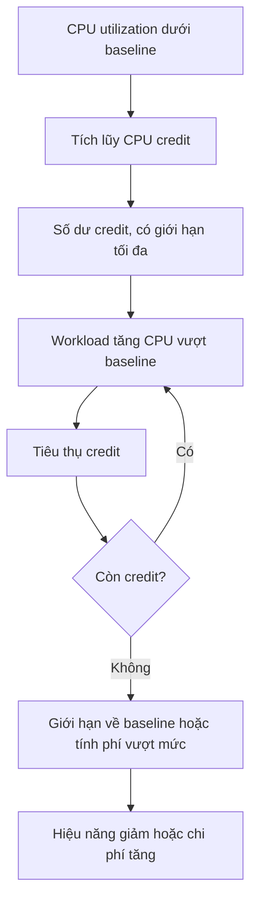

# Máy burstable, CPU credit và giới hạn hiệu năng duy trì

Khi chọn cấu hình máy ảo trên đám mây, số vCPU ghi trên tên instance không cho biết toàn bộ khả năng xử lý mà workload có thể sử dụng liên tục. Một số dòng máy được thiết kế để chạy ở mức CPU cơ bản trong phần lớn thời gian và tăng tốc trong những khoảng tải cao ngắn. Mô hình này thường được gọi là **burstable performance**. Nền tảng quản lý phần năng lực tăng thêm bằng một cơ chế tích lũy và tiêu thụ **CPU credit**.

Máy burstable có thể tiết kiệm chi phí cho dịch vụ có tải không đều, chẳng hạn website nhỏ, API nội bộ, môi trường phát triển hoặc tác vụ nền thỉnh thoảng tăng tải. Tuy nhiên, nếu ứng dụng thường xuyên sử dụng CPU cao, số credit có thể giảm về không và hiệu năng bị giới hạn ở mức duy trì của instance hoặc phát sinh chi phí bổ sung theo chế độ của nhà cung cấp. Vì vậy, khi chọn máy cần hiểu rõ baseline CPU, tốc độ tích lũy credit, tốc độ tiêu thụ, giới hạn số dư và hành vi khi credit cạn.

## 1. Máy burstable là gì?

Máy burstable là loại instance có khả năng cung cấp hiệu năng CPU cao hơn mức cơ bản trong một khoảng thời gian. Nhà cung cấp thường định nghĩa một mức hiệu năng nền, gọi là **baseline performance** hoặc baseline CPU utilization. Khi workload sử dụng CPU thấp hơn mức này, instance tích lũy khả năng tăng tốc dưới dạng credit. Khi workload cần nhiều CPU hơn baseline, instance tiêu thụ số credit đã tích lũy để tăng hiệu năng.

Mô hình này phù hợp với workload có đặc điểm:

- CPU thường nhàn rỗi hoặc sử dụng ở mức thấp đến trung bình.
- Có các đợt tăng tải ngắn, ví dụ khi người dùng đăng nhập đầu giờ, chạy báo cáo hoặc xử lý một đợt request.
- Có thể chấp nhận mức xử lý thấp hơn sau khi đợt tăng tải kết thúc hoặc khi số credit đã dùng hết.
- Không cần duy trì CPU cao liên tục trong nhiều giờ.

Ví dụ, một dịch vụ quản trị nội bộ có CPU trung bình 8%, nhưng thỉnh thoảng tăng lên 70% trong vài phút khi tạo báo cáo. Một instance burstable có thể dùng lượng credit đã tích lũy để xử lý đợt tăng tải đó. Nếu cùng instance phải chạy tác vụ mã hóa hoặc phân tích dữ liệu ở mức CPU 80% suốt cả ngày, credit sẽ nhanh chóng cạn và loại máy này có thể không còn phù hợp.

Máy burstable vẫn có vCPU, bộ nhớ, mạng và lưu trữ như các instance khác. Điểm khác biệt chính nằm ở cách nhà cung cấp cấp phát và giới hạn năng lực CPU theo thời gian. Cấu hình RAM, băng thông mạng, IOPS hoặc thông lượng ổ đĩa có thể có giới hạn riêng và không tự tăng chỉ vì instance còn CPU credit.

## 2. Baseline CPU và mức burst tối đa

**Baseline CPU** là mức năng lực CPU mà mô hình burstable được thiết kế để duy trì lâu dài theo chính sách của nhà cung cấp. Baseline thường được biểu diễn dưới dạng tỷ lệ phần trăm công suất CPU của instance hoặc dưới dạng tốc độ tích lũy credit. Giá trị cụ thể phụ thuộc họ máy, kích thước instance và nền tảng.

**Burst capacity** là phần năng lực CPU có thể sử dụng vượt baseline khi còn credit hoặc khi chế độ vận hành cho phép dùng credit vượt mức tích lũy. Một instance có thể tạm thời sử dụng gần hết năng lực vCPU được cấp, nhưng điều đó không có nghĩa nó có thể duy trì mức sử dụng này vô thời hạn.

Hãy phân biệt ba khái niệm:

| Khái niệm | Ý nghĩa | Câu hỏi cần trả lời |
|---|---|---|
| Baseline | Mức CPU cơ bản có thể duy trì theo mô hình của instance | Khi không còn credit, hiệu năng CPU còn ở mức nào? |
| Burst | Phần CPU sử dụng vượt baseline trong thời gian giới hạn | Instance có thể tăng tốc tới mức nào khi còn credit? |
| Credit balance | Số dư dùng để chi trả cho phần CPU vượt baseline | Có thể burst trong bao lâu trước khi số dư giảm tới ngưỡng giới hạn? |

Baseline không nên được hiểu là cam kết rằng mọi workload luôn đạt đúng tỷ lệ CPU đó. Hiệu năng thực tế còn phụ thuộc thế hệ CPU, loại instance, giới hạn nền tảng, mức tranh chấp tài nguyên, cấu hình hệ điều hành và các giới hạn khác. Cần đọc đặc tả của đúng họ máy đang sử dụng.

### Baseline không phải là giới hạn tổng số vCPU

Giả sử instance có 2 vCPU và baseline CPU là 20%. Có thể hình dung mức CPU cơ bản tương đương 0,4 vCPU được sử dụng liên tục trên tổng công suất 2 vCPU. Khi workload cần 70% tổng công suất CPU, phần sử dụng vượt baseline tương đương 1 vCPU. Phần vượt này tiêu thụ credit theo mô hình phổ biến.

Tỷ lệ CPU thường là mức sử dụng tổng hợp của instance. Nếu một ứng dụng đơn luồng chỉ chạy tối đa trên một vCPU, biểu đồ CPU tổng thể của máy 4 vCPU có thể chỉ hiển thị khoảng 25% dù một lõi đã bận hoàn toàn. Khi chẩn đoán, cần xem cả mức sử dụng theo lõi, số luồng runnable và thời gian chờ CPU, thay vì chỉ nhìn một con số tổng.

## 3. CPU credit hoạt động như thế nào?

CPU credit là đơn vị kế toán năng lực xử lý trong một số dòng máy burstable. Credit không phải tiền, không phải dung lượng lưu trữ và cũng không phải một gói CPU có thể chuyển giữa các instance tùy ý. Nó biểu diễn lượng thời gian CPU vượt baseline mà instance được phép sử dụng theo quy tắc của nhà cung cấp.

Trong một mô hình phổ biến, một credit tương đương một vCPU chạy ở mức 100% trong một phút. Nếu instance có nhiều vCPU, mức tiêu thụ được tính theo tổng công suất vượt baseline. Tuy nhiên, đơn vị và cách tính cụ thể phải được xác nhận trong tài liệu của nhà cung cấp; không nên áp dụng công thức của một nền tảng cho mọi loại máy.

Chu trình credit thường gồm ba hoạt động:

1. **Tích lũy:** instance nhận credit theo tốc độ định trước khi hoạt động trong điều kiện của mô hình.
2. **Tiêu thụ:** khi CPU sử dụng vượt baseline, phần vượt sẽ làm giảm số dư credit.
3. **Giới hạn số dư:** số credit tích lũy thường có mức trần. Khi đã chạm trần, instance không tiếp tục tích lũy vô hạn trong thời gian nhàn rỗi.

Hãy hình dung credit như một bình năng lượng có giới hạn. Thời gian CPU thấp giúp bình được nạp; những đợt sử dụng vượt baseline làm bình cạn dần. Một workload có thể burst lâu hơn nếu nó đã tích lũy đủ credit trước khi đợt tải cao bắt đầu.

### 3.1. Tốc độ tích lũy

Mỗi kích thước instance thường có tốc độ tích lũy credit riêng. Instance lớn hơn có thể có nhiều vCPU hơn và tốc độ tích lũy cao hơn. Tốc độ này có quan hệ với baseline của cấu hình, nhưng cách công bố có thể khác nhau giữa các nhà cung cấp.

Nếu workload dùng CPU thấp trong một thời gian, credit balance tăng cho tới khi đạt giới hạn. Khi workload tăng tải, balance giảm. Vì số dư có trần, việc để máy nhàn rỗi nhiều ngày không nhất thiết tạo ra khả năng burst vô hạn; sau khi bình credit đầy, thời gian nhàn rỗi tiếp theo không tạo thêm lợi ích dự trữ.

### 3.2. Tốc độ tiêu thụ

Khi CPU sử dụng vượt baseline, phần vượt được quy đổi thành lượng credit tiêu thụ. Mức sử dụng càng cao và kéo dài càng lâu thì credit giảm càng nhanh.

Một ví dụ đơn giản theo quy ước một credit bằng một vCPU-phút:

- Instance có 2 vCPU.
- Baseline là 20% tổng công suất.
- Workload sử dụng trung bình 70% tổng công suất trong một giờ.
- Phần vượt baseline là 50 điểm phần trăm, tương đương 1 vCPU ở mức 100%.
- Một giờ sử dụng phần vượt này tiêu thụ khoảng 60 credit.

Nếu instance tích lũy 24 credit mỗi giờ, trong khoảng thời gian đó số dư giảm ròng khoảng 36 credit. Đây là phép tính minh họa; khi áp dụng vào một instance thực tế, hãy dùng tốc độ earn/spend và đơn vị credit do nhà cung cấp công bố.

## 4. Ước lượng thời gian burst

Để ước lượng khả năng burst, cần biết số dư credit hiện tại, tốc độ tích lũy, tốc độ tiêu thụ ở mức tải dự kiến và giới hạn chế độ vận hành.

Trong mô hình credit theo vCPU-phút, có thể ước lượng phần credit tiêu thụ mỗi giờ khi CPU cao hơn baseline bằng công thức:

\[
 C_{use}=60\times N\times\max(0,U-B)
\]

Trong đó:

- \(C_{use}\): credit tiêu thụ trong một giờ.
- \(N\): số vCPU của instance.
- \(U\): mức sử dụng CPU trung bình của toàn instance, biểu diễn dưới dạng số từ 0 đến 1.
- \(B\): baseline CPU, cũng biểu diễn dưới dạng số từ 0 đến 1.
- Hệ số 60 chuyển vCPU-phút thành vCPU-giờ.

Nếu instance tích lũy \(C_{earn}\) credit mỗi giờ thì mức thay đổi số dư trong một giờ có thể ước lượng:

\[
 \Delta C=C_{earn}-C_{use}
\]

Khi \(\Delta C\) âm, số dư đang giảm. Nếu tải và tốc độ tiêu thụ ổn định, thời gian gần đúng tới khi số dư chạm ngưỡng là:

\[
 T_{hours}\approx\frac{C_{balance}}{C_{use}-C_{earn}}
\]

Công thức này chỉ phù hợp khi mẫu credit của nền tảng tương ứng với giả định trên, tải tương đối ổn định và không có thay đổi chế độ tính phí. Nó không thay thế số liệu đo thực tế hoặc mô phỏng theo chính sách của nhà cung cấp.

### Ví dụ tính toán

Giả sử một instance có 2 vCPU, baseline 20%, tốc độ tích lũy 24 credit mỗi giờ và số dư hiện tại 180 credit. Ứng dụng dự kiến dùng CPU trung bình 70% trong đợt cao điểm.

Phần sử dụng vượt baseline là:

\[
2\times(0.70-0.20)=1\text{ vCPU}
\]

Tốc độ tiêu thụ là 60 credit mỗi giờ. Sau khi trừ 24 credit tích lũy, số dư giảm ròng 36 credit mỗi giờ. Thời gian gần đúng tới khi hết số dư:

\[
180\div36=5\text{ giờ}
\]

Nếu đợt cao điểm chỉ kéo dài 10 phút, lượng credit tiêu thụ ròng theo giả định này khoảng 6 credit. Nếu tải 70% kéo dài nhiều giờ, instance sẽ dần tiến tới giới hạn. Đây là khác biệt quan trọng giữa burst ngắn và tải CPU duy trì.

## 5. Điều gì xảy ra khi CPU credit cạn?

Hành vi khi credit balance chạm ngưỡng phụ thuộc nhà cung cấp, họ máy và chế độ vận hành. Thường gặp hai kiểu chính:

**Giới hạn ở baseline:** instance giảm hoặc bị giới hạn CPU về mức hiệu năng cơ bản. Workload vẫn có thể chạy nhưng thời gian xử lý tăng, request có thể xếp hàng, độ trễ tăng và throughput giảm. Khi tải giảm và credit được tích lũy lại, khả năng burst có thể phục hồi.

**Cho phép dùng vượt số credit tích lũy:** một số nền tảng có chế độ cho phép tiếp tục burst khi số dư thông thường đã cạn. Phần vượt có thể được ghi nhận thành credit thặng dư và tính phí theo chính sách của nhà cung cấp. Chế độ này giúp tránh suy giảm hiệu năng đột ngột nhưng có thể khiến chi phí tăng nếu workload dùng CPU cao kéo dài.

Không phải mọi dòng máy đều có cùng hai chế độ, và tên gọi như Standard, Unlimited hoặc cách tính surplus có thể thay đổi theo thế hệ instance. Trước khi bật chế độ cho phép vượt credit, hãy xác định rõ:

- Khi nào nền tảng bắt đầu ghi nhận phần sử dụng vượt mức?
- Phần vượt được tính phí theo đơn vị nào và theo khoảng thời gian nào?
- Có ngưỡng cảnh báo hoặc giới hạn ngân sách không?
- Khi tắt chế độ này, instance sẽ bị giới hạn ở mức nào?
- Có ảnh hưởng nào tới instance đang chạy khi thay đổi chế độ hay không?

Không nên giả định rằng việc cho phép burst không giới hạn đồng nghĩa hiệu năng CPU cao được cung cấp miễn phí. Cần đưa cả chi phí surplus vào so sánh tổng chi phí sở hữu.

## 6. Các ví dụ trên nền tảng đám mây

Nhiều nhà cung cấp có họ máy burstable, nhưng tên gọi, cách tích lũy credit, baseline và chế độ vượt credit khác nhau. Hai ví dụ phổ biến là:

| Nhà cung cấp | Họ máy thường được biết đến | Điểm cần tìm trong tài liệu cấu hình |
|---|---|---|
| Amazon Web Services (AWS) | Các họ T như T2, T3, T3a và T4g | Baseline theo kích thước, tốc độ earn, CPU credit balance, chế độ Standard/Unlimited và surplus credit |
| Microsoft Azure | Họ B-series | Baseline CPU, tốc độ tích lũy/tiêu thụ, số dư CPU credit và hành vi khi số dư về không |

Danh sách họ máy chỉ nhằm minh họa. Khả năng cung cấp, kiến trúc CPU, vùng triển khai, kích thước và điều kiện tính phí có thể thay đổi. Hãy tra cứu đúng SKU, region và thế hệ instance đang dự định triển khai.

### Những điểm không nên suy diễn giữa các nhà cung cấp

- Không mặc định một credit của mọi nền tảng có cùng định nghĩa hoặc cùng giá trị quy đổi.
- Không mặc định baseline của hai instance cùng số vCPU là giống nhau.
- Không mặc định chế độ mặc định là Standard hoặc Unlimited cho mọi thế hệ.
- Không mặc định credit được chuyển sang instance khác khi resize, stop, start hoặc tạo instance mới.
- Không mặc định giới hạn credit tối đa hoặc cách tính phí surplus là giống nhau.

Khi di chuyển workload giữa các nhà cung cấp, cần đánh giá lại biểu đồ CPU, baseline, số dư credit và chi phí. Cùng một workload có thể chạy tốt trên một họ máy nhưng bị giới hạn sớm hơn trên họ máy khác.

## 7. Chọn workload phù hợp với máy burstable

Máy burstable có lợi nhất khi mức sử dụng CPU biến động và trung bình thấp hơn năng lực duy trì của cấu hình. Một số tình huống thường phù hợp:

| Workload | Mức độ phù hợp | Lý do và điều kiện |
|---|---|---|
| Website nhỏ, API ít request | Thường phù hợp | CPU thấp phần lớn thời gian, có thể tăng nhanh trong các đợt request ngắn |
| Máy phát triển, staging, kiểm thử | Thường phù hợp | Tải không liên tục; có thể chấp nhận biến động hiệu năng ngoài giờ cao điểm |
| Dịch vụ nội bộ, bot hoặc webhook | Có thể phù hợp | Cần đo độ dài và tần suất của các đợt burst |
| Worker xử lý theo lịch | Tùy trường hợp | Phù hợp nếu mỗi đợt ngắn và có thể chấp nhận thời gian xử lý dài hơn khi credit thấp |
| Cơ sở dữ liệu có tải ổn định | Cần thận trọng | CPU cao kéo dài, độ trễ và thời gian phản hồi ổn định thường quan trọng |
| Mã hóa video, biên dịch lớn, phân tích dữ liệu liên tục | Thường không phù hợp | CPU có thể cao trong thời gian dài và tiêu thụ credit nhanh |
| Dịch vụ realtime nhạy cảm về độ trễ | Cần đánh giá kỹ | Sự suy giảm khi credit cạn có thể vi phạm SLO |

Một workload có CPU trung bình thấp vẫn có thể không phù hợp nếu cần phản hồi tức thời trong các đợt burst dài. Ngược lại, một workload có CPU trung bình tương đối cao nhưng có các khoảng nhàn rỗi đủ dài để phục hồi credit có thể hoạt động được, nếu số liệu đo xác nhận điều đó.

### Đánh giá theo chu kỳ tải

Đừng chỉ xem CPU trung bình theo ngày. Hãy quan sát theo phút hoặc khoảng thời gian ngắn hơn phù hợp với nhịp tải của ứng dụng. Hai hệ thống có cùng CPU trung bình 20% có thể có hành vi rất khác:

- Hệ thống A duy trì quanh 20% liên tục, ít có đỉnh cao.
- Hệ thống B luân phiên 5 phút ở 100% và 20 phút gần 0%.

Hệ thống B có thể cần credit cho các đợt tải cao và dùng thời gian nhàn rỗi để tích lũy lại. Hệ thống A có thể phù hợp với một instance có baseline gần mức sử dụng ổn định, nhưng không nhất thiết cần burst capacity lớn. Cần mô phỏng theo chu kỳ tải thực tế và số dư credit ban đầu.

## 8. So sánh máy burstable với máy có hiệu năng CPU duy trì

Máy có hiệu năng CPU duy trì (general-purpose, compute-optimized hoặc loại phù hợp khác tùy nhà cung cấp) thường được thiết kế để cung cấp năng lực xử lý ổn định hơn khi tải CPU cao kéo dài. Máy burstable thường có chi phí đầu vào thấp hơn cho một số cấu hình, đổi lại khả năng duy trì tải cao bị giới hạn bởi baseline và cơ chế credit.

| Tiêu chí | Máy burstable | Máy hiệu năng duy trì |
|---|---|---|
| Mẫu tải phù hợp | Thấp phần lớn thời gian, tăng cao theo đợt | Trung bình cao hoặc cao kéo dài |
| Hiệu năng CPU dài hạn | Theo baseline hoặc chính sách credit | Theo năng lực duy trì của SKU và giới hạn nền tảng |
| Khả năng tăng tốc ngắn hạn | Dùng credit hoặc chế độ burst | Có thể dùng toàn bộ năng lực CPU được cấu hình mà không phụ thuộc credit burst |
| Rủi ro khi tải tăng dài | Cạn credit, giảm CPU hoặc phát sinh phí surplus | Có thể tăng chi phí cấu hình, nhưng ít phụ thuộc số dư credit |
| Cách chọn | Dựa trên phân bố tải, baseline, credit và thời lượng burst | Dựa trên vCPU, thế hệ CPU, hiệu năng đo được và SLO |

Máy hiệu năng duy trì không có nghĩa là CPU vô hạn hoặc không có giới hạn. Nó vẫn chịu giới hạn vCPU, quota, giới hạn nền tảng, nhiệt độ, băng thông bộ nhớ và khả năng của ứng dụng. Điểm khác biệt là quyết định sizing ít phụ thuộc vào số dư CPU credit.

Khi so sánh chi phí, hãy tính cả phí instance, chế độ burst vượt mức, thời gian xử lý, khả năng đáp ứng tải và chi phí của việc mở rộng nhiều máy nhỏ. Một instance rẻ hơn theo giờ có thể đắt hơn nếu phải chạy lâu hơn để hoàn thành cùng khối lượng công việc hoặc thường xuyên phát sinh phí surplus.

## 9. CPU credit không thay thế sizing bộ nhớ, mạng và lưu trữ

CPU burst chỉ giải quyết một khía cạnh của hiệu năng. Workload có thể còn bị giới hạn bởi RAM, băng thông mạng, IOPS, thông lượng lưu trữ, giới hạn kết nối hoặc tài nguyên của dịch vụ phụ thuộc.

**Bộ nhớ:** credit CPU không cấp thêm RAM. Nếu ứng dụng vượt giới hạn bộ nhớ, hệ điều hành có thể swap, kernel có thể kết thúc tiến trình hoặc container có thể bị OOMKilled. Cần chọn dung lượng RAM theo working set, cache, heap, số tiến trình và mức tăng tải dự kiến.

**Mạng:** thông lượng mạng có thể phụ thuộc loại instance, kích thước máy, số luồng, giới hạn theo luồng hoặc chính sách của nhà cung cấp. CPU còn credit không bảo đảm băng thông mạng sẽ tăng tương ứng.

**Lưu trữ:** IOPS và throughput của volume có thể có baseline, burst bucket hoặc giới hạn riêng. Đây là cơ chế khác với CPU credit. Cần phân biệt credit CPU với burst credit của ổ đĩa nếu nền tảng có cung cấp.

**Ứng dụng:** khóa đồng bộ, truy vấn cơ sở dữ liệu, giới hạn connection pool, garbage collection hoặc độ trễ dịch vụ phụ thuộc có thể làm request chậm dù CPU còn dư. Hãy dùng tracing và profiling để tìm đúng nút thắt.

## 10. Theo dõi CPU credit và hiệu năng trong vận hành

Một hệ thống sử dụng máy burstable cần giám sát cả mức dùng CPU lẫn số dư credit. Chỉ theo dõi CPU utilization có thể bỏ sót nguy cơ: instance đang dùng CPU thấp nhưng credit balance đã thấp từ đợt tăng tải trước, hoặc CPU có thể bị giới hạn khi tải tăng tiếp.

Các nhóm chỉ số nên theo dõi:

| Nhóm chỉ số | Ý nghĩa | Cách sử dụng |
|---|---|---|
| CPU utilization tổng và theo lõi | Mức bận CPU và khả năng một lõi bị bão hòa | Nhận diện tải CPU cao, nghẽn đơn luồng và xu hướng theo giờ |
| Credit balance | Số dư khả năng burst còn lại | Cảnh báo khi số dư thấp hoặc giảm liên tục |
| Credit usage/consumption | Tốc độ tiêu thụ credit | Ước lượng thời gian tới ngưỡng cạn trong đợt tải hiện tại |
| Credit surplus hoặc chi phí vượt mức | Phần sử dụng vượt số dư thông thường và khoản phí liên quan nếu có | Phát hiện chế độ burst làm tăng hóa đơn |
| CPU throttling, run queue, CPU steal | Dấu hiệu CPU bị giới hạn hoặc phải chờ | Phân biệt thiếu năng lực với vấn đề ứng dụng hoặc hạ tầng |
| Latency, throughput, error rate | Tác động lên trải nghiệm và SLO | Xác định mức CPU nào bắt đầu làm dịch vụ suy giảm |

Tên metric và cách thu thập phụ thuộc nền tảng. Ví dụ, AWS CloudWatch có các metric liên quan như `CPUCreditBalance`, `CPUCreditUsage` và các metric surplus ở chế độ hỗ trợ. Azure Monitor cung cấp metric CPU credit cho các máy B-series. Hãy kiểm tra tên metric, đơn vị, chu kỳ lấy mẫu và phạm vi áp dụng của đúng dịch vụ.

### Đặt cảnh báo theo xu hướng, không chỉ theo ngưỡng CPU

Một bộ cảnh báo hữu ích có thể gồm:

- Credit balance dưới một ngưỡng dự trữ trong nhiều chu kỳ liên tiếp.
- Credit balance giảm đều trong giờ cao điểm và không phục hồi giữa các đợt tải.
- Credit surplus hoặc chi phí vượt mức xuất hiện thường xuyên.
- CPU utilization cao đồng thời với latency hoặc error rate tăng.
- CPU utilization thấp nhưng run queue, CPU throttling hoặc thời gian xử lý vẫn cao; đây là tín hiệu cần điều tra thêm về giới hạn cgroup, CPU steal hoặc nút thắt khác.

Ngưỡng cảnh báo cần dựa trên thời gian burst tối thiểu mà dịch vụ cần duy trì. Chẳng hạn, nếu ứng dụng cần xử lý một đợt cao điểm kéo dài 30 phút, số dư cảnh báo nên đủ để giữ năng lực trong khoảng đó và có thêm biên dự phòng cho biến động.

## 11. Quy trình lựa chọn và sizing máy burstable

Có thể áp dụng quy trình sau khi lựa chọn cấu hình cho một workload:

1. **Thu thập mẫu tải.** Đo CPU tổng, CPU theo lõi, RAM, mạng, I/O và latency trong ngày thường, giờ cao điểm, đợt batch và sự kiện bất thường.
2. **Xác định baseline cần thiết.** Tìm mức CPU mà workload cần duy trì lâu dài để đáp ứng SLO, không chỉ lấy CPU trung bình.
3. **Xác định đặc điểm burst.** Ghi lại mức CPU đỉnh, thời lượng mỗi đợt, số lần lặp, khoảng nghỉ giữa các đợt và khả năng dự báo.
4. **Đọc thông số credit của SKU.** Xác nhận tốc độ tích lũy, giới hạn balance, cách tính tiêu thụ, trạng thái ban đầu và hành vi khi hết credit.
5. **Ước lượng thời gian burst.** Dùng số dư hiện tại và tốc độ tiêu thụ ròng để tính thời gian gần đúng; sau đó kiểm chứng bằng thử tải.
6. **Đánh giá RAM và các giới hạn khác.** Bảo đảm bộ nhớ, mạng, lưu trữ và quota đáp ứng workload trong cả trạng thái bình thường lẫn cao điểm.
7. **So sánh tổng chi phí.** So sánh máy burstable ở các chế độ được hỗ trợ với máy hiệu năng duy trì, tính cả surplus, thời gian xử lý và chi phí vận hành.
8. **Thử nghiệm khi credit thấp.** Kiểm tra hành vi của ứng dụng khi balance gần cạn hoặc khi nền tảng giới hạn CPU. Xác minh autoscaling, timeout và khả năng phục hồi.
9. **Theo dõi sau triển khai.** Cảnh báo balance thấp, mức sử dụng vượt baseline kéo dài và chi phí burst; đánh giá lại SKU khi mẫu tải thay đổi.

### Ví dụ lựa chọn cho một API nhỏ

Một API có 2 vCPU và 4 GiB RAM, CPU thường ở mức 5–12%, nhưng tăng lên 65% trong 8 phút mỗi giờ. Đợt tăng tải thường kết thúc nhanh và không trùng với tác vụ batch khác. Đây là ứng viên để thử máy burstable.

Trước khi chọn SKU, nhóm vận hành cần kiểm tra baseline của máy có đủ phục vụ tải bình thường hay không, tốc độ earn/spend có giúp bù lại credit đã tiêu thụ trong mỗi giờ hay không, và số dư có đủ cho một đợt cao điểm kéo dài hơn dự kiến hay không. Cũng cần xác minh 4 GiB RAM đủ cho working set và cache, vì CPU credit không xử lý tình trạng thiếu bộ nhớ.

Nếu số dư giảm qua từng giờ, nghĩa là tải thực tế đang tiêu thụ credit nhanh hơn tốc độ tích lũy. Khi đó có thể tăng kích thước burstable, giảm CPU demand, tối ưu truy vấn hoặc chuyển sang instance có hiệu năng duy trì. Quyết định cần dựa trên SLO và tổng chi phí, không chỉ giá theo giờ.

## 12. Kết hợp máy burstable với container và autoscaling

Máy burstable thường được dùng làm node cho workload container có tải biến động. Tuy nhiên, cần phân biệt **CPU credit của VM** với **CPU request/limit của container**.

- CPU credit được quản lý ở cấp instance hoặc theo mô hình của nhà cung cấp.
- Kubernetes `requests.cpu` biểu thị lượng CPU mà scheduler dùng để tính khả năng đặt Pod.
- Kubernetes `limits.cpu` giới hạn lượng CPU container được phép sử dụng theo cơ chế runtime/cgroup.
- CPU throttling ở container có thể xảy ra do `limits.cpu` ngay cả khi VM còn credit.
- Ngược lại, VM có thể bị giới hạn ở baseline khi hết credit dù container chưa chạm CPU limit.

Vì vậy, khi điều tra hiệu năng cần xem cả metric của node/VM và metric của container. Đặt CPU limit quá thấp có thể làm ứng dụng bị throttling độc lập với credit. Đặt request quá thấp có thể khiến scheduler đóng gói quá nhiều Pod lên một node, làm tải tổng vượt baseline và tiêu thụ credit nhanh.

Autoscaling cũng cần được thiết kế có tính đến credit. Nếu scale out chỉ khi CPU đã cao, các node mới có thể bắt đầu với số dư credit thấp hoặc trạng thái ban đầu khác nhau tùy nền tảng. Nếu scale in quá nhanh, tải dồn lên số node còn lại có thể làm credit cạn. Cần kiểm thử chu kỳ scale out/scale in, chính sách khởi tạo credit và phân bố Pod để tránh dao động.

Một số biện pháp vận hành hữu ích:

- Dành node burstable cho workload có mức CPU biến động và giới hạn tài nguyên rõ ràng.
- Tránh đặt các batch job CPU-intensive cùng node với API nhạy cảm về độ trễ.
- Theo dõi credit balance theo từng node, không chỉ lấy trung bình của toàn cluster.
- Cấu hình autoscaler dựa trên cả CPU, hàng đợi và tín hiệu ứng dụng khi phù hợp.
- Có node pool hiệu năng duy trì để chuyển workload quan trọng khi tải ổn định vượt baseline.

## 13. Lỗi thường gặp khi sử dụng máy burstable

**Chọn máy theo CPU trung bình.** CPU trung bình thấp có thể che giấu các đợt tải cao kéo dài. Hãy xem phân bố theo thời gian, thời lượng burst và số dư credit.

**Cho rằng số vCPU bằng hiệu năng duy trì.** Một instance 2 vCPU burstable không nhất thiết duy trì được 2 vCPU ở mức 100% liên tục. Cần đọc baseline và giới hạn credit.

**Không giám sát credit balance.** CPU utilization hiện tại có thể bình thường nhưng số dư đã gần cạn, khiến đợt tải tiếp theo suy giảm hiệu năng.

**Bật chế độ vượt credit mà không tính chi phí.** Dịch vụ có thể chạy ổn định hơn nhưng phát sinh khoản phí ngoài dự kiến. Cần theo dõi surplus và đặt cảnh báo ngân sách.

**Dùng máy burstable cho tác vụ CPU cao liên tục.** Credit sẽ giảm nhanh; một máy hiệu năng duy trì có thể rẻ hơn khi xét tổng thời gian xử lý và chi phí vận hành.

**Nhầm CPU credit với giới hạn container.** Container có thể bị throttling do CPU limit, hoặc VM bị giới hạn do credit cạn. Phải quan sát đúng cấp tài nguyên.

**Bỏ qua RAM, mạng và lưu trữ.** CPU còn credit không giúp giải quyết OOM, nghẽn mạng hoặc giới hạn IOPS. Cần sizing đồng bộ các tài nguyên.

**Không thử nghiệm sau khi thay đổi SKU.** Resize hoặc chuyển họ máy có thể làm thay đổi baseline, số dư, CPU generation và đặc tính mạng. Cần kiểm thử lại dưới tải đại diện.

## 14. Checklist trước khi đưa vào vận hành

- [ ] Đã đo CPU theo thời gian, theo lõi và trong các đợt tải cao.
- [ ] Đã xác định baseline CPU cần thiết để đáp ứng SLO.
- [ ] Đã biết số vCPU, baseline, tốc độ tích lũy và giới hạn credit của SKU.
- [ ] Đã ước lượng thời gian burst với số dư ban đầu và tải dự kiến.
- [ ] Đã xác minh hành vi khi credit cạn và chính sách tính phí surplus.
- [ ] Đã sizing RAM, mạng và lưu trữ độc lập với CPU credit.
- [ ] Đã phân biệt giới hạn CPU của VM với request/limit và throttling của container.
- [ ] Đã có cảnh báo credit balance thấp, credit tiêu thụ nhanh và chi phí vượt mức.
- [ ] Đã thử nghiệm tải cao kéo dài và tình huống credit gần cạn.
- [ ] Đã có phương án nâng cấp hoặc chuyển sang máy hiệu năng duy trì khi tải thay đổi.

## 15. Kết luận

Máy burstable dùng CPU credit để cho phép workload tăng tốc trong những khoảng thời gian ngắn sau khi tích lũy năng lực từ các giai đoạn tải thấp. Baseline thể hiện mức hiệu năng cơ bản, còn credit balance quyết định khả năng sử dụng CPU vượt mức đó trong thời gian giới hạn. Khi credit cạn, instance có thể bị giới hạn về baseline hoặc phát sinh phí vượt mức tùy chính sách của nhà cung cấp.

Để chọn đúng máy, cần phân tích chu kỳ tải, thời lượng burst, tốc độ tích lũy và tiêu thụ credit, hành vi khi hết credit, RAM và các giới hạn mạng/lưu trữ. Máy burstable phù hợp với workload biến động; workload CPU cao liên tục hoặc nhạy cảm về độ trễ thường cần cấu hình có hiệu năng duy trì ổn định hơn. Quyết định cuối cùng nên dựa trên số liệu đo, thử tải và tổng chi phí trong điều kiện vận hành thực tế.
