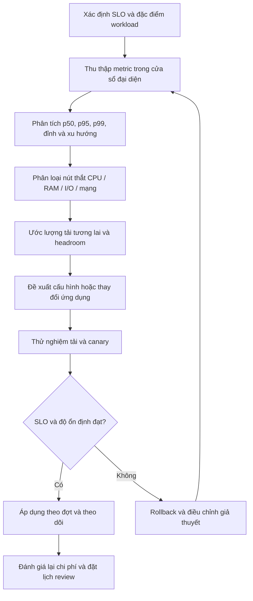

# Right-sizing dựa trên số liệu sử dụng và khoảng dự phòng

Một máy chủ cloud có thể chạy ổn định nhưng vẫn được cấp quá nhiều CPU hoặc bộ nhớ so với nhu cầu. Ngược lại, một cấu hình tiết kiệm chi phí có thể khiến ứng dụng chậm, hết bộ nhớ hoặc không chịu được giờ cao điểm. **Right-sizing** là quá trình chọn và điều chỉnh cấu hình tài nguyên dựa trên số liệu vận hành, mục tiêu dịch vụ và mức dự phòng phù hợp.

Right-sizing không có nghĩa là luôn chọn máy nhỏ nhất. Mục tiêu là cung cấp đủ năng lực cho tải thực tế và tải dự kiến, duy trì khoảng an toàn khi có biến động, đồng thời tránh trả tiền cho tài nguyên không được sử dụng. Quyết định cần dựa trên nhiều chỉ số cùng lúc: CPU, RAM, lưu trữ, mạng, độ trễ ứng dụng, tỷ lệ lỗi và xu hướng tăng trưởng.

Sau bài học, bạn có thể:

- Thu thập và đọc các số liệu quan trọng để đánh giá mức sử dụng tài nguyên.
- Phân biệt tải trung bình, tải cao theo percentile và đỉnh ngắn hạn.
- Ước lượng CPU, bộ nhớ và lưu trữ cần thiết theo tải hiện tại, tăng trưởng và khoảng dự phòng.
- Nhận biết khi nào nên đổi kích thước instance, đổi họ máy, tối ưu ứng dụng hoặc mở rộng ngang.
- Thử nghiệm thay đổi an toàn, xác minh kết quả và theo dõi tác động đến chi phí.

## 1. Right-sizing là gì?

Right-sizing là việc đối chiếu **tài nguyên được cấp** với **tài nguyên workload thực sự cần** để đạt các mục tiêu hiệu năng và độ sẵn sàng. Việc đánh giá có thể áp dụng cho máy ảo, máy chủ vật lý chuyên dụng, node của cụm container hoặc cấu hình compute của dịch vụ được quản lý.

Ví dụ, một máy ảo được cấp 16 vCPU và 64 GiB RAM nhưng trong giờ cao điểm CPU chỉ thường xuyên dùng 20% và bộ nhớ hoạt động ở mức 30%. Đây có thể là dấu hiệu cấp dư, nhưng chưa đủ để kết luận nên giảm cấu hình: cần xem tải đỉnh, độ trễ, các đợt batch, thời gian chạy sao lưu, mức tăng trưởng, giới hạn I/O và yêu cầu dự phòng.

Tương tự, CPU trung bình chỉ 35% không chứng minh máy đang dư CPU. Nếu CPU thường xuyên đạt 95% trong những khoảng ngắn trùng với độ trễ p99 tăng mạnh, việc giảm vCPU có thể làm trải nghiệm người dùng xấu đi.

Right-sizing cần cân bằng ba mục tiêu:

1. **Hiệu năng:** đáp ứng thông lượng và độ trễ mà ứng dụng yêu cầu.
2. **Khả năng chịu biến động:** duy trì đủ tài nguyên khi tải tăng, có tiến trình nền hoặc một phần hạ tầng gặp lỗi.
3. **Chi phí:** hạn chế tài nguyên nhàn rỗi và chi phí phụ trợ mà không làm tăng rủi ro vận hành quá mức.

## 2. Bắt đầu bằng mục tiêu dịch vụ và đặc điểm workload

Trước khi nhìn dashboard, hãy xác định ứng dụng cần làm gì và thế nào là hoạt động tốt. Một cấu hình phù hợp cho worker batch có thể không phù hợp cho API giao dịch trực tuyến.

| Loại workload | Đặc điểm cần hiểu | Chỉ số thường cần ưu tiên |
|---|---|---|
| API hoặc website | Lưu lượng thay đổi theo giờ, người dùng chờ phản hồi | Request/giây, độ trễ p50/p95/p99, tỷ lệ lỗi, CPU, RAM, số kết nối |
| Worker xử lý hàng đợi | Công việc có thể tích tụ và xử lý song song | Độ dài hàng đợi, tuổi của message lâu nhất, thời gian xử lý, CPU, RAM |
| Batch định kỳ | Tải tăng mạnh trong thời gian chạy, có thể có deadline | Thời gian hoàn thành, CPU, RAM, I/O, số tác vụ song song |
| Cơ sở dữ liệu | Nhạy với bộ nhớ cache, độ trễ lưu trữ và kết nối | RAM, cache hit ratio, IOPS, latency, queue depth, số kết nối, replication lag |
| Cache hoặc in-memory service | Dữ liệu hoạt động cần nằm trong RAM | Working set, memory pressure, eviction, hit ratio, mạng |
| Phân tích hoặc học máy | Có thể cần CPU nhiều lõi, RAM lớn hoặc GPU | Thời gian hoàn thành, mức sử dụng thiết bị, bộ nhớ GPU, thông lượng dữ liệu |

Hãy ghi lại các mục tiêu như độ trễ p95 tối đa, tỷ lệ lỗi chấp nhận được, thời gian hoàn thành batch, thời gian hoạt động và mức tăng trưởng dự kiến. Nếu chưa có mục tiêu định lượng, hãy thống nhất một ngưỡng ban đầu để có thể đánh giá trước và sau khi điều chỉnh.

## 3. Thu thập số liệu đúng cách

### Chọn cửa sổ quan sát đủ dài

Một ảnh chụp dashboard tại một thời điểm không đại diện cho toàn bộ hoạt động. Cửa sổ đo cần bao phủ các chu kỳ có ý nghĩa của workload:

- Với ứng dụng có tải khá đều, hãy thu thập ít nhất một chu kỳ hoạt động đầy đủ và bao gồm giờ cao điểm.
- Với hệ thống có lịch theo ngày hoặc tuần, cần quan sát qua nhiều ngày và các đợt batch định kỳ.
- Với sản phẩm có mùa vụ, chiến dịch hoặc ngày cao điểm, hãy dùng số liệu của các đợt tương tự hoặc tạo tải thử có kiểm soát.
- Với hệ thống mới, số liệu ngắn hạn chỉ là đường cơ sở ban đầu; cần giữ cảnh báo và đánh giá lại sau khi có dữ liệu thực tế.

Khoảng quan sát có thể là vài tuần hoặc dài hơn tùy chu kỳ tải. Không có một số ngày cố định phù hợp cho mọi workload. Hãy chọn khoảng đủ để thấy ngày thường, cuối tuần, tác vụ nền và các đỉnh quan trọng.

### Không chỉ nhìn giá trị trung bình

Các percentile giúp hiểu phân phối tải:

- **p50 (median):** một nửa số mẫu thấp hơn hoặc bằng giá trị này; mô tả mức điển hình.
- **p95:** 95% số mẫu thấp hơn hoặc bằng giá trị này; hữu ích để quan sát tải cao thường gặp.
- **p99:** 99% số mẫu thấp hơn hoặc bằng giá trị này; giúp phát hiện những khoảng tải cao ít gặp hơn.
- **Maximum:** giá trị lớn nhất đã ghi nhận; có thể phản ánh một sự kiện ngắn hoặc mẫu bất thường.

Trung bình làm mượt các đỉnh. Maximum có thể bị chi phối bởi một điểm đo lỗi. Vì vậy, hãy đọc trung bình, p95, p99, maximum và biểu đồ theo thời gian cùng nhau. Cần xem cả thời lượng của đỉnh: CPU đạt 100% trong vài giây khác với CPU bị bão hòa liên tục 30 phút.

### Nguồn số liệu

Kết hợp số liệu từ nhiều lớp để tránh chẩn đoán sai:

1. **Hệ điều hành hoặc hypervisor:** CPU utilization, load, run queue, memory available, swap, disk I/O, network throughput.
2. **Nền tảng cloud:** vCPU được cấp, CPU credits hoặc throttling nếu có, giới hạn băng thông, IOPS, trạng thái instance và metric theo dịch vụ.
3. **Container/runtime:** CPU request/limit, memory working set, throttling, restart, OOM kill và số bản sao.
4. **Ứng dụng:** request rate, concurrency, thời gian phản hồi, lỗi, thời gian xử lý từng chặng, số kết nối và độ dài hàng đợi.
5. **Hệ thống phụ thuộc:** độ trễ cơ sở dữ liệu, cache hit ratio, thời gian phản hồi API bên ngoài và tình trạng hàng đợi.

Đồng bộ thời gian giữa các nguồn metric, log và trace. Khi CPU tăng, hãy kiểm tra cùng thời điểm đó độ trễ và tỷ lệ lỗi có tăng hay không. Mối liên hệ theo thời gian giúp phân biệt nguyên nhân với hiện tượng đi kèm.

## 4. Đánh giá CPU

CPU utilization cho biết phần năng lực xử lý đang được sử dụng trong một khoảng đo. Tuy nhiên, một tỷ lệ CPU riêng lẻ chưa đủ để quyết định tăng hay giảm cấu hình.

### Các chỉ số CPU nên xem

| Chỉ số | Ý nghĩa | Dấu hiệu cần điều tra |
|---|---|---|
| CPU utilization | Tỷ lệ CPU đang bận | Duy trì cao cùng với độ trễ hoặc hàng đợi tăng |
| Load average / run queue | Lượng công việc đang chạy hoặc chờ CPU, cách tính tùy hệ điều hành | Hàng đợi dài kéo dài trong khi số CPU khả dụng không đổi |
| CPU throttling | Thời gian workload bị giới hạn bởi quota CPU | Container bị throttling cùng lúc thời gian phản hồi tăng |
| CPU steal / ready time | Thời gian máy ảo chờ hypervisor cấp CPU vật lý | Tăng cao có thể cho thấy tranh chấp tài nguyên hoặc giới hạn nền tảng |
| Frequency / CPU credits | Tần số hoạt động hoặc tín dụng burst còn lại trên loại máy hỗ trợ | Hiệu năng giảm sau một thời gian tải cao |
| Per-core utilization | Mức bận theo từng lõi hoặc luồng | Một lõi bão hòa trong khi các lõi khác còn nhàn rỗi |

Với ứng dụng đơn luồng, tổng CPU có thể không cao dù một lõi đã bão hòa. Với ứng dụng đa luồng, cần xác nhận ứng dụng có thể tận dụng thêm lõi và không bị giới hạn bởi khóa, I/O hoặc một dịch vụ bên ngoài.

### Ước lượng CPU cần thiết

Một phép ước lượng ban đầu có thể dùng nhu cầu CPU quan sát được ở percentile đã chọn, sau đó điều chỉnh theo tăng trưởng và mức sử dụng mục tiêu:

\[
\text{vCPU cần thiết} \approx
\frac{\text{vCPU hiện tại} \times \text{CPU utilization quan sát} \times \text{hệ số tăng trưởng}}
{\text{mức utilization mục tiêu}}
\]

Các tỷ lệ phải dùng cùng dạng thập phân. Ví dụ, 40% được viết là 0,40. Công thức giả định nhu cầu tăng gần tuyến tính theo tải và cấu hình CPU; đó chỉ là ước lượng để sàng lọc phương án. Hiệu năng mỗi vCPU có thể khác giữa các thế hệ CPU, họ máy, kiến trúc và chính sách chia sẻ tài nguyên.

Mức utilization mục tiêu cần phụ thuộc workload. Một API nhạy với độ trễ thường cần nhiều khoảng trống hơn một batch có thể chạy lâu hơn. Không nên áp dụng một ngưỡng 70% hoặc 80% như quy tắc cứng cho mọi hệ thống.

### Ví dụ ước lượng CPU

Một API đang chạy trên máy 8 vCPU. Trong cửa sổ quan sát đại diện:

- CPU p95 là 40%.
- CPU p99 là 58%.
- Đỉnh cao nhất là 68% và chỉ kéo dài ngắn.
- Nhóm dự báo tải tăng 25% trong giai đoạn tiếp theo.

Nếu dùng p95 và mục tiêu 70%, nhu cầu ước lượng là:

\[
\frac{8 \times 0,40 \times 1,25}{0,70} \approx 5,72\text{ vCPU}
\]

Theo p95, cấu hình 6 vCPU có thể đáp ứng mức tải dự báo. Tuy nhiên, kiểm tra p99 cho kết quả:

\[
\frac{8 \times 0,58 \times 1,25}{0,70} \approx 8,29\text{ vCPU}
\]

Nếu các đỉnh p99 phải được xử lý ngay mà không được tăng độ trễ, cấu hình 8 vCPU có thể vẫn thiếu khoảng dự phòng theo giả định này. Nhóm cần kiểm tra thời lượng đỉnh, khả năng autoscaling, hàng đợi và giới hạn latency trước khi chọn. Nếu đỉnh ngắn có thể được hấp thụ bằng queue hoặc scale-out nhanh, cấu hình nền 6 vCPU có thể là phương án thử nghiệm tiết kiệm hơn.

Ví dụ cho thấy không nên lấy riêng một percentile rồi áp dụng máy móc. Mục tiêu dịch vụ và hành vi của tải quyết định percentile nào cần bảo vệ.

## 5. Đánh giá bộ nhớ RAM

RAM thường là tài nguyên khó giảm tùy tiện vì ứng dụng có thể cần giữ working set, cache, heap, buffer và dữ liệu kết nối trong bộ nhớ. Thiếu RAM có thể gây swap, thu hồi cache, garbage collection kéo dài hoặc tiến trình bị hệ điều hành kết thúc.

### Những số liệu cần theo dõi

- **Memory used và available:** lượng bộ nhớ đang sử dụng và lượng bộ nhớ hệ thống còn có thể cấp cho tiến trình. Cần hiểu cách hệ điều hành tính page cache và buffer.
- **Working set:** phần bộ nhớ ứng dụng thực sự cần giữ để hoạt động hiệu quả trong khoảng thời gian quan sát.
- **Heap và non-heap:** với runtime như JVM, cần quan sát heap, metaspace, direct buffer, thread stack và bộ nhớ native.
- **Swap/page fault:** hoạt động hoán đổi hoặc lỗi trang có thể phản ánh áp lực bộ nhớ; cần xem mức độ và thời lượng.
- **OOM kill/restart:** tiến trình hoặc container bị kết thúc do vượt giới hạn bộ nhớ.
- **Memory growth:** tốc độ bộ nhớ tăng theo thời gian, giúp phát hiện rò rỉ hoặc cache không có giới hạn.

Đừng kết luận RAM dư chỉ vì hệ điều hành báo free memory thấp. Hệ điều hành có thể dùng RAM trống làm page cache và giải phóng khi ứng dụng cần. Hãy quan sát available memory, working set, swap, OOM và độ trễ ứng dụng.

### Tính khoảng RAM cần dự phòng

Có thể ước lượng dung lượng cần cấp như sau:

\[
\text{RAM cần cấp} \approx
\frac{\text{working set tại percentile chọn} \times \text{hệ số tăng trưởng}}
{\text{tỷ lệ sử dụng RAM mục tiêu}}
\]

Ví dụ, working set p95 là 21 GiB, dự báo tăng 20% và nhóm muốn giữ mức sử dụng không quá 75%:

\[
\frac{21 \times 1,20}{0,75} = 33,6\text{ GiB}
\]

Nhóm nên chọn mức RAM khả dụng kế tiếp lớn hơn 33,6 GiB trong danh mục máy. Nếu chỉ có cấu hình 32 GiB và 48 GiB, cấu hình 48 GiB là điểm bắt đầu hợp lý để thử nghiệm. Cần xác minh bằng tải thật và xem p99, OOM, cache, heap cùng xu hướng tăng trưởng.

Với container, phải xem cả memory request và limit. Request ảnh hưởng việc lập lịch; limit có thể khiến container bị kết thúc khi vượt ngưỡng. Đặt request quá cao làm giảm mật độ workload trên node; đặt limit quá thấp làm tăng nguy cơ OOM. Cấu hình cần dựa trên working set và mức đỉnh thực tế.

## 6. Đánh giá lưu trữ và mạng

Right-sizing không dừng ở CPU và RAM. Ổ đĩa hoặc đường mạng có thể là nút thắt ngay cả khi CPU còn nhàn rỗi.

### Lưu trữ

Theo dõi ít nhất bốn nhóm số liệu:

1. **Dung lượng:** đã dùng, còn trống và tốc độ tăng dữ liệu. Dự báo cả dữ liệu chính, log, file tạm, index, snapshot và bản sao.
2. **IOPS:** số thao tác đọc/ghi mỗi giây. Cần phân biệt đọc và ghi nếu nền tảng có giới hạn riêng.
3. **Throughput:** lượng dữ liệu truyền mỗi giây. Một ổ có IOPS cao chưa chắc truyền được các khối dữ liệu lớn với thông lượng mong muốn.
4. **Latency và queue depth:** thời gian chờ I/O và số thao tác đang chờ xử lý. Độ trễ tăng cùng queue depth có thể chỉ ra giới hạn hiệu năng lưu trữ.

Không giảm loại ổ hoặc giới hạn IOPS chỉ vì CPU thấp. Với cơ sở dữ liệu, I/O chậm có thể làm truy vấn kéo dài và khiến CPU thấp do tiến trình phải chờ. Cần đối chiếu metric đĩa với thời gian truy vấn, cache hit ratio và hàng đợi của ứng dụng.

Để dự báo dung lượng, có thể dùng:

\[
\text{Dung lượng cần cấp} \approx
\frac{\text{dữ liệu dự kiến tại cuối kỳ}}{\text{tỷ lệ lấp đầy tối đa mục tiêu}}
\]

Ví dụ dữ liệu dự kiến đạt 1,44 TiB sau kỳ kế hoạch và nhóm đặt mục tiêu sử dụng tối đa 80% dung lượng, cần khoảng 1,8 TiB. Cần làm tròn theo kích thước cấp phát được hỗ trợ và dành thêm chỗ cho log, index, file tạm hoặc tăng trưởng bất thường.

### Mạng

Quan sát throughput vào/ra, packet rate, packet loss, retransmission, latency, số kết nối đồng thời và giới hạn băng thông của instance. Với ứng dụng gọi nhiều dịch vụ khác, hãy đo thời gian theo từng chặng để biết độ trễ đến từ mạng, DNS, TLS handshake hay dịch vụ đích.

Mạng thấp hơn nhu cầu có thể gây timeout và retry. Retry quá nhiều lại làm tăng lưu lượng và tải lên dịch vụ phụ thuộc. Khi đánh giá cấu hình mạng, cần xem cả mức đỉnh và hành vi khi nhiều kết nối mở đồng thời.

## 7. Xác định khoảng dự phòng hợp lý

**Khoảng dự phòng (headroom)** là phần năng lực còn lại sau khi đáp ứng tải dự kiến. Khoảng dự phòng giúp hệ thống hấp thụ biến động, thời gian autoscaling khởi tạo instance, tác vụ nền và một phần sự cố.

Không có một tỷ lệ dự phòng chung cho mọi workload. Hãy xác định khoảng dự phòng theo các yếu tố sau:

- **Độ biến động tải:** tải càng đột ngột và khó dự báo, càng cần năng lực trống hoặc cơ chế hấp thụ bằng hàng đợi.
- **Mục tiêu độ trễ:** API tương tác thường cần tránh vùng bão hòa; batch có deadline có thể chấp nhận utilization cao hơn nếu có thời gian hoàn thành dự phòng.
- **Thời gian scale:** nếu khởi tạo instance mất vài phút, hệ thống cần đủ năng lực nền để phục vụ trong lúc chờ scale.
- **Miền lỗi:** khi một instance hoặc AZ mất, phần còn lại phải gánh được tải cần thiết theo mục tiêu phục hồi.
- **Độ tin cậy của số liệu:** cửa sổ quan sát ngắn hoặc thiếu mùa cao điểm đòi hỏi dự phòng và kiểm tra lại nhiều hơn.
- **Tăng trưởng:** tính đến tăng người dùng, dữ liệu, tính năng mới và các đợt kinh doanh đã biết.

### Dùng hệ số tăng trưởng và mức sử dụng mục tiêu

Một cách lập kế hoạch đơn giản là nhân nhu cầu quan sát được với hệ số tăng trưởng, sau đó chia cho mức sử dụng mục tiêu:

\[
\text{Năng lực cần cấp} \approx
\frac{\text{Nhu cầu hiện tại} \times \text{hệ số tăng trưởng}}
{\text{mức sử dụng mục tiêu}}
\]

Nếu tải dự kiến tăng 30%, hệ số tăng trưởng là 1,30. Nếu nhóm đặt mục tiêu utilization tối đa 65% cho tải cần phản hồi nhanh, phần còn lại là headroom theo giả định. Hệ số và mục tiêu phải được chọn từ đặc điểm workload, SLA/SLO và kết quả kiểm thử.

Với hệ thống nhiều instance, cần tính năng lực khi mất một instance hoặc một miền lỗi. Ví dụ, nếu ba instance chia đều tải và một instance hỏng, hai instance còn lại phải phục vụ tải tiếp tục. Việc mỗi instance chỉ dùng 50% khi đủ ba máy không đảm bảo hai máy còn lại sẽ không vượt ngưỡng sau sự cố.

### Headroom không chỉ là tài nguyên nhàn rỗi

Có thể tạo khoảng dự phòng bằng nhiều cách:

- Duy trì CPU/RAM chưa sử dụng trên các instance đang chạy.
- Giữ một số instance tối thiểu sẵn sàng nhận tải.
- Dùng autoscaling dựa trên tín hiệu sớm như queue depth hoặc request rate.
- Đưa tác vụ không tương tác vào hàng đợi để xử lý dần.
- Giới hạn tải, áp dụng backpressure hoặc từ chối có kiểm soát khi hệ thống đạt ngưỡng an toàn.
- Phân bố bản sao qua nhiều miền lỗi và bảo đảm phần còn lại có đủ năng lực.

Autoscaling có thể giảm chi phí nền, nhưng không thay thế toàn bộ headroom nếu thời gian khởi tạo dài hoặc tải tăng nhanh hơn tốc độ mở rộng.

## 8. Quy trình right-sizing có kiểm soát

Một quy trình thực tế nên có đường cơ sở, giả thuyết, thay đổi nhỏ, đo lại và khả năng quay về cấu hình cũ.

### Bước 1: lập đường cơ sở

Ghi lại cấu hình hiện tại, giá theo thời gian sử dụng, số lượng instance, metric tài nguyên và metric ứng dụng. Chọn các khung thời gian đại diện và lưu cả số liệu trong giờ bình thường, giờ cao điểm, tác vụ nền và các đợt bất thường.

### Bước 2: tìm nút thắt thật

Đối chiếu metric hạ tầng với latency, error rate, throughput và hàng đợi. CPU cao có thể do thiếu vCPU hoặc thuật toán kém; RAM cao có thể do working set lớn hoặc memory leak; I/O cao có thể do truy vấn không tối ưu. Hãy thử xác minh nguyên nhân trước khi tăng tài nguyên.

### Bước 3: tạo giả thuyết có thể kiểm chứng

Ví dụ: “Giảm từ 8 xuống 6 vCPU sẽ giảm chi phí khoảng 25% theo đơn giá compute, trong khi CPU p95 sau thay đổi vẫn dưới mục tiêu và p99 latency không vượt SLO trong tải thử.” Giả thuyết tốt có số đo, ngưỡng thành công và điều kiện rollback rõ ràng.

### Bước 4: kiểm thử trong môi trường phù hợp

Chạy tải đại diện hoặc replay dữ liệu đã được làm sạch trong môi trường thử nghiệm. Kiểm tra tải bình thường, đỉnh, tình huống phụ thuộc chậm và khả năng phục hồi. Không dùng dữ liệu nhạy cảm thật nếu chưa có cơ chế bảo vệ thích hợp.

### Bước 5: triển khai theo đợt

Thay đổi một nhóm nhỏ hoặc một phần lưu lượng trước. Theo dõi CPU, RAM, I/O, network, latency, lỗi, restart và queue. Nếu các chỉ số vượt ngưỡng, dừng rollout hoặc quay về cấu hình trước.

### Bước 6: xác minh lợi ích và lên lịch xem lại

So sánh chi phí, hiệu năng và độ ổn định trước/sau trong cùng điều kiện tải. Ghi lại cấu hình mới, lý do, số liệu và ngày đánh giá lại. Right-sizing là hoạt động liên tục vì ứng dụng, dữ liệu và hành vi người dùng thay đổi.

## 9. Chọn họ máy và cách mở rộng sau khi đo

Khi đã hiểu nút thắt, hãy chọn loại tài nguyên có đặc tính phù hợp:

| Họ cấu hình thường gặp | Phù hợp khi | Cần kiểm tra |
|---|---|---|
| General purpose | CPU và RAM cần cân bằng cho API, web hoặc service thông thường | Tỷ lệ CPU/RAM, hiệu năng mỗi vCPU, mạng và giá |
| Compute optimized | Tính toán CPU là nút thắt chính | Hiệu năng đơn nhân/đa nhân, thế hệ CPU, kiến trúc và khả năng mở rộng |
| Memory optimized | Working set lớn, cache hoặc cơ sở dữ liệu cần nhiều RAM | Dung lượng RAM, băng thông bộ nhớ, giới hạn I/O và giá |
| Storage optimized | Workload cần IOPS, thông lượng hoặc dung lượng lưu trữ cục bộ cao | Độ trễ, độ bền dữ liệu, giới hạn thiết bị và hành vi khi thay thế máy |
| GPU/accelerator | Mã có thể tận dụng bộ tăng tốc | Loại GPU, VRAM, driver, framework, mức sử dụng và chi phí |
| Burstable | Tải nền thấp, có các đợt CPU cao ngắn | CPU credit, mức cơ sở, giới hạn burst và hiệu năng khi hết credit |

Tên và thông số từng họ máy khác nhau theo nhà cung cấp. Không so sánh hai instance chỉ bằng số vCPU và RAM; cần xem thế hệ CPU, kiến trúc, băng thông mạng, giới hạn I/O và giá.

### Khi nào đổi kích thước, khi nào mở rộng ngang?

- **Đổi kích thước (vertical scaling):** phù hợp khi một instance thiếu CPU/RAM, ứng dụng khó chia nhỏ hoặc thay đổi số instance tạo thêm phức tạp. Cần xem giới hạn kích thước và thời gian gián đoạn khi đổi máy.
- **Mở rộng ngang (horizontal scaling):** phù hợp khi ứng dụng có thể chạy nhiều bản sao, tải phân phối được và trạng thái không phụ thuộc một instance. Cần tính chi phí kết nối, dữ liệu dùng chung và khả năng đồng bộ.
- **Tối ưu mã hoặc cấu hình:** phù hợp khi tài nguyên bị lãng phí do truy vấn chậm, cache không hiệu quả, thread quá nhiều hoặc xử lý không cần thiết. Đây có thể là cách giảm chi phí mà không đổi loại máy.
- **Autoscaling:** phù hợp khi tải biến động và có thể đo bằng tín hiệu rõ. Cần đặt min/max, cooldown, quota và bảo vệ các dịch vụ phụ thuộc.

Đổi từ một họ máy sang họ khác đôi khi mang lại hiệu quả lớn hơn giảm số vCPU. Ví dụ, workload có working set lớn nhưng CPU thấp có thể phù hợp với máy nhiều RAM hơn và ít CPU hơn, nếu hiệu năng bộ nhớ và các giới hạn khác đáp ứng yêu cầu.

## 10. Đánh giá tác động đến chi phí

Chi phí compute có thể giảm khi hạ cấu hình hoặc giảm số instance, nhưng tổng hóa đơn còn gồm lưu trữ, snapshot, địa chỉ IP, truyền dữ liệu, load balancer, log, giám sát và dịch vụ phụ trợ.

Khi so sánh phương án, hãy dùng cùng đơn vị công việc và cùng mục tiêu chất lượng:

\[
\text{Chi phí trên mỗi đơn vị công việc} =
\frac{\text{Tổng chi phí trong kỳ}}{\text{Số đơn vị công việc thành công}}
\]

Ví dụ, so sánh chi phí cho 1.000 request thành công trong khi giữ cùng giới hạn p95 latency và tỷ lệ lỗi. Nếu cấu hình nhỏ hơn khiến thời gian phản hồi tăng, retry nhiều hơn hoặc phải chạy nhiều instance hơn, khoản tiết kiệm trên đơn giá máy có thể biến mất.

Kiểm tra thêm các yếu tố:

- Giá theo region, hệ điều hành, giấy phép và loại CPU.
- Mức giá theo nhu cầu, cam kết hoặc năng lực có thể bị thu hồi.
- Chi phí đĩa và snapshot vẫn tồn tại khi máy ảo dừng.
- Phí truyền dữ liệu ra ngoài hoặc giữa vùng, request và log.
- Chi phí dự phòng khi triển khai nhiều AZ và số instance tối thiểu.
- Chi phí vận hành nếu cấu hình quá nhỏ làm tăng sự cố hoặc thời gian xử lý.

Đừng dùng cam kết dài hạn để che đi một cấu hình chưa được đo lường. Hãy right-size trước, sau đó mới xem xét cam kết cho phần tải nền ổn định.

## 11. Ví dụ tổng hợp: điều chỉnh cấu hình cho API bán hàng

Một API bán hàng đang chạy trên máy 8 vCPU, 32 GiB RAM và ổ đĩa 2 TiB. Nhóm thu thập số liệu qua các ngày làm việc, cuối tuần và một đợt khuyến mại gần đây.

| Thành phần | Số liệu quan sát | Nhận định ban đầu |
|---|---|---|
| CPU | p95 40%, p99 58%, đỉnh ngắn 68% | p95 cho thấy có thể thử giảm CPU; cần giữ p99 trong mục tiêu |
| RAM | Working set p95 21 GiB, p99 24 GiB | RAM 32 GiB có ít dư địa nếu tải tăng 20% và muốn giữ mục tiêu 75% |
| Storage | Dữ liệu dự kiến 1,44 TiB cuối kỳ, mục tiêu lấp đầy tối đa 80% | Cần khoảng 1,8 TiB; 2 TiB có thể phù hợp nếu còn tính cả log và snapshot |
| Network | Throughput p95 thấp hơn giới hạn, nhưng có đỉnh khi xuất báo cáo | Xem xét lịch chạy báo cáo và giới hạn băng thông trước khi đổi instance |
| Application | p95 latency đạt SLO; p99 tăng trong đợt khuyến mại | Phải kiểm tra cả queue, database và thời gian gọi dịch vụ phụ thuộc |

Nhóm ước lượng CPU theo p95 và dự báo tăng trưởng 25%, mục tiêu 70% thì kết quả khoảng 5,72 vCPU. Tuy nhiên, p99 sau tăng trưởng đòi hỏi khoảng 8,29 vCPU theo cùng mục tiêu. Do p99 latency quan trọng với thao tác tạo đơn, nhóm quyết định thử cấu hình 8 vCPU trước và kiểm tra khả năng giảm bằng tối ưu truy vấn hoặc scale-out trong đợt tải.

Với RAM, working set p95 21 GiB tăng 20% và mục tiêu sử dụng 75% cho kết quả 33,6 GiB. Nhóm thử cấu hình 48 GiB nếu danh mục hỗ trợ, đồng thời theo dõi heap, cache và memory growth để tránh cấp dư nếu một phần bộ nhớ đến từ cache có thể điều chỉnh.

Với storage, nhóm dự báo dữ liệu 1,44 TiB và mục tiêu lấp đầy tối đa 80%, tương ứng 1,8 TiB. Ổ 2 TiB có thể đủ cho dữ liệu chính, nhưng cần kiểm tra phần dung lượng dành cho log, index, file tạm và snapshot. Nếu dữ liệu tăng nhanh hơn dự báo, cần đặt cảnh báo dung lượng và kế hoạch mở rộng.

Sau khi thử nghiệm, nhóm triển khai theo từng phần lưu lượng, theo dõi SLO và so sánh chi phí trên mỗi đơn hàng thành công. Nếu latency p99, tỷ lệ lỗi hoặc OOM xấu đi, nhóm rollback và điều chỉnh lại giả thuyết. Cấu hình cuối cùng phải được xác nhận bằng số liệu sau triển khai, không chỉ bằng phép tính dự báo.

## 12. Những sai lầm thường gặp

**Chỉ nhìn CPU trung bình.** Trung bình che giấu đỉnh ngắn và bão hòa theo từng lõi. Hãy xem percentile, maximum, thời lượng đỉnh và metric ứng dụng.

**Giảm RAM vì thấy free memory thấp hoặc cao.** Cách hệ điều hành tính cache khác với working set ứng dụng. Kiểm tra available memory, swap, page fault, OOM và xu hướng bộ nhớ.

**Chọn máy theo số vCPU và RAM mà thôi.** Hai cấu hình có cùng số vCPU có thể khác hiệu năng CPU, kiến trúc, mạng và I/O. So sánh đặc tính thực tế và benchmark workload.

**Đặt dự phòng theo một tỷ lệ cố định.** Mức dự phòng cần phản ánh độ biến động, mục tiêu latency, thời gian scale và miền lỗi. Một con số áp dụng cho mọi hệ thống có thể quá tốn kém hoặc không đủ an toàn.

**Thay đổi nhiều thứ cùng lúc.** Nếu đồng thời đổi CPU, RAM, ổ đĩa và cấu hình ứng dụng, rất khó biết yếu tố nào tạo ra kết quả. Thay đổi có kiểm soát giúp xác định nguyên nhân.

**Không có kế hoạch rollback.** Một thay đổi tiết kiệm chi phí có thể làm tăng lỗi vào giờ cao điểm. Ghi lại cấu hình cũ, ngưỡng dừng và cách quay lại trước khi triển khai.

**Không tính chi phí phụ trợ.** Giảm tiền máy chủ nhưng tăng lưu lượng, log, retry hoặc số lần truy cập dịch vụ khác có thể làm tổng chi phí tăng.

## 13. Checklist right-sizing

Trước khi phê duyệt thay đổi cấu hình, hãy xác nhận:

- [ ] Đã xác định workload, mục tiêu SLO và các khung tải quan trọng.
- [ ] Cửa sổ quan sát bao phủ chu kỳ ngày/tuần, batch và mùa cao điểm liên quan.
- [ ] Đã xem p50, p95, p99, maximum và thời lượng của các đỉnh.
- [ ] Đã đối chiếu metric hạ tầng với latency, lỗi, throughput và queue.
- [ ] Đã kiểm tra CPU theo lõi, throttling, steal/ready time hoặc CPU credit nếu có.
- [ ] Đã kiểm tra working set, swap, OOM và xu hướng tăng RAM.
- [ ] Đã kiểm tra dung lượng, IOPS, throughput, latency và queue depth của storage.
- [ ] Đã kiểm tra throughput, latency, retransmission và giới hạn mạng.
- [ ] Đã tính tăng trưởng dự kiến, headroom, thời gian autoscaling và tình huống mất một instance/AZ.
- [ ] Đã kiểm thử tải, canary, ngưỡng dừng và phương án rollback.
- [ ] Đã so sánh tổng chi phí trên cùng đơn vị công việc và cùng SLO.
- [ ] Đã ghi lại quyết định, chủ sở hữu và thời điểm đánh giá lại.

## 14. Tự kiểm tra

1. Vì sao CPU trung bình 30% chưa đủ để kết luận một máy có thể giảm một nửa số vCPU?
2. p95 và p99 khác nhau thế nào? Khi nào một API cần quan tâm đặc biệt đến p99?
3. Một container có memory limit 2 GiB thường xuyên bị OOM nhưng CPU thấp. Bạn sẽ kiểm tra những số liệu nào trước khi tăng limit?
4. Vì sao CPU thấp nhưng độ trễ cao có thể là dấu hiệu của nút thắt I/O hoặc mạng?
5. Hãy dùng công thức ước lượng để tính cấu hình CPU khi nhu cầu hiện tại, hệ số tăng trưởng và mức utilization mục tiêu đã biết. Những giả định nào khiến kết quả có thể sai?
6. Khoảng dự phòng cần thay đổi ra sao khi thời gian khởi tạo instance dài hoặc hệ thống phải chịu được mất một AZ?
7. Vì sao cần thử nghiệm và triển khai canary trước khi áp dụng cấu hình mới cho toàn bộ workload?
8. Làm thế nào để so sánh chi phí công bằng giữa hai cấu hình có hiệu năng và tỷ lệ lỗi khác nhau?

Right-sizing là một vòng lặp đo lường và điều chỉnh. Khi có số liệu đại diện, mục tiêu dịch vụ rõ ràng, khoảng dự phòng có lý do và quy trình rollback, nhóm có thể giảm lãng phí tài nguyên mà vẫn bảo vệ hiệu năng và độ ổn định của ứng dụng.
