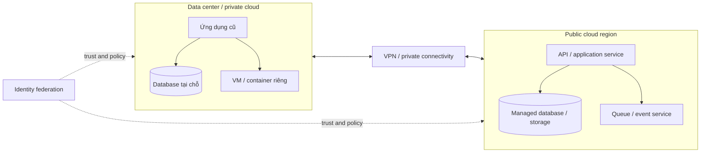

# Phân biệt hybrid cloud, edge compute và cloud tập trung

Kiến trúc compute hiện đại không nhất thiết chạy toàn bộ workload ở một trung tâm dữ liệu. Một ứng dụng có thể đặt hệ thống giao dịch chính trên public cloud, giữ một số dữ liệu hoặc hệ thống cũ tại data center riêng, đồng thời chạy xử lý gần thiết bị ở nhà máy hoặc cửa hàng. Để chọn đúng vị trí chạy, cần phân biệt ba khái niệm: **hybrid cloud**, **edge compute** và **cloud tập trung**.

Hybrid cloud mô tả cách kết hợp và phối hợp môi trường cloud riêng với cloud công cộng hoặc hạ tầng tại chỗ. Edge compute mô tả vị trí xử lý gần nơi dữ liệu được tạo ra hoặc nơi cần phản hồi. Cloud tập trung mô tả mô hình đưa phần lớn compute và dữ liệu về các region/data center tập trung của nhà cung cấp. Ba khái niệm này không loại trừ nhau: một kiến trúc hybrid có thể dùng edge node, rồi đồng bộ dữ liệu về cloud tập trung.

Trong module compute cloud, việc phân biệt đúng giúp quyết định workload nên chạy ở đâu, cần CPU/memory/network nào, dữ liệu di chuyển ra sao và ai chịu trách nhiệm vận hành. Không nên chọn edge chỉ vì muốn latency thấp, hoặc chọn hybrid chỉ vì đang có một máy chủ on-premises. Quyết định cần dựa trên yêu cầu ứng dụng, dữ liệu, kết nối, bảo mật, chi phí và năng lực vận hành.

## 1. Cloud tập trung là gì?

Cloud tập trung là mô hình triển khai trong đó compute, storage và các dịch vụ nền tảng chủ yếu chạy tại những region hoặc data center quy mô lớn của nhà cung cấp cloud. Người dùng truy cập tài nguyên qua mạng WAN/Internet hoặc kết nối riêng như VPN, private link/direct connection.

Các dịch vụ compute tập trung thường gồm:

- VM và bare metal instance.
- Container platform, Kubernetes managed và container serverless.
- Function/serverless runtime.
- Batch, HPC, GPU và accelerator service.
- Managed database, object storage, queue và event service.

### Đặc điểm

- **Tập trung năng lực:** gom compute, storage và network vào region có quy mô lớn.
- **Dịch vụ phong phú:** dễ tích hợp database, analytics, AI, identity, monitoring và automation.
- **Mở rộng theo nhu cầu:** có thể tăng/giảm instance, container hoặc function theo tải.
- **Quản lý tập trung:** policy, inventory, logging, billing và deployment có thể dùng chung.
- **Phụ thuộc kết nối:** client hoặc hệ thống tại xa cần kết nối tới region để trao đổi dữ liệu và gọi dịch vụ.

### Khi phù hợp

Cloud tập trung phù hợp với workload cần dữ liệu dùng chung, xử lý quy mô lớn, tích hợp nhiều managed service hoặc không có yêu cầu phản hồi ngay tại nơi dữ liệu được tạo ra. Ví dụ: hệ thống thương mại điện tử toàn quốc, backend SaaS, data warehouse, API công khai, hệ thống xử lý batch và ứng dụng cần scale theo traffic rộng.

Cloud tập trung không đồng nghĩa chỉ có một máy chủ hoặc một region. Nhà cung cấp có thể triển khai nhiều availability zone và region; “tập trung” ở đây nói tới việc compute được đặt tại các địa điểm cloud quy mô lớn thay vì sát thiết bị hoặc cơ sở phát sinh dữ liệu.

## 2. Hybrid cloud là gì?

Hybrid cloud kết hợp hai hoặc nhiều môi trường compute khác nhau, thường là private cloud/on-premises với public cloud, và tạo ra một cách phối hợp có chủ đích giữa chúng. Mục tiêu có thể là giữ một số workload tại chỗ vì yêu cầu dữ liệu, độ trễ hoặc hệ thống cũ, đồng thời dùng cloud công cộng cho khả năng mở rộng, dịch vụ managed và năng lực tính toán theo nhu cầu.

Một kiến trúc hybrid thực sự cần có sự kết nối và phối hợp về workload, dữ liệu, identity, network, policy hoặc vận hành. Việc một doanh nghiệp vừa thuê cloud vừa sở hữu server tại văn phòng chưa tự động tạo thành hybrid cloud nếu hai môi trường hoạt động hoàn toàn tách biệt.

### Thành phần thường gặp

- **On-premises/private environment:** data center riêng, private cloud hoặc hạ tầng tại chi nhánh.
- **Public cloud:** region và dịch vụ compute của nhà cung cấp.
- **Network connectivity:** VPN site-to-site, leased line, direct/private connection, SD-WAN hoặc kết nối bảo mật khác.
- **Identity federation:** tích hợp danh tính, role và quyền giữa các môi trường.
- **Management/control plane:** inventory, policy, deployment, monitoring và automation.
- **Data integration:** replication, synchronization, event streaming, backup và data transfer.
- **Workload placement:** quy tắc xác định dịch vụ nào chạy ở môi trường nào.

### Sơ đồ khái quát

Sơ đồ chỉ minh họa một cách kết nối. Trong triển khai thực tế, network path, identity trust và data flow cần được thiết kế riêng; không phải mọi workload đều cần truy cập hai chiều giữa các môi trường.

### Hybrid cloud không đồng nghĩa multi-cloud

Multi-cloud là sử dụng nhiều nhà cung cấp cloud công cộng. Hybrid cloud nhấn mạnh sự phối hợp giữa môi trường khác loại, thường có private/on-premises và public cloud. Một tổ chức có thể vừa hybrid vừa multi-cloud, nhưng hai thuật ngữ trả lời hai câu hỏi kiến trúc khác nhau.

## 3. Edge compute là gì?

Edge compute đưa compute và/hoặc storage tới gần nơi dữ liệu được tạo ra, nơi thiết bị hoạt động hoặc nơi cần phản hồi. Edge node có thể nằm trong nhà máy, cửa hàng, bệnh viện, trạm viễn thông, xe, tàu hoặc gateway IoT.

Mục tiêu chính là giảm phụ thuộc vào round trip tới cloud tập trung, xử lý dữ liệu tại chỗ, giảm lượng dữ liệu phải truyền đi hoặc tiếp tục hoạt động khi kết nối WAN bị gián đoạn.

### Các lớp edge thường gặp

- **Device edge:** xử lý ngay trên camera, cảm biến, gateway hoặc thiết bị đầu cuối.
- **Site/facility edge:** máy chủ hoặc cụm nhỏ tại nhà máy, cửa hàng hay cơ sở.
- **Network edge:** compute đặt gần điểm hiện diện mạng hoặc hạ tầng viễn thông.
- **Regional edge:** điểm compute gần khu vực người dùng hơn region cloud chính.
- **Cloud region:** nơi xử lý tập trung, quản lý fleet và phân tích tổng hợp.

Không có một định nghĩa khoảng cách vật lý cố định cho “edge”. Điểm quan trọng là vị trí compute được chọn để đáp ứng yêu cầu latency, data locality, bandwidth hoặc khả năng hoạt động cục bộ.

### Ví dụ

- Camera tại nhà máy phát hiện lỗi sản phẩm ngay trên gateway để dây chuyền phản ứng trong vài mili giây.
- Cửa hàng tiếp tục xử lý một số nghiệp vụ khi WAN mất kết nối, rồi đồng bộ giao dịch khi mạng phục hồi.
- Trạm viễn thông chạy video analytics hoặc content cache gần thuê bao.
- Xe tự hành xử lý cảm biến tại xe vì không thể phụ thuộc vào round trip tới cloud cho quyết định an toàn tức thời.
- Thiết bị y tế tiền xử lý dữ liệu tại cơ sở, chỉ gửi kết quả hoặc dữ liệu đã lọc về hệ thống trung tâm theo chính sách.

Edge không nhất thiết thay thế cloud. Cloud tập trung vẫn hữu ích để quản lý fleet, phân tích dữ liệu trên diện rộng, huấn luyện model, lưu trữ dài hạn và triển khai phiên bản phần mềm.

## 4. So sánh ba mô hình

| Tiêu chí | Cloud tập trung | Hybrid cloud | Edge compute |
|---|---|---|---|
| Khái niệm chính | Compute ở region/data center cloud tập trung | Phối hợp private/on-premises và public cloud | Compute gần nơi dữ liệu hoặc người dùng |
| Vị trí | Region cloud | Nhiều môi trường | Device, site, network hoặc regional edge |
| Mục tiêu nổi bật | Quy mô, dịch vụ phong phú, quản lý tập trung | Kết hợp kiểm soát tại chỗ với năng lực cloud | Latency thấp, locality và hoạt động cục bộ |
| Kết nối WAN | Thường cần cho client và tích hợp | Quan trọng giữa các môi trường | Có thể giảm phụ thuộc WAN cho luồng cục bộ |
| Data locality | Dữ liệu thường tập trung ở region | Dữ liệu phân bố giữa các môi trường | Dữ liệu có thể được xử lý/lưu tại site |
| Năng lực compute | Quy mô lớn và đa dạng | Phụ thuộc cả private lẫn public | Thường giới hạn hơn, tùy site/device |
| Quản trị | Tương đối tập trung | Phức tạp do nhiều control plane | Phân tán nhiều node và địa điểm |
| Khả năng offline | Phụ thuộc thiết kế ứng dụng | Có thể giữ hệ thống tại chỗ hoạt động | Thường là một mục tiêu thiết kế quan trọng |
| Chi phí nổi bật | Compute, storage, network egress và managed services | Cloud + hạ tầng riêng + kết nối + tích hợp | Thiết bị, triển khai site, fleet management và bảo trì |
| Trường hợp điển hình | SaaS, API, analytics, batch | ERP tại chỗ kết nối dịch vụ cloud | IoT, công nghiệp, retail, video và real-time control |

Hybrid là mô hình kết hợp môi trường; edge là cách đặt compute theo vị trí; cloud tập trung là cách tổ chức compute ở các region lớn. Một hệ thống có thể sử dụng đồng thời cả ba.

## 5. Các tiêu chí quyết định workload nên chạy ở đâu

Không có một tiêu chí duy nhất. Hãy đánh giá latency, data locality, kết nối, compliance, scale, khả năng vận hành và chi phí cho từng workload.

### Latency và thời gian phản hồi

Nếu ứng dụng cần phản hồi trong vài mili giây và mạng tới region không thể đáp ứng ổn định, xử lý tại edge có thể phù hợp. Nếu yêu cầu latency ở mức hàng trăm mili giây hoặc giây và người dùng phân bố rộng, cloud region có thể đáp ứng tốt.

Phải tính toàn bộ latency budget:

\[
T_{total} = T_{network} + T_{queue} + T_{compute} + T_{storage} + T_{response}
\]

Đặt compute gần client chỉ giảm một phần `T_network`. Nếu workload vẫn phải gọi database ở region xa, latency tổng có thể không cải thiện. Đưa compute tới edge nhưng giữ mọi dependency tại cloud tập trung đôi khi chỉ chuyển điểm nghẽn.

### Data locality và băng thông

Nếu thiết bị tạo ra lượng dữ liệu lớn, truyền toàn bộ dữ liệu thô tới cloud có thể tốn bandwidth và egress. Edge có thể lọc, nén, tổng hợp hoặc chỉ gửi event quan trọng.

Ví dụ, camera liên tục tạo video. Gateway có thể phân tích frame tại chỗ, chỉ gửi clip có sự kiện và metadata. Cách này giảm truyền dữ liệu nhưng cần quản lý model, firmware và policy xử lý tại site.

### Kết nối không ổn định

Nhà máy, tàu biển, xe hoặc vùng xa có thể mất WAN. Nếu ứng dụng phải tiếp tục hoạt động, cần edge/local compute, local storage, queue và cơ chế đồng bộ sau khi mạng phục hồi.

Thiết kế offline-first phải xác định rõ nghiệp vụ nào được phép hoạt động độc lập, dữ liệu nào có thể conflict và cách đồng bộ. Không phải mọi giao dịch đều an toàn khi thực hiện offline.

### Compliance và chủ quyền dữ liệu

Một số dữ liệu phải lưu hoặc xử lý trong phạm vi địa lý, pháp lý hoặc môi trường kiểm soát cụ thể. Hybrid có thể giữ data plane tại chỗ; edge có thể xử lý dữ liệu tại site; cloud region trong khu vực có thể đáp ứng yêu cầu nếu dịch vụ và hợp đồng phù hợp.

Không suy ra rằng chạy tại edge tự động tuân thủ. Thiết bị edge vẫn cần mã hóa, kiểm soát truy cập, audit, patching và quy trình xóa dữ liệu.

### Quy mô và khả năng quản trị

Cloud tập trung thuận lợi khi cần scale lớn và quản lý hàng nghìn workload qua control plane chung. Edge có thể tạo hàng trăm hoặc hàng nghìn node nhỏ ở các site khác nhau; fleet management, version drift, kết nối và bảo trì trở thành bài toán chính.

### Tính sẵn sàng và failure domain

Đặt compute tại một site có thể giảm latency nhưng site đó vẫn là failure domain riêng. Nếu site mất điện hoặc thiết bị hỏng, cần local redundancy hoặc khả năng chuyển workload sang site/cloud khác. Cloud region cũng có thể gặp outage; thiết kế cần xác định khả năng failover và dữ liệu được đồng bộ tới đâu.

## 6. Workload placement: phân loại trước khi phân bố

Một ứng dụng thường có nhiều thành phần với yêu cầu khác nhau. Không cần đặt toàn bộ ứng dụng ở cùng một nơi.

| Thành phần workload | Vị trí có thể phù hợp | Lý do |
|---|---|---|
| Điều khiển máy móc theo thời gian thực | Device/site edge | Cần phản hồi nhanh và không phụ thuộc WAN |
| Lọc dữ liệu cảm biến | Gateway/site edge | Giảm bandwidth và gửi dữ liệu đã chọn |
| API quản lý người dùng | Cloud tập trung | Dùng chung toàn hệ thống và cần managed services |
| Database giao dịch trung tâm | Cloud region hoặc private data center | Cần consistency, backup và quản trị dữ liệu |
| Tích hợp hệ thống ERP cũ | Hybrid | Giữ ERP tại chỗ, kết nối API cloud |
| Huấn luyện ML quy mô lớn | Cloud tập trung/HPC | Cần GPU, storage và khả năng scale |
| Inference gần camera | Edge | Giảm latency và truyền video thô |
| Phân tích tổng hợp từ nhiều site | Cloud tập trung | Gom dữ liệu để phân tích toàn cục |
| Cache nội dung | Edge/network edge | Đưa nội dung gần người dùng |
| Quản lý fleet và phân phối phần mềm | Cloud control plane | Điều phối tập trung nhiều edge node |

### Tách control plane và data plane

Một kiến trúc thường dùng cloud tập trung để quản lý, trong khi xử lý dữ liệu diễn ra tại edge:

- **Control plane:** inventory, policy, identity, software release, fleet health và cấu hình.
- **Data plane:** nhận dữ liệu cảm biến, xử lý inference, điều khiển cục bộ và lưu tạm.

Nếu mất kết nối tới control plane, data plane tại edge có thể tiếp tục hoạt động theo policy và cấu hình gần nhất. Khi kết nối trở lại, edge đồng bộ trạng thái và nhận cập nhật mới.

## 7. Kiến trúc hybrid điển hình

### Giữ hệ thống cũ tại chỗ, mở rộng bằng cloud

Một doanh nghiệp có ERP và database cũ trong data center. Họ triển khai portal/API mới trên cloud, kết nối tới hệ thống cũ qua private connectivity. Một số tác vụ batch có thể chạy trên cloud để tận dụng compute theo nhu cầu.

Các điểm cần thiết kế:

- Network route, DNS, firewall và private connectivity.
- Identity federation và service-to-service authentication.
- Data contract/API giữa hệ thống mới và cũ.
- Latency và timeout khi gọi qua WAN.
- Đồng bộ dữ liệu và xử lý retry khi link gián đoạn.
- Phân chia backup, DR và ownership giữa hai môi trường.

### Cloud bursting

Cloud bursting là cách dùng public cloud để bổ sung capacity khi private environment đạt giới hạn. Mô hình phù hợp với workload có thể mở rộng ngang và không phụ thuộc state cục bộ.

Trước khi burst, cần xác định:

- Image/runtime và cấu hình tương thích giữa hai môi trường.
- Dữ liệu đầu vào có sẵn ở cloud hay phải truyền qua WAN.
- Identity, network và secret có thể cấp an toàn không.
- Licensing có cho phép chạy trên cloud không.
- Chi phí compute, egress và data synchronization.
- Cách thu hồi cloud capacity khi tải giảm.

Cloud bursting khó áp dụng cho workload có state lớn, license gắn phần cứng hoặc dữ liệu không thể sao chép ra ngoài. Không coi nó là autoscaling đơn giản nếu data plane và control plane không được chuẩn bị.

### DR và backup hybrid

Một môi trường có thể làm recovery site cho môi trường còn lại. Ví dụ, backup từ private data center được copy tới cloud; khi data center gặp sự cố, compute mới được cấp phát trên cloud và restore dữ liệu.

Phải kiểm tra RPO/RTO thực tế, quota region, key, network, DNS, identity và khả năng restore. Bản backup tồn tại ở cloud chưa có nghĩa ứng dụng đã sẵn sàng chạy tại đó.

## 8. Kiến trúc edge điển hình

### Edge gateway trong nhà máy

Gateway nhận dữ liệu từ PLC/cảm biến, chuẩn hóa protocol, lọc nhiễu và chạy rule hoặc model inference. Dữ liệu cần thiết được gửi tới cloud qua message broker khi kết nối sẵn sàng.

Thiết kế cần:

- Buffer cục bộ có giới hạn dung lượng.
- Timestamp và sequence để phát hiện dữ liệu trễ/trùng.
- Đồng bộ thời gian giữa thiết bị.
- Store-and-forward khi WAN mất kết nối.
- Chính sách ưu tiên dữ liệu khi buffer gần đầy.
- Cập nhật model/firmware có ký số và rollback.
- Cô lập network OT và IT theo kiến trúc an toàn.

### Edge cache/CDN

Content cache đặt gần người dùng giúp giảm latency và tải origin. Cloud tập trung vẫn quản lý nội dung gốc, policy và analytics. Cần cache invalidation, TTL, bảo vệ nội dung riêng tư và xử lý khi origin không truy cập được.

### Retail edge

Một cửa hàng có thể chạy POS, inventory cache và một số nghiệp vụ cục bộ. Khi WAN mất, cửa hàng có thể tiếp tục một số hoạt động rồi đồng bộ giao dịch về cloud. Cần giải quyết conflict, thứ tự giao dịch, duplicate và giới hạn chức năng offline.

## 9. Network: yếu tố quyết định giữa cloud, hybrid và edge

Network là phần quan trọng của kiến trúc phân tán. Cần lập bản đồ luồng dữ liệu thay vì chỉ vẽ một đường kết nối giữa hai môi trường.

### Các kiểu kết nối

- Internet với TLS và kiểm soát ingress/egress.
- Site-to-site VPN qua Internet.
- Private dedicated connection hoặc private peering.
- SD-WAN kết nối nhiều chi nhánh.
- 5G/private cellular hoặc mạng chuyên dụng cho edge di động.
- Local network tại site cho thiết bị và gateway.

### Đánh giá network path

Với từng luồng, ghi rõ source, destination, protocol, port, bandwidth, latency target, availability, encryption và owner. Đặc biệt chú ý:

- DNS resolution giữa môi trường.
- Route propagation và overlapping IP ranges.
- Firewall/security group và egress control.
- TLS certificate, mutual TLS và rotation.
- NAT, proxy và giới hạn connection.
- MTU, packet loss, jitter và bandwidth contention.
- Network egress cost và inter-region transfer.

### Mất kết nối và phục hồi

Ứng dụng hybrid/edge cần timeout, retry có backoff, queue và circuit breaker. Retry vô hạn khi link down có thể tạo bão request lúc kết nối trở lại. Store-and-forward cần giới hạn buffer và có chính sách xử lý dữ liệu cũ hoặc hết hạn.

## 10. Data architecture và đồng bộ

Phân tán compute thường kéo theo phân tán dữ liệu. Cần xác định dữ liệu nào là source of truth, bản sao nào chỉ để đọc/cache và hệ thống nào được phép ghi.

### Replication

Replication sao chép dữ liệu giữa các môi trường. Đồng bộ có thể synchronous hoặc asynchronous. Synchronous replication có thể tăng latency và phụ thuộc kết nối; asynchronous replication cho phép hoạt động cục bộ nhưng có replication lag và có thể mất các thay đổi gần nhất khi failure.

### Event-driven synchronization

Edge có thể ghi event vào local queue rồi gửi về cloud khi kết nối phục hồi. Mỗi event cần event ID, sequence/version và timestamp; consumer cần idempotency để xử lý giao lặp.

### Conflict resolution

Nếu cùng một dữ liệu được cập nhật ở nhiều site khi offline, cần quy tắc xử lý conflict:

- Single-writer: chỉ một môi trường được phép ghi dữ liệu chuẩn.
- Last-write-wins: dùng timestamp/version, nhưng cần đồng bộ clock và chấp nhận mất một số cập nhật.
- Version/vector-based merge: kết hợp thay đổi khi domain cho phép.
- Application-specific resolution: dùng quy tắc nghiệp vụ, ví dụ tồn kho hoặc giao dịch tài chính.

Không dùng last-write-wins cho mọi dữ liệu. Với giao dịch cần consistency mạnh, nên giới hạn offline write hoặc dùng workflow có cơ chế reconcile rõ ràng.

### Data gravity

Dữ liệu lớn và có nhiều consumer tạo ra “data gravity”: chuyển compute tới nơi dữ liệu đang nằm đôi khi rẻ và nhanh hơn chuyển dữ liệu tới compute. Khi chọn placement, tính cả chi phí copy, egress, latency và thời gian đồng bộ.

## 11. Bảo mật và quản trị trong môi trường phân tán

Hybrid và edge mở rộng ranh giới bảo mật ra ngoài một cloud account hoặc data center. Mỗi site, gateway và connection đều là một phần của attack surface.

### Identity và zero trust

- Dùng identity riêng cho từng device/node/service.
- Ưu tiên credential ngắn hạn và certificate có rotation.
- Xác thực cả workload và thiết bị trước khi cấp quyền.
- Giới hạn quyền theo resource và hành động.
- Không dùng chung admin credential trên toàn bộ edge fleet.
- Có quy trình thu hồi identity khi thiết bị mất hoặc bị thay thế.

### Network segmentation

Tách mạng OT, IT, management và guest theo yêu cầu. Chỉ mở luồng cần thiết giữa edge gateway, thiết bị, cloud endpoint và control plane. Không expose management interface trực tiếp ra Internet nếu không có lớp bảo vệ phù hợp.

### Device hardening

Edge node có thể đặt ở vị trí vật lý ít được bảo vệ. Cần secure boot, disk encryption, tamper protection khi phù hợp, patching, hạn chế USB/console và quản lý vật lý. Khi thiết bị bị mất, phải có khả năng revoke credential và bảo vệ dữ liệu trên disk.

### Software supply chain

Phần mềm edge cần được build, ký, phân phối và xác minh trước khi cài. Dùng artifact version rõ ràng, registry/repository được kiểm soát và quy trình rollback. Không cho edge node tự tải script không xác minh từ endpoint công khai.

### Data residency và privacy

Edge có thể giảm việc truyền dữ liệu thô, nhưng vẫn cần xác định loại dữ liệu được xử lý/lưu tại site, thời gian giữ, encryption và quyền truy cập. Dữ liệu tổng hợp gửi về cloud vẫn có thể nhạy cảm tùy nội dung.

## 12. Availability, resilience và hoạt động khi offline

Cloud tập trung thường có nhiều availability zone và dịch vụ managed. Edge thường có ít node hơn tại mỗi site, nhưng có thể giảm phụ thuộc vào WAN. Hybrid cần thiết kế resilience cho cả hai phía và đường kết nối giữa chúng.

### Failure domain

Phân loại sự cố theo:

- Process/container/VM.
- Edge device hoặc gateway.
- Rack, nguồn điện hoặc mạng tại site.
- WAN link hoặc ISP.
- Cloud availability zone/region.
- Identity, DNS, certificate hoặc control plane.
- Database, queue và dịch vụ phụ thuộc.

Một edge gateway duy nhất là single point of failure cho site dù cloud phía sau có nhiều region. Ngược lại, hai gateway cùng dùng một switch hoặc nguồn điện vẫn có failure domain chung.

### Store-and-forward

Khi WAN down, edge có thể ghi dữ liệu vào local queue và gửi sau. Cần quy định:

- Buffer tối đa theo byte/message và thời gian.
- Hành vi khi buffer đầy.
- Dữ liệu nào được ưu tiên giữ hoặc loại bỏ.
- Message expiry và thứ tự xử lý.
- Retry/backoff và rate limit khi kết nối trở lại.
- Deduplication và idempotency ở cloud consumer.
- Cách theo dõi backlog và thời gian đồng bộ.

### Graceful degradation

Ứng dụng cần xác định chức năng nào tiếp tục hoạt động khi mất cloud. Ví dụ, POS có thể lưu giao dịch offline trong giới hạn; dashboard analytics có thể ngừng cập nhật; điều khiển an toàn tại nhà máy phải tiếp tục bằng logic cục bộ. Không phải mọi chức năng đều nên fail open.

## 13. Compute và resource sizing ở edge

Edge node thường có giới hạn điện năng, không gian, nhiệt, bandwidth và khả năng thay thế phần cứng. Cấu hình CPU/RAM/GPU phải dựa trên tải thực và điều kiện môi trường.

### CPU

Chọn CPU theo số luồng xử lý, kiến trúc instruction set, khả năng tăng tốc mã hóa/giải mã và yêu cầu runtime. Kiểm tra binary/container image có tương thích kiến trúc ARM/x86 hoặc accelerator của thiết bị không.

### Memory

Tính memory cho OS, agent quản lý, runtime, cache, buffer offline và workload. Buffer store-and-forward có thể chiếm nhiều RAM/disk khi mất WAN; cần giới hạn và giám sát.

### GPU/accelerator

Inference tại edge có thể cần GPU/NPU. Kiểm tra model format, driver, runtime, memory và khả năng update. Không giả định model chạy giống nhau trên mọi accelerator; cần benchmark latency, throughput và công suất tiêu thụ.

### Storage

Dùng SSD phù hợp với workload và điều kiện nhiệt/rung nếu triển khai công nghiệp. Tính endurance, encryption, backup và thời gian thay thế disk. Dữ liệu tạm có thể dùng local disk; dữ liệu quan trọng cần replication hoặc đồng bộ bền vững.

### Thermal và power envelope

Thiết bị edge có thể chạy trong tủ điện, ngoài trời hoặc trên phương tiện. Cần tính công suất tiêu thụ, tản nhiệt, nguồn dự phòng và giới hạn nhiệt. Throttling do nhiệt có thể làm latency tăng dù cấu hình CPU trên giấy đủ mạnh.

## 14. Vận hành fleet edge

Một hệ thống edge có thể gồm hàng trăm hoặc hàng nghìn node ở các địa điểm khác nhau. Quản lý từng node thủ công không mở rộng được.

### Fleet inventory

Mỗi node cần định danh duy nhất, site, hardware model, OS/runtime version, owner, network status, certificate expiry và software release. Inventory cần được cập nhật khi node được thay thế hoặc chuyển site.

### Remote provisioning

Provisioning cần xác minh thiết bị, cấp identity, cấu hình network, cài agent và tải workload đã ký. Thiết bị mới không nên được tin cậy chỉ vì kết nối được vào mạng site.

### OTA update

Update over-the-air cần:

- Artifact có chữ ký và checksum.
- Canary theo nhóm nhỏ/site trước khi rollout rộng.
- Kiểm tra compatibility và dependency.
- Atomic update hoặc A/B partition nếu thiết bị hỗ trợ.
- Health check sau cập nhật.
- Rollback tự động hoặc runbook khi update lỗi.
- Giới hạn rollout khi nhiều site đang offline.

### Drift và configuration management

Theo dõi version drift, config drift và node chưa nhận policy mới. Một node offline lâu có thể quay lại với certificate hết hạn hoặc software quá cũ; cần quy trình re-enrollment và cập nhật an toàn.

### Observability khi kết nối không liên tục

Agent edge có thể buffer log/metric cục bộ và gửi khi kết nối trở lại. Timestamp cần đồng bộ; nếu clock sai, log correlation khó chính xác. Ghi nhận cả thời điểm event xảy ra và thời điểm cloud nhận được.

## 15. Chi phí: so sánh toàn bộ vòng đời

Không so sánh chỉ giá VM cloud với giá edge server. Tổng chi phí cần tính cả phần cứng, kết nối, vận hành và dữ liệu.

### Cloud tập trung

- Compute, storage và managed service.
- Network egress, inter-region transfer và private connectivity.
- Logging, monitoring, backup và support.
- Commitment, reservation và idle capacity.

### Hybrid cloud

- Chi phí public cloud.
- Data center/private cloud, license và hardware.
- VPN/dedicated link, firewall và network operations.
- Integration, identity federation và data synchronization.
- Đội ngũ vận hành hai môi trường và DR.

### Edge compute

- Mua/thay thiết bị, gateway, GPU/NPU và phụ kiện.
- Lắp đặt, nguồn điện, cooling, rack và kết nối.
- Field service, bảo trì và logistics tại site.
- Fleet management, OTA, security và observability.
- Local storage, backup và truyền dữ liệu về cloud.
- Thiết bị dự phòng và vòng đời phần cứng.

### Tính TCO

\[
TCO = C_{hardware} + C_{compute} + C_{storage} + C_{network} + C_{operations} + C_{security} + C_{lifecycle}
\]

Đây là mô hình nhóm chi phí tổng quát. Cần tính theo cùng kỳ thời gian và khối lượng công việc. Với edge, chi phí field service và thay thiết bị có thể lớn hơn chi phí compute; với cloud, egress và managed service có thể là phần đáng kể.

### Cost per useful outcome

So sánh chi phí theo kết quả nghiệp vụ như chi phí trên mỗi thiết bị được giám sát, mỗi video được phân tích, mỗi giao dịch hoặc mỗi giờ hoạt động đạt SLO. Cách này phản ánh giá trị thực tế hơn so với chi phí trên mỗi vCPU-hour riêng lẻ.

## 16. Ví dụ lựa chọn kiến trúc

### Ví dụ A: hệ thống thương mại điện tử

Website, API, database và analytics phục vụ người dùng ở nhiều tỉnh thành. Workload không cần xử lý ngay tại thiết bị của người dùng; dữ liệu giao dịch cần nhất quán và tích hợp với nhiều dịch vụ managed.

Cloud tập trung theo nhiều availability zone thường là lựa chọn hợp lý. Có thể dùng CDN/edge cache để phân phối nội dung tĩnh, nhưng business transaction và database vẫn nằm ở cloud region. Nếu hệ thống ERP cũ ở data center riêng, kết nối hybrid tới ERP.

### Ví dụ B: dây chuyền sản xuất

Camera và cảm biến tạo dữ liệu liên tục; bộ điều khiển cần phản ứng trong thời gian ngắn và nhà máy không thể dừng khi WAN mất.

Edge gateway xử lý inference và rule cục bộ; dữ liệu sự kiện, metric và kết quả được gửi về cloud khi có kết nối. Cloud quản lý fleet, phân tích lịch sử và huấn luyện model. Nếu MES/ERP vẫn ở data center riêng, kiến trúc tổng thể là hybrid có edge.

### Ví dụ C: bệnh viện

Một số dữ liệu cần xử lý tại cơ sở vì latency, kết nối hoặc policy. Hệ thống quản lý trung tâm có thể đặt trong cloud region đáp ứng yêu cầu pháp lý; gateway tại bệnh viện xử lý dữ liệu thiết bị và tiếp tục hoạt động cục bộ khi kết nối gián đoạn.

Phải xác định dữ liệu nào được lưu tại edge, dữ liệu nào được gửi về cloud, cách mã hóa, audit và retention. Edge không tự động bảo đảm tuân thủ quy định dữ liệu y tế.

### Ví dụ D: hệ thống bán lẻ nhiều cửa hàng

Mỗi cửa hàng có POS, local cache và một số dịch vụ inventory. Khi WAN mất, POS lưu giao dịch offline theo giới hạn; khi mạng phục hồi, đồng bộ lên cloud. Cloud tập trung quản lý catalog, báo cáo và chính sách giá; edge tại cửa hàng giúp giảm phụ thuộc WAN cho nghiệp vụ cần tiếp tục tại chỗ.

## 17. Quy trình ra quyết định placement

Có thể dùng quy trình sau cho từng workload:

1. Xác định yêu cầu latency, throughput, availability và thời gian offline cho phép.
2. Xác định nơi dữ liệu được tạo, lưu và sử dụng; dung lượng và tốc độ thay đổi.
3. Xác định dữ liệu có được phép rời site/region không.
4. Đo network latency, bandwidth, jitter và chi phí truyền dữ liệu.
5. Xác định dependency nào cần ở gần workload và dependency nào có thể dùng managed cloud.
6. Đánh giá compute sizing, accelerator, storage và power/thermal constraint.
7. Xác định failure domain, offline behavior, replication và recovery.
8. Đánh giá năng lực quản trị fleet, patching, identity và monitoring.
9. Tính TCO và cost per useful outcome.
10. Chạy pilot ở một site/region, đo SLO và kiểm thử mất kết nối trước khi mở rộng.

### Bảng quyết định rút gọn

| Nếu yêu cầu chính là... | Ưu tiên xem xét | Cần kiểm chứng |
|---|---|---|
| Dịch vụ managed phong phú và scale lớn | Cloud tập trung | Region, quota, egress, availability |
| Giữ dữ liệu/hệ thống cũ tại chỗ nhưng dùng cloud | Hybrid cloud | Connectivity, identity, data consistency |
| Phản hồi cực nhanh tại thiết bị/site | Edge compute | Local capacity, power, offline operation |
| Giảm truyền dữ liệu thô | Edge preprocessing | Bandwidth savings, model update, local storage |
| Khôi phục khi data center riêng gặp sự cố | Hybrid DR | RPO/RTO, quota, restore và runbook |
| Quản lý nhiều site phân tán | Edge fleet + cloud control plane | Provisioning, OTA, inventory và security |

## 18. Những sai lầm thường gặp

- **Coi hybrid là multi-cloud:** hai khái niệm có trọng tâm khác nhau.
- **Coi edge là một loại cloud provider:** edge nói về vị trí xử lý, có thể do doanh nghiệp hoặc nhà cung cấp vận hành.
- **Đưa mọi thứ ra edge để giảm latency:** dependency ở cloud xa vẫn có thể chi phối thời gian phản hồi.
- **Giữ database ở nhiều nơi mà không có conflict strategy:** dễ phát sinh ghi đè và dữ liệu không nhất quán.
- **Không tính network egress:** truyền dữ liệu liên tục có thể làm chi phí tăng mạnh.
- **Cho rằng edge luôn hoạt động offline:** ứng dụng vẫn cần local dependency, buffer và quy tắc degrade.
- **Không quản lý fleet:** node bị drift, hết certificate hoặc chạy firmware cũ.
- **Dùng một credential cho toàn bộ site:** một thiết bị bị chiếm có thể ảnh hưởng cả fleet.
- **Không kiểm thử WAN failure:** store-and-forward có thể đầy buffer hoặc gửi dồn khi mạng phục hồi.
- **Bỏ qua field service và vòng đời phần cứng:** TCO edge bị đánh giá thấp.
- **Coi cloud region và edge node có cùng khả năng:** edge thường có capacity, redundancy và dịch vụ managed hạn chế hơn.
- **Không xác định owner theo lớp:** sự cố bị chuyển qua lại giữa network, platform, site và application team.

## 19. Checklist thiết kế hybrid và edge

**Workload placement:**

- [ ] Đã phân biệt cloud tập trung, hybrid và edge theo đúng mục tiêu.
- [ ] Đã xác định thành phần nào cần chạy tại site, region hoặc data center riêng.
- [ ] Đã đo latency, bandwidth, data volume và dependency path.
- [ ] Đã xác định yêu cầu data residency và compliance.

**Network và dữ liệu:**

- [ ] Có network topology, route, DNS, firewall và encryption rõ ràng.
- [ ] Có source of truth và mô hình replication.
- [ ] Có conflict resolution cho dữ liệu ghi offline hoặc multi-site.
- [ ] Có store-and-forward, buffer limit và replay/idempotency.
- [ ] Có quy tắc xử lý dữ liệu trễ, trùng và hết hạn.

**Compute và vận hành:**

- [ ] CPU, RAM, GPU, storage và power/thermal được benchmark.
- [ ] Có inventory và định danh riêng cho từng edge node.
- [ ] Có provisioning, OTA, signature verification và rollback.
- [ ] Có patching, certificate rotation và revocation.
- [ ] Có observability hoạt động khi WAN gián đoạn.
- [ ] Có owner và runbook cho từng failure domain.

**Resilience, security và cost:**

- [ ] Có phương án site/device/link/region failure.
- [ ] Có local redundancy hoặc graceful degradation phù hợp.
- [ ] Identity và network được phân đoạn theo least privilege.
- [ ] Dữ liệu local và truyền tải được mã hóa.
- [ ] TCO gồm hardware, connectivity, operations và lifecycle.
- [ ] Pilot đã kiểm thử latency, offline, recovery và cost per outcome.

## Kết luận

Cloud tập trung đặt phần lớn compute tại các region/data center quy mô lớn để tận dụng dịch vụ managed, khả năng mở rộng và quản lý tập trung. Hybrid cloud phối hợp private/on-premises với public cloud để kết hợp kiểm soát tại chỗ và năng lực cloud. Edge compute đặt xử lý gần thiết bị, dữ liệu hoặc người dùng để giảm latency, giảm truyền dữ liệu và duy trì một số chức năng khi WAN gián đoạn. Ba mô hình có thể kết hợp trong cùng kiến trúc. Hãy chọn vị trí cho từng workload dựa trên latency budget, data locality, kết nối, compliance, failure domain, khả năng vận hành và TCO; sau đó kiểm thử luồng dữ liệu, offline behavior và phục hồi trước khi triển khai rộng.
