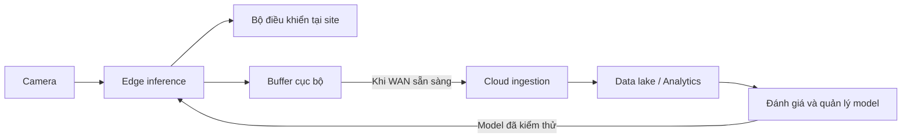

# Lựa chọn vị trí chạy theo độ trễ, dữ liệu và kết nối

Một workload cloud không nhất thiết phải chạy ở cùng một nơi với mọi thành phần dữ liệu và người dùng. Ứng dụng có thể xử lý tại vùng cloud trung tâm, tại trung tâm dữ liệu riêng, ở nhà máy hoặc cửa hàng, hay trên một thiết bị gateway gần nguồn dữ liệu. Vị trí phù hợp phụ thuộc vào thời gian phản hồi mà ứng dụng cần, nơi dữ liệu được tạo và lưu trữ, cũng như khả năng duy trì hoạt động khi đường truyền không ổn định.

Bài học thuộc chương **Compute lai và điện toán biên** trong module **CLOUD_CORE_SERVICES_COMPUTE**. Nội dung giúp lựa chọn nơi chạy workload dựa trên độ trễ, vị trí và quy định dữ liệu, băng thông, độ tin cậy của kết nối, yêu cầu bảo mật và chi phí vận hành. Các nguyên tắc này hỗ trợ triển khai ứng dụng, mở rộng năng lực tính toán và duy trì tính sẵn sàng trong môi trường kết hợp cloud, on-premises và edge.

Sau bài học, người học có thể:

- Phân biệt cloud region, trung tâm dữ liệu riêng, edge site và thiết bị edge.
- Xác định độ trễ đầu cuối và ngân sách độ trễ của từng bước xử lý.
- Đánh giá yêu cầu về nơi lưu dữ liệu, luồng dữ liệu và quyền kiểm soát dữ liệu.
- Chọn vị trí chạy dựa trên chất lượng kết nối, khả năng hoạt động khi mất mạng và nhu cầu đồng bộ.
- So sánh các phương án bằng tiêu chí bắt buộc và ma trận đánh giá có trọng số.
- Thiết kế luồng xử lý lai có lưu đệm, đồng bộ an toàn và khả năng phục hồi.

## 1. Những vị trí có thể chạy workload

Trong kiến trúc hybrid và edge, vị trí chạy không chỉ là tên một cloud region. Nó mô tả nơi workload thực thi, nơi dữ liệu được truy cập và nơi lưu lượng phải đi qua để hoàn thành một yêu cầu.

| Vị trí | Đặc điểm | Phù hợp với | Điểm cần cân nhắc |
|---|---|---|---|
| Cloud region | Hạ tầng tập trung trong một vùng địa lý của nhà cung cấp cloud | API dùng chung, xử lý dữ liệu lớn, hệ thống cần dịch vụ cloud được quản lý | Độ trễ đến người dùng hoặc nguồn dữ liệu ở xa; lưu lượng truyền ra/vào cloud |
| Cloud region gần người dùng | Region hoặc zone gần thị trường, chi nhánh hay thiết bị | Ứng dụng tương tác cần phản hồi nhanh hơn; xử lý theo khu vực | Dữ liệu có thể phân tán nhiều vùng; cần thiết kế replication và khôi phục |
| Trung tâm dữ liệu on-premises | Hạ tầng do tổ chức kiểm soát tại cơ sở riêng | Hệ thống cũ, dữ liệu nhạy cảm, thiết bị chuyên dụng hoặc yêu cầu tích hợp nội bộ | Năng lực mở rộng, cập nhật phần cứng, dự phòng và chi phí duy trì |
| Edge site | Máy chủ hoặc cụm nhỏ đặt tại nhà máy, cửa hàng, bệnh viện, trạm viễn thông | Xử lý gần nguồn dữ liệu, cần phản hồi nhanh hoặc tiếp tục chạy khi WAN gián đoạn | Không gian, điện, làm mát, bảo vệ vật lý, nhân lực vận hành tại điểm |
| Thiết bị edge/gateway | Thiết bị công nghiệp, gateway IoT hoặc máy tính nhúng | Lọc, chuẩn hóa, suy luận nhẹ, điều khiển cục bộ | CPU, bộ nhớ, lưu trữ, vòng đời thiết bị và khả năng cập nhật hạn chế |

Không phải mọi workload đều cần đưa ra edge. Edge có ích khi vị trí gần nguồn dữ liệu hoặc người dùng tạo ra lợi ích đo được về độ trễ, băng thông, khả năng hoạt động độc lập hoặc tuân thủ. Nếu workload chỉ cần xử lý theo lô và không có yêu cầu phản hồi nhanh, cloud region tập trung thường dễ vận hành và mở rộng hơn.

## 2. Độ trễ: đo cả hành trình của yêu cầu

Độ trễ là thời gian từ lúc một hành động bắt đầu đến khi kết quả hữu ích được trả về. Không nên chỉ đo thời gian thực thi CPU của function hoặc container. Một yêu cầu có thể tiêu tốn thời gian ở nhiều đoạn:

1. Thiết bị hoặc client tạo yêu cầu và gửi qua mạng truy cập.
2. DNS phân giải tên dịch vụ và thiết lập kết nối.
3. Lưu lượng đi qua mạng WAN, VPN, private link, gateway hoặc load balancer.
4. Workload được xếp hàng, xử lý và gọi các dependency.
5. Kết quả được gửi ngược lại client hoặc thiết bị.


Độ trễ đầu cuối có thể được phân tích gần đúng thành tổng thời gian truyền, thiết lập kết nối, xếp hàng, xử lý và chờ dependency. Trong thực tế, một số bước có thể chạy song song hoặc bị ảnh hưởng bởi retry, nên cần dùng trace và đo thực tế thay vì chỉ cộng các ước lượng độc lập.

### Ngân sách độ trễ

Hãy bắt đầu từ SLO của trải nghiệm hoặc quy trình. Ví dụ, nếu một hệ thống kiểm tra sản phẩm trên dây chuyền phải đưa ra quyết định trong 100 ms, nhóm thiết kế cần phân bổ ngân sách cho việc đọc camera, truyền dữ liệu, suy luận, ra quyết định và kích hoạt thiết bị. Nếu gửi toàn bộ hình ảnh lên một region ở xa khiến riêng mạng đã dùng gần hết ngân sách, việc tăng CPU tại cloud không giải quyết được giới hạn chính.

Không có một ngưỡng độ trễ phù hợp cho mọi workload. Gọi API tra cứu thông tin có thể chấp nhận hàng trăm mili giây; điều khiển máy móc hoặc vòng phản hồi thời gian thực có thể cần chặt chẽ hơn nhiều. Phải lấy yêu cầu từ nghiệp vụ và thiết bị thực tế, sau đó đo p50, p95, p99, jitter và tỷ lệ timeout trong điều kiện tải bình thường lẫn cao điểm.

### RTT, jitter và khoảng cách

- **Round-trip time (RTT):** thời gian một gói tin đi từ nguồn đến đích rồi quay lại. Ứng dụng có nhiều lần gọi tuần tự sẽ chịu ảnh hưởng cộng dồn của RTT.
- **Jitter:** mức dao động của độ trễ. Một kết nối có RTT trung bình thấp nhưng jitter lớn vẫn có thể gây giật hình, điều khiển không ổn định hoặc timeout.
- **Packet loss:** tỷ lệ gói tin bị mất; TCP có thể phải truyền lại, làm tăng thời gian hoàn thành và giảm thông lượng hữu dụng.
- **Throughput:** lượng dữ liệu truyền được trong một đơn vị thời gian. Throughput cao không đồng nghĩa với độ trễ thấp.

Khoảng cách địa lý ảnh hưởng đến thời gian truyền, nhưng tuyến mạng, peering, nghẽn mạng, mã hóa, thiết bị trung gian và vị trí của dependency cũng quan trọng. Một workload đặt gần client nhưng gọi database ở region xa có thể vẫn chậm do mỗi request phải đi qua mạng nhiều lần. Hãy đặt các thành phần có trao đổi thường xuyên gần nhau hoặc giảm số lượt gọi tuần tự.

## 3. Dữ liệu quyết định vị trí xử lý

Workload thường chạy gần nơi dữ liệu được tạo hoặc nơi dữ liệu được phép lưu trữ. Di chuyển dữ liệu đến compute có thể tốn băng thông, thời gian và chi phí; di chuyển compute đến dữ liệu có thể giảm truyền tải nhưng làm tăng yêu cầu triển khai và vận hành tại nơi mới.

Trước khi chọn vị trí, phân loại dữ liệu theo các câu hỏi sau:

- **Nguồn tạo dữ liệu:** dữ liệu đến từ camera, cảm biến, ứng dụng người dùng, hệ thống ERP hay thiết bị công nghiệp?
- **Độ nhạy cảm:** dữ liệu có chứa thông tin cá nhân, tài chính, y tế, bí mật kinh doanh hoặc dữ liệu vận hành quan trọng không?
- **Nơi được phép lưu và xử lý:** hợp đồng, chính sách tổ chức hoặc quy định pháp lý có giới hạn quốc gia, khu vực hay loại hạ tầng không?
- **Kích thước và tần suất:** mỗi sự kiện vài byte, một bản ghi nhỏ hay video liên tục nhiều megabyte mỗi giây?
- **Thời gian lưu:** dữ liệu cần lưu tại site bao lâu, khi nào được chuyển lên cloud và khi nào phải xóa?
- **Mức nhất quán:** dữ liệu cần được cập nhật tức thời trên mọi site hay có thể đồng bộ trễ?

### Data locality và data gravity

Data locality là yêu cầu giữ hoặc xử lý dữ liệu tại một vị trí nhất định. Data gravity mô tả xu hướng ứng dụng và dịch vụ phụ thuộc được kéo về nơi tập trung khối dữ liệu lớn vì chi phí và độ trễ truyền dữ liệu cao. Hai yếu tố này thường khiến kiến trúc hợp lý là xử lý dữ liệu thô tại nơi tạo ra, chỉ chuyển kết quả hoặc dữ liệu đã lọc đến cloud.

Ví dụ, camera công nghiệp có thể tạo ra nhiều terabyte video mỗi ngày. Gửi toàn bộ video lên cloud liên tục có thể làm tăng chi phí mạng và lưu trữ. Một edge server có thể chạy mô hình phát hiện lỗi, chỉ gửi ảnh minh chứng, metadata và sự kiện bất thường lên cloud. Tuy nhiên, cần xác định chính sách lưu video gốc, thời hạn lưu tại site, cách lấy dữ liệu khi điều tra và cách bảo đảm dữ liệu không bị xóa trước khi hoàn thành quy trình kiểm toán.

### Residency, sovereignty và luồng dữ liệu

Data residency nói về nơi dữ liệu được lưu trữ; data sovereignty liên quan đến quyền tài phán và quyền kiểm soát áp dụng đối với dữ liệu. Chỉ đặt compute trong một region không tự động bảo đảm mọi luồng dữ liệu tuân thủ yêu cầu. Cần xem cả backup, log, trace, telemetry, bản sao, cache, snapshot, hỗ trợ vận hành và dịch vụ bên thứ ba.

Vẽ sơ đồ dữ liệu để thể hiện nguồn, nơi xử lý, nơi lưu chính, bản sao, nơi truy cập và nơi xóa. Với mỗi luồng, ghi loại dữ liệu, mục đích, giao thức, mã hóa, thời gian lưu và bên có quyền truy cập. Khi chưa rõ yêu cầu pháp lý hoặc hợp đồng, cần chuyển câu hỏi cho bộ phận phụ trách tuân thủ và pháp chế trước khi chọn kiến trúc.

## 4. Kết nối: workload có thể hoạt động khi đường truyền gián đoạn không?

Một kiến trúc hybrid thường phụ thuộc vào kết nối giữa site và cloud. Các lựa chọn phổ biến gồm Internet có mã hóa, site-to-site VPN, private connectivity do nhà cung cấp cloud cung cấp, mạng WAN doanh nghiệp hoặc SD-WAN. Chọn kết nối dựa trên yêu cầu về độ trễ, băng thông, tính riêng tư, độ sẵn sàng, khả năng định tuyến và chi phí.

| Kiểu kết nối | Ưu điểm | Giới hạn và lưu ý |
|---|---|---|
| Internet + TLS | Phổ biến, triển khai nhanh, dễ mở rộng điểm truy cập | Độ trễ và tuyến đi biến động; cần bảo vệ endpoint, danh tính và chống tấn công |
| Site-to-site VPN | Mã hóa đường hầm qua mạng công cộng; phù hợp kết nối nhiều site | Có overhead mã hóa, giới hạn thông lượng theo thiết bị/gateway và phụ thuộc Internet |
| Private connectivity | Kết nối riêng hoặc được kiểm soát đến cloud, thường ổn định và dự đoán tốt hơn | Có chi phí, thời gian triển khai, giới hạn vùng phủ và vẫn cần thiết kế dự phòng |
| SD-WAN/WAN doanh nghiệp | Có thể quản lý nhiều đường truyền, chọn tuyến và áp dụng chính sách theo ứng dụng | Cần vận hành thiết bị, controller và tích hợp với mạng cloud |
| Kết nối cục bộ tại edge | Cho phép thiết bị và workload cùng site trao đổi ngay cả khi WAN mất | Phải quản lý mạng LAN, phân đoạn, thiết bị và an toàn vật lý tại site |

Không nên xem private link hoặc VPN là bảo đảm tuyệt đối về tính sẵn sàng. Cần xác định điểm lỗi đơn như router, firewall, gateway, nguồn điện, nhà mạng và thiết bị đầu cuối. Với site quan trọng, có thể cần hai đường truyền khác nhà cung cấp, hai thiết bị mạng hoặc tuyến dự phòng khác vật lý. Kiểm tra failover thực tế vì hai đường truyền có thể cùng đi qua một tuyến cáp hoặc thiết bị chung.

### Thiết kế theo mức phụ thuộc vào WAN

Chia workload thành ba nhóm:

1. **Phải chạy cục bộ:** chức năng an toàn, điều khiển hoặc giao dịch tối thiểu cần tiếp tục khi mất kết nối cloud.
2. **Có thể chạy cục bộ ở chế độ suy giảm:** chức năng dùng cache, dữ liệu gần nhất hoặc quy tắc dự phòng; chấp nhận giới hạn một số thao tác.
3. **Có thể chờ kết nối:** phân tích dài hạn, tổng hợp báo cáo, backup hoặc xử lý batch không cần phản hồi ngay.

Thiết kế offline-first cần quy định dữ liệu nào được lưu cục bộ, dung lượng buffer, thời gian chịu mất kết nối, cách đồng bộ lại và cách xử lý xung đột. Không phải mọi thao tác đều có thể xếp hàng an toàn: một giao dịch tài chính hoặc lệnh điều khiển có thể cần xác nhận trạng thái trung tâm trước khi thực hiện.

## 5. Quy trình lựa chọn vị trí chạy

Nên đánh giá theo hai vòng. Vòng đầu loại bỏ các phương án vi phạm điều kiện bắt buộc. Vòng sau so sánh các phương án còn lại theo mức độ phù hợp và chi phí.

### Bước 1: Xác định yêu cầu không thể thương lượng

Ghi lại các điều kiện như:

- SLO độ trễ đầu cuối hoặc thời hạn hoàn tất xử lý.
- Dữ liệu phải lưu hoặc xử lý trong khu vực nào.
- Workload có phải tiếp tục chạy khi mất WAN không và trong bao lâu.
- Mức sẵn sàng, RTO và RPO cần đạt.
- Yêu cầu về mạng riêng, mã hóa, danh tính, phân đoạn và kiểm soát vật lý.
- Thiết bị hoặc hệ thống cũ bắt buộc phải nằm cùng site.

Một phương án vi phạm điều kiện bắt buộc nên được loại bỏ trước khi chấm điểm. Ví dụ, nếu quy định yêu cầu dữ liệu thô phải ở trong cơ sở và không được truyền ra ngoài, phương án gửi toàn bộ dữ liệu thô lên region công cộng không phù hợp dù chi phí compute thấp.

### Bước 2: Đo workload và luồng dữ liệu

Đo số request mỗi giây, kích thước request/response, tốc độ tạo dữ liệu, số lần gọi dependency, thời gian xử lý, độ trễ mạng, packet loss, jitter và các thời điểm cao điểm. Ghi nhận cả phân vị và mức tải đỉnh; trung bình có thể che khuất thời điểm nghẽn.

Vẽ sơ đồ dependency và xác định đường đi của dữ liệu. Một API có thể gọi ba dịch vụ tuần tự; nếu mỗi lần gọi phải đi qua WAN, tổng độ trễ có thể lớn hơn nhiều so với một lần truyền dữ liệu lớn nhưng tuần tự ít. Tối ưu số lượt gọi, cache và gom batch có thể thay đổi quyết định placement.

### Bước 3: Tạo danh sách phương án

Ví dụ cho một hệ thống kiểm tra chất lượng tại nhà máy:

- **Phương án A:** gửi ảnh đến cloud region để xử lý và trả kết quả.
- **Phương án B:** suy luận ảnh tại edge server trong nhà máy; chỉ gửi sự kiện và ảnh lỗi lên cloud.
- **Phương án C:** xử lý tại edge khi cần phản hồi nhanh, đồng thời gửi dữ liệu đã lọc đến on-premises hoặc cloud để phân tích và huấn luyện mô hình.

Phương án C có thể cân bằng độ trễ và phân tích tập trung nhưng tạo thêm thành phần phải triển khai, cập nhật và quan sát. Phải so sánh lợi ích thực tế với chi phí vận hành bổ sung.

### Bước 4: Chấm điểm các phương án còn lại

Có thể dùng ma trận trọng số để thảo luận minh bạch. Ví dụ dưới đây dùng thang điểm 1 đến 5, trong đó 5 là phù hợp nhất. Trọng số và điểm chỉ mang tính minh họa; nhóm dự án phải thay bằng số đo và ưu tiên thực tế.

| Tiêu chí | Trọng số ví dụ | Cloud region | Edge tại site | Hybrid edge + cloud |
|---|---:|---:|---:|---:|
| Độ trễ tại nguồn | 30% | 2 | 5 | 5 |
| Kiểm soát dữ liệu tại site | 20% | 2 | 5 | 4 |
| Hoạt động khi WAN gián đoạn | 20% | 1 | 5 | 5 |
| Khả năng mở rộng và dịch vụ quản lý | 15% | 5 | 2 | 4 |
| Đơn giản vận hành và chi phí tổng thể | 15% | 4 | 2 | 3 |

Điểm tổng có thể tính bằng tổng của `trọng số × điểm tiêu chí`. Không nên dùng điểm tổng để che lấp một điều kiện bắt buộc bị vi phạm. Đồng thời, cần kiểm tra độ nhạy: nếu thay đổi trọng số độ trễ hoặc chi phí một chút mà phương án thắng thay đổi hoàn toàn, quyết định còn phụ thuộc giả định và cần đo thêm.

### Bước 5: Thử nghiệm tại vị trí dự kiến

Chạy thử với dữ liệu và thiết bị thật hoặc mô phỏng sát thực tế. Đo p95/p99 latency, jitter, packet loss, thông lượng, thời gian khởi động, mức dùng CPU/bộ nhớ, khả năng xử lý khi mất WAN và thời gian đồng bộ lại. Kiểm thử ở giờ cao điểm, khi đường truyền suy giảm và khi một dependency không sẵn sàng.

### Bước 6: Chốt kiến trúc và phương án phục hồi

Ghi lại vị trí của từng thành phần, nơi lưu dữ liệu, luồng kết nối, dependency, cơ chế failover, RTO/RPO, người vận hành và chi phí. Quyết định placement nên được xem xét lại khi số lượng site, quy định dữ liệu, mô hình tải hoặc chất lượng kết nối thay đổi.

## 6. Ví dụ lựa chọn theo từng loại workload

| Workload | Đặc điểm chính | Vị trí thường phù hợp | Mẫu xử lý |
|---|---|---|---|
| Điều khiển dây chuyền công nghiệp | Cần phản hồi nhanh, hoạt động liên tục và có thể ảnh hưởng an toàn | PLC và logic điều khiển tại site; edge hỗ trợ suy luận/giám sát | Quyết định điều khiển thiết yếu chạy cục bộ; cloud dùng cho phân tích và quản trị |
| Phân tích video camera | Dữ liệu lớn, liên tục, cần lọc trước khi truyền | Edge gần camera | Phát hiện tại chỗ, gửi metadata và clip cần thiết lên cloud |
| POS bán lẻ | Giao dịch cần phản hồi nhanh; một số thao tác cần kết nối trung tâm | POS/store edge kết hợp dịch vụ cloud | Cache danh mục và buffer sự kiện; quy định rõ giao dịch nào được phép offline |
| API thương mại điện tử | Người dùng phân tán, tải thay đổi, cần mở rộng | Cloud region gần nhóm người dùng hoặc nhiều region | API và dịch vụ dùng chung trong cloud; cache tại edge/CDN cho nội dung phù hợp |
| Thu thập telemetry IoT | Nhiều thiết bị, dữ liệu nhỏ nhưng tần suất cao | Gateway tại site và ingestion cloud | Lọc, gom batch, nén và gửi dữ liệu theo lô; giữ buffer khi WAN lỗi |
| Huấn luyện mô hình lớn | Cần GPU, dữ liệu tập trung và tài nguyên co giãn | Cloud hoặc cụm compute chuyên dụng | Huấn luyện tập trung; phân phối model đã kiểm thử đến edge để suy luận |
| Báo cáo và phân tích lịch sử | Không cần phản hồi tức thời, cần dữ liệu tổng hợp | Cloud data platform hoặc trung tâm dữ liệu phân tích | Đồng bộ dữ liệu đã làm sạch theo lô hoặc streaming |

### Ví dụ: kiểm tra lỗi sản phẩm tại nhà máy

Một dây chuyền có camera chụp ảnh sản phẩm liên tục. Bộ điều khiển cần nhận kết quả phân loại trong ngân sách thời gian ngắn để kích hoạt cơ cấu loại bỏ sản phẩm lỗi. Đường truyền WAN đến cloud có thể mất kết nối hoặc biến động, vì vậy gửi ảnh đến region để chờ kết quả không đáp ứng yêu cầu vận hành.

Kiến trúc phù hợp có thể gồm:

1. Camera truyền ảnh đến edge server trong mạng nhà máy.
2. Edge server chạy model inference và trả kết quả cho bộ điều khiển qua mạng OT được phân đoạn.
3. Edge ghi sự kiện, mã sản phẩm, kết quả, thời gian và tham chiếu ảnh; lưu cục bộ khi WAN gián đoạn.
4. Khi kết nối trở lại, edge đồng bộ sự kiện và ảnh minh chứng được phép lưu lên cloud.
5. Cloud tổng hợp chất lượng theo dây chuyền, theo dõi phiên bản model, phân tích xu hướng và quản lý phân phối model mới.



Trong thiết kế này, cloud không nằm trên đường đi bắt buộc của quyết định tức thời. Tuy vậy, edge phải có nguồn điện dự phòng phù hợp, lưu trữ đủ cho thời gian mất kết nối dự kiến, giám sát nhiệt độ và tài nguyên, cập nhật model có kiểm soát và khả năng quay lại model trước. Logic an toàn của máy móc cần tuân theo thiết kế an toàn công nghiệp; không giao chức năng bảo vệ an toàn thiết yếu cho một dịch vụ cloud hoặc model suy luận không được chứng nhận.

## 7. Đồng bộ dữ liệu và xử lý khi mất kết nối

Khi edge và cloud cùng ghi dữ liệu, cần xác định hệ thống nào là nguồn sự thật cho từng loại dữ liệu. Nếu không, đồng bộ lại có thể ghi đè thay đổi mới hơn bằng bản cũ hoặc tạo bản ghi trùng.

### Store-and-forward

Store-and-forward là mẫu phổ biến: edge ghi sự kiện vào hàng đợi hoặc nhật ký bền vững tại chỗ, sau đó chuyển lên cloud khi có kết nối. Mỗi sự kiện nên có ID duy nhất, thời điểm tạo, nguồn, schema version và trạng thái đồng bộ. Consumer phía cloud cần xử lý idempotent để một sự kiện được gửi lại không tạo tác động trùng.

Buffer phải có giới hạn dung lượng và chính sách khi đầy: ưu tiên loại dữ liệu nào, có bỏ telemetry ít quan trọng không, có dừng nhận tác vụ mới không và ai nhận cảnh báo. Không thể giả định buffer vô hạn. Dự tính dung lượng dựa trên tốc độ dữ liệu, kích thước trung bình, thời gian mất WAN tối đa và hệ số dự phòng.

### Xung đột và nhất quán

Nếu nhiều site có thể cập nhật cùng một bản ghi, cần quy tắc giải quyết xung đột. Có thể dùng single-writer cho từng thực thể, version number, optimistic concurrency, event sourcing hoặc quy tắc nghiệp vụ cụ thể. Last-write-wins chỉ phù hợp khi mất một cập nhật cũ là chấp nhận được và đồng hồ giữa các site đủ tin cậy; không nên dùng mặc định cho dữ liệu giao dịch quan trọng.

Đối với dữ liệu cần nhất quán mạnh, có thể phải yêu cầu kết nối tới hệ thống trung tâm trước khi xác nhận giao dịch. Đối với telemetry hoặc dữ liệu phân tích, eventual consistency thường chấp nhận được nếu độ trễ đồng bộ được đo và có thể truy vết.

### Khôi phục sau khi kết nối trở lại

Khi WAN hoạt động lại, không nên gửi toàn bộ buffer với tốc độ tối đa nếu có thể làm nghẽn đường truyền hoặc ảnh hưởng ứng dụng đang hoạt động. Dùng batch, nén, giới hạn tốc độ, ưu tiên sự kiện quan trọng và backoff khi lỗi. Theo dõi backlog, tuổi của sự kiện cũ nhất, tốc độ gửi/nhận và số lần retry. Xác nhận dữ liệu đã được nhận và xử lý trước khi xóa bản lưu cục bộ theo chính sách.

## 8. Bảo mật và vận hành phân tán

Mở rộng compute ra nhiều site làm tăng số điểm cần bảo vệ và quản lý. Một edge node bị xâm nhập có thể trở thành điểm truy cập vào mạng nội bộ hoặc tạo dữ liệu sai cho cloud.

- **Danh tính thiết bị và workload:** cấp chứng thư hoặc danh tính riêng cho từng thiết bị/site; tránh dùng chung một khóa cho toàn bộ fleet.
- **Mã hóa:** dùng TLS hoặc giao thức bảo vệ tương đương trên đường truyền; mã hóa dữ liệu lưu cục bộ và backup khi phù hợp.
- **Phân đoạn mạng:** tách mạng OT, IT, quản trị và guest; chỉ mở luồng cần thiết giữa các vùng.
- **Quản lý bí mật:** cấp, luân chuyển và thu hồi credential từ hệ thống quản lý bí mật; không lưu khóa dài hạn trong image hoặc file cấu hình không bảo vệ.
- **Cập nhật từ xa:** ký artifact, xác minh chữ ký trước khi cài đặt, triển khai theo nhóm nhỏ và có khả năng rollback.
- **Bảo vệ vật lý:** kiểm soát tủ thiết bị, cổng debug, USB và quyền truy cập tại site.
- **Quan sát tập trung:** thu thập health, version, cấu hình, log và cảnh báo; vẫn giữ khả năng chẩn đoán cục bộ khi mất kết nối.

Một fleet edge cần inventory thiết bị với owner, vị trí, serial hoặc ID nội bộ, phiên bản phần mềm, model, trạng thái chứng thư và thời điểm cập nhật cuối. Không đưa thông tin nhạy cảm vào log tập trung nếu không cần thiết. Quyền truy cập quản trị nên dựa trên danh tính, xác thực mạnh và nguyên tắc tối thiểu.

## 9. Kiểm tra và xác minh trước khi quyết định

### Đo đường truyền và độ trễ

Các lệnh dưới đây giúp khảo sát sơ bộ từ một máy tại site đến endpoint dự kiến. Kết quả phụ thuộc hệ điều hành, firewall và công cụ có sẵn; một lần ping thành công không chứng minh ứng dụng hoạt động tốt, và một lần ping thất bại không nhất thiết có nghĩa TCP/HTTPS bị chặn.

```bash
# Đo thời gian phản hồi HTTP và phân tách DNS, TCP, TLS, TTFB
curl -o /dev/null -sS \
  -w 'dns=%{time_namelookup}s connect=%{time_connect}s tls=%{time_appconnect}s ttfb=%{time_starttransfer}s total=%{time_total}s\n' \
  https://service.example.com/health

# Kiểm tra RTT cơ bản nếu ICMP được cho phép
ping -c 20 service.example.com

# Xem đường đi và các điểm có thể gây trễ (công cụ tùy hệ điều hành)
traceroute service.example.com

# Trên Linux, mtr có thể hỗ trợ quan sát loss và latency theo từng hop
mtr -rw service.example.com
```

Đo nhiều lần từ các site và thời điểm khác nhau. Dùng endpoint thử nghiệm gần với đường đi production, có cùng DNS, TLS, gateway và dependency nếu có thể. Tránh kết luận từ một phép đo đơn lẻ hoặc chỉ đo từ laptop của kỹ sư.

### Kiểm tra dữ liệu và kết nối

1. Xác nhận dữ liệu được tạo, lưu, sao lưu và xử lý tại các vị trí đã phê duyệt.
2. Kiểm tra route, DNS, chứng thư, firewall và quyền truy cập đến dependency.
3. Ngắt WAN trong khoảng thời gian đã định để xác minh workload cục bộ có tiếp tục hoạt động đúng chế độ.
4. Khôi phục WAN và xác nhận buffer được đồng bộ, không mất hoặc nhân đôi sự kiện.
5. Tắt một đường truyền hoặc gateway để xác minh failover và đo thời gian chuyển tuyến.
6. Kiểm tra log, metric và trace có thể liên kết request giữa edge và cloud.
7. Đo lại p95/p99, jitter, packet loss và throughput khi có tải thực tế.

### Phân biệt lỗi mạng và lỗi ứng dụng

Nếu DNS không phân giải, kiểm tra resolver, zone và phạm vi tên. Nếu TCP timeout, kiểm tra route, firewall, security group, VPN và trạng thái endpoint. Nếu TCP kết nối được nhưng HTTP chậm, xem TLS, hàng đợi, CPU, dependency và trace. Nếu chỉ xảy ra khi mất WAN, kiểm tra logic offline, timeout, retry, buffer và trạng thái đồng bộ. Phân loại theo lớp giúp tránh thay đổi placement khi nguyên nhân thực tế là cấu hình mạng hoặc ứng dụng.

## 10. Đánh đổi về chi phí và độ phức tạp

Chi phí của một vị trí chạy gồm nhiều phần hơn giá CPU và bộ nhớ:

- **Compute và lưu trữ:** máy chủ, thiết bị edge, accelerator, ổ đĩa, backup và thay thế phần cứng.
- **Kết nối:** đường truyền riêng, VPN gateway, băng thông, phí truyền dữ liệu và lưu lượng egress.
- **Vận hành site:** điện, làm mát, tủ rack, không gian, bảo vệ vật lý và hỗ trợ tại chỗ.
- **Quản lý fleet:** provisioning, inventory, giám sát, cập nhật, chứng thư, cấu hình và xử lý thiết bị lỗi.
- **Phục hồi:** dự phòng node, đường truyền, bản sao dữ liệu, diễn tập DR và thời gian nhân sự xử lý sự cố.
- **Độ phức tạp phần mềm:** nhiều môi trường triển khai, phiên bản runtime, cấu hình và chiến lược đồng bộ cần duy trì.

Edge có thể giảm chi phí truyền video hoặc dữ liệu thô và giảm thời gian phản hồi, nhưng làm tăng phần cứng và vận hành phân tán. Cloud tập trung có thể tận dụng dịch vụ quản lý và mở rộng theo nhu cầu, nhưng truyền dữ liệu liên tục hoặc gọi nhiều dependency từ xa có thể làm tăng chi phí mạng và độ trễ. Hybrid thường hợp lý khi mỗi phần workload có đặc tính khác nhau, nhưng phải có năng lực quản lý vòng đời và quan sát toàn bộ hệ thống.

So sánh tổng chi phí sở hữu (TCO) theo cùng một khoảng thời gian, bao gồm chi phí đầu tư, vận hành, kết nối, nhân lực, sự cố và thay thế thiết bị. Đừng chỉ so sánh giá một instance cloud với giá mua một edge server; cần tính cả thời gian vận hành và khả năng khai thác của thiết bị trong suốt vòng đời.

## 11. Bài tập thực hành

Một chuỗi cửa hàng có 40 điểm bán. Mỗi cửa hàng cần tra cứu sản phẩm, ghi nhận giao dịch và tiếp tục một số hoạt động khi đường truyền tới cloud bị gián đoạn. Hãy đề xuất vị trí chạy cho các thành phần sau: giao diện POS, cache danh mục, xử lý giao dịch, dữ liệu giao dịch trung tâm và báo cáo toàn chuỗi.

Thực hiện theo các bước:

1. Ghi ngân sách độ trễ cho thao tác tra cứu và xác nhận giao dịch; xác định thao tác nào cần hoạt động khi mất WAN.
2. Phân loại dữ liệu danh mục, giao dịch, thông tin khách hàng và log theo mức nhạy cảm, nơi lưu và thời gian lưu.
3. Vẽ hai phương án: toàn bộ xử lý trên cloud và mô hình POS/store edge kết hợp cloud.
4. Ước lượng băng thông khi đồng bộ giao dịch và log từ 40 cửa hàng; tính dung lượng buffer nếu mất kết nối trong khoảng thời gian giả định.
5. Định nghĩa quy tắc offline: loại giao dịch được phép, hạn mức, idempotency, cách xử lý xung đột và cách thông báo trạng thái cho nhân viên.
6. Đánh giá đường truyền chính và dự phòng; mô phỏng mất WAN rồi khôi phục để kiểm tra đồng bộ.
7. Chấm điểm các phương án theo độ trễ, dữ liệu, kết nối, bảo mật, khả năng mở rộng và TCO; nêu rõ điều kiện bắt buộc và giả định còn cần xác minh.

Kết quả cần có sơ đồ vị trí chạy, luồng dữ liệu, ma trận quyết định, kế hoạch kiểm thử mất kết nối và danh sách rủi ro vận hành. Không giả định mọi giao dịch đều an toàn khi offline; hãy chỉ rõ giao dịch nào cần xác thực hoặc đối chiếu với hệ thống trung tâm.

## 12. Checklist lựa chọn vị trí chạy

- [ ] SLO và ngân sách độ trễ đầu cuối đã được xác định theo yêu cầu nghiệp vụ.
- [ ] Đã đo p50/p95/p99, RTT, jitter, packet loss và throughput từ vị trí người dùng/thiết bị thật.
- [ ] Đã lập sơ đồ dependency và xác định nơi dữ liệu được tạo, lưu, xử lý và sao lưu.
- [ ] Đã kiểm tra data residency, quyền tài phán, hợp đồng và chính sách dữ liệu liên quan.
- [ ] Đã phân loại chức năng phải chạy cục bộ, có thể chạy suy giảm và có thể chờ kết nối.
- [ ] Đã xác định băng thông, thời gian mất WAN có thể chịu và dung lượng buffer cần thiết.
- [ ] Đã thiết kế danh tính, mã hóa, phân đoạn mạng và cập nhật an toàn cho mọi site.
- [ ] Đã quy định nguồn sự thật, idempotency, đồng bộ và xử lý xung đột dữ liệu.
- [ ] Đã thử failover đường truyền, mất dependency, mất điện có kiểm soát và khôi phục đồng bộ.
- [ ] Đã so sánh TCO gồm compute, kết nối, thiết bị, nhân lực và phục hồi.
- [ ] Đã xác định người chịu trách nhiệm vận hành tại site và trên cloud.
- [ ] Đã lưu giả định, số đo, giới hạn và điều kiện cần đánh giá lại placement.

Vị trí chạy tốt là vị trí đáp ứng được yêu cầu về thời gian phản hồi, dữ liệu và khả năng kết nối trong điều kiện vận hành thực tế. Cloud tập trung, on-premises và edge đều có vai trò riêng; một kiến trúc hybrid hiệu quả đặt từng chức năng ở nơi phù hợp, giới hạn luồng dữ liệu cần thiết và vẫn duy trì hoạt động an toàn khi kết nối thay đổi.
