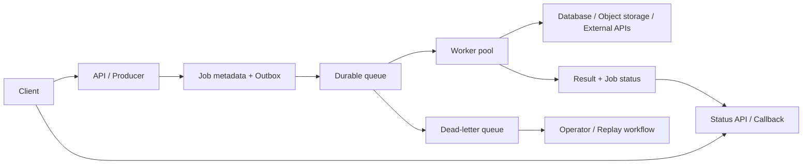
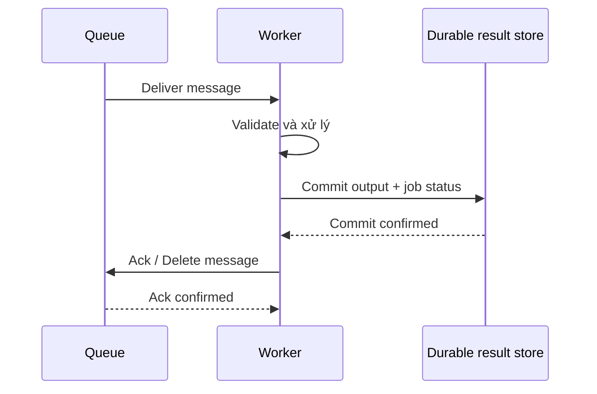
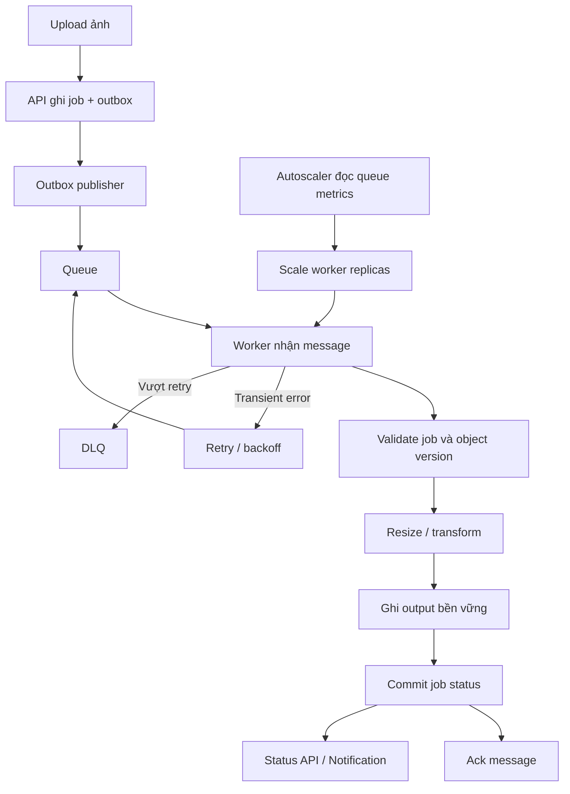

# Thiết kế worker bất đồng bộ có co giãn theo hàng đợi

## Mục tiêu học tập

Sau bài học, bạn có thể:

- Mô tả kiến trúc producer, durable queue, worker pool và hệ thống lưu kết quả.
- Xác định khi nào nên tách xử lý khỏi request đồng bộ bằng hàng đợi.
- Thiết kế vòng đời nhận, xử lý, commit và xác nhận message an toàn khi worker có thể bị dừng hoặc chạy trùng.
- Chọn visibility timeout, lease, heartbeat, retry, backoff và dead-letter queue phù hợp.
- Ước lượng số worker theo backlog, tốc độ message đến, thời gian xử lý và deadline.
- Thiết kế autoscaling theo queue depth, tuổi message cũ nhất, throughput và số message đang xử lý.
- Điều chỉnh concurrency, prefetch và batch size để bảo vệ dependency.
- Scale down và triển khai phiên bản mới mà không làm mất công việc đang xử lý.
- Kiểm soát thứ tự, fairness, idempotency, bảo mật và chi phí.
- Theo dõi SLO và xử lý các tình huống queue tăng, worker lỗi hoặc dependency quá tải.

## 1. Vì sao cần worker bất đồng bộ?

Một request HTTP thường cần phản hồi nhanh, nhưng công việc phía sau có thể mất vài giây hoặc vài phút. Ví dụ:

- Tạo thumbnail và chuyển mã video sau khi người dùng tải file.
- Gửi email, SMS hoặc thông báo.
- Tổng hợp báo cáo lớn.
- Xử lý đơn hàng và cập nhật trạng thái fulfillment.
- Chạy kiểm tra bảo mật hoặc phân tích dữ liệu.
- Gọi nhiều hệ thống bên ngoài để hoàn tất một workflow.
- Tạo embedding hoặc chạy inference theo batch.

Nếu API giữ kết nối mở trong toàn bộ thời gian xử lý, request có thể timeout, chiếm connection và làm tăng tải lên web tier. Khi downstream chậm, các request đồng bộ có thể dồn ứ và lan truyền sự cố sang toàn bộ hệ thống.

Kiến trúc bất đồng bộ tách thời điểm tiếp nhận yêu cầu khỏi thời điểm hoàn thành công việc:

1. API xác thực yêu cầu và ghi nhận công việc.
2. Một message mô tả công việc được gửi vào durable queue.
3. API trả về job ID hoặc trạng thái đã tiếp nhận.
4. Worker lấy message, xử lý và lưu kết quả.
5. Client truy vấn trạng thái hoặc nhận callback/event khi hoàn tất.

Hàng đợi hấp thụ dao động tải. Worker có thể tăng khi backlog lớn và giảm khi backlog nhỏ. API không cần khởi tạo một worker mới cho từng request.

### 1.1. Kiến trúc tổng quát



Các thành phần có thể nằm trong nhiều dịch vụ hoặc cùng một nền tảng. Queue không nhất thiết lưu toàn bộ payload lớn; message có thể chỉ chứa job ID và tham chiếu tới dữ liệu bền vững.

### 1.2. Khi nào nên dùng queue?

| Nhu cầu | Xử lý đồng bộ | Worker bất đồng bộ |
|---|---|---|
| Phản hồi người dùng | Chờ tới khi hoàn tất | Trả trạng thái accepted và job ID |
| Thời gian xử lý | Ngắn, dễ dự đoán | Dài hoặc biến động |
| Dao động tải | API phải chịu trực tiếp | Queue hấp thụ backlog |
| Retry | Thường gắn với request/client | Có thể retry độc lập ở worker |
| Scale | Scale API theo request | Scale worker theo backlog |
| Dependency chậm | Dễ giữ connection và lan truyền lỗi | Có thể giới hạn tốc độ tiêu thụ |
| Theo dõi | Request trace | Job ID, message ID và attempt |

Không phải mọi thao tác đều nên đưa vào queue. Nếu người dùng cần kết quả ngay và thao tác hoàn thành rất nhanh, request/response đồng bộ đơn giản hơn. Queue phù hợp khi có thể chấp nhận kết quả đến sau và cần tách tải hoặc vòng đời xử lý.

## 2. Các thành phần và trách nhiệm

Một worker system có thể gồm các thành phần sau:

| Thành phần | Trách nhiệm |
|---|---|
| Producer | Xác thực yêu cầu, tạo job và gửi message |
| Durable queue | Lưu message, phân phối cho consumer và giữ message chưa được xác nhận |
| Worker | Nhận message, xử lý nghiệp vụ và ghi kết quả |
| Result store | Lưu output và trạng thái job bền vững |
| Coordinator/control plane | Quản lý retry, lease, lịch chạy, concurrency và autoscaling |
| Dead-letter queue (DLQ) | Giữ message đã vượt chính sách retry |
| Scheduler/autoscaler | Tăng hoặc giảm số worker theo tải và policy |
| Monitoring | Đo backlog, age, throughput, lỗi, thời gian và chi phí |
| Operator/runbook | Điều tra, replay và xử lý message lỗi |

### 2.1. Message nên chứa gì?

Message nên đủ để worker tìm và xử lý công việc, nhưng không nên mang payload quá lớn hoặc secret dài hạn.

Ví dụ message:

```json
{
  "message_id": "msg-01JXYZ",
  "job_id": "job-20261122-0042",
  "job_type": "image.resize",
  "schema_version": 2,
  "tenant_id": "tenant-17",
  "input": {
    "object_key": "uploads/2026/11/photo-42.jpg",
    "object_version": "v8"
  },
  "requested_at": "2026-11-22T08:30:00Z",
  "deadline_at": "2026-11-22T08:45:00Z",
  "correlation_id": "req-7f13"
}
```

Đây là cấu trúc minh họa. Message thực tế cần được validate bằng schema và có giới hạn kích thước. Worker nên tải payload từ object storage hoặc database theo tham chiếu, kiểm tra version và quyền truy cập trước khi xử lý.

Các trường hữu ích:

- Message ID duy nhất.
- Job ID ổn định qua các lần retry.
- Job type và schema version.
- Tenant hoặc partition key nếu cần fairness/thứ tự.
- Tham chiếu input và version.
- Thời điểm tạo, deadline và correlation ID.
- Metadata không nhạy cảm phục vụ routing.

Không đặt password, access token hoặc private key trong message. Queue thường được lưu bền vững và có thể xuất hiện trong log, DLQ hoặc bản sao lưu.

## 3. Chọn mô hình queue và semantics phân phối

Các hệ thống queue có semantics khác nhau. Trước khi thiết kế worker, cần xác định cách message được phân phối, xác nhận, lưu giữ và giao lại.

### 3.1. Competing consumers

Nhiều worker cùng đọc một queue. Queue phân phối message cho worker sẵn sàng; mỗi worker xử lý một hoặc nhiều message.

Mô hình này phù hợp với task độc lập và có thể tăng số worker để tăng throughput. Tuy nhiên, nó không tự bảo đảm thứ tự hoàn tất hoặc thứ tự xử lý toàn cục.

Nếu message A và B có quan hệ phụ thuộc, không thể giả định worker xử lý A xong trước B chỉ vì A được gửi trước.

### 3.2. At-most-once, at-least-once và exactly-once

- **At-most-once:** message được giao tối đa một lần; nếu worker hoặc đường truyền lỗi, message có thể mất.
- **At-least-once:** message có thể được giao lại cho tới khi được xác nhận hoặc hết retention; worker có thể xử lý trùng.
- **Exactly-once:** hệ thống bảo đảm một hiệu ứng được commit đúng một lần trong phạm vi semantics được định nghĩa. Thường cần transaction, deduplication hoặc idempotency; không nên hiểu là toàn bộ workflow và mọi external API tự động chạy đúng một lần.

Nhiều queue phổ biến cung cấp at-least-once. Vì vậy, worker phải được thiết kế để chịu duplicate delivery.

### 3.3. Queue, topic và stream

| Kiểu | Mô hình | Trường hợp thường gặp |
|---|---|---|
| Work queue | Một message được một consumer xử lý thành công rồi xác nhận | Gửi email, resize ảnh, xử lý đơn |
| Pub/sub topic | Một event được phân phối tới nhiều subscription | Nhiều dịch vụ phản ứng với cùng event |
| Partitioned log/stream | Message nằm trong partition và consumer đọc theo offset | Event streaming, replay và xử lý liên tục |

Topic có thể tạo nhiều subscription, mỗi subscription có queue/offset riêng. Stream thường có semantics retention và offset khác queue truyền thống. Không dùng thuật ngữ queue, topic và stream thay thế cho nhau khi thiết kế ack, ordering hoặc replay.

### 3.4. Ordering và partition key

Nếu cần thứ tự theo một thực thể, ví dụ mọi event của cùng order phải xử lý theo trình tự, dùng partition key hoặc message group ID theo order ID nếu dịch vụ hỗ trợ.

Cần lưu ý:

- Ordering thường chỉ được bảo đảm trong một partition hoặc message group.
- Một partition key quá nóng có thể tạo bottleneck.
- Nhiều worker có thể xử lý các key khác nhau song song.
- Retry một message có thể chặn các message sau trong cùng group ở một số queue FIFO.
- Ordering không thay thế kiểm tra version hoặc trạng thái nghiệp vụ.

Chỉ yêu cầu ordering ở phạm vi thực sự cần. Ordering toàn cục thường làm giảm khả năng song song.

## 4. Vòng đời xử lý một message

Một worker an toàn thường thực hiện theo trình tự:

1. Nhận message từ queue.
2. Kiểm tra schema, loại công việc, deadline và tham chiếu input.
3. Xác định job đã hoàn tất trước đó hay chưa.
4. Lấy lease hoặc quyền xử lý nếu kiến trúc cần coordinator.
5. Thực hiện nghiệp vụ với idempotency key.
6. Ghi output và trạng thái hoàn tất bền vững.
7. Commit side effect hoặc transaction liên quan.
8. Xác nhận message (ack/delete/commit offset) sau khi kết quả đã bền vững.
9. Ghi metric và log theo job ID, message ID, attempt.

Điểm quyết định là thứ tự commit kết quả và xác nhận message. Nếu xác nhận message trước khi lưu kết quả, worker có thể chết giữa hai thao tác và công việc bị mất khỏi queue.

### 4.1. Ack sau khi commit

Mô hình an toàn phổ biến:



Nếu worker chết sau commit nhưng trước ack, queue có thể giao lại message. Worker lần sau phải nhận ra job đã commit và trả kết quả thành công mà không tạo side effect lần nữa. Đây là cách chấp nhận at-least-once delivery nhưng bảo vệ hiệu ứng nghiệp vụ bằng idempotency.

### 4.2. Vì sao không thể dựa vào ack để bảo đảm exactly-once?

Queue và database thường là hai hệ thống độc lập. Không có transaction phân tán chung, worker không thể atomically commit database và ack queue trong mọi trường hợp.

Có hai cửa sổ lỗi:

- Ack trước, commit sau: message mất nếu worker chết sau ack.
- Commit trước, ack sau: message được giao lại nếu worker chết giữa hai thao tác.

Thường chọn commit trước rồi ack sau, sau đó dùng idempotency/deduplication để xử lý trường hợp giao lại.

## 5. Idempotency và chống xử lý trùng

Idempotent operation có thể được thực hiện nhiều lần nhưng tạo ra cùng hiệu ứng cuối như thực hiện một lần, trong phạm vi được định nghĩa.

Ví dụ, thay vì cộng thêm 100 điểm mỗi lần nhận message, worker ghi trạng thái "job X đã cộng 100 điểm" với unique key để thao tác thứ hai không cộng lần nữa.

Các kỹ thuật:

- Dùng job ID hoặc idempotency key duy nhất.
- Unique constraint ở database.
- Conditional insert/update.
- Transaction lưu kết quả và trạng thái job cùng nhau.
- Output key xác định theo job ID và version.
- Deduplication record có retention phù hợp.
- Fencing token nếu có khả năng worker cũ tiếp tục sau khi lease hết hạn.

### 5.1. Mẫu transaction trong database

Ví dụ khái niệm:

```sql
BEGIN;

INSERT INTO processed_jobs(job_id, completed_at)
VALUES ('job-42', CURRENT_TIMESTAMP)
ON CONFLICT (job_id) DO NOTHING;

-- Chỉ thực hiện thay đổi nghiệp vụ nếu job_id vừa được insert.
-- Ứng dụng kiểm tra số dòng insert trước khi thực hiện side effect.

COMMIT;
```

Đây là pseudo-SQL theo phong cách PostgreSQL; câu lệnh nghiệp vụ thực tế cần được đặt trong cùng transaction và chỉ chạy nếu thao tác deduplication giành được quyền xử lý. Không gọi external API không thể rollback trong transaction rồi giả định database có thể hoàn tác tác động bên ngoài.

### 5.2. Transactional outbox ở producer

Một lỗi thường gặp: API ghi job vào database nhưng gửi message tới queue thất bại, hoặc gửi message thành công nhưng transaction database rollback. Khi đó trạng thái job và queue không khớp.

Transactional outbox giải quyết bằng cách ghi job và outbox event trong cùng transaction database. Một publisher riêng đọc outbox và gửi event tới queue; sau khi gửi thành công, nó đánh dấu event đã phát.

Luồng:

1. API mở transaction.
2. Ghi job metadata.
3. Ghi outbox event.
4. Commit transaction.
5. Publisher đọc event chưa gửi.
6. Publish message tới queue.
7. Đánh dấu outbox event đã gửi.

Publisher cũng có thể gửi trùng nếu chết sau publish nhưng trước khi đánh dấu sent. Consumer vẫn cần idempotency.

### 5.3. Side effect với hệ thống bên ngoài

Nếu worker gọi payment, email hoặc API đối tác, dùng idempotency key do hệ thống đích hỗ trợ nếu có. Nếu không, cần lưu trạng thái intent/result và thiết kế reconciliation.

Không thể bảo đảm exactly-once cho một external API chỉ bằng cách đánh dấu message đã xử lý ở queue. Cần hiểu hợp đồng retry của API đích và khả năng tra cứu giao dịch đã thực hiện.

## 6. Visibility timeout, lease và heartbeat

Với queue kiểu visibility timeout, khi worker nhận message, message tạm thời không hiển thị cho consumer khác. Nếu worker không ack trước khi timeout, message có thể xuất hiện lại.

Một số hệ thống dùng lease hoặc lock có thời hạn thay cho visibility timeout. Tên gọi khác nhau nhưng vấn đề tương tự: worker cần gia hạn quyền xử lý khi công việc kéo dài.

### 6.1. Chọn visibility timeout

Visibility timeout nên đủ dài cho thời gian xử lý bình thường, bao gồm commit và ack, nhưng không quá dài tới mức message bị giữ quá lâu khi worker chết.

Nếu timeout quá ngắn:

- Message có thể được giao lại khi worker đầu vẫn đang xử lý.
- Hai worker có thể chạy cùng job.
- Tạo duplicate side effect và tăng tải.

Nếu timeout quá dài:

- Khi worker chết, message phải chờ lâu mới được giao lại.
- Recovery time tăng.
- Queue age và deadline có thể xấu đi.

### 6.2. Heartbeat/visibility extension

Với task có thời gian xử lý biến động, worker có thể gia hạn visibility/lease định kỳ.

Ví dụ quy tắc:

- Xử lý heartbeat mỗi khoảng thời gian ngắn hơn đáng kể so với lease.
- Gia hạn chỉ khi worker vẫn sở hữu task và đang tiến triển.
- Ghi metric cho số lần gia hạn và lỗi gia hạn.
- Dừng ghi output nếu không thể xác nhận quyền xử lý.
- Dùng fencing token hoặc conditional commit để ngăn worker cũ ghi kết quả sau khi lease đã được cấp cho worker mới.

Heartbeat không nên chỉ là timer vô điều kiện. Nếu process bị treo nhưng heartbeat thread vẫn chạy, message có thể bị giữ mãi. Hãy gắn heartbeat với tiến độ, deadline và health của worker.

### 6.3. Graceful shutdown

Khi Pod bị terminate do scale down, rollout hoặc node drain:

1. Worker ngừng nhận message mới.
2. Hoàn tất message đang xử lý nếu còn trong termination grace period.
3. Nếu không thể hoàn tất, dừng an toàn và để message được giao lại.
4. Không ack message chưa commit.
5. Đóng connection và flush telemetry.
6. Thoát trước khi hết grace period.

Nếu queue hỗ trợ negative acknowledgement hoặc release visibility, worker có thể chủ động trả message về queue. Nếu không, để visibility timeout hết hạn. Việc lựa chọn cần xét nguy cơ worker cũ còn chạy và cơ chế idempotency.

## 7. Retry và dead-letter queue

Không phải mọi lỗi đều cần retry. Retry có ích với lỗi tạm thời nhưng có thể làm tình hình xấu hơn khi lỗi là vĩnh viễn.

### 7.1. Phân loại lỗi

| Loại lỗi | Ví dụ | Cách xử lý |
|---|---|---|
| Transient | Network reset, timeout ngắn, service 503 | Retry có backoff |
| Throttling | API trả 429 hoặc Retry-After | Giảm concurrency, tôn trọng thời gian chờ |
| Capacity | Worker thiếu RAM, queue không cấp được instance | Điều chỉnh resource hoặc capacity |
| Data poison | Payload sai schema hoặc record không hợp lệ | Đưa DLQ/quarantine, không retry vô hạn |
| Permanent | Thiếu quyền, resource không tồn tại, cấu hình sai | Dừng retry và báo vận hành |
| Duplicate | Message giao lại sau commit | Idempotency và ack |
| Dependency outage | Database hoặc API đích ngừng hoạt động | Circuit breaker, backoff và giới hạn retry |

### 7.2. Exponential backoff và jitter

Một công thức tham khảo:

\[
delay_n = \min(delay_{max}, base \times 2^n) + jitter
\]

Trong đó n là số lần retry. Jitter giúp tránh nhiều worker cùng retry vào một thời điểm. Khi API trả Retry-After, cần ưu tiên tuân theo hướng dẫn đó.

Không retry liên tục với khoảng cố định ngắn khi dependency đang quá tải. Retry storm có thể làm tăng request, queue backlog và thời gian phục hồi.

### 7.3. Dead-letter queue

DLQ nhận message vượt quá số lần giao hoặc điều kiện retry đã định nghĩa. Nó giúp:

- Cách ly message lỗi để không chặn queue chính.
- Điều tra payload, exception và lịch sử attempt.
- Sửa dữ liệu hoặc code rồi replay có kiểm soát.
- Theo dõi loại lỗi và tenant bị ảnh hưởng.

DLQ không phải kho lưu trữ vô thời hạn. Cần retention, quyền truy cập, mã hóa, cảnh báo và quy trình xử lý.

### 7.4. Replay DLQ an toàn

Trước khi replay:

1. Xác định nguyên nhân gốc đã được sửa.
2. Kiểm tra schema và phiên bản consumer tương thích.
3. Xác định message đã tạo side effect hay chưa.
4. Giữ nguyên job ID/idempotency key khi replay cùng nghiệp vụ.
5. Chọn tốc độ replay để không làm quá tải dependency.
6. Theo dõi success, retry và số message quay lại DLQ.
7. Ghi audit ai đã replay và lý do.

Không xóa DLQ chỉ để làm queue dashboard về 0. Message có thể chứa công việc hợp lệ cần khôi phục.

## 8. Thiết kế worker pool và concurrency

Một worker process có thể xử lý một message tại một thời điểm hoặc nhiều message đồng thời. Concurrency cao có thể tăng throughput nhưng cũng tăng memory, connection, lock và tải downstream.

### 8.1. Concurrency trong mỗi worker

Giả sử mỗi Pod có 4 vCPU và 8 GiB RAM. Nếu một task cần 1 vCPU và 1 GiB RAM, lý thuyết có thể chạy vài task đồng thời, nhưng còn phải dành tài nguyên cho runtime, cache, logging và peak usage.

Cần benchmark:

- CPU và memory trên mỗi task.
- Số connection database/API.
- I/O và network bandwidth.
- Thời gian xử lý p50/p95/p99.
- Lock contention và garbage collection.
- Số message đang in-flight.

Đặt concurrency theo bottleneck thực tế, không chỉ theo số core.

### 8.2. Prefetch và batch receive

Worker có thể nhận trước nhiều message để giảm round-trip tới queue. Tuy nhiên, prefetch quá cao làm message bị giữ trong worker đang bận, khiến queue hiển thị ít backlog hơn trong khi thời gian chờ thực tế tăng.

Nếu worker chỉ xử lý 5 message đồng thời nhưng prefetch 100, 95 message có thể nằm trong bộ nhớ hoặc trạng thái in-flight mà chưa được xử lý. Điều này làm autoscaler đánh giá thiếu tải nếu chỉ nhìn visible queue depth.

Chọn prefetch gần với concurrency hữu ích, hoặc theo dõi cả in-flight count và oldest message age. Với batch receive, cần xác nhận từng message theo semantics của dịch vụ; một message lỗi không nhất thiết làm mất các message còn lại.

### 8.3. Một process hay nhiều Pod?

| Mô hình | Ưu điểm | Hạn chế |
|---|---|---|
| Một worker process, concurrency nội bộ | Ít Pod, startup thấp, tận dụng connection pool | Một process crash ảnh hưởng nhiều task đang xử lý |
| Nhiều process trong một Pod | Tận dụng CPU và cô lập process | Chia sẻ resource limit, lifecycle phức tạp |
| Một worker mỗi Pod | Cô lập resource và rollout rõ | Tăng overhead scheduling và Pod |
| Một Pod nhiều worker thread | Hiệu quả cho I/O-bound task | Cần kiểm soát thread safety và memory |

Chọn theo mức độ cô lập, startup overhead, loại workload CPU-bound hay I/O-bound và cách runtime xử lý shutdown.

## 9. Autoscaling theo queue

Mục tiêu autoscaling là đưa số worker đủ để xử lý backlog theo SLO, đồng thời tránh tạo capacity quá mức và làm downstream quá tải.

Không nên chỉ scale theo CPU. Worker I/O-bound có thể chờ database hoặc API nên CPU thấp dù queue đang tăng. Queue metrics phản ánh nhu cầu xử lý trực tiếp hơn.

Các tín hiệu thường dùng:

- Visible backlog: số message đang chờ.
- Oldest message age: tuổi của message cũ nhất.
- Arrival rate: tốc độ message mới đến.
- Completion rate: tốc độ worker hoàn tất.
- In-flight/unacked: số message đã giao nhưng chưa ack.
- Processing duration: thời gian xử lý.
- Deadline miss hoặc queue wait SLO.
- Worker utilization và dependency saturation.

### 9.1. Scale theo backlog trên mỗi worker

Một cách đơn giản:

\[
N_{\text{workers}} =
\left\lceil
\frac{Backlog}{TargetBacklogPerWorker}
\right\rceil
\]

Ví dụ:

- Backlog hiện tại: 1.200 message.
- Mục tiêu: 40 message chờ trên mỗi worker.
- Số worker mong muốn: 30.

Cần giới hạn bằng min/max replica, quota, capacity node và khả năng downstream. Công thức không tính trực tiếp độ dài task hoặc tốc độ message đến; nó phù hợp khi message tương đối đồng đều.

### 9.2. Scale theo arrival rate và service time

Có thể ước lượng số worker cần thiết theo tốc độ message đến và thời gian xử lý trung bình:

\[
N \approx \frac{\lambda \times S}{U}
\]

Trong đó:

- λ: arrival rate, đơn vị message/giây.
- S: service time trung bình, đơn vị giây/message.
- U: mức utilization mục tiêu, nhỏ hơn 1 để giữ capacity dự phòng.

Ví dụ, hệ thống nhận 20 message/giây, mỗi message xử lý trung bình 5 giây và muốn worker chỉ bận khoảng 70%:

\[
N \approx \frac{20 \times 5}{0.7} \approx 143
\]

Nếu mỗi worker xử lý đồng thời 5 message, số Pod lý thuyết có thể thấp hơn, nhưng cần tính resource và contention trong Pod. Dùng service time p95 hoặc safety factor khi deadline nghiêm ngặt; average đơn thuần có thể đánh giá thiếu capacity khi có long-tail task.

### 9.3. Backlog không phải toàn bộ câu chuyện

Hai queue cùng có 1.000 message nhưng có thể cần số worker rất khác:

- Queue A chứa task 100 ms.
- Queue B chứa task 60 giây.
- Queue C chứa task gọi API bị rate limit.
- Queue D chứa message đã quá deadline.

Cần theo dõi oldest age và service time cùng backlog. Nếu message mới đến nhanh hơn tốc độ hoàn tất, queue sẽ tiếp tục tăng dù worker đang bận hết mức.

### 9.4. Scale down có hysteresis

Scale up nhanh khi backlog tăng, nhưng scale down chậm hơn để tránh dao động replica.

Có thể dùng:

- Cooldown sau khi scale up.
- Stabilization window cho scale down.
- Minimum replica để giữ capacity nền.
- Threshold thấp hơn cho scale down so với scale up.
- Chỉ scale down khi oldest age và in-flight ổn định.
- Drain worker trước khi terminate.

Nếu scale down quá nhanh, Pod bị terminate khi đang xử lý; message có thể được giao lại và làm tăng duplicate/retry. Nếu scale down quá chậm, chi phí idle tăng.

## 10. Scale-to-zero và khởi động lại worker

Với workload thưa hoặc chỉ chạy theo đợt, scale-to-zero có thể tiết kiệm chi phí. Khi queue có message, autoscaler kích hoạt worker.

Cần xem xét:

- Polling interval hoặc event activation delay.
- Thời gian tạo Pod và cấp node.
- Image pull, startup và warm-up.
- Thời gian queue message chờ trước khi worker sẵn sàng.
- Hạn mức scale-from-zero của autoscaler.
- Queue metric có còn được thu thập khi không có worker không.

Scale-to-zero không phù hợp nếu SLO yêu cầu phản hồi trong vài giây nhưng node mới mất vài phút để cấp. Có thể giữ một worker nền hoặc capacity warm để giảm cold start.

### 10.1. Scale-to-zero với KEDA

KEDA có thể theo dõi nguồn event/queue và tạo hoặc điều chỉnh HPA để scale workload theo metric. Ví dụ minh họa với RabbitMQ scaler:

```yaml
apiVersion: keda.sh/v1alpha1
kind: ScaledObject
metadata:
  name: image-worker
  namespace: processing
spec:
  scaleTargetRef:
    name: image-worker
  pollingInterval: 15
  cooldownPeriod: 120
  minReplicaCount: 0
  maxReplicaCount: 40
  triggers:
    - type: rabbitmq
      metadata:
        protocol: amqp
        queueName: image-resize
        mode: QueueLength
        value: "30"
        hostFromEnv: RABBITMQ_HOST
```

Đây là ví dụ cần đối chiếu với phiên bản KEDA và cấu hình authentication đang dùng. Secret/connection string nên được cung cấp qua Secret hoặc TriggerAuthentication theo cơ chế của cluster, không ghi trực tiếp trong manifest. Giá trị mục tiêu là queue length theo semantics của scaler, không phải cam kết thời gian hoàn thành.

Các tham số cần thiết kế:

- pollingInterval: tần suất KEDA kiểm tra trigger.
- cooldownPeriod: thời gian chờ trước khi scale về min replica sau khi trigger không còn hoạt động.
- minReplicaCount: capacity nền; bằng 0 cho phép scale-to-zero.
- maxReplicaCount: giới hạn worker để bảo vệ dependency và chi phí.
- Trigger metric: queue length hoặc metric tương ứng của backend.

KEDA không tự giải quyết idempotency, retry hoặc graceful shutdown. Ứng dụng worker vẫn phải xử lý các trường hợp đó.

### 10.2. HPA với external metrics

Có thể dùng Horizontal Pod Autoscaler với external/custom metrics nếu cluster có metrics adapter phù hợp. Ví dụ metric có thể là queue messages per worker hoặc oldest message age.

HPA chỉ điều chỉnh replica dựa trên metric đã cung cấp. Cần xác định metric type, target semantics, scrape delay và cách tính khi replica bằng 0. Với scale-to-zero, KEDA hoặc một cơ chế event-driven activation thường thuận tiện hơn HPA thuần tùy phiên bản và cấu hình.

## 11. Bảo vệ dependency bằng backpressure

Autoscaler có thể tăng worker nhanh hơn khả năng xử lý của database, API đối tác hoặc object storage. Nếu mọi worker cùng tạo connection và request, queue backlog có thể giảm nhưng dependency bị quá tải.

Backpressure đặt giới hạn tốc độ tiêu thụ dựa trên năng lực downstream.

Các cơ chế:

- Max replica để giới hạn tổng worker.
- Concurrency limit trong từng worker.
- Rate limit theo dependency hoặc tenant.
- Circuit breaker khi dependency lỗi.
- Retry với exponential backoff và jitter.
- Queue riêng cho workload có dependency khác nhau.
- Bulkhead để lỗi của một loại task không chiếm hết worker.
- Tạm dừng consumer khi dependency đang quá tải.
- Giảm prefetch khi in-flight tăng.
- Dùng token bucket hoặc distributed semaphore khi cần giới hạn toàn cluster.

### 11.1. Tách queue theo loại công việc

Nếu một queue chứa cả image resize nhẹ và video transcode nặng, worker dùng chung có thể làm task nhẹ bị chậm khi task nặng chiếm hết capacity.

Có thể tách:

- Queue theo job type.
- Queue theo priority.
- Queue theo tenant class.
- Queue theo dependency hoặc resource profile.
- Queue riêng cho task GPU và CPU.

Tách queue giúp scale và giới hạn resource độc lập, nhưng làm tăng số thành phần cần vận hành và cần xác định quy tắc routing/retry.

### 11.2. Fairness giữa tenant

Một tenant gửi lượng task lớn có thể chiếm toàn bộ worker. Có thể dùng:

- Queue riêng theo tenant hoặc nhóm tenant.
- Weighted fair scheduling.
- Per-tenant concurrency quota.
- Rate limit producer.
- Priority class với giới hạn để tránh starvation.
- Aging để task chờ lâu được tăng mức ưu tiên.

Không dùng priority cao cho mọi tenant; nếu tất cả message đều ưu tiên cao, policy không còn ý nghĩa.

## 12. Bảo đảm deadline và thời gian hoàn thành

Một queue worker có thể có throughput cao nhưng vẫn vi phạm deadline nếu message chờ quá lâu hoặc task xử lý có long tail.

Cần phân biệt:

- Enqueue-to-start latency: thời gian từ lúc gửi message tới khi worker bắt đầu.
- Processing duration: thời gian worker thực thi.
- Commit/ack duration: thời gian lưu kết quả và xác nhận.
- End-to-end completion: thời gian từ yêu cầu tới kết quả cuối.
- Oldest message age: tuổi message đang chờ lâu nhất.
- Deadline miss rate: tỷ lệ job hoàn thành sau deadline.

### 12.1. Ước lượng backlog drain time

Nếu backlog có B message, worker pool hoàn tất trung bình R message/giây và tốc độ mới đến là λ message/giây, khi R lớn hơn λ, thời gian xấp xỉ để xóa backlog là:

\[
T_{\text{drain}} \approx \frac{B}{R-\lambda}
\]

Ví dụ backlog 6.000 message, worker hoàn tất 50 message/giây, producer tiếp tục gửi 20 message/giây:

\[
T_{\text{drain}} \approx \frac{6000}{50-20}=200 \text{ giây}
\]

Nếu R nhỏ hơn hoặc bằng λ, backlog không giảm. Đây là mô hình đơn giản giả định tốc độ ổn định, message đồng đều và không có retry hoặc dependency bottleneck.

### 12.2. Deadline-aware priority

Nếu message có deadline, worker system có thể:

- Ưu tiên deadline gần hơn.
- Tách queue theo SLA.
- Giới hạn thời gian chờ trước khi chuyển sang capacity khác.
- Loại bỏ hoặc chuyển trạng thái các job đã hết giá trị theo policy nghiệp vụ.
- Dành baseline capacity cho nhóm ưu tiên cao.

Queue FIFO không tự thực hiện earliest-deadline-first. Nếu cần ưu tiên, phải chọn queue type, partition hoặc scheduler hỗ trợ semantics đó. Tránh để message hết deadline vẫn tiêu thụ capacity và gây trễ cho job còn giá trị.

## 13. Triển khai worker trên Kubernetes

Một worker Deployment thường có:

- Image chứa code và dependency.
- ServiceAccount/workload identity.
- Resource requests/limits.
- Environment/secret reference cho queue.
- Liveness/readiness/startup probes phù hợp.
- Graceful termination.
- Autoscaler theo queue metric.
- PodDisruptionBudget nếu cần bảo vệ baseline replica.
- Node affinity/toleration khi worker cần loại compute cụ thể.

Ví dụ Deployment tối giản:

```yaml
apiVersion: apps/v1
kind: Deployment
metadata:
  name: image-worker
  namespace: processing
spec:
  replicas: 2
  selector:
    matchLabels:
      app: image-worker
  template:
    metadata:
      labels:
        app: image-worker
    spec:
      terminationGracePeriodSeconds: 90
      serviceAccountName: image-worker
      containers:
        - name: worker
          image: registry.example.com/media/image-worker:2.4
          env:
            - name: QUEUE_NAME
              value: image-resize
            - name: WORKER_CONCURRENCY
              value: "4"
            - name: RABBITMQ_HOST
              valueFrom:
                secretKeyRef:
                  name: queue-connection
                  key: host
          resources:
            requests:
              cpu: "1"
              memory: "1Gi"
            limits:
              cpu: "2"
              memory: "2Gi"
          lifecycle:
            preStop:
              exec:
                command: ["/app/worker", "drain"]
```

Manifest minh họa cần điều chỉnh theo runtime và cách ứng dụng xử lý signal. Lệnh preStop phải tồn tại trong image và thực sự chuyển worker sang chế độ drain. Không giả định Kubernetes tự biết worker đang xử lý message nào.

### 13.1. Readiness và liveness

Readiness của worker không nhất thiết giống web service. Worker thường không nhận traffic từ Service, nhưng có thể dùng readiness hoặc trạng thái nội bộ để báo có thể nhận task.

- **Startup probe:** cho phép worker khởi động và tải cấu hình/model trước khi bị đánh dấu lỗi.
- **Liveness probe:** phát hiện process bị treo hoặc không thể phục hồi.
- **Readiness/worker-ready signal:** báo worker đã kết nối queue và có thể nhận message.
- **Drain state:** ngăn nhận message mới khi chuẩn bị shutdown.

Probe không nên đánh dấu worker unhealthy chỉ vì queue tạm thời không có message. Liveness quá nhạy có thể tạo restart loop và làm tăng duplicate delivery.

### 13.2. Graceful termination trong Kubernetes

Khi Pod nhận SIGTERM:

1. Đặt trạng thái draining.
2. Ngừng poll hoặc nhận message mới.
3. Hoàn tất task đang chạy nếu còn đủ thời gian.
4. Gia hạn visibility/lease trong khi tiếp tục xử lý nếu cần.
5. Nếu không thể hoàn tất, dừng trước khi hết grace period và không ack.
6. Flush log/metric và đóng kết nối.
7. Thoát trước khi Kubernetes gửi SIGKILL.

terminationGracePeriodSeconds cần lớn hơn thời gian drain dự kiến nhưng không nên vô hạn. Với task rất dài, checkpoint hoặc trả message về queue có thể phù hợp hơn chờ Pod kết thúc.

### 13.3. PodDisruptionBudget và node drain

PodDisruptionBudget có thể hạn chế số Pod bị voluntary disruption đồng thời. Nó hữu ích với worker pool có baseline capacity, nhưng không ngăn node crash hoặc mọi loại eviction.

Nếu worker có thể scale về 0, PDB không thay thế graceful shutdown. Nếu worker xử lý task có thể retry, PDB cần được cân nhắc cùng queue semantics, visibility timeout và capacity dự phòng.

## 14. Cập nhật worker và schema message

Producer và consumer có thể được triển khai ở thời điểm khác nhau. Message cũ có thể còn trong queue khi phiên bản worker mới đã được rollout.

Thiết kế tương thích:

- Gắn schema_version vào message.
- Consumer hỗ trợ ít nhất các schema còn nằm trong retention.
- Thay đổi field theo hướng additive khi có thể.
- Không đổi nghĩa field hiện có mà không version hóa.
- Có bước migration/replay cho message cũ.
- Kiểm tra DLQ và queue backlog trước khi bỏ hỗ trợ schema cũ.

### 14.1. Rolling deployment

Khi rollout worker:

- Pod mới phải sẵn sàng trước khi Pod cũ bị giảm.
- Pod cũ ngừng nhận message mới.
- Task đang chạy được hoàn tất hoặc để queue giao lại.
- Image mới tương thích với message cũ.
- Không thay đổi idempotency key hoặc output contract giữa chừng.
- Theo dõi error rate, retry và queue age trong rollout.

Nếu worker mới có bug và xử lý sai message, cần dừng rollout, giữ queue và replay từ DLQ hoặc nguồn bền vững sau khi sửa. Không xóa queue để rollback nhanh.

## 15. Bảo mật của queue và worker

Message có thể chứa dữ liệu nghiệp vụ và được lưu bền vững. Worker thường có quyền truy cập database, object storage và API bên ngoài; vì vậy cần giới hạn quyền.

Nguyên tắc:

- Dùng workload identity hoặc service account riêng cho từng worker type.
- Chỉ cấp quyền consume queue cần thiết.
- Tách quyền publish, consume, purge và quản trị queue.
- Mã hóa kết nối bằng TLS và dữ liệu lưu trữ theo khả năng dịch vụ.
- Không nhúng secret trong image, command line hoặc message.
- Lấy secret từ secret manager.
- Giới hạn network egress tới dependency cần thiết.
- Validate message và kiểm tra tenant authorization ở worker.
- Giới hạn kích thước payload và chống deserialization không an toàn.
- Audit thao tác replay, purge, DLQ và thay đổi policy.
- Thiết lập retention và quyền truy cập cho DLQ.

Không tin cậy tenant ID trong message chỉ vì producer đã gửi. Worker vẫn cần xác minh job thuộc tenant nào và identity hiện tại có quyền xử lý dữ liệu đó.

## 16. Observability và SLO cho queue worker

CPU utilization không đủ để biết worker system có khỏe hay không. Cần metric về queue, thời gian, kết quả và dependency.

| Nhóm | Metric | Ý nghĩa |
|---|---|---|
| Queue | Visible messages, in-flight/unacked, oldest age | Backlog và message bị giữ |
| Flow | Enqueue rate, dequeue rate, completion rate | Tốc độ vào/ra |
| Worker | Active workers, busy slots, idle slots | Capacity đang dùng |
| Processing | Duration p50/p95/p99, timeout | Thời gian xử lý |
| Reliability | Success, retry, duplicate, failure, DLQ rate | Độ tin cậy |
| Scaling | Desired/current replicas, scale events, provisioning delay | Chất lượng autoscaling |
| Dependency | DB latency, API 429/5xx, connection pool, storage error | Bottleneck downstream |
| Business | Job completion, deadline miss, output validation | Kết quả nghiệp vụ |
| Cost | Worker-hours, queue cost, storage, data transfer | Chi phí vận hành |

### 16.1. SLO nên đo end-to-end

Ví dụ SLO minh họa:

- 99% job ưu tiên cao bắt đầu xử lý trong 30 giây.
- 99% image resize hoàn tất trong 3 phút.
- Tỷ lệ job thất bại sau retry dưới 0,1%.
- DLQ không tăng liên tục.
- Không mất job đã được API xác nhận accepted.

Các ngưỡng phải xuất phát từ yêu cầu sản phẩm và đo thực tế. Không lấy queue depth bằng 0 làm SLO duy nhất; queue có thể rỗng vì producer ngừng gửi hoặc worker bị lỗi không consume.

### 16.2. Log và trace

Mỗi log nên gắn các ID:

- job_id.
- message_id.
- correlation_id/trace_id.
- tenant_id hoặc tenant class nếu không nhạy cảm.
- attempt_number.
- worker_id và version.
- queue_name.
- partition/message group.
- processing stage.

Không ghi payload nhạy cảm hoặc secret vào log. Distributed trace có thể nối API enqueue với publisher, queue consumer và dependency calls; queue cần truyền trace context theo định dạng đã thống nhất.

## 17. Chi phí và sizing worker

Chi phí worker phụ thuộc số replica, resource request, thời gian chạy, node pool, queue service, storage và dependency.

### 17.1. Ước lượng worker theo throughput

Nếu mỗi worker xử lý trung bình μ message/giây và có N worker, throughput lý thuyết gần đúng là:

\[
R = N \times \mu
\]

Để backlog giảm, R cần lớn hơn arrival rate trong khoảng thời gian cần drain. Nhưng μ thay đổi theo message type, dependency và concurrency. Hãy đo throughput thực tế thay vì dùng benchmark của một task đơn lẻ.

### 17.2. Worker sizing theo tài nguyên

Với worker CPU-bound:

- Theo dõi CPU utilization, throttling và task duration.
- Cấp đủ CPU để tránh throttling quá mức.
- Benchmark concurrency theo core.

Với worker I/O-bound:

- Theo dõi connection pool, network wait và dependency latency.
- Concurrency có thể cao hơn số CPU, nhưng cần giới hạn tổng connection.
- Tránh giữ quá nhiều message in-flight.

Với worker memory-heavy:

- Đo peak RSS và memory cgroup.
- Giới hạn batch size và số task đồng thời.
- Tránh OOM làm message retry hàng loạt.

### 17.3. Scale up và cost trade-off

Scale up quá chậm làm queue age tăng và deadline bị trễ. Scale up quá nhanh có thể:

- Tạo node mới và phát sinh chi phí cold start.
- Làm dependency quá tải.
- Tăng retry do timeout.
- Làm queue giảm nhanh nhưng tạo idle capacity sau burst.

Cần tune polling interval, cooldown, min/max replica và worker concurrency bằng dữ liệu thực tế. Với workload có burst ngắn, giữ một baseline nhỏ hoặc dùng capacity warm có thể rẻ hơn việc scale từ zero liên tục.

## 18. Ví dụ thực tế: xử lý ảnh bất đồng bộ

Một ứng dụng cho phép người dùng tải ảnh lên và tạo nhiều kích thước thumbnail.

Thiết kế:

- API ghi metadata upload và outbox event trong cùng transaction.
- Publisher gửi message chứa job ID, object key và object version vào queue.
- Worker pool consume queue.
- Worker xác minh tenant và object version.
- Worker tạo thumbnail theo preset.
- Output được ghi vào object key riêng theo job ID và preset.
- Database cập nhật trạng thái job sau khi output được xác minh.
- Worker ack message sau commit.
- Nếu lỗi tạm thời, message retry với backoff.
- Nếu vượt số lần retry, message vào DLQ.
- Autoscaler tăng worker theo queue length và oldest age.
- Khi backlog thấp, worker drain và scale down.
- Status API cho client biết queued, processing, succeeded hoặc failed.

### 18.1. Luồng xử lý



Nếu worker chết sau khi ghi output nhưng trước khi ack, message có thể được giao lại. Output key ổn định và conditional commit giúp lần xử lý sau nhận ra kết quả đã tồn tại, kiểm tra checksum và ack mà không tạo thumbnail trùng.

### 18.2. Tính capacity cho burst

Giả sử:

- Bình thường có 2 message/giây.
- Khi có chiến dịch, producer tăng lên 30 message/giây trong 10 phút.
- Một worker xử lý trung bình 3 message/giây với concurrency đã benchmark.
- Mục tiêu không để backlog tăng kéo dài.

Tốc độ xử lý lý thuyết của 10 worker là 30 message/giây, chỉ vừa bằng tốc độ đến. Để vừa xử lý backlog vừa hấp thụ biến động, cần capacity cao hơn mức này hoặc chấp nhận queue drain sau burst. Nếu cần drain backlog 6.000 message trong 5 phút trong khi vẫn nhận 30 message/giây, throughput cần đạt:

\[
R \geq \lambda + \frac{B}{T}
= 30 + \frac{6000}{300}
= 50 \text{ message/giây}
\]

Với mỗi worker 3 message/giây, cần ít nhất khoảng 17 worker theo mô hình lý tưởng. Thực tế cần safety margin dựa trên p95 duration, startup delay và downstream capacity. Nếu dependency chỉ chịu được 12 worker, phải giảm tốc độ producer, tăng cửa sổ hoàn tất hoặc cải thiện throughput mỗi worker.

## 19. Runbook xử lý sự cố

### Queue backlog tăng liên tục

1. Kiểm tra enqueue rate và completion rate.
2. Xem oldest message age và task duration.
3. Xác định worker có đủ replica và đang ready không.
4. Kiểm tra queue visibility/in-flight và retry count.
5. Kiểm tra dependency latency, rate limit và connection pool.
6. Nếu downstream khỏe, tăng worker trong giới hạn capacity.
7. Nếu downstream quá tải, giảm concurrency và áp backpressure.
8. Kiểm tra data skew hoặc message type nặng bất thường.

### Worker không nhận message

1. Kiểm tra Pod status, logs và readiness.
2. Xác minh queue endpoint, DNS, TLS và authentication.
3. Kiểm tra quyền consume và network policy.
4. Kiểm tra consumer group/subscription và queue binding.
5. Xem message có bị giữ bởi consumer khác hoặc partition ownership không.
6. Kiểm tra autoscaler metric và scale-to-zero activation.
7. Khôi phục từng thành phần và xác nhận message bắt đầu được xử lý.

### Message lặp hoặc side effect trùng

1. Xác định message ID, job ID và attempt.
2. Kiểm tra ack có xảy ra sau commit không.
3. Kiểm tra visibility timeout và heartbeat.
4. Kiểm tra worker cũ có tiếp tục chạy sau lease expiry không.
5. Kiểm tra idempotency key, unique constraint và fencing.
6. Đối soát side effect đã phát sinh.
7. Sửa logic trước khi replay message lỗi.

### DLQ tăng đột biến

1. Dừng replay tự động nếu đang làm tăng tải.
2. Nhóm message theo exception, schema version và job type.
3. Xác định lỗi code, dữ liệu, quyền hay dependency.
4. Sửa nguyên nhân và kiểm thử trên mẫu message.
5. Replay theo batch nhỏ và rate limit.
6. Theo dõi tỷ lệ quay lại DLQ.
7. Ghi nhận audit và xử lý message hết hạn theo policy.

## 20. Checklist thiết kế và vận hành

### Kiến trúc và message

- [ ] Xác định job nào phù hợp với xử lý bất đồng bộ.
- [ ] Chọn queue/topic/stream theo semantics cần thiết.
- [ ] Message có ID, schema version và input reference ổn định.
- [ ] Payload có giới hạn kích thước và không chứa secret.
- [ ] Có durable result store và job status.
- [ ] Có transactional outbox nếu job được tạo cùng transaction nghiệp vụ.
- [ ] Xác định ordering/partition key chỉ ở phạm vi cần thiết.

### Worker và độ tin cậy

- [ ] Commit output trước khi ack.
- [ ] Có idempotency key và deduplication.
- [ ] Visibility timeout/lease đủ cho task và có heartbeat.
- [ ] Worker xử lý SIGTERM và graceful shutdown.
- [ ] Retry có backoff, jitter và giới hạn.
- [ ] Có DLQ, retention và quy trình replay.
- [ ] Timeout giữa queue, worker và dependency được phối hợp.
- [ ] Side effect bên ngoài có idempotency hoặc reconciliation.

### Autoscaling và capacity

- [ ] Chọn metric backlog, oldest age và arrival/completion rate.
- [ ] Tính worker count theo service time và concurrency.
- [ ] Đặt min/max replica và giới hạn quota.
- [ ] Scale up đủ nhanh cho burst.
- [ ] Scale down có stabilization và drain.
- [ ] Đánh giá scale-to-zero/cold start theo SLO.
- [ ] Prefetch không che giấu backlog hoặc giữ message quá lâu.
- [ ] Backpressure bảo vệ dependency và fairness tenant.

### Quan sát và bảo mật

- [ ] Theo dõi queue depth, age, in-flight và throughput.
- [ ] Theo dõi success, retry, duplicate và DLQ.
- [ ] Đo end-to-end completion và deadline miss.
- [ ] Gắn job/message/attempt ID vào log và trace.
- [ ] Dùng workload identity và least privilege.
- [ ] Mã hóa queue, connection và dữ liệu.
- [ ] Kiểm soát replay, purge và quyền quản trị.
- [ ] Theo dõi worker-hours và cost per completed job.

## 21. Những nhầm lẫn thường gặp

- **Queue tự bảo đảm công việc chỉ chạy một lần.** At-least-once có thể giao message lặp; worker cần idempotency.
- **Ack ngay khi nhận message là an toàn.** Nếu worker chết trước khi commit, công việc có thể mất.
- **Ack sau commit loại bỏ mọi duplicate.** Worker vẫn có thể chết trước ack; lần giao lại cần được xử lý an toàn.
- **Visibility timeout càng dài càng tốt.** Timeout quá dài làm recovery chậm khi worker chết.
- **Visibility timeout càng ngắn càng tốt.** Timeout quá ngắn có thể làm cùng message chạy đồng thời ở nhiều worker.
- **CPU thấp nghĩa là worker thiếu tải.** Worker có thể đang chờ database, network hoặc rate limit.
- **Queue depth bằng 0 chứng minh hệ thống khỏe.** Producer có thể ngừng gửi hoặc consumer có thể đang giữ message in-flight.
- **Scale theo queue length là đủ.** Cần xét task duration, oldest age, arrival rate, in-flight và dependency capacity.
- **Tăng worker luôn làm backlog giảm nhanh hơn.** Downstream có thể quá tải và throughput tổng giảm.
- **Scale down có thể terminate worker bất kỳ lúc nào.** Worker cần drain, không nhận message mới và không ack công việc chưa commit.
- **DLQ là nơi bỏ quên message lỗi.** Cần điều tra, retention và replay có kiểm soát.
- **Retry vô hạn làm hệ thống tin cậy hơn.** Nó có thể tạo retry storm và giữ message lỗi mãi.
- **Scale-to-zero luôn tiết kiệm.** Cold start có thể vi phạm latency SLO.
- **Message payload càng đầy đủ càng tốt.** Payload lớn tăng chi phí, rủi ro lộ dữ liệu và coupling schema.
- **Rolling update chỉ cần thay image.** Worker mới phải tương thích message cũ và worker cũ phải drain an toàn.

## 22. Tự kiểm tra

**Tình huống 1:** Worker ghi kết quả vào database thành công nhưng chết trước khi ack message. Điều gì xảy ra và cần thiết kế ra sao?

**Gợi ý:** Queue có thể giao lại message. Worker mới cần nhận ra job đã commit qua idempotency key hoặc unique record, sau đó ack mà không lặp side effect.

**Tình huống 2:** Queue có 10.000 message nhưng CPU worker chỉ 15%. Có nên tăng replica ngay không?

**Gợi ý:** Trước hết xem worker đang chờ gì, processing duration, oldest age, dependency latency và in-flight. Nếu database đang rate limit, tăng worker có thể làm tình hình xấu hơn.

**Tình huống 3:** Message xử lý trung bình 20 giây nhưng visibility timeout là 10 giây. Rủi ro nào xuất hiện?

**Gợi ý:** Message có thể hiển thị lại trước khi worker đầu hoàn tất, dẫn đến duplicate execution. Tăng timeout phù hợp hoặc dùng heartbeat/lease extension và idempotency.

**Tình huống 4:** Autoscaler giảm worker từ 20 xuống 2 trong lúc nhiều Pod đang xử lý task dài. Cần bảo vệ điều gì?

**Gợi ý:** Ngừng nhận message mới, cho task đang chạy hoàn tất trong grace period hoặc để queue giao lại, không ack khi chưa commit, và tránh worker cũ ghi kết quả sau khi lease hết hạn.

**Tình huống 5:** Sau khi nâng cấp consumer, toàn bộ message schema version 1 bắt đầu vào DLQ. Có thể xóa DLQ và tiếp tục không?

**Gợi ý:** Không. Xác định thay đổi schema, khôi phục tương thích hoặc chuyển đổi message có kiểm soát, thử replay trên batch nhỏ và giữ audit.

**Tình huống 6:** Một tenant gửi 80% tổng số message và chiếm gần hết worker. Cách thiết kế nào giúp tenant khác vẫn được phục vụ?

**Gợi ý:** Dùng queue/partition theo tenant hoặc nhóm, per-tenant concurrency quota, weighted fairness, rate limit producer và policy ưu tiên có kiểm soát.

## Kết luận

Worker bất đồng bộ có co giãn theo hàng đợi tách việc tiếp nhận yêu cầu khỏi quá trình xử lý, giúp hấp thụ burst và điều chỉnh compute theo backlog. Một thiết kế tin cậy cần durable queue, message có version, worker idempotent, commit trước ack, visibility timeout/lease phù hợp, retry có giới hạn và DLQ có quy trình replay. Autoscaling nên kết hợp queue depth, oldest message age, arrival rate, service time và capacity của dependency; scale down phải drain worker an toàn. Hãy đo thời gian hoàn tất end-to-end, tỷ lệ deadline miss, duplicate, retry và cost per completed job để điều chỉnh concurrency, replica và backpressure theo tải thực tế.
