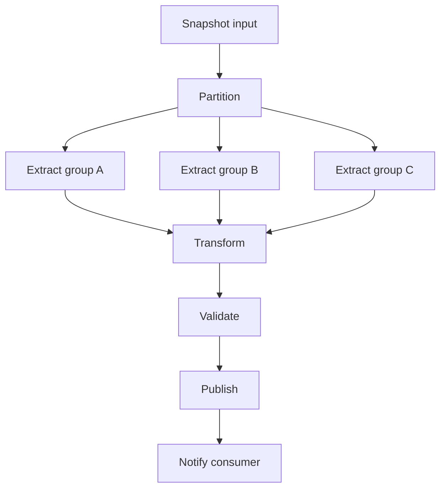

# Thiết kế xử lý dữ liệu theo lô có deadline

## Mục tiêu học tập

Sau bài học, bạn có thể:

- Phân biệt batch window, execution timeout, start deadline, completion deadline và data freshness.
- Chuyển yêu cầu nghiệp vụ thành SLO về thời điểm bắt đầu, hoàn tất và độ mới của dữ liệu.
- Ước lượng khả năng hoàn thành batch theo khối lượng, throughput, critical path và thời gian dự phòng.
- Chọn chính sách lập lịch theo deadline, slack, priority và fairness.
- Thiết kế admission control để nhận, trì hoãn, từ chối hoặc xử lý suy giảm khi thiếu capacity.
- Chia batch thành partition và stage có thể retry, checkpoint và phục hồi.
- Phối hợp CPU, memory, GPU, storage và network để đáp ứng thời hạn.
- Triển khai lịch chạy, timeout và concurrency trên Kubernetes hoặc batch scheduler.
- Xử lý dữ liệu đến muộn, snapshot, watermark và kết quả một phần.
- Theo dõi deadline miss, queue age, throughput, chi phí và điều chỉnh capacity.

## 1. Deadline trong xử lý dữ liệu theo lô

Batch processing xử lý một tập dữ liệu hoặc một nhóm công việc trong khoảng thời gian xác định. Ví dụ:

- Tạo báo cáo doanh thu trước 06:00 mỗi ngày.
- Tổng hợp log và telemetry theo giờ.
- Tính hóa đơn cuối tháng trước thời điểm phát hành.
- Chạy mô hình dự báo trước khi hệ thống mở cửa.
- Đồng bộ dữ liệu giữa hai hệ thống trong cửa sổ bảo trì.
- Chạy backup hoặc chuyển đổi dữ liệu trước giờ bàn giao.

Khi có deadline, tiêu chí thành công không chỉ là "job chạy xong". Kết quả phải sẵn sàng đủ sớm để bước nghiệp vụ tiếp theo sử dụng.

Một batch có thể chạy thành công về mặt kỹ thuật nhưng vẫn thất bại về nghiệp vụ nếu hoàn tất sau hạn. Ngược lại, batch hoàn thành sớm nhưng dùng snapshot dữ liệu quá cũ cũng có thể không đáp ứng yêu cầu.

### 1.1. Các loại thời hạn

| Khái niệm | Ý nghĩa | Ví dụ |
|---|---|---|
| Schedule time | Thời điểm dự kiến bắt đầu | 01:00 hằng ngày |
| Batch window | Khoảng dữ liệu thuộc một lần chạy | Dữ liệu từ 00:00 đến 01:00 |
| Start deadline | Thời điểm muộn nhất job phải bắt đầu | Bắt đầu trước 01:15 |
| Execution timeout | Thời gian chạy tối đa kể từ khi bắt đầu | Không chạy quá 90 phút |
| Completion deadline | Thời điểm kết quả phải sẵn sàng | Publish trước 03:00 |
| Data freshness deadline | Tuổi dữ liệu tối đa được chấp nhận | Không cũ hơn 15 phút |
| Workflow deadline | Hạn cuối của pipeline nhiều stage | Báo cáo sẵn sàng trước 06:00 |

Cần ghi rõ deadline áp dụng cho task, job hay toàn bộ workflow. Timeout 60 phút không đồng nghĩa deadline hoàn tất lúc 03:00 nếu job chỉ bắt đầu lúc 02:30.

### 1.2. Hard deadline và soft deadline

**Hard deadline** là hạn mà việc trễ gây hậu quả nghiêm trọng hoặc làm kết quả mất giá trị. Ví dụ: batch tính giá phải hoàn tất trước khi hệ thống chốt giao dịch.

**Soft deadline** là mục tiêu thời gian; trễ vẫn có thể chấp nhận trong phạm vi xác định. Ví dụ: báo cáo phân tích nội bộ nên có trước 06:00 nhưng có thể chậm 10 phút.

Có thể phân loại thêm:

- **Firm deadline:** kết quả sau hạn không còn giá trị, dù job hoàn thành.
- **Best-effort deadline:** cố gắng hoàn thành đúng hạn nhưng không có cam kết tuyệt đối.
- **Deadline theo SLA:** thời hạn có ngưỡng đo lường và tỷ lệ đáp ứng trong một cửa sổ.

Không gắn nhãn hard deadline chỉ vì người dùng yêu cầu "càng sớm càng tốt". Cần xác định hậu quả của việc trễ, khả năng chấp nhận kết quả muộn và chính sách khi thiếu capacity.

### 1.3. Batch window và deadline không giống nhau

Batch window xác định dữ liệu hoặc công việc thuộc một lần chạy. Deadline xác định thời điểm kết quả cần hoàn tất.

Ví dụ batch báo cáo ngày D:

- Input window: 00:00–23:59:59 UTC ngày D.
- Data arrival grace period: chờ thêm 20 phút cho event đến muộn.
- Processing start: 00:30 ngày D+1.
- Completion deadline: 02:00 ngày D+1.
- Publish deadline: 02:10 ngày D+1.

Nếu không phân biệt các mốc này, hệ thống có thể bắt đầu trước khi dữ liệu ổn định hoặc publish khi validation chưa hoàn tất.

## 2. Chuyển yêu cầu nghiệp vụ thành SLO

Yêu cầu "batch phải xong trước 06:00" chưa đủ để thiết kế compute. Cần làm rõ:

- Mốc thời gian được tính theo timezone nào?
- Batch xử lý dữ liệu của khoảng thời gian nào?
- Có cho phép dữ liệu đến muộn không?
- Deadline áp dụng cho output thô hay output đã validate và publish?
- Có bao nhiêu lần chạy mỗi ngày?
- Khi trễ, có chấp nhận partial result không?
- Tỷ lệ hoàn tất đúng hạn mong muốn là bao nhiêu?
- Hệ thống có thể tăng capacity tạm thời hay không?

### 2.1. Định nghĩa SLO deadline

Ví dụ:

- 99% batch ngày hoàn tất validation trước 05:45.
- 100% batch tạo invoice phải được publish trước 06:00 hoặc chuyển sang quy trình incident.
- 95% batch dữ liệu giờ bắt đầu trong vòng 3 phút sau lịch chạy.
- Dữ liệu được publish có freshness không quá 20 phút so với watermark đã cam kết.

Một SLO cần có:

1. Đối tượng đo: job, batch run, partition hay workflow.
2. Mốc bắt đầu và kết thúc.
3. Timezone và cách xử lý clock skew.
4. Điều kiện success.
5. Cửa sổ đo và tỷ lệ đáp ứng.
6. Cách xử lý canceled, skipped và partial run.

Không chỉ đo thời điểm process exit. Nên đo tới khi kết quả đã commit, kiểm tra và được consumer nhìn thấy.

### 2.2. End-to-end time budget

Tổng thời gian từ lúc batch đủ điều kiện tới khi output được công bố có thể gồm:

\[
T_{total} =
T_{queue} + T_{provision} + T_{startup} +
T_{compute} + T_{validate} + T_{publish}
\]

Trong đó:

- \(T_{queue}\): thời gian chờ scheduler hoặc queue.
- \(T_{provision}\): thời gian cấp VM/node/container capacity.
- \(T_{startup}\): tải image, cấu hình và khởi động runtime.
- \(T_{compute}\): thời gian xử lý dữ liệu.
- \(T_{validate}\): kiểm tra schema, checksum và business invariant.
- \(T_{publish}\): commit metadata, cập nhật pointer hoặc thông báo consumer.

Nếu deadline cách thời điểm dự kiến bắt đầu 90 phút, không thể dành toàn bộ 90 phút cho compute. Cần giữ budget cho queue, provisioning, validation và publish.

### 2.3. Dùng percentile thay vì chỉ dùng trung bình

Batch duration thường có phân bố lệch do dữ liệu lớn, retry, straggler hoặc dependency chậm.

- p50 cho biết lần chạy điển hình.
- p90/p95 giúp hiểu phần lớn các lần chạy.
- p99 cho thấy tail latency và các lần chạy hiếm nhưng rất chậm.
- Maximum hữu ích để điều tra nhưng dễ bị chi phối bởi một sự cố đơn lẻ.

Sizing cho hard deadline cần xem p95/p99 và các kịch bản tải cao. Nếu chỉ dùng average duration, hệ thống có thể thiếu capacity vào ngày dữ liệu tăng đột biến.

## 3. Ước lượng khả năng hoàn thành đúng hạn

Trước khi nhận một batch, cần ước lượng liệu nó có thể hoàn tất trong thời gian còn lại hay không.

Các đầu vào quan trọng:

- Số lượng record, file, byte hoặc đơn vị công việc.
- Chi phí xử lý trung bình và phân bố của mỗi đơn vị.
- Số worker và concurrency mỗi worker.
- Resource profile của mỗi worker.
- Thời gian queue, provisioning và startup.
- Dependency throughput và rate limit.
- Số stage tuần tự và critical path.
- Thời gian retry dự phòng.
- Thời gian validation và publish.
- Deadline còn lại.

### 3.1. Mô hình throughput cơ bản

Nếu có W worker, mỗi worker xử lý trung bình μ đơn vị/giây, throughput lý thuyết là:

\[
R = W \times \mu
\]

Nếu batch có N đơn vị dữ liệu, thời gian xử lý lý tưởng gần đúng:

\[
T_{compute} \approx \frac{N}{W \times \mu}
\]

Ví dụ:

- 12 triệu record.
- Một worker xử lý 20.000 record/giây.
- Có 20 worker.

Throughput lý thuyết là 400.000 record/giây; compute time khoảng 30 giây. Đây chỉ là phép tính minh họa. Đọc dữ liệu, ghi output, skew, retry và giới hạn database có thể làm thời gian thực tế dài hơn nhiều.

### 3.2. Mô hình có concurrency trong worker

Nếu một Pod chạy C task đồng thời, mỗi task xử lý trung bình μt, throughput lý thuyết của W Pod là:

\[
R = W \times C \times \mu_t
\]

Không được mặc định tăng C sẽ tăng throughput tuyến tính. Các task có thể tranh chấp CPU, RAM, file descriptor, connection pool hoặc I/O. Cần benchmark ở mức concurrency thực tế.

### 3.3. Giới hạn bởi dependency

Nếu worker có throughput 100.000 record/giây nhưng database nguồn chỉ cho phép 30.000 record/giây, throughput toàn hệ thống không vượt được bottleneck đó.

Một mô hình gần đúng:

\[
R_{effective} = \min(R_{compute}, R_{storage}, R_{network}, R_{dependency})
\]

Nếu pipeline có nhiều stage tuần tự, thời gian workflow không chỉ là tổng khối lượng chia cho số worker. Một stage chậm có thể chi phối toàn bộ pipeline.

### 3.4. DAG và critical path

Một workflow batch thường gồm nhiều stage có dependency:



Các nhánh có thể chạy song song, nhưng stage kế tiếp phải chờ các dependency bắt buộc. Critical path là đường đi có tổng thời gian dài nhất trong DAG. Thêm worker cho nhánh không nằm trên critical path có thể không làm workflow hoàn tất sớm hơn.

Nếu stage A mất 10 phút, stage B/C chạy song song mất 40 phút và stage D mất 15 phút, tổng lý tưởng khoảng 65 phút cộng overhead, không phải tổng tất cả thời gian của B và C.

### 3.5. Điều kiện khả thi sơ bộ

Có thể ước lượng:

\[
T_{required} =
T_{queue} + T_{provision} + T_{startup} +
T_{critical} + T_{validate} + T_{publish} + T_{reserve}
\]

Trong đó T_reserve là phần dự phòng cho retry, biến động dữ liệu và tail latency.

Nếu:

\[
T_{required} > T_{deadline\ remaining}
\]

thì batch không khả thi với cấu hình hiện tại. Hệ thống cần tăng capacity, thay đổi chiến lược xử lý, giảm phạm vi theo policy hoặc báo nguy cơ trễ sớm.

Không chờ tới khi deadline đã qua mới phát hiện job không thể hoàn thành.

## 4. Slack, lateness và deadline-aware scheduling

**Slack** là thời gian còn lại sau khi trừ thời gian xử lý dự kiến khỏi thời gian tới deadline.

\[
Slack = Deadline - Now - EstimatedRemainingTime
\]

Ví dụ:

- Deadline còn 50 phút.
- Thời gian còn lại dự kiến 35 phút.
- Slack là 15 phút.

Slack nhỏ cho biết job có ít thời gian dự phòng. Slack âm nghĩa là với ước lượng hiện tại, job đã không thể hoàn thành đúng hạn nếu không thay đổi capacity hoặc phạm vi.

**Lateness** là thời điểm hoàn tất trừ deadline. Giá trị dương biểu thị trễ:

\[
Lateness = CompletionTime - Deadline
\]

**Tardiness** thường được tính là phần trễ không âm:

\[
Tardiness = \max(0, CompletionTime - Deadline)
\]

Các chỉ số này giúp phân biệt job hoàn thành sớm, đúng hạn và trễ bao lâu.

### 4.1. Earliest Deadline First (EDF)

EDF ưu tiên job có deadline gần nhất. Đây là chính sách đơn giản và hữu ích khi nhiều job có deadline khác nhau.

Ưu điểm:

- Dễ hiểu.
- Ưu tiên công việc sắp tới hạn.
- Phù hợp với một số tập task độc lập có thời gian xử lý tương đối dự đoán được.

Hạn chế:

- Job dài có thể chiếm capacity trước khi deadline gần hơn đến.
- Không tự tính critical path hoặc dependency.
- Có thể bỏ đói job deadline xa nếu luôn có job mới với deadline gần.
- Không tự xử lý fairness giữa tenant.
- Không bảo đảm deadline trong môi trường nhiều resource constraint và provisioning delay.

### 4.2. Least Laxity First (LLF)

LLF ưu tiên job có slack/laxity nhỏ nhất:

\[
Laxity_i = Deadline_i - Now - RemainingWork_i
\]

LLF xét cả deadline và thời gian xử lý còn lại. Job deadline xa nhưng cần nhiều thời gian có thể cần được chạy sớm hơn job ngắn có deadline gần.

Tuy nhiên, ước lượng remaining work có thể sai. Nếu task có thời gian xử lý biến động, LLF có thể thay đổi thứ tự liên tục và gây preemption hoặc scheduling overhead. Với batch không preemptible, có thể dùng slack như tín hiệu cảnh báo và ưu tiên, không cần thay đổi worker đang chạy liên tục.

### 4.3. Priority theo business impact

Một policy thực tế thường kết hợp:

- Deadline.
- Slack.
- Mức độ quan trọng nghiệp vụ.
- Tenant hoặc nhóm khách hàng.
- Chi phí trễ.
- Resource requirement.
- Fairness và giới hạn quota.

Ví dụ:

| Nhóm | Deadline | Tác động trễ | Chính sách |
|---|---|---|---|
| Invoice close | Hard | Rất cao | Reserved capacity, ưu tiên cao |
| Daily report | Soft | Trung bình | EDF trong nhóm thường |
| Analytics backfill | Không gấp | Thấp | Chạy khi còn capacity |
| Data repair | Theo incident | Có thể cao | Priority có thời hạn và audit |

Không nên chỉ dùng một số priority không có định nghĩa. Cần xác định ai được gán priority, giới hạn mức cao nhất và cách ngăn mọi tenant tự nâng job lên mức khẩn cấp.

## 5. Admission control: có nên nhận batch hay không?

Admission control quyết định một batch có được đưa vào hệ thống tại thời điểm này hay không. Mục tiêu là tránh nhận nhiều công việc hơn capacity có thể xử lý, khiến mọi batch cùng trễ.

Một batch request nên có:

- Job ID và owner.
- Input snapshot/version.
- Resource profile.
- Deadline và timezone.
- Estimated work/duration.
- Priority và business impact.
- Retry policy.
- Output contract.
- Data classification và access scope.

### 5.1. Các quyết định admission

| Quyết định | Khi nào dùng | Hành vi |
|---|---|---|
| Accept | Có đủ capacity hoặc có kế hoạch cấp capacity | Đưa vào queue |
| Defer | Capacity tạm thời thiếu nhưng deadline còn slack | Xếp lịch bắt đầu muộn hơn |
| Reject | Không thể đáp ứng deadline hoặc policy | Trả lý do và yêu cầu đổi thời hạn/phạm vi |
| Accept with degradation | Có thể tạo kết quả một phần hoặc chất lượng thấp hơn theo hợp đồng | Ghi rõ giới hạn và đánh dấu output |
| Preempt lower priority | Có job khẩn cấp và policy cho phép | Dừng hoặc hoãn job ưu tiên thấp một cách an toàn |

Không tự ý trả partial result nếu consumer yêu cầu dữ liệu đầy đủ. Degradation phải được xác định trước trong hợp đồng nghiệp vụ.

### 5.2. Admission theo slack

Một quy tắc đơn giản:

- Nếu slack lớn hơn ngưỡng an toàn, accept.
- Nếu slack nhỏ nhưng có capacity dự phòng, accept với priority phù hợp.
- Nếu slack âm, đánh dấu at-risk và tìm phương án.
- Nếu không có phương án khả thi, reject hoặc đề xuất deadline mới.

Cần tính cả thời gian chờ queue và provisioning. Nếu job cần GPU node mất 8 phút để cấp, không thể bỏ qua 8 phút này trong admission estimate.

### 5.3. Capacity reservation

Một số batch quan trọng có thể cần capacity được dành trước:

- Node pool hoặc VM capacity riêng.
- Quota dành cho namespace/tenant.
- Reserved concurrency cho job loại nhất định.
- Queue/partition riêng.
- GPU hoặc memory-heavy pool riêng.
- Capacity warm để tránh cold start.

Reservation làm tăng chi phí idle, vì vậy chỉ nên dành cho workload có deadline hoặc business impact đủ lớn. Có thể dùng quota mềm và pool dùng chung với mức capacity bảo đảm theo lịch.

## 6. Chia batch thành partition và task có thể hoàn thành đúng hạn

Partitioning ảnh hưởng trực tiếp đến deadline vì nó quyết định mức song song, overhead và thời gian retry.

### 6.1. Chọn partition size

Partition quá lớn:

- Một task có thể vượt execution timeout.
- Retry làm mất nhiều công sức đã hoàn thành.
- Một partition nặng có thể trở thành straggler.
- Khó điều chỉnh capacity giữa chừng.

Partition quá nhỏ:

- Tăng overhead scheduler và worker startup.
- Tạo nhiều metadata, object và queue message.
- Tăng chi phí orchestration.
- Có thể làm dependency bị nhiều request nhỏ.

Chọn kích thước dựa trên thời gian xử lý dự kiến, startup overhead, retry cost và khả năng cân bằng dữ liệu.

### 6.2. Data skew và straggler

Nếu một partition mất 40 phút trong khi các partition khác chỉ mất 5 phút, batch có thể trễ dù tổng CPU capacity còn dư.

Cần:

- Đo duration theo partition.
- Ước lượng cost theo byte, record hoặc đặc tính dữ liệu.
- Chia subpartition cho hot key nếu logic cho phép.
- Dùng dynamic work queue cho task không đồng đều.
- Dự phòng thời gian cho task cuối và validation.
- Cân nhắc speculative execution khi output idempotent và dependency chịu được tải bổ sung.

Không chia một nhóm dữ liệu nếu các record cần xử lý tuần tự hoặc cùng transaction. Bảo toàn invariant nghiệp vụ quan trọng hơn số worker.

### 6.3. Static partition và dynamic queue

| Tiêu chí | Static partition | Dynamic queue |
|---|---|---|
| Phân công | Xác định trước | Worker nhận task khi rảnh |
| Dự đoán duration | Dễ khi dữ liệu đồng đều | Linh hoạt khi duration biến động |
| Cân bằng tải | Phụ thuộc partition map | Tốt hơn với worker lấy task tiếp |
| Điều phối | Đơn giản hơn | Cần queue, lease và ack |
| Deadline | Dễ ước lượng khi workload ổn định | Phù hợp khi task phát sinh và thời gian không đều |
| Retry | Retry partition xác định | Requeue task theo semantics |
| Chi phí | Metadata có thể thấp | Có thêm queue và coordination |

Có thể kết hợp: tạo partition cố định theo snapshot, sau đó phân phối từng partition qua queue để worker rảnh lấy phần tiếp theo.

## 7. Lập lịch workflow nhiều stage

Một batch thường không phải một process duy nhất. Nó có thể gồm extract, transform, aggregate, validate, publish và notify.

### 7.1. Định nghĩa dependency rõ ràng

Mỗi stage cần:

- Input và output contract.
- Dependency bắt buộc.
- Resource request.
- Estimated duration.
- Timeout và retry.
- Deadline nội bộ.
- Điều kiện success.
- Cách phục hồi nếu stage chạy lại.

Deadline nội bộ được tính ngược từ deadline cuối. Ví dụ publish cần 5 phút, validation cần 10 phút và aggregate cần 20 phút; các stage trước phải kết thúc đủ sớm để giữ budget cho phần sau.

### 7.2. Backward scheduling

Bắt đầu từ deadline cuối, trừ thời gian cần cho từng stage:

| Stage | Thời gian dự kiến | Mốc phải xong |
|---|---:|---|
| Publish | 5 phút | 06:00 |
| Validate | 10 phút | 05:55 |
| Aggregate | 20 phút | 05:45 |
| Transform | 45 phút | 05:25 |
| Extract | 20 phút | 04:40 |
| Provision + startup | 10 phút | 04:20 |

Bảng minh họa cách lập lịch ngược; mốc từng stage cần tính nhất quán với dependency và thời gian thực tế. Cần thêm reserve cho retry và tail latency thay vì xếp các stage sát nhau.

### 7.3. Fan-out và fan-in

Fan-out chia workload thành nhiều task song song; fan-in chờ các task bắt buộc hoàn tất rồi tổng hợp.

Các câu hỏi cần trả lời:

- Có cần tất cả partition hoàn tất không?
- Có thể bỏ qua partition không quan trọng không?
- Có ngưỡng phần trăm dữ liệu tối thiểu không?
- Nếu một partition lỗi, có thể retry riêng không?
- Có thể publish từng partition hay chỉ publish kết quả tổng?
- Fan-in có đủ capacity trước deadline không?

Nếu một partition quan trọng thất bại, không nên đánh dấu cả workflow thành công chỉ vì 99% task đã hoàn tất.

## 8. Dữ liệu đến muộn, watermark và snapshot

Batch có deadline thường xử lý dữ liệu phát sinh trong một khoảng thời gian. Dữ liệu có thể đến sau do mạng, thiết bị offline, producer retry hoặc hệ thống nguồn chậm.

Cần phân biệt:

- **Event time:** thời điểm sự kiện thực sự xảy ra.
- **Ingestion time:** thời điểm hệ thống nhận dữ liệu.
- **Processing time:** thời điểm batch xử lý dữ liệu.
- **Watermark:** mốc event time mà pipeline tạm xem là đã nhận đủ dữ liệu theo policy.
- **Late arrival:** dữ liệu đến sau watermark hoặc sau khi batch đã bắt đầu.

### 8.1. Chờ dữ liệu hay giữ deadline?

Có trade-off giữa completeness và timeliness:

- Chờ lâu hơn giúp nhận thêm dữ liệu đến muộn nhưng giảm thời gian xử lý.
- Bắt đầu sớm giữ deadline nhưng có thể thiếu dữ liệu.
- Chạy lại phần bị ảnh hưởng có thể tạo correction sau publish.
- Publish partial result cần được đánh dấu rõ.

Một policy có thể quy định: chờ dữ liệu đến muộn tối đa 15 phút, sau đó chốt snapshot, chạy batch và xử lý late data bằng correction job.

### 8.2. Snapshot nhất quán

Mọi partition của một run cần đọc cùng một dataset version hoặc snapshot logic. Nếu partition A đọc dữ liệu lúc 01:00 và partition B đọc dữ liệu lúc 01:30 trong khi nguồn đang thay đổi, kết quả có thể không nhất quán.

Cách làm:

- Chụp snapshot hoặc lưu watermark.
- Ghi dataset version vào manifest.
- Truyền version cho mọi worker.
- Không thay input reference giữa các lần retry.
- Tách correction run khỏi run ban đầu.
- Lưu lineage từ output về input snapshot.

## 9. Retry, checkpoint và phục hồi dưới deadline

Retry tăng khả năng hoàn thành khi lỗi tạm thời, nhưng mỗi lần retry tiêu thụ thời gian còn lại.

### 9.1. Phân loại lỗi

| Loại lỗi | Ví dụ | Hướng xử lý |
|---|---|---|
| Transient | Network reset, storage timeout | Retry có backoff |
| Capacity | Không đủ node hoặc quota | Defer, scale hoặc chuyển pool |
| Data poison | Record sai schema | Quarantine hoặc dead-letter |
| Permanent | Thiếu quyền, cấu hình sai | Dừng retry và báo lỗi |
| Resource | OOM, disk full, CPU timeout | Sizing lại hoặc chia task |
| Dependency | Database/API quá tải | Backpressure, circuit breaker |
| Interruption | Spot/Preemptible instance bị thu hồi | Checkpoint và resume |

### 9.2. Retry budget

Không dùng retry vô hạn. Định nghĩa retry budget theo:

- Số lần thử tối đa.
- Tổng thời gian retry tối đa.
- Deadline còn lại.
- Loại lỗi có thể retry.
- Backoff và jitter.
- Thời gian tối thiểu cần cho validation/publish.

Nếu chỉ còn 3 phút tới deadline nhưng một task cần tối thiểu 10 phút, retry thêm không giúp đạt deadline. Có thể chuyển trạng thái at-risk, chạy degraded path nếu được phép hoặc báo incident.

### 9.3. Checkpoint

Checkpoint lưu trạng thái xử lý đã commit để worker tiếp tục từ điểm an toàn sau interruption.

Một checkpoint nên ghi:

- Run ID và partition ID.
- Input snapshot/version.
- Offset/cursor đã xử lý.
- Output generation đã commit.
- Schema và code version.
- Checksum.
- Timestamp và trạng thái.
- Metadata cần thiết để phục hồi.

Không ghi checkpoint trước khi output tương ứng được commit bền vững. Khi resume, worker phải xác minh checkpoint tương thích với input và code version.

### 9.4. Retry có thể gây duplicate

Worker có thể ghi output rồi chết trước khi báo thành công. Khi retry, worker khác có thể xử lý lại. Cần:

- Idempotency key theo run/partition/version.
- Output path riêng theo attempt.
- Conditional commit hoặc manifest pointer.
- Fencing token nếu worker cũ có thể tiếp tục.
- Chỉ publish một generation hợp lệ.

Deadline không phải lý do bỏ qua idempotency. Duplicate output có thể khiến bước reconcile tốn thời gian hơn và làm batch trễ thêm.

## 10. Preemption và lựa chọn compute capacity

Batch có deadline có thể chạy trên capacity linh hoạt hoặc máy có thể bị thu hồi. Cần chọn compute pool theo khả năng chịu interruption.

### 10.1. On-demand và interruptible capacity

| Loại capacity | Ưu điểm | Rủi ro | Workload phù hợp |
|---|---|---|---|
| On-demand/regular | Capacity ổn định hơn theo cam kết dịch vụ | Chi phí cao hơn | Hard deadline, task khó phục hồi |
| Spot/Preemptible | Có thể giảm chi phí | Có thể bị thu hồi | Task checkpointable, retryable |
| Reserved capacity | Có kế hoạch capacity dài hạn | Có thể trả tiền cho idle capacity | Batch quan trọng theo lịch |
| Warm pool | Giảm provisioning/startup delay | Tốn chi phí duy trì | Deadline ngắn và tải dự đoán được |

Có thể dùng hybrid: chạy phần lớn partition trên Spot/Preemptible và giữ một pool on-demand để hoàn tất task còn lại khi deadline gần. Cần đảm bảo output idempotent và checkpoint đủ thường xuyên.

### 10.2. Khi nào không nên dùng Spot?

- Task không thể checkpoint hoặc retry an toàn.
- Interruption có thể làm mất trạng thái khó tái tạo.
- Deadline quá sát để chịu provisioning lại.
- Workload phụ thuộc GPU/instance type khan hiếm.
- Chi phí trễ lớn hơn phần tiết kiệm compute.

Nếu dùng Spot, cần có interruption handler, checkpoint, retry policy và capacity fallback được kiểm thử trước.

## 11. Tài nguyên compute cho batch có deadline

Chọn CPU, RAM, storage, network và accelerator theo bottleneck.

### 11.1. CPU-bound

Dấu hiệu:

- CPU utilization cao liên tục.
- Task duration giảm khi tăng core đến một ngưỡng.
- Ít thời gian chờ I/O.
- CPU throttling có thể xuất hiện khi limit thấp.

Hướng xử lý:

- Benchmark số worker và core.
- Đặt CPU request/limit phù hợp.
- Tránh oversubscription gây context switching.
- Tối ưu thuật toán hoặc vectorization.
- Kiểm tra phần tuần tự theo Amdahl's Law.

### 11.2. Memory-bound

Dấu hiệu:

- OOM hoặc memory pressure.
- GC/heap pressure cao.
- Swap hoặc page fault tăng.
- Partition lớn gây peak memory.

Hướng xử lý:

- Giảm batch size.
- Streaming thay vì load toàn bộ dataset.
- Tăng memory hoặc chia partition.
- Theo dõi peak memory, không chỉ average.
- Tránh nhiều task đồng thời cùng tạo memory spike.

### 11.3. I/O và network-bound

Dấu hiệu:

- CPU thấp nhưng task duration cao.
- Storage latency hoặc queue depth tăng.
- Network throughput chạm giới hạn.
- Database/API rate limit.

Hướng xử lý:

- Đặt worker gần data source.
- Tối ưu file format và batch request.
- Dùng cache có version.
- Giới hạn concurrency để bảo vệ downstream.
- Tăng IOPS/bandwidth khi đó là bottleneck thật.

### 11.4. GPU/accelerator-bound

GPU batch cần xét:

- GPU model và VRAM.
- Compute capability và driver/runtime compatibility.
- Batch size và model memory.
- GPU utilization và data loader throughput.
- Số GPU/node và topology.
- Thời gian cấp GPU node.
- Chính sách chia sẻ MIG/time-slicing nếu có.

Nếu deadline ngắn, thời gian chờ GPU capacity có thể lớn hơn compute time. Cần kiểm tra queue wait và reserved capacity, không chỉ benchmark model trên một GPU đã sẵn sàng.

## 12. Autoscaling theo deadline và backlog

Autoscaling nên phản ánh cả số lượng công việc lẫn thời gian còn lại.

Các tín hiệu:

- Queue depth/backlog.
- Oldest task age.
- Arrival rate.
- Completion rate.
- Estimated remaining work.
- Slack/deadline risk.
- Worker utilization.
- Provisioning delay.
- Dependency saturation.
- Pending Pod/instance count.

### 12.1. Scale theo backlog

Một ước lượng đơn giản:

\[
W_{needed} =
\left\lceil
\frac{Backlog}{TargetBacklogPerWorker}
\right\rceil
\]

Phù hợp khi task tương đối đồng đều. Với task có duration khác nhau, backlog count có thể gây đánh giá sai.

### 12.2. Scale theo work remaining và deadline

Nếu còn B đơn vị công việc, throughput mỗi worker là μ, thời gian xử lý còn lại là T, số worker tối thiểu lý thuyết:

\[
W_{needed} \geq \frac{B}{\mu \times T}
\]

Cần cộng safety margin và giới hạn bởi downstream capacity. Nếu số worker cần thiết vượt max capacity, hệ thống phải báo deadline risk thay vì tiếp tục scale vô hạn.

### 12.3. Scale up và scale down

- Scale up sớm khi dự báo slack giảm dưới ngưỡng.
- Dùng warm capacity nếu provisioning delay đáng kể.
- Giới hạn max worker theo quota và downstream.
- Scale down sau khi batch gần hoàn tất và task đang chạy đã drain.
- Không terminate worker có state chưa checkpoint.
- Tránh autoscaler dao động do metric noisy.

Scale theo CPU đơn thuần có thể không phù hợp với batch I/O-bound. Kết hợp queue age, work remaining và service time để dự báo deadline.

## 13. Triển khai batch có deadline trên Kubernetes

Kubernetes Job và CronJob phù hợp với nhiều workload batch. Tuy nhiên, chúng không phải hệ thống real-time scheduler; cần hiểu semantics về lịch chạy, retry, timeout và concurrency.

### 13.1. Job và activeDeadlineSeconds

Job có thể đặt:

- **completions:** số lần completion cần đạt.
- **parallelism:** số Pod tối đa mong muốn chạy đồng thời.
- **backoffLimit:** số lần retry theo semantics Job.
- **activeDeadlineSeconds:** giới hạn thời gian Job hoạt động.
- **ttlSecondsAfterFinished:** thời gian giữ Job sau khi kết thúc.
- **completionMode Indexed:** gán completion index cho task array.

Ví dụ:

```yaml
apiVersion: batch/v1
kind: Job
metadata:
  name: daily-report
  namespace: batch
spec:
  completions: 48
  parallelism: 12
  completionMode: Indexed
  backoffLimit: 3
  activeDeadlineSeconds: 5400
  ttlSecondsAfterFinished: 86400
  template:
    spec:
      restartPolicy: Never
      containers:
        - name: report-worker
          image: registry.example.com/analytics/report:3.2
          env:
            - name: RUN_ID
              value: "daily-2026-11-22"
            - name: DEADLINE_UTC
              value: "2026-11-22T06:00:00Z"
          resources:
            requests:
              cpu: "2"
              memory: "4Gi"
            limits:
              cpu: "4"
              memory: "8Gi"
```

Manifest minh họa tạo 48 completion và tối đa 12 Pod song song, với active deadline 90 phút. Giá trị thời hạn là giới hạn hoạt động của Job theo Kubernetes, không phải cơ chế bảo đảm scheduler bắt đầu đúng một giờ cụ thể. Cần tính thời gian queue trước khi Pod được tạo và thời gian validation/publish ngoài Job nếu chúng thuộc workflow.

### 13.2. CronJob và lịch chạy

CronJob tạo Job theo lịch. Các trường cần chú ý:

- **schedule:** biểu thức cron.
- **timeZone:** timezone khi phiên bản cluster hỗ trợ.
- **concurrencyPolicy:** xử lý khi lần chạy mới đến trong lúc Job trước còn active.
- **startingDeadlineSeconds:** cửa sổ cho phép tạo Job bị lỡ lịch.
- **suspend:** tạm dừng tạo Job.
- **successfulJobsHistoryLimit** và **failedJobsHistoryLimit:** số Job lịch sử giữ lại.

Ví dụ:

```yaml
apiVersion: batch/v1
kind: CronJob
metadata:
  name: hourly-aggregation
  namespace: batch
spec:
  schedule: "5 * * * *"
  timeZone: "Etc/UTC"
  concurrencyPolicy: Forbid
  startingDeadlineSeconds: 300
  successfulJobsHistoryLimit: 3
  failedJobsHistoryLimit: 5
  jobTemplate:
    spec:
      activeDeadlineSeconds: 2400
      backoffLimit: 2
      template:
        spec:
          restartPolicy: Never
          containers:
            - name: aggregate
              image: registry.example.com/data/aggregate:1.8
              args: ["--window", "previous-hour"]
```

Ví dụ chạy lúc phút thứ 5 mỗi giờ theo UTC, bỏ qua lần chạy mới nếu Job trước vẫn đang active và chỉ cho phép tạo Job trễ lịch trong cửa sổ 5 phút. Forbid có thể làm một lịch bị bỏ qua nếu lần trước chưa hoàn tất; cần theo dõi missed schedule và có quy trình backfill.

### 13.3. Chọn concurrencyPolicy

| Policy | Hành vi | Khi phù hợp |
|---|---|---|
| Allow | Cho phép nhiều Job lịch chạy chồng nhau | Mỗi cửa sổ độc lập và có capacity |
| Forbid | Bỏ qua lần chạy mới nếu Job trước còn active | Không cho phép overlap |
| Replace | Thay Job đang chạy bằng Job mới | Chỉ khi dừng lần trước là an toàn và đúng nghiệp vụ |

Replace có thể làm gián đoạn batch đang chạy. Forbid không tự chạy bù mọi cửa sổ bị bỏ lỡ. Allow có thể tạo backlog hoặc đụng dữ liệu nếu job không idempotent. Phải chọn theo hợp đồng dữ liệu và deadline.

### 13.4. CronJob không phải đồng hồ thời gian thực

CronJob controller có thể tạo Job trễ do control plane, controller downtime hoặc quá nhiều lịch bị missed. Một lịch chạy không đồng nghĩa Pod bắt đầu chính xác tại giây đó.

Nếu deadline rất nghiêm ngặt:

- Dùng scheduler và capacity đã kiểm thử.
- Theo dõi scheduled time so với actual start.
- Có alert cho missed schedule.
- Thiết kế idempotent để chịu duplicate.
- Dùng workflow controller hoặc batch platform nếu cần dependency và deadline phức tạp.
- Không dựa vào CronJob như hệ thống hard real-time.

### 13.5. Job timeout và workflow deadline

activeDeadlineSeconds giới hạn thời gian Job hoạt động; nó không tự hiểu deadline nghiệp vụ từ lúc batch window kết thúc. Nên truyền deadline vào ứng dụng, để worker tự kiểm tra thời gian còn lại và dừng nhận task khi không thể hoàn thành an toàn.

Một workflow có thể gồm nhiều Job. Mỗi Job cần timeout riêng và coordinator cần giữ end-to-end deadline cho toàn bộ DAG.

## 14. Batch scheduler và dịch vụ cloud

Ngoài Kubernetes, batch có thể chạy trên HPC scheduler hoặc managed cloud batch service.

### 14.1. HPC scheduler

Các scheduler như Slurm quản lý job queue, partition, resource request, priority và wall-time limit. Người vận hành cần:

- Khai báo CPU, memory, GPU và wall time.
- Chọn partition/queue phù hợp.
- Kiểm tra job priority và thời gian chờ.
- Xác định policy preemption và requeue.
- Dùng checkpoint nếu job dài.
- Dự báo thời gian chờ trước khi job được cấp node.

Wall time limit là giới hạn thời gian chạy sau khi bắt đầu, không nhất thiết là completion deadline. Scheduler có thể giữ job trong queue vì thiếu resource; cần tính queue wait vào time budget.

### 14.2. Managed cloud batch

Dịch vụ cloud batch thường cung cấp:

- Job queue và priority.
- Job definition hoặc container image.
- Compute environment/node pool.
- Retry strategy.
- Timeout hoặc attempt duration.
- Array job.
- Scale compute environment.
- Log và trạng thái job.

Tên thuộc tính và semantics khác nhau theo provider. Cần xác minh timeout tính từ lúc submit, lúc bắt đầu hay từng attempt; kiểm tra thời gian provisioning và giới hạn max vCPU/GPU.

### 14.3. So sánh cách triển khai

| Mô hình | Ưu điểm | Cần chú ý |
|---|---|---|
| Kubernetes Job/CronJob | Gần với workload container và cluster hiện có | Scheduling delay, quota, controller semantics |
| HPC scheduler | Hỗ trợ resource topology và job queue chuyên biệt | Queue wait, partition policy, wall time |
| Managed cloud batch | Tự động mở rộng compute environment | Provisioning delay, quota và provider-specific timeout |
| Workflow orchestrator | Quản lý DAG, retry và dependency | Orchestrator không thay thế compute capacity |
| Queue workers | Linh hoạt theo backlog và task | Cần tự thiết kế deadline, fairness và commit |

## 15. Partial result, degraded mode và business decision

Khi deadline gần, hệ thống có thể không đủ thời gian hoàn thành toàn bộ dữ liệu. Cần có policy từ trước.

Một số chiến lược:

- Publish partial result với nhãn rõ ràng.
- Dùng dữ liệu snapshot gần nhất và ghi freshness.
- Bỏ qua nhóm dữ liệu không thiết yếu theo policy.
- Chạy quick path trước, full path sau.
- Tạo correction run sau deadline.
- Chuyển sang manual review.
- Fail closed nếu kết quả thiếu có thể gây sai lệch tài chính hoặc an toàn.

### 15.1. Phân biệt partial và complete

Output cần metadata thể hiện:

- Run ID.
- Input snapshot/watermark.
- Expected partition count.
- Completed partition count.
- Failed/skipped partition.
- Data freshness.
- Validation status.
- Published time.
- Completeness flag.
- Reason nếu degraded.

Không đặt tên file final cho output chưa đầy đủ nếu consumer không có cách phân biệt.

### 15.2. Correction run

Nếu late data đến sau khi batch đã publish, có thể:

1. Ghi nhận event late.
2. Xác định partition bị ảnh hưởng.
3. Chạy correction task với input version mới.
4. Validate delta.
5. Publish version mới hoặc adjustment record.
6. Giữ lineage và liên kết với run trước.

Không âm thầm ghi đè output cũ nếu consumer cần audit hoặc reproducibility.

## 16. Bảo mật và tính toàn vẹn của batch

Batch job có thể xử lý lượng lớn dữ liệu và thường chạy với quyền truy cập rộng. Deadline không phải lý do bỏ qua least privilege.

Nguyên tắc:

- Dùng workload identity/service account riêng cho từng job type.
- Chỉ cấp quyền đọc input và ghi output cần thiết.
- Tách quyền chạy job khỏi quyền sửa scheduler và queue.
- Không nhúng secret vào image, manifest hoặc command line.
- Dùng secret manager và rotation.
- Mã hóa dữ liệu khi truyền và lưu.
- Audit thay đổi schedule, priority, resource limit và deadline.
- Ghi lại người phê duyệt thay đổi hard deadline hoặc degraded mode.
- Kiểm tra image digest và dependency.
- Giữ manifest, checkpoint và output metadata có integrity.

Nếu job chạy theo tenant, cần xác thực quyền truy cập ở worker; tenant ID trong message không tự chứng minh quyền.

## 17. Monitoring và cảnh báo deadline

Theo dõi cả compute và tiến độ nghiệp vụ.

| Nhóm | Metric | Ý nghĩa |
|---|---|---|
| Schedule | Scheduled time, actual start, missed run | Độ trễ bắt đầu |
| Queue | Queue depth, oldest age, wait time | Công việc đang chờ |
| Execution | Duration p50/p95/p99, active task | Thời gian chạy |
| Progress | Completed/total partitions, remaining work | Tiến độ |
| Deadline | Slack, at-risk count, deadline miss, tardiness | Khả năng hoàn thành |
| Resource | CPU, memory, I/O, network, GPU, throttling | Bottleneck |
| Reliability | Retry, failure, checkpoint, interruption | Độ tin cậy |
| Data | Watermark, late arrival, freshness, validation | Chất lượng input/output |
| Cost | Worker-hours, idle capacity, cost per run | Chi phí |

### 17.1. Cảnh báo theo slack

Một policy có thể:

- Warning khi slack dưới 30 phút.
- Critical khi slack dưới 10 phút.
- Incident khi estimated completion vượt deadline.
- Alert khi queue age tăng nhanh hơn tốc độ drain.
- Alert khi stage critical path vượt budget.
- Alert khi provisioning delay tăng bất thường.

Ngưỡng chỉ là ví dụ. Cần hiệu chỉnh theo thời gian chạy và business impact.

### 17.2. Dự báo completion time

Có thể ước lượng:

\[
EstimatedCompletion =
Now + QueueWaitEstimate + ProvisioningEstimate +
RemainingExecutionEstimate + FinalizationEstimate
\]

So sánh với deadline để tạo trạng thái:

- On track: còn reserve.
- At risk: reserve thấp.
- Predicted miss: completion estimate sau deadline.
- Missed: thực tế đã quá hạn.

Dự báo cần cập nhật khi backlog, throughput hoặc dependency thay đổi. Một estimate đầu job không đủ cho workflow kéo dài nhiều giờ.

## 18. Ví dụ thực tế: batch báo cáo phải publish trước 06:00

Một hệ thống tạo báo cáo doanh thu mỗi ngày. Output phải sẵn sàng cho bộ phận vận hành trước 06:00 UTC.

Yêu cầu:

- Input là dữ liệu giao dịch của ngày trước.
- Chờ late event tối đa 15 phút.
- Có 120 partition theo region và tenant group.
- Báo cáo phải được validate và publish trước 06:00.
- Nếu một partition quan trọng thất bại, không được đánh dấu report complete.

Thiết kế time budget:

| Hoạt động | Budget |
|---|---:|
| Chốt watermark và snapshot | 15 phút |
| Queue/provision/startup | 10 phút |
| Extract + transform | 70 phút |
| Aggregate | 20 phút |
| Validate | 10 phút |
| Publish + notify | 5 phút |
| Reserve | 10 phút |
| Tổng | 140 phút |

Nếu bắt đầu lúc 03:40, budget 140 phút đưa thời điểm hoàn tất tới 06:00. Nhưng phần reserve không được dùng như thời gian compute mặc định; nó dành cho retry và biến động.

### 18.1. Lập lịch và capacity

- Tạo snapshot input cố định theo watermark.
- Dự báo thời gian theo p95 của 7–14 ngày gần nhất.
- Chọn partition size sao cho transform hoàn tất trong budget 70 phút.
- Dùng queue ưu tiên cho report batch.
- Dành capacity nền cho workflow quan trọng.
- Scale worker theo remaining work và slack.
- Giới hạn concurrency theo database throughput.
- Chạy aggregate sau khi các partition bắt buộc hoàn tất.
- Validate số record, checksum và business totals.
- Publish bằng version pointer sau khi validation pass.

### 18.2. Khi batch có nguy cơ trễ

Nếu lúc 05:00 còn 40 partition và estimate cho biết cần 50 phút:

- Tính slack còn lại so với validation/publish.
- Kiểm tra bottleneck và capacity downstream.
- Tăng worker nếu dependency còn dư capacity.
- Chia subpartition cho nhóm dữ liệu skew nếu có thể.
- Nếu vẫn không khả thi, thông báo at-risk và áp dụng policy partial/degraded đã được phê duyệt.
- Không bỏ qua validation chỉ để đạt mốc giờ.

## 19. Runbook xử lý batch có nguy cơ trễ

### Job chưa bắt đầu đúng lịch

1. Kiểm tra schedule controller và missed run.
2. Xem queue wait và scheduler events.
3. Kiểm tra quota, node capacity và resource request.
4. Kiểm tra image pull, secret và dependency.
5. Tính lại time budget và slack.
6. Nếu cần, dùng capacity pool dự phòng theo policy.
7. Cập nhật trạng thái at-risk và thông báo owner.

### Throughput thấp hơn dự kiến

1. So sánh arrival/remaining work với completion rate.
2. Xem CPU, memory, I/O, network và throttling.
3. Xác định dependency rate limit hoặc contention.
4. So sánh duration theo partition để phát hiện skew.
5. Tăng concurrency chỉ khi dependency chịu được.
6. Giảm batch size hoặc chia task nếu phù hợp.
7. Cập nhật estimated completion liên tục.

### Task bị interruption hoặc OOM

1. Xác định partition và attempt.
2. Kiểm tra checkpoint cuối cùng đã commit.
3. Xác minh input snapshot và code version.
4. Điều chỉnh resource hoặc partition size.
5. Retry trong retry budget.
6. Kiểm tra output attempt cũ và idempotency.
7. Cập nhật deadline risk sau khi retry.

### Deadline đã bị miss

1. Bảo toàn run metadata và output hiện có.
2. Xác định stage và nguyên nhân gây trễ.
3. Xác định output partial có được phép sử dụng không.
4. Thông báo owner/consumer theo SLA.
5. Chọn retry, correction run hoặc manual path.
6. Không publish trạng thái complete nếu validation chưa đạt.
7. Ghi tardiness, root cause và action item.

## 20. Những nhầm lẫn thường gặp

- **Execution timeout chính là completion deadline.** Timeout thường tính từ lúc job bắt đầu; deadline có thể bao gồm queue wait và publish.
- **Job chạy thành công đồng nghĩa đúng hạn.** Cần đo completion time so với deadline.
- **CronJob chạy đúng phút đã khai báo.** Controller có thể tạo Job trễ; nó không phải real-time scheduler.
- **Forbid tự chạy bù lịch đã bỏ lỡ.** Policy này ngăn overlap; cần theo dõi missed schedule và backfill riêng.
- **Tăng parallelism luôn giúp batch đúng hạn.** Dependency có thể là bottleneck và throughput tổng có thể giảm.
- **Average duration đủ để sizing.** Tail latency, skew và retry cần được tính vào reserve.
- **Queue depth thấp nghĩa batch đang an toàn.** Task có thể đã được giao nhưng còn in-flight hoặc đang chờ dependency.
- **Mọi partition hoàn tất gần deadline là có thể publish ngay.** Validation và publish vẫn cần time budget.
- **Spot luôn rẻ hơn cho batch.** Interruption, retry và deadline miss có thể làm tổng cost cao hơn.
- **Partial result có thể dùng thay complete result.** Chỉ khi consumer contract và business policy cho phép.
- **Watermark là bằng chứng tuyệt đối không còn late data.** Nó là mốc theo policy và giả định của pipeline.
- **Retry nhiều lần giúp đạt deadline.** Retry có thể tiêu hết slack và tạo tải bổ sung.
- **Scale down không ảnh hưởng batch đang chạy.** Pod có thể bị terminate; cần drain và checkpoint.
- **Deadline chỉ cần lưu trong scheduler.** Ứng dụng và workflow coordinator cũng cần biết deadline để dừng nhận việc hoặc chuyển degraded mode.
- **Không có alert nghĩa là job đang on track.** Cần tính predicted completion và giám sát pipeline metric.

## 21. Checklist thiết kế batch có deadline

### Trước khi nhận job

- [ ] Xác định hard/soft/firm deadline.
- [ ] Xác định timezone, batch window và input snapshot.
- [ ] Định nghĩa success tới bước validate/publish.
- [ ] Ước lượng work volume và duration p50/p95/p99.
- [ ] Tính queue, provisioning, startup và finalization budget.
- [ ] Tính critical path và dependency bottleneck.
- [ ] Xác định slack và admission decision.
- [ ] Xác định priority, fairness và quota.
- [ ] Xác định policy partial result và correction run.
- [ ] Chọn capacity thường, reserved, warm hoặc interruptible.

### Trong khi chạy

- [ ] Theo dõi queue age và actual start time.
- [ ] Theo dõi remaining work và completion rate.
- [ ] Cập nhật predicted completion và slack.
- [ ] Theo dõi stage critical path và straggler.
- [ ] Theo dõi CPU, memory, disk, network và GPU.
- [ ] Kiểm soát concurrency theo dependency capacity.
- [ ] Retry trong retry budget.
- [ ] Checkpoint và commit output an toàn.
- [ ] Cảnh báo at-risk trước khi deadline bị miss.
- [ ] Drain worker an toàn khi scale down hoặc rollout.

### Khi hoàn tất

- [ ] Xác nhận đủ partition bắt buộc.
- [ ] Kiểm tra snapshot/watermark và data freshness.
- [ ] Validate schema, checksum và business invariant.
- [ ] Publish output theo generation/version.
- [ ] Ghi completion time và deadline result.
- [ ] Ghi partial/degraded status nếu có.
- [ ] Dọn tài nguyên tạm theo retention.
- [ ] Tính cost per run và cost per output.
- [ ] Ghi lại nguyên nhân trễ và cập nhật sizing.

## 22. Tự kiểm tra

**Tình huống 1:** Batch cần hoàn tất lúc 06:00. Compute dự kiến mất 70 phút, queue/provision 10 phút, validation/publish 15 phút và reserve 10 phút. Muộn nhất nên bắt đầu lúc nào?

**Gợi ý:** Tổng budget là 105 phút. Muộn nhất bắt đầu khoảng 04:15 để còn đủ thời gian và reserve, giả định các estimate phù hợp và không có dependency tuần tự khác.

**Tình huống 2:** Một job có deadline 02:00, hiện tại 01:20 và remaining execution estimate là 50 phút. Slack là bao nhiêu?

**Gợi ý:** Còn 40 phút tới deadline, cần 50 phút xử lý nên slack là âm 10 phút. Cấu hình hiện tại dự báo miss nếu không tăng capacity hoặc thay đổi phạm vi hợp lệ.

**Tình huống 3:** CronJob dùng concurrencyPolicy Forbid. Lần chạy trước kéo dài qua lịch tiếp theo. Điều gì có thể xảy ra?

**Gợi ý:** Lần chạy mới có thể bị bỏ qua vì Job trước còn active. Cần alert missed schedule và có backfill/reconciliation nếu batch window bị bỏ lỡ.

**Tình huống 4:** Batch đã xử lý 95% partition nhưng một partition quan trọng bị lỗi. Có nên publish report complete để đạt deadline không?

**Gợi ý:** Chỉ nếu business contract cho phép partial result và output được gắn completeness status. Nếu partition bắt buộc, phải fail hoặc dùng quy trình degraded được phê duyệt.

**Tình huống 5:** Scale worker gấp đôi nhưng throughput không tăng, database latency tăng mạnh. Nên làm gì?

**Gợi ý:** Database là bottleneck. Giảm concurrency, áp backpressure, tối ưu truy vấn hoặc tăng capacity database; không tiếp tục scale worker mù quáng.

**Tình huống 6:** Batch chạy trên Spot bị interruption khi còn 20 phút tới deadline. Quyết định nào cần được đưa ra?

**Gợi ý:** Xác định checkpoint, thời gian cấp lại capacity và remaining work. Nếu có thể resume trong retry budget, chuyển sang capacity dự phòng; nếu không, cập nhật predicted miss và áp dụng policy business đã định nghĩa.

## Kết luận

Thiết kế batch có deadline bắt đầu từ việc định nghĩa rõ batch window, input snapshot, thời điểm bắt đầu và completion deadline. Cần lập time budget cho queue, provisioning, startup, compute, validation và publish; ước lượng duration theo throughput, critical path và tail latency; sau đó dùng slack, priority và admission control để quyết định nhận hoặc điều chỉnh workload. Partition, checkpoint, retry và output commit phải hỗ trợ phục hồi mà không làm sai kết quả. Autoscaling cần kết hợp backlog, remaining work, service time và dependency capacity, còn Kubernetes CronJob hay batch scheduler chỉ cung cấp cơ chế lập lịch và timeout theo semantics riêng. Hãy theo dõi predicted completion, deadline miss, data freshness và cost per run để phát hiện nguy cơ trễ sớm và giữ kết quả đúng hợp đồng nghiệp vụ.
