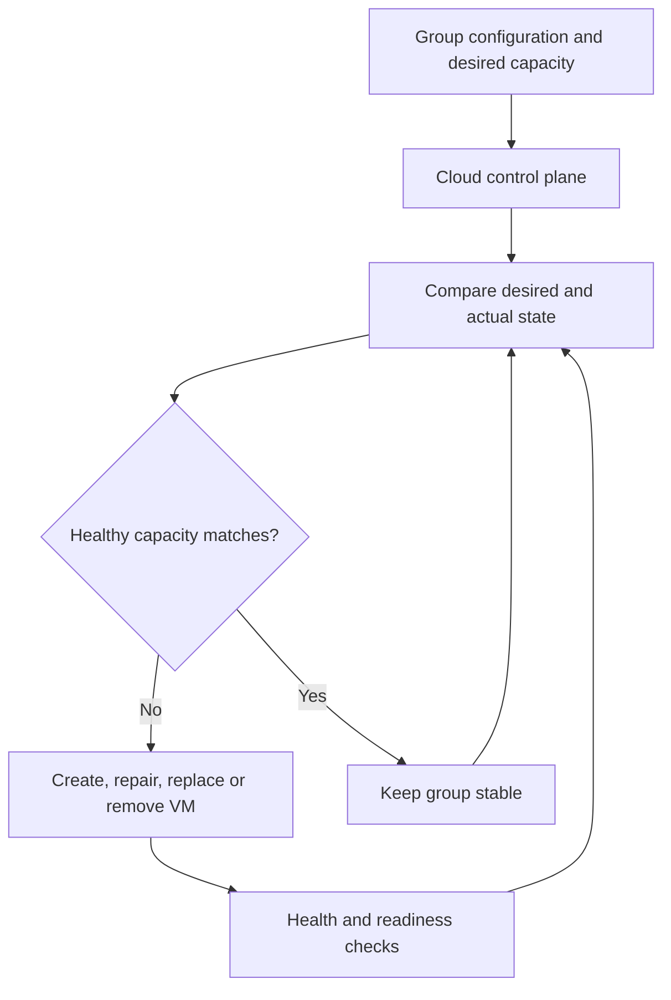

# Đối chiếu nhóm máy có quản lý và cơ chế tự động co giãn

## Bối cảnh: quản lý một nhóm VM thay vì vận hành từng máy riêng lẻ

Một dịch vụ web có thể cần nhiều VM chạy cùng một phiên bản ứng dụng. Khi tải tăng, hệ thống cần thêm máy; khi tải giảm, hệ thống có thể thu hồi bớt máy để tiết kiệm chi phí. Nếu quản trị viên tự tạo, cấu hình, kiểm tra sức khỏe và xóa từng VM, quy trình nhanh chóng trở nên khó kiểm soát. Các cloud provider cung cấp nhóm máy có quản lý để mô tả trạng thái mong muốn và để control plane duy trì nhóm đó.

Nhóm máy có quản lý thường kết hợp một định nghĩa máy (image, instance type/size, network, identity, disk và startup configuration), một tập VM thành viên, chính sách số lượng mong muốn và cơ chế health check/repair. Autoscaling điều chỉnh số lượng thành viên theo metric, lịch hoặc dự báo. Nhóm còn có thể hỗ trợ phân bố qua availability zone, thay phiên bản image, rolling update và thay máy lỗi.

Trong module **CLOUD_CORE_SERVICES_COMPUTE**, chủ đề này giúp lựa chọn mô hình vận hành compute giữa các cloud. Các tên dịch vụ khác nhau nhưng cùng giải quyết một nhóm vấn đề: duy trì fleet VM nhất quán, tăng/giảm capacity theo nhu cầu và phục hồi khi instance không khỏe.

## 1. Nhóm máy có quản lý là gì?

Managed instance group là tập hợp các VM được điều khiển bởi một cấu hình hoặc template chung và một control plane. Người vận hành khai báo số lượng, loại máy, image, network, metadata, health check và policy; dịch vụ quản lý việc tạo, thay thế, phân phối hoặc thu hồi thành viên.

Một nhóm thường có các thuộc tính:

- **Instance template/model:** mô tả cấu hình VM mới.
- **Desired capacity:** số lượng hoặc capacity mà nhóm cần duy trì.
- **Minimum/maximum capacity:** giới hạn dưới và trên.
- **Membership:** danh sách instance đang thuộc nhóm.
- **Health check/autohealing:** phát hiện máy không khỏe và thay thế hoặc repair.
- **Scaling policy:** điều kiện tăng/giảm capacity.
- **Update policy:** cách thay instance khi đổi image hoặc cấu hình.
- **Placement policy:** phân bố instance qua zone, subnet hoặc fault domain.

Control plane liên tục đối chiếu trạng thái thực tế với trạng thái mong muốn. Nếu desired capacity là 6 nhưng chỉ còn 5 instance khỏe, group manager có thể tạo thêm một instance. Nếu cấu hình mới được triển khai, update policy quyết định thay instance theo đợt hay thay toàn bộ.

### 1.1. Desired state và reconciliation loop

Nhóm máy có quản lý hoạt động theo ý tưởng desired state:



Reconciliation giúp tự phục hồi khi một VM bị xóa nhầm hoặc lỗi. Tuy nhiên, không nên xem việc instance ở trạng thái `running` là bằng chứng ứng dụng đã sẵn sàng. Cần health check ở đúng tầng, startup process idempotent và khả năng đăng ký/deregister với load balancer.

### 1.2. Nhóm máy khác với một VM độc lập

| Khía cạnh | VM độc lập | Nhóm máy có quản lý |
|---|---|---|
| Vòng đời | Người vận hành tạo/xóa từng máy | Control plane quản lý membership |
| Cấu hình | Có thể drift giữa các máy | Instance mới sinh từ template/model chung |
| Khôi phục | Cần quy trình riêng | Có thể tự thay máy không khỏe |
| Scaling | Thường cần automation tự viết | Có policy và capacity boundary tích hợp |
| Rolling update | Tự điều phối | Có update policy hoặc instance refresh |
| Phân bố zone | Người vận hành chọn placement | Có tùy chọn phân phối theo group |
| Phù hợp | Máy đặc thù, tác vụ quản trị, workload đơn | Fleet stateless hoặc service cần capacity thay đổi |

Managed group không có nghĩa mọi instance luôn giống hệt nhau. Một số nền tảng cho phép nhiều instance type/size hoặc cấu hình linh hoạt; stateful setting cũng có thể giữ một số thuộc tính qua lần thay máy. Cần hiểu rõ phần nào được template quản lý và phần nào có thể khác giữa các thành viên.

## 2. Các dịch vụ tương đương giữa những cloud phổ biến

Ba họ dịch vụ thường được dùng để quản lý VM fleet là:

| Cloud | Dịch vụ nhóm máy | Mô hình cấu hình chính | Autoscaling thường gặp |
|---|---|---|---|
| AWS | Amazon EC2 Auto Scaling Groups (ASG) | Launch Template, desired/min/max capacity, health check và scaling policy | Target tracking, step/simple, scheduled, predictive; có thể kết hợp mixed instances |
| Microsoft Azure | Virtual Machine Scale Sets (VMSS) | VM profile/model, orchestration mode, instance count, upgrade policy và health extension | Azure Monitor autoscale theo metric/lịch; tùy workload có thể dùng automation bổ sung |
| Google Cloud | Compute Engine Managed Instance Groups (MIG) | Instance template, zonal/regional group, target size, autohealing và update policy | Autoscaler theo metric hỗ trợ, lịch và một số chế độ dự báo tùy cấu hình |

Tên gọi và tập tính năng không hoàn toàn tương đương một-một. Mỗi dịch vụ có giới hạn, cách tính capacity, semantics health check, zone behavior, update strategy và khả năng giữ state riêng. Khi so sánh phải dùng cùng workload, cùng region/zone, cùng loại VM và cùng yêu cầu SLO.

### 2.1. AWS EC2 Auto Scaling Groups

EC2 Auto Scaling Group (ASG) quản lý một tập EC2 instance. Launch Template mô tả cấu hình instance như AMI, instance type, key/role, network interface, security group, storage mapping và user data. ASG duy trì desired capacity trong giới hạn minimum/maximum và có thể phân phối instance qua nhiều Availability Zone.

Các khả năng thường dùng:

- **Target tracking:** điều chỉnh capacity để giữ metric gần một target, ví dụ average CPU utilization hoặc metric tùy chỉnh.
- **Step/simple scaling:** tăng/giảm theo alarm và mức thay đổi được định nghĩa.
- **Scheduled scaling:** đặt desired/min/max theo lịch đã biết.
- **Predictive scaling:** dùng lịch sử metric để dự báo nhu cầu và chuẩn bị capacity trước; phù hợp tải có chu kỳ rõ.
- **Health checks:** dựa trên EC2 status và có thể tích hợp load balancer health check.
- **Instance refresh:** thay instance theo đợt khi cần cập nhật launch template hoặc AMI.
- **Mixed instances policy:** phối hợp nhiều instance type và purchasing option theo chiến lược capacity/cost.
- **Warm pools:** giữ instance đã chuẩn bị ở trạng thái phù hợp để giảm thời gian scale-out trong một số workload.

ASG có thể kết hợp On-Demand và Spot theo policy. Spot capacity có thể bị thu hồi; workload cần xử lý interruption và không được phụ thuộc vào một instance cụ thể. Các tính năng, tỷ lệ phân phối và behavior có thể khác theo loại instance, region và cấu hình.

### 2.2. Azure Virtual Machine Scale Sets

Virtual Machine Scale Sets (VMSS) quản lý một nhóm VM có thể scale và nâng cấp theo một model. VMSS tích hợp với Azure networking, load balancing, monitoring và Azure Monitor autoscale. Orchestration mode ảnh hưởng cách quản lý instance:

- **Uniform:** quản lý fleet theo mô hình đồng nhất, phù hợp nhóm VM được tạo và nâng cấp như một đơn vị.
- **Flexible:** cho phép quản lý các VM member linh hoạt hơn, kết hợp khả năng quản trị VM độc lập với orchestration của scale set theo phạm vi hỗ trợ.

Các khả năng thường gặp:

- Autoscale theo metric Azure Monitor, lịch hoặc profile.
- Instance count cùng giới hạn capacity.
- Phân bố qua Availability Zones hoặc fault domains theo cấu hình.
- Rolling upgrade/upgrade policy và health monitoring.
- Scale-in policy và bảo vệ instance khỏi scale-in trong trường hợp cần thiết.
- Kết hợp Spot VM cho workload chịu được gián đoạn.

VMSS có nhiều lựa chọn orchestration, upgrade và health extension. Cần xác minh tính tương thích giữa orchestration mode, availability zone, disk, load balancer, extension và autoscale rule; không mặc định mọi tính năng áp dụng giống nhau cho mọi mode.

### 2.3. Google Compute Engine Managed Instance Groups

Managed Instance Group (MIG) quản lý các VM được tạo từ instance template. MIG có thể là zonal hoặc regional. Regional MIG hỗ trợ phân phối instance qua nhiều zone trong region để giảm phụ thuộc vào một zone, theo giới hạn và policy được cấu hình.

Các khả năng thường dùng:

- Autoscaling theo CPU utilization, load balancing serving capacity hoặc metric Cloud Monitoring được hỗ trợ.
- Autoscaling schedule để tăng capacity theo khung thời gian dự kiến.
- Autohealing dựa trên health check và repair policy.
- Rolling update với mức `maxSurge`/`maxUnavailable` hoặc các lựa chọn rollout tương ứng.
- Proactive instance redistribution trong một số cấu hình regional MIG.
- Stateful MIG configuration cho một số workload cần giữ stateful disk hoặc metadata theo instance.

Zonal MIG phù hợp khi workload gắn với một zone hoặc cần placement cụ thể; regional MIG phù hợp khi muốn phân tán capacity qua nhiều zone trong region. Stateful configuration có giới hạn và không biến MIG thành một database HA tự động; ứng dụng vẫn phải quản lý replication, consistency và recovery.

## 3. Thành phần cần chuẩn hóa khi đối chiếu

Không nên chỉ so sánh tên sản phẩm hoặc số lượng tính năng. Hãy lập cùng một mô hình yêu cầu rồi kiểm tra mỗi provider xử lý từng phần ra sao.

### 3.1. Image và instance template

Template/model nên khai báo đầy đủ:

- Image/OS version hoặc image family đã pin.
- Instance type/size, CPU architecture, memory và accelerator nếu cần.
- Boot/data disk, encryption và IOPS/throughput.
- VPC/subnet, NIC, security group/NSG/firewall và public/private IP.
- Machine identity/instance profile/service account.
- Startup script, extension hoặc bootstrap agent.
- Labels/tags, monitoring agent và log configuration.
- Metadata/secret reference, không nhúng secret trực tiếp vào template.

Image nên bất biến theo version hoặc digest. Nếu dùng image alias luôn trỏ đến bản mới nhất, việc tạo instance trong cùng một group ở hai thời điểm có thể tạo ra hai OS/app version khác nhau. Với rollout có kiểm soát, build image mới, kiểm thử rồi cập nhật template/model rõ ràng.

### 3.2. Capacity model

Các group thường có:

- `min`: số instance tối thiểu hoặc capacity floor.
- `desired`: số instance hiện được yêu cầu.
- `max`: giới hạn trên.
- `target`: mục tiêu autoscaler cố gắng đạt dựa trên metric hoặc lịch.

Không phải mọi provider dùng cùng thuật ngữ hoặc cùng cách tính. Một số hệ thống tính số instance; một số hỗ trợ weighted capacity khi nhiều loại VM có kích thước khác nhau. Khi dùng weighted capacity, cần hiểu `desired capacity` được tính theo instance count hay đơn vị capacity.

### 3.3. Load balancer và service discovery

VM mới phải được đưa vào đường phục vụ traffic sau khi ứng dụng sẵn sàng. Luồng phổ biến:

1. Group tạo VM từ template.
2. Bootstrap cài/khởi động ứng dụng và agent.
3. Instance đăng ký vào target pool/backend/service discovery.
4. Readiness/health check xác nhận có thể phục vụ.
5. Load balancer bắt đầu gửi traffic.

Khi scale-in hoặc thay máy, instance cần ngừng nhận request mới và drain kết nối trước khi bị terminate. Nếu group xóa VM trước khi load balancer hoàn tất deregistration delay, request đang xử lý có thể bị ngắt.

## 4. Health check, autohealing và thay thế instance

Autoscaling và autohealing là hai chức năng khác nhau:

- **Autoscaling** thay đổi số lượng capacity theo nhu cầu.
- **Autohealing** thay thế hoặc sửa instance không khỏe để group đạt trạng thái mong muốn.

Một group có thể đủ số lượng nhưng vẫn không phục vụ được nếu các instance đều unhealthy. Ngược lại, một instance có thể unhealthy trong khi autoscaler không cần tăng số lượng vì desired capacity đã đạt; autohealing mới là cơ chế xử lý.

### 4.1. Các lớp health check

| Lớp kiểm tra | Ví dụ | Phát hiện được | Hạn chế |
|---|---|---|---|
| Infrastructure/host | VM status, host/system check | Host, hypervisor hoặc VM-level fault | Không chứng minh ứng dụng sẵn sàng |
| Guest/agent | Agent heartbeat, service process | Agent hoặc service không hoạt động | Có thể vẫn báo khỏe khi app không phục vụ đúng |
| Application | HTTP `/health`, readiness endpoint | App không thể nhận request | Cần thiết kế endpoint tránh phụ thuộc sai vào mọi downstream |
| Load balancer | Target/backend health | Instance không đáp ứng đường traffic thực tế | Có thể chịu ảnh hưởng network/route và threshold |
| Business synthetic | Request mẫu, transaction kiểm thử | Luồng nghiệp vụ không hoạt động | Tốn tài nguyên và cần tránh tạo side effect thật |

Health check nên phản ánh khả năng nhận công việc. Liveness trả lời process có cần restart hay không; readiness trả lời instance có nên nhận traffic hay không. Không gộp hai khái niệm nếu một dependency tạm thời lỗi có thể khiến toàn bộ fleet bị thay thế đồng loạt.

### 4.2. Autohealing và vòng lặp thay thế

Khi health check thất bại đủ số lần theo threshold, group manager có thể terminate instance và tạo instance mới. Nếu nguyên nhân là lỗi cấu hình chung trong image hoặc startup script, mọi instance mới cũng có thể thất bại, tạo vòng lặp replace liên tục.

Để tránh vòng lặp:

- Kiểm thử image/template trước khi cập nhật toàn fleet.
- Có rollout giới hạn và khả năng rollback.
- Đặt threshold/grace period đủ cho startup bình thường.
- Phân biệt startup chậm với app thực sự lỗi.
- Alert khi tỷ lệ instance unhealthy hoặc replacement tăng bất thường.
- Giữ một phiên bản ổn định đã biết để khôi phục.

### 4.3. Bootstrap phải idempotent

VM mới có thể được tạo lại nhiều lần. Startup script/extension cần chạy lặp an toàn:

- Không tạo user, firewall rule hoặc file cấu hình trùng mỗi lần chạy.
- Cài package theo version đã pin.
- Lấy secret qua identity và secret manager.
- Không ghi dữ liệu nghiệp vụ duy nhất vào boot disk.
- Có timeout, retry có giới hạn và log bootstrap.
- Báo trạng thái readiness chỉ sau khi ứng dụng thực sự sẵn sàng.

Không đặt thao tác thủ công hoặc yêu cầu nhập mật khẩu trong bootstrap tự động; điều đó có thể làm instance mới treo ở trạng thái chưa sẵn sàng.

## 5. Cơ chế autoscaling

Autoscaling điều chỉnh capacity của group theo một hoặc nhiều tín hiệu. Mục tiêu không đơn thuần là tăng số VM khi CPU cao; cần cung cấp đủ capacity trước khi SLO bị ảnh hưởng và thu hồi capacity khi không còn cần thiết.

### 5.1. Reactive scaling theo metric

Reactive scaling quan sát metric hiện tại rồi tăng/giảm capacity. Metric có thể là:

- CPU utilization hoặc CPU queue/run queue.
- Memory utilization nếu metric được thu thập và hỗ trợ.
- Request rate, concurrent request hoặc latency.
- Load balancer requests per instance/serving capacity.
- Queue depth hoặc age of oldest message.
- Metric tùy chỉnh như số job đang chờ trên mỗi worker.

CPU là tín hiệu dễ dùng nhưng không phải lúc nào cũng phản ánh demand. Một API có thể đạt latency SLO kém do database chậm trong khi CPU thấp; worker có thể cần scale theo queue age chứ không theo CPU.

### 5.2. Target tracking

Target tracking cố gắng duy trì một metric gần giá trị mục tiêu. Ví dụ, giữ average CPU khoảng 55% hoặc queue backlog ở mức 20 job trên mỗi worker. Autoscaler tính capacity cần thiết dựa trên metric và điều chỉnh dần.

Ưu điểm:

- Ít phải tự tính từng bước tăng/giảm.
- Phù hợp tải biến động nhưng có quan hệ tương đối ổn định giữa capacity và metric.
- Có thể tự tăng capacity khi metric vượt target và giảm khi thấp hơn.

Hạn chế:

- Metric cần có tính đại diện và cập nhật đủ nhanh.
- Target quá cao làm hệ thống thiếu headroom; target quá thấp tạo nhiều idle capacity.
- Scaling không thể vượt quota hoặc capacity khả dụng của provider.
- Nếu metric bị ảnh hưởng bởi startup/warm-up, autoscaler có thể phản ứng quá mức hoặc quá chậm.

### 5.3. Step scaling và threshold rules

Step scaling dùng ngưỡng cảnh báo và mức thay đổi theo vùng metric. Ví dụ:

| Metric | Hành động minh họa |
|---|---|
| CPU dưới 25% trong 15 phút | Giảm 1 instance, nếu vẫn trên min |
| CPU từ 60% đến 75% | Tăng 1 instance |
| CPU từ 75% đến 90% | Tăng 2 instance |
| CPU trên 90% | Tăng 3 instance và cảnh báo capacity |

Threshold cần có hysteresis và thời gian ổn định để tránh oscillation. Nếu scale-out khi CPU vượt 60% nhưng scale-in ngay khi CPU giảm dưới 60%, group có thể liên tục thêm/xóa instance do metric dao động.

### 5.4. Scheduled scaling

Scheduled scaling phù hợp khi nhu cầu có lịch rõ, ví dụ batch chạy lúc 01:00, cửa hàng mở cửa lúc 08:00 hoặc traffic tăng vào giờ làm việc. Có thể đặt min/desired/max hoặc profile capacity theo từng khung thời gian.

Scheduled scaling hữu ích để chuẩn bị capacity trước khi tải xuất hiện, tránh chờ metric tăng rồi mới khởi tạo VM. Cần tính:

- Time zone, ngày nghỉ và lịch đặc biệt.
- Thời gian boot, bootstrap và warm-up.
- Job có chạy trễ hoặc overlap không.
- Scheduled profile có xung đột với reactive policy không.
- Cách phục hồi nếu schedule bị bỏ lỡ.

### 5.5. Predictive scaling

Predictive scaling dùng lịch sử metric hoặc mô hình dự báo để chuẩn bị capacity trước thời điểm tải dự kiến tăng. Nó hữu ích khi workload có chu kỳ lặp lại đủ ổn định, chẳng hạn traffic theo ngày trong tuần.

Dự báo không phải cam kết demand sẽ giống lịch sử. Sự kiện bất thường, chiến dịch marketing hoặc thay đổi sản phẩm có thể làm dự báo sai. Cần kết hợp predictive baseline với reactive scaling để xử lý sai lệch và burst.

### 5.6. Scaling theo queue backlog

Với worker xử lý queue, metric phù hợp có thể là backlog trên mỗi worker hoặc tuổi message cũ nhất. Ví dụ:

\[
\text{backlog per worker}=\frac{\text{visible pending messages}}{\text{active workers}}
\]

Nếu queue có 12.000 message và 20 worker, backlog trung bình là 600 message/worker. Nếu mục tiêu là 100 message/worker, capacity mục tiêu xấp xỉ 120 worker, trong giới hạn max và downstream quota.

Chỉ số age of oldest message thường phản ánh deadline tốt hơn queue depth đơn thuần. Một queue có nhiều message mới có thể chưa trễ; queue ít message nhưng message đã chờ 30 phút có thể vi phạm deadline.

### 5.7. Scale-out và scale-in khác nhau

Scale-out cần nhanh để bảo vệ latency/throughput. Scale-in cần thận trọng để không ngắt request, job hoặc session đang xử lý. Policy scale-in nên phối hợp:

- Connection draining và deregistration delay.
- Graceful shutdown của ứng dụng.
- Worker không nhận job mới trước khi terminate.
- Termination protection hoặc scale-in protection cho instance đang giữ công việc đặc biệt.
- Cooldown/stabilization window và metric đủ thời gian ổn định.

Không nên chọn instance để scale-in chỉ theo tuổi hoặc thứ tự tạo nếu workload có state, cache hoặc job dài mà chưa có cơ chế drain.

## 6. Điều chỉnh capacity ổn định và tránh dao động

Autoscaler có độ trễ do metric aggregation, alarm evaluation, API control plane, quota check, VM provisioning, image boot và application warm-up. Một policy tốt phải tính tổng độ trễ đó.

### 6.1. Cooldown và stabilization window

Cooldown hoặc stabilization window là khoảng thời gian hạn chế quyết định scaling liên tiếp để metric có thời gian phản ánh tác động của lần scale trước. Tên và semantics cụ thể khác nhau theo provider.

Ví dụ: nếu tạo VM mới mất 4 phút để ứng dụng Ready, không nên scale thêm mỗi 30 giây chỉ vì CPU vẫn cao trong thời gian VM chưa phục vụ traffic. Có thể cần scale-out theo bước lớn hơn hoặc dùng metric dự báo demand/capacity pending.

### 6.2. Warm-up và initialization time

Instance mới chỉ tăng capacity hữu ích sau khi:

1. VM được cấp phát.
2. OS boot và cloud-init/custom script hoàn tất.
3. Ứng dụng được cài/nạp và khởi động.
4. Secret, network route và dependency được kết nối.
5. Health/readiness check thành công.
6. Instance được đăng ký vào load balancer/backend.

Hãy đo `time_to_ready`, không chỉ `VM provisioning time`. Nếu ứng dụng cần 7 phút để Ready, autoscaling dựa trên CPU phản ứng khi CPU đã cao có thể đến quá muộn. Scheduled/predictive scaling hoặc buffer queue có thể giúp.

### 6.3. Hysteresis và min/max

Min capacity giữ baseline HA; max capacity giới hạn chi phí và bảo vệ dependency. Ngưỡng scale-out nên tách khỏi ngưỡng scale-in để tránh bật/tắt liên tục. Ví dụ scale-out khi queue age vượt 60 giây nhưng chỉ scale-in khi age dưới 10 giây liên tục trong 10 phút.

Min/max cần được chọn theo:

- SLO và capacity cần khi mất một zone hoặc một số instance.
- Peak demand và tốc độ tăng tải.
- Quota, instance availability và downstream limit.
- Ngân sách và mức chi phí tối đa chấp nhận.
- Thời gian scale-out và thời gian drain.

### 6.4. Scale-in protection và instance selection

Một số group cho phép bảo vệ instance khỏi scale-in hoặc cấu hình policy chọn instance sẽ xóa. Có thể dùng cho worker đang xử lý job dài, instance giữ cache đắt để warm hoặc thành viên cần giữ tạm thời.

Protection không nên trở thành vĩnh viễn. Cần timeout, owner và cơ chế gỡ protection khi job hoàn tất; nếu không, autoscaler có thể không giảm được capacity và nhóm vượt mức mong muốn.

## 7. Phân bố qua zone và fault domain

Managed group có thể phân bố VM qua nhiều availability zone hoặc fault domain trong một region. Mục tiêu là giảm rủi ro khi một zone hoặc rack gặp sự cố và duy trì capacity khi một phần hạ tầng không sẵn sàng.

### 7.1. Zonal và regional group

- **Zonal group:** instance được tạo trong một zone. Dễ kiểm soát placement hoặc gắn với resource zonal, nhưng một zone outage có thể làm mất toàn bộ group.
- **Regional/multi-zone group:** instance được phân bố qua nhiều zone trong region theo policy. Có khả năng tiếp tục phục vụ khi một zone lỗi nếu còn đủ capacity và dependency cũng chịu lỗi.

Regional group không tự động biến ứng dụng thành multi-zone HA. Database, storage, load balancer, NAT, DNS và secret service cũng phải được đánh giá. Nếu toàn bộ VM phân bố nhiều zone nhưng database chỉ nằm trong một zone, database vẫn là điểm lỗi tập trung.

### 7.2. Even distribution và capacity imbalance

Group có thể cố gắng phân bố instance đồng đều, nhưng quota hoặc thiếu capacity ở một zone có thể khiến phân bố lệch. Cần giám sát số instance khỏe và capacity theo zone, không chỉ tổng số instance.

Ví dụ group mong muốn 9 VM trên 3 zone, mục tiêu là 3 VM/zone. Nếu zone C hết capacity, group có thể chỉ tạo được 6 VM hoặc phân bố lại tùy provider/policy. Khi đánh giá HA, phải tính trường hợp zone còn lại nhận toàn bộ tải.

### 7.3. Capacity sau khi mất một zone

Giả sử mỗi VM xử lý an toàn 500 request/giây, workload peak là 2.000 request/giây và group có 6 VM chia đều 2 VM/zone qua 3 zone. Khi mất một zone, còn 4 VM với capacity danh nghĩa 2.000 request/giây. Đây là mức vừa đủ, chưa có headroom cho lỗi instance khác hoặc tăng tải.

Nếu muốn 30% headroom sau khi mất zone, capacity còn lại cần:

\[
\text{required capacity}=\frac{2,000}{0.70}\approx2,858\text{ req/s}
\]

Với 500 req/s mỗi VM, cần ít nhất 6 VM còn lại, tức tổng group ban đầu tối thiểu 9 VM nếu phân bố đều 3 zone và một zone có thể mất. Ví dụ này giả định throughput tuyến tính; cần benchmark để xác minh capacity thực tế.

### 7.4. Zone rebalance và disruption

Một số group hỗ trợ phân phối lại instance khi zone mất capacity hoặc khi group lệch phân bố. Rebalance có thể tạo và xóa VM, gây thay đổi membership và connection. Cần:

- Có đủ surge capacity hoặc chấp nhận temporary under-capacity.
- Đặt drain trước khi xóa instance.
- Bảo đảm ứng dụng không lưu state duy nhất trên local disk.
- Giám sát capacity theo zone và số lần rebalance.
- Tránh policy liên tục di chuyển instance gây churn.

## 8. Rolling update và thay phiên bản máy

Khi image, startup script hoặc instance type thay đổi, managed group cần đưa thành viên về cấu hình mới. Rolling update thay một phần instance theo đợt để dịch vụ vẫn có capacity phục vụ.

### 8.1. Các tham số rollout

- **Max surge:** số instance bổ sung tối đa trong lúc cập nhật.
- **Max unavailable:** số instance tối đa có thể tạm không phục vụ.
- **Health/ready gate:** chỉ tiếp tục khi instance mới vượt health check.
- **Pause/canary:** dừng sau một nhóm nhỏ để quan sát.
- **Rollback:** quay về template/image trước nếu lỗi tăng.

Nếu group có 10 VM, max unavailable là 2 thì rollout có thể tạm giảm capacity xuống 8 VM. Nếu peak demand cần đủ 10 VM, policy này có thể làm vi phạm SLO. Max surge có thể giữ capacity bằng cách tạo VM mới trước khi terminate VM cũ, nhưng cần quota và ngân sách cho phần capacity tạm thời.

### 8.2. Cập nhật immutable image

Quy trình nên tạo image mới thay vì sửa thủ công từng VM:

1. Build image từ source và package đã pin.
2. Quét lỗ hổng, kiểm tra license và cấu hình bảo mật.
3. Chạy test boot, readiness và smoke test.
4. Cập nhật template/model sang image mới.
5. Rollout theo batch/canary và quan sát error rate, latency, saturation.
6. Dừng rollout/rollback nếu health hoặc SLO xấu đi.
7. Sau khi hoàn tất, xác minh toàn group đang dùng version mong muốn.

### 8.3. Drift và cấu hình ngoài template

Nếu quản trị viên SSH vào VM và sửa package hoặc file cấu hình trực tiếp, instance đó có thể lệch khỏi template. Khi group thay instance, thay đổi thủ công sẽ mất. Quản lý bằng image, IaC và configuration management; hạn chế drift bằng policy, audit và quy trình sửa lỗi qua source of truth.

## 9. Workload stateful và giới hạn của nhóm máy

Managed group phù hợp nhất với VM stateless hoặc có thể thay thế. Workload stateful cần đánh giá cẩn thận:

- Database node có data disk, replica identity và membership cố định.
- Worker có local state hoặc job chưa checkpoint.
- Cache giữ dữ liệu có thể tái tạo nhưng cần warm-up dài.
- License gắn với host, machine identity hoặc MAC address.
- Public IP hoặc private IP phải giữ ổn định.

Một số provider có tính năng stateful instance group, giữ disk/IP/metadata qua lần recreate hoặc hỗ trợ instance protection. Tính năng này có phạm vi và giới hạn riêng; không thay thế database replication, backup hoặc quorum management.

### 9.1. Stateful disk và local disk

Boot disk thường có thể được tái tạo từ image; data disk có thể được giữ hoặc detach/attach theo policy. Local/ephemeral disk gắn với host có thể mất khi instance bị terminate. Không đặt dữ liệu duy nhất trên ephemeral disk nếu group có thể autoheal/scale-in.

### 9.2. Session và cache

Nếu session chỉ nằm trong memory của VM, request tiếp theo có thể đến VM khác hoặc instance có thể bị scale-in. Dùng external session store, sticky session chỉ khi cần và hiểu rằng affinity không bảo đảm instance tồn tại mãi.

Cache có thể được warm lại từ source of truth. Nếu cache warm-up tốn thời gian, cân nhắc min capacity, warm pool hoặc staggered rollout để không làm toàn bộ fleet cold cùng lúc.

### 9.3. Scale-in an toàn cho worker

Worker cần:

1. Ngừng nhận job mới khi được chọn scale-in.
2. Hoàn tất job hiện tại hoặc checkpoint và release lease.
3. Ghi trạng thái xử lý bền vững.
4. Đóng connection và thoát trong termination grace period.
5. Cho phép job được giao lại an toàn nếu worker bị terminate giữa chừng.

Nếu worker không có checkpoint/idempotency, scale-in có thể gây mất hoặc lặp tác động nghiệp vụ. Cơ chế autoscaling cần gắn với semantics xử lý batch.

## 10. So sánh chi tiết các cơ chế giữa provider

Bảng dưới đây là khung đối chiếu khái niệm. Tên tính năng và điều kiện hỗ trợ có thể thay đổi theo region, instance family, orchestration mode và cấu hình. Trước khi triển khai, cần kiểm tra tài liệu/billing của đúng dịch vụ và API version đang dùng.

| Năng lực | AWS EC2 ASG | Azure VMSS | Google Compute Engine MIG |
|---|---|---|---|
| Mô tả instance | Launch Template | VMSS model/profile | Instance template |
| Desired/min/max | Có | Có | Có |
| Reactive autoscaling | Target tracking, step/simple | Azure Monitor autoscale rules | MIG autoscaler theo metric hỗ trợ |
| Scheduled scaling | Có | Autoscale profile/schedule | Autoscaling schedule theo cấu hình hỗ trợ |
| Predictive scaling | Có cho metric/workload đủ điều kiện | Thường dùng autoscale profile/automation dự báo tùy dịch vụ | Có chế độ predictive autoscaling trong các trường hợp được hỗ trợ |
| Multi-zone | Phân phối qua Availability Zones | Zone-spanning/fault-domain theo mode và cấu hình | Regional MIG qua nhiều zone |
| Health/repair | EC2/ELB health checks và replacement | Health extension/application health và repair theo mode | Autohealing policy với health check |
| Rolling update | Instance refresh | Upgrade policy/mode | MIG rolling update policy |
| Mixed VM types | Mixed instances policy | Có lựa chọn size/instance flexibility theo cấu hình và orchestration | Một số MIG có thể dùng instance flexibility theo tính năng hỗ trợ |
| Spot/preemptible | Spot Instances trong group | Spot VM trong scale set theo cấu hình | Spot VMs trong MIG theo cấu hình |
| Warm capacity | Warm pools | Có các phương án pre-provision/standby theo thiết kế dịch vụ | Có thể giữ target/min capacity hoặc dùng giải pháp chuẩn bị trước tùy kiến trúc |
| Stateful behavior | Instance protection/lifecycle hooks và thiết kế riêng | Flexible orchestration, protection và disk behavior tùy mode | Stateful MIG configuration cho một số thuộc tính |

Không nên diễn giải dấu “có” thành tính năng hoàn toàn giống nhau. Ví dụ, health check có thể được tính từ tầng VM ở một provider và từ application health extension ở provider khác; rolling update có thể dùng các tham số surge/unavailable khác nhau; mixed instance flexibility có thể có giới hạn riêng.

### 10.1. AWS: điểm cần kiểm tra

- Launch Template version nào được ASG sử dụng khi tạo instance mới.
- Health check type và grace period để tránh thay máy trước khi app boot xong.
- AZ distribution, capacity rebalance và behavior khi Spot interruption.
- Instance refresh preferences: minimum healthy percentage, max healthy percentage, checkpoints và rollback.
- Warm pool state và chi phí của capacity giữ sẵn.
- Lifecycle hook để drain hoặc chạy bước trước terminate.
- Weighted capacity nếu group phối hợp instance type khác nhau.

### 10.2. Azure: điểm cần kiểm tra

- VMSS orchestration mode Uniform hay Flexible và tác động đến lifecycle.
- Autoscale rule, metric aggregation, cooldown, min/max và profile theo lịch.
- Upgrade mode (automatic, manual hoặc rolling theo cấu hình) và health extension.
- Availability zone/fault domain behavior của SKU và region.
- Scale-in policy, instance protection và Spot eviction handling.
- Disk retention, NIC/IP behavior và extension khi instance được recreate.

### 10.3. Google Cloud: điểm cần kiểm tra

- Zonal hay regional MIG và distribution policy.
- Autoscaler metric, target utilization, initialization period và predictive/scheduled configuration.
- Autohealing health check khác với load balancer health check ra sao.
- Rolling update policy, surge/unavailable và canary/version target.
- Instance flexibility, reservations và capacity availability.
- Stateful configuration cho disk/metadata/IP và điều kiện khi recreate.

## 11. Chi phí của managed group và autoscaling

Managed group thường không chỉ tạo chi phí cho VM đang chạy. Tổng chi phí còn phụ thuộc storage, network, load balancer, monitoring, image/build pipeline, license, reserved capacity và capacity tạm trong rollout.

### 11.1. Thành phần chi phí

| Thành phần | Ví dụ chi phí | Điều cần quan sát |
|---|---|---|
| VM compute | vCPU/RAM/GPU theo thời gian chạy | Instance-hours, family, OS/license, purchase option |
| Disk | Boot/data volume, provisioned IOPS | Volume còn tồn tại sau khi VM bị xóa không |
| Network | Public IP, NAT, egress, cross-zone traffic | Traffic giữa zone, region và Internet |
| Load balancing | LB giờ chạy, capacity/processed units | Backend count, traffic và rule |
| Monitoring | Metric, log ingestion, retention | Log volume khi autoscaling tạo nhiều instance |
| Image/artifact | Image registry, snapshot, build storage | Image version cũ và retention |
| Commitment | Reservation, savings/committed spend | Unused commitment và coverage |
| Rollout capacity | Surge/warm pool/standby | Chi phí tạm tăng khi update hoặc chuẩn bị scale-out |

### 11.2. Min capacity là quyết định availability và cost

Min capacity giữ số VM nền ngay cả khi tải thấp. Min quá thấp có thể không đủ phục vụ peak đột ngột hoặc khi mất một zone; min quá cao tạo idle spend.

Ví dụ workload cần tối thiểu 4 VM để phục vụ traffic thường ngày và muốn chịu mất một zone với 3 zone phân bố đều. Nếu mỗi zone có 2 VM, mất một zone còn 4 VM; nếu cần giữ 4 VM để đáp ứng baseline, tổng min là 6 VM. Nếu min chỉ là 4 VM phân bố 2-1-1, mất zone có 2 VM còn 2 VM và có thể thiếu capacity.

Min capacity nên tính từ failure scenario, không chỉ từ average utilization. Với app stateless, autoscaler có thể tạo thêm máy sau zone outage nhưng thời gian provisioning có thể vượt SLO; do đó cần đủ baseline capacity ở các zone còn lại.

### 11.3. Max capacity và ngân sách

Max capacity là guardrail về quota, chi phí và áp lực lên dependency. Nếu max quá thấp, hệ thống throttling/queue backlog; nếu quá cao, lỗi traffic spike hoặc metric sai có thể tạo hóa đơn lớn và làm database quá tải.

Thiết lập max dựa trên:

- Ngân sách compute và chi phí phụ trợ.
- Quota của instance, IP, disk, vCPU và regional capacity.
- Throughput tối đa của database, cache, queue và API.
- SLO và backlog age.
- Rate limit của dịch vụ bên ngoài.

Khi chạm max, cần alert và xác định hành vi: từ chối request, giữ queue, trả 429/503 hay kéo dài thời gian xử lý. Không để hệ thống âm thầm tăng backlog vô hạn.

### 11.4. Scale-out có thể tăng chi phí trước khi tạo giá trị

Nếu VM mới mất 6 phút để boot và warm cache, việc scale-out liên tục theo CPU có thể tạo nhiều máy chưa phục vụ traffic nhưng đã phát sinh compute charge. Cần theo dõi pending capacity, time-to-ready và hiệu quả của từng lần scale.

Warm pool hoặc min capacity có thể giảm latency nhưng giữ tài nguyên sẵn sàng và tạo chi phí nền. So sánh chi phí warm capacity với chi phí request trễ, backlog và lỗi SLO.

### 11.5. Spot/preemptible và mixed instance policy

Spot/preemptible phù hợp batch, worker stateless hoặc workload có thể checkpoint/retry. Không phù hợp node đơn lẻ chứa state không replicate hoặc tác vụ không thể bị gián đoạn.

Khi dùng nhiều instance type:

- Chọn các type có hiệu năng tương đương cho workload.
- Tránh giả định một instance count tương đương capacity khi size khác nhau.
- Dùng weighted capacity hoặc metric per-capacity unit nếu provider hỗ trợ.
- Đa dạng hóa type/zone để giảm rủi ro thiếu capacity.
- Xử lý interruption notice và drain trước khi VM bị thu hồi.
- Giữ On-Demand baseline nếu SLO yêu cầu capacity ổn định.

## 12. Ví dụ thiết kế autoscaling cho API stateless

Giả sử một API nhận traffic biến động trong ngày. Mỗi VM sau warm-up xử lý an toàn khoảng 400 request/giây ở latency mục tiêu. Peak dự kiến 2.400 request/giây. Hệ thống chạy qua 3 zone và muốn chịu mất một zone mà không phải chờ scale-out mới.

### 12.1. Tính baseline capacity

Nếu muốn 30% headroom sau khi mất một zone, capacity cần còn lại ít nhất:

\[
\frac{2,400}{0.70}\approx3,429\text{ req/s}
\]

Với 400 request/giây mỗi VM, cần 9 VM còn lại. Phân bố đều qua 3 zone nghĩa là ban đầu cần 12 VM (4 mỗi zone) để khi mất một zone còn 8 VM; tuy nhiên 8 VM chỉ đạt 3.200 request/giây, thấp hơn 3.429. Cần tối thiểu 10 VM còn lại; để phân bố gần đều, có thể chọn 15 VM (5 mỗi zone), khi mất một zone còn 10 VM.

Đây là ước lượng theo throughput giả định. Benchmark thực tế, tỷ lệ cache hit, dependency và CPU/memory pressure có thể làm capacity mỗi VM khác nhau.

### 12.2. Policy minh họa

| Tham số | Giá trị khởi đầu | Lý do |
|---|---:|---|
| Min | 15 VM | Giữ capacity cho failure scenario đã đặt ra |
| Desired | 15 VM | Baseline theo peak/HA giả định; điều chỉnh theo profile thực tế |
| Max | 30 VM | Giới hạn quota, dependency và budget |
| Scale-out signal | Request/VM hoặc CPU kết hợp | Gần với demand và saturation |
| Target | 65% target utilization | Giữ headroom để hấp thụ burst |
| Scale-in | Metric thấp liên tục 10-15 phút | Tránh churn và đảm bảo drain |
| Health check | VM + application readiness | Phát hiện cả lỗi hạ tầng và lỗi app |
| Rollout | Surge, canary và health gate | Duy trì capacity khi cập nhật |

Các giá trị là điểm bắt đầu để kiểm thử, không phải cấu hình tối ưu chung. Trong thực tế min 15 có thể quá đắt nếu peak hiếm; scheduled/predictive scaling có thể giảm baseline nếu SLO cho phép khởi tạo trước khi tải tăng.

### 12.3. Luồng scale-out

1. Request rate trên mỗi VM tăng và vượt target.
2. Autoscaler tính desired capacity mới trong giới hạn max.
3. Group yêu cầu VM ở các zone theo distribution policy.
4. Instance boot từ image đã pin, lấy config/secret qua identity.
5. Application health check xác nhận Ready.
6. Load balancer thêm backend và bắt đầu gửi traffic.
7. Metric được đánh giá lại sau warm-up/stabilization.

Nếu một zone thiếu capacity, group có thể không đạt desired count ngay. Cần alert cho capacity shortfall và có chiến lược instance type/zone thay thế đã kiểm thử.

## 13. Ví dụ worker batch theo queue backlog

Một nhóm worker xử lý message. Mỗi VM xử lý trung bình 20 message/giây. Queue có 18.000 message đang chờ; mục tiêu backlog tối đa là 300 message/worker. Capacity mục tiêu ước tính:

\[
\frac{18,000}{300}=60\text{ workers}
\]

Nếu hiện có 20 worker, group cần tăng lên khoảng 60 worker để đưa backlog/worker về target, nhưng chỉ khi database/API downstream đủ capacity. Nếu downstream chỉ chịu 40 worker đồng thời, max phải được giới hạn ở mức phù hợp và queue age cần được chấp nhận hoặc xử lý bằng tăng throughput của dependency.

### 13.1. Thiết kế worker

- Worker stateless, job/message có định danh ổn định.
- Checkpoint hoặc ACK chỉ sau khi business effect bền vững.
- Idempotency key ngăn tác động lặp khi worker bị terminate.
- Shutdown hook ngừng nhận job mới và drain job đang chạy.
- Lease/visibility timeout dài hơn thời gian xử lý bình thường, có heartbeat nếu cần.
- DLQ và retry policy cho poison message.

### 13.2. Scale-in

Khi backlog giảm, autoscaler giảm desired capacity. Trước khi terminate, worker cần ngừng poll, hoàn tất job hiện tại hoặc checkpoint và release lease. Nếu job vượt termination grace period, message phải được giao lại an toàn. Scale-in protection có thể bảo vệ worker đang xử lý job đặc biệt, nhưng phải tự gỡ khi hoàn tất để group không bị giữ capacity vô hạn.

## 14. Quy trình lựa chọn giữa AWS, Azure và Google Cloud

Để chọn managed group, hãy so sánh workload và yêu cầu vận hành thay vì chọn theo số lượng feature trong bảng marketing.

### Bước 1: Xác định workload

- API stateless, web tier, worker queue, batch, cache node hay database node?
- Workload có chạy liên tục hay burst theo lịch?
- Có state local, license hoặc IP cố định không?
- Có thể bị terminate và retry không?

### Bước 2: Xác định SLO và failure scenario

- Availability target và latency/throughput objective.
- Có cần chịu mất một VM, host, zone hay region?
- RTO/RPO nếu instance hoặc zone mất.
- Thời gian boot/warm-up và drain.

### Bước 3: Chuẩn hóa capacity model

- Baseline/min capacity.
- Peak/max capacity.
- Capacity mỗi VM theo benchmark.
- Headroom sau khi mất một zone.
- Quota, reserved capacity và instance availability.

### Bước 4: Chọn scaling signal

- CPU/memory nếu phản ánh saturation.
- Request per instance hoặc latency nếu workload phục vụ API.
- Queue depth/age nếu workload bất đồng bộ.
- Schedule/predictive nếu demand có chu kỳ.
- Kết hợp nhiều metric nếu một metric đơn lẻ không đủ.

### Bước 5: Đánh giá lifecycle

- Health check và autohealing.
- Rolling update, canary, surge và rollback.
- Scale-in protection, lifecycle hook và drain.
- Stateful disk/IP/metadata behavior.
- Spot interruption và mixed instance support.

### Bước 6: Tính tổng chi phí

Tính VM, disk, IP, LB, NAT, egress, log, monitoring, license, warm capacity, rollout surge và commitment. So sánh chi phí trên cùng throughput/SLO và cùng failure scenario.

### Bước 7: Chạy thử và kiểm chứng

- Tạo group trong môi trường test.
- Tăng tải và quan sát time-to-ready.
- Dừng một VM và xác minh autohealing.
- Giả lập mất zone trong môi trường kiểm soát.
- Rollout image mới và thử rollback.
- Thử scale-in trong lúc request/job đang chạy.
- Đối chiếu billing và metric sau thử nghiệm.

## 15. Cách đọc một policy autoscaling

Một policy autoscaling tốt phải chỉ rõ tín hiệu, target, tốc độ thay đổi, giới hạn và cách xử lý khi thiếu capacity. Ví dụ cấu hình ở mức khái niệm:

```yaml
group:
  min_capacity: 6
  desired_capacity: 9
  max_capacity: 24

scale_out:
  metric: requests_per_healthy_instance
  target: 350
  evaluation_window: 2m
  cooldown: 3m

scale_in:
  metric: requests_per_healthy_instance
  target_below: 180
  stabilization_window: 15m
  drain_before_terminate: true

health:
  startup_grace: 6m
  readiness_path: /ready

placement:
  zones: [zone-a, zone-b, zone-c]
  rebalance: enabled
```

Đây là pseudoconfiguration để giải thích ý nghĩa; không phải schema có thể nạp trực tiếp vào AWS, Azure hoặc Google Cloud. Mỗi provider dùng resource/API và đơn vị thời gian riêng.

Khi review policy, cần hỏi:

- Metric được tính trên instance healthy hay tất cả instance?
- Instance đang boot có được tính vào denominator không?
- Evaluation window và cooldown có đủ dài so với time-to-ready không?
- Scale-in có bảo vệ job đang chạy và drain connection không?
- Min/max áp dụng theo instance count hay weighted capacity?
- Khi quota hết, autoscaler báo lỗi và giữ backlog thế nào?
- Policy có xung đột với scheduled scaling hoặc manual desired capacity không?

## 16. Bảo mật và governance của managed group

Group tự tạo và thay VM nên mọi cấu hình bảo mật phải được mã hóa trong template, image hoặc policy tự động. Một instance mới cần nhận đúng identity, network rule, secret và logging ngay từ lần boot đầu tiên.

### 16.1. Instance identity và quyền tối thiểu

- Dùng instance profile/managed identity/service account thay cho access key tĩnh.
- Chỉ cấp quyền đọc secret/config và gọi dependency mà workload cần.
- Tách quyền control plane quản lý group khỏi quyền runtime của ứng dụng.
- Rotation credential không phụ thuộc thao tác thủ công trên từng VM.
- Audit việc thay đổi launch template, VMSS model, instance template và scaling policy.

### 16.2. Network boundary

- Đặt VM trong subnet phù hợp và chỉ mở port cần thiết.
- Load balancer là ingress path; không cần public IP cho mọi instance nếu kiến trúc không yêu cầu.
- Hạn chế egress theo dependency và kiểm soát NAT/Firewall.
- Bảo vệ health endpoint và admin endpoint khỏi truy cập không tin cậy.
- Kiểm tra network path giữa zone và chi phí cross-zone.

### 16.3. Image supply chain

- Build image từ base image được phê duyệt.
- Pin package và runtime version.
- Quét CVE và license trước khi publish.
- Ký/kiểm tra provenance image nếu pipeline hỗ trợ.
- Dùng version/digest bất biến trong template.
- Có quy trình thay image lỗi và thu hồi version có lỗ hổng.

### 16.4. Policy as code

Có thể dùng IaC và policy engine để kiểm soát:

- Bắt buộc min/max và owner tag.
- Bắt buộc encryption cho disk.
- Chặn public IP hoặc ingress quá rộng khi không được phê duyệt.
- Chỉ cho phép image từ registry/project được duyệt.
- Yêu cầu health check và monitoring.
- Giới hạn instance family, GPU hoặc Spot theo môi trường.
- Yêu cầu multi-zone cho workload có criticality cao.

## 17. Những anti-pattern thường gặp

**Chỉ so sánh tên dịch vụ.** ASG, VMSS và MIG có nhiều điểm tương đồng nhưng semantics về update, health, stateful behavior và capacity không giống hoàn toàn. So sánh theo workload và failure scenario.

**Autoscale chỉ theo CPU.** CPU thấp không có nghĩa hệ thống còn khỏe; queue age, request latency, connection pool hoặc downstream throttling có thể là nút thắt thực sự. Chọn metric gắn với mục tiêu dịch vụ.

**Đặt min bằng 1 cho dịch vụ production đa zone.** Một instance không tạo được khả năng chịu lỗi zone và có thể không đủ capacity khi instance restart. Tính baseline theo HA objective.

**Đặt max rất lớn mà không có budget/quota guardrail.** Scaling sai có thể làm tăng chi phí và đẩy database/API xuống cấp. Giới hạn capacity theo dependency và ngân sách.

**Scale-in ngay khi metric vừa giảm.** Metric dao động hoặc request dài có thể khiến VM bị terminate giữa công việc. Dùng stabilization, drain và protection có thời hạn.

**Coi VM running là healthy.** VM có thể boot xong nhưng ứng dụng chưa Ready hoặc không truy cập được dependency. Dùng health check ở đúng tầng.

**Dùng autohealing để sửa lỗi image.** Nếu image/template sai, replacement lặp lại cùng lỗi. Kiểm thử image, canary và rollback trước rollout rộng.

**Cập nhật thủ công trên từng VM.** Instance mới sinh từ template sẽ mất thay đổi thủ công và tạo drift. Quản lý bằng image/IaC/configuration management.

**Không tính surge capacity trong rollout.** Update có thể cần VM tạm thời vượt desired count; nếu quota hết, rollout đứng hoặc capacity giảm. Tính quota và ngân sách trước.

**Đặt toàn bộ workload stateful trong group stateless.** Termination có thể làm mất local state hoặc identity. Dùng storage bền vững, replication và lifecycle policy phù hợp.

**Cho rằng multi-zone group tự bảo đảm HA.** Database, network, storage, LB và dependency vẫn có thể tập trung ở một zone. Rà soát toàn bộ request/data path.

**Dùng Spot cho công việc không thể retry.** Spot/preemptible có thể bị thu hồi. Chỉ dùng khi worker có checkpoint, idempotency và xử lý interruption.

## 18. Checklist đối chiếu và triển khai

### Group model

- [ ] Đã chọn đúng dịch vụ group: EC2 ASG, Azure VMSS hoặc Google MIG.
- [ ] Đã xác định zonal/regional placement và fault domain.
- [ ] Template/model pin image, size, disk, network, identity và bootstrap.
- [ ] Desired/min/max được tính theo workload và failure scenario.
- [ ] Tag/label, owner và cost center được áp dụng.

### Autoscaling

- [ ] Scaling metric phản ánh demand hoặc backlog thực tế.
- [ ] Target, evaluation window, cooldown và stabilization được đo.
- [ ] Scheduled/predictive policy phù hợp chu kỳ workload nếu cần.
- [ ] Min/max bảo vệ SLO, dependency và ngân sách.
- [ ] Scale-out tính cả provisioning, bootstrap và time-to-ready.
- [ ] Scale-in có drain, graceful shutdown và protection có thời hạn.
- [ ] Hành vi khi chạm quota/max được giám sát và có runbook.

### Health, rollout và resilience

- [ ] Infrastructure health và application readiness được phân biệt.
- [ ] Autohealing có grace period và cảnh báo replacement loop.
- [ ] Có canary/rolling update, surge/unavailable và rollback.
- [ ] Đã thử mất một instance và mất một zone.
- [ ] Capacity còn lại sau failure đáp ứng target với headroom.
- [ ] Stateful disk, local disk, IP và license có lifecycle rõ.
- [ ] Worker có checkpoint/idempotency và dừng an toàn khi scale-in.

### Chi phí, bảo mật và vận hành

- [ ] Tính VM, disk, IP, LB, NAT, egress, logs, monitoring và commitment.
- [ ] Đã tính warm pool, min capacity và surge capacity.
- [ ] Spot chỉ dùng cho workload có khả năng chịu interruption.
- [ ] Instance identity theo least privilege; không nhúng key tĩnh.
- [ ] Image có version bất biến, được quét và kiểm thử.
- [ ] Có dashboard capacity theo zone, unhealthy instance, scale event và time-to-ready.
- [ ] Có cảnh báo autoscaler stuck, quota shortage, max reached và cost anomaly.
- [ ] Có runbook cho scale-out, scale-in, autohealing, rollout và rollback.

## 19. Kết luận

Nhóm máy có quản lý giúp duy trì một fleet VM theo desired state, đồng bộ cấu hình, thay thế máy lỗi và điều chỉnh capacity mà không cần vận hành từng instance riêng lẻ. AWS EC2 Auto Scaling Groups, Azure Virtual Machine Scale Sets và Google Compute Engine Managed Instance Groups cung cấp những năng lực tương tự về template, desired/min/max, health, autoscaling và rollout, nhưng khác nhau ở orchestration mode, placement, health semantics, stateful behavior và chi tiết policy. Chọn đúng group cần dựa trên workload, metric phản ánh demand, thời gian boot/warm-up, failure domain, quota, downstream capacity và tổng chi phí. Autoscaling hiệu quả phải phối hợp scale-out nhanh với scale-in an toàn, health check đúng tầng, multi-zone headroom, rolling update có rollback và lifecycle rõ cho state. Đối chiếu bằng benchmark và diễn tập trong từng cloud sẽ cho thấy cấu hình nào đáp ứng SLO và ngân sách của hệ thống.
