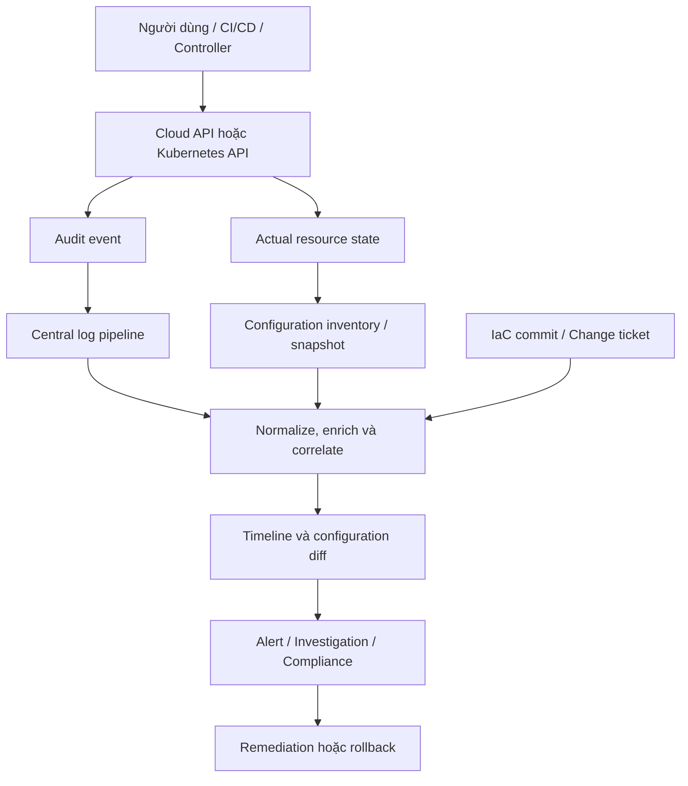
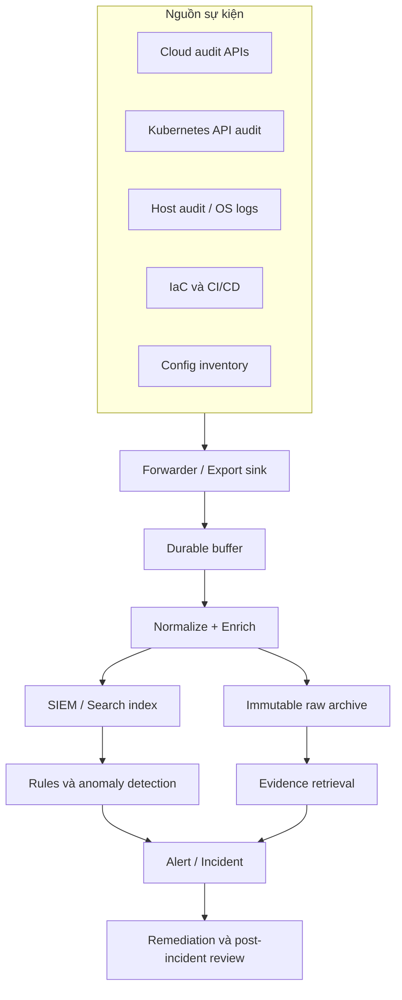

# Audit log và truy vết thay đổi cấu hình compute

## Mục tiêu học tập

Sau bài học, bạn có thể:

- Phân biệt audit log, operational log, metric, trace và lịch sử phiên bản cấu hình.
- Xác định các nguồn audit cần thu thập khi quản trị VM, container, Kubernetes, autoscaling, storage và accelerator.
- Đọc một sự kiện thay đổi cấu hình và xác định ai đã thực hiện, tác động lên tài nguyên nào, khi nào, từ đâu và kết quả ra sao.
- Liên kết danh tính con người, role được assume, service account, pipeline và controller tự động.
- Tái dựng trạng thái trước/sau bằng request event, configuration snapshot, IaC plan/apply và inventory.
- Thiết kế audit policy cho Kubernetes API server và quy trình lưu log từ cloud provider.
- Phát hiện thay đổi ngoài kế hoạch, drift giữa desired state và actual state, cũng như hành vi làm suy yếu bảo mật.
- Bảo vệ tính toàn vẹn, khả năng truy cập và thời hạn lưu giữ audit log.
- Truy vấn, cảnh báo và điều tra sự cố thay đổi compute theo một timeline có bằng chứng.
- Xây dựng quy trình quản trị thay đổi có thể kiểm toán mà vẫn kiểm soát chi phí và dữ liệu nhạy cảm.

## 1. Vì sao phải audit thay đổi cấu hình compute?

Hạ tầng compute thay đổi liên tục. Một máy ảo có thể đổi instance type, disk, network interface hoặc security group. Một node Kubernetes có thể được gắn taint, label hoặc thay đổi phiên bản. Một Deployment có thể đổi image, CPU/memory limit hoặc replica count. Autoscaler và controller cũng có thể tự động điều chỉnh capacity.

Nếu chỉ biết trạng thái hiện tại, đội vận hành khó trả lời:

- Ai đã đổi cấu hình?
- Thay đổi xảy ra lúc nào và qua giao diện, API, CLI hay pipeline nào?
- Tài nguyên nào bị tác động?
- Giá trị trước và sau là gì?
- Thay đổi có được phê duyệt không?
- Thay đổi do người dùng, CI/CD hay controller tự động thực hiện?
- Thay đổi có gây gián đoạn, tăng chi phí hoặc mở rộng quyền truy cập không?
- Có thể khôi phục trạng thái trước đó bằng cách nào?

Audit log ghi lại hành động có ý nghĩa về quản trị và bảo mật. Khi kết hợp với snapshot cấu hình, lịch sử IaC, inventory và telemetry, audit log giúp tái dựng diễn biến thay đổi và tác động của nó.

Các tình huống thực tế:

- Một VM đột ngột chuyển sang instance type đắt hơn.
- Một security group được mở cổng quản trị ra Internet.
- Một node pool tăng số lượng máy trong giờ thấp điểm.
- Một container bị nâng memory limit khiến node thiếu RAM.
- Một người dùng sửa autoscaling policy và làm hệ thống scale quá mức.
- Một GPU node bị thay driver hoặc cấu hình MIG.
- Một Persistent Disk được chuyển sang loại lưu trữ khác.
- Một service account được cấp quyền quản lý instance.

Audit không chỉ phục vụ điều tra sau sự cố. Nó còn giúp kiểm soát chi phí, tuân thủ, change management và phát hiện cấu hình lệch khỏi baseline.

### 1.1. Vòng đời truy vết thay đổi



Sự kiện audit mô tả hành động; snapshot mô tả trạng thái tài nguyên tại một thời điểm; IaC hoặc change ticket mô tả ý định. Ba nguồn này bổ sung cho nhau.

## 2. Phân biệt audit log với log và telemetry khác

Không phải mọi log đều là audit log. Chọn sai nguồn dữ liệu sẽ tạo khoảng trống khi cần truy vết.

| Loại dữ liệu | Câu hỏi chính | Ví dụ |
|---|---|---|
| Audit log | Ai đã làm gì với tài nguyên và kết quả ra sao? | API đổi machine type, sửa Deployment |
| Operational/application log | Thành phần đã thực thi điều gì hoặc gặp lỗi gì? | kubelet báo container restart |
| Metric | Tài nguyên đang hoạt động ở mức nào? | CPU utilization, memory pressure |
| Trace | Một request đi qua các thành phần nào và mất bao lâu? | API request gọi scheduler rồi database |
| Configuration snapshot | Tài nguyên có cấu hình gì tại thời điểm chụp? | VM type, disk, tags, network |
| IaC history | Desired configuration đã thay đổi như thế nào trong source control? | Terraform commit và plan |
| Change record | Ai yêu cầu, phê duyệt và triển khai thay đổi nào? | Ticket bảo trì compute |

Ví dụ: CPU utilization tăng là metric, nhưng không cho biết ai tăng CPU limit. Log ứng dụng báo timeout, nhưng không chứng minh ai đã đổi instance type. Audit event có thể ghi nhận API mutation, còn snapshot cho thấy cấu hình thực tế trước và sau.

### 2.1. Control plane và data plane

**Control plane** là lớp quản lý tài nguyên: tạo, sửa, xóa VM, node pool, disk, network policy, Deployment hoặc autoscaling rule. Đây là nơi phát sinh phần lớn sự kiện thay đổi cấu hình.

**Data plane** là nơi workload thực thi và phục vụ lưu lượng: process trong VM, container, ứng dụng, disk I/O hoặc network packet. Data plane có operational log, metric và trace riêng.

Một thay đổi control plane có thể gây tác động data plane. Ví dụ API thay đổi disk type là audit event; latency I/O tăng sau đó là metric. Khi điều tra, cần ghép hai mốc thời gian để xác định quan hệ.

### 2.2. Audit event không phải lúc nào cũng chứa đầy đủ before/after

Một API event có thể ghi request parameters và response metadata, nhưng không phải dịch vụ nào cũng lưu đầy đủ cấu hình cũ và mới. Một số thao tác chỉ ghi resource ID hoặc tên operation.

Vì vậy, cần bổ sung:

- Snapshot trước/sau hoặc định kỳ.
- Resource inventory và configuration history.
- IaC plan, apply log và commit hash.
- Change ticket và approval.
- Event từ controller hoặc autoscaler.
- API response hoặc trạng thái tài nguyên sau mutation.

Không suy ra giá trị cũ chỉ từ giá trị mới. Nếu không có snapshot hoặc event ghi rõ old/new value, hãy ghi nhận khoảng trống bằng chứng.

## 3. Phạm vi audit trong compute

Phạm vi nên bao phủ các lớp có thể thay đổi khả năng tính toán, chi phí, tính sẵn sàng và ranh giới bảo mật.

| Nhóm tài nguyên | Thay đổi cần theo dõi | Rủi ro nếu không truy vết |
|---|---|---|
| VM/instance | Machine type, image, zone, metadata, lifecycle | Downtime, drift, tăng chi phí |
| CPU/memory | vCPU, RAM, resource request/limit | Throttling, OOM, overprovision |
| Disk/storage | Disk type, size, IOPS, encryption, attach/detach | Mất dữ liệu, tăng chi phí |
| Network | NIC, subnet, route, firewall, public IP | Lộ dịch vụ, mất kết nối |
| Identity | IAM role, service account, policy, key | Leo thang quyền |
| Instance group/node pool | Min/max size, template, rollout, autoscaler | Scale sai, capacity thiếu |
| Kubernetes | Deployment, StatefulSet, DaemonSet, Pod, quota | Workload thay đổi ngoài ý muốn |
| Container runtime | Runtime class, image, security context | Rủi ro thực thi và tương thích |
| GPU/accelerator | Device plugin, driver, MIG, sharing policy | Mất thiết bị, hiệu năng và chi phí |
| Host/OS | Kernel, package, startup script, systemd unit | Drift và thay đổi khó kiểm soát |
| Backup/recovery | Snapshot policy, retention, restore config | Không thể phục hồi đúng |
| Scheduling | Priority, affinity, taint, toleration | Workload chạy sai node hoặc bị starvation |

### 3.1. Phân loại thay đổi theo mức độ tác động

Có thể phân loại theo ba chiều:

- **Availability:** có thể gây downtime, restart, drain hoặc mất capacity.
- **Security:** có thể mở quyền, public exposure, thay đổi encryption hoặc audit policy.
- **Cost:** có thể tăng loại máy, số replica, GPU-hours, disk hoặc network transfer.

Một thay đổi có thể thuộc nhiều nhóm. Ví dụ tăng node pool max size vừa ảnh hưởng cost vừa mở rộng bề mặt tấn công và capacity.

## 4. Cấu trúc một audit event hữu ích

Một sự kiện chuẩn hóa nên có đủ trường để truy vấn, đối chiếu và tương quan.

| Trường | Ý nghĩa |
|---|---|
| event_id | ID duy nhất của sự kiện |
| event_time | Thời điểm nguồn ghi nhận hành động |
| ingest_time | Thời điểm hệ thống log nhận sự kiện |
| actor | Principal thực hiện hành động |
| actor_type | Human, service account, role, controller hoặc pipeline |
| source_ip | IP nguồn nếu nguồn audit cung cấp |
| user_agent | Công cụ hoặc client gửi request |
| action | Operation hoặc API method |
| resource_type | Loại tài nguyên |
| resource_id | ID đầy đủ của tài nguyên |
| project/account/subscription | Phạm vi quản trị chứa tài nguyên |
| region/zone | Vị trí tài nguyên |
| request_id/correlation_id | Khóa nối các event liên quan |
| result | Success, denied, failed hoặc trạng thái tương ứng |
| change_id | Ticket, pipeline run hoặc release ID |
| before/after | Giá trị cũ/mới nếu có bằng chứng |
| source | Cloud provider, Kubernetes API, host audit hoặc IaC |
| severity | Mức tác động theo policy nội bộ |

### 4.1. Ví dụ sự kiện đã chuẩn hóa

```json
{
  "event_id": "evt-7c3a91",
  "event_time": "2026-11-22T09:14:32Z",
  "ingest_time": "2026-11-22T09:14:35Z",
  "source": "cloud-control-plane",
  "actor": "user:engineer@example.invalid",
  "actor_type": "human",
  "assumed_role": "ComputeChangeOperator",
  "action": "compute.instances.update",
  "resource_type": "virtual_machine",
  "resource_id": "projects/prod-a/zones/zone-1/instances/api-07",
  "region": "region-1",
  "source_ip": "203.0.113.24",
  "user_agent": "terraform/1.x",
  "request_id": "req-91b2",
  "change_id": "CHG-2048",
  "result": "SUCCESS",
  "change": {
    "machine_type": {
      "before": "standard-4",
      "after": "standard-8"
    }
  }
}
```

Đây là schema minh họa đã được chuẩn hóa, không phải payload nguyên bản của một cloud provider. Email, IP và tên resource dùng dữ liệu ví dụ. Trong hệ thống thực tế, không tự tạo actor hoặc before value nếu nguồn không cung cấp; hãy để null hoặc đánh dấu unavailable.

### 4.2. Event time và ingest time

Hai thời điểm này khác nhau:

- **Event time:** thời gian dịch vụ nguồn ghi nhận thao tác.
- **Ingest time:** thời gian pipeline nhận được log.

Sự chênh lệch có thể do buffering, export delay, network outage hoặc clock skew. Khi xây timeline, ưu tiên event time của nguồn đáng tin cậy và giữ ingest time để phát hiện trễ. Đồng bộ clock bằng NTP hoặc dịch vụ time synchronization trên host và hệ thống tự quản.

### 4.3. Actor là con người hay automation?

Một thay đổi có thể đi qua nhiều danh tính:

1. Kỹ sư đăng nhập bằng SSO.
2. Kỹ sư assume role triển khai.
3. CI/CD runner sử dụng workload identity.
4. Terraform hoặc deployment controller gọi cloud API.
5. Autoscaler hoặc operator tiếp tục thay đổi node.

Audit log có thể chỉ hiển thị role hoặc service account cuối cùng. Muốn quy về người khởi tạo, cần giữ session name, identity federation subject, pipeline run, commit hash và correlation ID.

Không kết luận "người A thực hiện" chỉ vì role được assume có tên của người đó. Cần xác minh chuỗi identity và nguồn phát request.

## 5. Nguồn audit log ở cloud provider

Mỗi cloud provider có dịch vụ audit riêng. Tên field và khả năng lưu before/after khác nhau, nhưng nguyên tắc chung là thu thập management/control-plane event ở phạm vi tổ chức, tài khoản hoặc project.

### 5.1. AWS CloudTrail

AWS CloudTrail ghi lại hoạt động API và một số sự kiện quản trị của tài khoản AWS. Các management event hữu ích để truy vết thao tác trên EC2, Auto Scaling, EBS, IAM, VPC và các dịch vụ khác. Data event là nhóm riêng và có thể cần cấu hình bổ sung tùy dịch vụ.

Các trường thường gặp trong một CloudTrail event:

- eventTime: thời điểm sự kiện.
- eventSource: dịch vụ phát sinh event.
- eventName: API operation.
- userIdentity: danh tính gọi API.
- sourceIPAddress: địa chỉ nguồn.
- userAgent: client/công cụ.
- requestParameters: tham số request được ghi nhận.
- responseElements: một phần response nếu có.
- errorCode/errorMessage: thông tin lỗi.
- requestID: ID request.
- awsRegion: region.

Ví dụ, thao tác đổi thuộc tính EC2 có thể cho biết API operation, identity và request parameters. Tuy nhiên, không phải API nào cũng cung cấp toàn bộ trạng thái trước đó. Có thể cần đối chiếu AWS Config hoặc snapshot inventory để dựng diff.

### 5.2. Azure Activity Log

Azure Activity Log ghi nhận sự kiện control plane ở phạm vi subscription và các thao tác quản lý tài nguyên Azure. Nó hữu ích để truy vết việc tạo, sửa, xóa VM, VM Scale Set, disk, network interface và policy.

Các trường thường gặp:

- eventTimestamp: thời điểm event.
- caller: danh tính gọi thao tác.
- operationName: operation được thực hiện.
- resourceId: ID tài nguyên.
- resourceGroupName: resource group.
- subscriptionId: subscription.
- status/subStatus: kết quả.
- correlationId: khóa tương quan.
- callerIpAddress: IP nguồn nếu có.
- properties: metadata bổ sung.

Activity Log giúp trả lời ai đã gọi operation nào trên resource nào và kết quả ra sao. Để có lịch sử cấu hình chi tiết hoặc before/after, cần kết hợp resource change history, deployment history, Azure Policy hoặc snapshot phù hợp.

### 5.3. Google Cloud Audit Logs

Google Cloud Audit Logs cung cấp các nhóm audit log cho hoạt động trong project và tổ chức. Những loại thường được nhắc đến gồm:

- **Admin Activity:** thao tác quản trị thay đổi cấu hình hoặc metadata tài nguyên.
- **Data Access:** truy cập dữ liệu; khả năng ghi và cấu hình phụ thuộc dịch vụ.
- **System Event:** thay đổi do hệ thống quản lý thực hiện.
- **Policy Denied:** request bị từ chối bởi policy.

Các field thường gặp trong payload:

- protoPayload.authenticationInfo: danh tính xác thực.
- protoPayload.methodName: phương thức được gọi.
- protoPayload.resourceName: tài nguyên mục tiêu.
- protoPayload.request: request được ghi nhận.
- protoPayload.response: response nếu có.
- protoPayload.status: trạng thái.
- protoPayload.requestMetadata.callerIp: IP nguồn nếu được ghi.
- serviceName: dịch vụ phát sinh event.
- timestamp: thời gian sự kiện.

Admin Activity và System Event đặc biệt hữu ích để phân biệt thao tác do người dùng/automation yêu cầu với thay đổi do nền tảng thực hiện. Cần kiểm tra cấu hình Data Access, sink, retention và quyền truy cập theo yêu cầu audit của tổ chức.

### 5.4. So sánh nguồn cloud audit

| Nền tảng | Nguồn audit chính | Dùng để truy vết |
|---|---|---|
| AWS | CloudTrail | API call, identity, region, request/response metadata |
| Azure | Activity Log | Control-plane operation, caller, resource ID, status, correlation |
| Google Cloud | Cloud Audit Logs | Admin Activity, System Event, Data Access và Policy Denied |
| Kubernetes | API server audit log | Người dùng/service account, verb, object, request/response stage |
| Linux host | auditd/journald/system logs | Thay đổi file, lệnh hoặc hoạt động host tùy policy |

Tên dịch vụ không bảo đảm log đã được export hoặc lưu giữ tập trung. Cần xác minh nguồn, phạm vi, loại event được bật và thời hạn retention.

## 6. Audit trong Kubernetes

Kubernetes API server là điểm kiểm soát cho nhiều thay đổi cấu hình cluster. Audit logging ghi lại request tới API server theo policy.

Các thao tác cần quan tâm:

- Tạo/sửa/xóa Deployment, StatefulSet, DaemonSet và Job.
- Thay đổi Pod template, image, CPU/memory request/limit.
- Thay đổi Node label, taint và annotation.
- Thay đổi ResourceQuota, LimitRange và PriorityClass.
- Sửa HorizontalPodAutoscaler, ClusterAutoscaler-related resource hoặc custom autoscaling object.
- Thay đổi RuntimeClass, StorageClass và PersistentVolume.
- Thay đổi RBAC, ServiceAccount và admission policy.
- Truy cập exec/attach/port-forward vào container.
- Thay đổi cấu hình device plugin hoặc GPU operator.

### 6.1. Audit stage

Kubernetes audit event có thể được phát ở các stage khác nhau:

- RequestReceived: API server nhận request.
- ResponseStarted: response bắt đầu cho một số request dài.
- ResponseComplete: request hoàn tất.
- Panic: request kết thúc do panic.

Một request có thể tạo nhiều event theo stage. Cần chọn stage phù hợp để tránh duplicate hoặc thiếu thông tin. Với nhiều hệ thống, ResponseComplete là stage hữu ích cho thao tác hoàn tất; long-running request có thể cần xử lý khác.

### 6.2. Audit level

Các level chính:

| Level | Nội dung ghi | Dùng khi |
|---|---|---|
| None | Không ghi event khớp rule | Loại bỏ event không cần |
| Metadata | User, verb, resource, timestamp và metadata; không ghi request/response body | Theo dõi truy cập mà hạn chế dữ liệu nhạy cảm |
| Request | Metadata và request body | Điều tra thay đổi cần biết nội dung request |
| RequestResponse | Metadata, request body và response body | Cần bằng chứng chi tiết, phải kiểm soát dữ liệu nhạy cảm |

Không dùng RequestResponse cho mọi API một cách mặc định. Request/response có thể chứa Secret, token, annotation nội bộ hoặc cấu hình nhạy cảm. Nên chọn mức theo resource và operation.

### 6.3. Ví dụ audit policy

Policy minh họa sau ưu tiên chỉ ghi metadata cho Secret, ghi request cho một số thay đổi compute và metadata cho các thao tác đọc thông thường. Quy tắc được xét theo thứ tự; rule đầu tiên khớp sẽ quyết định level.

```yaml
apiVersion: audit.k8s.io/v1
kind: Policy
omitStages:
  - RequestReceived
rules:
  - level: Metadata
    resources:
      - group: ""
        resources: ["secrets"]

  - level: Request
    verbs: ["create", "update", "patch", "delete"]
    resources:
      - group: ""
        resources: ["nodes", "pods", "persistentvolumes"]
      - group: "apps"
        resources: ["deployments", "statefulsets", "daemonsets"]
      - group: "batch"
        resources: ["jobs", "cronjobs"]
      - group: "autoscaling"
        resources: ["horizontalpodautoscalers"]
      - group: "storage.k8s.io"
        resources: ["storageclasses"]
      - group: "scheduling.k8s.io"
        resources: ["priorityclasses"]

  - level: Metadata
    verbs: ["get", "list", "watch"]

  - level: Metadata
```

Đây là điểm khởi đầu để thảo luận, không phải policy hoàn chỉnh cho mọi cluster. Cần bổ sung group/resource theo CRD và phiên bản Kubernetes đang dùng. Policy thực tế nên xem xét cả RBAC, admission configuration, node resources và custom operator. Không đưa Secret body vào audit chỉ để có diff đầy đủ.

### 6.4. Audit backend và vận chuyển

Kubernetes API server có thể ghi audit event vào file hoặc gửi tới webhook backend. Trong môi trường managed Kubernetes, cách cấu hình và quyền truy cập audit log phụ thuộc nhà cung cấp.

Cần bảo đảm:

- Audit policy được quản lý như cấu hình hạ tầng có review.
- File backend có rotation và giới hạn dung lượng.
- Webhook backend có retry, buffer và giám sát delivery.
- Log được chuyển tới hệ thống lưu trữ tập trung.
- Mất kết nối log sink phải tạo cảnh báo.
- Có thể kiểm tra event sample sau mỗi lần thay policy.
- Quyền đọc audit log được tách khỏi quyền quản trị cluster.

Nếu audit sink bị ngừng hoặc policy quá rộng, có thể mất log hoặc tăng chi phí đáng kể. Hãy kiểm tra ingestion rate và dropped event.

## 7. Theo dõi thay đổi ở Linux host và container node

Audit ở cloud control plane không ghi lại mọi thao tác bên trong host. Nếu cần truy vết thay đổi OS hoặc runtime, có thể cần nguồn host-level:

- Linux audit subsystem (auditd) cho syscall/file access theo rule.
- systemd journal và service logs.
- Package manager history.
- Configuration management agent.
- File integrity monitoring.
- Container runtime logs.
- SSH/session recording theo policy.
- Host inventory và image build metadata.

Các thay đổi đáng theo dõi:

- Sửa file cấu hình kubelet hoặc container runtime.
- Thay driver GPU.
- Thay kernel hoặc module.
- Sửa systemd unit và startup script.
- Cài package hoặc binary mới.
- Thay file firewall/route.
- Thay mount, fstab hoặc disk configuration.
- Thay quyền file và user/group đặc quyền.

Auditd có thể ghi lại hoạt động theo syscall và path được cấu hình, nhưng rule quá rộng có thể tạo volume lớn và ảnh hưởng hiệu năng. Cần ưu tiên file cấu hình quan trọng, command privilege và thay đổi cần điều tra.

### 7.1. Audit host không thay thế cloud audit

Nếu một người thay machine type qua cloud API, auditd trong VM có thể không thấy thao tác đó. Ngược lại, nếu người quản trị SSH vào VM và sửa file systemd, cloud control-plane audit có thể không ghi chi tiết nội dung file.

Cần kết hợp nguồn theo ranh giới trách nhiệm:

- Cloud audit cho API quản lý tài nguyên.
- Kubernetes audit cho API cluster.
- Host audit cho thao tác bên trong OS.
- IaC/CI logs cho thay đổi mong muốn và pipeline.
- Configuration snapshot cho trạng thái thực tế.

## 8. Truy vết before/after và configuration diff

Một audit event có thể nói "UpdateInstance" thành công nhưng không luôn chứa toàn bộ cấu hình cũ. Để tạo diff đáng tin cậy, cần xây dựng chuỗi bằng chứng.

### 8.1. Các nguồn tạo diff

1. API request parameters: giá trị client yêu cầu.
2. API response: kết quả dịch vụ trả về.
3. Configuration history: thay đổi field được dịch vụ lưu.
4. Snapshot trước/sau: cấu hình tài nguyên tại hai thời điểm.
5. IaC plan: dự kiến thay đổi trước khi apply.
6. IaC state hoặc inventory: trạng thái đã áp dụng.
7. Change ticket: mục đích và người phê duyệt.

Không coi IaC plan là bằng chứng actual state đã thay đổi. Apply có thể thất bại hoặc chỉ thành công một phần. Cần đối chiếu audit event và trạng thái sau apply.

### 8.2. Ví dụ diff VM

```json
{
  "resource_id": "vm-prod-api-07",
  "observed_at": "2026-11-22T09:20:00Z",
  "changes": [
    {
      "field": "machine_type",
      "before": "standard-4",
      "after": "standard-8",
      "source": "configuration-snapshot"
    },
    {
      "field": "boot_disk.size_gb",
      "before": 100,
      "after": 200,
      "source": "provider-change-event"
    }
  ],
  "correlation": {
    "audit_request_id": "req-91b2",
    "change_id": "CHG-2048",
    "iac_commit": "a1b2c3d4"
  }
}
```

Diff này minh họa cách lưu nguồn bằng chứng cho từng field. Nếu before value chỉ đến từ snapshot trước đó, ghi rõ snapshot timestamp. Không gán tất cả field vào cùng một nguồn nếu nguồn dữ liệu khác nhau.

### 8.3. Diff cho Kubernetes workload

Với Deployment, cần quan tâm:

- spec.replicas.
- image và image digest.
- command/args.
- CPU/memory requests và limits.
- environment references.
- volume mounts.
- securityContext.
- nodeSelector, affinity, tolerations.
- serviceAccountName.
- runtimeClassName.
- GPU extended resource limits.

Pod runtime state có thể thay đổi do rollout hoặc scheduler mà không phải mọi thay đổi đều xuất phát từ người dùng. Đối chiếu Deployment revision, ReplicaSet, Pod owner reference và audit event để tìm nguồn.

### 8.4. Desired state và actual state

- **Desired state:** cấu hình được khai báo trong Git/IaC hoặc manifest.
- **Actual state:** cấu hình đang tồn tại trên cloud API hoặc cluster.
- **Observed state:** trạng thái mà inventory/controller ghi nhận tại thời điểm quan sát.

Drift xảy ra khi actual state lệch khỏi desired state. Nhưng không phải mọi khác biệt đều là drift trái phép: autoscaler, controller hoặc admission webhook có thể điều chỉnh field theo thiết kế.

Cần định nghĩa field nào do con người quản lý, field nào do controller quản lý và field nào được phép thay đổi động. Nếu không, hệ thống có thể cảnh báo liên tục cho các thay đổi hợp lệ.

## 9. Kết hợp audit với Infrastructure as Code và CI/CD

IaC tạo lịch sử thay đổi có review, nhưng không thay thế audit log. Audit log ghi nhận thao tác thực tế ở control plane; source control ghi lại ý định và nội dung cấu hình được đề xuất.

Một quy trình tốt:

1. Kỹ sư tạo pull request thay đổi Terraform hoặc Kubernetes manifest.
2. CI chạy format, validation, policy check và plan.
3. Reviewer phê duyệt diff và rủi ro.
4. Pipeline sử dụng workload identity ngắn hạn để apply.
5. Cloud provider/Kubernetes API phát audit event.
6. Pipeline ghi commit SHA, run ID và change ID.
7. Inventory chụp actual state sau apply.
8. Hệ thống đối chiếu actual với desired state.
9. Alert nếu có thay đổi ngoài pipeline hoặc drift không được chấp thuận.

### 9.1. Liên kết commit với audit event

Nên truyền metadata không nhạy cảm vào request hoặc resource tag/label khi nền tảng hỗ trợ:

- change_id.
- pipeline_run_id.
- git_commit_sha.
- deployment_version.
- owner/team.
- environment.
- reason.

Không phải API nào cũng cho phép thêm metadata tùy ý. Nếu không thể đưa change ID vào request, lưu mapping giữa pipeline run, principal, request ID và resource ID ở hệ thống change record.

### 9.2. Phân biệt human change và controller change

Một autoscaler có thể thay đổi số node mà không có thao tác thủ công. Một operator có thể sửa replica hoặc Pod template theo custom resource. Audit event có thể hiển thị service account của controller.

Để phân loại:

- Duy trì danh mục service account và workload identity hợp lệ.
- Gắn owner và controller type cho resource.
- Liên kết event với autoscaler/operator logs.
- So sánh hành động với policy và ngưỡng cấu hình.
- Cảnh báo khi automation thay đổi ngoài phạm vi được phép.

Không tự động miễn audit cho service account. Automation cũng có thể bị chiếm quyền hoặc cấu hình sai.

## 10. Phát hiện configuration drift

Drift detection so sánh desired state với actual state theo chu kỳ hoặc event-driven.

Các cách:

- Chạy IaC plan định kỳ ở chế độ read-only/refresh phù hợp.
- Thu thập inventory snapshot và so sánh field.
- Dùng cloud configuration management/rules.
- Dùng Kubernetes GitOps controller để đối chiếu manifest.
- Phát hiện thay đổi qua audit event rồi truy vấn actual state.
- Dùng file integrity monitoring cho host config.

### 10.1. Phân loại drift

| Loại drift | Ví dụ | Hướng xử lý |
|---|---|---|
| Approved drift | Thay đổi có ticket và phê duyệt | Cập nhật desired state hoặc ticket |
| Emergency drift | Sửa trực tiếp để khôi phục dịch vụ | Ghi lại lý do, review hậu kiểm và đồng bộ IaC |
| Controller-managed | Autoscaler đổi replica hoặc node count | Xác định owner và policy cho field |
| Unauthorized drift | Mở firewall hoặc tăng quyền không có approval | Cảnh báo, điều tra và khôi phục |
| Temporary drift | Rollout hoặc scale tạm thời | Áp dụng grace window và baseline động |
| Unknown drift | Không xác định được nguồn | Giữ bằng chứng, mở incident và điều tra |

Không tự động revert mọi drift. Một thay đổi emergency có thể đang bảo vệ production; cần policy theo mức độ rủi ro và quy trình xác minh trước khi remediation.

### 10.2. Drift theo field ownership

Một resource có thể có nhiều controller cùng quản lý các field khác nhau. Ví dụ:

- GitOps quản lý image và resource requests.
- HPA quản lý replica count.
- Cluster autoscaler quản lý node count.
- Operator quản lý một số field chuyên biệt.

Nếu một hệ thống liên tục ghi đè field của hệ thống khác, sẽ tạo reconciliation loop. Xác định ownership theo field, dùng server-side apply/field manager hoặc cơ chế tương đương và loại các field động khỏi diff không phù hợp.

## 11. Phát hiện thay đổi rủi ro

Không phải mọi update đều có mức độ rủi ro như nhau. Nên xây dựng rule theo tài nguyên, field, actor, môi trường và thời điểm.

### 11.1. Ví dụ rule cần cảnh báo

| Thay đổi | Rủi ro | Mức ưu tiên gợi ý |
|---|---|---|
| Mở SSH/RDP từ Internet | Tăng bề mặt tấn công | Critical/High |
| Tắt encryption của disk | Mất bảo vệ dữ liệu | High |
| Gắn public IP cho VM nhạy cảm | Exposure ngoài dự kiến | High |
| Tăng quyền IAM/service account | Privilege escalation | Critical/High |
| Tắt audit logging hoặc đổi sink | Mất khả năng giám sát | Critical |
| Tăng max node pool đột biến | Chi phí/capacity tăng | Medium/High |
| Đổi instance type sang loại đắt hơn | Chi phí tăng | Medium |
| Bỏ resource limit hoặc tăng quá cao | Noisy neighbor/OOM/cost | Medium/High |
| Gắn privileged hoặc hostPath rộng cho Pod | Rủi ro host compromise | High |
| Thay GPU driver/MIG layout | Gián đoạn workload accelerator | Medium/High |
| Xóa backup/snapshot policy | Khả năng phục hồi giảm | High |
| Thay image không rõ nguồn | Rủi ro supply chain | High |

Mức ưu tiên thực tế phụ thuộc môi trường, data classification và exposure. Một thay đổi ở development có thể ít tác động hơn production, nhưng vẫn cần log để đối soát.

### 11.2. Rule cần có ngữ cảnh

Ví dụ "tăng replica" không phải lúc nào cũng xấu. Autoscaler tăng replica trong ngưỡng là bình thường; một người tăng replica gấp 20 lần và đồng thời nâng machine type có thể là dấu hiệu bất thường.

Một rule tốt kết hợp:

- Resource ID và environment.
- Field thay đổi và độ lớn thay đổi.
- Actor type và quyền của actor.
- Change ID/approval.
- Thời điểm và cửa sổ bảo trì.
- Source IP, user agent và vị trí truy cập nếu được phép.
- Baseline và lịch sử hành vi.
- Kết quả operation và trạng thái tài nguyên sau đó.

## 12. Truy vấn audit log và dựng timeline

Một quy trình điều tra nên bắt đầu từ một resource hoặc sự cố cụ thể, sau đó mở rộng theo request ID, actor, time window và dependency.

### 12.1. Các bước truy vấn

1. Xác định resource ID hoặc cluster/node/workload bị ảnh hưởng.
2. Chốt khoảng thời gian trước và sau khi sự cố bắt đầu.
3. Tìm event thay đổi resource trong khoảng đó.
4. Lấy actor, operation, source IP, user agent và request ID.
5. Tra change ticket, pipeline run và commit SHA.
6. So sánh snapshot trước/sau hoặc configuration diff.
7. Kiểm tra event từ controller/autoscaler.
8. Ghép operational log và metric để xác định tác động.
9. Xác minh trạng thái hiện tại và remediation đã thực hiện.
10. Lưu evidence và kết luận với mức độ tin cậy.

### 12.2. Truy vấn dạng SQL minh họa

Giả sử audit event đã được chuẩn hóa vào bảng audit_events:

```sql
SELECT
    event_time,
    actor,
    action,
    resource_id,
    result,
    request_id,
    change_id
FROM audit_events
WHERE resource_id = 'projects/prod-a/instances/api-07'
  AND event_time >= TIMESTAMP '2026-11-22 08:00:00'
  AND event_time <  TIMESTAMP '2026-11-22 10:00:00'
ORDER BY event_time ASC;
```

Cú pháp timestamp và tên bảng phụ thuộc query engine. Truy vấn minh họa cách lọc theo resource và thời gian, không phải truy vấn trực tiếp dùng được trên mọi dịch vụ.

### 12.3. Tìm thay đổi không có change ID

Một rule có thể tìm event thành công ở production nhưng thiếu change ID:

```sql
SELECT
    event_time,
    actor,
    action,
    resource_id,
    source,
    request_id
FROM audit_events
WHERE environment = 'production'
  AND result = 'SUCCESS'
  AND action_category = 'CONFIG_MUTATION'
  AND (change_id IS NULL OR change_id = '')
ORDER BY event_time DESC;
```

Một số automation hợp lệ có thể không dùng change ticket. Cần allowlist theo service identity và đối chiếu với deployment/autoscaler event. Không coi thiếu change ID là bằng chứng đủ để kết luận trái phép.

### 12.4. Tương quan với telemetry

Sau khi xác định event thay đổi, đối chiếu:

- CPU/memory utilization và throttling.
- Container restart, OOMKilled và node pressure.
- Request latency, error rate và throughput.
- Disk latency, IOPS và queue depth.
- Network error, connection reset và packet drop.
- GPU utilization, VRAM và driver error.
- Autoscaler desired/current replica và pending Pod.

Nếu metric thay đổi ngay sau config event, đó là tương quan thời gian, chưa tự động chứng minh quan hệ nhân quả. Cần kiểm tra các thay đổi đồng thời và dependency.

## 13. Lưu trữ audit log và bảo vệ tính toàn vẹn

Audit log chỉ hữu ích nếu có thể tin cậy và truy cập khi cần điều tra. Người có quyền thay đổi compute không nên có quyền xóa dấu vết thay đổi của chính họ.

### 13.1. Kiến trúc lưu trữ

Một kiến trúc phổ biến:

1. Nguồn audit ghi event.
2. Log sink/exporter chuyển event ra khỏi account/project/cluster nguồn.
3. Ingestion pipeline kiểm tra schema, timestamp và nguồn.
4. Event được chuẩn hóa và enrich.
5. Bản gốc được lưu ở vùng immutable hoặc append-only.
6. Bản phục vụ tìm kiếm được index vào SIEM/log analytics.
7. Retention policy chuyển dữ liệu cũ sang storage tier phù hợp.
8. Cảnh báo khi log delivery hoặc ingestion gặp lỗi.

Nên có bản sao ngoài phạm vi quyền quản trị thông thường của workload. Nếu toàn bộ log và compute resource nằm trong cùng một account với cùng quyền admin, kẻ tấn công có thể xóa cả tài nguyên lẫn bằng chứng.

### 13.2. Chống sửa/xóa

Các biện pháp:

- Bật immutable retention hoặc object lock khi nền tảng hỗ trợ.
- Dùng bucket/account/project lưu log riêng.
- Tách quyền ghi log, đọc log và xóa log.
- Bật versioning và retention lock phù hợp.
- Ghi nhận access log cho chính hệ thống audit.
- Dùng checksum hoặc hash chain để phát hiện thay đổi ngoài ý muốn.
- Sao chép log sang security account hoặc vùng quản trị độc lập.
- Cảnh báo khi audit trail, export sink hoặc retention policy bị thay đổi.

Hash chain có thể giúp phát hiện chỉnh sửa nếu checkpoint hash được bảo vệ độc lập. Chỉ tính hash rồi lưu cùng file trong cùng quyền quản trị không đủ chống người có quyền sửa cả hai.

### 13.3. Retention và chi phí

Retention phải đáp ứng yêu cầu pháp lý, hợp đồng, điều tra và nội bộ. Không có một số ngày đúng cho mọi tổ chức.

Có thể phân tầng:

- Hot: dữ liệu mới cần truy vấn nhanh.
- Warm: dữ liệu cần truy vấn thường xuyên nhưng chấp nhận latency cao hơn.
- Archive: dữ liệu lưu lâu để tuân thủ hoặc điều tra hiếm gặp.

Cân bằng giữa thời hạn lưu, chi phí index, dung lượng, tốc độ truy xuất và yêu cầu legal hold. Không xóa log khi đang có incident, legal hold hoặc yêu cầu bảo toàn bằng chứng.

## 14. Quyền truy cập và dữ liệu nhạy cảm trong audit

Audit log có thể chứa email, IP, resource path, command, metadata, request body hoặc thông tin tenant. RequestResponse logging quá rộng có thể vô tình lưu token, password, Secret hoặc dữ liệu cá nhân.

Nguyên tắc:

- Chỉ ghi body khi có lý do và phạm vi rõ.
- Redact hoặc loại bỏ credential, token và secret.
- Hạn chế quyền truy cập theo vai trò điều tra.
- Dùng MFA và audit cho thao tác truy vấn/export log.
- Mã hóa khi truyền và lưu trữ.
- Đặt retention theo phân loại dữ liệu.
- Không gửi audit log nhạy cảm tới workspace hoặc kênh không được phê duyệt.
- Tách quyền quản trị compute khỏi quyền quản trị audit sink.
- Ghi lại việc đọc, export, replay hoặc xóa log.

Không dùng audit log làm nơi lưu toàn bộ cấu hình secret. Mục tiêu là truy vết hành động và metadata đủ để điều tra, không sao chép credential.

## 15. Cảnh báo khi audit pipeline bị gián đoạn

Một hệ thống có thể không có event bất thường vì không có thay đổi, hoặc vì log pipeline đang hỏng. Hai trường hợp này phải phân biệt.

Theo dõi:

- Số event theo source và account/project.
- Ingestion lag giữa event time và ingest time.
- Delivery failure và retry.
- Dropped event hoặc queue backlog.
- Audit sink permission error.
- Export job last success.
- Log volume bất thường giảm về 0.
- Thay đổi audit policy hoặc retention.
- Clock drift trên host.
- Parser/schema failure.

Có thể tạo synthetic event hoặc kiểm tra định kỳ bằng thao tác test được phê duyệt ở môi trường riêng. Không tạo thay đổi giả trên production chỉ để kiểm tra log nếu chưa có quy trình an toàn.

### 15.1. Log coverage matrix

Duy trì bảng nguồn audit và tình trạng thu thập:

| Nguồn | Phạm vi | Kiểm tra định kỳ |
|---|---|---|
| Cloud management audit | Account/project/subscription | Event mới nhất, sink và retention |
| Kubernetes API audit | Cluster | Audit policy, backend và dropped event |
| Host audit | Node/VM | Agent health, rule load và log forwarding |
| IaC/CI/CD | Repository/pipeline | Commit, approval, plan/apply artifact |
| Configuration inventory | Compute resource | Snapshot freshness và diff |
| Identity provider | SSO/role federation | Session, MFA và identity chain |

Coverage matrix giúp phát hiện resource group hoặc node pool chưa được nối vào log pipeline.

## 16. Quy trình điều tra sự cố thay đổi cấu hình

Khi có cảnh báo, mục tiêu là bảo toàn bằng chứng, xác định phạm vi và khôi phục an toàn.

### 16.1. Runbook

1. Mở incident và ghi thời điểm phát hiện.
2. Xác định tài nguyên, project/account/cluster và environment.
3. Bảo toàn audit event gốc cùng request ID.
4. Kiểm tra actor, identity chain, source IP và user agent.
5. Tra change ID, approval, pipeline run và commit.
6. Lấy snapshot actual state và so sánh với baseline.
7. Kiểm tra event từ controller, autoscaler và operator.
8. Đối chiếu metric/log/trace để xác định tác động.
9. Đánh giá có cần cô lập actor, role hoặc resource hay không.
10. Chọn remediation: rollback, apply desired state hoặc sửa thủ công theo emergency process.
11. Xác minh trạng thái sau remediation và ghi audit event mới.
12. Ghi timeline, bằng chứng, root cause và hành động phòng ngừa.

Không xóa resource hoặc thay đổi log policy trong lúc điều tra nếu chưa bảo toàn evidence. Nếu thay đổi khẩn cấp để ngăn thiệt hại, ghi rõ người thực hiện, lý do, thời điểm và trạng thái trước/sau.

### 16.2. Ví dụ điều tra: VM bị tăng cấu hình ngoài dự kiến

Tình huống: hóa đơn compute tăng và một VM API có CPU capacity gấp đôi.

Bằng chứng cần thu thập:

- Audit event của API update instance.
- Actor và assumed role.
- Source IP/user agent.
- Request parameters và response.
- Snapshot VM trước/sau.
- IaC plan/apply history.
- Change ticket.
- CPU/memory metric và billing timeline.
- Autoscaler hoặc automation event nếu có.

Các khả năng:

- Change đã được phê duyệt nhưng IaC chưa đồng bộ.
- CI/CD apply nhầm workspace hoặc environment.
- Người dùng sửa trực tiếp qua console.
- Automation chạy sai policy.
- Credential bị sử dụng trái phép.

Kết luận cần dựa trên identity chain và bằng chứng liên quan. Nếu chỉ thấy role của pipeline, chưa đủ để xác định commit hoặc người khởi tạo.

### 16.3. Ví dụ điều tra: Kubernetes resource limit thay đổi

Tình huống: Pod bắt đầu bị OOM sau khi rollout.

Kiểm tra:

- Audit event của Deployment patch/update.
- Request body và user identity.
- ReplicaSet revision và Pod template.
- Commit/manifest được triển khai.
- CPU/memory limit trước/sau.
- Container restart reason và OOM event.
- Admission webhook hoặc operator có sửa resource không.

Nếu Deployment manifest không thay đổi nhưng Pod template khác, kiểm tra mutating admission webhook và controller. Không mặc định mọi thay đổi Pod đều do người triển khai trực tiếp.

## 17. Governance: phê duyệt và quản lý thay đổi

Audit log ghi lại điều đã xảy ra; change management định nghĩa điều gì được phép xảy ra.

Một change record tốt có:

- Change ID duy nhất.
- Người yêu cầu và người phê duyệt.
- Mục tiêu và lý do.
- Tài nguyên/phạm vi.
- Field dự kiến thay đổi.
- Thời gian thực hiện.
- Kế hoạch kiểm thử.
- Kế hoạch rollback.
- Pipeline/run ID.
- Kết quả và hậu kiểm.

### 17.1. Phân loại change

- **Standard change:** lặp lại, rủi ro thấp, có quy trình chuẩn.
- **Normal change:** cần review/approval theo mức rủi ro.
- **Emergency change:** cần hành động nhanh để khôi phục hoặc ngăn sự cố; phải hậu kiểm và đồng bộ hồ sơ.

Không yêu cầu approval thủ công cho mọi thay đổi autoscaler nếu policy đã phê duyệt trước. Thay vào đó, xác định ngưỡng, giới hạn và danh tính automation hợp lệ, sau đó audit từng hành động.

### 17.2. Separation of duties

Tách vai trò để một người không thể tự đề xuất, phê duyệt, triển khai và xóa audit trail của cùng thay đổi.

Ví dụ:

- Developer đề xuất IaC change.
- Reviewer phê duyệt.
- CI/CD role thực thi.
- Security/audit role đọc log.
- Storage admin quản lý retention lock.

Với đội nhỏ, có thể dùng approval rule theo mức rủi ro và hậu kiểm độc lập cho emergency change.

## 18. Tích hợp audit với policy và compliance

Audit event có thể được dùng làm bằng chứng cho các yêu cầu:

- Ai có quyền thay đổi compute.
- Tài nguyên nào được public.
- Encryption có bị tắt hay không.
- Instance image có nằm trong danh sách được phê duyệt không.
- Workload có dùng resource limit theo policy không.
- Audit log có được bật và giữ đúng thời hạn không.
- Thay đổi production có ticket và approval không.
- Có thay đổi IAM hoặc service account bất thường không.

Cần phân biệt **control evidence** và **compliance conclusion**. Một event chứng minh API được gọi không tự chứng minh toàn bộ kiểm soát đã hiệu quả. Cần xác định scope, completeness, retention, access control và cách kiểm thử bằng chứng.

## 19. Kiến trúc tham khảo cho audit pipeline



Một pipeline tốt cần có:

- Nguồn event được xác định rõ và coverage được kiểm tra.
- Buffer bền vững để chịu gián đoạn ngắn.
- Schema chuẩn hóa nhưng vẫn giữ raw event.
- Parser version và nguồn gốc event.
- Immutable archive tách quyền.
- Search index có retention và access policy.
- Alert theo mức độ rủi ro.
- Runbook và evidence retrieval.
- Giám sát chính pipeline audit.

Không chỉ giữ bản normalized. Raw event giúp xác minh parser, field mapping và ngữ cảnh gốc khi điều tra.

## 20. Chỉ số vận hành audit và change tracking

| Nhóm | Chỉ số | Mục đích |
|---|---|---|
| Coverage | Tỷ lệ account/project/cluster có audit source | Phát hiện phạm vi thiếu |
| Freshness | Thời gian từ event tới ingest | Phát hiện log trễ |
| Completeness | Dropped event, delivery error, parser failure | Phát hiện mất dữ liệu |
| Integrity | Checksum/retention lock/version status | Bảo vệ bằng chứng |
| Access | Số lần đọc/export, thay đổi policy | Theo dõi lạm dụng |
| Change governance | Tỷ lệ mutation có change ID/approval | Đánh giá quy trình |
| Drift | Số drift chưa xử lý và tuổi drift | Quản lý actual vs desired |
| Risk | Thay đổi high-risk theo actor/resource | Phát hiện bất thường |
| Response | Thời gian xác định actor và resource | Hiệu quả điều tra |
| Cost | Log ingest, index, archive và query cost | Tối ưu vận hành |

Đặt SLO cho pipeline audit, ví dụ tỷ lệ event được ingest trong một khoảng thời gian và thời gian phát hiện khi source mất log. Ngưỡng cụ thể phải dựa trên kiến trúc và yêu cầu của tổ chức.

## 21. Những nhầm lẫn thường gặp

- **Audit log là application log.** Audit tập trung vào hành động quản trị, actor và resource; application log mô tả hành vi của ứng dụng.
- **Trạng thái hiện tại cho biết ai đã thay đổi.** Cần event, identity chain và change history.
- **Mọi cloud API event đều có before/after.** Nhiều event chỉ có request hoặc metadata; cần snapshot/config history bổ sung.
- **IaC plan chứng minh thay đổi đã được áp dụng.** Plan mô tả dự kiến; cần apply result và actual state.
- **Role name xác định chính xác con người.** Cần session, federation subject, pipeline run và correlation.
- **Automation không cần audit.** Controller và service account cũng có thể bị lỗi hoặc bị chiếm quyền.
- **Audit log chỉ cần bật ở cloud provider.** Kubernetes API, host và CI/CD có ranh giới sự kiện riêng.
- **RequestResponse luôn tốt hơn Metadata.** Body có thể chứa secret và dữ liệu nhạy cảm.
- **Không có event nghĩa là không có thay đổi.** Có thể audit policy, sink hoặc ingestion đang hỏng.
- **Hash file đủ để chống sửa log.** Hash và checkpoint phải được bảo vệ độc lập.
- **Tự động revert mọi drift là an toàn.** Có thể phá emergency fix hoặc field do controller quản lý.
- **Queue backlog hoặc CPU metric đủ để giải thích thay đổi.** Cần kết hợp audit, snapshot, IaC và telemetry.
- **Một change ticket hợp lệ chứng minh actual state đúng.** Cần đối chiếu kết quả API và configuration snapshot.
- **Log lưu lâu là luôn tốt.** Retention phải cân bằng yêu cầu bằng chứng, quyền riêng tư và chi phí.

## 22. Tự kiểm tra

**Tình huống 1:** Một VM chuyển từ machine type 4 vCPU sang 8 vCPU. Cloud audit event chỉ có operation và request parameters, không có cấu hình cũ. Làm thế nào dựng before/after?

**Gợi ý:** Tìm configuration snapshot trước thời điểm event, resource history hoặc inventory; đối chiếu snapshot sau thay đổi và giữ timestamp/nguồn của từng giá trị. Không suy đoán giá trị cũ từ request mới.

**Tình huống 2:** Audit log cho thấy một service account đã sửa node pool max size. Có thể kết luận autoscaler đã thực hiện thay đổi không?

**Gợi ý:** Chưa. Tra service account owner, workload/pod sử dụng identity, pipeline run, controller log và correlation ID. Một identity automation có thể được dùng bởi nhiều thành phần.

**Tình huống 3:** Kubernetes audit policy ghi RequestResponse cho mọi resource và log sink bắt đầu lưu cả dữ liệu Secret. Cần điều chỉnh gì?

**Gợi ý:** Giảm level cho Secret xuống Metadata hoặc policy phù hợp, loại bỏ body nhạy cảm, hạn chế quyền truy cập, đánh giá retention và kiểm tra liệu dữ liệu đã export cần xử lý theo quy trình bảo mật hay chưa.

**Tình huống 4:** IaC plan không có thay đổi nhưng actual VM type khác với source control. Đây có thể là gì?

**Gợi ý:** Có thể là manual drift, state stale, resource được quản lý ngoài workspace hoặc controller/automation thay đổi. Refresh inventory, kiểm tra state, audit event và ownership trước khi remediation.

**Tình huống 5:** Trong production không thấy audit event mới suốt 30 phút, dù hệ thống đang triển khai liên tục. Có thể coi đây là dấu hiệu tốt không?

**Gợi ý:** Không. Kiểm tra source health, sink permission, export job, ingestion lag, dropped event, parser và policy. Im lặng có thể là mất log.

**Tình huống 6:** Một autoscaler tăng số node từ 10 lên 30 trong thời gian tải cao. Làm sao phân biệt thay đổi hợp lệ với thay đổi trái phép?

**Gợi ý:** Đối chiếu actor/service account, autoscaler event, policy min/max, metric tải, change window và node pool configuration. Nếu nằm trong ngưỡng được phê duyệt, ghi nhận là controller-managed change; nếu vượt policy, mở incident.

## Kết luận

Audit log và truy vết thay đổi cấu hình compute giúp xác định actor, operation, resource, thời điểm và kết quả của các thao tác quản trị. Để dựng lại before/after đáng tin cậy, cần kết hợp cloud audit, Kubernetes API audit, host audit, IaC history, change record và configuration snapshot. Hệ thống phải giữ nguyên raw event, chuẩn hóa dữ liệu có nguồn gốc, bảo vệ log khỏi sửa/xóa, kiểm soát quyền truy cập và cảnh báo khi pipeline mất log. Khi điều tra, hãy liên kết identity chain, request ID, change ID và telemetry, đồng thời phân biệt thay đổi do con người với controller được phép. Một quy trình audit tốt giúp phát hiện drift, giảm rủi ro bảo mật, kiểm soát chi phí và cung cấp bằng chứng rõ ràng cho vận hành compute.
