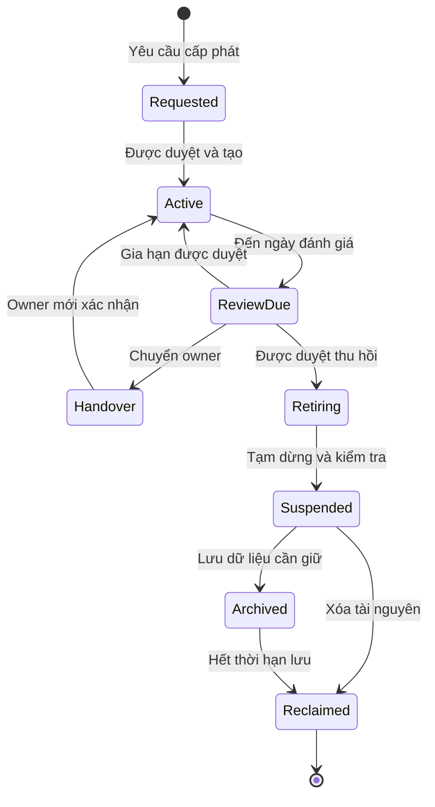

# Quy trình hết hạn, bàn giao và thu hồi tài nguyên

Tài nguyên compute trên cloud thường được tạo nhanh để thử nghiệm, chạy dự án, xử lý dữ liệu theo đợt hoặc phục vụ một môi trường ứng dụng. Nếu không có ngày hết hạn và người chịu trách nhiệm rõ ràng, máy ảo, node pool, GPU, container service và function có thể tiếp tục tồn tại sau khi nhu cầu đã kết thúc. Hệ quả là chi phí tăng, bề mặt tấn công rộng hơn và đội vận hành khó xác định tài nguyên nào có thể dừng an toàn.

Quy trình hết hạn, bàn giao và thu hồi giúp tổ chức quản lý vòng đời tài nguyên từ lúc cấp phát đến khi kết thúc sử dụng. Quy trình phải trả lời được ai sở hữu workload, thời điểm nào cần đánh giá lại, ai tiếp nhận khi chủ sở hữu thay đổi, dữ liệu nào cần giữ, thành phần nào cần tắt và bằng chứng nào xác nhận việc thu hồi đã hoàn tất.

Bài học thuộc chương **Quản trị tài nguyên compute** của module **CLOUD_CORE_SERVICES_COMPUTE**. Nội dung áp dụng cho máy ảo, container, cụm điều phối, function serverless và tài nguyên tăng tốc như GPU. Sau bài học, người học có thể:

- Thiết lập ngày hết hạn và chính sách gia hạn cho tài nguyên compute.
- Xác định chủ sở hữu, người phê duyệt và người tiếp nhận khi bàn giao.
- Phân biệt hết hạn, tạm dừng, lưu trữ, chuyển giao và thu hồi hoàn toàn.
- Thực hiện quy trình kiểm kê, đánh giá phụ thuộc, sao lưu, tắt và xóa tài nguyên có kiểm soát.
- Thu hồi quyền truy cập, địa chỉ mạng, dung lượng lưu trữ và cấu hình liên quan.
- Lưu bằng chứng kiểm toán và xác minh chi phí sau khi kết thúc vòng đời.

## 1. Vì sao tài nguyên cần ngày hết hạn?

Một tài nguyên cloud có thể được tạo trong vài phút nhưng tồn tại trong nhiều tháng nếu không có cơ chế nhắc việc và thu hồi. Các trường hợp thường gặp gồm:

- Máy ảo dùng để thử nghiệm một bản dựng nhưng vẫn chạy sau khi nhóm kết thúc thử nghiệm.
- GPU được đặt trước cho một đợt huấn luyện nhưng không được giải phóng khi job hoàn tất.
- Môi trường staging được tạo cho một dự án ngắn hạn nhưng tiếp tục giữ node, load balancer và volume.
- Container service hoặc node pool không còn workload nhưng vẫn duy trì cấu hình và năng lực dự phòng.
- Function, event source mapping hoặc provisioned concurrency còn hoạt động sau khi luồng nghiệp vụ bị thay thế.
- Tài nguyên được tạo bởi nhân sự đã chuyển nhóm hoặc rời tổ chức, khiến không còn owner chủ động.

Ngày hết hạn biến một tài nguyên tạm thời thành một cam kết có thể quản lý. Tại thời điểm đó, hệ thống yêu cầu owner xác nhận một trong các quyết định: gia hạn, bàn giao, tạm dừng để chờ xử lý, lưu trữ hoặc thu hồi. Hết hạn không nhất thiết đồng nghĩa với xóa ngay lập tức; đây là mốc bắt buộc để đánh giá lại nhu cầu và rủi ro.

Quy trình tốt cần cân bằng ba mục tiêu: giải phóng tài nguyên không còn cần thiết, tránh xóa nhầm workload đang phục vụ người dùng và bảo toàn dữ liệu hoặc bằng chứng phải lưu theo chính sách.

## 2. Phạm vi vòng đời và trạng thái tài nguyên

Vòng đời có thể được mô hình hóa bằng các trạng thái rõ ràng. Tên trạng thái cụ thể tùy công cụ quản trị, nhưng ý nghĩa và điều kiện chuyển trạng thái phải thống nhất.



| Trạng thái | Ý nghĩa | Hành động cần có |
|---|---|---|
| Requested | Có yêu cầu tạo tài nguyên | Xác định mục đích, owner, chi phí dự kiến và thời hạn |
| Active | Đang được sử dụng | Theo dõi sức khỏe, chi phí, owner và ngày hết hạn |
| Review due | Đến hạn đánh giá | Gửi nhắc việc, kiểm tra mức sử dụng và nhu cầu tiếp tục |
| Handover | Đang chuyển trách nhiệm | Bàn giao vận hành, dữ liệu, quyền và tài liệu |
| Retiring | Đã có quyết định kết thúc | Đóng băng thay đổi không cần thiết, lập kế hoạch phụ thuộc |
| Suspended | Đã dừng hoặc cô lập để xác minh | Kiểm tra tác động, dữ liệu, kết nối và yêu cầu lưu giữ |
| Archived | Chỉ còn dữ liệu hoặc cấu hình cần lưu | Theo dõi thời hạn lưu trữ, quyền truy cập và khả năng phục hồi |
| Reclaimed | Tài nguyên đã được thu hồi | Lưu bằng chứng, xác nhận không còn chi phí hoặc quyền truy cập ngoài ý muốn |

Không phải tài nguyên nào cũng đi qua mọi trạng thái. Một máy ảo thử nghiệm có thể được dừng, xác minh rồi xóa; một hệ thống sản xuất có thể cần bàn giao cho owner mới trước khi kết thúc. Trạng thái phải phản ánh tình trạng thực tế, tránh đánh dấu `Reclaimed` chỉ vì đã gửi yêu cầu xóa.

## 3. Xác định owner và thông tin bắt buộc

Mỗi tài nguyên compute cần có một owner chịu trách nhiệm về mục đích sử dụng và quyết định gia hạn. Tùy tổ chức, owner có thể là cá nhân, nhóm sản phẩm hoặc service team. Tài khoản thanh toán hoặc người tạo tài nguyên không tự động là owner nghiệp vụ.

Thông tin quản trị tối thiểu nên gồm:

| Trường | Mục đích | Ví dụ |
|---|---|---|
| `owner` | Nhóm hoặc cá nhân chịu trách nhiệm | `team-orders` |
| `technical_contact` | Người xử lý sự cố kỹ thuật | `orders-platform-oncall` |
| `service` | Dịch vụ hoặc workload sử dụng tài nguyên | `order-api` |
| `environment` | Môi trường | `dev`, `staging`, `prod` |
| `cost_center` | Đơn vị theo dõi chi phí | `CC-420` |
| `created_at` | Thời điểm tạo | `2026-11-01T09:00:00Z` |
| `expires_at` | Thời điểm cần đánh giá lại | `2026-12-01T00:00:00Z` |
| `data_classification` | Mức phân loại dữ liệu liên quan | `internal` |
| `lifecycle_policy` | Chính sách vòng đời áp dụng | `temporary-30d` |
| `change_reference` | Ticket hoặc yêu cầu liên quan | `OPS-1842` |

Có thể lưu thông tin bằng tag/label, metadata của resource, CMDB hoặc hệ thống quản lý tài sản. Không phải nền tảng nào cũng hỗ trợ tag giống nhau cho mọi loại tài nguyên. Nếu tài nguyên con không hỗ trợ metadata, quản lý quan hệ từ resource group, project, namespace hoặc inventory trung tâm.

Ví dụ tag nhất quán:

```text
owner=team-orders
service=order-api
environment=staging
cost_center=CC-420
expires_at=2026-12-01
lifecycle_policy=temporary-30d
change_reference=OPS-1842
```

Không đưa mật khẩu, token, dữ liệu cá nhân hoặc thông tin nhạy cảm vào tag. Tag có thể xuất hiện trong báo cáo chi phí, API quản trị hoặc log kiểm toán nên cần coi là metadata có thể được nhiều người nhìn thấy.

### Phân định trách nhiệm

- **Owner nghiệp vụ/service owner:** xác nhận workload còn cần thiết, mức độ quan trọng và người tiếp nhận.
- **Technical owner:** cung cấp sơ đồ phụ thuộc, quy trình triển khai, cách dừng và cách phục hồi.
- **Cloud/platform operations:** kiểm tra tài nguyên, thực hiện thao tác theo quyền được cấp và xác minh kết quả.
- **Security/data owner:** xác nhận quyền truy cập, dữ liệu cần lưu, yêu cầu xóa và các nghĩa vụ kiểm toán.
- **Cost owner/FinOps:** xác nhận chi phí, ngân sách và kết quả tiết kiệm sau thu hồi.
- **Approver:** phê duyệt gia hạn, chuyển giao hoặc thu hồi theo mức độ ảnh hưởng.

Với workload nhỏ, một người có thể đảm nhiệm nhiều vai trò. Với production hoặc dữ liệu quan trọng, nên có người kiểm tra độc lập trước thao tác xóa để giảm nguy cơ sai sót.

## 4. Thiết lập thời hạn và chính sách gia hạn

Ngày hết hạn nên phản ánh mục đích thực tế, không chỉ là một giá trị mặc định áp dụng cho tất cả. Môi trường sandbox vài ngày, môi trường kiểm thử theo sprint vài tuần và môi trường production lâu dài có nhu cầu khác nhau.

Một chính sách có thể phân loại như sau:

| Nhóm tài nguyên | Thời hạn đánh giá ví dụ | Điều kiện gia hạn |
|---|---|---|
| Sandbox cá nhân | 7 ngày | Owner xác nhận còn thử nghiệm; không chứa dữ liệu nhạy cảm |
| Môi trường phát triển nhóm | 30 ngày | Có ticket hoặc milestone còn hiệu lực |
| Staging/UAT | 30–60 ngày hoặc theo đợt phát hành | Có lịch kiểm thử và owner chịu trách nhiệm |
| GPU/job nghiên cứu | Theo thời lượng job hoặc reservation | Có workload đang chờ và ngân sách được duyệt |
| Production | Đánh giá định kỳ theo chu kỳ dịch vụ | Có owner, SLO, ngân sách và kế hoạch vận hành |

Các mốc trên chỉ là ví dụ để xây dựng chính sách. Production không nên bị xóa tự động chỉ vì một ngày hết hạn tag đã qua. Thời hạn production thường là mốc đánh giá owner, hợp đồng, reservation hoặc nhu cầu, với quy trình phê duyệt riêng.

### Nhắc việc theo nhiều mốc

Một lịch nhắc mẫu cho tài nguyên tạm thời:

1. Trước hạn 14 ngày: gửi owner danh sách tài nguyên và chi phí gần đây.
2. Trước hạn 7 ngày: yêu cầu owner chọn gia hạn, bàn giao hoặc thu hồi.
3. Trước hạn 2 ngày: nhắc owner và technical contact; chuyển cấp nếu chưa có phản hồi.
4. Đến hạn: chuyển trạng thái sang `Review due`, tạo ticket và áp dụng chính sách đã phê duyệt.
5. Sau hạn: chỉ thực hiện hành động tự động trong phạm vi được chính sách cho phép; tài nguyên quan trọng phải có xác nhận phù hợp.

Yêu cầu gia hạn nên có lý do, thời hạn mới, người phê duyệt và ticket tham chiếu. Không gia hạn vô thời hạn chỉ bằng cách cập nhật ngày hết hạn. Nếu tài nguyên liên tục cần gia hạn, hãy xem xét chuyển nó sang nhóm workload dài hạn với ngân sách và owner chính thức.

## 5. Quy trình đánh giá khi tài nguyên hết hạn

Khi đến hạn, owner và đội vận hành cần xác định tài nguyên có còn hoạt động và phụ thuộc nào đang sử dụng nó.

### Bước 1: Kiểm kê và xác minh danh tính

Thu thập resource ID, loại tài nguyên, region/zone, project/account, owner, service, environment, thời điểm tạo, ngày hết hạn, trạng thái, cấu hình mạng, volume, snapshot, địa chỉ IP, reservation và chi phí. Kiểm tra tag có thiếu hoặc mâu thuẫn không. Nếu không xác định được owner, chuyển vào quy trình điều tra tài nguyên mồ côi; không tự suy luận chỉ từ tên resource.

### Bước 2: Kiểm tra hoạt động và phụ thuộc

Xem metric sử dụng CPU, memory, network, request, job, connection và log trong một cửa sổ thời gian đủ đại diện. Một máy ít CPU vẫn có thể là standby node, bastion, scheduler hoặc hệ thống phục hồi. Kiểm tra:

- Client, service hoặc workload nào gọi tài nguyên này?
- Có DNS record, load balancer target, firewall rule, route hoặc service discovery entry nào tham chiếu không?
- Có job định kỳ, queue consumer, cron, pipeline hoặc event trigger phụ thuộc không?
- Có volume, snapshot, backup, secret, certificate hoặc khóa mã hóa liên quan không?
- Có reservation, committed use, license hoặc quota được giữ cho tài nguyên không?

Không dùng một mình chỉ số CPU thấp hoặc không có request trong thời gian ngắn làm bằng chứng tài nguyên không còn cần thiết.

### Bước 3: Chọn hướng xử lý

Owner chọn một trong các phương án:

- Gia hạn và giữ nguyên owner.
- Bàn giao cho owner hoặc service team mới.
- Tạm dừng có thời hạn để xác minh thêm.
- Lưu trữ dữ liệu/cấu hình rồi thu hồi compute.
- Thu hồi hoàn toàn khi đã xác nhận không còn nhu cầu và nghĩa vụ lưu giữ.

### Bước 4: Phê duyệt và lập kế hoạch

Ghi rõ phạm vi resource ID, thời gian thực hiện, người thực hiện, người phê duyệt, dependency, kế hoạch backup, phương án rollback và tiêu chí hoàn tất. Với production, cần change record, thông báo theo quy trình nội bộ và thời điểm bảo trì phù hợp.

### Bước 5: Thực hiện và xác minh

Thực hiện theo thứ tự đã duyệt, quan sát lỗi và xác nhận dịch vụ liên quan vẫn hoạt động. Nếu có dấu hiệu phụ thuộc chưa được ghi nhận, dừng quy trình, phục hồi trạng thái cần thiết và cập nhật inventory trước khi tiếp tục.

## 6. Bàn giao tài nguyên cho owner mới

Bàn giao là chuyển trách nhiệm vận hành và quyền quản lý. Việc đổi tag `owner` đơn thuần không hoàn tất bàn giao nếu người tiếp nhận chưa có quyền, tài liệu hoặc hiểu biết để xử lý sự cố.

Một gói bàn giao nên bao gồm:

- **Phạm vi:** resource ID, account/project, region, môi trường và quan hệ giữa các tài nguyên.
- **Mục đích:** workload phục vụ ai, mức độ quan trọng, SLO và thời gian vận hành.
- **Kiến trúc:** sơ đồ kết nối, dependency, ingress/egress, storage, queue, database và tích hợp.
- **Vận hành:** cách deploy, restart, scale, backup, restore, giám sát và xử lý sự cố.
- **Bảo mật:** role, policy, service account, secret reference, certificate, network rule và quyền truy cập cần thiết.
- **Chi phí:** cost center, budget, reservation, license và xu hướng chi tiêu.
- **Vòng đời:** ngày hết hạn tiếp theo, chính sách gia hạn, owner dự phòng và ticket đang mở.
- **Dữ liệu:** phân loại dữ liệu, nơi lưu, thời hạn lưu, backup và nghĩa vụ xóa.

### Trình tự bàn giao

1. Owner hiện tại tạo yêu cầu bàn giao và chỉ định owner mới cùng ngày hiệu lực.
2. Owner mới xác nhận phạm vi, mức độ quan trọng, tài liệu và trách nhiệm tiếp nhận.
3. Technical owner kiểm tra quyền truy cập, dashboard, cảnh báo, runbook và khả năng thao tác.
4. Chuyển quyền theo nguyên tắc tối thiểu; dùng nhóm hoặc role do tổ chức quản lý thay vì chia sẻ tài khoản cá nhân.
5. Cập nhật tag/metadata, CMDB, on-call, cost center, lịch gia hạn và danh sách liên hệ.
6. Thực hiện một lần kiểm tra vận hành có owner mới tham gia, ví dụ xem metric, chạy health check hoặc diễn tập quy trình phục hồi không gây tác động.
7. Owner cũ và mới xác nhận hoàn tất; hệ thống lưu thời gian và bằng chứng bàn giao.

Không chuyển giao bằng cách chia sẻ mật khẩu hoặc private key. Credential cá nhân của owner cũ cần được thu hồi theo quy trình IAM; credential của workload nên thuộc service identity và được luân chuyển khi có lý do hoặc nguy cơ lộ lọt. Nếu tài nguyên chứa dữ liệu nhạy cảm, data owner phải xác nhận phạm vi quyền đọc/ghi của owner mới.

## 7. Thu hồi tài nguyên compute có kiểm soát

Thu hồi gồm nhiều hành động hơn việc xóa một máy ảo. Cần xử lý workload, lưu trữ, mạng, danh tính, lịch chạy, cấu hình tự động hóa và các cam kết chi phí liên quan.

### Giai đoạn A: Chuẩn bị

- Xác nhận yêu cầu thu hồi và phê duyệt theo mức độ quan trọng.
- Kiểm tra owner, service, môi trường và tất cả resource ID trong phạm vi.
- Xác định dependency, lịch job, event source, DNS, load balancer và traffic.
- Xác định dữ liệu cần giữ, backup, snapshot, retention và nơi lưu trữ.
- Kiểm tra khóa mã hóa, secret, certificate, license và reservation.
- Chuẩn bị kế hoạch khôi phục và thời gian chờ xác minh.

### Giai đoạn B: Ngừng nhận công việc mới

Tùy loại workload, có thể gỡ khỏi load balancer, ngừng nhận message mới, disable lịch chạy, chuyển traffic, drain connection hoặc đặt maintenance mode. Chờ request và job đang chạy hoàn tất theo thời gian cho phép. Với worker bất đồng bộ, cần xác nhận queue backlog và cơ chế retry/DLQ trước khi dừng consumer.

### Giai đoạn C: Sao lưu và lưu giữ

Sao lưu dữ liệu cần giữ theo chính sách. Kiểm tra backup có thể khôi phục, mã hóa đúng và có owner chịu trách nhiệm. Lưu cấu hình hạ tầng, manifest, image reference, deployment artifact, log kiểm toán và runbook nếu cần tái tạo môi trường. Snapshot không tự động thay thế backup đã được kiểm thử; snapshot có thể phụ thuộc vào cùng tài khoản, region hoặc khóa mã hóa.

### Giai đoạn D: Dừng và quan sát

Dừng workload hoặc giảm về zero replica khi thích hợp. Theo dõi error rate, alert, request, queue, network flow và metric của hệ thống phụ thuộc. Nếu xuất hiện lỗi hoặc workload vẫn được gọi, xác định nguồn gọi và khôi phục theo kế hoạch. Giai đoạn chờ quan sát phải đủ dài để bao phủ các job định kỳ và chu kỳ nghiệp vụ liên quan.

### Giai đoạn E: Xóa và giải phóng

Sau khi có xác nhận, xóa resource compute theo đúng phạm vi. Tiếp đó rà soát volume, disk, snapshot, image, load balancer, IP tĩnh, NIC, firewall rule, DNS record, service account, IAM role/policy, key, secret, event trigger, autoscaling group, node pool, reservation và license. Chỉ xóa các thành phần đã được xác minh không còn được chia sẻ hoặc sử dụng bởi workload khác.

### Giai đoạn F: Xác minh hoàn tất

Kiểm tra resource ID không còn tồn tại hoặc đã ở trạng thái giải phóng theo API của nền tảng. Xác nhận không còn target, schedule hoặc trigger tạo lại tài nguyên; kiểm tra bill/cost report sau chu kỳ cập nhật dữ liệu chi phí. Cập nhật inventory, trạng thái ticket, owner, bằng chứng và thời điểm kết thúc.

## 8. Khác biệt khi thu hồi theo loại compute

| Loại tài nguyên | Kiểm tra trước khi dừng | Thành phần thường bị bỏ sót |
|---|---|---|
| Máy ảo | Process, service, mount, IP, DNS, load balancer, backup và job định kỳ | Disk độc lập, snapshot, NIC, IP tĩnh, reservation và monitoring agent |
| Kubernetes node pool | Pod placement, disruption budget, daemonset, autoscaler và capacity còn lại | Persistent volume, load balancer, node image, autoscaler config và cluster add-on |
| Container service | Desired count, deployment, task/job đang chạy, service discovery và queue | Registry image, secret, log group, target group, scheduled task và network interface |
| GPU/accelerator | Job đang chạy, checkpoint, dữ liệu đầu vào/đầu ra và reservation | Dung lượng lưu trữ, quota, license, scheduler queue và node chuyên dụng |
| Serverless function | Trigger, alias, API integration, event source mapping, concurrency và lịch gọi | Log retention, permission, event rule, provisioned concurrency, secret và layer/package |
| Batch/temporary worker | Job state, retry, checkpoint, output và lịch chạy | Queue, artifact, bucket tạm, dead-letter queue và lịch orchestration |

### Ví dụ: thu hồi máy ảo thử nghiệm

Giả sử nhóm phát triển có một VM `vm-loadtest-07` trong môi trường staging, hết hạn sau một đợt kiểm thử. Quy trình có thể thực hiện như sau:

1. Xác nhận owner là `team-orders`, ticket kiểm thử đã kết thúc và không còn lịch chạy.
2. Kiểm tra metric, log, DNS, security group, load balancer target và kết nối đến VM trong cửa sổ đại diện.
3. Xác nhận dữ liệu kiểm thử không chứa dữ liệu cần lưu; nếu cần giữ log hoặc kết quả benchmark, xuất chúng vào kho được phê duyệt.
4. Gỡ VM khỏi target group hoặc điểm nhận traffic, dừng workload và quan sát lỗi từ client.
5. Dừng VM theo quy trình của nền tảng; sau thời gian xác minh, xóa VM và các disk tạm đã được duyệt.
6. Kiểm tra snapshot, IP tĩnh, NIC, rule riêng, DNS và reservation có còn cần thiết không.
7. Cập nhật ticket và inventory, lưu resource ID, thời điểm, người phê duyệt, người thực hiện và kết quả kiểm tra chi phí.

Không nên xóa toàn bộ resource group/project chỉ vì một VM hết hạn. Nhóm tài nguyên có thể chứa mạng, log, secret hoặc workload khác đang dùng chung. Phạm vi xóa phải được liệt kê rõ và kiểm tra dependency trước khi thực hiện.

## 9. Tự động hóa vòng đời mà vẫn có kiểm soát

Tự động hóa giúp nhắc hạn, phát hiện thiếu owner, phân loại tài nguyên và tạo ticket. Các hành động phá hủy như xóa disk hoặc xóa workload production cần chính sách và kiểm soát phù hợp với mức độ rủi ro.

### Phát hiện tài nguyên thiếu metadata

Một tác vụ định kỳ có thể tìm tài nguyên không có `owner`, `service`, `environment` hoặc `expires_at`, rồi gửi vào hàng đợi xử lý. Không nên tự gán owner dựa vào người tạo nếu người đó có thể đã chuyển nhóm. Tài nguyên không rõ chủ sở hữu nên được gắn trạng thái `owner-review-required` và chuyển cho nhóm quản trị cloud phân loại.

### Chính sách hết hạn

Ví dụ một định nghĩa chính sách ở mức khái niệm:

```yaml
lifecycle:
  policy: temporary-30d
  review_before_days: [14, 7, 2]
  on_expiry: require-owner-decision
  allowed_decisions:
    - renew
    - handover
    - suspend-for-review
    - archive-and-reclaim
  auto_reclaim:
    enabled: false
    environments:
      - sandbox
    require_owner_tag: true
    require_expiry_tag: true
    require_approval: true
```

Đây là ví dụ mô tả chính sách, không phải schema chung của một cloud provider. Khi triển khai, ánh xạ các trường vào công cụ policy, scheduler, tag, workflow hoặc CMDB mà tổ chức sử dụng.

### Nguyên tắc an toàn cho automation

- Chạy chế độ inventory/dry-run trước khi thực hiện hành động thay đổi.
- Chỉ áp dụng tự động cho loại tài nguyên và môi trường đã được phê duyệt.
- Kiểm tra owner, expiry, trạng thái và dependency tại thời điểm chạy, không chỉ dựa vào kết quả quét cũ.
- Có allowlist cho tài nguyên dùng chung, production, backup, security và recovery.
- Yêu cầu phê duyệt độc lập cho thao tác xóa dữ liệu hoặc tài nguyên quan trọng.
- Ghi log mọi quyết định: tài nguyên nào được xét, điều kiện nào đạt, ai phê duyệt và hành động nào được thực hiện.
- Có cơ chế dừng automation khẩn cấp và runbook phục hồi khi phát hiện xóa nhầm.

Tự động dừng một sandbox có metadata đầy đủ có thể phù hợp. Tự động xóa một volume chỉ vì VM đã hết hạn có thể gây mất dữ liệu nếu volume được gắn với workload khác hoặc có retention riêng. Chính sách phải phân biệt compute có thể tái tạo với dữ liệu có yêu cầu lưu giữ.

## 10. Bằng chứng kiểm toán và xác minh chi phí

Một quy trình chỉ được coi là hoàn tất khi có thể trả lời ai đã quyết định, ai đã thực hiện, tài nguyên nào bị tác động, dữ liệu được xử lý ra sao và kết quả xác minh là gì.

Hồ sơ thu hồi nên lưu:

- Ticket/change ID và lý do kết thúc hoặc chuyển giao.
- Resource ID, account/project, region và loại tài nguyên.
- Owner cũ, owner mới nếu có, approver và người thực hiện.
- Kết quả kiểm tra dependency và danh sách thành phần liên quan.
- Backup/snapshot ID, retention, vị trí lưu và kết quả kiểm tra restore nếu yêu cầu.
- Thời điểm ngừng traffic, dừng, xóa và xác minh.
- Kết quả thu hồi IAM, secret, certificate, network rule và quyền quản trị.
- Trạng thái inventory và kết quả đối chiếu chi phí.

Chi phí có thể cập nhật trễ theo chu kỳ billing. Sau khi xóa, hãy kiểm tra các ngày tiếp theo để xác nhận compute charge giảm và không còn phí từ disk, snapshot, IP, load balancer, license hoặc reservation. Một reservation/commitment có thể tiếp tục tính phí dù resource đã xóa; cần xử lý theo điều khoản và chính sách mua cam kết riêng.

Đo hiệu quả chương trình bằng các chỉ số như tỷ lệ tài nguyên có owner hợp lệ, tỷ lệ có ngày hết hạn, số tài nguyên quá hạn chưa được xử lý, thời gian trung bình từ hết hạn đến quyết định, số lần gia hạn, số tài nguyên thu hồi, chi phí tiết kiệm ước tính và số sự cố do thu hồi sai. Chỉ số tiết kiệm cần nêu rõ cách tính và khoảng thời gian, tránh cộng trùng chi phí hoặc coi toàn bộ giá niêm yết là khoản tiết kiệm thực tế.

## 11. Bài tập thực hành

Một nhóm dự án có các tài nguyên sau: hai VM staging, một node pool Kubernetes dùng chung, một máy GPU chạy thử nghiệm, một function xử lý sự kiện và một volume chứa kết quả benchmark. Dự án kết thúc vào cuối tháng. Hãy lập kế hoạch hết hạn, bàn giao và thu hồi.

Thực hiện:

1. Tạo inventory gồm resource ID, loại, owner, service, environment, cost center, ngày hết hạn và phân loại dữ liệu.
2. Đánh dấu node pool dùng chung và xác định các namespace/workload khác đang sử dụng nó.
3. Kiểm tra máy GPU có job hoặc checkpoint cần lưu; xác định thời gian chờ job kết thúc.
4. Kiểm tra function có trigger, event source mapping, alias hoặc lịch chạy nào còn hoạt động.
5. Quyết định volume benchmark cần lưu bao lâu, ai có quyền đọc và cách xác minh backup.
6. Chọn tài nguyên cần bàn giao cho team vận hành và tài nguyên có thể thu hồi.
7. Viết trình tự ngừng traffic, dừng, lưu trữ, xóa và xác minh; nêu điều kiện dừng nếu phát hiện dependency chưa biết.
8. Xác định người phê duyệt, người thực hiện, bằng chứng cần lưu và cách đối chiếu chi phí sau thu hồi.

Kết quả cần có inventory, ma trận quyết định, checklist thao tác, kế hoạch rollback và hồ sơ bằng chứng mẫu. Không chọn xóa node pool dùng chung hoặc volume trước khi xác nhận đầy đủ dependency và yêu cầu lưu giữ.

## 12. Checklist vận hành

**Khi cấp phát**

- [ ] Có owner, technical contact, service, environment và cost center.
- [ ] Có ngày hết hạn hoặc chu kỳ đánh giá lại phù hợp với loại workload.
- [ ] Có mục đích, ticket tham chiếu, ngân sách và phân loại dữ liệu.
- [ ] Có chính sách backup, retention và người chịu trách nhiệm dữ liệu.

**Khi đến hạn hoặc bàn giao**

- [ ] Owner xác nhận gia hạn, bàn giao, tạm dừng, lưu trữ hoặc thu hồi.
- [ ] Đã kiểm tra metric, log, lịch job, trigger và dependency.
- [ ] Owner mới đã xác nhận phạm vi và có quyền cần thiết.
- [ ] Runbook, dashboard, cảnh báo, backup, chi phí và lịch gia hạn đã được bàn giao.
- [ ] Quyền của owner cũ được điều chỉnh hoặc thu hồi theo chính sách IAM.

**Khi thu hồi**

- [ ] Có phê duyệt và danh sách resource ID chính xác.
- [ ] Đã kiểm tra dependency, traffic, queue, schedule và workload đang chạy.
- [ ] Dữ liệu cần giữ đã được backup/lưu trữ và có owner, retention rõ ràng.
- [ ] Đã ngừng nhận công việc mới, drain và quan sát theo kế hoạch.
- [ ] Đã xóa compute và rà soát disk, IP, NIC, snapshot, network, IAM, secret và trigger liên quan.
- [ ] Đã xác minh không còn resource hoặc automation tạo lại ngoài ý muốn.
- [ ] Inventory, ticket và bằng chứng kiểm toán đã được cập nhật.
- [ ] Đã đối chiếu chi phí sau chu kỳ cập nhật billing.

Quản trị vòng đời compute hiệu quả bắt đầu từ owner và thời hạn rõ ràng, tiếp tục bằng quyết định gia hạn hoặc bàn giao có xác nhận, và kết thúc bằng thu hồi có kiểm soát cùng bằng chứng kiểm toán. Khi quy trình bao gồm cả dependency, dữ liệu, quyền truy cập và chi phí, tổ chức có thể giải phóng năng lực không còn cần thiết mà vẫn bảo vệ workload đang hoạt động.
