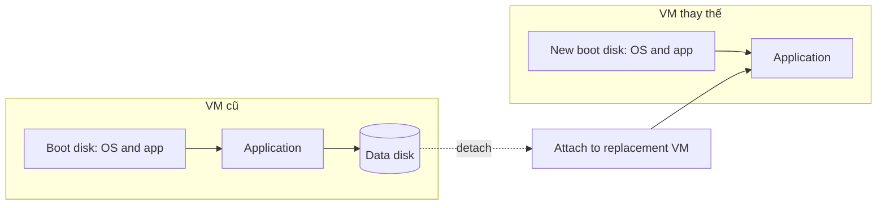

# Gắn data disk và kiểm tra dữ liệu khi thay thế máy

## Bối cảnh: thay VM nhưng dữ liệu phải tiếp tục tồn tại

Một VM có thể bị lỗi, cần nâng cấp hệ điều hành hoặc được thay bằng instance mới có cấu hình tốt hơn. Nếu ứng dụng lưu toàn bộ dữ liệu trên boot disk của VM, việc thay máy có thể làm mất dữ liệu hoặc kéo dài thời gian khôi phục. Một cách thiết kế phổ biến là tách **boot disk** chứa hệ điều hành và phần mềm khỏi **data disk** chứa dữ liệu ứng dụng, rồi gắn data disk vào VM thay thế.

Data disk độc lập với vòng đời VM giúp phục hồi nhanh hơn, nhưng thao tác detach/attach cần được thực hiện đúng thứ tự. Hệ thống tệp phải được đóng an toàn, volume phải được nhận diện chính xác, filesystem không được format nhầm, và ứng dụng chỉ được khởi động sau khi dữ liệu đã mount và kiểm tra hợp lệ. Việc gắn được volume vào VM mới chưa chứng minh dữ liệu nhất quán hoặc ứng dụng có thể sử dụng ngay.

Trong module **CLOUD_CORE_SERVICES_COMPUTE**, bài thực hành này áp dụng cho VM trên các cloud, đặc biệt là AWS EBS, Azure Managed Disks và Google Persistent Disk. Mục tiêu là thay thế compute instance mà vẫn giữ được data volume, xác minh tính toàn vẹn dữ liệu và có phương án rollback.

## 1. Phân biệt boot disk và data disk

**Boot disk** chứa bootloader, hệ điều hành, package và cấu hình cần để VM khởi động. **Data disk** chứa dữ liệu cần tồn tại độc lập với VM, ví dụ file upload, application data, database files hoặc dữ liệu batch.

| Tiêu chí | Boot disk | Data disk |
|---|---|---|
| Mục đích | Khởi động OS và runtime | Lưu dữ liệu ứng dụng |
| Vòng đời | Thường gắn với VM/image lifecycle | Có thể tồn tại qua nhiều lần thay VM |
| Thay máy | Có thể tạo boot disk mới từ image | Detach khỏi máy cũ rồi attach vào máy mới |
| Backup | Image/snapshot theo chính sách OS | Snapshot/backup theo yêu cầu dữ liệu và ứng dụng |
| Mount | Các filesystem hệ thống | Mount point riêng như `/srv/appdata` hoặc drive letter |
| Rủi ro chính | VM không boot được | Mất dữ liệu, attach nhầm, filesystem không nhất quán |

Không phải mọi cloud đều tự động xóa hoặc giữ boot/data disk giống nhau khi terminate VM. Cần kiểm tra delete-on-termination, disk retention và snapshot policy trước khi xóa máy.

### 1.1. Kiến trúc đơn giản



Data disk vẫn là cùng một volume; VM mới cung cấp compute và boot disk mới. Nếu volume được tạo từ snapshot thay vì detach/attach volume cũ, đó là một bản sao dữ liệu tại thời điểm snapshot và có thể cần quy trình đồng bộ phần thay đổi sau snapshot.

### 1.2. Khi nào nên tách data disk?

Phù hợp khi:

- Dữ liệu cần tồn tại qua việc recreate hoặc nâng cấp VM.
- Có quy trình thay máy định kỳ hoặc autohealing.
- Cần tách backup/retention của dữ liệu khỏi OS image.
- Cần thay đổi kích thước/loại compute mà không di chuyển toàn bộ dữ liệu.
- Cần khôi phục volume vào máy khác trong cùng failure domain được hỗ trợ.

Data disk không thay thế backup. Nếu volume bị xóa nhầm, hỏng logic, ransomware mã hóa file hoặc ứng dụng ghi dữ liệu sai, volume gắn rời vẫn có thể mất dữ liệu. Cần snapshot/backup và kiểm thử restore độc lập.

## 2. Hiểu giới hạn attach của block storage

Cloud block storage thường được cung cấp dưới dạng volume có thể attach vào VM. Tuy nhiên, khả năng attach phụ thuộc loại disk, zone, region, VM family, protocol và mode.

### 2.1. Phạm vi zone và region

- Nhiều zonal disk chỉ attach được vào VM trong cùng availability zone.
- Một số dịch vụ hỗ trợ regional disk hoặc synchronous replication qua nhiều zone; phạm vi và hiệu năng khác với zonal disk.
- Disk không nhất thiết có thể attach trực tiếp sang region khác; có thể cần snapshot/copy/restore.
- Một số dịch vụ hỗ trợ cross-zone migration hoặc replication có điều kiện riêng.

Ví dụ khái niệm:

| Provider | Dịch vụ block disk phổ biến | Điểm cần xác minh |
|---|---|---|
| AWS | Amazon EBS | Volume AZ, loại volume, Multi-Attach support, encryption/KMS permission |
| Azure | Managed Disks | Disk SKU, zone, shared disk support, max shares và VM compatibility |
| Google Cloud | Persistent Disk | Zonal/regional disk, access mode, machine type và multi-writer support |

Tên dịch vụ không bảo đảm tính năng attach giống nhau. Trước khi tạo VM thay thế, xác minh zone/region, disk type, encryption key, attach limit, interface/protocol và quyền identity.

### 2.2. Single attach và multi-attach

Nhiều volume thông thường chỉ cho phép một VM attach ở chế độ read/write tại một thời điểm. Một số loại volume hỗ trợ multi-attach hoặc shared disk, nhưng thường yêu cầu filesystem/cluster-aware application và có giới hạn về OS, protocol, VM type hoặc số node.

Không attach cùng một filesystem thông thường vào nhiều VM cùng ghi đồng thời. Filesystem như ext4 hoặc XFS không tự trở thành shared cluster filesystem khi volume được multi-attach. Nếu nhiều node cần ghi đồng thời, phải dùng giải pháp hỗ trợ cluster locking, fencing và filesystem phù hợp, hoặc chuyển sang shared file storage/database.

### 2.3. Disk identity và device name

Tên device như `/dev/sdf`, `/dev/sdb` hoặc `/dev/nvme1n1` có thể thay đổi theo VM, driver, thứ tự attach hoặc loại instance. Không viết automation dựa duy nhất vào tên device tạm thời.

Nên nhận diện volume bằng:

- Cloud volume ID trong control plane.
- Serial/WWN được guest OS hiển thị nếu provider/driver cung cấp.
- Filesystem UUID hoặc PARTUUID sau khi xác minh đúng volume.
- Label riêng có quy ước và inventory mapping.

Filesystem UUID không phải cloud volume ID. Snapshot/clone có thể tạo filesystem UUID trùng với volume gốc; khi đó mount bằng UUID có thể không xác định được volume mong muốn. Cần kiểm tra serial/volume ID trước, sau đó xử lý UUID duplicate theo quy trình có kiểm soát.

## 3. Chuẩn bị trước khi thay VM

Trước khi detach volume, cần xác định rõ dữ liệu nào đang được ghi, ứng dụng nào sử dụng disk và cách khôi phục nếu attach thất bại.

### 3.1. Inventory và ownership

Ghi nhận các thông tin:

- VM hiện tại: instance ID, zone/region, OS, boot image và trạng thái.
- Data volume: volume ID, zone/region, size, type, encryption, key ID và attachment.
- Filesystem: loại filesystem, UUID, partition table, LVM/RAID nếu có.
- Mount point: ví dụ `/srv/appdata`, `/var/lib/postgresql` hoặc drive `D:`.
- Ứng dụng và process đang mở file trên volume.
- Owner, môi trường, backup policy, retention và RPO/RTO.
- VM thay thế: zone/region, OS version, architecture, driver và quyền attach/decrypt.

Không suy ra volume chỉ từ tên hiển thị. Dùng volume ID do cloud control plane trả về và đối chiếu với serial trong guest OS.

### 3.2. Kiểm tra backup và khả năng phục hồi

Trước thay máy:

1. Xác nhận snapshot/backup gần nhất thành công và có retention phù hợp.
2. Kiểm tra volume đang được mã hóa và VM mới có quyền sử dụng encryption key.
3. Xác định snapshot là crash-consistent hay application-consistent.
4. Nếu chứa database, dùng quy trình backup/checkpoint/quiesce của database.
5. Nếu có yêu cầu nghiêm ngặt, thử restore snapshot sang volume test và kiểm tra dữ liệu.
6. Ghi lại thời điểm snapshot, volume ID, checksum/manifest và runbook rollback.

Snapshot block-level có thể chỉ phản ánh trạng thái block tại thời điểm chụp. Với database hoặc ứng dụng ghi nhiều file liên quan, snapshot không được quiesce có thể cần recovery log hoặc crash recovery khi mount.

### 3.3. Quiesce ứng dụng và flush dữ liệu

Không detach volume khi ứng dụng vẫn ghi dữ liệu. Quy trình khái niệm:

1. Ngừng nhận request/job mới.
2. Drain request và job đang xử lý.
3. Dừng writer/consumer hoặc chuyển ứng dụng sang maintenance mode.
4. Thực hiện checkpoint/flush theo hướng dẫn ứng dụng/database.
5. Đóng process giữ file descriptor trên volume.
6. Chạy `sync` và unmount filesystem.
7. Xác nhận volume không còn mount hoặc open handle.

Với database, dừng service bằng service manager hoặc dùng cơ chế backup/quiesce của database. Không chỉ chạy `sync` rồi giả định database đã nhất quán; `sync` đẩy dirty data của kernel xuống block device nhưng không thay thế checkpoint/transaction protocol của ứng dụng.

## 4. Kiểm tra data disk trên Linux trước khi detach

Các lệnh dưới đây là ví dụ cho Linux. Tên device thực tế phải được xác định trên máy đang thao tác.

### 4.1. Xem disk, mount và filesystem

```bash
# Xem disk, partition, filesystem, UUID và mount point
lsblk -o NAME,PATH,SIZE,TYPE,FSTYPE,UUID,PARTUUID,MOUNTPOINTS,MODEL,SERIAL

# Xem filesystem đang mount
findmnt

# Kiểm tra block device và UUID
sudo blkid

# Xem process đang sử dụng mount point
sudo fuser -vm /srv/appdata
```

Đối chiếu dung lượng, filesystem, UUID, serial và mount point với inventory. Không chọn disk chỉ vì nó có kích thước giống dự kiến; boot disk hoặc volume khác có thể cùng dung lượng.

### 4.2. Dừng ứng dụng và unmount

Ví dụ ứng dụng ghi vào `/srv/appdata`:

```bash
sudo systemctl stop myapp
sudo systemctl status myapp --no-pager

# Xác minh không còn process dùng mount point
sudo fuser -vm /srv/appdata

# Flush dữ liệu và unmount
sudo sync
sudo umount /srv/appdata

# Xác minh mount point đã được tháo
findmnt /srv/appdata
```

Nếu `umount` báo target busy, không dùng `umount -f` như phản xạ. Tìm process, shell có current directory trong mount, container bind mount hoặc file descriptor đang mở. Dừng workload đúng cách rồi unmount lại. Force detach có thể làm filesystem hoặc ứng dụng mất dữ liệu.

### 4.3. Kiểm tra LVM hoặc RAID nếu có

Volume có thể chứa LVM physical volume, logical volume hoặc RAID member thay vì filesystem trực tiếp trên partition. Kiểm tra trước:

```bash
sudo pvs
sudo vgs
sudo lvs -a -o +devices
cat /proc/mdstat
```

Nếu sử dụng LVM/RAID, phải thực hiện quy trình deactivate/assemble đúng cấu hình trước khi detach. Không chạy `mkfs` hoặc tạo partition table mới trên thiết bị đang chứa LVM/RAID metadata.

## 5. Detach data disk khỏi VM cũ

Sau khi ứng dụng đã dừng, filesystem đã unmount và inventory được xác minh, thực hiện detach bằng cloud control plane hoặc API/CLI của provider.

### 5.1. Trình tự detach

1. Mở trang quản lý VM cũ và xác minh instance ID.
2. Mở danh sách disk/volume đang attach và xác minh volume ID, device mapping, zone và encryption key.
3. Kiểm tra delete-on-termination hoặc tùy chọn xóa disk khi xóa VM; đặt retention phù hợp.
4. Xác nhận ứng dụng đã dừng và mount point đã unmount trong guest OS.
5. Detach đúng data disk khỏi VM cũ.
6. Chờ trạng thái detach hoàn tất theo control plane.
7. Xác minh volume còn tồn tại, không còn attachment và không bị xóa.

Tên trạng thái có thể là `available`, `unattached` hoặc tương đương. Chỉ tiếp tục khi provider xác nhận detach hoàn tất. Nếu thao tác vẫn ở trạng thái detaching, không khởi động VM mới với cùng volume.

### 5.2. Những việc cần tránh

- Không detach boot disk nếu mục tiêu chỉ là chuyển data disk.
- Không force detach volume đang có I/O nếu chưa đánh giá crash recovery.
- Không xóa volume cũ khi xóa VM thay thế hoặc VM nguồn.
- Không tạo filesystem mới trên volume đã có dữ liệu.
- Không attach cùng filesystem read/write vào hai VM nếu loại disk/filesystem không hỗ trợ cluster sharing.
- Không thay đổi encryption key hoặc snapshot lifecycle giữa lúc migration mà chưa kiểm tra khả năng decrypt/restore.

### 5.3. Khác biệt theo provider

**AWS EBS:** xác minh volume ID và Availability Zone; volume EBS thông thường phải attach vào EC2 trong cùng AZ. Kiểm tra `DeleteOnTermination`, encryption/KMS key permission và trạng thái volume. Multi-Attach chỉ áp dụng cho một số loại volume/instance và yêu cầu ứng dụng/filesystem hỗ trợ.

**Azure Managed Disks:** xác minh disk resource, region/zone, disk SKU, VM compatibility và `maxShares` nếu dùng shared disk. Một số thao tác detach/attach có thể cần VM deallocate tùy loại disk/cấu hình. Kiểm tra encryption set/key access và disk state.

**Google Persistent Disk:** xác minh disk resource, zone hoặc regional scope, access mode và machine type. Disk zonal cần VM ở cùng zone; regional disk có semantics replication/attachment riêng. Multi-writer chỉ dùng khi disk type, machine type và filesystem/workload đáp ứng yêu cầu.

Tên menu và quy tắc cụ thể thay đổi theo phiên bản dịch vụ. Dùng volume ID làm khóa đối chiếu, kiểm tra trạng thái trên control plane và đọc cảnh báo trước khi xác nhận thao tác.

## 6. Tạo hoặc chuẩn bị VM thay thế

VM thay thế thường được tạo từ image đã kiểm thử, với OS và driver tương thích với filesystem trên data disk.

### 6.1. Kiểm tra tương thích

- Cùng region và zone nếu volume là zonal.
- Hệ điều hành hỗ trợ filesystem hiện có (ext4, XFS, NTFS hoặc filesystem chuyên dụng).
- CPU architecture và driver storage/network phù hợp với image.
- Instance có đủ CPU, RAM, network và IOPS/throughput cho workload.
- VM identity có quyền attach volume, đọc encryption key và truy cập secret cần thiết.
- Security group/NSG/firewall và route cho phép ứng dụng truy cập dependency.
- Backup agent, monitoring, antivirus/EDR và logging được cài đúng phiên bản.

### 6.2. Tách boot disk khỏi data disk

Tạo VM mới với boot disk từ image chuẩn. Không restore data disk lên boot disk trừ khi đó là thiết kế đã được kiểm thử. Giữ nguyên data volume ID nếu đang chuyển trực tiếp volume, hoặc ghi rõ snapshot ID/version nếu tạo volume thay thế từ snapshot.

Nếu dùng snapshot để tạo disk mới:

- Xác minh snapshot thuộc đúng source volume và đúng thời điểm.
- Kiểm tra snapshot hoàn tất, không còn trạng thái pending.
- Xác minh KMS/Key Vault/Cloud KMS key và quyền decrypt.
- Xác định có cần restore database log hoặc replay event sau snapshot không.
- Ghi lại volume ID mới và liên kết nó với nguồn snapshot trong change record.

### 6.3. Cấp quyền encryption và identity

Disk mã hóa có thể cần quyền sử dụng key của customer-managed key (CMK), kể cả khi người dùng có quyền attach volume. Kiểm tra cả quyền của operator/control plane và identity mà cloud service dùng để attach/decrypt.

Nguyên tắc:

- Cấp quyền tối thiểu để VM mới sử dụng đúng key.
- Không chuyển key policy sang quyền rộng hơn chỉ để khắc phục attach error.
- Kiểm tra key còn enabled và không bị scheduled deletion.
- Xác minh backup/snapshot có thể decrypt bằng key hiện hành.
- Ghi nhận key ID/rotation state để phục hồi về sau.

## 7. Attach data disk vào VM mới

Sau khi VM thay thế ở trạng thái phù hợp và volume đã detach hoàn toàn, attach đúng volume vào VM mới bằng control plane.

### 7.1. Trình tự attach

1. Xác minh VM ID và zone/region của VM mới.
2. Xác minh volume ID, size, type, encryption và attachment state.
3. Chọn device mapping nếu provider yêu cầu; ghi nhận mapping trong change record.
4. Attach volume ở mode read/write phù hợp với workload.
5. Chờ control plane xác nhận attachment hoàn tất.
6. Trên guest OS, quét disk mới và nhận diện bằng serial/volume metadata.
7. Xác minh partition, filesystem UUID và dung lượng trước khi mount.

Không dựa vào tên `/dev/sdX` đã ghi từ VM cũ. Guest OS mới có thể đặt volume ở tên device khác.

### 7.2. Linux: nhận diện volume mới

```bash
# Cập nhật danh sách thiết bị block
sudo udevadm settle
lsblk -o NAME,PATH,SIZE,TYPE,FSTYPE,UUID,PARTUUID,MOUNTPOINTS,MODEL,SERIAL

# Kiểm tra metadata filesystem
sudo blkid

# Xem kernel log về thiết bị mới
sudo dmesg --ctime | tail -n 80
```

Nếu volume chưa xuất hiện, kiểm tra attach status trên cloud, driver, rescan SCSI/NVMe theo OS/provider và system log. Không chạy `partprobe`, `mkfs` hoặc `wipefs` cho đến khi xác định chắc chắn đúng thiết bị và hiểu rõ partition layout.

### 7.3. Kiểm tra partition và filesystem

Giả sử volume được nhận diện là `/dev/nvme1n1` và có partition `/dev/nvme1n1p1`; đây chỉ là ví dụ. Trên volume không có partition table, filesystem có thể nằm trực tiếp trên device.

```bash
sudo lsblk -f /dev/nvme1n1
sudo blkid /dev/nvme1n1 /dev/nvme1n1p1
sudo file -s /dev/nvme1n1
```

Kết quả cần khớp inventory: loại filesystem, UUID, partition layout và dung lượng. Nếu `blkid` không nhận diện filesystem, dừng lại để điều tra; không khởi tạo filesystem mới trên volume có dữ liệu.

### 7.4. Trường hợp LVM

Nếu volume chứa LVM, xác minh PV/VG/LV và tránh kích hoạt nhầm volume group có cùng tên với một disk khác trên VM mới:

```bash
sudo pvscan
sudo vgscan
sudo vgchange -ay <volume-group>
sudo lvs -a -o +devices
```

Tên volume group trong ví dụ phải được thay bằng giá trị đã xác minh. Nếu snapshot/clone tạo PV UUID hoặc VG UUID trùng với bản gốc đang attach, cần xử lý theo hướng dẫn LVM cho clone và không tự ý đổi metadata khi chưa có backup.

## 8. Mount filesystem an toàn trên Linux

Chỉ mount sau khi đã xác định đúng volume, partition, filesystem và trạng thái nhất quán. Tạo mount point nếu chưa có:

```bash
sudo mkdir -p /srv/appdata

# Mount bằng filesystem UUID đã xác minh
sudo mount UUID=<filesystem-uuid> /srv/appdata

# Xác minh thiết bị thực sự được mount
findmnt -o SOURCE,TARGET,FSTYPE,OPTIONS /srv/appdata
df -hT /srv/appdata
lsblk -f
```

Thay `<filesystem-uuid>` bằng UUID lấy từ `blkid` sau khi đối chiếu volume ID/serial. Không dùng placeholder nguyên văn trong lệnh thực tế.

### 8.1. Kiểm tra read-only trước nếu có nghi ngờ

Nếu volume được restore từ snapshot, có dấu hiệu filesystem không sạch hoặc cần kiểm tra trước khi cho ứng dụng ghi, có thể mount read-only trong môi trường kiểm tra:

```bash
sudo mount -o ro UUID=<filesystem-uuid> /mnt/data-check
findmnt /mnt/data-check
```

Với filesystem cần replay journal khi mount, read-only có thể không phản ánh đầy đủ trạng thái mà ứng dụng mong đợi; tùy filesystem có thể cần chế độ kiểm tra chuyên biệt. Không dùng tùy chọn bỏ qua recovery hoặc force mount để che lỗi. Nếu filesystem cần repair, unmount và thực hiện bằng công cụ đúng loại filesystem sau khi đã có snapshot/backup.

### 8.2. UUID trùng khi tạo volume từ snapshot/clone

Nếu volume mới là clone của volume đang tồn tại, filesystem UUID có thể giống nhau. Khi đó `mount UUID=...` có thể chọn nhầm thiết bị hoặc gây mơ hồ. Trước tiên kiểm tra serial/volume ID và mapping device.

Nếu hai bản sao phải cùng tồn tại độc lập, sau khi xác nhận đó là clone và có snapshot/backup, có thể tạo UUID filesystem mới bằng công cụ đúng loại:

```bash
# ext2/3/4: filesystem phải unmount
sudo tune2fs -U random /dev/<verified-partition>

# XFS: filesystem phải unmount
sudo xfs_admin -U generate /dev/<verified-partition>
```

Các lệnh trên thay đổi metadata định danh filesystem. Không chạy trên volume gốc đang dùng hoặc khi chưa xác minh clone. Nếu dùng LVM, cần kiểm tra và xử lý PV/VG UUID trùng theo quy trình riêng; đổi filesystem UUID không giải quyết xung đột LVM.

### 8.3. Sửa quyền và ownership sau mount

Filesystem giữ UID/GID dạng số. Nếu VM mới dùng user/group ID khác với VM cũ, file có thể hiển thị owner là số hoặc ứng dụng bị `Permission denied`.

```bash
ls -ln /srv/appdata
getent passwd appuser
getent group appgroup
stat -c '%u:%g %a %n' /srv/appdata
```

Đối chiếu UID/GID mong đợi trước khi sửa quyền. Không chạy `chown -R` hoặc `chmod -R 777` một cách đại trà trên data volume lớn; thao tác này có thể thay đổi hàng triệu file, phá permission model và làm tăng thời gian recovery. Hãy tạo user/group với UID/GID phù hợp hoặc sửa đúng phạm vi đã xác định.

### 8.4. Cấu hình mount bền vững qua reboot

Khi mount tạm đã kiểm tra thành công, có thể thêm entry vào `/etc/fstab` bằng UUID:

```fstab
UUID=<filesystem-uuid>  /srv/appdata  xfs  defaults  0  0
```

Ví dụ trên giả định filesystem XFS; trường fsck pass number là `0` vì XFS có cơ chế recovery riêng và `fsck.xfs` không thực hiện kiểm tra kiểu ext. Nếu volume dùng ext4, thay loại filesystem thành `ext4` và thường dùng pass number `2` cho data filesystem. Thứ tự dump/fsck field cần phù hợp với OS và filesystem.

Trước khi reboot, kiểm tra cấu hình:

```bash
sudo findmnt --verify --verbose
sudo mount -a
findmnt /srv/appdata
```

Không thêm `nofail` một cách tùy tiện cho data disk bắt buộc. Nếu mount thất bại mà OS vẫn boot và ứng dụng ghi vào thư mục `/srv/appdata` nằm trên root disk, ứng dụng có thể tạo dữ liệu mới ở sai filesystem. Khi volume thật được mount sau đó, dữ liệu vừa ghi sẽ bị che khuất, gây nhầm lẫn hoặc mất dữ liệu vận hành.

Nếu data disk là bắt buộc, cấu hình service phụ thuộc mount point, ví dụ systemd `RequiresMountsFor=/srv/appdata`, và để service fail closed khi mount không có. Chỉ dùng `nofail` cho volume thực sự tùy chọn và ứng dụng có xử lý thiếu dữ liệu an toàn.

### 8.5. Kiểm tra filesystem trước khi sửa chữa

Nếu mount báo lỗi hoặc kernel log có I/O error:

1. Dừng ứng dụng và unmount volume.
2. Tạo snapshot/clone phục vụ điều tra nếu có thể.
3. Xác minh loại filesystem và thiết bị chính xác.
4. Chạy công cụ kiểm tra phù hợp trong trạng thái unmounted.
5. Đọc output và xác định có cần repair hay restore từ backup.

Ví dụ kiểm tra ext4:

```bash
sudo e2fsck -fn /dev/<verified-partition>
```

Ví dụ kiểm tra XFS:

```bash
sudo xfs_repair -n /dev/<verified-partition>
```

Đây là chế độ kiểm tra không ghi sửa theo công cụ tương ứng. Nếu cần repair thực tế, dùng lệnh/options chính thức của filesystem sau khi có backup và phê duyệt. Không chạy `fsck`/`xfs_repair` trên filesystem đang mount read-write.

## 9. Windows: online disk và gán drive letter

Trên Windows Server, volume có thể xuất hiện trong Disk Management nhưng đang Offline, Read-only hoặc chưa có drive letter. Trước khi thay đổi, xác minh disk number, size, serial/unique ID và partition.

### 9.1. Nhận diện disk

Mở PowerShell với quyền phù hợp:

```powershell
Get-Disk | Format-Table Number, FriendlyName, SerialNumber, UniqueId, Size, OperationalStatus, IsOffline, IsReadOnly
Get-Partition | Format-Table DiskNumber, PartitionNumber, DriveLetter, Type, Size
Get-Volume | Format-Table DriveLetter, FileSystem, FileSystemLabel, Size, HealthStatus
```

Đối chiếu disk với volume ID/serial từ cloud control plane. Disk number có thể khác so với VM cũ; không dùng disk number cũ làm định danh duy nhất.

### 9.2. Đưa disk hiện có Online

Sau khi xác minh đúng disk chứa dữ liệu và volume đã detach an toàn:

```powershell
$disk = Get-Disk -Number 2
Set-Disk -Number $disk.Number -IsOffline $false
Set-Disk -Number $disk.Number -IsReadOnly $false
Get-Partition -DiskNumber $disk.Number
```

`2` chỉ là số minh họa. Không chạy `Initialize-Disk`, `Clear-Disk`, `New-Partition` hoặc `Format-Volume` trên disk đã có dữ liệu. Nếu Windows hỏi Initialize disk, Cancel và kiểm tra lại disk identity/partition table trước khi tiếp tục.

### 9.3. Gán drive letter

Nếu partition đã tồn tại nhưng chưa có drive letter, xác minh đúng partition rồi gán ký tự chưa được sử dụng:

```powershell
$partition = Get-Partition -DiskNumber 2 -PartitionNumber 1
Set-Partition -InputObject $partition -NewDriveLetter 'D'
Get-Volume -DriveLetter D
```

Drive letter `D` và disk/partition number trong ví dụ phải được thay bằng giá trị đã xác minh. Nếu volume dùng mount folder hoặc Storage Spaces, thực hiện theo thiết kế Windows tương ứng.

### 9.4. Kiểm tra NTFS và quyền truy cập

- Kiểm tra volume label, filesystem, size và health status.
- Kiểm tra ACL/NTFS permissions của thư mục ứng dụng.
- Xác minh service account trên VM mới có quyền đọc/ghi cần thiết.
- Nếu dùng BitLocker hoặc encryption khác, xác minh key protector/recovery key theo policy.
- Không format volume hoặc chạy repair có ghi trước khi có backup và đánh giá tình trạng.

Với disk dùng chung trong Windows Failover Cluster, phải tuân thủ cluster ownership và CSV protocol; không tự đưa disk Online đồng thời trên các node ngoài quy trình cluster.

## 10. Kiểm tra dữ liệu sau khi attach

Sau khi mount hoặc gán drive letter, chưa khởi động ứng dụng ngay. Trước hết kiểm tra volume đúng, dữ liệu hiện diện, filesystem khỏe và quyền truy cập phù hợp.

### 10.1. Kiểm tra metadata và dung lượng

Linux:

```bash
findmnt -o SOURCE,TARGET,FSTYPE,OPTIONS /srv/appdata
df -hT /srv/appdata
lsblk -f
sudo blkid
stat /srv/appdata
```

Windows:

```powershell
Get-Volume -DriveLetter D | Format-List *
Get-Partition -DriveLetter D | Format-List *
Get-Disk | Format-Table Number, SerialNumber, UniqueId, Size, OperationalStatus
```

Xác minh:

- Volume ID/serial đúng với change record.
- Size, filesystem và partition layout đúng.
- Mount point/drive letter đúng vị trí ứng dụng mong đợi.
- Volume không bị mount nhầm read-only hoặc sai option.
- Không có I/O error, filesystem error hoặc disk warning trong system log.

### 10.2. Kiểm tra cấu trúc và mẫu dữ liệu

Không chỉ kiểm tra thư mục tồn tại. Đối chiếu các dấu hiệu nghiệp vụ:

- Các thư mục/partition quan trọng có mặt.
- File mới nhất có timestamp và size hợp lý.
- File manifest, metadata hoặc marker của ứng dụng khớp với run trước.
- Số lượng record/file nằm trong khoảng dự kiến.
- Không có file tạm hoặc lock file bất thường do lần chạy trước bị gián đoạn.
- UID/GID hoặc ACL phù hợp với service account mới.

Linux:

```bash
sudo find /srv/appdata -maxdepth 2 -type d -print | head -n 80
sudo find /srv/appdata -maxdepth 2 -type f -printf '%TY-%Tm-%Td %TH:%TM %s %p\n' | sort | tail -n 40
du -sh /srv/appdata
```

PowerShell:

```powershell
Get-ChildItem D:\AppData -Force | Select-Object Mode, Length, LastWriteTime, Name
Get-ChildItem D:\AppData -File -Recurse | Measure-Object -Property Length -Sum
```

Với volume rất lớn, tránh chạy đệ quy toàn bộ file nếu chưa đánh giá I/O impact. Có thể dùng manifest hoặc sample có chọn lọc trước, sau đó chạy integrity scan trong maintenance window.

### 10.3. Kiểm tra checksum

Nếu có manifest checksum được tạo khi dữ liệu ở trạng thái nhất quán, xác minh sau khi attach:

```bash
cd /srv/appdata
sha256sum -c SHA256SUMS
```

Nếu chưa có manifest, tạo checksum trước thay máy khi workload đã quiesce và lưu manifest ở nơi độc lập với volume đang chuyển. Sau attach, tính lại và so sánh. Không lưu bản duy nhất của manifest trên chính data disk vì nếu volume hỏng hoặc bị thay nhầm thì bằng chứng cũng mất.

Checksum xác nhận nội dung byte của các file được kiểm tra, nhưng không chứng minh logic nghiệp vụ đúng. Với database, cần thêm native integrity check, recovery log và query kiểm tra số liệu.

### 10.4. Kiểm tra dữ liệu database

Nếu data disk chứa database files:

1. Xác minh phiên bản database server tương thích với data directory.
2. Xác minh quyền sở hữu thư mục, file mode và cấu hình path.
3. Kiểm tra backup/WAL/binlog hoặc transaction log có sẵn.
4. Khởi động database theo runbook của sản phẩm, xem log recovery.
5. Chờ recovery hoàn tất và xác minh trạng thái primary/replica/quorum nếu có.
6. Chạy native integrity check hoặc query đối soát theo khuyến nghị của database.
7. Kiểm tra row count, sequence/LSN, transaction cuối và các business invariant quan trọng.

Không copy hoặc chỉnh sửa file database khi database đang chạy nếu sản phẩm không hỗ trợ thao tác đó. Không xóa WAL, redo log, transaction log hoặc lock file chỉ vì chúng có vẻ cũ; chúng có thể cần cho crash recovery.

Ví dụ kiểm tra PostgreSQL ở mức ứng dụng sau khi service khởi động:

```bash
sudo -u postgres pg_isready
sudo -u postgres psql -d appdb -c 'SELECT now(), pg_is_in_recovery();'
sudo -u postgres psql -d appdb -c 'SELECT count(*) FROM critical_table;'
```

Đây chỉ là kiểm tra kết nối và một số trạng thái cơ bản; chọn thêm query/integrity procedure phù hợp phiên bản PostgreSQL và kiến trúc replication. Không chạy query nặng trên production chỉ để xác minh sơ bộ.

### 10.5. Kiểm tra ứng dụng trước khi mở traffic

- Chạy service ở chế độ maintenance/read-only nếu có.
- Kiểm tra config path, secret, connection string và service identity.
- Thực hiện smoke test đọc dữ liệu và ghi thử vào vùng test được phép.
- Xác minh log không có permission error, missing file hoặc schema mismatch.
- Kiểm tra health/readiness endpoint và dependency.
- Mở traffic theo canary hoặc từng bước, theo dõi error rate/latency.

Không cho ứng dụng ghi vào volume cho đến khi đã xác minh đây là dữ liệu đúng của môi trường và không có VM cũ nào còn sử dụng volume.

## 11. Xác minh tính nhất quán và tránh split-brain

Khi thay VM, rủi ro lớn là VM cũ và VM mới cùng ghi vào một dữ liệu hoặc hai bản volume khác nhau được mở ghi đồng thời.

### 11.1. Chỉ một writer cho volume thông thường

Với volume single-writer, quy trình cần bảo đảm:

- VM cũ đã dừng ứng dụng và unmount.
- Control plane xác nhận volume đã detach khỏi VM cũ.
- VM mới là attachment duy nhất ở mode read/write.
- Nếu VM cũ còn tồn tại để rollback, nó không được tự khởi động ứng dụng hoặc remount volume.
- Quyền/automation không tự attach volume ngược về VM cũ khi recovery.

Nếu cần giữ VM cũ, tắt hoặc cô lập network/service, đánh dấu rõ trạng thái maintenance và kiểm soát quyền khởi động. Không dựa vào việc VM cũ “có vẻ đã dừng” nếu control plane vẫn báo attachment.

### 11.2. Fencing và ownership

Trong hệ thống có nhiều worker/VM, dùng lease, lock hoặc fencing token ở tầng ứng dụng/storage để từ chối writer cũ. Cloud disk attachment control có thể ngăn một số kiểu attach đồng thời nhưng không thay thế cơ chế phân quyền writer ở database hoặc cluster.

Với database cluster, dùng quorum, replication protocol và fencing theo sản phẩm. Không tự attach disk data directory của primary sang một VM khác rồi khởi động database như một primary độc lập nếu chưa có quy trình failover chính thức.

### 11.3. Snapshot/clone không phải cùng một volume

Nếu tạo disk mới từ snapshot, VM mới nhận một bản dữ liệu tại thời điểm snapshot. Volume gốc và volume clone có thể cùng tồn tại và đều có thể ghi. Cần xác định rõ:

- Volume nào là source of truth.
- Có delta write nào phát sinh sau snapshot không.
- Cách đồng bộ delta (replication/log replay/application sync).
- Thời điểm chuyển writer và chặn ghi ở source.
- Cách rollback mà không ghi song song vào hai bản.

Không chuyển traffic sang clone chỉ vì nó mount thành công; phải kiểm tra snapshot timestamp và phần dữ liệu phát sinh sau snapshot.

## 12. Cập nhật cấu hình khởi động và tự động mount

Sau khi xác minh thủ công, cấu hình VM mới để mount đúng volume sau reboot và chỉ cho ứng dụng khởi động khi data disk sẵn sàng.

### 12.1. Linux systemd dependency

Ví dụ override cho service:

```ini
[Unit]
RequiresMountsFor=/srv/appdata

[Service]
ExecStartPre=/usr/bin/test -d /srv/appdata
```

`RequiresMountsFor` yêu cầu systemd kéo các mount unit cần thiết vào dependency chain. `ExecStartPre` ở đây chỉ kiểm tra mount path tồn tại; để bảo đảm đúng volume, có thể thêm kiểm tra mount source/UUID bằng script đã review. Không chỉ kiểm tra directory tồn tại vì thư mục có thể nằm trên root filesystem nếu data disk không mount.

Ví dụ script kiểm tra source:

```bash
#!/usr/bin/env bash
set -euo pipefail

expected_uuid="<filesystem-uuid>"
actual_source="$(findmnt -n -o SOURCE --target /srv/appdata)"
actual_uuid="$(blkid -s UUID -o value "$actual_source")"

test "$actual_uuid" = "$expected_uuid"
```

Đây là ví dụ cần kiểm thử theo cách `findmnt` trả source trong môi trường thực tế (device path có thể là symlink, mapper hoặc LVM logical volume). Với LVM, cần xác minh mapping đến đúng PV/volume ID, không chỉ UUID filesystem.

### 12.2. fstab và boot behavior

Đối với data disk bắt buộc, cấu hình mount phải làm rõ hành vi khi volume không có hoặc chưa attach. Nếu service không thể hoạt động an toàn khi thiếu disk, để mount/service fail rõ ràng và phát alert. Tránh cấu hình khiến service âm thầm ghi vào thư mục rỗng trên boot disk.

Đối với disk tùy chọn, `nofail` hoặc timeout ngắn có thể giúp VM boot ngay cả khi disk không có, nhưng ứng dụng phải kiểm tra sự hiện diện và không ghi nhầm vào mount point dự phòng.

### 12.3. Windows service dependency

Trên Windows, dùng Task Scheduler, service dependency hoặc startup script có kiểm tra volume identity trước khi chạy ứng dụng. Script nên xác minh drive letter/volume unique ID, filesystem và thư mục dữ liệu. Không chỉ kiểm tra `Test-Path D:\AppData` vì nếu disk chưa gắn, thư mục trên volume hệ thống có thể tồn tại cùng tên.

## 13. Quy trình cutover và rollback

Cutover là thời điểm chuyển ứng dụng sang VM mới. Rollback cần được chuẩn bị trước khi cho phép VM mới ghi dữ liệu.

### 13.1. Cutover theo bước

1. Thông báo maintenance và chặn request/job mới.
2. Drain công việc đang chạy; dừng ứng dụng/database theo runbook.
3. Flush, checkpoint, unmount và xác minh VM cũ không còn writer.
4. Tạo snapshot/backup theo yêu cầu và ghi lại volume ID/source version.
5. Detach data disk và chờ trạng thái detach hoàn tất.
6. Tạo VM thay thế từ image đã kiểm thử ở zone phù hợp.
7. Attach volume, nhận diện thiết bị và xác minh filesystem.
8. Mount/gán drive letter và kiểm tra permission, checksum, database recovery.
9. Chạy smoke test ở chế độ hạn chế; chưa mở traffic rộng.
10. Xác nhận owner/application sign-off và chuyển writer sang VM mới.
11. Mở traffic từng bước, theo dõi metric/log và đối soát dữ liệu.
12. Giữ VM cũ ở trạng thái cô lập trong khoảng rollback đã định, sau đó retire theo policy.

### 13.2. Điều kiện rollback trước khi có write mới

Nếu VM mới chưa ghi dữ liệu nghiệp vụ, rollback thường đơn giản hơn:

- Dừng app ở VM mới.
- Unmount data disk.
- Detach volume khỏi VM mới.
- Attach lại volume vào VM cũ hoặc VM phục hồi theo giới hạn zone/region.
- Mount và kiểm tra lại filesystem trước khi khởi động app.

Không attach volume read/write vào cả hai máy cùng lúc nếu loại disk/filesystem không hỗ trợ. Không khởi động VM cũ trước khi xác minh volume đã detach khỏi VM mới.

### 13.3. Rollback sau khi VM mới đã ghi dữ liệu

Sau khi VM mới đã nhận write, việc quay lại VM cũ có thể làm mất các thay đổi phát sinh sau cutover. Cần một trong các chiến lược:

- Replicate delta về source/VM cũ trước khi chuyển writer.
- Chụp snapshot mới và khôi phục vào VM rollback.
- Dùng database replication/failback protocol.
- Thực hiện reconciliation hoặc business compensation cho dữ liệu đã phát sinh.

Không chỉ detach volume rồi gắn lại vào VM cũ nếu VM cũ có một bản dữ liệu cũ khác hoặc database log/format đã thay đổi. Xác định source of truth và điểm phục hồi trước khi thực hiện.

### 13.4. Tiêu chí hoàn tất cutover

- Đúng volume ID được attach vào đúng VM.
- Không có attachment/writer cũ ngoài dự kiến.
- Filesystem mount đúng và không có I/O/filesystem error.
- Dữ liệu quan trọng và checksum/manifest khớp.
- Database recovery hoàn tất và business invariant đạt.
- Ứng dụng đọc/ghi đúng mount point/drive.
- Health check, log, latency và error rate đạt ngưỡng.
- Backup/snapshot mới được tạo theo lịch sau cutover.
- Change record lưu VM ID, volume ID, snapshot ID, UUID, timestamp và người xác nhận.

## 14. Ví dụ thao tác qua CLI của cloud provider

Các lệnh dưới đây minh họa control-plane operation. Hãy thay placeholder bằng resource ID đã xác minh, chọn đúng subscription/project/account và zone/region. Chạy lệnh detach chỉ sau khi guest OS đã dừng ứng dụng và unmount volume.

### 14.1. AWS EBS

```bash
# Detach volume khỏi EC2 cũ
aws ec2 detach-volume --volume-id vol-0123456789abcdef0

# Chờ volume trở về trạng thái có thể attach
aws ec2 wait volume-available --volume-ids vol-0123456789abcdef0

# Attach vào EC2 thay thế trong cùng Availability Zone
aws ec2 attach-volume \
  --volume-id vol-0123456789abcdef0 \
  --instance-id i-0123456789abcdef0 \
  --device /dev/sdf

aws ec2 wait volume-in-use --volume-ids vol-0123456789abcdef0
```

Device name `/dev/sdf` là mapping yêu cầu ở control plane; trên instance Nitro, guest OS có thể hiển thị thiết bị dưới tên NVMe khác. Sau attach, dùng `lsblk`, `blkid`, serial và volume ID để nhận diện thực tế.

### 14.2. Azure Managed Disk

```bash
# Detach disk khỏi VM cũ
az vm disk detach \
  --resource-group <resource-group> \
  --vm-name <old-vm> \
  --name <managed-disk-name>

# Attach disk hiện có vào VM thay thế
az vm disk attach \
  --resource-group <resource-group> \
  --vm-name <new-vm> \
  --name <managed-disk-name> \
  --lun 0
```

LUN `0` chỉ là ví dụ; chọn LUN còn trống và tương thích với cấu hình VM. Kiểm tra disk resource, zone, SKU, encryption và disk state bằng Azure CLI/portal trước và sau thao tác.

### 14.3. Google Persistent Disk

```bash
# Detach disk khỏi VM cũ
gcloud compute instances detach-disk <old-vm> \
  --disk=<disk-name> \
  --zone=<zone>

# Attach disk vào VM thay thế trong phạm vi zone phù hợp
gcloud compute instances attach-disk <new-vm> \
  --disk=<disk-name> \
  --zone=<zone> \
  --device-name=<device-name>
```

Nếu disk là regional hoặc dùng access mode đặc biệt, tham số và điều kiện attach có thể khác. Kiểm tra `gcloud compute disks describe` và instance zone trước khi chạy.

Các lệnh CLI có thể cần quyền IAM bổ sung và phiên bản CLI mới. Đọc output, xác minh resource ID và trạng thái sau từng thao tác; không chạy lặp detach/attach chỉ vì lệnh client timeout mà chưa kiểm tra trạng thái thực tế.

## 15. Bài thực hành: chuyển data disk sang VM thay thế

### 15.1. Mục tiêu và giả định

Thực hành trong môi trường lab có dữ liệu thử nghiệm:

- VM cũ chạy Linux và ứng dụng ghi vào `/srv/appdata`.
- Data disk chứa filesystem XFS hoặc ext4.
- VM mới được tạo trong zone tương thích với disk.
- Volume có ID rõ ràng và đã bật backup/snapshot.
- Ứng dụng có thể dừng trong maintenance window.

Không dùng volume production hoặc dữ liệu duy nhất nếu chưa có backup đã kiểm thử. Các lệnh device bên dưới là ví dụ; xác định lại device path trên từng VM.

### 15.2. Ghi nhận trạng thái ban đầu

Trên VM cũ:

```bash
lsblk -f
findmnt /srv/appdata
df -hT /srv/appdata
sudo blkid
```

Ghi vào change record: volume ID, VM ID, zone, filesystem UUID, filesystem type, mount point, dung lượng đã dùng và snapshot ID. Tạo một file kiểm thử có nội dung đã biết hoặc manifest checksum để xác minh sau khi chuyển.

### 15.3. Dừng workload và detach

```bash
sudo systemctl stop myapp
sudo fuser -vm /srv/appdata
sudo sync
sudo umount /srv/appdata
findmnt /srv/appdata
```

Nếu `findmnt` vẫn cho thấy mount hoặc `fuser` cho thấy process còn sử dụng, dừng và xử lý dependency trước khi detach. Tạo snapshot theo policy, sau đó detach data disk bằng control plane và chờ trạng thái hoàn tất.

### 15.4. Attach vào VM mới và mount

Trên control plane, attach đúng volume ID vào VM mới. Trên VM mới:

```bash
sudo udevadm settle
lsblk -o NAME,PATH,SIZE,TYPE,FSTYPE,UUID,PARTUUID,MODEL,SERIAL
sudo blkid
```

Đối chiếu volume ID/serial và UUID với change record. Nếu khớp, mount vào mount point kiểm tra:

```bash
sudo mkdir -p /mnt/data-check
sudo mount -o ro UUID=<filesystem-uuid> /mnt/data-check
findmnt /mnt/data-check
df -hT /mnt/data-check
```

Nếu mount read-only thành công và kiểm tra dữ liệu đạt, unmount rồi mount read-write vào mount point chính:

```bash
sudo umount /mnt/data-check
sudo mkdir -p /srv/appdata
sudo mount UUID=<filesystem-uuid> /srv/appdata
```

Nếu filesystem yêu cầu journal recovery hoặc báo lỗi, dừng và làm theo quy trình kiểm tra/repair; không force mount để tiếp tục lab.

### 15.5. Xác minh dữ liệu và mở ứng dụng

```bash
findmnt /srv/appdata
df -hT /srv/appdata
cd /srv/appdata
sudo sha256sum -c SHA256SUMS
sudo ls -ln /srv/appdata
```

Sau khi checksum/metadata đạt, xác minh ownership và cấu hình ứng dụng. Chạy ứng dụng ở chế độ maintenance hoặc smoke test, kiểm tra log và đọc một số record/file nghiệp vụ. Chỉ mở traffic sau khi owner xác nhận dữ liệu đúng.

### 15.6. Kiểm thử reboot

Thêm entry `/etc/fstab` theo UUID và cấu hình service phụ thuộc mount. Kiểm tra `findmnt --verify`, `mount -a`, sau đó reboot VM trong lab. Sau reboot, xác minh:

- Volume được attach đúng.
- Mount point dùng đúng filesystem UUID.
- Service không khởi động trước data disk.
- Ứng dụng đọc đúng dữ liệu và không tạo thư mục dữ liệu rỗng trên boot disk.
- Log không có lỗi I/O, permission hoặc mount timeout.

## 16. Troubleshooting

| Triệu chứng | Nguyên nhân có thể | Cách xử lý |
|---|---|---|
| Volume không attach được | Sai zone, attach limit, VM không tương thích hoặc còn attachment cũ | Kiểm tra volume ID, zone, trạng thái detach và disk type |
| VM mới không thấy device | Attach chưa hoàn tất, driver/rescan hoặc mapping khác | Kiểm tra control plane, `dmesg`, `lsblk`, rescan theo OS/provider |
| Device path khác VM cũ | Thứ tự attach/driver khác | Dùng serial/volume ID, UUID/PARTUUID đã xác minh |
| Filesystem không nhận diện | Chọn sai device, partition hoặc metadata lỗi | Dừng thao tác ghi; xác minh volume/partition và backup |
| Mount báo UUID không duy nhất | Clone/snapshot giữ UUID gốc | Xác minh clone, đổi UUID theo filesystem nếu cần và cập nhật fstab |
| Mount read-only | Volume/FS được yêu cầu read-only, lỗi filesystem hoặc policy | Xem mount options/kernel log và kiểm tra filesystem offline |
| `umount` báo busy | Process, shell, container bind mount hoặc file handle còn mở | Tìm process và dừng đúng thứ tự; không force unmount tùy tiện |
| Permission denied | UID/GID/ACL khác trên VM mới | Đối chiếu identity, quyền thư mục và service account |
| Ứng dụng thấy thư mục rỗng | Data disk chưa mount, sai mount point hoặc mount sai volume | Dừng ứng dụng, xác minh `findmnt` và source UUID/volume ID |
| Database không khởi động | Version/path/ownership sai hoặc recovery log cần xử lý | Đọc log database và làm theo recovery procedure của sản phẩm |
| Checksum không khớp | Snapshot cũ, dữ liệu thay đổi, copy lỗi hoặc corruption | Không mở traffic; xác định source of truth và phục hồi/đối soát |
| Encryption/key error | VM identity/operator thiếu quyền key hoặc key disabled | Kiểm tra key policy, identity và trạng thái key |
| VM cũ vẫn ghi dữ liệu | App chưa dừng, stale writer hoặc attachment chưa release | Cô lập VM cũ, fencing và xác minh chỉ còn một writer |

## 17. Runbook khi dữ liệu sau attach không đúng

Nếu volume đã attach nhưng dữ liệu thiếu, sai hoặc filesystem báo lỗi:

1. Dừng ứng dụng trên VM mới và chặn traffic/job mới.
2. Không chạy format, partition, repair có ghi hoặc cleanup file.
3. Ghi nhận VM ID, volume ID, snapshot ID, device, UUID, timestamp và log lỗi.
4. Xác minh volume được attach đúng và không có writer khác.
5. Kiểm tra filesystem ở chế độ không ghi nếu công cụ hỗ trợ.
6. So sánh manifest/checksum và snapshot timestamp với baseline.
7. Nếu có nghi ngờ corruption, tạo snapshot/clone để điều tra trước khi repair.
8. Xác định cần filesystem repair, database recovery, log replay hay restore snapshot.
9. Nếu rollback, dừng writer mới và detach an toàn trước khi attach lại volume vào VM cũ.
10. Sau phục hồi, chạy integrity check và business reconciliation trước khi mở traffic.

Nếu không biết dữ liệu nào là bản mới nhất, không chọn volume dựa trên timestamp file đơn lẻ. Dùng application log, database LSN/transaction log, snapshot metadata và change record để xác định nguồn sự thật.

## 18. Checklist trước và sau khi thay VM

### Trước detach

- [ ] Đã xác minh VM ID, volume ID, zone/region, device mapping và mount point.
- [ ] Đã phân biệt boot disk và data disk.
- [ ] Đã kiểm tra snapshot/backup, encryption key và retention.
- [ ] Đã dừng nhận request/job và drain workload.
- [ ] Database/application đã checkpoint hoặc shutdown theo runbook.
- [ ] Filesystem đã unmount và không còn open handle.
- [ ] Đã ghi UUID, filesystem type, size, serial và checksum/manifest.
- [ ] VM cũ không còn writer và volume retention đã được xác nhận.

### Khi attach vào VM mới

- [ ] VM mới đúng zone/region và tương thích disk type/OS/driver.
- [ ] Encryption key và identity permission đã được kiểm tra.
- [ ] Control plane xác nhận detach cũ hoàn tất trước attach mới.
- [ ] Device được nhận diện bằng volume ID/serial, không chỉ device name.
- [ ] Partition, filesystem, UUID và size khớp inventory.
- [ ] Không initialize, format hoặc ghi metadata mới lên volume hiện có.

### Sau mount và cutover

- [ ] Mount source/UUID đúng và mount option phù hợp.
- [ ] UID/GID/ACL và service account có quyền cần thiết.
- [ ] Checksum/manifest, metadata và dữ liệu nghiệp vụ đạt.
- [ ] Database recovery và integrity check hoàn tất.
- [ ] Service phụ thuộc mount và fail closed nếu data disk bắt buộc bị thiếu.
- [ ] Chỉ có một writer; VM cũ được cô lập.
- [ ] Smoke test, health check và canary đạt trước khi mở traffic.
- [ ] Backup mới, change record và rollback plan được cập nhật.

## Kết luận

Tách data disk khỏi boot disk giúp thay VM mà vẫn giữ dữ liệu, nhưng an toàn phụ thuộc vào việc quiesce ứng dụng, flush và unmount filesystem, detach đúng volume, attach trong phạm vi zone/region được hỗ trợ, nhận diện thiết bị bằng volume ID/serial và mount theo UUID đã xác minh. Trên VM mới cần kiểm tra filesystem, quyền, checksum, database recovery và business invariant trước khi mở traffic. Cấu hình mount tự động phải làm ứng dụng fail closed khi data disk bắt buộc không có để tránh ghi nhầm lên boot disk. Snapshot/backup, single-writer control, rollback và reconciliation hoàn thiện quy trình thay máy; thao tác attach thành công chỉ là một bước trong quá trình phục hồi dữ liệu.
