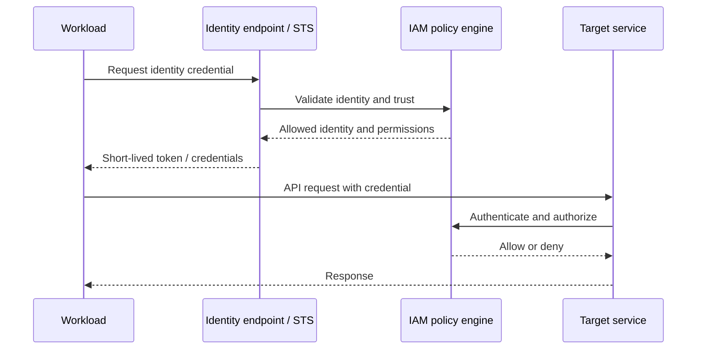
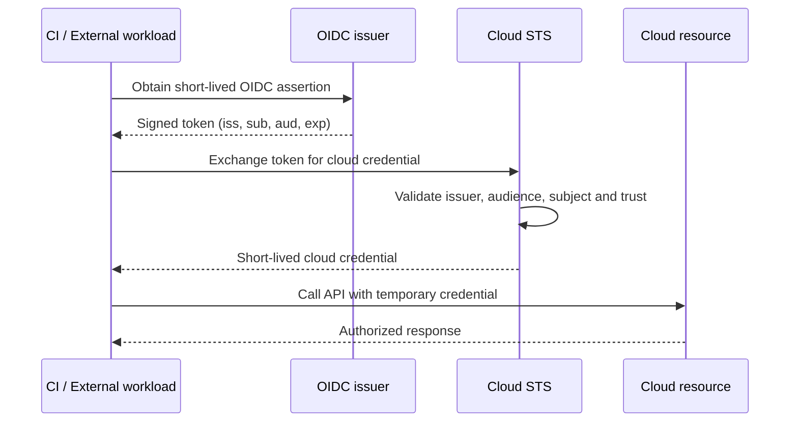

# Cấp danh tính workload để truy cập dịch vụ mà không dùng khóa tĩnh

## 1. Vì sao workload cần danh tính riêng?

Một workload compute thường phải gọi các dịch vụ khác để đọc cấu hình, tải dữ liệu, ghi kết quả, gửi log, giải mã volume hoặc gọi API. Ví dụ, một VM xử lý báo cáo cần đọc object trong storage; một pod cần ghi message vào queue; một function cần truy cập database hoặc secret manager. Dịch vụ đích phải xác định được workload nào đang gọi và workload đó được phép làm gì.

Cách triển khai cũ thường đặt access key, client secret, password hoặc file service account key vào image, biến môi trường hay file cấu hình. Khóa tĩnh có thể tồn tại lâu, được sao chép giữa nhiều máy và khó thu hồi khi bị lộ. Nếu một image bị chia sẻ nhầm hoặc một container bị khai thác, credential có thể cho phép truy cập tài nguyên vượt xa workload ban đầu.

**Workload identity** cung cấp danh tính cho ứng dụng hoặc tài nguyên compute. Nền tảng xác thực danh tính đó dựa trên vị trí thực thi, cấu hình gắn với tài nguyên hoặc một giao thức federation. Workload nhận credential ngắn hạn khi cần; dịch vụ đích kiểm tra credential và policy trước khi cho phép hành động.

Mục tiêu là để workload chứng minh nó là workload nào mà không phải mang theo khóa bí mật dài hạn. Điều này không có nghĩa bỏ qua xác thực, phân quyền hay quản lý khóa của nền tảng. Hệ thống vẫn cần trust relationship, token issuer, audience, subject, policy và audit.

Trong module **CLOUD_CORE_SERVICES_COMPUTE**, danh tính workload là một phần của cấu hình bảo mật khi triển khai VM, container và serverless. Cấp đúng identity giúp workload truy cập dịch vụ cần thiết, giảm rủi ro credential bị lộ và hỗ trợ di chuyển, mở rộng compute có kiểm soát.

Sau bài học, người học có thể:

- Phân biệt user identity, machine identity, workload identity và credential.
- Giải thích rủi ro của access key và service account key tĩnh.
- Mô tả cách workload lấy credential ngắn hạn từ metadata service hoặc identity endpoint.
- Thiết kế trust relationship và federation bằng OIDC/SAML khi phù hợp.
- Đối chiếu EC2 instance role, Azure Managed Identity và Google attached service account.
- Cấp danh tính cho workload trên Kubernetes và serverless.
- Thiết kế permission theo least privilege và kiểm tra quyền bị từ chối.
- Bảo vệ token, metadata endpoint, federation subject và identity lifecycle.
- Kiểm toán việc sử dụng identity, rotation/revocation và xử lý sự cố.

## 2. Các khái niệm nền tảng

### 2.1. Identity và credential khác nhau

Identity là danh tính được hệ thống công nhận, ví dụ role của một VM, managed identity của một ứng dụng hoặc service account gắn với workload. Credential là bằng chứng được dùng để chứng minh identity đó, ví dụ access token, temporary access key, certificate hoặc signed assertion.

Một workload identity có thể được xác thực bằng nhiều credential trong vòng đời của nó. Credential ngắn hạn được cấp lại khi hết hạn; identity và policy có thể vẫn giữ nguyên. Thu hồi quyền của identity có thể chặn các lần cấp credential mới, còn credential đã phát hành có thể vẫn hợp lệ đến khi hết hạn hoặc bị hệ thống đích từ chối.

### 2.2. Các loại danh tính

| Loại | Đại diện cho | Ví dụ |
|---|---|---|
| Human/user identity | Người dùng hoặc quản trị viên | Tài khoản nhân viên, nhóm quản trị |
| Machine identity | Máy hoặc thiết bị | VM, node, appliance, certificate của host |
| Workload identity | Ứng dụng hoặc tiến trình đang chạy | API service, queue worker, scheduled function |
| Service identity | Danh tính dịch vụ do nền tảng quản lý | IAM role, managed identity, service account |
| Federated identity | Danh tính được tin cậy qua một issuer khác | OIDC subject của CI hoặc Kubernetes service account |

Một VM có thể có machine identity ở tầng host và nhiều workload identity ở tầng ứng dụng. Không nên mặc định mọi process trên cùng VM phải dùng chung một danh tính có quyền rộng.

### 2.3. Authentication và authorization

**Authentication** xác minh workload là ai. **Authorization** quyết định workload được phép làm gì trên tài nguyên nào.

Ví dụ, một function có thể xác thực thành công bằng execution role nhưng vẫn không có quyền đọc bucket cụ thể. Đây là lỗi authorization, không phải lỗi lấy credential. Khi troubleshooting, cần tách lỗi không lấy được token khỏi lỗi token hợp lệ nhưng policy từ chối hành động.

### 2.4. Credential tĩnh và credential ngắn hạn

| Tiêu chí | Credential tĩnh | Credential ngắn hạn |
|---|---|---|
| Vòng đời | Có thể tồn tại lâu đến khi rotate/revoke | Có expiry rõ ràng, thường được cấp lại |
| Phân phối | Thường phải lưu hoặc chuyển secret đến workload | Lấy qua identity endpoint, SDK hoặc federation |
| Rủi ro khi lộ | Có thể dùng lâu nếu chưa bị thu hồi | Cửa sổ sử dụng thường ngắn hơn |
| Rotation | Cần quy trình cập nhật secret và restart/reload | SDK/runtime thường tự làm mới khi cấu hình đúng |
| Phạm vi | Dễ bị dùng chung giữa nhiều workload | Có thể gắn policy riêng cho từng workload |
| Vận hành | Dễ phát sinh secret drift và bản sao cũ | Cần quản lý trust, issuer, token expiry và clock |

Credential ngắn hạn không tự động an toàn nếu token bị log, cấp quyền quá rộng hoặc bị đánh cắp trong thời gian còn hiệu lực. Cần kết hợp least privilege, bảo vệ token và giám sát sử dụng.

## 3. Kiến trúc cấp workload identity

### 3.1. Luồng tổng quát

Một luồng phổ biến gồm các bước:

1. Nền tảng hoặc identity provider xác định workload.
2. Workload yêu cầu credential qua SDK, metadata service hoặc token exchange endpoint.
3. Identity system xác minh workload và trust relationship.
4. Credential ngắn hạn được cấp với audience/scope phù hợp.
5. Workload gửi credential đến dịch vụ đích.
6. Dịch vụ đích xác thực token và kiểm tra IAM/resource policy.
7. Credential hết hạn; workload lấy credential mới khi cần.



Đây là mô hình logic. Mỗi cloud có thể gộp identity endpoint, STS và policy engine thành các dịch vụ khác nhau.

### 3.2. Gắn identity với workload

Identity cần được gắn vào đúng ranh giới thực thi:

- VM: instance profile, managed identity hoặc attached service account.
- Kubernetes pod: service account được ánh xạ/federate sang cloud identity.
- Serverless function: execution role hoặc service identity gắn với function.
- Container platform: task identity, managed identity hoặc service account của revision/task.
- CI/CD runner: federated identity dựa trên repository, branch, workflow hoặc job claims.

Tránh dùng identity của node hoặc host cho mọi workload bên trong nếu nền tảng có cơ chế identity riêng cho pod/container. Nếu mọi pod cùng lấy được credential của node, ranh giới phân quyền giữa các ứng dụng bị suy yếu.

### 3.3. Token và các claim quan trọng

Với OIDC/JWT, token có thể chứa các claim như:

- `iss` (issuer): hệ thống phát hành token.
- `sub` (subject): danh tính chủ thể, ví dụ service account hoặc workload.
- `aud` (audience): bên nhận dự kiến của token.
- `exp` và `iat`: thời điểm hết hạn và thời điểm phát hành.
- `nbf`: thời điểm token bắt đầu có hiệu lực nếu được dùng.
- Claim bổ sung: repository, branch, namespace, service account, environment hoặc workflow.

Federation trust cần giới hạn issuer, subject và audience. Chỉ kiểm tra chữ ký token là chưa đủ: token có chữ ký hợp lệ nhưng đến từ repository, namespace hoặc workflow không được phép vẫn phải bị từ chối.

### 3.4. Audience và confused deputy

Audience cho biết token được phát hành cho bên nhận nào. Nếu token có thể dùng ở nhiều dịch vụ không liên quan, nguy cơ token bị tái sử dụng sai mục đích tăng lên.

Chỉ yêu cầu audience mà dịch vụ đích mong đợi. Không chấp nhận token có audience quá rộng nếu không có nhu cầu rõ ràng. Với federation, audience thường là định danh của dịch vụ token exchange hoặc trust configuration; cần dùng chính xác giá trị mà provider yêu cầu.

Confused deputy xảy ra khi một dịch vụ có quyền rộng bị workload không đủ tin cậy lừa sử dụng quyền thay nó. Ràng buộc subject, audience, tenant và resource scope giúp giảm nguy cơ này.

## 4. Vì sao tránh khóa tĩnh?

### 4.1. Khóa có thể bị sao chép

Access key hoặc service account key thường được lưu trong secret file, environment variable, CI variable, image layer hoặc máy của developer. Mỗi bản sao là một điểm có thể bị lộ. Khóa dùng chung cũng làm khó xác định workload nào đã thực hiện hành động.

### 4.2. Rotation tạo ra khoảng chuyển tiếp

Khi rotate khóa, hệ thống thường phải cập nhật secret ở nhiều nơi, triển khai lại workload và thu hồi khóa cũ. Nếu bỏ sót một worker hoặc image cũ, credential cũ vẫn có thể hoạt động. Nếu thu hồi quá sớm, workload chưa cập nhật có thể gián đoạn.

### 4.3. Credential có thể bị nhúng vào image

Xóa secret khỏi Dockerfile hoặc filesystem cuối không bảo đảm secret biến mất khỏi layer cũ. Image được copy sang registry khác có thể mang theo credential đã bị lộ. Với VM image, file key có thể tồn tại trong snapshot hoặc backup.

### 4.4. Khó gắn hành động với workload cụ thể

Nếu nhiều ứng dụng dùng chung một key, audit log chỉ cho biết key đã được dùng, không nhất thiết xác định được pod hoặc function cụ thể. Workload identity riêng giúp policy và audit gắn với một service hoặc execution boundary rõ ràng hơn.

### 4.5. Mục tiêu thay thế

- Dùng identity gắn với VM, pod, task, function hoặc CI job.
- Lấy credential ngắn hạn từ nền tảng hoặc STS.
- Cấp quyền tối thiểu theo resource và action.
- Không lưu secret dài hạn trong source, image hoặc user data.
- Có audit trail để biết identity nào truy cập tài nguyên.

## 5. Identity cho VM trên các cloud

### 5.1. AWS EC2 instance profile và IAM role

Với EC2, IAM role được gắn vào instance thông qua instance profile. EC2 Instance Metadata Service cung cấp temporary security credentials cho role; AWS SDK có thể lấy và làm mới credential qua default credential provider chain.

Quy trình thiết kế:

1. Tạo IAM role dành riêng cho workload hoặc nhóm workload có cùng chức năng.
2. Viết trust policy cho phép EC2 service assume role.
3. Gắn role vào instance profile và instance.
4. Cấp permission policy chỉ cho phép action/resource cần thiết.
5. Trong ứng dụng, dùng SDK credential chain thay vì đọc access key từ file.
6. Theo dõi CloudTrail và rà soát quyền theo thời gian.

Ví dụ trust policy rút gọn:

```json
{
  "Version": "2012-10-17",
  "Statement": [
    {
      "Effect": "Allow",
      "Principal": { "Service": "ec2.amazonaws.com" },
      "Action": "sts:AssumeRole"
    }
  ]
}
```

Trust policy trên chỉ cho EC2 assume role. Nó không cấp quyền đọc bucket hoặc ghi log; các quyền đó nằm trong permission policy riêng. Cần giới hạn resource, condition và role attachment theo môi trường thực tế.

### 5.2. Sử dụng AWS SDK credential chain

Ứng dụng nên để SDK tìm credential theo cơ chế mặc định phù hợp với môi trường. Khi chạy trên EC2, SDK có thể lấy temporary credential từ instance profile; khi chạy local, developer có thể dùng SSO/profile theo quy trình tổ chức.

Không viết code tự đọc `AWS_ACCESS_KEY_ID`/`AWS_SECRET_ACCESS_KEY` rồi nhúng vào cấu hình production. Cũng không copy credential cache của developer vào image.

### 5.3. Azure Managed Identity

Azure Managed Identity cung cấp identity được quản lý bởi nền tảng cho VM và các dịch vụ compute hỗ trợ. Có hai loại chính:

- **System-assigned identity:** gắn với vòng đời resource; khi resource bị xóa, identity tương ứng cũng bị xóa theo.
- **User-assigned identity:** resource identity độc lập, có thể gắn vào nhiều resource được phép.

Quy trình:

1. Bật system-assigned identity hoặc tạo user-assigned identity.
2. Gán Azure RBAC role ở scope tối thiểu cần thiết.
3. Dùng Azure Identity SDK/DefaultAzureCredential phù hợp môi trường.
4. Lấy token cho đúng resource/audience.
5. Truy cập dịch vụ đích và theo dõi sign-in/audit log.

Ví dụ C# minh họa dùng SDK:

```csharp
using Azure.Identity;
using Azure.Security.KeyVault.Secrets;

var credential = new DefaultAzureCredential();
var client = new SecretClient(
    new Uri("https://example-vault.vault.azure.net/"),
    credential);

KeyVaultSecret secret = await client.GetSecretAsync("orders-api-config");
```

Ví dụ sử dụng `DefaultAzureCredential` để chọn credential theo môi trường. Trên Azure compute, cấu hình identity phù hợp để SDK dùng Managed Identity. Trong production, tránh fallback ngoài dự kiến sang developer credential; có thể cấu hình credential chain rõ hơn theo SDK/version và kiểm thử identity thực tế.

### 5.4. Google Cloud attached service account

Compute Engine VM có thể gắn service account. Metadata server cấp access token ngắn hạn cho service account; ứng dụng dùng Google client library hoặc Application Default Credentials (ADC) để lấy credential.

Quy trình:

1. Tạo service account riêng cho workload.
2. Gắn service account vào VM khi tạo hoặc cập nhật cấu hình.
3. Cấp IAM role trên tài nguyên cần truy cập.
4. Dùng ADC/client library thay vì tải JSON key.
5. Kiểm tra audit log và quyền thực tế.

Không dùng default service account với quyền Editor rộng nếu workload chỉ cần đọc một bucket. Kiểm tra cả IAM role và OAuth access scope theo cấu hình VM; scope không thay thế IAM policy.

### 5.5. Bảng đối chiếu VM identity

| Khía cạnh | AWS EC2 | Azure VM | Google Compute Engine |
|---|---|---|---|
| Danh tính gắn vào VM | IAM role qua instance profile | System/user-assigned Managed Identity | Attached service account |
| Cấp credential | Temporary credentials qua IMDS/SDK | Token qua Managed Identity endpoint/SDK | Access token qua metadata server/ADC |
| Phân quyền | IAM identity/resource policy | Azure RBAC và data-plane access policy | IAM roles/resource policy |
| Làm mới | SDK/provider chain lấy credential mới | SDK lấy token mới | ADC/client library refresh token |
| Rủi ro cần chú ý | IMDS access, role quá rộng | Identity assignment và RBAC scope | Default service account và quyền rộng |

Các dịch vụ có tên và tính năng thay đổi theo loại VM/region. Hãy kiểm tra tài liệu của loại compute đang dùng và xác minh SDK thực sự chọn identity dự kiến.

## 6. Workload identity trên Kubernetes

### 6.1. Vì sao không nên dùng identity của node cho mọi pod?

Kubernetes node thường cần identity để pull image, attach volume hoặc tương tác với control plane. Nếu mọi pod trên node đều có thể lấy credential của node, pod không đáng tin cậy có thể truy cập quyền của workload khác.

Workload identity federation ánh xạ Kubernetes service account của pod sang cloud identity. Pod nhận token OIDC do cluster phát hành; cloud STS/identity provider xác minh issuer, subject và audience rồi cấp credential ngắn hạn.

### 6.2. Kubernetes ServiceAccount

ServiceAccount đại diện cho workload trong namespace. Pod dùng service account được chỉ định trong `spec.serviceAccountName`. Token projected có thể được cấp với audience và thời hạn phù hợp; không nên dùng token không giới hạn hoặc lưu token lâu dài.

Ví dụ:

```yaml
apiVersion: v1
kind: ServiceAccount
metadata:
  name: report-worker
  namespace: analytics
```

ServiceAccount Kubernetes tự nó không tự động cấp quyền cloud. Cần cấu hình federation/annotation/binding tùy nền tảng và permission policy ở cloud.

### 6.3. AWS EKS: IRSA và EKS Pod Identity

EKS hỗ trợ các mô hình cấp AWS credentials cho pod như IAM Roles for Service Accounts (IRSA) và EKS Pod Identity. Cả hai nhằm giới hạn quyền theo workload thay vì chia sẻ role của node.

Với IRSA:

1. EKS cluster có OIDC issuer.
2. IAM OIDC provider được cấu hình cho issuer.
3. IAM role trust policy giới hạn `sub` đến service account/namespace cụ thể và `aud` theo yêu cầu.
4. Kubernetes ServiceAccount được gắn annotation role ARN.
5. Pod dùng service account đó và AWS SDK lấy temporary credentials qua web identity token flow.

Ví dụ annotation:

```yaml
apiVersion: v1
kind: ServiceAccount
metadata:
  name: report-worker
  namespace: analytics
  annotations:
    eks.amazonaws.com/role-arn: arn:aws:iam::123456789012:role/report-worker-role
```

Role ARN là placeholder. Trust policy phải giới hạn đúng OIDC issuer, subject dạng `system:serviceaccount:analytics:report-worker` và audience được yêu cầu. Không dùng wildcard subject cho mọi namespace nếu không có lý do rõ ràng.

EKS Pod Identity dùng association giữa cluster/namespace/service account và IAM role cùng agent/provider flow tương ứng. Chọn một cơ chế theo kiến trúc cluster; kiểm tra phiên bản EKS, agent, SDK và hỗ trợ của workload trước triển khai.

### 6.4. Azure AKS: Microsoft Entra Workload ID

AKS Workload ID dùng OIDC issuer của cluster và federated identity credential trong Microsoft Entra ID. Trust được ràng buộc với issuer, subject của Kubernetes service account và audience.

Một luồng thường gặp:

1. Bật OIDC issuer và workload identity trên AKS.
2. Tạo user-assigned managed identity hoặc ứng dụng Entra được hỗ trợ.
3. Tạo federated identity credential trỏ đến issuer, subject và audience.
4. Gắn annotation client ID vào Kubernetes ServiceAccount.
5. Gắn label `azure.workload.identity/use: "true"` cho pod template theo yêu cầu của cấu hình.
6. Cấp Azure RBAC/data-plane role cho managed identity.
7. Dùng Azure Identity SDK để lấy token.

Ví dụ ServiceAccount:

```yaml
apiVersion: v1
kind: ServiceAccount
metadata:
  name: report-worker
  namespace: analytics
  annotations:
    azure.workload.identity/client-id: "00000000-0000-0000-0000-000000000000"
```

Ví dụ pod template label:

```yaml
apiVersion: apps/v1
kind: Deployment
metadata:
  name: report-worker
  namespace: analytics
spec:
  selector:
    matchLabels:
      app: report-worker
  template:
    metadata:
      labels:
        app: report-worker
        azure.workload.identity/use: "true"
    spec:
      serviceAccountName: report-worker
      containers:
        - name: app
          image: example.invalid/report-worker:v1
```

Đây là Deployment minh họa; image là placeholder. Label phải nằm trong `spec.template.metadata.labels` của Pod template, còn `serviceAccountName` nằm trong Pod spec. Client ID trong ví dụ ServiceAccount là placeholder. Federated credential phải khớp chính xác issuer, subject `system:serviceaccount:analytics:report-worker` và audience được cấu hình.

### 6.5. Google Kubernetes Engine: Workload Identity Federation

GKE Workload Identity Federation cho phép Kubernetes workload truy cập Google Cloud API bằng danh tính gắn với Kubernetes ServiceAccount hoặc liên kết với IAM service account theo cấu hình được hỗ trợ. Mô hình hiện đại có thể dùng principal đại diện trực tiếp cho Kubernetes service account và cấp IAM binding đến resource; một số kiến trúc dùng IAM service account impersonation.

Các bước tổng quát:

1. Bật Workload Identity Federation cho cluster/node pool theo hướng dẫn GKE.
2. Xác định project/cluster workload identity pool.
3. Tạo Kubernetes ServiceAccount cho workload.
4. Cấp IAM role cho principal của KSA hoặc cấu hình liên kết IAM service account theo mô hình chọn.
5. Cấu hình annotation/association cần thiết nếu dùng service account impersonation.
6. Dùng ADC và Google client library trong pod.

Ví dụ annotation khi liên kết KSA với IAM service account trong mô hình KSA-to-GSA:

```yaml
apiVersion: v1
kind: ServiceAccount
metadata:
  name: report-worker
  namespace: analytics
  annotations:
    iam.gke.io/gcp-service-account: report-worker@sample-project.iam.gserviceaccount.com
```

Đây là ví dụ cho mô hình liên kết KSA-to-GSA. Với principal trực tiếp của Workload Identity Federation, IAM binding và principal URI khác; không áp dụng annotation này một cách máy móc. Cần làm theo chế độ Workload Identity đang bật trên cluster.

### 6.6. So sánh các mô hình Kubernetes

| Nền tảng | Cơ chế phổ biến | Ràng buộc trust | Credential trong pod |
|---|---|---|---|
| Amazon EKS | IRSA hoặc EKS Pod Identity | OIDC issuer, namespace, service account, audience/association | AWS temporary credentials |
| Azure AKS | Microsoft Entra Workload ID | OIDC issuer, subject, audience | Entra access token |
| Google GKE | Workload Identity Federation | Workload pool principal/KSA, hoặc KSA-to-GSA association | Google access token qua ADC |

Không nên gắn credential của node vào pod như một giải pháp thay thế mặc định. Nếu workload cần truy cập cloud API, cấp identity riêng cho service account và kiểm tra ranh giới giữa các namespace.

## 7. Workload identity cho container và serverless

### 7.1. Container task identity

Một số container platform cấp identity ở cấp task, app hoặc revision. Ví dụ, container task có thể nhận role riêng, Azure Container Apps có thể dùng managed identity, còn Cloud Run có service identity gắn với service.

Khi thiết kế:

- Gắn identity vào service/task cụ thể.
- Không chia sẻ một role quản trị giữa mọi container.
- Cấp quyền theo resource và operation.
- Dùng SDK hỗ trợ credential provider của nền tảng.
- Kiểm tra identity thực tế trong task/revision mới sau deployment.

### 7.2. AWS Lambda execution role

Lambda function dùng execution role để truy cập dịch vụ AWS. Role được cấu hình trên function; Lambda runtime cung cấp temporary credentials cho execution environment. Permission policy xác định function có thể đọc bucket, ghi log hoặc gửi message nào.

Nên tạo role theo function hoặc nhóm function có cùng ranh giới tin cậy. Tránh gắn một role rộng cho toàn bộ ứng dụng nếu các function có nhiệm vụ khác nhau.

### 7.3. Azure Functions managed identity

Azure Functions có thể dùng system-assigned hoặc user-assigned managed identity tùy hosting plan và cấu hình. Ứng dụng dùng Azure Identity SDK để lấy token cho Storage, Key Vault hoặc dịch vụ khác. Gán role ở scope cần thiết và kiểm tra khả năng hỗ trợ của plan/runtime.

### 7.4. Google Cloud Run và Cloud Functions identity

Cloud Run service hoặc function có thể chạy dưới service account được gắn. Runtime credential/ADC cho phép ứng dụng lấy token mà không tải JSON key. Service account cần có quyền tối thiểu trên tài nguyên đích.

Không dùng service account key JSON trong biến môi trường hoặc image khi runtime đã hỗ trợ attached service identity.

### 7.5. Identity cho scheduled job

Scheduled job cũng cần identity riêng. Không dùng credential của người tạo lịch hoặc tài khoản quản trị để chạy tác vụ nền. Gắn execution identity cho scheduler target hoặc job runtime, cấp quyền đọc input/ghi output đúng scope và audit mỗi lần chạy.

## 8. Federation với OIDC/SAML cho workload bên ngoài

### 8.1. Khi nào cần federation?

Federation phù hợp khi workload chạy bên ngoài cloud nhưng cần truy cập cloud resource, ví dụ:

- CI/CD runner trên GitHub Actions hoặc hệ thống build khác.
- Workload chạy ở Kubernetes cluster tự quản.
- Job chạy trên cloud khác.
- Hệ thống đối tác cần truy cập tài nguyên giới hạn.
- Máy on-premises cần gọi cloud API.

Thay vì tạo access key dài hạn rồi lưu trong CI secret, workload lấy assertion từ identity provider hiện có. Cloud STS/identity service xác minh assertion và cấp credential ngắn hạn.

### 8.2. OIDC token exchange

OIDC identity provider phát ID token hoặc JWT có chữ ký. Workload gửi token đến Security Token Service hoặc endpoint federation. Provider kiểm tra issuer, chữ ký, audience, subject, thời hạn và điều kiện trust rồi phát credential cho role/service identity.



Token assertion và credential cloud là hai thứ khác nhau. Assertion chứng minh danh tính từ issuer; credential cloud được cấp sau khi federation trust thành công.

### 8.3. Trust conditions

Trust policy nên ràng buộc:

- Issuer chính xác và được tin cậy.
- Audience đúng với token exchange/provider.
- Subject cụ thể, ví dụ repository/workflow/branch hoặc namespace/service account.
- Thời hạn token ngắn và thời điểm hợp lệ.
- Claim bổ sung như environment, organization, project hoặc protected branch nếu provider hỗ trợ.
- Role được assume chỉ có quyền cần thiết.

Tránh trust tất cả subject từ một issuer công khai. Nếu token từ bất kỳ repository nào cũng có thể assume role production, một repository ít tin cậy có thể trở thành đường vào tài nguyên production.

### 8.4. SAML federation

SAML cũng có thể dùng để federation giữa identity provider và cloud. Assertion SAML chứa subject và attribute; cloud kiểm tra issuer, audience, recipient, thời hạn và trust mapping rồi cấp quyền/credential theo cấu hình.

OIDC thường thuận tiện cho workload hiện đại và CI vì token JWT có claim dễ ràng buộc. SAML vẫn có thể phù hợp với enterprise identity provider hoặc hệ thống đã có sẵn. Chọn giao thức theo khả năng hai bên và yêu cầu bảo mật.

### 8.5. Federation không phải token forwarding tùy tiện

Không chuyển nguyên token của một dịch vụ sang dịch vụ khác nếu audience không dành cho bên nhận. Dùng token exchange hoặc on-behalf-of flow được thiết kế cho mục đích đó. Tránh lưu assertion lâu dài trong artifact hoặc log.

## 9. Ví dụ CI/CD không dùng access key tĩnh

### 9.1. Luồng phát hành

Một pipeline build image và deploy lên cloud có thể:

1. CI runner nhận OIDC token từ CI identity provider.
2. Cloud STS kiểm tra issuer, audience, repository và branch.
3. STS cấp credential ngắn hạn cho role deploy.
4. Pipeline push image vào registry hoặc cập nhật deployment.
5. Credential hết hạn sau thời gian ngắn.

Role build/push và role deploy nên tách nếu chúng có quyền khác nhau. Pull request từ fork không được nhận quyền deploy production.

### 9.2. AWS AssumeRoleWithWebIdentity

AWS STS hỗ trợ web identity federation. IAM role trust policy có thể ràng buộc OIDC provider và claim như `aud`/`sub`. CI runner lấy token từ OIDC provider rồi SDK/CLI dùng web identity token để nhận temporary role credentials.

Ví dụ policy trust dạng khái niệm:

```json
{
  "Version": "2012-10-17",
  "Statement": [
    {
      "Effect": "Allow",
      "Principal": {
        "Federated": "arn:aws:iam::123456789012:oidc-provider/token.actions.githubusercontent.com"
      },
      "Action": "sts:AssumeRoleWithWebIdentity",
      "Condition": {
        "StringEquals": {
          "token.actions.githubusercontent.com:aud": "sts.amazonaws.com",
          "token.actions.githubusercontent.com:sub": "repo:example-org/orders-api:ref:refs/heads/main"
        }
      }
    }
  ]
}
```

Account ID, organization, repository, branch và OIDC provider là ví dụ. Dùng claim thực tế của CI provider, giới hạn branch/environment được bảo vệ và chỉ cấp quyền deploy cần thiết.

### 9.3. Azure federated identity credential

Azure Entra workload federation có thể tin cậy OIDC token từ CI. Federated identity credential liên kết issuer, subject và audience với application hoặc user-assigned managed identity được hỗ trợ. Pipeline dùng login flow workload identity federation để lấy token; không cần client secret tĩnh.

Subject thường có thể gắn với repository, branch hoặc environment tùy CI provider. Phải lấy đúng claim thực tế của job và không dùng wildcard rộng nếu không cần.

### 9.4. Google Cloud Workload Identity Federation

Google Cloud Workload Identity Federation cho phép external identity provider được ánh xạ sang principal trong workload identity pool. Provider xác minh issuer và attribute condition; principal có thể được cấp IAM role trực tiếp hoặc impersonate service account theo thiết kế.

Các thành phần:

- Workload identity pool.
- Provider OIDC/SAML hoặc provider được hỗ trợ.
- Attribute mapping từ claim sang attribute chuẩn.
- Attribute condition để giới hạn issuer subject/project/repository.
- IAM binding cho principal hoặc service account.
- Credential configuration cho SDK/CLI.

Không tạo service account key JSON cho CI nếu federation đáp ứng yêu cầu. Cần kiểm tra claim mapping, audience và quyền impersonation.

## 10. Thiết kế permission theo least privilege

### 10.1. Xác định hành động nghiệp vụ

Không bắt đầu từ danh sách role có sẵn. Hãy liệt kê hành động workload cần thực hiện:

| Workload | Hành động | Tài nguyên | Quyền tối thiểu dự kiến |
|---|---|---|---|
| Report worker | Đọc input | Bucket/prefix của báo cáo | Read object trong prefix |
| Report worker | Ghi output | Output bucket/prefix | Write object trong prefix |
| API service | Đọc cấu hình | Secret cụ thể | Read secret/version cần thiết |
| Queue consumer | Nhận và xác nhận message | Queue cụ thể | Receive/delete hoặc ack phù hợp |
| Backup job | Đọc snapshot metadata | Volume/snapshot cụ thể | Describe/read snapshot |
| CI deploy job | Cập nhật service | Cluster/project/resource cụ thể | Deploy action trong environment được duyệt |

Tránh cấp quyền wildcard trên toàn account/subscription/project khi workload chỉ cần một resource.

### 10.2. Tách identity theo môi trường

Development, staging và production nên có identity hoặc trust boundary riêng. Không để CI branch development assume role production. Tách cloud account/project/subscription nếu cần ranh giới mạnh hơn.

### 10.3. Tách build, deploy và runtime identity

- Build identity: đọc source/dependency và push artifact.
- Deploy identity: cập nhật workload hoặc release.
- Runtime identity: truy cập tài nguyên khi ứng dụng đang chạy.

Nếu một credential vừa có thể build image, deploy cluster, vừa đọc dữ liệu production, sự cố ở một giai đoạn có thể ảnh hưởng toàn hệ thống. Tách identity giúp giới hạn blast radius.

### 10.4. Permission boundary và condition

Dùng condition theo resource tag, namespace, project, region, environment hoặc request context khi provider hỗ trợ. Kiểm tra cả identity policy và resource policy; quyền hiệu lực có thể bị giới hạn bởi permission boundary, organization policy, SCP hoặc deny rule.

### 10.5. Kiểm thử quyền âm

Ngoài việc xác minh thao tác hợp lệ thành công, thử các thao tác phải bị từ chối:

- Đọc bucket khác.
- Ghi vào production từ identity staging.
- Đọc secret của service khác.
- Assume role khác.
- Truy cập region/resource không nằm trong scope.
- Dùng federation token từ branch/repository không được phép.

Kết quả deny là bằng chứng quan trọng cho thấy policy không cấp quyền thừa.

## 11. Bảo vệ token và identity endpoint

### 11.1. Token là bearer credential

Nhiều access token là bearer token: ai sở hữu token hợp lệ có thể dùng token trong phạm vi và thời gian cho phép. Không log token, đưa token vào exception message, command history hoặc telemetry label.

### 11.2. Bảo vệ metadata endpoint

Metadata endpoint thường nằm ở địa chỉ link-local hoặc hostname nội bộ. SSRF có thể khiến ứng dụng truy cập endpoint để lấy token. Dùng cơ chế bảo vệ của provider, validate URL đầu vào, hạn chế proxy đến metadata và cấp quyền tối thiểu cho identity.

Với container, bảo đảm pod không cần metadata của node thì không thể truy cập credential node. Dùng network controls, runtime configuration và workload identity integration của cluster.

### 11.3. Token lifetime và refresh

Chọn thời hạn token ngắn nhưng đủ cho tác vụ hợp lệ. SDK nên tự làm mới token khi gần hết hạn. Nếu ứng dụng cache token thủ công, phải xử lý expiry, clock skew, refresh failure và concurrent refresh.

Không cache token vô thời hạn. Không chia sẻ token giữa workload khác nhau hoặc tenant khác nhau.

### 11.4. Audience và scope tối thiểu

Yêu cầu token cho đúng API/resource. Token cho Storage không nên được tái sử dụng như token cho Key Vault nếu audience khác. Với OAuth scope, chỉ yêu cầu scope cần thiết; với cloud IAM, quyền cuối cùng vẫn cần được kiểm tra tại resource policy.

### 11.5. Clock synchronization

JWT và signed assertion phụ thuộc thời gian `iat`, `nbf`, `exp`. Clock lệch có thể làm token bị từ chối hoặc tạo cửa sổ xác thực sai. Đồng bộ thời gian của VM/node bằng time service được quản lý và theo dõi clock drift.

### 11.6. Không chuyển token qua log hoặc queue

Queue nên chứa business identifier hoặc reference, không chứa access token. Nếu worker khác cần credential, worker đó lấy identity riêng của mình. Token trong message có thể bị lưu trong retention, DLQ, log hoặc replay ngoài ý muốn.

## 12. Vòng đời identity: tạo, thay đổi và thu hồi

### 12.1. Provisioning

Tạo identity cùng lúc với deployment definition hoặc IaC. Gắn owner, purpose, environment và contact. Tạo trust policy và permission policy có review.

### 12.2. Cấp quyền và thay đổi

Mọi thay đổi trust condition hoặc permission cần được review như thay đổi code. Ghi lại ai thay đổi, resource nào bị ảnh hưởng và thời gian hiệu lực. Tránh chỉnh quyền thủ công không được lưu trong IaC.

### 12.3. Credential refresh

SDK/provider agent nên lấy credential mới trước khi credential cũ hết hạn. Ứng dụng cần xử lý lỗi refresh và retry có backoff; không tiếp tục dùng token hết hạn hoặc fallback sang key tĩnh không kiểm soát.

### 12.4. Revocation

Khi workload bị xâm nhập:

1. Xác định identity và credential đang được sử dụng.
2. Thu hẹp hoặc gỡ permission policy.
3. Sửa trust relationship để ngăn cấp credential mới.
4. Thu hồi session/token nếu nền tảng hỗ trợ; nếu không, chờ expiry ngắn nhất và chặn ở resource policy khi cần.
5. Dừng hoặc cô lập workload bị xâm nhập.
6. Kiểm tra audit log và hoạt động bất thường.
7. Tạo identity sạch hoặc triển khai lại workload.

Gỡ role khỏi VM hoặc xóa federated credential có thể ngăn lần cấp mới nhưng không phải lúc nào cũng vô hiệu hóa ngay token đã phát hành. Cần hiểu thời hạn token và khả năng revocation của từng provider.

### 12.5. Deprovisioning

Khi xóa workload, thu hồi role binding, federated credential, service account mapping và policy không còn dùng. Kiểm tra resource policy còn tham chiếu principal cũ hay không. Giữ audit record theo retention.

## 13. Quan sát và kiểm toán workload identity

### 13.1. Log và audit event

Ghi nhận:

- Principal/workload identity.
- Resource và action được truy cập.
- Thời điểm, region/project/account và source context phù hợp.
- Kết quả allow/deny.
- Federation issuer, subject và audience ở mức an toàn khi có thể.
- Request ID/correlation ID.

Không ghi raw token, private key hoặc secret. Khi cần điều tra, dùng token ID, hash hoặc request metadata không nhạy cảm theo khả năng nền tảng.

### 13.2. Phát hiện hành vi bất thường

Theo dõi:

- Identity truy cập resource ngoài baseline.
- Tăng đột biến AccessDenied hoặc AssumeRole/token exchange.
- Federated subject từ branch/repository lạ.
- Workload production lấy credential từ môi trường development.
- Identity không hoạt động nhưng vẫn có API call.
- Một role được dùng từ nhiều vùng hoặc execution context bất thường.
- Quyền mới được cấp rộng mà không có change record.

### 13.3. Inventory identity

Duy trì danh mục identity với owner, workload, environment, permission scope, trust issuer, token lifetime và ngày review gần nhất. Tìm identity mồ côi hoặc policy không còn dùng. Có thể tự động đối chiếu IaC với trạng thái thực tế để phát hiện drift.

## 14. Troubleshooting

### 14.1. Workload không lấy được credential

Kiểm tra:

1. Identity đã được gắn vào đúng VM/pod/function/task chưa?
2. Metadata/identity endpoint có truy cập được không?
3. OIDC issuer/provider đã được đăng ký và trust chưa?
4. `iss`, `sub`, `aud`, `exp` và claim mapping có khớp không?
5. Node/pod có clock drift hoặc network restriction không?
6. SDK có dùng đúng credential provider chain không?
7. Runtime/agent/SDK version có hỗ trợ cơ chế identity không?

### 14.2. Token lấy được nhưng API trả AccessDenied

Authentication có thể thành công trong khi authorization thất bại. Kiểm tra action, resource ARN/ID, role binding, data-plane permission, resource policy, condition, deny rule, organization policy và scope/audience.

Không khắc phục bằng cách cấp Owner/Administrator toàn account. Xác định quyền cụ thể bị thiếu rồi cấp ở scope nhỏ nhất.

### 14.3. Federation trả invalid audience

So sánh audience trong assertion với audience mà cloud provider/trust provider yêu cầu. Kiểm tra cấu hình OIDC provider, client ID hoặc token exchange audience. Không thay bằng wildcard audience để vượt lỗi.

### 14.4. Federation subject không khớp

Kiểm tra claim `sub` thực tế, gồm namespace, service account, repository, branch hoặc environment. Một dấu `/`, tên namespace hoặc ref khác có thể khiến trust policy từ chối. Dùng token claims đã được xác minh từ issuer; không đoán subject.

### 14.5. Token hết hạn hoặc refresh lỗi

Kiểm tra clock, token lifetime, SDK refresh, proxy, DNS và quyền gọi token endpoint. Nếu ứng dụng giữ token trong biến global hoặc cache tự viết, xác minh nhiều thread không cùng refresh gây race. Dùng SDK chính thức khi có thể.

### 14.6. Workload dùng nhầm identity

SDK credential chain có thể chọn biến môi trường hoặc file credential trước identity gắn với nền tảng. Kiểm tra thứ tự provider chain, file cấu hình, environment variable và runtime agent. Gỡ credential tĩnh cũ khỏi deployment sau khi xác nhận workload đã dùng identity đúng.

### 14.7. Pod lấy được node credential

Kiểm tra pod có thể truy cập metadata endpoint của node không, network policy và cấu hình hop limit/IMDS có phù hợp không, workload identity integration có hoạt động không. Cô lập pod có quyền không cần thiết và xoay/thu hồi credential nếu có bằng chứng bị lộ.

## 15. Ví dụ thiết kế end-to-end

### 15.1. VM đọc input và ghi output vào object storage

Một VM chạy báo cáo cần đọc `input/reports/` và ghi `output/daily/`.

**Thiết kế:** gắn role/managed identity/service account riêng cho report worker. Policy chỉ cho phép read prefix input và write prefix output. Ứng dụng dùng SDK credential provider của cloud, không có access key trong image.

**Kiểm thử:** đọc input thành công; ghi output thành công; thử đọc bucket khác và xóa object phải bị từ chối.

### 15.2. Pod chỉ truy cập secret của service mình

Một pod `analytics/report-worker` cần đọc một secret cấu hình.

**Thiết kế:** tạo Kubernetes ServiceAccount riêng; dùng IRSA, AKS Workload ID hoặc GKE Workload Identity Federation; trust chỉ chấp nhận namespace/service account đó; cấp quyền read đúng secret.

**Kiểm thử:** pod đúng service account lấy được token; pod ở namespace khác không assume được identity; pod không được đọc secret của service khác.

### 15.3. Serverless function gửi message

Function xử lý sự kiện đơn hàng cần gửi message đến queue.

**Thiết kế:** gắn execution identity riêng cho function, chỉ cấp quyền publish vào queue đích. SDK dùng credential ngắn hạn của runtime. Không nhúng queue access key vào environment variable.

**Kiểm thử:** function publish được vào queue đích; publish sang queue khác bị từ chối; audit log xác định đúng function identity.

### 15.4. CI deploy production bằng OIDC federation

Pipeline release từ branch được bảo vệ cần cập nhật production service.

**Thiết kế:** CI provider phát OIDC token; cloud trust policy giới hạn issuer, audience, repository và branch/environment. STS cấp credential ngắn hạn cho deploy role; role chỉ có quyền cập nhật tài nguyên được phê duyệt. Pull request từ fork không được assume role.

**Kiểm thử:** release workflow được phép; workflow từ branch khác, repository khác hoặc fork bị từ chối; không có cloud access key lưu trong CI secret.

## 16. Những sai lầm thường gặp

- **Dùng một identity cho mọi workload:** tăng blast radius và làm audit khó phân biệt.
- **Coi identity là credential:** identity có thể tồn tại lâu, credential được cấp theo phiên và có expiry.
- **Để khóa tĩnh trong image:** secret có thể tồn tại trong layer, snapshot và bản copy.
- **Đặt secret trong user data/metadata:** dữ liệu bootstrap có thể bị đọc hoặc xuất hiện trong log.
- **Trust toàn bộ OIDC issuer:** workload không tin cậy có thể assume role.
- **Không giới hạn subject:** branch/repository/namespace khác có thể nhận quyền production.
- **Audience quá rộng:** token có thể bị dùng sai dịch vụ.
- **Cấp role quá rộng:** workload bị xâm nhập có thể truy cập nhiều tài nguyên.
- **Dùng node identity cho mọi pod:** phá vỡ ranh giới giữa workload.
- **Không kiểm tra SDK credential chain:** ứng dụng có thể tiếp tục dùng key cũ.
- **Chỉ test quyền allow:** không phát hiện permission thừa.
- **Cho rằng revoke identity vô hiệu token tức thì:** token đã phát hành có thể còn hiệu lực đến expiry.
- **Log token để debug:** tạo thêm bản sao credential nhạy cảm.
- **Không có owner/expiry cho federation trust:** trust cũ tồn tại sau khi repository hoặc workload bị xóa.
- **Không tách build/deploy/runtime role:** một pipeline hoặc process lỗi có thể chiếm toàn bộ quyền.

## 17. Checklist triển khai workload identity

### Thiết kế identity

- [ ] Mỗi workload có identity và owner rõ ràng.
- [ ] Không dùng access key/service account key tĩnh khi nền tảng hỗ trợ identity ngắn hạn.
- [ ] VM, pod, task và function dùng đúng identity ở cấp thực thi.
- [ ] Build, deploy và runtime identity được tách theo chức năng.
- [ ] Development, staging và production có trust boundary phù hợp.

### Federation và credential

- [ ] Issuer được xác minh và tin cậy.
- [ ] Subject/namespace/repository/branch/environment được giới hạn cụ thể.
- [ ] Audience đúng với token exchange và dịch vụ đích.
- [ ] Token có expiry và SDK refresh được kiểm thử.
- [ ] Không log hoặc đưa token vào queue, image hay artifact.
- [ ] Metadata endpoint được bảo vệ trước SSRF và truy cập ngoài ý muốn.

### Authorization

- [ ] Policy giới hạn action và resource theo least privilege.
- [ ] Resource policy, IAM policy và deny condition đã được xem xét.
- [ ] Đã test cả thao tác được phép và thao tác phải bị từ chối.
- [ ] Không cấp quyền quản trị rộng để sửa lỗi AccessDenied.
- [ ] Pod không thể dùng node credential nếu không cần.

### Vận hành và audit

- [ ] SDK dùng đúng credential provider chain.
- [ ] Có audit log cho token exchange và API access.
- [ ] Có inventory identity, owner và lịch review.
- [ ] Có quy trình revoke trust, role và credential khi sự cố.
- [ ] Hiểu thời gian token còn hiệu lực sau khi thu hồi quyền.
- [ ] IaC quản lý identity/trust/policy và phát hiện drift.

## 18. Kết luận

Workload identity cho phép VM, container, Kubernetes pod, serverless function và CI job chứng minh danh tính của mình để truy cập dịch vụ. Thay vì phân phối access key hoặc service account key dài hạn, workload lấy credential ngắn hạn từ metadata service, managed identity endpoint hoặc federation flow. Cloud provider xác minh identity và trust relationship trước khi cấp credential; dịch vụ đích tiếp tục kiểm tra permission policy.

Thiết kế an toàn cần identity riêng theo workload, trust giới hạn issuer/subject/audience, permission theo least privilege và token được bảo vệ trong suốt vòng đời. Trên VM có thể dùng instance role, managed identity hoặc attached service account; trên Kubernetes dùng cơ chế federation theo service account; trên serverless dùng execution identity; với CI hoặc workload ngoài cloud dùng OIDC/SAML federation. Cuối cùng, audit, kiểm thử quyền âm, quản lý expiry và quy trình revocation giúp giảm rủi ro credential bị lộ mà vẫn duy trì khả năng vận hành compute.
