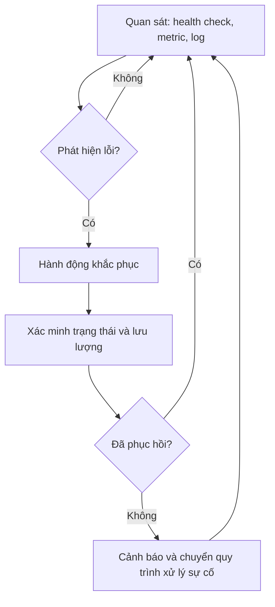
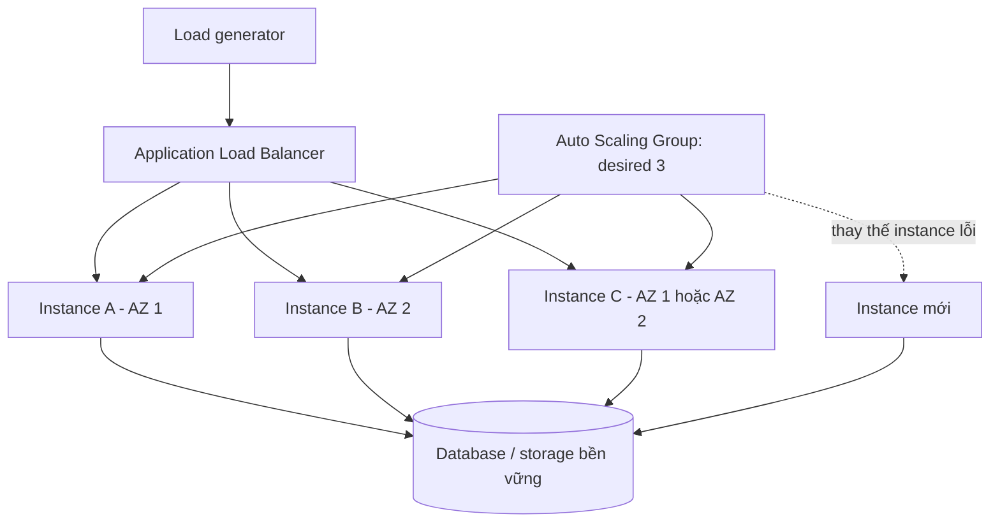

# Giả lập máy lỗi và xác minh cơ chế tự phục hồi

Một hệ thống có nhiều máy ảo hoặc node chỉ thực sự có khả năng chịu lỗi khi có thể phát hiện một thành phần ngừng hoạt động, chuyển lưu lượng sang thành phần khỏe mạnh và khôi phục đủ năng lực phục vụ trong thời gian mục tiêu. Việc bật Auto Scaling hoặc chạy nhiều replica chưa tự chứng minh hệ thống tự phục hồi. Cần tạo một lỗi có kiểm soát, quan sát phản ứng của từng lớp và xác nhận người dùng vẫn nhận được dịch vụ trong giới hạn đã cam kết.

Bài học thuộc chương **Thực hành triển khai và vận hành** trong module **CLOUD_CORE_SERVICES_COMPUTE**. Nội dung hướng dẫn mô phỏng lỗi máy ảo hoặc node, kiểm tra health check, load balancer, cơ chế thay thế instance, khả năng lập lịch lại workload và khôi phục lưu lượng. Các ví dụ sử dụng AWS Auto Scaling Group và Kubernetes để minh họa; có thể áp dụng cùng nguyên tắc cho Managed Instance Group, Virtual Machine Scale Set hoặc nền tảng điều phối container tương đương.

Sau bài học, người học có thể:

- Phân biệt lỗi tiến trình, lỗi máy ảo, lỗi node và lỗi vùng sẵn sàng.
- Mô tả vòng lặp phát hiện, quyết định, khắc phục và xác minh của cơ chế tự phục hồi.
- Chuẩn bị môi trường thử nghiệm có đủ capacity, health check và giám sát trước khi gây lỗi.
- Mô phỏng việc một instance hoặc worker node bị mất và quan sát quá trình thay thế.
- Đo thời gian phát hiện, thời gian phục hồi, tỷ lệ request lỗi và mức năng lực còn lại.
- Xác định giới hạn của tự phục hồi đối với dữ liệu trạng thái, dependency và lỗi diện rộng.

## 1. Tự phục hồi gồm những lớp nào?

Tự phục hồi (self-healing) là khả năng hệ thống phát hiện trạng thái không khỏe và tự thực hiện hành động khôi phục theo chính sách đã định. Một vòng lặp cơ bản gồm bốn bước: quan sát, phát hiện, hành động và xác minh.



Hành động khắc phục phụ thuộc vào lớp lỗi:

| Lớp | Dấu hiệu | Hành động có thể xảy ra | Điều cần xác minh |
|---|---|---|---|
| Tiến trình ứng dụng | Process thoát, deadlock hoặc health endpoint lỗi | Supervisor khởi động lại process; container runtime restart container | Process mới thực sự sẵn sàng và không lặp crash |
| Container hoặc Pod | Container dừng, Pod bị xóa hoặc không còn Ready | Deployment/ReplicaSet tạo Pod thay thế; scheduler đặt Pod lên node có capacity | Số replica Ready trở lại và Service có endpoint khỏe mạnh |
| Máy ảo | Instance bị terminate hoặc health check hạ trạng thái | Auto Scaling Group/Managed Instance Group tạo instance khác | Instance mới vào trạng thái InService, đăng ký target và phục vụ request |
| Worker node | Node mất kết nối hoặc ở trạng thái NotReady | Scheduler chuyển workload; node group hoặc node repair thay thế máy | Workload được phân bố lại và năng lực cluster trở lại |
| Vùng sẵn sàng | Nhiều instance hoặc đường mạng cùng lỗi | Load balancer chuyển traffic sang vùng còn hoạt động; nhóm máy mở rộng ở vùng khỏe | Capacity còn lại đủ chịu tải và dependency liên vùng hoạt động |

Các lớp này có thể phối hợp nhưng không thay thế nhau. Kubernetes có thể tạo Pod mới khi một Pod lỗi, nhưng không phải mọi cấu hình cluster đều tự tạo máy ảo mới khi node chết. Auto Scaling Group có thể thay máy ảo, nhưng không tự sửa lỗi logic của ứng dụng hoặc khôi phục dữ liệu đã mất. Cần xác định rõ thành phần nào chịu trách nhiệm ở từng lớp.

## 2. Xác định điều kiện thử nghiệm và tiêu chí thành công

Trước khi giả lập lỗi, hãy viết rõ điều cần chứng minh. Ví dụ: khi một instance trong nhóm ba máy bị terminate bất ngờ, load balancer ngừng gửi request đến instance đó, Auto Scaling Group tạo instance thay thế, instance mới vượt qua health check và tổng capacity trở lại mức mong muốn.

Chọn các tiêu chí đo được:

- **Detection time:** thời gian từ khi lỗi bắt đầu đến khi hệ thống đánh dấu thành phần không khỏe.
- **Mitigation time:** thời gian từ lúc phát hiện đến khi lưu lượng được chuyển khỏi thành phần lỗi hoặc workload được lập lịch lại.
- **Recovery time:** thời gian từ khi lỗi bắt đầu đến khi capacity hoặc dịch vụ trở lại trạng thái mục tiêu.
- **Availability trong thử nghiệm:** tỷ lệ request thành công trong toàn bộ cửa sổ gây lỗi và phục hồi.
- **Error budget tiêu thụ:** số lượng hoặc tỷ lệ request lỗi so với mục tiêu dịch vụ.
- **Capacity còn lại:** số instance/replica khỏe mạnh và mức sử dụng CPU, bộ nhớ, connection pool trong giai đoạn lỗi.
- **Data integrity:** xác nhận dữ liệu ghi trước, trong và sau sự cố không bị mất hoặc nhân đôi ngoài dự kiến.

Ví dụ tiêu chí cho một dịch vụ web thử nghiệm:

| Chỉ số | Mục tiêu minh họa |
|---|---|
| Số instance mong muốn | 3 instance ở ít nhất 2 Availability Zone |
| Số instance khỏe mạnh khi mất 1 máy | Tối thiểu 2 instance tiếp tục nhận request |
| Thời gian thay thế máy | Không quá 8 phút trong môi trường lab |
| Request thành công | Ít nhất 99% trong cửa sổ thử nghiệm |
| Phục hồi capacity | Trở lại 3 instance InService và healthy |
| Dữ liệu | Không mất bản ghi đã xác nhận thành công |

Các con số chỉ là ví dụ để xây dựng bài lab. SLO thật phải dựa trên đặc điểm ứng dụng, thời gian health check, thời gian khởi động, tải và giới hạn của nền tảng. Không dùng kết quả từ một lần thử để khẳng định mọi sự cố hoặc sự cố ở mọi vùng đều đáp ứng cùng thời gian.

## 3. Chuẩn bị môi trường an toàn

Thử nghiệm nên chạy trong tài khoản, project hoặc subscription lab riêng. Dùng một dịch vụ stateless có thể tạo lại từ image hoặc artifact đã kiểm thử; dữ liệu cần giữ phải nằm trên dịch vụ lưu trữ bền vững hoặc database có cơ chế backup và phục hồi phù hợp.

Trước khi gây lỗi, xác nhận các điều kiện sau:

1. Có quyền truy cập quản trị cần thiết và biết cách dừng bài lab.
2. Đã xác định chính xác nhóm máy, instance, node và load balancer thuộc môi trường thử nghiệm.
3. Desired capacity, minimum và maximum capacity được cấu hình đúng; còn quota và tài nguyên ở các Availability Zone.
4. Health check kiểm tra đúng ứng dụng, đúng cổng và đúng endpoint readiness.
5. Image, launch template hoặc node image có thể tạo máy thay thế mà không cần thao tác thủ công.
6. Log, metric, event và dashboard đã hoạt động trước khi gây lỗi.
7. Có ít nhất một client tạo request liên tục để quan sát tác động.
8. Đã lưu trạng thái ban đầu và có kế hoạch khôi phục cấu hình sau thử nghiệm.

Không thử terminate máy production, node dùng chung hoặc máy đang chứa dữ liệu duy nhất. Với môi trường nhiều nhóm cùng sử dụng, cần xác nhận phạm vi và cửa sổ thử nghiệm theo quy trình vận hành của tổ chức. Dừng thử nghiệm nếu thấy ảnh hưởng đến workload ngoài phạm vi lab.

### Kiến trúc lab mẫu



Load balancer phân phối request đến các target khỏe mạnh. Auto Scaling Group duy trì số lượng instance theo desired capacity. Khi một instance bị mất, nhóm phát hiện thành viên không còn tồn tại và tạo máy mới. Máy mới cần khởi động ứng dụng, đăng ký target và vượt health check trước khi nhận traffic. Thời gian phục hồi gồm cả thời gian khởi tạo máy và thời gian ứng dụng sẵn sàng.

## 4. Thực hành A: giả lập máy ảo lỗi với AWS Auto Scaling Group

Bài lab này dùng một Auto Scaling Group (ASG) có desired capacity bằng 3, minimum bằng 2, maximum ít nhất bằng 4, gắn với target group của Application Load Balancer. Nhóm máy được phân bố qua tối thiểu hai Availability Zone. Ứng dụng trả một endpoint `/health` và có thể ghi request ID để quan sát.

### Bước 1: Kiểm tra trạng thái ban đầu

Đặt các biến môi trường theo tài nguyên trong tài khoản lab. Ví dụ dưới đây dùng Bash và AWS CLI; thay tên nhóm và ARN bằng giá trị thực tế.

```bash
export AWS_REGION=ap-southeast-1
export ASG_NAME=compute-lab-asg
export TARGET_GROUP_ARN=arn:aws:elasticloadbalancing:ap-southeast-1:123456789012:targetgroup/compute-lab/abcdef1234567890
export SERVICE_URL=https://compute-lab.example.com/health

# Xem cấu hình và capacity của Auto Scaling Group
aws autoscaling describe-auto-scaling-groups \
  --auto-scaling-group-names "$ASG_NAME" \
  --region "$AWS_REGION" \
  --query 'AutoScalingGroups[0].[MinSize,DesiredCapacity,MaxSize,AvailabilityZones]' \
  --output table

# Xem trạng thái từng instance thuộc nhóm
aws autoscaling describe-auto-scaling-groups \
  --auto-scaling-group-names "$ASG_NAME" \
  --region "$AWS_REGION" \
  --query 'AutoScalingGroups[0].Instances[*].[InstanceId,LifecycleState,HealthStatus,AvailabilityZone]' \
  --output table

# Xem trạng thái target của load balancer
aws elbv2 describe-target-health \
  --target-group-arn "$TARGET_GROUP_ARN" \
  --region "$AWS_REGION" \
  --query 'TargetHealthDescriptions[*].[Target.Id,TargetHealth.State,TargetHealth.Reason]' \
  --output table

# Gửi request kiểm tra ứng dụng
curl -fsS "$SERVICE_URL"
```

Chỉ bắt đầu khi có đủ ba instance InService, health status Healthy và target group có đủ target healthy theo thiết kế. Nếu target chưa healthy, hãy sửa cấu hình health check hoặc ứng dụng trước khi mô phỏng lỗi; nếu bắt đầu từ trạng thái không ổn định, kết quả thử nghiệm sẽ khó diễn giải.

### Bước 2: Chạy tải nền và lưu baseline

Gửi request đều đặn đến URL qua load balancer trong vài phút. Có thể dùng công cụ load test của tổ chức hoặc một vòng lặp đơn giản ở môi trường lab:

```bash
for i in $(seq 1 120); do
  curl -sS -o /dev/null \
    -w "request=$i status=%{http_code} total=%{time_total}\n" \
    "$SERVICE_URL"
  sleep 1
done
```

Lưu tỷ lệ HTTP 2xx, 5xx, timeout, latency và target đang nhận traffic. Ghi lại số instance, target health, CPU, memory và log ứng dụng. Baseline giúp phân biệt lỗi do bài thử nghiệm với lỗi vốn đã tồn tại.

### Bước 3: Chọn một instance lab để gây lỗi

Lấy instance ID từ danh sách ASG, kiểm tra lại tên nhóm và tag môi trường. Không lấy ID bằng cách đoán. Lưu ID của một thành viên InService đang healthy:

```bash
export FAILED_INSTANCE_ID=i-0123456789abcdef0

aws ec2 describe-instances \
  --instance-ids "$FAILED_INSTANCE_ID" \
  --region "$AWS_REGION" \
  --query 'Reservations[0].Instances[0].[InstanceId,State.Name,Placement.AvailabilityZone,Tags]' \
  --output json
```

Đối chiếu instance ID với output của ASG và tag lab trước khi thực hiện. Mục tiêu của bài lab là mô phỏng máy bị mất đột ngột, vì vậy có thể terminate instance trong tài khoản lab:

```bash
aws ec2 terminate-instances \
  --instance-ids "$FAILED_INSTANCE_ID" \
  --region "$AWS_REGION"
```

Lệnh này xóa máy ảo được chỉ định. Chỉ chạy sau khi xác nhận đó là instance thử nghiệm, ứng dụng không lưu dữ liệu duy nhất trên ổ đĩa tạm của máy và đã có ít nhất hai instance khỏe mạnh tiếp tục phục vụ. Không chạy lệnh trên instance ngoài phạm vi lab.

### Bước 4: Quan sát phát hiện lỗi và thay thế

Theo dõi trạng thái ASG và target group trong khi client tiếp tục gửi request:

```bash
# Quan sát các instance và trạng thái lifecycle
aws autoscaling describe-auto-scaling-groups \
  --auto-scaling-group-names "$ASG_NAME" \
  --region "$AWS_REGION" \
  --query 'AutoScalingGroups[0].Instances[*].[InstanceId,LifecycleState,HealthStatus,AvailabilityZone]' \
  --output table

# Kiểm tra các hoạt động launch/terminate gần đây của ASG
aws autoscaling describe-scaling-activities \
  --auto-scaling-group-name "$ASG_NAME" \
  --region "$AWS_REGION" \
  --max-items 20 \
  --query 'Activities[*].[StartTime,StatusCode,Description,Cause]' \
  --output table

# Kiểm tra target group
aws elbv2 describe-target-health \
  --target-group-arn "$TARGET_GROUP_ARN" \
  --region "$AWS_REGION" \
  --output table
```

Kỳ vọng quan sát:

1. Instance bị terminate chuyển khỏi danh sách instance phục vụ hoặc được ghi nhận là đã chấm dứt.
2. ASG phát hiện capacity thấp hơn desired capacity và khởi chạy instance thay thế.
3. Instance mới đi qua các trạng thái lifecycle, khởi động ứng dụng và đăng ký với target group.
4. Target group chỉ gửi request đến target vượt qua health check.
5. Số instance InService và target healthy trở lại mức mục tiêu.

Không đánh đồng `running` với `healthy`. Máy ảo có thể đã running nhưng ứng dụng chưa mở cổng, chưa tải xong cấu hình hoặc chưa kết nối được database. Chỉ coi instance sẵn sàng khi health check của ứng dụng thành công và target được load balancer đánh dấu healthy.

### Bước 5: Xác minh dịch vụ trong toàn bộ cửa sổ lỗi

Đối chiếu log client với metric load balancer và ứng dụng. Xác định có request nào lỗi đúng thời điểm terminate, lỗi kéo dài bao lâu và sau khi target mới healthy thì latency có trở lại baseline không. Ghi lại thời điểm bắt đầu terminate, thời điểm ASG bắt đầu launch, thời điểm instance mới InService, thời điểm target healthy và thời điểm capacity phục hồi.

Nếu có một vài request lỗi trong khoảng chuyển tiếp, phân tích nguyên nhân: connection đang mở đến target bị mất, health check phát hiện chậm, retry của client, timeout, hoặc ứng dụng chưa sẵn sàng. Mục tiêu thử nghiệm là đo mức ảnh hưởng thực tế và so sánh với SLO đã đặt, không giả định failover luôn không có request lỗi.

## 5. Thực hành B: giả lập worker node lỗi trong Kubernetes

Kubernetes có thể khôi phục Pod được quản lý bởi Deployment hoặc StatefulSet khi Pod bị xóa hoặc node không còn khả dụng. Tuy nhiên, khả năng tạo node mới thường do node group, cluster autoscaler hoặc cơ chế node auto-repair của nền tảng đảm nhiệm. Cần xác minh cả hai lớp.

### Bước 1: Chuẩn bị workload có nhiều replica

Dùng một ứng dụng stateless trong namespace thử nghiệm, với ít nhất ba replica và đủ node để scheduler đặt lại Pod khi một node mất. Ví dụ Deployment rút gọn:

```yaml
apiVersion: apps/v1
kind: Deployment
metadata:
  name: web-lab
  namespace: resilience-lab
spec:
  replicas: 3
  selector:
    matchLabels:
      app: web-lab
  template:
    metadata:
      labels:
        app: web-lab
    spec:
      containers:
        - name: web
          image: nginx:1.27
          ports:
            - name: http
              containerPort: 80
          readinessProbe:
            httpGet:
              path: /
              port: http
            initialDelaySeconds: 3
            periodSeconds: 5
          livenessProbe:
            httpGet:
              path: /
              port: http
            initialDelaySeconds: 10
            periodSeconds: 10
```

Áp dụng manifest trong namespace lab đã được tạo và kiểm tra:

```bash
kubectl apply -f web-lab.yaml
kubectl rollout status deployment/web-lab -n resilience-lab
kubectl get pods -n resilience-lab -o wide
kubectl get nodes -o wide
```

Với môi trường thực tế, cần phân tán replica qua nhiều node hoặc zone bằng topology spread constraints/anti-affinity. Nếu cả ba Pod nằm trên cùng một node, mất node đó có thể làm mất toàn bộ replica cùng lúc. Đồng thời bảo đảm cluster còn CPU, memory và quota để đặt lại Pod.

### Bước 2: Phân biệt xóa Pod với mất máy

Có thể xóa một Pod để kiểm tra ReplicaSet tạo Pod mới:

```bash
kubectl delete pod <pod-name> -n resilience-lab
kubectl get pods -n resilience-lab -o wide --watch
```

Đây chỉ là phép thử controller khôi phục Pod. Nó không chứng minh cơ chế tự phục hồi khi máy ảo hoặc node bị lỗi. Để mô phỏng mất node, hãy dùng cluster lab có node group được quản lý, xác định instance ID của một worker node từ thông tin node và hạ tầng, rồi terminate đúng instance trong nhóm node thử nghiệm. Theo dõi Node chuyển sang `NotReady`, Pod được xử lý theo toleration/eviction và node group tạo máy thay thế. Thời gian phát hiện node mất có thể dài hơn thời gian xóa Pod chủ động.

Không dùng `kubectl drain` để tuyên bố đã mô phỏng máy chết: drain là thao tác bảo trì có kiểm soát, scheduler được thông báo trước và Pod được evict một cách graceful. Drain vẫn hữu ích để kiểm tra khả năng di chuyển workload khi bảo trì node, nhưng khác với lỗi đột ngột.

### Bước 3: Quan sát controller và scheduler

```bash
# Theo dõi node và trạng thái Ready
kubectl get nodes -o wide --watch

# Theo dõi Pod và node đang chạy Pod
kubectl get pods -n resilience-lab -o wide --watch

# Xem sự kiện mới nhất trong namespace
kubectl get events -n resilience-lab --sort-by=.lastTimestamp

# Xem trạng thái Deployment và số replica
kubectl describe deployment web-lab -n resilience-lab
```

Khi node bị mất, Kubernetes cần thời gian để nhận biết heartbeat đã ngừng, đánh dấu node `NotReady` và xử lý Pod theo chính sách eviction. Pod mới chỉ có thể chạy nếu còn node phù hợp và đủ tài nguyên. Nếu node group không tạo máy thay thế, cần kiểm tra desired size, autoscaling limits, subnet/IP, quota, launch template và lỗi khởi tạo node.

## 6. Health check quyết định thời điểm loại và nhận lại traffic

Health check quá nhạy có thể loại một instance đang hoạt động tốt do một đợt tải ngắn; health check quá lỏng có thể tiếp tục gửi traffic đến ứng dụng đã hỏng. Cần thiết kế các phép kiểm tra phù hợp với mục tiêu.

| Loại kiểm tra | Câu hỏi cần trả lời | Ví dụ |
|---|---|---|
| Liveness | Tiến trình còn sống và có thể tiếp tục không? | HTTP endpoint nội bộ xác nhận process không bị kẹt |
| Readiness | Instance có đủ điều kiện nhận request mới không? | Đã tải cấu hình, mở cổng và có dependency bắt buộc |
| Startup | Ứng dụng đã hoàn tất khởi động chưa? | Cho phép ứng dụng khởi tạo lâu trước khi áp dụng liveness |
| VM/instance health | Hạ tầng máy ảo có hoạt động bình thường không? | System status check và instance status check |
| Load balancer target health | Target có nhận request theo giao thức và đường dẫn kiểm tra không? | HTTP `/health` trên đúng port |

Readiness nên phản ánh khả năng phục vụ request, nhưng tránh gọi mọi dependency tùy chọn trong mỗi lần kiểm tra nếu điều đó làm một sự cố phụ khiến toàn bộ instance bị loại. Với dependency bắt buộc như database chính, cần định nghĩa rõ ứng dụng có thể hoạt động ở chế độ suy giảm hay phải ngừng nhận traffic.

Trong AWS Auto Scaling, health check type thường có thể là EC2 hoặc kết hợp ELB. Nếu chỉ dùng EC2 health check, một máy có thể vượt kiểm tra hạ tầng nhưng ứng dụng đã hỏng ở cấp HTTP. Nếu muốn ASG thay instance dựa trên tình trạng target của load balancer, cần cấu hình ELB health check cho ASG và target group đúng cách. Cần đặt health check grace period đủ cho thời gian khởi động bình thường; grace period quá dài làm chậm phát hiện lỗi mới, quá ngắn có thể terminate instance chưa kịp sẵn sàng.

Trong Kubernetes, readiness probe quyết định Pod có được coi là sẵn sàng để nhận traffic qua Service hay không; liveness probe có thể dẫn đến restart container; startup probe bảo vệ ứng dụng khởi động lâu khỏi bị liveness probe đánh dấu lỗi quá sớm. Probe phải kiểm tra đúng trạng thái cần thiết và có timeout, period, failure threshold phù hợp.

## 7. Xác minh dữ liệu và trạng thái sau khi máy được thay thế

Thay thế compute không đồng nghĩa dữ liệu tự được khôi phục. Instance mới có thể không chứa file được ghi vào ổ đĩa tạm của instance cũ. Container mới có thể được tạo trên node khác và không có dữ liệu local trước đó. Vì vậy, dịch vụ cần tách vòng đời compute khỏi vòng đời dữ liệu.

- Dữ liệu quan trọng nên lưu ở database, object storage hoặc volume có chính sách backup/replication phù hợp.
- Nếu dùng block volume gắn với instance, phải xác định hành vi detach/reattach, zone constraint và cơ chế phục hồi khi instance mất.
- Với StatefulSet, cần xác minh PersistentVolumeClaim, topology của volume, fencing và thời gian attach vào node mới.
- Dữ liệu trong memory hoặc local cache phải có thể tái tạo hoặc được xem là mất khi process/node biến mất.
- Với message processing, dùng acknowledgement đúng thời điểm, idempotency và retry có giới hạn để tránh mất hoặc xử lý trùng.

Sau khi thay thế máy, chạy kiểm tra đọc/ghi dữ liệu thử nghiệm, xác minh bản ghi đã commit trước sự cố còn tồn tại và đối chiếu số lượng sự kiện. Nếu workload là stateful, phải có bài lab riêng cho lỗi volume, database failover hoặc quorum; một phép thử terminate VM stateless không chứng minh khả năng phục hồi dữ liệu của hệ thống stateful.

## 8. Phân tích kết quả và chẩn đoán khi tự phục hồi không xảy ra

Nếu không có instance hoặc Pod thay thế, kiểm tra theo thứ tự:

1. **Cơ chế quản lý có nhận biết lỗi không?** Kiểm tra health status, node condition, ASG activity hoặc event của controller.
2. **Desired capacity có được duy trì không?** Kiểm tra min/desired/max, replica count, node group size và chính sách scale-in.
3. **Có đủ tài nguyên để tạo lại không?** Kiểm tra quota, subnet IP, capacity theo AZ, CPU/memory, node selector và taint/toleration.
4. **Image và cấu hình khởi động có hợp lệ không?** Kiểm tra launch template, image version, bootstrap, secret, IAM role và log khởi tạo.
5. **Health check có thể vượt qua không?** Kiểm tra port, path, protocol, security group, readiness và thời gian grace.
6. **Traffic có được chuyển đến target khỏe không?** Kiểm tra listener, target group, Service endpoint và DNS.
7. **Dependency có sẵn sàng không?** Kiểm tra database, queue, DNS nội bộ, storage, credential và giới hạn kết nối.

| Triệu chứng | Nguyên nhân có thể | Hướng kiểm tra |
|---|---|---|
| ASG không tạo instance mới | Desired capacity đã giảm, max capacity quá thấp hoặc activity bị lỗi | Kiểm tra desired/min/max và scaling activities |
| Instance mới liên tục bị terminate | Health check sai, ứng dụng crash hoặc bootstrap lỗi | Xem lifecycle, EC2 status, target health và log khởi động |
| Instance mới running nhưng không nhận traffic | Chưa đăng ký target hoặc target chưa healthy | Kiểm tra target group, listener, port và health path |
| Pod vẫn Pending sau node failure | Cluster hết tài nguyên hoặc ràng buộc scheduling không phù hợp | Xem `kubectl describe pod`, events, taint, affinity và quota |
| Node NotReady nhưng không có node mới | Node group không duy trì capacity hoặc cơ chế auto-repair chưa cấu hình | Kiểm tra node group, ASG, autoscaler và lỗi bootstrap |
| Request vẫn lỗi sau khi compute phục hồi | Dependency, dữ liệu hoặc connection pool vẫn lỗi | Kiểm tra trace, database, queue, retry và trạng thái ứng dụng |
| Pod mới chạy nhưng dữ liệu biến mất | Dữ liệu được lưu trên filesystem tạm hoặc volume không được gắn lại | Kiểm tra PVC, volume lifecycle, backup và nơi lưu dữ liệu |

Nếu máy thay thế liên tục bị lỗi, không nên để controller lặp vô hạn mà không có cảnh báo. Cần có alarm cho số lần launch thất bại, instance churn, Pod restart tăng cao, replica unavailable và thời gian phục hồi vượt SLO. Khi vượt ngưỡng, chuyển sang quy trình xử lý sự cố để tránh tạo thêm chi phí và tải lên dependency đang gặp vấn đề.

## 9. Mở rộng thử nghiệm: lỗi tiến trình và lỗi vùng

Sau khi kiểm tra lỗi một máy, có thể thực hiện thêm các thử nghiệm nhỏ hơn hoặc lớn hơn trong môi trường lab:

| Thử nghiệm | Cách mô phỏng | Kết quả cần quan sát |
|---|---|---|
| Process crash | Dừng process ứng dụng trong container thử nghiệm | Supervisor/container restart; readiness ngừng nhận traffic rồi trở lại |
| Pod bị xóa | Xóa một Pod do Deployment quản lý | ReplicaSet tạo Pod mới; Service cập nhật endpoint |
| Instance terminate | Terminate một instance thuộc ASG lab | ASG launch instance thay thế; load balancer loại target lỗi |
| Node mất | Dừng hoặc terminate worker node lab | Node condition thay đổi, workload được reschedule và node group phục hồi capacity |
| Một AZ không sẵn sàng | Trong môi trường mô phỏng chuyên dụng, ngăn capacity ở một AZ hoặc dùng công cụ fault injection được kiểm soát | Traffic chuyển sang AZ khác; capacity còn lại đủ phục vụ |
| Dependency lỗi | Dùng endpoint mock hoặc dependency thử nghiệm trả lỗi/timeout | Circuit breaker, retry và chế độ suy giảm hoạt động theo thiết kế |

Thử lỗi vùng có phạm vi ảnh hưởng lớn hơn lỗi một máy. Chỉ thực hiện khi môi trường được thiết kế để thử nghiệm, có giới hạn blast radius và có kế hoạch dừng. Không tự ý chặn subnet, route hoặc dịch vụ dùng chung để mô phỏng AZ failure. Nếu dùng dịch vụ fault injection của cloud, hãy giới hạn resource bằng tag, role và duration; đọc trước tác động dự kiến và điều kiện dừng.

## 10. Đo lường và lập biên bản thử nghiệm

Mỗi lần thử nên có một bản ghi gồm:

| Trường | Nội dung cần lưu |
|---|---|
| Experiment ID | Mã thử nghiệm duy nhất |
| Phạm vi | Account/project, region, cluster, ASG, node hoặc workload lab |
| Giả thuyết | Cơ chế nào dự kiến phát hiện và khôi phục lỗi |
| Điều kiện ban đầu | Capacity, replica, health, tải và trạng thái dependency |
| Tác động gây lỗi | Instance/Pod/node nào, thời điểm và phương thức mô phỏng |
| Phát hiện | Thời điểm đầu tiên health check/controller ghi nhận lỗi |
| Khắc phục | Thời điểm traffic chuyển, instance/Pod thay thế bắt đầu chạy |
| Xác minh | Thời điểm target healthy, replica Ready và request ổn định |
| Tác động | Request lỗi, latency, data integrity và chi phí phát sinh |
| Kết luận | PASS/FAIL, sai lệch với SLO và hành động tiếp theo |

Ví dụ bảng thời gian:

| Mốc | Thời điểm | Ý nghĩa |
|---|---|---|
| T0 | 10:00:00 | Gây lỗi instance thử nghiệm |
| T1 | 10:00:35 | ASG hoặc health check phát hiện lỗi |
| T2 | 10:01:10 | Target lỗi không còn nhận request mới |
| T3 | 10:02:20 | Instance thay thế InService |
| T4 | 10:03:05 | Target mới healthy và nhận request |
| T5 | 10:03:30 | Capacity và error rate trở lại mục tiêu |

Các thời điểm trên chỉ minh họa cách ghi nhận, không phải thời gian mặc định của AWS hoặc Kubernetes. Tính `detection time = T1 - T0`, `mitigation time = T2 - T0` và `recovery time = T5 - T0`. So sánh kết quả với mục tiêu đã thống nhất và lưu dashboard, log, event cùng trace có liên quan.

## 11. Dọn dẹp và đưa hệ thống về trạng thái ban đầu

Sau khi hoàn tất:

1. Xác nhận desired capacity, min/max, replica count và node group size trở về cấu hình ban đầu.
2. Kiểm tra không còn instance thử nghiệm ngoài dự kiến, target unhealthy hoặc Pod Pending.
3. Khôi phục cấu hình health check, alarm và load generator nếu đã thay đổi cho bài lab.
4. Dừng load generator và công cụ fault injection.
5. Kiểm tra dữ liệu thử nghiệm, volume, snapshot và log theo chính sách lưu giữ.
6. Xác nhận request kiểm tra qua endpoint dịch vụ thành công và dashboard không còn cảnh báo do thử nghiệm.
7. Ghi lại kết quả, thời gian phục hồi, sai lệch và việc cần cải thiện trước khi kết thúc.

Nếu dùng tài nguyên tính phí theo thời gian, xóa hoặc dừng tài nguyên lab không còn cần thiết theo hướng dẫn môi trường. Không xóa database, volume hoặc log cần giữ làm bằng chứng thử nghiệm.

## 12. Checklist xác minh cơ chế tự phục hồi

- [ ] Đã xác định rõ lỗi cần mô phỏng và phạm vi tài nguyên lab.
- [ ] Có baseline về capacity, health, latency, error rate và dữ liệu.
- [ ] Có ít nhất một bản sao workload khỏe mạnh và đủ capacity dự phòng.
- [ ] Health check phân biệt được máy đang chạy với ứng dụng thực sự sẵn sàng.
- [ ] Đã xác minh controller hoặc nhóm máy có chính sách thay thế thành phần lỗi.
- [ ] Đã gây lỗi đúng một thành phần thử nghiệm và ghi nhận thời điểm bắt đầu.
- [ ] Load balancer hoặc Service ngừng gửi request đến target không khỏe.
- [ ] Instance/node/Pod mới được tạo hoặc lập lịch lại theo thiết kế.
- [ ] Target hoặc replica mới vượt health/readiness check trước khi nhận traffic.
- [ ] Request success rate, latency và capacity trở lại mục tiêu.
- [ ] Dữ liệu đã commit được giữ nguyên; retry không tạo side effect trùng ngoài dự kiến.
- [ ] Đã kiểm tra cảnh báo khi phục hồi chậm hoặc không thể tạo capacity mới.
- [ ] Đã khôi phục cấu hình và dọn dẹp tài nguyên thử nghiệm.
- [ ] Đã lưu biên bản, số đo, log, event và hành động cải thiện.

Một bài thử tự phục hồi chỉ đạt khi hệ thống phát hiện đúng lỗi, khôi phục đúng lớp, đưa traffic trở lại thành phần khỏe mạnh và bảo toàn dữ liệu theo cam kết. Việc ghi nhận thời gian và tác động thực tế giúp xác định khoảng cách giữa cấu hình dự kiến với khả năng chịu lỗi thật của dịch vụ compute.
