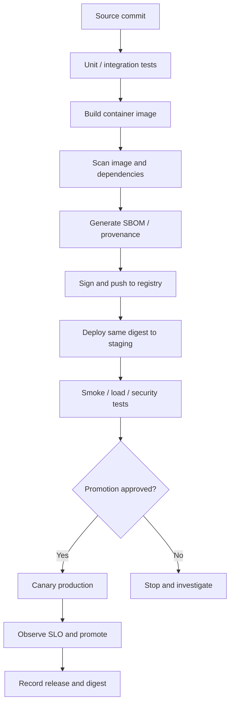

# Chuyển ứng dụng từ máy ảo sang container có quản lý

Trong dự án tổng hợp này, bạn sẽ chuyển một ứng dụng đang chạy trên máy ảo (VM) sang nền tảng container có quản lý. Mục tiêu là tạo được image có thể tái lập, triển khai bằng cấu hình khai báo, quản lý cấu hình và secret an toàn, kiểm soát tài nguyên, tự phục hồi khi container lỗi và phát hành phiên bản mới mà không phải đăng nhập cài đặt thủ công trên từng máy.

Chuyển từ VM sang container không chỉ là đóng gói thư mục ứng dụng thành image. Ứng dụng có thể đang phụ thuộc vào cấu hình trên host, file local, cron, systemd, firewall, địa chỉ IP cố định, thư viện hệ điều hành hoặc tiến trình phụ. Những phụ thuộc này cần được phát hiện và xử lý trước khi chuyển workload. Cũng cần xác định rõ phần nào được chuyển: thường nên bắt đầu với application tier stateless; database, queue và storage có thể tiếp tục chạy trên VM hoặc dịch vụ hiện tại trong giai đoạn đầu.

## 1. Mục tiêu và kết quả cần bàn giao

Giả định bạn được giao một ứng dụng web/API đang chạy trên một hoặc nhiều VM. Ứng dụng nhận HTTP request, đọc/ghi dữ liệu vào database, ghi log và có thể chạy worker nền. Nhiệm vụ là đưa application tier lên managed container platform, giữ tương thích nghiệp vụ và có thể rollback nếu cutover thất bại.

Sau capstone, cần bàn giao:

1. Workload inventory và sơ đồ kiến trúc hiện tại (as-is).
2. Danh sách phụ thuộc OS, network, storage, identity, database và scheduled task.
3. Quyết định phạm vi migration, target platform và lý do lựa chọn.
4. Dockerfile/multi-stage build và image đã được kiểm tra.
5. Cấu hình runtime tách khỏi image; secret được cấp qua cơ chế an toàn.
6. Manifest hoặc deployment specification cho managed container platform.
7. CI/CD pipeline tạo, quét, ký và triển khai image theo digest.
8. Health check, resource request/limit, autoscaling và graceful shutdown.
9. Kế hoạch kiểm thử, cutover, rollback và quan sát sau triển khai.
10. So sánh chi phí, rủi ro, giới hạn và tiêu chí nghiệm thu.

## 2. Phạm vi và giả định dự án

Để có thể thực hành độc lập, dùng mô hình tham chiếu sau và thay số liệu bằng dữ liệu thật nếu có:

| Thuộc tính | Giả định ban đầu |
|---|---|
| Ứng dụng | `orders-api`, ứng dụng Java cung cấp HTTP API |
| Nền tảng hiện tại | 2 VM application chạy Linux sau load balancer |
| Database | Database quan hệ chạy riêng; chưa chuyển trong đợt này |
| File | Upload và tài liệu nghiệp vụ nằm trong object storage hoặc shared storage; cần xác minh thực tế |
| Runtime | JRE 21, application artifact dạng JAR |
| Traffic | Có tải nền và peak; cần đo request rate/concurrency trước khi sizing |
| Target | Managed Kubernetes hoặc managed container platform có health check, rollout và autoscaling |
| Availability | Nhiều replica và phân bố qua failure domain mà nền tảng hỗ trợ |
| Release | CI build image; CD triển khai theo môi trường và digest |

Đây là giả định để minh họa, không phải yêu cầu bắt buộc về Java, Kubernetes hay số VM. Với ứng dụng .NET, Node.js, Python hoặc native binary, thay runtime/build stage tương ứng. Nếu workload cần Windows service, kernel module, GPU driver hoặc quyền truy cập host đặc biệt, phải xác minh target platform trước khi container hóa.

### Trong phạm vi

- Chuyển application process từ VM sang container.
- Quản lý vòng đời container bằng nền tảng có quản lý.
- Kết nối tới database và dịch vụ phụ trợ hiện hữu.
- Quản lý cấu hình, secret, logging, metrics, rollout và rollback.
- Thử nghiệm tải, phục hồi và vận hành.

### Ngoài phạm vi mặc định

- Chuyển database sang managed database trong cùng một đợt.
- Viết lại toàn bộ ứng dụng theo microservices.
- Thay đổi schema nghiệp vụ lớn.
- Thay đổi giao thức API công khai.
- Chuyển toàn bộ VM, network và storage của tổ chức cùng lúc.

Giới hạn phạm vi giúp tách rủi ro containerization khỏi rủi ro database migration hoặc tái cấu trúc kiến trúc. Có thể lập dự án tiếp theo cho các phần này sau khi application tier ổn định.

## 3. Xác định nền tảng container có quản lý

“Container có quản lý” có thể chỉ nhiều loại dịch vụ. Không nên mặc định mọi workload phải chạy Kubernetes.

| Lựa chọn | Nền tảng cung cấp | Đội ngũ vẫn phải quản lý | Khi cân nhắc |
|---|---|---|---|
| Managed Kubernetes | Control plane, API và một phần tích hợp vận hành | Worker/node pool tùy dịch vụ, workload, networking, storage, policy, upgrade và observability | Nhiều workload, cần scheduling linh hoạt, ecosystem Kubernetes và khả năng mở rộng platform |
| Managed container service | Control plane/orchestration và một phần hạ tầng chạy task/container | Image, task sizing, network, identity, scaling, logging và deployment policy | Ứng dụng container cần vận hành đơn giản hơn cluster tổng quát |
| Managed application/container platform | Runtime, routing, scaling và một phần deployment được trừu tượng hóa | Ứng dụng, cấu hình, dependency, quota, secret, data và quan sát | Team muốn tập trung vào ứng dụng và chấp nhận giới hạn platform |
| VM chạy container runtime tự quản lý | Chỉ cung cấp VM/compute cơ bản | OS, runtime, scheduler, patching, HA, upgrade và nhiều thành phần khác | Chỉ phù hợp khi cần kiểm soát host hoặc có lý do kỹ thuật cụ thể |

Đánh giá ít nhất các câu hỏi sau:

- Có hỗ trợ CPU architecture, OS/runtime và network cần thiết không?
- Có thể triển khai nhiều replica, health check và rolling update không?
- Có giới hạn thời gian chạy, memory, CPU, ephemeral disk hoặc số connection nào?
- Có hỗ trợ private networking, service identity, secret integration và encryption không?
- Có thể chạy workload trong nhiều zone/failure domain không?
- Có cơ chế autoscaling và quota phù hợp với peak không?
- Có log/metric/trace và audit trail cần thiết không?
- Ai chịu trách nhiệm patch node, nâng cấp control plane và bảo vệ image?
- Chi phí gồm control plane, worker, load balancer, storage, network, log và support ra sao?

Nếu ứng dụng chỉ có một vài service đơn giản, managed container service có thể giảm độ phức tạp so với Kubernetes. Nếu tổ chức đã có platform Kubernetes trưởng thành và nhiều workload dùng chung, triển khai vào cluster hiện hữu có thể hợp lý hơn. Quyết định phải dựa trên yêu cầu và năng lực vận hành thực tế.

## 4. Khảo sát VM hiện tại (as-is assessment)

Trước khi build image, thu thập cấu hình và hành vi thật của ứng dụng. Không chỉ đọc tài liệu cũ; cần kiểm tra process, file, network connection, scheduler và telemetry trong môi trường đang chạy.

### Inventory ứng dụng

| Nhóm | Câu hỏi cần trả lời | Bằng chứng |
|---|---|---|
| Process | Lệnh khởi động, user, PID, worker/thread và tiến trình con là gì? | systemd unit, process list, startup script |
| Runtime | JDK/JRE, thư viện native, locale, timezone và OS package nào cần? | Package inventory, runtime version, dependency scan |
| Config | File cấu hình, biến môi trường và tham số JVM nằm ở đâu? | Config files, service definition, deployment scripts |
| Secret | Password, token, private key, certificate được cấp và rotate thế nào? | Secret inventory, vault/keystore integration |
| Network | Port inbound/outbound, DNS, proxy, firewall và allowlist nào cần? | Firewall rules, flow logs, connection inventory |
| Storage | File nào cần giữ qua restart; file nào chỉ là cache/tmp? | Mount table, directory usage, application behavior |
| Database | Connection pool, driver, TLS, transaction và migration ra sao? | DB config, metrics, schema migration history |
| Scheduler | Cron/systemd timer hoặc batch task nào chạy trên VM? | crontab, timer units, scheduler inventory |
| Observability | Log, metrics, tracing, alert và agent nào đang hoạt động? | Monitoring config, dashboards, log pipeline |
| Recovery | Backup, restore, failover và rollback hiện tại thế nào? | Runbook, backup policy, DR test |

### Các lệnh khảo sát Linux tham khảo

```bash
# Process va service
ps -eo pid,ppid,user,comm,args --sort=pid
systemctl status orders-api
systemctl cat orders-api

# Port va ket noi dang lang nghe
ss -lntup
ss -tpn

# Filesystem va mount
df -hT
findmnt
du -xhd1 /var /opt 2>/dev/null

# Scheduler va package
crontab -l
systemctl list-timers --all
dpkg-query -W 2>/dev/null | head
rpm -qa 2>/dev/null | head
```

Các lệnh chỉ mang tính tham khảo; hệ điều hành và quyền truy cập có thể khác. Không đưa output có secret, token, dữ liệu cá nhân hoặc thông tin nhạy cảm vào tài liệu dự án. Chạy lệnh đọc cấu hình với quyền phù hợp và lưu kết quả đã được làm sạch.

### Tạo dependency map

Phân loại dependency thành:

- **Bắt buộc khi startup:** cấu hình hợp lệ, certificate, DNS, database connection nếu ứng dụng không thể khởi động thiếu nó.
- **Bắt buộc khi phục vụ request:** database, identity provider, service nội bộ.
- **Tùy chọn/degradable:** telemetry endpoint, recommendation service hoặc một số integration không ảnh hưởng request cốt lõi.
- **Vận hành:** log collector, metrics endpoint, secret provider, registry và deployment control plane.

Sơ đồ dependency nên ghi giao thức, port, hướng kết nối, timeout, authentication, owner và behavior khi dependency mất kết nối. Điều này sẽ trở thành đầu vào cho network policy và readiness semantics.

## 5. Phân loại state trước khi container hóa

Một VM thường chứa cả application binary lẫn dữ liệu phát sinh trong lúc chạy. Container cần tách rõ state vì container instance có thể bị thay thế bất cứ lúc nào.

| Dữ liệu trên VM | Phân loại | Cách xử lý khi chuyển |
|---|---|---|
| JAR/binary và runtime dependency | Artifact | Đóng gói vào image |
| File cấu hình môi trường | Configuration | ConfigMap/config file external hoặc platform configuration |
| Password/token/private key | Secret | Secret manager, workload identity hoặc secret mount |
| Log | Telemetry | stdout/stderr hoặc collector; gửi tới hệ thống tập trung |
| Cache có thể tạo lại | Ephemeral state | Memory, tmpfs hoặc ephemeral storage có giới hạn |
| File upload/tài liệu | Business data | Object storage hoặc persistent storage phù hợp |
| Database data | Persistent state | Giữ database hiện tại trong giai đoạn đầu hoặc migration riêng |
| Job checkpoint | Recovery state | Database/queue/object storage bền vững |
| PID/socket/temp file | Runtime ephemeral | Tạo lại trong container; không migrate như dữ liệu nghiệp vụ |

Nếu ứng dụng lưu file upload trong `/opt/orders/uploads` trên VM, việc đưa thư mục đó vào image sẽ tạo nhiều bản sao không đồng bộ. Cần chuyển sang object storage hoặc persistent volume có semantics phù hợp, rồi cập nhật ứng dụng để đọc/ghi qua interface rõ ràng.

## 6. Chuẩn bị ứng dụng để chạy trong container

Trước khi tạo image, xác minh ứng dụng đáp ứng các nguyên tắc:

- Chạy tiến trình chính ở foreground và thoát với exit code có ý nghĩa.
- Không phụ thuộc vào một hostname/IP cố định của VM.
- Nhận cấu hình từ environment hoặc file mount ngoài image.
- Nhận secret qua cơ chế riêng, không đóng gói vào source/image.
- Ghi log ra stdout/stderr hoặc dùng agent/volume được thiết kế rõ.
- Có readiness/liveness/startup signal phù hợp với ngữ nghĩa ứng dụng.
- Xử lý SIGTERM và đóng request/connection một cách có kiểm soát.
- Không lưu dữ liệu nghiệp vụ duy nhất trong writable layer.
- Có thể chạy nhiều replica mà không xung đột local state hoặc singleton scheduler.
- Có timeout, retry và connection pool giới hạn cho dependency.

### Xử lý singleton và scheduled task

Nếu VM hiện chạy cron job mỗi đêm, khi scale application từ 2 lên 5 replica, cron có thể chạy 5 lần. Hãy tách scheduled task thành Job/CronJob hoặc scheduler riêng, dùng distributed lock/idempotency khi cần và định nghĩa chính xác một lần chạy theo business key.

Nếu ứng dụng có local in-memory session, cần cân nhắc external session store, stateless token hoặc sticky session chỉ khi có lý do. Sticky session không giải quyết việc mất VM và có thể cản trở scale/failover.

## 7. Containerize ứng dụng bằng multi-stage build

Ví dụ với Java/Maven: stage build dùng JDK và Maven; stage runtime chỉ chứa JRE cùng JAR đã đóng gói.

```dockerfile
# syntax=docker/dockerfile:1.7
FROM maven:3.9-eclipse-temurin-21 AS build
WORKDIR /workspace

COPY pom.xml mvnw ./
COPY .mvn/ .mvn/
RUN chmod +x mvnw \
    && ./mvnw -B -ntp dependency:go-offline

COPY src/ src/
RUN ./mvnw -B -ntp package -DskipTests \
    && mkdir -p /out \
    && cp target/orders-api.jar /out/app.jar

FROM eclipse-temurin:21-jre
WORKDIR /app
COPY --from=build --chown=10001:10001 /out/app.jar /app/app.jar
USER 10001:10001
EXPOSE 8080
ENTRYPOINT ["java", "-jar", "/app/app.jar"]
```

Tên artifact `target/orders-api.jar` cần khớp với build output thật. Trong production, pin base image theo version/digest đã phê duyệt, chạy test trước khi đóng gói release và quét image. `EXPOSE` chỉ là metadata, không tự mở firewall hoặc publish port.

Tạo `.dockerignore` phù hợp:

```text
.git
.idea
.vscode
**/target
**/build
*.log
*.tmp
.env
.env.*
*.pem
*.key
secrets/
```

Không loại trừ file cần thiết cho build. Không đưa `application-prod.yml`, credential hoặc private key vào context nếu không cần. Dùng BuildKit secret mount cho credential cần thiết trong lúc tải dependency private.

### Build và chạy thử local

```bash
docker build -t orders-api:local .
docker image inspect orders-api:local
docker run --rm -p 8080:8080 \
  -e APP_PROFILE=local \
  orders-api:local
```

Xác minh process chạy non-root, port lắng nghe đúng, endpoint hoạt động, log ra stdout/stderr và container dừng đúng khi nhận SIGTERM. Không dùng secret production trong môi trường local.

## 8. Quản lý cấu hình và secret

Cùng một image phải có thể chạy ở development, staging và production bằng cấu hình ngoài image.

Ví dụ cấu hình không nhạy cảm:

```yaml
server:
  port: 8080
application:
  profile: production
  requestTimeout: 3s
database:
  host: orders-db.internal
  port: 5432
  name: orders
```

Ví dụ trên chỉ minh họa cấu trúc; password và credential không được lưu trong file này. Secret nên được cấp qua secret manager, workload identity hoặc secret mount được nền tảng hỗ trợ. Ưu tiên identity ngắn hạn thay cho access key dài hạn khi có thể.

Quy tắc:

- Tách config không nhạy cảm khỏi secret.
- Không commit secret vào Git, Dockerfile, image label hoặc build argument.
- Không log toàn bộ environment/config khi startup.
- Giới hạn quyền đọc secret theo service identity.
- Có quy trình rotate/revoke và kiểm tra ứng dụng nhận secret mới.
- Không dùng chung credential giữa dev/staging/prod.

Nếu platform mount secret thành file, kiểm tra quyền file, reload behavior và khả năng ứng dụng nhận phiên bản mới. Nếu secret chỉ được đọc lúc startup, rotation có thể yêu cầu restart có kiểm soát.

## 9. Thiết kế container stateless và externalize dữ liệu

Managed container platform có thể tạo, dừng hoặc thay container instance. Vì vậy, ứng dụng stateless nên lưu state bên ngoài:

- Database giữ dữ liệu nghiệp vụ và transaction.
- Object storage giữ file upload, export và artifact.
- Queue giữ công việc đang chờ.
- Shared session store hoặc token stateless giữ session theo thiết kế.
- Cache có thể tạo lại và có TTL.
- Checkpoint được lưu bền vững để batch/worker có thể tiếp tục.

Nếu cần persistent volume, xác định access mode, zone affinity, backup, restore, performance và behavior khi Pod reschedule. Persistent volume không tự động biến workload thành HA; storage backend và attach semantics vẫn có failure domain riêng.

Trong giai đoạn đầu, giữ database trên VM hiện tại có thể giảm phạm vi thay đổi. Khi application container đã ổn định, có thể thực hiện migration database riêng với kiểm thử consistency, replication, backup và rollback.

## 10. Thiết kế health check và graceful shutdown

Ba tín hiệu thường cần tách biệt:

| Tín hiệu | Mục đích | Hành vi khi thất bại |
|---|---|---|
| Startup | Ứng dụng đã hoàn tất khởi động chưa? | Nền tảng tiếp tục thử trong startup window; vượt ngưỡng có thể restart |
| Readiness | Instance có thể nhận traffic nghiệp vụ không? | Ngừng route traffic tới instance chưa sẵn sàng |
| Liveness | Process còn có thể tiếp tục hoạt động không? | Nền tảng có thể restart container |

Không để liveness phụ thuộc vào mọi dịch vụ bên ngoài. Nếu database tạm thời mất kết nối và liveness thất bại trên toàn bộ replica, hệ thống có thể tạo restart storm. Readiness có thể kiểm tra dependency bắt buộc để ngừng nhận request khi service không thể phục vụ.

Khi nhận SIGTERM, ứng dụng nên ngừng nhận request mới, đánh dấu not-ready, drain request đang chạy, đóng connection pool và thoát trước termination grace period. Nếu không, rollout có thể làm mất request hoặc tạo giao dịch dở dang.

## 11. Deployment manifest tham khảo

Ví dụ sau mô tả một Deployment chạy ba replica. Đây là cấu hình minh họa cho managed Kubernetes; cần điều chỉnh namespace, image digest, resource profile, probe path, secret reference, network policy và storage theo môi trường thật.

```yaml
apiVersion: apps/v1
kind: Deployment
metadata:
  name: orders-api
  namespace: production
  labels:
    app.kubernetes.io/name: orders-api
    app.kubernetes.io/component: api
spec:
  replicas: 3
  revisionHistoryLimit: 5
  selector:
    matchLabels:
      app.kubernetes.io/name: orders-api
  strategy:
    type: RollingUpdate
    rollingUpdate:
      maxSurge: 1
      maxUnavailable: 0
  template:
    metadata:
      labels:
        app.kubernetes.io/name: orders-api
    spec:
      terminationGracePeriodSeconds: 45
      securityContext:
        runAsNonRoot: true
        runAsUser: 10001
        runAsGroup: 10001
        seccompProfile:
          type: RuntimeDefault
      containers:
        - name: api
          image: registry.example.com/commerce/orders-api@sha256:REPLACE_WITH_VERIFIED_DIGEST
          ports:
            - name: http
              containerPort: 8080
          env:
            - name: APP_PROFILE
              value: production
            - name: DB_PASSWORD_FILE
              value: /var/run/secrets/database/password
          resources:
            requests:
              cpu: 500m
              memory: 768Mi
            limits:
              cpu: "2"
              memory: 1536Mi
          startupProbe:
            httpGet:
              path: /health/startup
              port: http
            periodSeconds: 5
            timeoutSeconds: 2
            failureThreshold: 30
          readinessProbe:
            httpGet:
              path: /health/ready
              port: http
            periodSeconds: 5
            timeoutSeconds: 2
            failureThreshold: 3
          livenessProbe:
            httpGet:
              path: /health/live
              port: http
            periodSeconds: 10
            timeoutSeconds: 2
            failureThreshold: 3
          securityContext:
            allowPrivilegeEscalation: false
            readOnlyRootFilesystem: true
            capabilities:
              drop: ["ALL"]
          volumeMounts:
            - name: tmp
              mountPath: /tmp
            - name: database-secret
              mountPath: /var/run/secrets/database
              readOnly: true
      volumes:
        - name: tmp
          emptyDir: {}
        - name: database-secret
          secret:
            secretName: orders-database-credentials
```

`REPLACE_WITH_VERIFIED_DIGEST` là placeholder, không phải image reference hợp lệ để deploy. Secret `orders-database-credentials` phải được tạo hoặc đồng bộ bởi secret manager integration; không đưa password vào manifest. `emptyDir` ở đây chỉ dành cho file tạm; dữ liệu nghiệp vụ không được lưu tại đó.

Readiness/liveness path cần được ứng dụng cung cấp và định nghĩa đúng semantics. Resource request/limit là số ví dụ; phải sizing theo load test và memory profile. `readOnlyRootFilesystem` có thể cần thêm writable mount cho `/tmp`, thư mục cache hoặc runtime file mà ứng dụng thực sự cần.

### Service và autoscaling

```yaml
apiVersion: v1
kind: Service
metadata:
  name: orders-api
  namespace: production
spec:
  selector:
    app.kubernetes.io/name: orders-api
  ports:
    - name: http
      port: 80
      targetPort: http
  type: ClusterIP
---
apiVersion: autoscaling/v2
kind: HorizontalPodAutoscaler
metadata:
  name: orders-api
  namespace: production
spec:
  scaleTargetRef:
    apiVersion: apps/v1
    kind: Deployment
    name: orders-api
  minReplicas: 3
  maxReplicas: 12
  metrics:
    - type: Resource
      resource:
        name: cpu
        target:
          type: Utilization
          averageUtilization: 65
```

HPA cần Metrics Server hoặc nguồn metrics tương thích và node capacity đủ để schedule Pod mới. CPU target không phải lúc nào cũng phản ánh bottleneck; với API I/O-bound, cần cân nhắc request concurrency, queue length hoặc custom metric. Không tăng maxReplicas vượt capacity database và downstream.

### Pod disruption budget

```yaml
apiVersion: policy/v1
kind: PodDisruptionBudget
metadata:
  name: orders-api
  namespace: production
spec:
  minAvailable: 2
  selector:
    matchLabels:
      app.kubernetes.io/name: orders-api
```

PDB hỗ trợ hạn chế voluntary disruption làm số Pod khả dụng xuống dưới ngưỡng. PDB không bảo vệ khỏi mọi loại lỗi node/zone và không thay thế capacity planning, topology spread hoặc ứng dụng chịu lỗi.

## 12. Network và kết nối tới hệ thống hiện hữu

Trong giai đoạn chuyển đổi, container có thể cần truy cập database, cache, message broker hoặc API vẫn chạy trên VM. Lập network flow matrix trước khi thay firewall:

| Source | Destination | Port/protocol | Mục đích | Kiểm soát |
|---|---|---|---|---|
| Managed container workload | Database hiện hữu | TCP port theo DB | Truy vấn/giao dịch | Private route, SG/firewall, TLS, DB identity |
| Managed container workload | Secret manager | HTTPS | Lấy secret/runtime credential | Workload identity và egress policy |
| Load balancer/ingress | Container Service | HTTP/TLS theo kiến trúc | Chuyển request | TLS termination, security group/network policy |
| Container workload | Logging/metrics endpoint | HTTPS hoặc protocol agent | Telemetry | Egress allowlist và authentication |
| CI/CD runner | Container registry | HTTPS | Push/pull image | Short-lived credential và repository permission |

Không mở rộng firewall theo kiểu “allow all” chỉ để container kết nối được. Cần xác định source identity, destination, port, TLS, DNS và đường đi. Nếu container platform dùng NAT hoặc egress gateway, tính cả giới hạn connection và phí network.

Đảm bảo database allowlist chấp nhận source range/identity mới của managed platform. Không dựa vào IP Pod thay đổi liên tục làm identity lâu dài. Dùng network identity hoặc security group/service identity theo khả năng nền tảng.

## 13. Bảo mật workload container

Các kiểm soát cơ bản:

- Chạy process bằng non-root user.
- Drop Linux capabilities không cần thiết và tắt privilege escalation.
- Dùng read-only root filesystem nếu ứng dụng tương thích.
- Giới hạn CPU, memory, ephemeral storage và số process khi platform hỗ trợ.
- Không mount Docker socket hoặc host filesystem nếu không có nhu cầu được phê duyệt.
- Dùng workload identity/service account có quyền tối thiểu.
- Quét base image và dependency; tạo SBOM và ký image.
- Deploy theo digest đã xác minh.
- Giới hạn ingress/egress và namespace/tenant isolation.
- Rotate secret/certificate và audit quyền truy cập.

Container không phải ranh giới bảo mật tuyệt đối. Cần patch host/runtime theo shared responsibility model, cập nhật base image, bảo vệ registry và giới hạn quyền của workload. Nếu platform quản lý worker node, xác định rõ provider chịu trách nhiệm phần nào và khách hàng vẫn cần làm gì.

## 14. CI/CD: build một lần, promote theo digest

Pipeline nên tách build artifact khỏi deploy môi trường:



Quy tắc quan trọng:

1. Build từ commit xác định và dependency được khóa.
2. Chạy test trước khi phát hành image.
3. Quét image và tạo SBOM/provenance.
4. Ký artifact và push vào registry riêng.
5. Ghi lại digest, source commit, build ID và scan result.
6. Deploy cùng digest qua staging, canary và production.
7. Không rebuild image khi promote chỉ để thay environment; inject config/secret lúc deploy.
8. Có approval, rollout status và rollback reference.

Image tag như `1.4.2` hữu ích cho con người, nhưng digest là định danh nội dung bất biến phù hợp để xác nhận đúng artifact đã kiểm tra. Registry retention cần giữ đủ phiên bản để rollback.

## 15. Kiểm thử trước khi chuyển traffic

Không chỉ kiểm tra container có start hay không. Cần xác minh hành vi nghiệp vụ, hiệu năng, bảo mật và phục hồi.

| Nhóm test | Nội dung | Tiêu chí ví dụ |
|---|---|---|
| Functional | API, transaction, validation, integration | Kết quả tương đương VM baseline |
| Configuration | Thiếu/sai config, secret rotation, env separation | Fail fast rõ ràng; không lộ secret |
| Health | Startup, readiness, liveness và shutdown | Không nhận traffic trước readiness; drain đúng |
| Network | DB, DNS, TLS, egress, ingress và timeout | Chỉ flow được phép hoạt động |
| Load | Baseline, peak, burst và soak | Đạt SLO với headroom đã định |
| Resilience | Kill container, node drain, dependency outage | Tự phục hồi trong mục tiêu; không mất transaction |
| Security | Image scan, non-root, policy, secret access | Không có vi phạm critical theo policy |
| Deployment | Rolling update, canary, rollback | Không gián đoạn vượt ngưỡng |
| Data | Upload, file, transaction, duplicate request | Dữ liệu nhất quán và không mất file |
| Operations | Log, metrics, alerts, runbook | On-call xác định được lỗi và owner |

### So sánh VM và container bằng cùng tải

Chạy cùng bộ request/test data trên hai môi trường. So sánh:

- p50/p95/p99 latency và throughput.
- Error rate, timeout và connection failure.
- CPU/memory utilization, throttling và GC.
- Startup/readiness time và thời gian scale-out.
- Database connections, query latency và pool wait.
- Chi phí compute, network, log và platform theo cùng kỳ.

Không so sánh VM chạy warm cache với container vừa khởi động rồi kết luận container chậm hơn. Ghi rõ cache state, số replica, resource limit, JVM flags, network path và thời gian warm-up.

## 16. Kế hoạch migration theo từng giai đoạn

### Giai đoạn 1 — Discover và baseline

- Xác định service owner, business owner, SLO, RTO/RPO và traffic profile.
- Inventory VM, process, package, config, secret, port, volume, cron và agent.
- Vẽ dependency map và phân loại dữ liệu/state.
- Đo baseline latency, throughput, resource usage và chi phí.
- Xác định hard constraints và target platform.

**Gate:** dependency và ownership đủ rõ; có baseline và phạm vi migration được phê duyệt.

### Giai đoạn 2 — Containerize và local validation

- Chỉnh ứng dụng để nhận config ngoài image, log stdout/stderr và graceful shutdown.
- Tạo Dockerfile multi-stage và `.dockerignore`.
- Tách file bền vững khỏi container filesystem.
- Build image, scan và chạy smoke test local.
- Xác minh non-root, health endpoint và dependency connection.

**Gate:** image có thể build tái lập, chạy đúng chức năng và không chứa secret.

### Giai đoạn 3 — Platform foundation

- Chuẩn bị namespace/project, network, identity, registry access và secret integration.
- Thiết lập resource quota, policy, logging, monitoring và deployment pipeline.
- Chuẩn hóa manifest/service definition và rollback reference.
- Kiểm tra capacity, autoscaling và failure domain.

**Gate:** môi trường target đáp ứng security, network, observability và operational readiness.

### Giai đoạn 4 — Deploy staging và kiểm thử

- Deploy theo image digest.
- Chạy functional, integration, load, security và resilience test.
- So sánh kết quả với VM baseline.
- Sửa resource, probe, timeout, connection pool và rollout settings.
- Diễn tập rollback.

**Gate:** đạt acceptance criteria và runbook đã được kiểm chứng.

### Giai đoạn 5 — Canary production

- Triển khai một replica hoặc tỷ lệ traffic nhỏ theo khả năng platform.
- Giữ VM path sẵn sàng phục vụ phần traffic còn lại.
- Theo dõi latency, error, database load, saturation và business metric.
- Tăng traffic theo từng bước khi các ngưỡng ổn định.

**Gate:** không vi phạm SLO, không có lỗi dữ liệu và có khả năng rollback.

### Giai đoạn 6 — Cutover và decommission có kiểm soát

- Chuyển traffic theo kế hoạch.
- Theo dõi sát sau cutover.
- Giữ VM ở trạng thái standby hoặc giảm capacity trong cửa sổ rollback đã thống nhất.
- Sau khi hết cửa sổ rollback, xác minh backup, dependency và chi phí trước khi decommission.

**Gate:** workload ổn định, owner chấp thuận và quy trình phục hồi đã được xác nhận.

## 17. Chọn chiến lược migration

| Chiến lược | Cách làm | Ưu điểm | Rủi ro/điều kiện |
|---|---|---|---|
| Rehost container runtime trên VM | Cài container runtime lên VM và chạy container | Thay đổi nền tảng ít | Vẫn tự quản lý VM/OS/orchestration; không đạt đầy đủ lợi ích managed platform |
| Replatform sang managed container | Đóng gói app và triển khai trên managed platform | Giảm quản lý host, chuẩn hóa rollout và scaling | Cần thích ứng network, storage, identity và runtime constraints |
| Strangler/incremental | Chuyển từng service/route hoặc component | Giảm blast radius và cho phép học dần | Tạm thời vận hành hai môi trường, routing và data consistency phức tạp |
| Big-bang cutover | Chuyển toàn bộ traffic trong một lần | Kết thúc coexistence nhanh | Rủi ro cao, rollback khó nếu data/schema đã đổi |

Với ứng dụng có nhiều dependency, thường nên bắt đầu bằng replatform/incremental cho application tier. Không cần chuyển database cùng lúc nếu việc đó làm tăng rủi ro và không phải mục tiêu bắt buộc.

## 18. Cutover traffic và quản lý coexistence

Trong giai đoạn VM và container cùng chạy, cần xác định:

- Load balancer/API gateway route traffic theo tỷ lệ hoặc theo header/path như thế nào.
- Hai phiên bản có cùng contract API và schema không.
- Cả hai có thể đọc/ghi database đồng thời an toàn không.
- Scheduled task có chạy trùng ở hai môi trường không.
- Session/cache có chia sẻ hoặc chuyển đổi đúng không.
- Webhook/event consumer có thể nhận duplicate không.
- Cách theo dõi traffic, error và business outcome theo version.

Một quy trình canary có thể tăng traffic theo mức 1% → 5% → 25% → 50% → 100%, nhưng tỷ lệ thực tế tùy traffic và khả năng routing. Ở mỗi bước, chờ đủ mẫu quan sát và kiểm tra p95/p99, error rate, database connection, queue lag và business invariant.

Không chạy hai consumer cùng xử lý một nguồn event nếu chưa có idempotency/partition ownership. Không chạy cron ở cả VM và container trong thời gian coexistence nếu task không idempotent hoặc không có distributed lock.

## 19. Rollback và xử lý dữ liệu

Rollback cần được thiết kế trước cutover. Một kế hoạch cơ bản:

1. Giữ VM image/config/version cuối cùng đã biết hoạt động.
2. Giữ container image digest và manifest của phiên bản mới.
3. Đảm bảo schema database tương thích với cả hai phiên bản trong cửa sổ rollback.
4. Nếu chỉ đổi routing, chuyển traffic về VM và xác minh health.
5. Nếu có thay đổi dữ liệu không tương thích, cần reverse migration hoặc forward-fix; không giả định chuyển traffic là đủ.
6. Kiểm tra queue, duplicate event, session và transaction đang chạy.
7. Ghi nhận thời điểm, dữ liệu và quyết định của incident commander/owner.

Ưu tiên expand-and-contract cho schema: thêm trường tương thích, deploy code có thể đọc/ghi cả schema cũ/mới, chuyển traffic, rồi chỉ xóa trường cũ sau khi rollback window kết thúc. Không thực hiện destructive migration cùng lúc với lần chuyển compute đầu tiên nếu có thể tránh.

## 20. Observability và vận hành sau migration

Container platform cần có telemetry ở cả cấp ứng dụng và nền tảng.

### Metrics

- Request rate, error rate, p50/p95/p99 latency.
- Replica count, ready replicas, restart count và rollout status.
- CPU/memory usage, throttling, OOM kill và ephemeral storage.
- Database connection pool, query latency và downstream error.
- Queue depth, oldest message age và worker throughput nếu có worker.
- Autoscaling event, pending Pod/task và node capacity.

### Logs và traces

- Log structured ra stdout/stderr với timestamp, service, environment, version và correlation ID.
- Không ghi password, token, cookie hoặc dữ liệu cá nhân không cần thiết.
- Truyền trace context qua API và message khi có thể.
- Gắn release ID/image digest để liên hệ lỗi với bản triển khai.
- Có retention và quyền truy cập phù hợp.

### Alert và runbook

Alert cần dựa trên SLO và dấu hiệu ảnh hưởng: error rate tăng, p99 vượt ngưỡng, replica không Ready, restart loop, OOM, database saturation hoặc queue age vượt SLA. Mỗi alert quan trọng cần owner, severity, runbook và bước xác minh.

## 21. Sizing, autoscaling và chi phí

Không copy nguyên cấu hình VM sang container request/limit. VM có thể được cấp dư CPU/RAM trong nhiều năm; container cần được sizing theo metric và giới hạn cgroup.

Quy trình sizing:

1. Đo CPU/memory working set của VM trong tải nền, peak và soak test.
2. Tách memory heap, native memory, cache, thread stack và overhead runtime.
3. Chọn request đủ để scheduler cấp capacity và limit phù hợp với peak đã kiểm chứng.
4. Kiểm tra CPU throttling và OOM behavior.
5. Đo startup time, readiness và scale-out delay.
6. Chọn min/max replicas theo SLO và capacity downstream.
7. Đưa vào chi phí node/compute, load balancer, storage, network, logging và managed platform fee.

So sánh chi phí toàn phần:

| Thành phần | VM hiện tại | Managed container |
|---|---|---|
| Compute | VM instance hours, OS/license | Pod/task allocation và worker/node capacity nếu tính riêng |
| Platform | Hypervisor/VM management | Control plane/platform fee nếu có |
| Storage | Boot/data disk, snapshot | Persistent volume, ephemeral storage, image registry |
| Network | LB, IP, egress, cross-zone | Ingress/LB, NAT, service networking, egress |
| Observability | Agent, log/metric backend | Container log/metric/trace ingest và retention |
| Operations | Patching, deployment, HA, on-call | Image maintenance, platform config, quota, policy, on-call |
| Migration | Có thể thấp trong hiện trạng | Build, test, chạy song song, training và decommission |

Managed container không mặc định rẻ hơn VM. Nó có thể giảm nhân lực và cải thiện utilization, nhưng phí platform, worker headroom, load balancer, logging và network có thể tăng. So sánh theo cùng tải, SLO, retention và thời gian phân tích.

## 22. Acceptance criteria cho capstone

Một migration chỉ được xem là sẵn sàng cutover khi đáp ứng tiêu chí đã thống nhất. Ví dụ:

| Nhóm | Tiêu chí nghiệm thu mẫu |
|---|---|
| Artifact | Image có version/digest, scan result và provenance; không chứa secret |
| Functional | Bộ test nghiệp vụ pass và kết quả tương đương VM baseline |
| Security | Non-root, quyền tối thiểu, secret externalized, ingress/egress được giới hạn |
| Reliability | Container restart không làm mất dữ liệu; replica phục hồi trong mục tiêu |
| Latency | p95/p99 không vượt SLO đã thống nhất trong tải đại diện |
| Capacity | Peak test đạt throughput mục tiêu, không OOM/throttling kéo dài ngoài ngưỡng |
| Deployment | Rolling/canary và rollback đã diễn tập thành công |
| Data | Không mất/nhân đôi transaction; file và checkpoint bền vững |
| Observability | Log, metric, trace và alert hoạt động; có owner/runbook |
| Cost | TCO và unit economics nằm trong ngân sách được phê duyệt hoặc có lý do chấp nhận |

Các con số phải do chủ workload xác định. Không tự chọn một p95 hoặc availability target chung cho mọi ứng dụng.

## 23. Rủi ro và biện pháp giảm thiểu

| Rủi ro | Dấu hiệu | Biện pháp |
|---|---|---|
| Phụ thuộc host bị bỏ sót | Container thiếu thư viện, file hoặc quyền | Inventory, dependency test và so sánh runtime behavior |
| Local state mất | File upload/session/checkpoint biến mất sau restart | Externalize state, persistent storage và restore test |
| Secret lộ trong image | Secret scan hoặc image layer chứa credential | Secret manager, rotate/revoke và rebuild artifact sạch |
| Database quá tải | Connection spike sau scale-out | Pool limit, concurrency cap, proxy và load test |
| Probe cấu hình sai | Restart loop hoặc traffic tới instance chưa sẵn sàng | Tách startup/readiness/liveness và test failure |
| CPU/memory sizing sai | Throttling, OOM hoặc chi phí dư thừa | Profile, request/limit tuning và soak test |
| Scheduled task chạy trùng | Email/billing/report bị nhân đôi | Tách scheduler, distributed lock và idempotency |
| Rollback không tương thích | Code cũ không đọc schema mới | Expand-and-contract, compatibility test và backup |
| Egress/network path sai | DB/API timeout hoặc chi phí tăng | Flow matrix, private routing và network cost review |
| Đội ngũ thiếu năng lực | Incident không xử lý được, rollout chậm | Training, managed support, runbook và ownership |

## 24. Kế hoạch thực hành theo deliverable

| Chặng | Công việc | Deliverable để review |
|---|---|---|
| A. Discover | Khảo sát VM, dependency, state và baseline | `assessment.md`, dependency diagram, baseline metrics |
| B. Design | Chọn target platform, security/network và migration strategy | ADR, target architecture, risk register |
| C. Package | Dockerfile, `.dockerignore`, config schema và image | Source changes, image digest, SBOM/scan result |
| D. Deploy | Manifest, service, probes, resources, secret integration | Rendered manifest, deployment record |
| E. Automate | CI build/scan/sign và CD promote/rollback | Pipeline definition, release metadata |
| F. Validate | Functional, load, resilience, security và data test | Test report và acceptance matrix |
| G. Cutover | Canary, traffic shift, monitoring và rollback readiness | Cutover runbook, decision log |
| H. Operate | Dashboard, alerts, owner, cost review và decommission | Runbook, dashboard links, TCO comparison |

Mỗi deliverable cần có owner và trạng thái. Nếu một bước không thể thực hiện vì thiếu quyền hoặc dịch vụ, ghi rõ blocker, tác động và phương án thay thế; không đánh dấu pass dựa trên giả định.

## 25. Ví dụ runbook cutover

**Trước cutover**

- Xác nhận release digest, manifest và config đã được phê duyệt.
- Xác nhận database connectivity, secret, DNS, TLS và network policy.
- Kiểm tra số replica Ready và autoscaling capacity.
- Xác nhận dashboard, alert, on-call và incident channel.
- Xác nhận VM version cũ vẫn có thể nhận traffic trong rollback window.
- Tạm dừng hoặc khóa scheduled task trùng giữa VM và container.
- Xác nhận backup và schema compatibility.

**Trong cutover**

1. Đưa một phần nhỏ traffic tới container.
2. Kiểm tra p95/p99, 4xx/5xx, business transaction và database load.
3. Tăng traffic theo từng bước đã định.
4. Theo dõi replica readiness, restart, OOM, queue lag và network errors.
5. Dừng rollout nếu bất kỳ hard threshold nào bị vi phạm.

**Sau cutover**

- Theo dõi sát trong cửa sổ hypercare.
- Đối soát số request/transaction và dữ liệu.
- Ghi nhận actual cost và resource utilization.
- Chỉ decommission VM sau khi owner xác nhận hết rollback window.
- Cập nhật inventory, service catalog, runbook và sơ đồ kiến trúc.

### Điều kiện rollback mẫu

- Error rate vượt ngưỡng trong nhiều cửa sổ đo liên tiếp.
- p95/p99 vi phạm SLO và không phục hồi sau khi scale/điều chỉnh đã được phê duyệt.
- Có lỗi dữ liệu, transaction duplicate hoặc file bị mất.
- Container restart loop, OOM hoặc replica không Ready làm thiếu capacity.
- Database/downstream bị quá tải do connection/concurrency từ workload mới.
- Security control hoặc audit evidence bắt buộc không hoạt động.

Rollback phải được kích hoạt theo runbook và quyền quyết định đã thống nhất. Nếu schema hoặc data đã thay đổi không tương thích, cần thực hiện recovery plan tương ứng thay vì chỉ đổi route về VM.

## 26. Những sai lầm thường gặp

- **Đóng gói nguyên VM thành một container:** kéo theo package, service và state không cần thiết. Xác định process boundary và chỉ đóng gói thành phần cần chạy.
- **Giữ dữ liệu trong container filesystem:** dữ liệu mất khi instance bị thay thế. Externalize state hoặc dùng persistent storage đúng semantics.
- **Nhúng config/secret production vào image:** image không thể promote an toàn và secret bị nhân bản. Tách config/secret khỏi artifact.
- **Copy sizing VM sang container:** dễ overprovision hoặc OOM/throttling. Đo working set và tune request/limit.
- **Chạy cron trên mọi replica:** task bị thực hiện nhiều lần. Tách scheduler hoặc dùng leader/lock/idempotency.
- **Dùng liveness kiểm tra database:** database outage khiến toàn bộ Pod restart. Tách liveness và readiness.
- **Không xử lý SIGTERM:** rollout cắt request và transaction. Drain và graceful shutdown.
- **Dùng tag thay digest khi deploy:** cùng tag có thể trỏ tới nội dung khác. Ghi và triển khai digest đã xác minh.
- **Mở firewall quá rộng:** migration hoạt động nhưng tăng attack surface. Dùng flow matrix và least privilege.
- **Scale worker không giới hạn:** database bị connection storm. Đặt concurrency cap và backpressure.
- **Cutover toàn bộ cùng lúc:** blast radius lớn và rollback khó. Dùng canary/staged rollout nếu kiến trúc cho phép.
- **Decommission VM ngay sau deploy:** mất đường rollback và bằng chứng. Chờ hết rollback window và xác nhận owner.
- **Chỉ so giá compute:** bỏ sót phí platform, log, network, storage và nhân lực. So sánh TCO cùng unit economics.

## 27. Checklist hoàn thành capstone

**Assessment và design**

- [ ] Có workload owner, SLO, RTO/RPO và traffic baseline.
- [ ] Đã inventory process, runtime, config, secret, network, storage, cron và monitoring trên VM.
- [ ] Đã lập dependency map và phân loại state.
- [ ] Đã chọn target platform theo yêu cầu và năng lực vận hành.
- [ ] Có migration strategy, risk register và hard constraints.

**Container và platform**

- [ ] Dockerfile multi-stage và `.dockerignore` được review.
- [ ] Image chạy non-root, không chứa secret và được định danh bằng digest.
- [ ] Config/secret được externalize và có rotation plan.
- [ ] Dữ liệu bền vững không phụ thuộc writable layer.
- [ ] Có startup/readiness/liveness semantics phù hợp.
- [ ] Có resource request/limit, autoscaling và capacity plan.
- [ ] Network flow, IAM, TLS và policy được kiểm tra.

**Delivery và validation**

- [ ] CI chạy test, build, scan, SBOM/provenance và ký image theo policy.
- [ ] CD promote cùng digest qua môi trường.
- [ ] Functional, integration, load, resilience, security và data tests pass.
- [ ] Canary/rolling deployment và rollback đã diễn tập.
- [ ] Không có scheduled task hoặc consumer chạy trùng ngoài ý muốn.

**Operations và closure**

- [ ] Dashboard, alerts, logs, traces và runbook sẵn sàng.
- [ ] Owner/on-call và shared responsibility được xác định.
- [ ] TCO và unit economics đã được so sánh với VM baseline.
- [ ] Cutover có rollback window và điều kiện dừng rõ.
- [ ] Data, dependency và transaction được đối soát sau cutover.
- [ ] VM chỉ được decommission sau khi owner xác nhận và hết rollback window.
- [ ] Inventory, service catalog và tài liệu vận hành được cập nhật.

## 28. Tiêu chí đánh giá kết quả học tập

Một bài thực hành đạt yêu cầu khi người thực hiện có thể giải thích và chứng minh:

1. Vì sao chọn managed container platform thay vì tiếp tục chạy VM hoặc dùng một lựa chọn managed khác.
2. Những phụ thuộc nào được phát hiện trên VM và cách xử lý từng phụ thuộc.
3. Vì sao image không chứa cấu hình môi trường, secret hoặc dữ liệu bền vững.
4. Cách đặt resource request/limit, probe, replica và autoscaling dựa trên số đo.
5. Cách CI/CD bảo đảm artifact đã kiểm tra là artifact được deploy.
6. Cách giữ database/network hiện hữu hoạt động trong giai đoạn coexistence.
7. Cách phát hiện lỗi, bảo toàn bằng chứng, rollback và đối soát dữ liệu.
8. Chi phí và năng lực vận hành thay đổi thế nào sau migration.

Người review nên yêu cầu bằng chứng từ manifest đã render, image digest, scan report, test report, dashboard, cutover runbook và cost comparison. Một bản thiết kế đẹp nhưng chưa chạy test hoặc chưa có rollback evidence chưa đủ để kết luận migration sẵn sàng production.

Chuyển ứng dụng từ VM sang container có quản lý là một thay đổi về cách đóng gói, triển khai, phục hồi và chịu trách nhiệm vận hành. Thành công phụ thuộc vào việc hiểu rõ workload hiện tại, tách artifact khỏi config và state, chuẩn hóa image/deployment, kiểm thử trên target platform và chuyển traffic theo từng bước có thể quan sát. Khi giữ được data integrity, SLO và đường rollback trong suốt migration, tổ chức có thể giảm công quản lý host và tạo nền tảng compute nhất quán hơn cho các lần phát hành tiếp theo.
