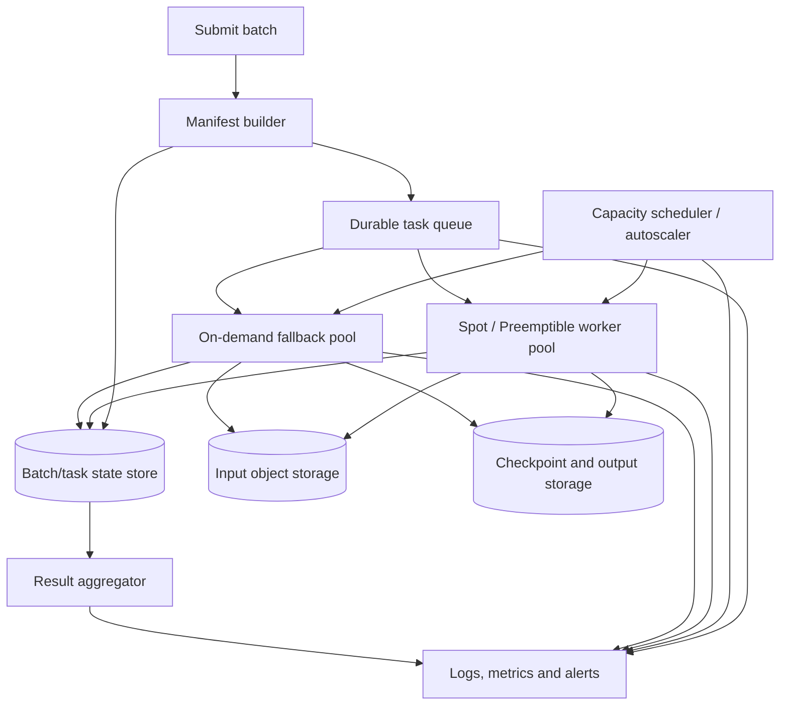
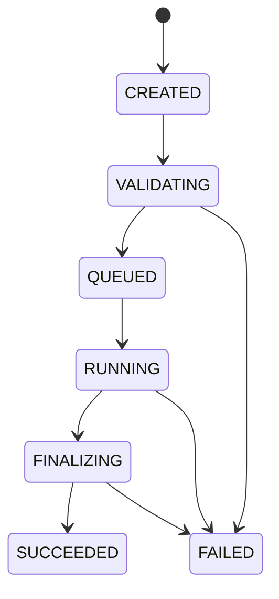
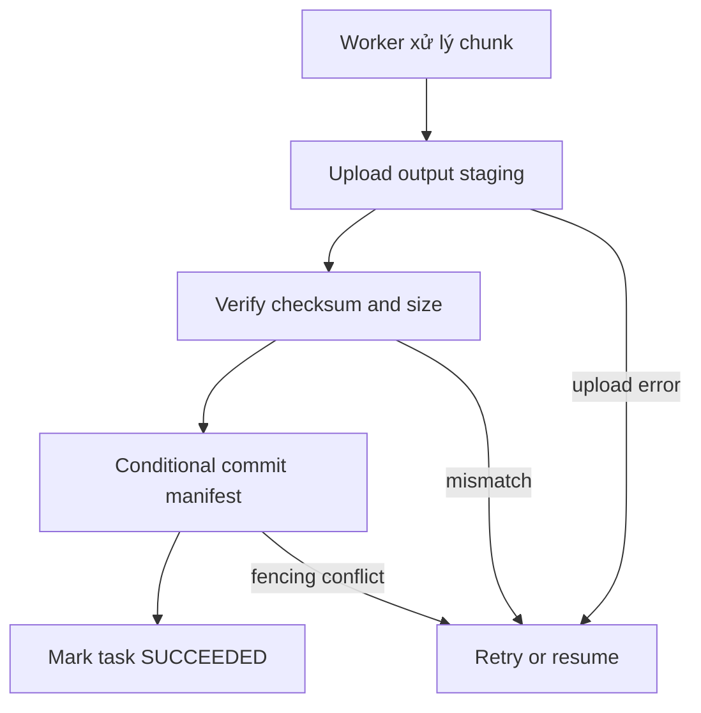

# Triển khai hệ thống batch trên capacity có thể bị thu hồi

Hệ thống batch xử lý một lượng công việc hữu hạn theo lô: chuyển mã video, phân tích dữ liệu, dựng báo cáo, xử lý ảnh, mô phỏng hoặc chạy các bước ETL. Những workload này thường có thể chia thành nhiều task độc lập và không cần phản hồi ngay cho người dùng. Vì vậy, chúng là ứng viên phù hợp để chạy trên capacity giá thấp có thể bị thu hồi như Spot, Preemptible hoặc interruptible VM.

Thách thức chính là instance có thể bị dừng trước khi hoàn tất. Một thiết kế batch tốt phải coi interruption là tình huống vận hành bình thường: task được chia nhỏ, trạng thái được lưu bền vững, worker có thể tiếp tục từ checkpoint, kết quả được commit idempotent và scheduler có thể phân phối lại công việc. Hệ thống cũng cần capacity ổn định cho control plane, queue và các tác vụ không thể bị gián đoạn, cùng cơ chế fallback khi Spot capacity không đủ.

Bài capstone này hướng dẫn thiết kế và triển khai một hệ thống batch có thể chạy trên capacity bị thu hồi ở nhiều cloud. Mục tiêu là tạo một pipeline có thể mở rộng ngang, chịu được worker bị dừng đột ngột, kiểm soát chi phí và chứng minh tính đúng đắn qua các bài kiểm thử failure.

## 1. Bài toán capstone

Xây dựng hệ thống xử lý một tập lớn tệp dữ liệu đầu vào. Mỗi tệp được chia thành các partition độc lập, worker xử lý từng partition rồi ghi output vào object storage. Hệ thống phải hoàn tất toàn bộ batch, kể cả khi một số worker Spot bị thu hồi, khởi động lại hoặc xử lý cùng task nhiều lần.

### Kịch bản tham chiếu

Một nhóm dữ liệu cần xử lý 50.000 tệp mỗi ngày. Mỗi tệp cần được kiểm tra, chuẩn hóa và chuyển thành một hoặc nhiều output. Khối lượng công việc tăng mạnh vào ban đêm. Thời gian hoàn tất mục tiêu là 4 giờ; từng task có thể chạy từ 2 đến 10 phút. Có thể chạy lại task nếu worker bị mất, nhưng không được tạo output trùng hoặc đánh dấu batch hoàn tất khi còn task chưa thành công.

| Thuộc tính | Yêu cầu ví dụ |
|---|---|
| Input | Object storage, manifest chứa danh sách tệp |
| Khối lượng | 50.000 tệp/batch |
| Đơn vị xử lý | Partition nhỏ, có ID ổn định |
| Thời gian task | 2-10 phút |
| Compute | CPU worker; có thể mở rộng nhiều instance type tương thích |
| Capacity | Ưu tiên Spot/Preemptible, có on-demand fallback giới hạn |
| Durability | Input, checkpoint, trạng thái task và output lưu ngoài worker |
| Correctness | Retry an toàn, idempotent output, không mất task |
| Completion target | Hoàn tất trong 4 giờ ở tải tham chiếu |
| Cost target | Giảm chi phí compute so với chạy toàn bộ on-demand |

Các con số trên dùng để minh họa thiết kế. Khi triển khai thật, cần đo thời gian xử lý, kích thước dữ liệu, tỷ lệ interruption và giá theo region/provider.

### Kết quả cần đạt

- Có thể submit một batch và theo dõi trạng thái đến khi hoàn tất.
- Task được chia nhỏ và phân phối qua queue hoặc scheduler.
- Worker chạy trên capacity có thể bị thu hồi.
- Worker lưu checkpoint định kỳ và xử lý tín hiệu shutdown/interruption.
- Task đang chạy được lease/heartbeat quản lý và có thể phân phối lại.
- Retry không tạo side effect trùng.
- Thiếu Spot capacity có thể chuyển sang pool khác hoặc fallback có kiểm soát.
- Có metric, log, dashboard và cảnh báo về backlog, interruption, retry và chi phí.
- Có bài kiểm thử cố ý dừng worker để chứng minh khả năng phục hồi.

## 2. Kiến trúc tổng thể

Một hệ thống batch có thể tách thành control plane và worker data plane.

- **Control plane:** nhận batch, tạo manifest, chia task, quản lý trạng thái, quyết định retry, autoscaling và báo cáo kết quả.
- **Worker data plane:** lấy task, xử lý dữ liệu, ghi checkpoint và output.
- **Durable services:** queue, database/state store, object storage, registry, logging và metrics.
- **Compute pools:** Spot/Preemptible pool là capacity chính; on-demand pool có thể dùng cho control plane hoặc fallback.



Control plane và state store nên chạy trên dịch vụ bền vững hoặc capacity ổn định. Không nên đặt queue coordinator duy nhất trên một Spot VM: nếu nó bị thu hồi, hệ thống có thể mất khả năng điều phối ngay khi cần phục hồi worker.

### Luồng xử lý

1. Người dùng submit batch và cung cấp input manifest cùng cấu hình xử lý.
2. Manifest builder kiểm tra input, tạo batch ID và chia công việc thành task có ID ổn định.
3. Task metadata được ghi vào state store; task sẵn sàng được đưa vào queue.
4. Scheduler quan sát backlog, deadline, Spot availability và quota rồi điều chỉnh worker pool.
5. Worker nhận task, lấy lease, đọc input và tiếp tục từ checkpoint hợp lệ nếu có.
6. Worker xử lý theo chunk, ghi checkpoint/output bền vững rồi cập nhật tiến độ.
7. Khi hoàn tất, worker commit kết quả idempotent và đánh dấu task thành công.
8. Aggregator kiểm tra toàn bộ task và tạo batch summary.
9. Nếu worker bị thu hồi, lease hết hạn hoặc task được retry; một worker khác tiếp tục xử lý.

## 3. Chọn đơn vị công việc và chia partition

Khả năng chịu interruption phụ thuộc nhiều vào kích thước task. Task quá lớn làm tăng lượng công việc phải chạy lại; task quá nhỏ tạo overhead cho queue, scheduler, metadata và startup.

### Chọn kích thước task

Hãy cân bằng:

- Thời gian xử lý mỗi task.
- Thời gian khởi động worker và tải input.
- Tần suất checkpoint.
- Xác suất worker bị thu hồi trong thời gian task.
- Overhead tạo, nhận và commit message.
- Khả năng chạy song song và thứ tự phụ thuộc.
- Deadline của toàn batch.

Nếu một task thường mất 8 giờ, interruption giữa chừng có thể làm mất nhiều compute. Có thể chia thành chunk 5-10 phút hoặc checkpoint tiến độ định kỳ. Nếu task chỉ mất vài giây, overhead queue và checkpoint có thể lớn hơn phần compute; nên gom nhiều record thành batch nhỏ.

### Partition phải có định danh ổn định

Một task ID không nên phụ thuộc vào thứ tự worker nhận task. Có thể tạo ID từ batch ID, input object version và partition index.

Ví dụ:

```text
batch_id      = batch-20261122-001
input_version = manifest-sha256-...
partition_id  = part-000042
task_id       = batch-20261122-001:part-000042
```

Khi submit lại cùng manifest, hệ thống có thể nhận diện batch đã tồn tại hoặc tạo batch mới theo idempotency key. Không tạo task ID ngẫu nhiên mới cho mỗi lần retry vì sẽ khó phát hiện duplicate.

### Manifest bất biến

Manifest nên ghi rõ danh sách input, version/ETag/checksum, partition boundaries, processor version và tham số xử lý. Không để một batch đang chạy đọc một manifest bị thay đổi âm thầm. Nếu cần thay input hoặc logic, tạo batch version mới.

## 4. Mô hình trạng thái batch và task

State store là nguồn sự thật cho tiến độ. Queue chỉ giúp phân phối công việc; không nên dùng queue depth làm bằng chứng duy nhất rằng batch đã hoàn tất.

### Trạng thái batch



### Trạng thái task

| Trạng thái | Ý nghĩa | Chuyển tiếp thường gặp |
|---|---|---|
| `PENDING` | Đã tạo nhưng chưa được worker claim | `LEASED`, `CANCELLED` |
| `LEASED` | Worker đang giữ lease | `RUNNING`, `PENDING`, `FAILED` |
| `RUNNING` | Đang xử lý | `CHECKPOINTED`, `SUCCEEDED`, `RETRY_WAIT` |
| `CHECKPOINTED` | Có tiến độ bền vững để resume | `LEASED`, `SUCCEEDED` |
| `RETRY_WAIT` | Đợi thời điểm retry | `PENDING`, `FAILED` |
| `SUCCEEDED` | Output đã commit và xác minh | Trạng thái cuối |
| `FAILED` | Vượt retry hoặc lỗi permanent | Trạng thái cuối, cần xử lý |
| `CANCELLED` | Bị hủy theo yêu cầu | Trạng thái cuối |

State transition cần được bảo vệ bằng conditional update/transaction. Một worker cũ không được ghi đè trạng thái của worker mới sau khi lease đã hết hạn.

### Task record tham khảo

```json
{
  "task_id": "batch-20261122-001:part-000042",
  "batch_id": "batch-20261122-001",
  "status": "RUNNING",
  "attempt": 2,
  "lease_owner": "worker-spot-a17",
  "lease_expires_at": "2026-11-22T23:10:00Z",
  "fencing_token": 7,
  "checkpoint_uri": "s3://batch-state/checkpoints/part-000042.json",
  "input_uri": "s3://batch-input/data-042.parquet",
  "processor_version": "sha256:..."
}
```

Ví dụ chỉ minh họa schema; field và kiểu dữ liệu cần phù hợp database/state store thực tế. Lease expiry phải dùng thời gian UTC và có quy tắc đồng hồ nhất quán.

## 5. Lease, heartbeat và fencing token

Worker có thể mất kết nối hoặc bị thu hồi trước khi gửi thông báo. Scheduler cần phát hiện task bị bỏ lại và phân phối lại sau một khoảng thời gian.

### Lease

Lease là quyền xử lý task có thời hạn. Khi claim task, worker ghi `lease_owner` và `lease_expires_at`. Worker định kỳ heartbeat để gia hạn. Nếu heartbeat ngừng và lease hết hạn, coordinator có thể đưa task về trạng thái có thể retry.

Lease không chứng minh worker cũ đã dừng. Worker có thể bị network partition và tiếp tục chạy trong khi worker mới đã claim task. Vì vậy cần fencing token.

### Fencing token

Mỗi lần task được claim, coordinator cấp một token tăng đơn điệu. Output commit chỉ được chấp nhận nếu token còn mới nhất. Worker cũ có token thấp hơn sẽ bị từ chối khi cố ghi kết quả sau khi lease đã chuyển.

### Quy tắc heartbeat

- Heartbeat thường xuyên hơn lease duration đủ để phát hiện worker mất kết nối.
- Có timeout và jitter để nhiều worker không heartbeat cùng một thời điểm.
- Không heartbeat vô hạn khi worker đã gặp lỗi permanent.
- Khi đang shutdown, worker ngừng nhận task mới và ghi trạng thái/checkpoint cuối.
- Lease duration phải lớn hơn khoảng gián đoạn bình thường của network/runtime nhưng không quá dài khiến task lỗi bị treo lâu.

## 6. Checkpoint và resume

Checkpoint lưu tiến độ đủ để worker mới tiếp tục mà không phải xử lý lại toàn bộ task. Checkpoint phải nằm trên storage bền vững, độc lập với instance có thể bị thu hồi.

### Nội dung checkpoint

- Task ID, batch ID và partition ID.
- Input version/checksum.
- Processor version và cấu hình xử lý.
- Offset, cursor, record index hoặc chunk đã hoàn tất.
- URI của intermediate output.
- Checksum và kích thước output.
- Fencing token hoặc generation tương ứng.
- Timestamp và schema version.

### Ghi checkpoint an toàn

1. Xử lý một chunk nhỏ.
2. Ghi intermediate output vào object storage với key riêng theo task/chunk/version.
3. Xác minh upload hoàn tất và checksum đúng.
4. Ghi checkpoint metadata bằng conditional update.
5. Chỉ sau đó mới coi chunk đã commit.

Không cập nhật checkpoint trước khi output bền vững. Nếu worker chết giữa bước upload và metadata commit, output có thể trở thành orphan nhưng task vẫn có thể xử lý lại an toàn. Một cleanup job có thể thu hồi artifact không được tham chiếu sau thời gian retention.

### Checkpoint định kỳ

Checkpoint quá thường xuyên làm tăng I/O và chi phí; quá thưa làm tăng lost work khi interruption. Có thể chọn chu kỳ theo thời gian, số record hoặc dung lượng output.

Một cách ước lượng ban đầu là đặt checkpoint interval nhỏ hơn đáng kể so với thời gian task và interruption window kỳ vọng, sau đó benchmark overhead và lost-work thực tế. Không có chu kỳ chung phù hợp mọi workload.

### Resume validation

Worker mới phải xác minh checkpoint tương thích với input version, processor version và schema. Nếu code đã thay đổi không tương thích, không nên tiếp tục từ checkpoint cũ một cách mù quáng; cần migrate checkpoint hoặc chạy lại task với version mới.

## 7. Idempotency và commit output

Spot interruption thường tạo at-least-once execution: một task có thể được chạy nhiều lần. Hệ thống phải bảo đảm kết quả cuối cùng đúng dù task bị giao lặp.

### Idempotent output

- Dùng object key xác định theo batch/task/output version.
- Dùng conditional write hoặc transaction để tránh ghi đè kết quả mới hơn.
- Ghi output vào staging key, xác minh checksum rồi publish manifest/commit marker.
- Chỉ chuyển task sang `SUCCEEDED` khi output đã bền vững và được xác minh.
- Dùng idempotency key cho side effect bên ngoài.

### Atomic publish pattern

Một pattern an toàn là ghi output vào vùng tạm riêng rồi commit một manifest nhỏ làm dấu hiệu output hợp lệ.



Không để downstream consumer đọc tất cả file trong staging prefix như output chính thức. Chỉ những object được tham chiếu từ manifest commit mới được xem là kết quả hợp lệ.

### Side effect bên ngoài

Nếu task gọi API thanh toán, gửi email hoặc cập nhật hệ thống khác, object storage idempotency không đủ. Cần idempotency key được downstream hỗ trợ, transactional outbox hoặc workflow state để tránh thực hiện side effect hai lần.

## 8. Xử lý interruption và shutdown

Interruption notice có thể cho worker một khoảng thời gian ngắn để dừng. Thời gian cảnh báo, signal và mức độ đảm bảo khác nhau theo provider và loại capacity. Thiết kế không được phụ thuộc duy nhất vào việc nhận notice.

### Trình tự shutdown

1. Đánh dấu worker là `DRAINING` để scheduler không giao task mới.
2. Ngừng poll/claim task mới.
3. Nếu task đang chạy, hoàn tất chunk hiện tại nếu kịp.
4. Ghi checkpoint/output an toàn.
5. Cập nhật trạng thái task hoặc để lease hết hạn nếu không còn thời gian commit.
6. Flush log/metric cần thiết.
7. Thoát process trước deadline nếu có thể.

### Ví dụ pseudocode xử lý tín hiệu dừng

```python
import signal
import threading

shutdown_requested = threading.Event()

def request_shutdown(signum, frame):
    shutdown_requested.set()

signal.signal(signal.SIGTERM, request_shutdown)
signal.signal(signal.SIGINT, request_shutdown)

def run_task(task):
    progress = load_valid_checkpoint(task)
    for chunk in task.chunks_from(progress):
        if shutdown_requested.is_set():
            save_checkpoint_atomically(task, progress)
            return "INTERRUPTED"

        result = process_chunk(chunk)
        persist_chunk_output(task, chunk, result)
        progress = chunk.next_offset
        save_checkpoint_atomically(task, progress)

    commit_task_output(task, progress)
    return "SUCCEEDED"
```

Đây là pseudocode. Worker thực tế cần xử lý race giữa shutdown và commit, kiểm tra fencing token trước khi ghi, có timeout cho storage và không bắt đầu checkpoint mới nếu thời gian còn lại không đủ. Signal handler nên làm ít việc nhất; phần I/O được thực hiện trong luồng điều khiển an toàn.

### Không chỉ dựa vào interruption notice

Instance có thể mất đột ngột do host failure, network partition hoặc sự cố khác. Lease expiry, heartbeat, checkpoint định kỳ và idempotency mới là cơ chế phục hồi nền tảng. Notice chỉ giúp giảm lượng công việc phải làm lại.

## 9. Chọn và đa dạng hóa Spot capacity pool

Một capacity pool thường được xác định bởi zone, instance family/type, size và các thuộc tính phần cứng. Nếu scheduler chỉ yêu cầu một loại máy ở một zone, khả năng khởi chạy có thể thấp khi pool đó cạn.

### Diversification

- Khai báo nhiều instance type có hiệu năng tương đương.
- Chọn nhiều zone trong cùng region nếu yêu cầu dữ liệu cho phép.
- Dùng nhiều family/architecture nếu binary và image tương thích.
- Đặt capability constraint cho GPU, memory, local disk hoặc instruction set.
- Tránh phụ thuộc một pool có giá thấp nhất tại thời điểm tạo job.

### Allocation strategy

Provider có thể cung cấp chiến lược chọn pool theo capacity availability, price hoặc cân bằng giữa nhiều pool. Với batch có deadline, ưu tiên xác suất có capacity và thời gian hoàn tất hơn là chỉ chọn giá thấp nhất. Tên và semantics của strategy khác nhau giữa provider.

### Ví dụ pool policy

```yaml
worker_pool:
  capacity_type: interruptible
  allowed_zones:
    - zone-a
    - zone-b
    - zone-c
  instance_families:
    - general-purpose
    - compute-optimized
  min_vcpu: 4
  min_memory_gib: 16
  max_workers: 200
  fallback:
    enabled: true
    max_on_demand_workers: 20
    trigger: backlog_deadline_risk
```

Đây là cấu hình khái niệm, không phải schema triển khai của một provider. Cần ánh xạ thành node group, scale set, instance fleet hoặc autoscaling policy tương ứng.

### Kiểm tra compatibility

Đa dạng instance type chỉ có ích nếu workload chạy được trên chúng. Kiểm tra CPU architecture, memory, network throughput, local disk, GPU driver, container image và native dependency. Nếu có nhiều profile khác nhau, tạo queue hoặc worker class riêng.

## 10. Scheduler, autoscaling và fallback

Scheduler cần cân bằng ba yếu tố: deadline batch, backlog và capacity có thể cấp phát. Chỉ scale theo CPU của worker là chưa đủ vì queue có thể đang tồn đọng trong khi không có worker nào hoạt động.

### Metric đầu vào

- Queue depth và oldest message age.
- Số task `PENDING`, `RUNNING`, `RETRY_WAIT`.
- Thời gian xử lý trung bình/p95 của task.
- Batch deadline và thời gian còn lại.
- Worker active, draining, starting và failed.
- Spot launch success/failure và interruption rate.
- On-demand fallback utilization.
- Dependency saturation như storage throughput hoặc database connection.

### Ước lượng worker cần thiết

Một phép ước lượng đơn giản:

\[
N_{workers} \approx \frac{N_{tasks} \times T_{task}}{T_{remaining} \times U}
\]

Trong đó `N_tasks` là số task còn lại, `T_task` là thời gian xử lý trung bình, `T_remaining` là thời gian còn tới deadline và `U` là utilization mục tiêu (nhỏ hơn 1 để dành headroom). Kết quả cần được giới hạn bởi quota, dependency capacity và số worker tối đa.

Ví dụ: còn 12.000 task, trung bình 4 phút/task, còn 120 phút và utilization mục tiêu 0,8. Ước lượng ban đầu là 500 worker. Đây chỉ là capacity compute lý thuyết; cần tính thời gian startup, phân phối task, storage throughput, retry và giới hạn provider.

### Fallback policy

Không nên tự động chuyển toàn bộ backlog sang on-demand ngay khi Spot launch thất bại vài lần. Fallback cần dựa trên deadline risk và budget:

- Thử nhiều Spot pool tương thích.
- Dùng backoff khi provider báo capacity unavailable.
- Dành on-demand cho control plane và một mức worker tối thiểu nếu cần.
- Chỉ tăng on-demand fallback khi backlog age hoặc deadline risk vượt ngưỡng.
- Đặt max fallback workers và budget cap.
- Giảm fallback khi Spot capacity phục hồi.

### Tránh autoscaling oscillation

Scale-out quá nhanh có thể tạo launch storm; scale-in quá nhanh có thể thu hồi worker đang xử lý. Dùng cooldown, stabilization window, drain period và giới hạn thay đổi số worker mỗi chu kỳ. Worker cần được đánh dấu `DRAINING` trước khi terminate.

## 11. Queue, retry và poison task

Queue là bộ đệm giữa producer và worker. Có thể dùng managed queue, message broker hoặc scheduler database, nhưng phải xác định semantics delivery.

### Delivery semantics

Nhiều queue cung cấp at-least-once delivery. Một message có thể được giao nhiều lần nếu worker commit xong nhưng acknowledgement thất bại hoặc visibility timeout hết hạn. Vì vậy:

- Consumer phải idempotent.
- Ack chỉ sau khi output/state commit thành công.
- Visibility timeout/lease phải phù hợp với thời gian xử lý hoặc heartbeat.
- Retry cần giới hạn và có backoff.
- Poison task cần chuyển sang DLQ hoặc trạng thái lỗi cuối.

### Retry policy

Phân loại lỗi:

| Loại lỗi | Ví dụ | Hành động |
|---|---|---|
| Transient | Network timeout, throttling, temporary storage error | Retry với backoff và jitter |
| Capacity | Spot pool không có máy | Thử pool khác, đợi hoặc fallback theo policy |
| Interruption | Worker bị thu hồi | Resume từ checkpoint trên worker mới |
| Input permanent | File hỏng, schema không hợp lệ | Đánh dấu lỗi dữ liệu, không retry vô hạn |
| Code permanent | Processor bug hoặc version không tương thích | Dừng batch/partition, sửa code và tạo run mới |
| Dependency overload | Database/storage bão hòa | Giảm concurrency, mở circuit breaker và retry sau |

### Dead-letter queue

DLQ giữ task vượt số lần retry. Mỗi record cần task ID, batch ID, attempt count, error fingerprint, processor version và checkpoint reference. Không đưa secret hoặc payload nhạy cảm vào DLQ metadata.

Trước khi redrive, sửa nguyên nhân gốc, kiểm tra dependency capacity và xác minh output trước đó. Redrive theo batch/rate giới hạn để tránh tái tạo sự cố.

## 12. Lưu trữ input, checkpoint và output

Worker Spot nên được xem là compute có thể thay thế. Dữ liệu cần giữ phải nằm trên storage độc lập.

### Input storage

- Input object nên bất biến trong suốt batch hoặc có version/checksum.
- Manifest lưu URI, version, kích thước và checksum.
- Worker chỉ đọc đúng version được chỉ định.
- Nếu input nằm ở region khác, tính network egress và latency.

### Checkpoint storage

- Lưu checkpoint nhỏ và có schema version.
- Dùng conditional update hoặc generation để tránh ghi đè.
- Có retention đủ cho thời gian batch và retry.
- Mã hóa, phân quyền và audit.
- Có cleanup cho checkpoint/task đã hoàn tất sau retention.

### Output storage

- Ghi staging output riêng cho task/attempt/chunk.
- Xác minh checksum và kích thước.
- Commit manifest cuối bằng conditional write.
- Giữ output cũ cho tới khi batch mới được xác nhận nếu cần rollback.
- Có lifecycle policy cho artifact tạm và output đã hết hạn.

### Local disk

Local NVMe/ephemeral disk có thể dùng để tăng tốc scratch processing, nhưng không phải nơi duy nhất giữ checkpoint hoặc output. Nếu worker bị thu hồi, local disk có thể mất. Khi dùng local scratch, phải tính dung lượng, cleanup và thời gian upload trước khi commit.

## 13. Bảo mật và supply chain

Batch worker có thể xử lý dữ liệu nhạy cảm và được tạo hàng loạt. Cần giảm quyền và bảo vệ artifact.

### Workload identity

- Mỗi worker class dùng role/service account riêng.
- Cấp quyền đọc input prefix và ghi output/checkpoint prefix cần thiết.
- Không cấp quyền quản trị account/project cho worker.
- Ưu tiên credential ngắn hạn hoặc workload identity.
- Thu hồi quyền khi batch/worker pool kết thúc.

### Image và code

- Dùng image đã scan và pin digest.
- Ký artifact hoặc xác minh provenance theo policy.
- Không chứa secret trong image, startup script hoặc user data.
- Cập nhật base image và dependency.
- Ghi lại processor version trong task/checkpoint/output manifest.

### Network

- Giới hạn egress tới storage, queue, registry và dependency cần thiết.
- Dùng private endpoint khi phù hợp.
- Mã hóa TLS khi truyền và mã hóa storage khi lưu.
- Không để worker nhận inbound traffic công khai nếu không cần.

### Data handling

- Không ghi payload nhạy cảm vào log.
- Dùng dữ liệu giả lập hoặc đã giảm định danh trong môi trường test.
- Đặt retention và deletion policy cho input, output và checkpoint.
- Tách quyền đọc kết quả nghiệp vụ khỏi quyền vận hành worker.

## 14. Observability và vận hành

Một hệ thống batch cần quan sát cả cấp batch, task, worker và capacity pool.

### Log fields

- `batch_id`, `task_id`, `partition_id`.
- `worker_id`, `capacity_type`, `instance_type`, `zone`.
- `attempt`, `lease_owner`, `fencing_token`.
- `processor_version`, `input_version`, `checkpoint_version`.
- `started_at`, `checkpoint_at`, `completed_at`.
- `status`, `error_code`, `error_fingerprint`.
- `interruption_reason` nếu provider cung cấp.

Không dùng `task_id` hoặc `worker_id` làm metric label nếu số lượng lớn; chúng phù hợp hơn với log/trace để tránh cardinality bùng nổ.

### Metric quan trọng

| Nhóm | Metric | Ý nghĩa |
|---|---|---|
| Batch | Submitted, completed, failed, completion duration | Theo dõi kết quả toàn batch |
| Queue | Depth, oldest age, enqueue/dequeue rate | Phát hiện backlog |
| Task | Pending/running/retry/succeeded/failed | Biết task đang ở trạng thái nào |
| Worker | Active, starting, draining, lost | Theo dõi capacity thực tế |
| Spot | Launch failure, interruption rate, lost compute time | Đánh giá pool và rủi ro |
| Checkpoint | Count, bytes, duration, resume success | Đo overhead và khả năng phục hồi |
| Dependency | Storage latency/throttle, DB saturation | Phát hiện bottleneck ngoài compute |
| Cost | Spot/on-demand spend, cost per completed task | Kiểm chứng lợi ích kinh tế |

### Alert gợi ý

- Oldest queue age vượt ngưỡng deadline.
- Batch không có tiến độ trong một khoảng thời gian.
- DLQ tăng nhanh hoặc có task lỗi permanent.
- Spot launch failure tăng trên nhiều pool.
- Interruption rate tăng và lost compute time vượt ngưỡng.
- Checkpoint failure hoặc resume failure tăng.
- On-demand fallback vượt budget.
- Storage throttle hoặc network egress làm chậm worker.

### Runbook interruption

1. Kiểm tra interruption metric/event và pool/zone bị ảnh hưởng.
2. Xác định worker/task bị mất qua lease expiry hoặc heartbeat timeout.
3. Xác minh checkpoint cuối cùng và fencing token.
4. Đưa task về retry/resume, không xóa output đã commit.
5. Mở rộng pool khác hoặc fallback theo deadline/budget.
6. Theo dõi queue age, retry và dependency saturation.
7. Sau khi batch hoàn tất, tính lost work và cost per success.

## 15. Ước lượng chi phí và hiệu quả

Spot có đơn giá thấp nhưng chi phí thực tế còn gồm interruption, reprocessing, checkpoint, storage, network và vận hành.

### Mô hình chi phí

\[
C_{total} = C_{compute} + C_{retry} + C_{checkpoint} + C_{storage} + C_{network} + C_{operations}
\]

So sánh với phương án on-demand cùng workload, cùng deadline và cùng mức độ hoàn tất.

### Cost per completed task

\[
C_{task} = \frac{C_{total}}{N_{successful\ tasks}}
\]

Nếu Spot rẻ theo giờ nhưng tỷ lệ interruption cao, retry nhiều hoặc deadline bị trễ, cost per completed task có thể không còn lợi thế.

### Ví dụ minh họa

Giả sử batch cần 1.000 giờ compute hữu ích. On-demand có đơn giá giả định 1,00 đơn vị/giờ. Spot có giá 0,35 đơn vị/giờ; interruption làm phát sinh thêm 12% compute rework. Checkpoint/storage/network tốn thêm 30 đơn vị; control plane chạy on-demand tốn 40 đơn vị.

- On-demand toàn bộ: khoảng 1.000 đơn vị.
- Spot compute hữu ích: 1.000 × 0,35 = 350 đơn vị.
- Compute rework: 120 × 0,35 = 42 đơn vị.
- Checkpoint/storage/network: 30 đơn vị.
- Control plane: 40 đơn vị.
- Tổng minh họa: 462 đơn vị.

Mức tiết kiệm danh nghĩa khoảng 53,8% so với baseline 1.000 đơn vị. Đây chưa phải dự báo giá thực tế; cần tính theo hóa đơn, giá từng pool, hiệu năng máy và chi phí vận hành.

### Phân tích độ nhạy

Mô phỏng ít nhất các tình huống:

- Interruption rate thấp, trung bình và cao.
- Spot capacity unavailable trong 15, 30 hoặc 60 phút.
- Checkpoint overhead tăng gấp đôi.
- Storage/network throughput bị giới hạn.
- On-demand fallback phải chạy 10%, 25% hoặc 50% thời gian.
- Batch volume tăng gấp 2 hoặc giảm 50%.

Chọn chiến lược theo tổng chi phí và khả năng đáp ứng deadline, không chỉ theo discount phần trăm.

## 16. Triển khai theo từng giai đoạn

### Giai đoạn 1: Xây dựng workload có thể resume

- Tạo manifest và task ID ổn định.
- Chia input thành partition độc lập.
- Viết worker đọc input theo version.
- Lưu checkpoint và output bên ngoài instance.
- Dùng idempotency key và atomic commit.
- Kiểm thử restart worker giữa task.

Chưa cần tối ưu Spot ngay. Trước tiên phải chứng minh task có thể chạy lại an toàn trên một worker thông thường.

### Giai đoạn 2: Thêm queue và state coordinator

- Tạo batch/task state store.
- Tạo queue hoặc scheduler.
- Triển khai lease, heartbeat và fencing token.
- Xử lý retry, poison task và DLQ.
- Xây dựng aggregator kiểm tra batch completion.

### Giai đoạn 3: Chạy worker trên Spot

- Tạo worker image đã scan và pin digest.
- Khai báo nhiều instance type/zone tương thích.
- Thêm interruption handler và drain.
- Bật checkpoint định kỳ.
- Theo dõi launch failure và interruption.

### Giai đoạn 4: Thêm autoscaling và fallback

- Scale theo backlog, oldest age và deadline.
- Đặt max worker và dependency concurrency limit.
- Dùng Spot pool diversification.
- Thêm on-demand fallback có budget cap.
- Thêm cooldown và graceful scale-in.

### Giai đoạn 5: Quan sát và tối ưu

- Tạo dashboard batch, task, worker và capacity.
- Đo cost per completed task.
- Chạy failure injection.
- Tối ưu task size và checkpoint interval.
- Điều chỉnh fallback threshold và pool policy.

## 17. Ví dụ pseudocode scheduler và worker

### Scheduler

```python
def schedule_batch(batch_id):
    batch = state_store.get_batch(batch_id)
    pending = state_store.count_tasks(batch_id, status="PENDING")
    running = state_store.count_tasks(batch_id, status="RUNNING")
    oldest_age = queue.oldest_message_age(batch_id)

    remaining_seconds = max(1, batch.deadline_epoch - now_epoch())
    required = estimate_workers(
        pending_tasks=pending,
        average_task_seconds=batch.average_task_seconds,
        remaining_seconds=remaining_seconds,
        target_utilization=0.80,
    )

    desired = min(required, batch.max_workers)
    spot_capacity = capacity_provider.available_estimate(batch.pool_policy)
    request_spot_workers(min(desired, spot_capacity))

    if deadline_at_risk(batch, pending, running, oldest_age):
        fallback = min(
            batch.max_on_demand_workers,
            max(0, desired - spot_capacity),
        )
        request_on_demand_workers(fallback)
```

Đây là pseudocode thể hiện logic. `available_estimate` có thể không tồn tại hoặc không chính xác trong provider API; capacity thường chỉ được xác nhận khi yêu cầu launch. Scheduler phải xử lý launch failure và cập nhật desired capacity dựa trên kết quả thực tế.

### Worker

```python
def consume_task(message):
    task = parse_message(message)
    lease = coordinator.claim(task.task_id, worker_id)
    if lease is None:
        acknowledge_duplicate_or_stale(message)
        return

    checkpoint = checkpoint_store.load_latest(task.task_id)
    progress = validate_checkpoint(task, checkpoint)

    try:
        for chunk in task.iter_chunks(start=progress):
            if shutdown_requested():
                checkpoint_store.save(task, chunk.start_offset, lease.token)
                coordinator.release_for_retry(task.task_id, lease.token)
                return

            output = process(chunk)
            output_store.write_staging(task, chunk, output, lease.token)
            checkpoint_store.commit(task, chunk.next_offset, lease.token)
            coordinator.heartbeat(task.task_id, lease.token)

        output_store.publish_manifest(task, lease.token)
        coordinator.mark_succeeded(task.task_id, lease.token)
        acknowledge(message)
    except RetryableError:
        coordinator.schedule_retry(task.task_id, lease.token)
        raise
    except PermanentError as error:
        coordinator.mark_failed(task.task_id, lease.token, error.code)
        acknowledge_or_dead_letter(message)
```

Pseudocode cần được hiện thực hóa bằng transaction/conditional write phù hợp. Đặc biệt, thao tác publish output, cập nhật state và acknowledge queue không phải lúc nào cũng nằm trong một transaction phân tán; thiết kế phải chịu được crash giữa các bước bằng idempotency và reconciliation.

## 18. Kế hoạch kiểm thử và failure injection

Một batch chạy thành công khi không có lỗi chưa chứng minh được khả năng chịu interruption. Cần chủ động tạo lỗi ở các thời điểm khác nhau.

### Test chức năng

- Submit manifest hợp lệ và kiểm tra task được tạo đúng số lượng.
- Submit lại cùng idempotency key và xác minh không tạo batch trùng ngoài ý muốn.
- Kiểm tra output checksum và manifest.
- Xác minh aggregator chỉ báo `SUCCEEDED` khi mọi task cần thiết đã commit.

### Test interruption

1. Dừng worker khi chưa có checkpoint.
2. Dừng worker ngay sau khi upload staging output nhưng trước checkpoint commit.
3. Dừng worker sau checkpoint commit nhưng trước queue acknowledgement.
4. Dừng worker trong lúc heartbeat/lease renewal.
5. Làm mất network tới state store trong một khoảng thời gian.
6. Thu hồi một pool Spot và xác minh task được phân phối sang pool khác.
7. Làm cho worker cũ tiếp tục sau khi lease đã chuyển để kiểm tra fencing token.

### Test capacity và dependency

- Giả lập Spot launch failure ở một zone.
- Giả lập quota exhausted.
- Làm chậm object storage hoặc giới hạn throughput.
- Tăng queue backlog đột ngột.
- Làm dependency trả throttling/timeout.
- Kích hoạt on-demand fallback và xác minh budget cap.

### Test correctness

- Một task được giao nhiều lần nhưng output cuối chỉ có một commit hợp lệ.
- Worker cũ không ghi đè kết quả của worker mới.
- Resume từ checkpoint cho ra output giống chạy từ đầu.
- Task permanent failure không retry vô hạn.
- Batch không báo hoàn tất khi còn task pending/running/failed cần xử lý.

## 19. Tiêu chí nghiệm thu

| Tiêu chí | Cách chứng minh | Kết quả mong đợi |
|---|---|---|
| Batch submission | Submit manifest và kiểm tra state | Có batch ID, task ID ổn định và trạng thái hợp lệ |
| Horizontal scaling | Tăng số task và quan sát worker | Worker scale theo backlog trong giới hạn |
| Spot execution | Kiểm tra capacity type/instance metadata | Worker thực sự chạy trên pool có thể bị thu hồi |
| Checkpoint | Dừng worker giữa task rồi resume | Tiếp tục từ checkpoint hợp lệ |
| Idempotency | Giao cùng task nhiều lần | Không có output/side effect trùng |
| Lease safety | Worker cũ ghi sau khi lease hết hạn | Fencing token từ chối commit cũ |
| Interruption recovery | Thu hồi worker khi task đang chạy | Task được retry/resume, batch tiếp tục |
| Fallback | Làm Spot capacity unavailable | On-demand fallback tăng trong cap đã đặt |
| Dependency protection | Tạo backlog lớn | Concurrency/rate limit bảo vệ storage/database |
| Observability | Xem dashboard và log | Tìm được batch/task/worker và nguyên nhân lỗi |
| Cost | So sánh baseline và thực tế | Có cost per completed task và giải thích phần chênh |
| Completion | Chạy batch đầy đủ | Aggregator chỉ báo thành công sau khi output được xác minh |

Các ngưỡng cụ thể như thời gian hoàn tất, tỷ lệ tiết kiệm, retry limit và fallback cap cần được đặt trước khi test dựa trên yêu cầu dự án.

## 20. Các lỗi thiết kế thường gặp

- **Chạy toàn bộ batch trong một instance Spot:** interruption làm mất toàn bộ tiến độ nếu không có checkpoint.
- **Checkpoint chỉ trên local disk:** dữ liệu biến mất khi instance bị thu hồi.
- **Task quá lớn:** lost work và thời gian resume cao.
- **Task quá nhỏ:** queue, scheduler và checkpoint overhead áp đảo compute.
- **Không có idempotency:** retry tạo output hoặc side effect trùng.
- **Ack trước khi commit output:** message biến mất dù kết quả chưa bền vững.
- **Lease không có fencing:** worker cũ và worker mới cùng ghi output.
- **Tin interruption notice tuyệt đối:** host/network failure có thể không cho thời gian shutdown.
- **Một Spot pool duy nhất:** thiếu capacity làm batch trễ.
- **Fallback không giới hạn:** mất lợi ích tiết kiệm khi Spot khan hiếm.
- **Scale theo queue depth bất chấp dependency:** storage/database bị quá tải.
- **Không kiểm soát retry storm:** lỗi dependency tạo thêm tải và chi phí.
- **Đánh dấu batch xong theo queue rỗng:** message đang in-flight hoặc task lỗi có thể chưa hoàn tất.
- **Không lưu processor/input version:** checkpoint cũ bị dùng với code hoặc dữ liệu khác.

## 21. Deliverables của capstone

Một bài triển khai hoàn chỉnh nên bàn giao:

1. Sơ đồ kiến trúc control plane, worker pool và durable services.
2. Manifest schema và quy tắc partition/task ID.
3. State machine cho batch/task.
4. Worker image/source và quy trình build/sign/scan.
5. Checkpoint/resume và idempotent output implementation.
6. Lease, heartbeat, fencing và retry/DLQ policy.
7. Capacity pool policy với Spot diversification và on-demand fallback.
8. Autoscaling rule, quota và dependency concurrency limit.
9. IAM/network/storage policy.
10. Dashboard, log schema, alert và runbook interruption.
11. Test report có failure injection và kết quả correctness.
12. Cost report so sánh on-demand, Spot-only và hybrid fallback.

### Báo cáo chi phí nên trình bày

- Tổng compute hours theo Spot và on-demand.
- Số lần interruption và tổng lost compute time.
- Số lần resume/retry và checkpoint overhead.
- Storage/network/logging cost.
- Tổng batch duration và tỷ lệ task hoàn tất.
- Cost per completed task.
- So sánh với baseline on-demand cùng SLO.
- Giới hạn của dữ liệu và các giả định trong phép tính.

## 22. Mở rộng và cải tiến sau capstone

Khi thiết kế cơ bản ổn định, có thể mở rộng:

- Nhiều worker class cho CPU, memory và GPU task.
- Priority queue và deadline-aware scheduling.
- Batch packing để giảm overhead với task ngắn.
- Predictive scaling theo lịch sử và lịch batch.
- Multi-region execution với data locality và replication.
- Adaptive checkpoint interval dựa trên interruption/lost-work metric.
- Spot diversification theo hiệu năng thực đo thay vì chỉ theo SKU.
- Workflow orchestration cho dependency giữa các stage.
- Quản lý quota và budget theo team/environment.
- Fair-share scheduling khi nhiều batch cạnh tranh capacity.

Không nên thêm độ phức tạp trước khi có metric chứng minh nhu cầu. Mỗi cải tiến cần đo tác động tới completion time, correctness và cost per completed task.

## 23. Checklist triển khai

**Workload và dữ liệu:**

- [ ] Input manifest bất biến và có version/checksum.
- [ ] Task được chia đủ nhỏ và có ID ổn định.
- [ ] Processor version được lưu cùng task/checkpoint.
- [ ] Output được commit theo staging/manifest pattern.

**Resilience:**

- [ ] Checkpoint lưu trên durable storage.
- [ ] Lease, heartbeat và fencing token được triển khai.
- [ ] Worker xử lý shutdown/interruption và vẫn chịu được mất đột ngột.
- [ ] Retry có backoff, giới hạn và DLQ.
- [ ] Output và side effect idempotent.

**Capacity:**

- [ ] Có nhiều Spot pool/zone/type tương thích.
- [ ] Có quota và max worker rõ ràng.
- [ ] Có on-demand fallback với budget cap.
- [ ] Autoscaling dùng backlog, oldest age và deadline.
- [ ] Scale-in có drain và stabilization.

**Operations và security:**

- [ ] Worker image được scan, pin digest và quản lý version.
- [ ] Workload identity có quyền tối thiểu.
- [ ] Network egress và storage access được giới hạn.
- [ ] Có metric/log/alert cho batch, task, worker và Spot pool.
- [ ] Có runbook interruption, DLQ, quota và dependency overload.

**Validation:**

- [ ] Đã dừng worker tại nhiều điểm trong task.
- [ ] Đã kiểm tra duplicate delivery và fencing.
- [ ] Đã kiểm tra Spot capacity unavailable và fallback.
- [ ] Đã kiểm tra dependency throttling và retry storm.
- [ ] Đã xác minh output cuối và batch completion.
- [ ] Đã tính cost per completed task so với baseline.

## Kết luận

Triển khai batch trên capacity có thể bị thu hồi đòi hỏi thiết kế interruption vào vòng đời công việc ngay từ đầu. Chia workload thành task có ID ổn định, lưu checkpoint và output trên durable storage, dùng lease/heartbeat/fencing để tránh worker cũ ghi đè, và bảo đảm retry idempotent. Scheduler cần đa dạng hóa Spot pool, scale theo backlog và deadline, bảo vệ dependency, đồng thời dùng on-demand fallback có giới hạn cho phần công việc quan trọng. Chỉ công bố batch hoàn tất khi mọi task đã commit output hợp lệ. Cuối cùng, failure injection và cost per completed task là bằng chứng quan trọng để xác nhận hệ thống vừa chịu lỗi vừa đạt mục tiêu tiết kiệm.
