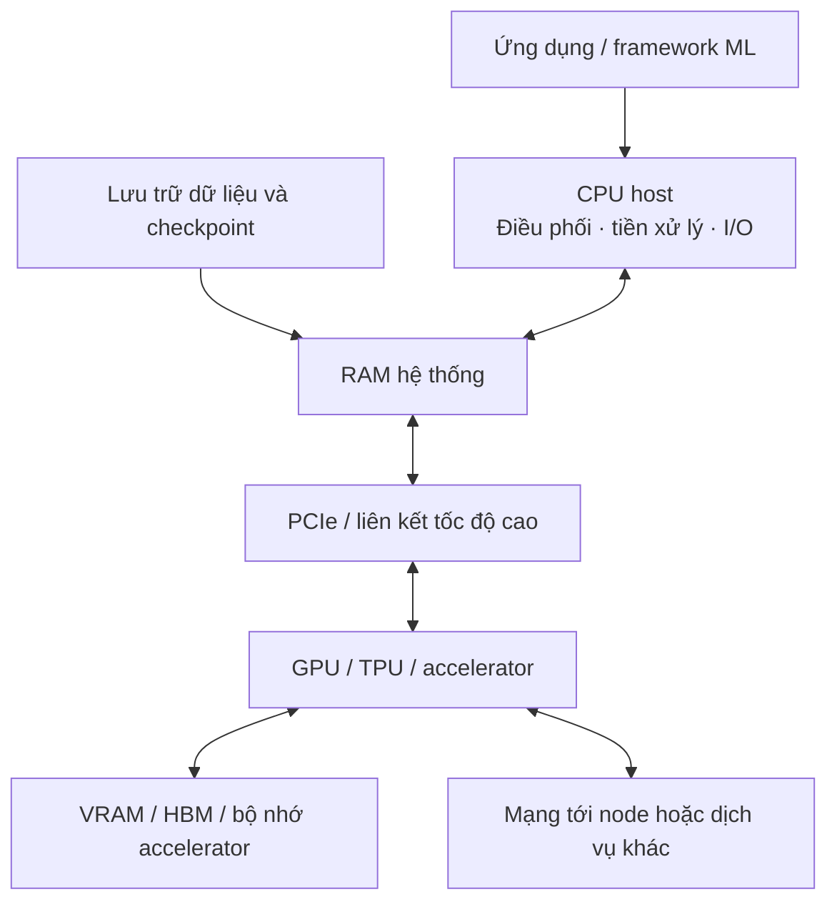

# GPU, TPU và các bộ tăng tốc chuyên dụng phục vụ compute

CPU phù hợp với nhiều loại tác vụ có luồng điều khiển phức tạp, nhưng không phải lựa chọn hiệu quả nhất cho mọi phép tính. Các workload như huấn luyện mô hình học máy, xử lý ảnh và video, mô phỏng khoa học, phân tích ma trận hoặc xử lý dữ liệu song song có thể cần hàng nghìn phép tính tương tự được thực hiện đồng thời. GPU và các bộ tăng tốc chuyên dụng được thiết kế để xử lý những công việc như vậy với thông lượng cao.

Trong môi trường cloud, người dùng có thể thuê máy ảo gắn GPU, máy chủ bare metal có accelerator, cụm TPU hoặc dịch vụ inference được tăng tốc. Mỗi lựa chọn có kiến trúc, bộ nhớ, phần mềm, cách chia sẻ tài nguyên và mô hình chi phí khác nhau. Chọn accelerator cần bắt đầu từ thuật toán và workload, sau đó mới đối chiếu với phần cứng, framework, dung lượng bộ nhớ, kết nối và khả năng vận hành.

## 1. Vì sao cần bộ tăng tốc?

CPU thường có số core tương đối ít nhưng mỗi core được thiết kế để xử lý nhiều loại lệnh, nhánh điều kiện và luồng công việc khác nhau. CPU có cache lớn, bộ dự đoán nhánh và khả năng phản hồi nhanh với các tác vụ tuần tự. GPU có nhiều đơn vị xử lý nhỏ hơn, được tổ chức để thực hiện đồng thời một số lượng lớn phép tính trên dữ liệu độc lập hoặc có cấu trúc tương tự.

Ví dụ, một chương trình có thể cần áp dụng cùng phép biến đổi cho hàng triệu điểm ảnh. CPU có thể xử lý theo một số luồng song song; GPU có thể phân phối các điểm ảnh thành rất nhiều phần tử công việc chạy trên các nhóm đơn vị xử lý. Với phép nhân ma trận lớn, các bộ tăng tốc còn có khối phần cứng chuyên cho phép toán ma trận và số học độ chính xác thấp.

GPU không thay thế CPU. Trong một hệ thống tăng tốc, CPU thường đảm nhiệm hệ điều hành, điều phối tiến trình, xử lý logic, chuẩn bị dữ liệu và khởi chạy kernel. GPU hoặc accelerator thực hiện phần tính toán song song nặng. Nếu dữ liệu không được chuẩn bị kịp, phải sao chép qua lại quá nhiều hoặc thuật toán có nhiều nhánh tuần tự, GPU có thể không được sử dụng hiệu quả.

## 2. GPU hoạt động như thế nào?

### Kiến trúc xử lý song song

GPU (Graphics Processing Unit) ban đầu được phát triển để xử lý đồ họa, nơi nhiều điểm ảnh, đỉnh hình học và phép biến đổi có thể được tính toán song song. GPU hiện đại được dùng rộng rãi cho đồ họa, mô phỏng, phân tích dữ liệu và AI.

Một GPU thường có nhiều cụm xử lý, chẳng hạn Streaming Multiprocessor (SM) trên một số kiến trúc hoặc Compute Unit (CU) trên một số kiến trúc khác. Mỗi cụm chứa nhiều đơn vị thực thi, thanh ghi, bộ lập lịch và cache. Chương trình gửi các kernel đến GPU; kernel được thực thi bởi nhiều thread, được tổ chức thành block và các nhóm thực thi phần cứng như warp hoặc wavefront tùy kiến trúc.

Mô hình SIMT (Single Instruction, Multiple Threads) thường được dùng để mô tả cách GPU chạy nhiều thread theo nhóm. Các thread trong cùng nhóm thường thực hiện cùng luồng lệnh trên dữ liệu khác nhau. Nếu các thread đi theo những nhánh điều kiện khác nhau, phần cứng có thể phải thực thi các nhánh tuần tự hoặc giảm mức sử dụng đơn vị thực thi. Hiện tượng này thường được gọi là branch divergence.

### GPU memory

GPU có bộ nhớ riêng, thường là GDDR hoặc HBM tùy phân khúc. Bộ nhớ này cung cấp băng thông cao để nuôi các đơn vị tính toán. HBM thường xuất hiện trên accelerator dành cho tính toán hiệu năng cao và AI; dung lượng và băng thông cụ thể thay đổi theo model.

Ngoài bộ nhớ toàn cục, GPU còn có các mức lưu trữ như register, shared memory hoặc local memory, cùng các cache. Dữ liệu đặt gần đơn vị tính toán có thể được truy cập nhanh hơn, nhưng dung lượng của các vùng này nhỏ và cần được sử dụng hợp lý. Với kernel xử lý ma trận hoặc tensor, cách bố trí dữ liệu, kích thước tile và mức tái sử dụng dữ liệu có thể ảnh hưởng lớn đến hiệu năng.

GPU memory (VRAM) tách biệt với RAM của máy chủ trong nhiều cấu hình. Một model có thể vừa RAM host nhưng không vừa VRAM; khi đó framework phải chia nhỏ batch, phân mảnh model, offload một phần dữ liệu sang RAM hoặc dùng nhiều GPU. Việc offload có thể làm tăng thời gian truyền dữ liệu và giảm throughput.

### Tensor Core và phép toán ma trận

Nhiều GPU hiện đại có đơn vị phần cứng chuyên xử lý phép toán ma trận hoặc tensor, chẳng hạn Tensor Cores trong một số GPU NVIDIA và các khối matrix acceleration tương ứng ở nền tảng khác. Các đơn vị này tăng tốc phép nhân ma trận tích lũy (matrix multiply-accumulate), thường là phần tính toán lớn trong deep learning.

Accelerator có thể hỗ trợ nhiều định dạng số như FP32, TF32, FP16, BF16, FP8 hoặc INT8. Định dạng có ít bit hơn thường cho phép thông lượng cao hơn và giảm dung lượng bộ nhớ, nhưng có thể làm thay đổi độ chính xác. Việc chọn precision phải dựa trên hỗ trợ phần cứng, framework, mô hình và yêu cầu chất lượng đầu ra. Không nên mặc định mọi workload có thể chuyển sang INT8 hoặc FP8 mà không cần đánh giá sai số.

## 3. GPU, TPU và các loại accelerator khác

### GPU đa dụng

GPU đa dụng có thể chạy nhiều loại kernel và phù hợp với nhiều framework, thư viện và workload. Chúng thường được sử dụng cho:

- Huấn luyện và suy luận mô hình học sâu.
- Xử lý ảnh, video, đồ họa 3D và dựng hình.
- Mô phỏng vật lý, động lực học chất lưu và tính toán khoa học.
- Phân tích dữ liệu song song, xử lý ma trận và một số workload mật mã.

Ưu điểm của GPU là hệ sinh thái phần mềm rộng và khả năng lập trình tương đối linh hoạt. Tuy nhiên, hiệu năng thực tế phụ thuộc kiến trúc GPU, VRAM, băng thông bộ nhớ, precision được hỗ trợ, driver, runtime và thư viện kernel. Hai GPU có cùng dung lượng VRAM vẫn có thể khác xa về tốc độ xử lý.

### TPU

TPU (Tensor Processing Unit) là tên gọi một dòng bộ xử lý chuyên dụng do Google phát triển để tăng tốc các phép toán tensor và workload machine learning. TPU được thiết kế xoay quanh các phép nhân ma trận và phép toán liên quan; một số thế hệ sử dụng kiến trúc systolic array để truyền dữ liệu qua các phần tử tính toán theo nhịp, giúp khai thác thông lượng cao cho các phép toán phù hợp.

TPU thường được sử dụng thông qua hạ tầng cloud và hệ sinh thái phần mềm hỗ trợ, chẳng hạn XLA và các framework tương thích. Mức độ phù hợp phụ thuộc vào framework, toán tử, kiểu dữ liệu, kích thước tensor và khả năng biên dịch. Một workload có nhiều toán tử chưa được hỗ trợ, thao tác tùy biến hoặc yêu cầu thư viện GPU cụ thể có thể khó chuyển sang TPU.

TPU không đơn giản là “GPU nhanh hơn”. GPU đa dụng và TPU có thiết kế, hệ sinh thái, cách lập lịch, khả năng tương thích và mô hình cấp phát khác nhau. Cần benchmark chính workload mục tiêu trên cả hai nền tảng nếu muốn so sánh.

### NPU và accelerator cho AI

NPU (Neural Processing Unit) là tên gọi chung cho bộ xử lý được tối ưu cho các phép toán mạng nơ-ron. NPU xuất hiện trên thiết bị di động, máy tính cá nhân, thiết bị biên và một số nền tảng máy chủ. NPU có thể tối ưu năng lượng và độ trễ cho các mô hình, toán tử và precision được hỗ trợ.

NPU thường hữu ích khi cần chạy inference tại thiết bị, xử lý dữ liệu gần nguồn hoặc giảm tiêu thụ điện. Hạn chế có thể gồm dung lượng bộ nhớ nhỏ, tập toán tử hỗ trợ giới hạn, yêu cầu chuyển đổi model và runtime riêng. Một model chạy được trên GPU chưa chắc có thể chạy nguyên trạng trên mọi NPU.

### FPGA

FPGA (Field-Programmable Gate Array) là mạch logic có thể cấu hình lại sau khi sản xuất. Kỹ sư có thể thiết kế pipeline phần cứng phù hợp với thuật toán, xử lý luồng dữ liệu hoặc giao thức đặc thù. FPGA có thể đạt độ trễ thấp và hiệu quả năng lượng tốt cho workload ổn định, có cấu trúc phù hợp.

Đổi lại, phát triển trên FPGA thường đòi hỏi kiến thức thiết kế phần cứng, HDL hoặc công cụ tổng hợp chuyên biệt. Thời gian phát triển, kiểm thử và bảo trì có thể cao hơn so với triển khai phần mềm trên GPU. FPGA phù hợp khi cần pipeline xác định, giao tiếp thiết bị đặc thù hoặc xử lý dữ liệu luồng với độ trễ chặt.

### ASIC và bộ tăng tốc chức năng cố định

ASIC (Application-Specific Integrated Circuit) là chip được thiết kế cho một tập chức năng cụ thể. Khi workload phù hợp với mục đích thiết kế, ASIC có thể đạt thông lượng cao và hiệu quả năng lượng tốt. Đổi lại, khả năng lập trình linh hoạt thấp hơn GPU hoặc FPGA; thay đổi thuật toán có thể cần phần cứng mới hoặc hỗ trợ từ nhà cung cấp.

Một số accelerator AI là ASIC được thiết kế chuyên cho ma trận và tensor. Các bộ mã hóa/giải mã video, xử lý tín hiệu hoặc nén dữ liệu chuyên dụng cũng là ví dụ về tăng tốc chức năng cố định.

### DPU, IPU và SmartNIC

DPU (Data Processing Unit), IPU (Infrastructure Processing Unit) và SmartNIC là các tên gọi cho nhóm thiết bị hỗ trợ xử lý tác vụ hạ tầng như mạng, lưu trữ, mã hóa, kiểm tra gói tin hoặc ảo hóa. Chúng có thể giảm tải cho CPU host và cải thiện khả năng mở rộng của trung tâm dữ liệu.

Những thiết bị này không phải lựa chọn thay thế trực tiếp GPU cho huấn luyện mô hình. Chúng tăng tốc đường dữ liệu và các dịch vụ hạ tầng, nhờ đó CPU và GPU có thể dành nhiều tài nguyên hơn cho workload chính.

### Bảng so sánh tổng quan

| Loại bộ xử lý | Công việc phù hợp | Điểm mạnh | Giới hạn cần lưu ý |
|---|---|---|---|
| CPU | Logic tổng quát, tác vụ tuần tự, điều phối và xử lý hệ thống | Linh hoạt, xử lý nhánh tốt, hệ sinh thái rộng | Thông lượng thấp hơn accelerator với phép tính song song lớn |
| GPU | Đồ họa, tensor, ma trận, mô phỏng và AI | Song song rộng, hệ sinh thái thư viện đa dạng, nhiều precision | Cần tối ưu kernel và dữ liệu; VRAM có giới hạn |
| TPU | Tensor và workload ML tương thích hệ sinh thái TPU | Tăng tốc phép toán tensor ở quy mô lớn | Phụ thuộc framework, compiler và toán tử được hỗ trợ |
| NPU | Inference AI trên thiết bị hoặc edge | Hiệu quả năng lượng, có thể giảm độ trễ và truyền dữ liệu | Hạn chế về model, toán tử, bộ nhớ và runtime |
| FPGA | Pipeline dữ liệu và thuật toán phần cứng tùy biến | Có thể cấu hình lại, độ trễ thấp cho thiết kế phù hợp | Phát triển và bảo trì phức tạp |
| ASIC | Chức năng chuyên biệt, khối lượng lớn và ổn định | Hiệu quả năng lượng và thông lượng cao cho mục tiêu cụ thể | Ít linh hoạt, phụ thuộc nhà cung cấp và vòng đời chip |
| DPU / SmartNIC | Mạng, lưu trữ, mã hóa và tác vụ hạ tầng | Offload xử lý khỏi CPU host | Không thay thế accelerator tính toán tensor |

## 4. CPU và accelerator phối hợp trong một hệ thống

Một node tăng tốc thường gồm CPU host, RAM, một hoặc nhiều accelerator, bộ nhớ trên accelerator, thiết bị lưu trữ và các kết nối nội bộ. CPU điều phối workload và xử lý phần không phù hợp để offload; accelerator thực hiện các kernel song song; dữ liệu được truyền giữa RAM host và bộ nhớ accelerator qua kết nối như PCIe hoặc liên kết tốc độ cao do nền tảng hỗ trợ.



Sơ đồ mô tả một node đơn giản. Trong cụm nhiều accelerator, còn có kết nối giữa các accelerator trong cùng máy và mạng liên node. Tên công nghệ, băng thông và topology phụ thuộc nhà cung cấp và thế hệ phần cứng.

### Chi phí truyền dữ liệu

Một kernel có thể chạy rất nhanh nhưng toàn bộ ứng dụng vẫn chậm nếu phải sao chép dữ liệu giữa RAM host và VRAM liên tục. Các bước tiền xử lý, giải mã ảnh, tokenization, đọc tệp và chuyển đổi tensor có thể trở thành nút thắt ở CPU hoặc lưu trữ.

Để giảm chi phí truyền dữ liệu, có thể:

- Gom nhiều phần tử thành batch phù hợp để giảm số lần gọi kernel và truyền dữ liệu.
- Giữ dữ liệu cần dùng lặp lại trong bộ nhớ accelerator khi đủ dung lượng.
- Dùng data loader đa luồng và prefetch để chuẩn bị batch tiếp theo trong lúc GPU tính toán.
- Chọn định dạng dữ liệu và layout phù hợp với kernel.
- Đo thời gian CPU, thời gian copy và thời gian kernel riêng biệt trước khi tối ưu.

### Kết nối nhiều accelerator

Huấn luyện mô hình lớn có thể cần nhiều GPU hoặc nhiều node. Các accelerator có thể kết nối qua bus trong máy, liên kết tốc độ cao giữa GPU hoặc mạng tốc độ cao giữa các node. Băng thông và độ trễ của liên kết ảnh hưởng đến giao tiếp gradient, đồng bộ và phân phối tensor.

Các kỹ thuật song song thường gặp:

- **Data parallelism:** mỗi accelerator xử lý một phần batch; gradient hoặc trạng thái cần đồng bộ giữa các thiết bị.
- **Model parallelism:** chia các phần của mô hình lên nhiều accelerator khi mô hình không vừa bộ nhớ một thiết bị hoặc cần tăng thông lượng.
- **Pipeline parallelism:** chia mô hình thành các stage và đưa các micro-batch đi qua từng stage.
- **Tensor parallelism:** chia phép toán tensor, chẳng hạn phép nhân ma trận lớn, giữa nhiều accelerator.

Khi tăng số GPU, thông lượng không nhất thiết tăng tuyến tính. Đồng bộ, truyền dữ liệu, tải không cân bằng và kích thước batch có thể làm giảm hiệu quả mở rộng. Cần đo scaling efficiency và thời gian chờ giao tiếp thay vì chỉ đếm số accelerator.

## 5. Workload nào nên dùng accelerator?

### Huấn luyện mô hình học máy

Huấn luyện thường thực hiện forward pass, tính loss, backward pass và cập nhật trọng số lặp đi lặp lại. Các phép toán ma trận và tensor lớn có tính song song cao, phù hợp với GPU hoặc TPU. Model lớn có thể cần nhiều accelerator, bộ nhớ HBM lớn và liên kết liên thiết bị tốc độ cao.

Các yếu tố cần đánh giá gồm kích thước model, batch size, sequence length, precision, optimizer, activation memory và phương pháp phân tán. Việc chọn GPU chỉ theo số phép tính tối đa trên lý thuyết có thể gây sai lệch nếu mô hình bị giới hạn bởi bộ nhớ hoặc giao tiếp.

### Inference

Inference là quá trình dùng mô hình đã huấn luyện để tạo dự đoán hoặc phản hồi. Với inference, độ trễ và throughput phụ thuộc batch size, kích thước đầu vào, số request đồng thời, kiến trúc model và giới hạn bộ nhớ.

Với mô hình ngôn ngữ lớn, cần quan tâm thời gian tạo token đầu tiên (time to first token), tốc độ sinh token, số request đồng thời và KV cache. Batch lớn có thể tăng throughput nhưng cũng có thể làm tăng độ trễ từng request và tiêu thụ nhiều bộ nhớ hơn. GPU, TPU hoặc NPU phù hợp tùy kích thước model, precision, runtime và mục tiêu latency.

### Đồ họa, video và xử lý ảnh

GPU hỗ trợ render, ray tracing, dựng hình, xử lý ảnh, chuyển mã video và các pipeline thị giác máy tính. Một số tác vụ video có thể dùng khối encode/decode chuyên dụng thay vì chiếm các đơn vị shader hoặc tensor. Khi chọn instance, cần xác định workload sử dụng GPU compute, graphics API hay codec engine vì các loại GPU không có cùng tính năng.

### HPC và mô phỏng khoa học

Mô phỏng vật lý, động lực học chất lưu, hóa học tính toán và một số thuật toán đại số tuyến tính có thể tận dụng GPU. Khả năng tăng tốc phụ thuộc tỷ lệ tính toán song song, độ chính xác số, băng thông bộ nhớ và mức giao tiếp giữa các node. Một số ứng dụng HPC vẫn phụ thuộc mạnh vào CPU hoặc cần thư viện chuyên biệt.

### Workload không nhất thiết cần GPU

Các API nhỏ, tác vụ nền ít tải, ứng dụng nhiều nhánh điều kiện, workload bị giới hạn bởi cơ sở dữ liệu hoặc mạng và các batch nhỏ có thể chạy hiệu quả hơn trên CPU. Nếu phần lớn thời gian chờ là I/O, thêm GPU thường chỉ tăng chi phí. Hãy lập hồ sơ hiệu năng để xác định phần tính toán có thể offload và phần thời gian có thể tiết kiệm.

## 6. Bộ nhớ accelerator và cách ước lượng dung lượng

Dung lượng VRAM/HBM thường là một trong những giới hạn quan trọng nhất khi chọn GPU. Một accelerator có thông lượng tính toán cao nhưng không đủ bộ nhớ để chứa model, batch và trạng thái trung gian có thể không chạy được workload dự kiến.

### Inference: trọng số, activation và KV cache

Ước lượng sơ bộ dung lượng trọng số:

\[
\text{Weight memory} \approx
\text{Number of parameters} \times \text{Bytes per parameter}
\]

Ví dụ, mô hình có 7 tỷ tham số lưu ở FP16/BF16 (2 byte mỗi tham số) cần khoảng:

\[
7 \times 10^9 \times 2 = 14 \times 10^9\text{ bytes}
\]

Tức khoảng 14 GB theo đơn vị thập phân, tương đương xấp xỉ 13 GiB. Đây chỉ là phần trọng số. Runtime, activation, workspace của kernel, phân mảnh bộ nhớ và KV cache cần thêm dung lượng. Vì vậy không thể kết luận một GPU có 16 GiB sẽ chắc chắn chạy được mô hình này với mọi cấu hình.

KV cache của mô hình transformer tăng theo số token đang được giữ, số layer, số request đồng thời, số head và kích thước head. Có thể dùng công thức gần đúng cho cache key và value:

\[
\text{KV bytes} \approx
2 \times L \times B \times T \times H_{kv} \times D_h \times S
\]

Trong đó:

- \(L\): số layer của mô hình.
- \(B\): tổng số chuỗi đang giữ cache (phụ thuộc batch và concurrency).
- \(T\): số token được lưu cho mỗi chuỗi.
- \(H_{kv}\): số head key/value.
- \(D_h\): số chiều mỗi head.
- \(S\): số byte của mỗi phần tử cache; hệ số 2 tính cả key và value.

Đây là ước lượng giản lược; kiến trúc MQA/GQA, sliding window, quantization, paged attention và cách runtime quản lý cache có thể làm thay đổi mức sử dụng thực tế.

### Training: nhiều hơn trọng số

Trong huấn luyện, bộ nhớ có thể bao gồm trọng số, gradient, trạng thái optimizer, activation cần giữ cho backward pass và workspace. Với mixed precision và optimizer như Adam, lượng bộ nhớ cho mỗi tham số có thể cao hơn nhiều lần dung lượng trọng số ở FP16/BF16. Con số chính xác phụ thuộc framework, optimizer, kỹ thuật lưu master weights, gradient accumulation, activation checkpointing và sharding.

Để giảm bộ nhớ, có thể dùng mixed precision, activation checkpointing, gradient accumulation, optimizer state sharding, tensor/model parallelism hoặc offload một phần trạng thái sang RAM. Mỗi kỹ thuật có đánh đổi về thời gian tính toán, giao tiếp, độ phức tạp và khả năng tương thích.

### Không chỉ dung lượng: băng thông và locality

Workload có thể bị giới hạn bởi băng thông bộ nhớ ngay cả khi GPU còn đơn vị tính toán nhàn rỗi. Hãy phân biệt:

- **Capacity:** có đủ chỗ chứa trọng số, activation, cache và batch hay không.
- **Bandwidth:** tốc độ đọc/ghi dữ liệu giữa bộ nhớ và đơn vị tính toán.
- **Latency:** thời gian chờ một lần truy cập dữ liệu.
- **Locality:** dữ liệu có được tái sử dụng trong cache hoặc vùng nhớ gần đơn vị thực thi hay không.

Khi so sánh accelerator, hãy xem dung lượng HBM/VRAM, băng thông bộ nhớ, cache, khả năng truy cập peer-to-peer và kết nối host. Cùng dung lượng bộ nhớ không có nghĩa cùng hiệu năng.

## 7. Chọn GPU hoặc accelerator trên cloud

Trang cấu hình accelerator thường nêu tên GPU, số thiết bị, bộ nhớ, số đơn vị tính toán, precision và liên kết. Cần đọc cùng cấu hình CPU host, RAM, storage, network và mô hình cấp phát.

| Tiêu chí | Câu hỏi cần trả lời |
|---|---|
| Model accelerator và thế hệ | Có hỗ trợ framework, kernel và precision cần dùng không? |
| Số accelerator | Một thiết bị có đủ bộ nhớ và throughput hay cần multi-GPU? |
| VRAM/HBM | Model, batch, activation, KV cache hoặc dữ liệu có vừa không? |
| Memory bandwidth | Workload có thường xuyên đọc/ghi tensor lớn không? |
| Tensor/matrix throughput | Thông số có áp dụng cho precision thực tế của workload không? |
| Interconnect | Có cần giao tiếp peer-to-peer, NVLink hoặc mạng tốc độ cao giữa node không? |
| CPU host và RAM | Có đủ năng lực tiền xử lý, data loader và cấp dữ liệu cho accelerator không? |
| Storage | Tập dữ liệu và checkpoint có được đọc/ghi đủ nhanh không? |
| Driver và runtime | Phiên bản driver, CUDA/ROCm, XLA hoặc thư viện có tương thích không? |
| Tenancy và isolation | GPU dùng chung, vGPU, passthrough hay phân vùng phần cứng? |
| Availability và quota | Region/zone có thiết bị không, quota được cấp bao nhiêu và có giới hạn khởi tạo không? |
| Billing | Tính phí theo thiết bị, instance, thời gian chạy, dung lượng đặt trước hay mức sử dụng? |

### GPU toàn phần, passthrough và GPU chia sẻ

Một máy ảo có thể được cấp GPU theo nhiều cách:

- **PCIe passthrough:** thiết bị hoặc chức năng PCIe được gán trực tiếp cho VM. Cách này thường cho phép VM truy cập GPU gần với phần cứng trực tiếp, nhưng việc chia sẻ thiết bị và di chuyển VM có thể bị hạn chế.
- **vGPU:** một GPU vật lý được chia sẻ cho nhiều VM qua lớp ảo hóa GPU. Tài nguyên, bộ nhớ, tính năng và hiệu năng được cấp theo profile hoặc chính sách của nhà cung cấp.
- **GPU partitioning:** một số GPU hỗ trợ chia thiết bị thành các phân vùng phần cứng độc lập. Ví dụ, công nghệ MIG trên một số GPU NVIDIA chia GPU thành các instance có phần tài nguyên tính toán và bộ nhớ riêng. Tính năng và số phân vùng phụ thuộc model.
- **Bare metal:** workload chạy trên máy chủ vật lý có GPU, phù hợp khi cần quyền kiểm soát phần cứng hoặc topology cao hơn. Nhà cung cấp vẫn có thể quản lý firmware và nền tảng vật lý.

Không nên suy luận rằng “một GPU” trong bảng giá luôn là một GPU vật lý đầy đủ. Cần kiểm tra model, profile, bộ nhớ được cấp, mức chia sẻ và giới hạn tính năng.

### Cấu hình nhiều GPU

Khi dùng nhiều GPU, hãy kiểm tra số thiết bị nhìn thấy trong VM, cách kết nối giữa chúng và topology NUMA của CPU host. Hai GPU cùng nằm trong một máy có thể giao tiếp nhanh hơn hai GPU ở hai máy khác nhau, nhưng điều này phụ thuộc liên kết và thế hệ phần cứng. Nếu framework không hỗ trợ phân tán hoặc workload không đủ song song, thêm GPU có thể không mang lại lợi ích tương xứng.

## 8. Phần mềm và hệ sinh thái

Accelerator cần driver, runtime, compiler và thư viện tương thích. Một số thành phần phổ biến gồm:

- CUDA và thư viện cuDNN/cuBLAS trên hệ sinh thái GPU NVIDIA.
- ROCm và thư viện tương ứng trên các GPU AMD được hỗ trợ.
- XLA và runtime liên quan trong các workload TPU và một số nền tảng tăng tốc khác.
- Framework như PyTorch, TensorFlow hoặc JAX; khả năng hỗ trợ phụ thuộc phiên bản và backend.
- Runtime suy luận như ONNX Runtime, TensorRT hoặc các engine chuyên dụng khác, tùy thiết bị.

Không phải mọi phiên bản framework đều hỗ trợ mọi thế hệ GPU/TPU. Một ứng dụng có thể cần compiler, driver và thư viện được ghép đúng phiên bản. Trước khi chọn instance, hãy kiểm tra ma trận tương thích của nhà cung cấp, framework và image hệ điều hành.

### Container và điều phối accelerator

Container giúp đóng gói thư viện ứng dụng, nhưng driver cấp host và plugin thiết bị thường vẫn do node hoặc nền tảng quản lý. Với Kubernetes, accelerator có thể được công bố qua device plugin hoặc cơ chế tích hợp của nhà cung cấp; scheduler phân bổ số thiết bị hoặc tài nguyên được khai báo cho Pod.

Một Pod yêu cầu 1 GPU không tự động có nghĩa nó được chia 1/4 GPU hoặc nhận một phần bộ nhớ theo tỷ lệ. Cách phân bổ phụ thuộc hỗ trợ của driver, device plugin, vGPU hoặc cơ chế partitioning. Cần kiểm tra cách nền tảng biểu diễn tài nguyên, hành vi khi Pod khởi động và khả năng cô lập giữa workload.

Đối với TPU hoặc accelerator khác, có thể cần resource type, topology và cách khởi chạy workload riêng. Không nên giả định manifest dành cho GPU có thể dùng nguyên trạng trên mọi accelerator.

## 9. Hiệu năng, benchmark và theo dõi

Thông số FLOPS hoặc TOPS trên tài liệu kỹ thuật chỉ phản ánh một năng lực tính toán trong điều kiện và precision nhất định. Nó không phải tốc độ hoàn thành ứng dụng. Hiệu năng thực tế phụ thuộc model, kernel, batch size, memory bandwidth, dữ liệu, precision, interconnect và phần mềm.

Các chỉ số nên đo gồm:

- **Throughput:** ảnh/giây, mẫu/giây, token/giây, request/giây hoặc số bước huấn luyện mỗi giờ.
- **Latency:** thời gian hoàn thành một tác vụ, đặc biệt p50, p95 và p99.
- **Time to first token:** với mô hình sinh, thời gian từ khi nhận yêu cầu đến khi phát token đầu tiên.
- **Accelerator utilization:** mức sử dụng thiết bị; cần xem cùng memory utilization và hoạt động kernel.
- **Memory usage:** VRAM/HBM đã dùng, đỉnh bộ nhớ, phân mảnh và nguy cơ OOM.
- **Host utilization:** CPU, RAM, network và storage; các tài nguyên này có thể làm accelerator đói dữ liệu.
- **Scaling efficiency:** mức throughput tăng thêm khi tăng số accelerator so với mức tăng tài nguyên.
- **Cost per unit:** chi phí trên mỗi token, request, epoch, ảnh hoặc đơn vị công việc hoàn thành.

### Ví dụ lệnh quan sát

Với GPU NVIDIA trên Linux, `nvidia-smi` có thể hiển thị thiết bị, bộ nhớ và mức sử dụng. Một số hệ thống hỗ trợ truy vấn định kỳ:

```bash
# Tổng quan GPU, nhiệt độ, công suất và bộ nhớ
nvidia-smi

# Theo dõi định kỳ
nvidia-smi -l 1

# Truy vấn một số chỉ số theo dạng CSV
nvidia-smi --query-gpu=name,utilization.gpu,utilization.memory,memory.total,memory.used,power.draw --format=csv
```

Với GPU AMD, một số môi trường cung cấp `rocm-smi` hoặc công cụ tương ứng trong bộ ROCm. TPU và accelerator khác có công cụ giám sát riêng của nền tảng. Tên metric và khả năng truy vấn phụ thuộc model, driver và quyền truy cập trong VM.

### Quy trình benchmark có kiểm soát

1. Dùng đúng phiên bản model, dữ liệu, framework và precision dự kiến triển khai.
2. Khởi động và chạy warm-up để loại ảnh hưởng của compile, cache hoặc khởi tạo runtime.
3. Đo nhiều batch size và mức concurrency, không chỉ một cấu hình.
4. Ghi throughput, p95/p99 latency, bộ nhớ đỉnh, GPU utilization và CPU host.
5. Thử ở tải duy trì đủ lâu để phát hiện throttling, nhiệt độ hoặc giới hạn công suất.
6. Với multi-GPU, đo hiệu quả mở rộng và thời gian giao tiếp giữa thiết bị.
7. Tính chi phí trên đơn vị công việc và lặp lại phép đo để xác định biến động.

## 10. Chi phí và mô hình vận hành

Accelerator thường có chi phí cao hơn instance CPU thông thường. Cách tính phí có thể theo giờ thiết bị, giờ instance, loại GPU, profile vGPU, cụm đặt trước hoặc dịch vụ inference tính theo request/token. Cần tính cả thời gian khởi động, thời gian tải model, thời gian chờ quota, lưu trữ dữ liệu và checkpoint.

Với huấn luyện, một GPU có giá mỗi giờ cao hơn vẫn có thể kinh tế nếu rút ngắn đáng kể thời gian hoàn thành. Với inference, chỉ số hữu ích là chi phí trên mỗi request hoặc mỗi triệu token ở mức latency và chất lượng đáp ứng yêu cầu. Cần so sánh trên cùng workload và cùng tiêu chí chất lượng.

Một số cách tối ưu chi phí:

- Chọn đúng cỡ GPU và VRAM; tránh thuê thiết bị quá lớn so với model và concurrency.
- Dùng batch phù hợp để tăng throughput nhưng giữ latency trong giới hạn.
- Tắt hoặc scale về 0 các node GPU khi không có workload, nếu thời gian khởi động cho phép.
- Dùng spot/preemptible cho batch hoặc training có checkpoint và khả năng tiếp tục khi bị thu hồi.
- Tối ưu precision, quantization và kernel sau khi xác nhận chất lượng đầu ra.
- Tách CPU preprocessing, lưu trữ và inference để xác định tài nguyên nào cần accelerator.
- Theo dõi quota, lịch sử sử dụng và tỷ lệ thời gian GPU nhàn rỗi.

## 11. Bảo mật và độ tin cậy khi dùng accelerator

GPU và accelerator là tài nguyên dùng chung hoặc thiết bị được gán trực tiếp, nên cần xem xét cả bảo mật và khả năng phục hồi.

- **Cô lập tenant:** kiểm tra cơ chế phân vùng, vGPU, passthrough và phạm vi chia sẻ bộ nhớ. Không mặc định profile GPU có cùng mức cô lập với một thiết bị vật lý độc quyền.
- **Driver và firmware:** cập nhật theo khuyến nghị của nhà cung cấp, kiểm tra lỗ hổng và tương thích trước khi nâng phiên bản trong production.
- **Quyền truy cập thiết bị:** giới hạn container và user được phép truy cập device node; tránh cấp quyền đặc biệt rộng cho workload không cần thiết.
- **Dữ liệu:** bảo vệ dữ liệu đầu vào, trọng số model, checkpoint và kết quả; dùng mã hóa khi truyền và kiểm soát quyền truy cập lưu trữ.
- **Chuỗi cung ứng phần mềm:** lấy image, driver và thư viện từ nguồn tin cậy; kiểm tra phiên bản và tính toàn vẹn của artifact.
- **Khả năng phục hồi:** lưu checkpoint định kỳ, thử khôi phục, thiết kế retry và xử lý khi node hoặc accelerator lỗi.
- **Giám sát:** theo dõi nhiệt độ, công suất, lỗi phần cứng, ECC error nếu có, bộ nhớ và tình trạng thiết bị.

GPU không tự tạo ra tính sẵn sàng cao. Một máy có nhiều GPU vẫn là một điểm lỗi nếu toàn bộ workload phụ thuộc vào cùng host. Với dịch vụ quan trọng, cần phân tán replica hoặc worker qua nhiều node và vùng sẵn sàng theo khả năng của dịch vụ.

## 12. Quy trình chọn accelerator

1. **Xác định phần tính toán cần tăng tốc.** Dùng profiler để tìm kernel hoặc bước xử lý chiếm nhiều thời gian. Xác định workload có đủ song song và dữ liệu có thể đưa đến accelerator hiệu quả không.
2. **Xác định yêu cầu chức năng.** Làm rõ framework, model, toán tử, precision, thư viện, API đồ họa hoặc codec cần hỗ trợ.
3. **Ước lượng bộ nhớ.** Tính trọng số, activation, KV cache, batch, workspace và phần dự phòng. Với training, tính cả gradient và optimizer state.
4. **Chọn kiến trúc phù hợp.** So sánh GPU đa dụng, TPU, NPU, FPGA hoặc ASIC theo workload, khả năng lập trình và hệ sinh thái.
5. **Kiểm tra node và kết nối.** Xác minh CPU host, RAM, VRAM/HBM, PCIe hoặc interconnect, network, storage và topology nhiều thiết bị.
6. **Kiểm tra cloud và vận hành.** Xác minh region/zone, quota, tenancy, driver/runtime, orchestration, SLA và cách tính phí.
7. **Benchmark đầu cuối.** Đo từ lúc đọc dữ liệu đến khi hoàn thành kết quả, không chỉ đo thời gian kernel. Kiểm tra latency, throughput, chất lượng và chi phí.
8. **Thiết kế vận hành.** Thiết lập autoscaling, checkpoint, giám sát, cập nhật driver, bảo mật và phương án phục hồi.

### Ví dụ chọn nền tảng

| Tình huống | Phương án nên thử trước | Điều cần xác minh |
|---|---|---|
| Huấn luyện mô hình deep learning phổ biến, framework hỗ trợ rộng | GPU đa dụng | VRAM, precision, thư viện, interconnect và khả năng mở rộng |
| Workload tensor lớn tương thích tốt với hệ sinh thái TPU | TPU | XLA, toán tử, framework, topology và chi phí theo thời gian chạy |
| Inference nhỏ tại thiết bị biên, ưu tiên điện năng | NPU | Runtime, toán tử được hỗ trợ, bộ nhớ và độ trễ đầu cuối |
| Xử lý luồng dữ liệu có pipeline cố định và độ trễ chặt | FPGA | Công cụ phát triển, tốc độ dữ liệu, độ trễ và năng lực đội ngũ |
| Khối lượng lớn, thuật toán ổn định và chức năng chuyên biệt | ASIC | Tính linh hoạt, phụ thuộc nhà cung cấp và vòng đời sản phẩm |
| Offload mạng, lưu trữ hoặc mã hóa cho máy chủ | DPU / SmartNIC | Tính năng offload, tích hợp nền tảng và mức giảm tải CPU |
| API thông thường hoặc workload chủ yếu chờ I/O | CPU trước tiên | Profiler có xác nhận accelerator giải quyết đúng nút thắt không? |

## 13. Những hiểu lầm thường gặp

- **“GPU luôn nhanh hơn CPU.”** GPU có lợi thế với phép tính song song phù hợp; tác vụ tuần tự, nhiều nhánh hoặc bị giới hạn I/O có thể không nhanh hơn.
- **“Nhiều FLOPS hơn nghĩa là ứng dụng nhanh hơn.”** FLOPS phụ thuộc precision và phép đo lý thuyết. Bộ nhớ, kernel, dữ liệu, giao tiếp và phần mềm quyết định hiệu năng đầu cuối.
- **“GPU có đủ VRAM cho trọng số là chạy được model.”** Còn cần activation, KV cache, workspace, batch và bộ nhớ runtime.
- **“TPU là một loại GPU.”** TPU là accelerator chuyên cho tensor với kiến trúc và hệ sinh thái riêng.
- **“Một GPU trong cloud luôn là thiết bị vật lý độc quyền.”** Dịch vụ có thể dùng passthrough, vGPU hoặc phân vùng phần cứng; cần kiểm tra profile và chính sách.
- **“Thêm GPU luôn làm training nhanh theo tỷ lệ.”** Đồng bộ, interconnect, tải không cân bằng và giới hạn batch có thể làm hiệu quả mở rộng giảm.
- **“GPU utilization thấp nghĩa là GPU yếu.”** Nguyên nhân có thể nằm ở CPU preprocessing, storage, network, batch quá nhỏ hoặc kernel chờ dữ liệu.

## Kết luận

GPU phù hợp với nhiều workload song song và có hệ sinh thái đa dụng; TPU tăng tốc các phép toán tensor trong hệ sinh thái tương thích; NPU, FPGA, ASIC và DPU giải quyết những nhóm công việc chuyên biệt. Hiệu quả của accelerator phụ thuộc vào mức độ phù hợp với thuật toán, dung lượng và băng thông bộ nhớ, precision, kết nối, phần mềm và khả năng vận hành. Hãy đo workload đầu cuối, ước lượng bộ nhớ, kiểm tra khả năng tương thích và so sánh chi phí trên đơn vị công việc trước khi chọn cấu hình cloud.
