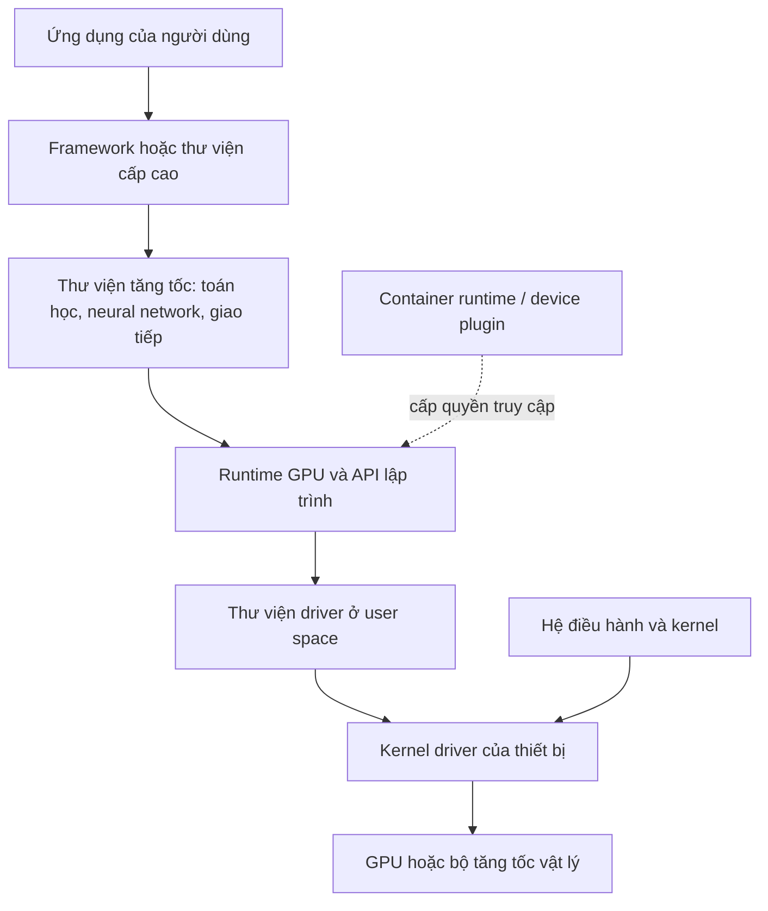

# Driver, runtime và tính tương thích của thư viện tăng tốc

Một máy ảo có GPU chưa chắc đã chạy được ứng dụng tăng tốc ngay sau khi khởi tạo. Ứng dụng cần một chuỗi thành phần tương thích: GPU vật lý, driver của thiết bị, runtime, thư viện tính toán và framework mà chương trình sử dụng. Chỉ cần một mắt xích sai phiên bản hoặc không hỗ trợ đúng kiến trúc GPU, chương trình có thể không nhận thiết bị, không nạp được thư viện hoặc chạy nhưng đạt hiệu năng thấp.

Trong kiến trúc hạ tầng tính toán trên đám mây, GPU và bộ tăng tốc là tài nguyên chuyên dụng có giá trị cao. Việc chọn đúng driver, runtime và thư viện giúp triển khai workload AI, học sâu, đồ họa, mô phỏng và tính toán song song ổn định, đồng thời giảm thời gian xử lý sự cố khi thay đổi image, container hoặc phiên bản framework.

## 1. Các lớp trong stack GPU

Một ứng dụng GPU thường đi qua nhiều lớp phần mềm. Tên gọi và cách đóng gói có thể khác nhau giữa NVIDIA CUDA, AMD ROCm, Intel oneAPI và các nền tảng khác, nhưng vai trò tổng quát tương tự nhau.



| Thành phần | Vai trò | Ví dụ |
|---|---|---|
| GPU hoặc accelerator | Thực thi kernel song song và xử lý phép toán chuyên dụng | GPU NVIDIA, GPU AMD, accelerator khác |
| Kernel driver | Giao tiếp với thiết bị, quản lý bộ nhớ và thực thi lệnh ở cấp hệ điều hành | NVIDIA kernel module, AMD `amdgpu` |
| Driver API và thư viện user space | Cung cấp giao diện để runtime hoặc ứng dụng làm việc với driver | CUDA Driver API, thư viện `libcuda.so` |
| Runtime | Quản lý context, bộ nhớ, stream, kernel launch và các thao tác thường dùng | CUDA Runtime, HIP runtime, Level Zero |
| Thư viện tăng tốc | Cung cấp thuật toán đã tối ưu cho phần cứng | cuDNN, cuBLAS, NCCL, rocBLAS, MIOpen, RCCL |
| Framework | Cung cấp API cấp cao cho mô hình và ứng dụng | PyTorch, TensorFlow, JAX, framework đồ họa |
| Container và bộ lập lịch | Đưa thiết bị vào môi trường chạy và phân phối tài nguyên cho workload | NVIDIA Container Toolkit, Kubernetes device plugin |

Driver, runtime và thư viện không phải là một khái niệm duy nhất. Driver kết nối phần mềm với thiết bị và hệ điều hành; runtime cung cấp môi trường thực thi; thư viện tăng tốc triển khai các phép toán cụ thể; framework kết hợp những thành phần này thành API mà lập trình viên sử dụng.

## 2. Driver GPU làm nhiệm vụ gì?

Driver là lớp phần mềm cho phép hệ điều hành và chương trình điều khiển GPU. Trên Linux, driver thường gồm module chạy trong kernel và các thư viện ở user space. Trên Windows, driver được cài qua gói của nhà sản xuất và tích hợp với mô hình driver đồ họa của hệ điều hành.

Driver có thể đảm nhiệm các công việc như:

- Nhận diện thiết bị và cung cấp thông tin về GPU.
- Cấp phát, ánh xạ và quản lý vùng nhớ của thiết bị.
- Tạo context, tiếp nhận lệnh và điều phối việc thực thi.
- Quản lý ngắt, đồng bộ và giao tiếp giữa CPU với GPU.
- Cung cấp giao diện cho runtime, thư viện và công cụ quản trị.
- Áp dụng các bản sửa lỗi, cải thiện hiệu năng và cập nhật bảo mật.

Driver thường gắn với hệ điều hành, kernel và thế hệ phần cứng cụ thể. Khi nâng cấp kernel, một số môi trường cần xây dựng lại module driver hoặc cài gói driver tương ứng. Nếu module không được nạp, GPU có thể xuất hiện trong thông tin phần cứng nhưng runtime không thể sử dụng nó.

### Driver của host và driver trong container

Với container GPU, driver cấp thấp thường được cài trên **host**. Container sử dụng các giao diện thiết bị và thư viện driver user space được runtime container đưa vào theo cấu hình. Image container thường đóng gói runtime và thư viện ứng dụng cần dùng; nó không nên tự mang một kernel driver độc lập để thay thế driver của host.

Điều này giúp nhiều container dùng chung driver của node, nhưng cũng tạo ra yêu cầu tương thích giữa driver host và các thư viện bên trong image. Cập nhật image lên runtime mới hơn trong khi node vẫn dùng driver quá cũ có thể khiến ứng dụng không khởi động hoặc không sử dụng được một số tính năng.

## 3. Runtime và thư viện tăng tốc

**Runtime** là lớp cung cấp API để ứng dụng sử dụng thiết bị mà không phải tự quản lý mọi thao tác cấp thấp. Runtime thường hỗ trợ phát hiện thiết bị, tạo context, cấp phát bộ nhớ, sao chép dữ liệu, tạo stream, đồng bộ và gọi kernel.

**Thư viện tăng tốc** cung cấp các phép toán hoặc thuật toán đã được tối ưu. Ví dụ trong hệ sinh thái CUDA:

- `cuBLAS` cung cấp các phép toán đại số tuyến tính trên GPU.
- `cuDNN` cung cấp các primitive được tối ưu cho deep learning.
- `NCCL` hỗ trợ giao tiếp và đồng bộ tập thể giữa nhiều GPU.
- `cuFFT` cung cấp phép biến đổi Fourier nhanh.

Trong hệ sinh thái ROCm, các thành phần tương ứng có thể gồm HIP runtime, rocBLAS, MIOpen và RCCL. Tên thư viện và mức tương đương không nhất thiết khớp hoàn toàn giữa hai nền tảng.

Một framework có thể gọi trực tiếp runtime, hoặc gọi thư viện chuyên dụng để thực hiện phép toán. Ví dụ, một framework deep learning có thể dùng cuDNN cho convolution, cuBLAS cho phép nhân ma trận và NCCL khi phân tán mô hình trên nhiều GPU. Vì vậy, kiểm tra riêng driver và runtime chưa đủ; phải xác nhận các thư viện mà framework thực sự nạp.

## 4. Tính tương thích là gì?

Tính tương thích là khả năng các thành phần trong stack hoạt động cùng nhau trên phần cứng và hệ điều hành đã chọn. Không có một con số phiên bản duy nhất đại diện cho toàn bộ stack. Cần kiểm tra ít nhất các mối quan hệ sau:

| Mối quan hệ | Cần xác minh |
|---|---|
| GPU và driver | Driver có hỗ trợ đúng model, kiến trúc và tính năng của GPU không? |
| Driver và hệ điều hành | Driver có hỗ trợ phiên bản OS, kernel và cách khởi động hiện tại không? |
| Driver và runtime | Driver có đáp ứng phiên bản tối thiểu mà runtime yêu cầu không? |
| Runtime và thư viện | Các thư viện tăng tốc có được xây dựng cho runtime/ABI tương thích không? |
| Framework và thư viện | Bản framework được cài có hỗ trợ đúng phiên bản CUDA/ROCm và các thư viện liên quan không? |
| Framework và kiến trúc GPU | Bản build có mã máy hoặc mã trung gian phù hợp với kiến trúc GPU đang chạy không? |
| Host và container | Container runtime có chuyển thiết bị, driver interface và quyền truy cập cần thiết vào container không? |
| Nhiều GPU | Driver, runtime, thư viện giao tiếp và topology mạng có hỗ trợ số GPU và cách kết nối dự kiến không? |

Một ứng dụng chỉ chạy được khi các quan hệ cần thiết đều thỏa mãn. Cài một phiên bản toolkit mới không tự động nâng cấp driver host; cập nhật driver cũng không bảo đảm framework cũ có thể nạp thư viện mới.

## 5. CUDA và quan hệ giữa driver với toolkit

CUDA là nền tảng tính toán song song của NVIDIA. Trong stack CUDA, cần phân biệt **CUDA Toolkit**, **CUDA Runtime** và **NVIDIA driver**.

- CUDA Toolkit là bộ công cụ phát triển, có thể gồm compiler `nvcc`, header, thư viện phát triển, công cụ debug và profiler.
- CUDA Runtime cung cấp API cấp cao để ứng dụng quản lý thiết bị và thực thi kernel.
- NVIDIA driver cung cấp giao diện cho hệ điều hành và runtime giao tiếp với GPU.

Một máy chạy ứng dụng đã biên dịch không nhất thiết cần cài toàn bộ CUDA Toolkit. Nếu chương trình và image đã có các thư viện runtime cần thiết, môi trường có thể chỉ cần driver host tương thích. Ngược lại, máy dùng để biên dịch CUDA cần bộ công cụ phát triển phù hợp.

### 5.1. Tương thích ngược và tương thích theo phiên bản nhỏ

Driver NVIDIA mới thường có thể chạy ứng dụng được xây dựng bằng toolkit cũ hơn trong phạm vi tương thích được hỗ trợ. NVIDIA cũng có cơ chế tương thích theo phiên bản nhỏ trong một số dòng CUDA, cho phép ứng dụng trong cùng một major family chạy trên driver đáp ứng mức tối thiểu được quy định.

Các cơ chế này có giới hạn. Một tính năng mới có thể yêu cầu driver mới hơn; ứng dụng dùng một số API hoặc khả năng mới có thể không chạy chỉ nhờ tương thích theo phiên bản nhỏ. Cơ chế forward compatibility qua gói thư viện tương thích cũng chỉ áp dụng trong các điều kiện về GPU, hệ điều hành và nền tảng mà nhà cung cấp công bố.

Vì các ngưỡng driver tối thiểu thay đổi theo phiên bản CUDA và nền tảng, hãy kiểm tra ma trận tương thích chính thức của đúng toolkit và driver. Không nên lấy một bảng phiên bản cũ rồi áp dụng cho mọi GPU hoặc mọi bản phát hành.

### 5.2. SASS, PTX và kiến trúc GPU

Mã CUDA có thể được biên dịch thành mã máy dành cho một hoặc nhiều kiến trúc GPU cụ thể (thường gọi là SASS), hoặc thành PTX là dạng mã trung gian. Khi cần, driver có thể dùng trình biên dịch JIT để chuyển PTX sang mã máy phù hợp với GPU tại thời điểm chạy.

Điều này tạo ra một số tình huống:

- Binary có SASS cho kiến trúc hiện tại thường có thể chạy trực tiếp trên GPU được hỗ trợ.
- Binary chỉ có SASS cho kiến trúc khác có thể không có mã phù hợp để thực thi.
- PTX có thể tăng khả năng tương thích với GPU mới hơn, nhưng driver phải hiểu phiên bản PTX đó và GPU phải hỗ trợ các tính năng cần thiết.
- JIT compilation có thể làm tăng thời gian khởi động lần đầu và tạo cache mã đã biên dịch.

Khi đóng gói ứng dụng, cần chọn các kiến trúc mục tiêu phù hợp với GPU triển khai. Không nên chỉ kiểm tra việc biên dịch thành công trên máy phát triển rồi giả định binary sẽ chạy trên mọi thế hệ GPU.

### 5.3. Hiểu đúng thông tin từ `nvidia-smi`

Lệnh `nvidia-smi` thường được dùng để kiểm tra driver và GPU:

```bash
nvidia-smi
```

Thông tin `Driver Version` cho biết phiên bản driver đang hoạt động. Dòng `CUDA Version` trong kết quả thường thể hiện phiên bản CUDA tối đa mà driver báo hỗ trợ theo khả năng tương thích của nó; nó **không chứng minh** rằng CUDA Toolkit cùng phiên bản đó đã được cài trên máy.

Để kiểm tra compiler của toolkit cài tại máy phát triển, dùng:

```bash
nvcc --version
```

Hai lệnh trả lời hai câu hỏi khác nhau. Một máy có thể có driver mới và không có `nvcc`; điều đó vẫn có thể đủ để chạy container hoặc ứng dụng đã đóng gói runtime phù hợp.

## 6. ROCm và các nền tảng tăng tốc khác

AMD ROCm là stack phần mềm cho tính toán GPU. Tùy cấu hình, stack có thể gồm kernel driver `amdgpu`, các thành phần user space của ROCm, HIP runtime, thư viện toán học và framework được build cho ROCm.

Một số thành phần thường gặp:

- **ROCm platform:** tập hợp các thành phần phần mềm để phát triển và chạy ứng dụng GPU.
- **HIP:** mô hình lập trình và runtime cung cấp API cho tính toán GPU; có thể hỗ trợ chuyển đổi một số mã CUDA sang môi trường AMD, nhưng không bảo đảm mọi mã nguồn hoặc thư viện có thể chuyển nguyên trạng.
- **rocBLAS:** thư viện đại số tuyến tính.
- **MIOpen:** thư viện primitive cho workload deep learning.
- **RCCL:** thư viện giao tiếp tập thể nhiều GPU.

Khả năng tương thích ROCm phụ thuộc tổ hợp GPU, phiên bản ROCm, kernel Linux, bản phân phối Linux, driver và phiên bản framework. Một bản ROCm có thể chỉ hỗ trợ một tập GPU hoặc OS cụ thể. Cần tra cứu ma trận hỗ trợ chính thức trước khi chọn image và cài đặt.

Các nền tảng như Intel oneAPI/Level Zero có runtime, driver và thư viện riêng. Nguyên tắc chung vẫn giống nhau: xác minh đúng thiết bị, driver, runtime, thư viện và framework theo ma trận phiên bản của nhà cung cấp.

## 7. Tương thích của framework và thư viện học sâu

Framework thường phát hành các gói được build cho một tổ hợp CUDA hoặc ROCm cụ thể. Một số gói nhị phân đóng gói sẵn một phần thư viện user space; một số môi trường lại dựa vào thư viện cài bên ngoài. Cách đóng gói phụ thuộc framework, phiên bản, hệ điều hành và cách cài đặt.

Ví dụ, với PyTorch, các thông tin có thể kiểm tra từ Python gồm:

```python
import torch

print("PyTorch:", torch.__version__)
print("CUDA build:", torch.version.cuda)
print("CUDA available:", torch.cuda.is_available())

if torch.cuda.is_available():
    print("GPU:", torch.cuda.get_device_name(0))
    print("Capability:", torch.cuda.get_device_capability(0))
    print("cuDNN:", torch.backends.cudnn.version())
```

`torch.version.cuda` cho biết phiên bản CUDA mà bản PyTorch được build để sử dụng; nó không phải là kết quả của `nvcc --version` và không có nghĩa toolkit đó nhất thiết được cài ở đường dẫn hệ thống. `torch.cuda.is_available()` xác nhận framework có thể khởi tạo CUDA trong môi trường hiện tại, nhưng chưa chứng minh mọi phép toán hoặc thư viện tùy chọn đều hoạt động đúng.

Với TensorFlow, JAX hoặc framework khác, hãy dùng cách kiểm tra được tài liệu của đúng phiên bản hướng dẫn. Đừng cài một gói framework theo lệnh tìm thấy trên mạng mà không xác minh phiên bản Python, OS, kiến trúc CPU, driver, CUDA/ROCm và thư viện đi kèm.

### ABI và thư viện động

Ngoài số phiên bản, cần chú ý ABI (Application Binary Interface), phiên bản thư viện động và runtime của ngôn ngữ. Một extension C/C++ được biên dịch với ABI hoặc thư viện hệ thống khác có thể không nạp được dù driver GPU hoàn toàn tương thích.

Trên Linux, lỗi như `cannot open shared object file`, `undefined symbol` hoặc lỗi nạp module Python có thể chỉ ra thư viện thiếu, sai đường dẫn hoặc ABI không khớp. Các công cụ như `ldd`, `readelf` và `ldconfig -p` giúp kiểm tra phụ thuộc động. Hãy xác minh thư viện nào thực sự được nạp trong tiến trình thay vì chỉ nhìn danh sách package đã cài.

## 8. GPU trong container và Kubernetes

Container giúp đóng gói ứng dụng cùng phiên bản runtime và thư viện mà nó cần. Tuy nhiên, GPU là thiết bị của host nên container cần được cấp quyền truy cập qua container runtime và cơ chế tích hợp tương ứng.

Một cấu trúc phổ biến với NVIDIA gồm:

1. Host cài driver NVIDIA tương thích với GPU và kernel.
2. NVIDIA Container Toolkit được cấu hình với Docker hoặc container runtime tương ứng.
3. Image chứa framework, CUDA user-space runtime và các thư viện ứng dụng cần thiết.
4. Khi chạy container, runtime đưa thiết bị GPU và các thư viện driver cần thiết vào môi trường container.
5. Ứng dụng kiểm tra thiết bị và chạy workload.

Ví dụ chạy một container kiểm tra GPU có thể có dạng:

```bash
docker run --rm --gpus all <cuda-image> nvidia-smi
```

`<cuda-image>` là image đã chọn theo phiên bản runtime và framework cần dùng. Cú pháp này chỉ hoạt động khi host đã cài driver và container runtime được cấu hình hỗ trợ GPU. Không nên đưa một phiên bản driver tùy ý vào image để thay thế driver host.

### 8.1. Kubernetes device plugin

Trong Kubernetes, device plugin của nhà cung cấp quảng bá tài nguyên GPU cho kubelet để scheduler có thể đặt Pod lên node có thiết bị phù hợp. Với NVIDIA, tài nguyên thường được yêu cầu dưới dạng `nvidia.com/gpu`.

Ví dụ Pod yêu cầu một GPU:

```yaml
apiVersion: v1
kind: Pod
metadata:
  name: gpu-worker
spec:
  restartPolicy: Never
  containers:
    - name: worker
      image: example/gpu-worker:1.0
      resources:
        limits:
          nvidia.com/gpu: 1
```

Ví dụ trên giả định node đã cài driver, runtime và device plugin phù hợp. Việc khai báo `nvidia.com/gpu: 1` không tự cài driver hoặc biến một node CPU-only thành node GPU. Với AMD hoặc accelerator khác, tên tài nguyên và plugin sẽ khác.

Trong môi trường nhiều node, cần quản lý phiên bản driver và plugin đồng nhất theo node pool. Có thể dùng node label, taint và toleration để chỉ đặt workload GPU trên nhóm node đã được chuẩn bị. Với GPU chia sẻ, MIG hoặc cơ chế phân vùng thiết bị, cần xác minh cách nền tảng công bố tài nguyên và giới hạn cô lập tương ứng.

## 9. Chọn image và quản lý phiên bản

Một image GPU nên được chọn theo framework và tổ hợp phiên bản đã xác minh. Trước khi dùng image trong production, hãy ghi lại:

- Hệ điều hành nền và kiến trúc CPU của image.
- Phiên bản framework và phiên bản Python hoặc runtime ngôn ngữ.
- Phiên bản CUDA/ROCm mà framework được build hoặc phụ thuộc.
- Phiên bản các thư viện như cuDNN, NCCL, rocBLAS hoặc MIOpen.
- Phiên bản driver tối thiểu được yêu cầu trên host.
- Các kiến trúc GPU được binary hỗ trợ.
- Cách container runtime cấp thiết bị và driver library vào container.

Ưu tiên image chính thức hoặc image nội bộ đã được kiểm thử, cố định tag phiên bản cụ thể và dùng digest khi cần tái lập chính xác. Tag `latest` có thể trỏ tới một tổ hợp mới vào lần pull tiếp theo, khiến môi trường thay đổi ngoài dự kiến.

Khi nâng cấp, hãy nâng từng lớp theo một kế hoạch có kiểm thử. Ví dụ, nếu framework mới yêu cầu CUDA runtime mới, trước tiên xác minh driver host đáp ứng yêu cầu; sau đó kiểm thử thư viện, model và các phép toán quan trọng. Không nâng driver trên toàn bộ node pool cùng lúc nếu chưa có phương án rollback và kiểm tra workload đại diện.

## 10. Quy trình kiểm tra tương thích trước khi triển khai

Có thể dùng quy trình sau để kiểm tra một workload GPU mới:

1. **Xác định phần cứng đích.** Ghi model GPU, kiến trúc, dung lượng VRAM, số thiết bị, khả năng liên kết giữa GPU và yêu cầu multi-GPU.
2. **Chọn hệ điều hành và kernel.** Xác minh phiên bản OS, kernel và kiến trúc CPU được driver hỗ trợ.
3. **Chọn driver.** Đối chiếu phiên bản driver với GPU, OS và runtime mà ứng dụng cần.
4. **Chọn runtime/toolkit.** Xác định runtime cần khi chạy và toolkit cần khi biên dịch; hai yêu cầu này có thể khác nhau.
5. **Kiểm tra thư viện tăng tốc.** Xác minh phiên bản cuDNN, cuBLAS, NCCL hoặc thư viện tương ứng và các phụ thuộc ABI.
6. **Chọn framework build.** Cài đúng gói framework hỗ trợ runtime, Python và GPU architecture đã chọn.
7. **Kiểm tra môi trường container.** Xác nhận host driver, container runtime, device plugin và quyền truy cập thiết bị.
8. **Chạy kiểm thử tối thiểu.** Phát hiện GPU, cấp phát VRAM, chạy phép toán nhỏ, đồng bộ và kiểm tra kết quả.
9. **Chạy workload đại diện.** Đo throughput, latency, VRAM, nhiệt độ, mức dùng GPU và giao tiếp giữa nhiều GPU nếu có.
10. **Đóng băng và ghi nhận cấu hình.** Lưu image digest, phiên bản driver/runtime/framework, cấu hình node và kết quả kiểm thử để tái tạo môi trường.

## 11. Chẩn đoán lỗi thường gặp

| Triệu chứng | Nguyên nhân có thể | Hướng kiểm tra |
|---|---|---|
| `nvidia-smi` không chạy hoặc không thấy GPU | Driver chưa cài, module chưa nạp, thiết bị chưa được gắn vào VM hoặc lỗi kernel | Kiểm tra thiết bị PCI, module kernel, log driver và cấu hình GPU passthrough |
| `nvidia-smi` chạy được nhưng framework không thấy GPU | Framework CPU-only, thiếu thư viện user space, container chưa được cấp GPU hoặc phiên bản không tương thích | Kiểm tra build framework, runtime, container runtime và biến môi trường |
| Báo lỗi driver version không đủ | Driver host thấp hơn mức runtime/framework yêu cầu | Đối chiếu yêu cầu driver tối thiểu; nâng cấp theo quy trình đã kiểm thử |
| Báo thiếu `libcuda.so`, `libcudart.so` hoặc thư viện khác | Thiếu thư viện, sai đường dẫn hoặc image không chứa runtime cần thiết | Kiểm tra loader, package và thư viện thực tế được nạp |
| Lỗi `undefined symbol` | ABI hoặc phiên bản thư viện không khớp | Kiểm tra phụ thuộc động, phiên bản framework và thư viện tăng tốc |
| Kernel không chạy trên GPU đời mới | Binary không chứa mã phù hợp hoặc PTX không được driver hỗ trợ | Kiểm tra kiến trúc build, phiên bản compiler và khả năng JIT |
| Container thấy GPU nhưng Pod không được lập lịch | Device plugin chưa đăng ký tài nguyên, node không có GPU khả dụng hoặc request sai | Kiểm tra node capacity, plugin, taint/toleration và resource request |
| Chỉ một số phép toán lỗi | Thư viện chuyên dụng hoặc tính năng cụ thể không tương thích | Tạo phép thử nhỏ cho từng thư viện, kiểm tra phiên bản và GPU architecture |
| Hiệu năng thấp hơn kỳ vọng | Dữ liệu không nằm trên GPU, CPU preprocessing nghẽn, thiếu băng thông hoặc kernel chưa tối ưu | Profile CPU/GPU, memory transfer, utilization và thời gian đồng bộ |

### Các lệnh kiểm tra cơ bản trên Linux

```bash
# Xem GPU và driver NVIDIA
nvidia-smi

# Kiểm tra module driver đang nạp
lsmod | grep -E 'nvidia|amdgpu'

# Xem thông tin PCI của thiết bị tăng tốc
lspci | grep -Ei 'vga|3d|display'

# Kiểm tra compiler CUDA nếu toolkit đã cài
nvcc --version

# Kiểm tra các thư viện động mà một binary phụ thuộc
ldd ./gpu-app
```

Với ROCm, các công cụ như `rocminfo`, `rocm-smi` và `hipcc --version` giúp kiểm tra thiết bị, trạng thái và bộ công cụ. Tên lệnh hoặc khả năng có thể thay đổi theo phiên bản. Hãy kết hợp kết quả lệnh với log kernel và tài liệu cài đặt đúng bản phát hành.

## 12. Bảo mật và vận hành driver

Driver GPU chạy ở lớp đặc quyền cao và có thể tương tác trực tiếp với kernel. Vì vậy, quản lý driver là một phần của bảo mật hạ tầng.

- Cài driver từ nguồn tin cậy và theo quy trình quản lý package/image của tổ chức.
- Theo dõi bản cập nhật bảo mật và lỗi đã biết của driver.
- Kiểm thử driver mới trên một node hoặc nhóm canary trước khi triển khai rộng.
- Kiểm tra yêu cầu Secure Boot, ký module và cơ chế xây dựng module khi kernel được nâng cấp.
- Giới hạn quyền truy cập thiết bị GPU và quyền quản trị node; không cấp quyền đặc quyền cho container nếu không cần thiết.
- Cố định image và phiên bản thư viện để giảm thay đổi ngoài kiểm soát.
- Theo dõi nhiệt độ, mức tiêu thụ điện, VRAM, lỗi thiết bị và sự kiện reset GPU.

Driver mới có thể sửa lỗi hoặc hỗ trợ GPU mới nhưng cũng có thể làm thay đổi hành vi của runtime hoặc framework cũ. Nên quản lý nâng cấp theo ma trận tương thích và có phương án quay lại phiên bản đã biết hoạt động.

## 13. Ví dụ triển khai một workload AI trên cloud GPU

Giả sử nhóm phát triển muốn chạy một dịch vụ suy luận trên một VM có GPU NVIDIA và đóng gói bằng container. Một quy trình triển khai có thể như sau:

**Bước 1: Chọn loại VM.** Xác nhận GPU model, VRAM, số GPU, CPU host, RAM, băng thông mạng và giới hạn lưu trữ phù hợp với kích thước model. Nếu cần nhiều GPU, kiểm tra topology PCIe/NVLink hoặc kết nối tương ứng.

**Bước 2: Chuẩn bị host.** Chọn image OS được nhà cung cấp và driver hỗ trợ. Cài driver NVIDIA theo hướng dẫn của image hoặc nhà cung cấp; khởi động lại nếu quá trình cài đặt yêu cầu. Xác minh bằng `nvidia-smi`.

**Bước 3: Chọn container image.** Chọn image framework có phiên bản CUDA runtime và thư viện tương thích với driver host. Ghi nhận image digest, không chỉ ghi tag dễ thay đổi.

**Bước 4: Cấp thiết bị cho container.** Cấu hình NVIDIA Container Toolkit và chạy container với quyền truy cập GPU. Kiểm tra `nvidia-smi` bên trong container để xác nhận thiết bị được nhìn thấy.

**Bước 5: Kiểm tra framework.** Chạy đoạn mã xác nhận framework nhận GPU, đọc tên thiết bị và thực hiện một phép nhân ma trận nhỏ. Tiếp tục chạy model thật để kiểm tra thư viện và kiến trúc GPU.

**Bước 6: Theo dõi khi phục vụ tải.** Quan sát GPU utilization, VRAM, CPU preprocessing, latency, throughput và lỗi driver. Đặt cảnh báo khi thiết bị reset hoặc VRAM gần đầy.

**Bước 7: Quản lý thay đổi.** Khi nâng framework hoặc CUDA runtime, thử trên một VM canary. Nếu cần nâng driver, kiểm tra lại toàn bộ image và workload trước khi thay đổi node pool production.

Quy trình này giúp phân biệt lỗi thuộc host, container hay ứng dụng. Nếu `nvidia-smi` trên host thất bại thì cần xử lý driver hoặc thiết bị trước. Nếu host thấy GPU nhưng container không thấy, cần kiểm tra container runtime. Nếu container thấy GPU nhưng framework không nhận, cần kiểm tra build framework và thư viện user space.

## 14. Checklist trước khi đưa workload GPU vào vận hành

- [ ] Đã xác định model GPU, kiến trúc, VRAM và yêu cầu multi-GPU.
- [ ] Driver hỗ trợ đúng GPU, hệ điều hành và kernel.
- [ ] Đã phân biệt phiên bản driver, CUDA/ROCm runtime và toolkit phát triển.
- [ ] Các thư viện tăng tốc cần dùng tương thích với runtime và framework.
- [ ] Framework build hỗ trợ đúng phiên bản Python, OS và kiến trúc GPU.
- [ ] Đã kiểm tra ABI và các thư viện động thực tế được nạp.
- [ ] Host có driver phù hợp và container runtime được cấu hình để cấp GPU.
- [ ] Kubernetes device plugin hoặc cơ chế cấp thiết bị tương ứng hoạt động đúng.
- [ ] Đã chạy kiểm thử phát hiện GPU, cấp phát bộ nhớ và phép toán đại diện.
- [ ] Đã đo throughput, latency, VRAM và hiệu năng dưới tải thực tế.
- [ ] Có quy trình cập nhật driver/runtime và phương án rollback.
- [ ] Đã giới hạn quyền truy cập thiết bị và giám sát lỗi phần cứng/driver.

## 15. Kết luận

Driver, runtime, thư viện tăng tốc và framework là các lớp khác nhau trong stack GPU. Driver kết nối phần mềm với thiết bị và hệ điều hành; runtime quản lý quá trình thực thi; thư viện tăng tốc cung cấp các phép toán tối ưu; framework kết hợp chúng để xây dựng ứng dụng. Tính tương thích phụ thuộc đồng thời vào GPU, driver, kernel, runtime, thư viện, framework, ABI và cách thiết bị được cấp vào container.

Khi triển khai trên cloud, hãy xác định phần cứng trước, đối chiếu ma trận phiên bản của nhà cung cấp, cố định image và kiểm thử toàn bộ đường đi từ host tới framework. Việc theo dõi driver, runtime và thư viện như một bộ cấu hình thống nhất giúp workload GPU ổn định, dễ tái lập và an toàn hơn trong vận hành.
