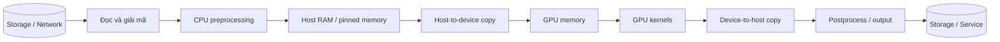
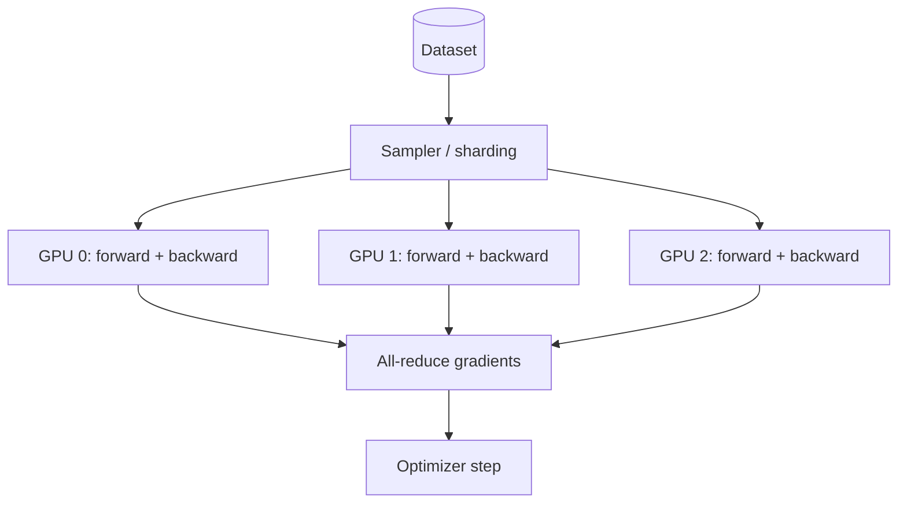

# Đo mức sử dụng bộ tăng tốc và nhận diện nút thắt cấp dữ liệu

Một workload dùng GPU hoặc bộ tăng tốc chỉ đạt hiệu năng tốt khi toàn bộ pipeline cung cấp dữ liệu đủ nhanh để thiết bị có việc liên tục. GPU có thể có hàng nghìn lõi tính toán, nhưng nếu CPU giải mã dữ liệu chậm, ổ lưu trữ đọc không kịp, batch quá nhỏ hoặc việc truyền dữ liệu qua PCIe bị tuần tự hóa, thiết bị sẽ thường xuyên chờ. Ngược lại, GPU luôn báo mức sử dụng cao cũng chưa chắc hệ thống đang đạt thông lượng tốt: kernel có thể bị giới hạn bởi băng thông bộ nhớ, truy cập dữ liệu không liên tục hoặc thực hiện quá nhiều phép toán phụ.

Trong phạm vi **CLOUD_CORE_SERVICES_COMPUTE**, người vận hành cần đo cả CPU, bộ nhớ, mạng, lưu trữ và cấu hình bảo mật khi triển khai workload. Với GPU và các bộ tăng tốc, việc đo phải đi xa hơn chỉ số phần trăm GPU utilization: cần quan sát pipeline từ nguồn dữ liệu đến bộ nhớ thiết bị, thời gian kernel, mức sử dụng compute unit, băng thông bộ nhớ, truyền dữ liệu và đồng bộ. Các kỹ năng này giúp lựa chọn cấu hình GPU phù hợp, mở rộng đúng điểm nghẽn, duy trì tính sẵn sàng và kiểm soát chi phí.

## Mục tiêu học tập

Sau bài này, bạn có thể:

- Mô tả pipeline dữ liệu của một workload GPU từ lưu trữ, tiền xử lý, truyền dữ liệu đến kernel và kết quả.
- Phân biệt GPU utilization, compute occupancy, mức sử dụng bộ nhớ, băng thông bộ nhớ và thông lượng ứng dụng.
- Thu thập metric từ thiết bị, CPU, lưu trữ, mạng và framework để xác định nơi workload đang chờ.
- Dùng công cụ giám sát và profiler phù hợp để tìm kernel chậm, truyền dữ liệu tuần tự hoặc data loader thiếu năng lực.
- Áp dụng batching, prefetch, pinned memory, asynchronous copy và tối ưu pipeline khi có bằng chứng đo lường.
- Đánh giá hiệu năng theo throughput, latency, hiệu quả sử dụng tài nguyên và chi phí trên mỗi đơn vị công việc.

## 1. Vì sao phải đo cả pipeline?

GPU được thiết kế để xử lý song song một lượng lớn dữ liệu. Tuy nhiên, GPU không tự lấy dữ liệu nghiệp vụ từ object storage, database hoặc file dataset. Một ứng dụng thường có nhiều công đoạn:

1. Đọc dữ liệu từ đĩa, object storage, mạng hoặc queue.
2. Giải mã, parse, giải nén và biến đổi dữ liệu trên CPU.
3. Tạo batch và chuyển dữ liệu từ bộ nhớ host sang bộ nhớ thiết bị.
4. Chạy kernel trên GPU hoặc bộ tăng tốc.
5. Chuyển kết quả về host nếu cần, hậu xử lý và ghi kết quả.
6. Lặp lại cho batch tiếp theo.



Nếu một công đoạn chậm hơn phần còn lại, nó giới hạn tốc độ toàn pipeline. Ví dụ, GPU chỉ mất 20 ms để xử lý một batch nhưng data loader mất 50 ms để đọc và tiền xử lý batch đó. Nếu hai công đoạn chạy nối tiếp, thời gian mỗi batch xấp xỉ 70 ms; giảm kernel từ 20 ms xuống 10 ms chỉ cải thiện tổng thời gian từ 70 ms xuống 60 ms. Tối ưu khâu chuẩn bị dữ liệu từ 50 ms xuống 15 ms có tác động lớn hơn.

Vì vậy, câu hỏi đầu tiên khi GPU utilization thấp không phải là “cần thêm GPU hay không?” mà là “GPU đang chờ điều gì?”. Câu hỏi khi utilization cao là “thiết bị đang thực hiện công việc hữu ích hay đang bị giới hạn ở một tài nguyên khác?”.

## 2. Các khái niệm đo lường cần phân biệt

### 2.1. GPU utilization

GPU utilization thường biểu thị tỷ lệ thời gian trong một khoảng lấy mẫu mà GPU có ít nhất một kernel đang hoạt động hoặc đang xử lý công việc, tùy cách định nghĩa của driver và công cụ. Chỉ số này hữu ích để nhận biết thiết bị thường xuyên rảnh hay bận.

Tuy nhiên, utilization không phải phần trăm công suất tính toán cực đại đã sử dụng. Một kernel nhỏ có thể làm GPU báo utilization cao trong khi chỉ chiếm một phần nhỏ compute unit. Một workload chạy thành từng đợt ngắn có thể bị làm mượt bởi chu kỳ lấy mẫu, khiến con số trung bình không phản ánh các khoảng chờ ngắn.

Ví dụ, `GPU-Util` trong `nvidia-smi` là chỉ số hoạt động được driver báo cáo trong khoảng lấy mẫu. Cách đo, chu kỳ cập nhật và khả năng hiển thị chi tiết phụ thuộc thiết bị/driver. Không nên so sánh trực tiếp số liệu từ hai công cụ có định nghĩa khác nhau.

### 2.2. Compute occupancy

Occupancy trong ngữ cảnh CUDA thường là tỷ lệ giữa số warp đang hoạt động trên một streaming multiprocessor (SM) và số warp tối đa mà SM có thể hỗ trợ. Occupancy chịu ảnh hưởng bởi số register mỗi thread, shared memory mỗi block, số thread/block và giới hạn phần cứng.

Occupancy cao có thể giúp che giấu độ trễ bộ nhớ bằng cách cho phép nhiều warp sẵn sàng chạy. Nhưng occupancy tối đa không phải mục tiêu tự thân. Kernel có thể đạt hiệu năng tốt với occupancy vừa phải nếu mỗi thread thực hiện nhiều công việc hữu ích hoặc sử dụng tài nguyên trên mỗi thread hiệu quả. Ép occupancy lên cao bằng cách giảm register có thể gây register spilling và làm chậm kernel.

### 2.3. Compute throughput và mức sử dụng đơn vị chuyên dụng

Compute throughput đo lượng công việc hoàn thành trong một đơn vị thời gian, chẳng hạn số ảnh/giây, token/giây, mẫu/giây hoặc FLOP/s. Một số GPU có nhiều đường xử lý như CUDA cores, Tensor Cores, ray tracing cores hoặc đơn vị giải mã video. Accelerator khác có thể cung cấp matrix engine hoặc NPU core.

GPU utilization không cho biết riêng từng đơn vị chuyên dụng đang bận đến mức nào. Khi cần hiểu kernel có tận dụng Tensor Cores hay không, hãy dùng profiler có metric tương ứng và kiểm tra kiểu dữ liệu, kích thước ma trận, thuật toán, alignment cùng cấu hình thư viện.

### 2.4. Bộ nhớ và băng thông

Không nên gộp các chỉ số bộ nhớ thành một khái niệm:

- **Memory capacity used:** dung lượng VRAM/HBM đang được cấp phát hoặc sử dụng. Nó cho biết mức chiếm chỗ, không cho biết tốc độ đọc/ghi.
- **Memory bandwidth:** lượng dữ liệu được đọc/ghi qua bộ nhớ thiết bị mỗi giây. Đây là chỉ số quan trọng với workload memory-bound.
- **Cache hit/miss:** mức dữ liệu được phục vụ từ cache hoặc phải đi đến bộ nhớ xa hơn, tùy kiến trúc và công cụ.
- **Host RAM usage:** bộ nhớ CPU dùng cho dataset, batch, cache và tiến trình tiền xử lý.
- **Pinned host memory:** vùng RAM host được khóa để hỗ trợ truyền DMA hiệu quả; dùng quá nhiều có thể làm giảm bộ nhớ khả dụng cho hệ điều hành.

VRAM gần đầy có thể gây lỗi cấp phát, giảm batch size hoặc buộc framework dùng chiến lược bộ nhớ khác. Nhưng VRAM chỉ dùng 40% không có nghĩa băng thông bộ nhớ còn dư 60%; kernel vẫn có thể bão hòa băng thông với dung lượng đang dùng nhỏ.

### 2.5. Truyền dữ liệu và đồng bộ

Với GPU rời, dữ liệu thường đi qua PCIe hoặc NVLink giữa host và thiết bị. Thời gian truyền phụ thuộc kích thước dữ liệu, topology, băng thông, số lần copy và khả năng overlap với tính toán. Các lệnh đồng bộ như chờ kết quả trên host có thể khiến pipeline mất tính bất đồng bộ và làm thiết bị rảnh.

Các chỉ số cần quan sát gồm:

- Throughput host-to-device (H2D) và device-to-host (D2H).
- Thời gian chờ copy engine và số lần truyền.
- Mức sử dụng PCIe/NVLink nếu nền tảng hỗ trợ metric.
- Thời gian đồng bộ CPU-GPU, thời gian chờ event và khoảng trống giữa các kernel.
- Lưu lượng giữa các GPU trong workload phân tán.

## 3. Bộ metric cần thu thập

Đo một workload GPU nên có nhiều nhóm metric. Chỉ thu thập GPU utilization mà không có CPU, storage và network sẽ khó giải thích nguyên nhân.

| Nhóm | Metric nên quan sát | Câu hỏi cần trả lời |
|---|---|---|
| Thiết bị | GPU utilization, clock, power, temperature, throttling, lỗi thiết bị | GPU có bận liên tục không? Có bị giới hạn nhiệt hoặc công suất không? |
| Compute unit | SM/compute engine active, Tensor Core activity, occupancy, warp stall | Kernel có dùng được năng lực tính toán cần thiết không? |
| VRAM/HBM | Memory used/free, bandwidth, cache behavior, allocation failure | Thiết bị thiếu dung lượng hay bị giới hạn tốc độ đọc/ghi? |
| Host CPU | CPU utilization theo core, run queue, context switch, thread count | CPU có đủ thread để đọc, giải mã và nạp batch không? |
| Host memory | RAM available, page fault, swap, pinned memory | Host có thiếu RAM hoặc bị áp lực bộ nhớ không? |
| Storage | IOPS, throughput, read latency, queue depth, cache hit | Dataset có được đọc đủ nhanh không? |
| Network | Throughput, packet loss, RTT, retransmission, bandwidth theo NIC | Dữ liệu từ object storage hoặc node khác có bị chậm không? |
| Pipeline/framework | Data loader time, batch wait, H2D/D2H, kernel time, queue depth | Công đoạn nào tạo khoảng chờ giữa các batch? |
| Ứng dụng | Samples/s, tokens/s, requests/s, p50/p95/p99 latency, error rate | Hiệu năng người dùng thực sự nhận được là bao nhiêu? |
| Chi phí | GPU-hours, CPU-hours, storage/network cost, cost per job/token/sample | Mỗi đơn vị công việc có đang tiêu tốn quá nhiều tài nguyên không? |

Nên thu thập đồng thời các metric ở cùng một khoảng thời gian và gắn nhãn theo job, model, dataset, batch size, node, GPU ID và phiên bản phần mềm. Đồng bộ timestamp giữa các node giúp đối chiếu sự kiện trong workload nhiều GPU hoặc nhiều máy.

### 3.1. Lấy metric thiết bị bằng công cụ dòng lệnh

Với GPU NVIDIA, `nvidia-smi` giúp kiểm tra nhanh trạng thái thiết bị:

```bash
nvidia-smi
nvidia-smi --query-gpu=name,utilization.gpu,utilization.memory,memory.used,memory.total,temperature.gpu,power.draw,clocks.sm --format=csv
nvidia-smi dmon -s pucm
```

Các truy vấn được hỗ trợ có thể thay đổi theo GPU và phiên bản driver. Hãy xem danh sách trường mà thiết bị hỗ trợ; trường không có sẵn có thể trả về `N/A`. Trong truy vấn trên, `utilization.memory` phản ánh thời gian memory controller hoạt động trong khoảng lấy mẫu, không phải tỷ lệ dung lượng VRAM đã dùng; dùng `memory.used` và `memory.total` để theo dõi capacity. `dmon` hữu ích để quan sát xu hướng theo thời gian, nhưng vẫn là số liệu lấy mẫu và không thay thế profiler ở cấp kernel.

Với AMD GPU, có thể dùng `rocm-smi` hoặc công cụ giám sát thuộc ROCm; để phân tích kernel và hoạt động compute, dùng profiler như `rocprof` hoặc công cụ phân tích tương ứng với phiên bản ROCm. Với accelerator khác, dùng công cụ vendor cung cấp và kiểm tra định nghĩa metric trước khi đưa vào dashboard chung.

### 3.2. Thu thập metric ở cấp node

Trên node chạy GPU, cần quan sát CPU, RAM, disk và NIC cùng lúc. Ví dụ các lệnh Linux thường dùng:

```bash
top
vmstat 1
iostat -xz 1
sar -n DEV 1
```

`top` giúp nhận biết CPU thread và tiến trình tiêu thụ tài nguyên; `vmstat` cho thấy run queue, swap và chờ I/O; `iostat` cho thấy độ trễ và hàng đợi đĩa; `sar` theo dõi lưu lượng giao diện mạng. Các công cụ cần gói hệ thống phù hợp và quyền truy cập metric trên node.

Trong môi trường Kubernetes hoặc dịch vụ container được quản lý, kết hợp metric từ node, Pod/container và thiết bị. Cần xác định workload nào đang sử dụng GPU, request/limit đã đặt ra sao, có tranh chấp GPU giữa nhiều container hay không và plugin/device operator có báo lỗi cấp phát không.

## 4. Hiểu các kiểu nút thắt cấp dữ liệu

### 4.1. Storage-bound: đọc dữ liệu từ nguồn quá chậm

Nếu dataset nằm trên block storage, file system dùng chung hoặc object storage, tốc độ đọc có thể thấp hơn tốc độ xử lý của GPU. Dấu hiệu thường gặp:

- GPU có khoảng rảnh lặp lại giữa các batch.
- Storage read latency hoặc queue depth tăng; throughput chạm giới hạn của volume hoặc đường mạng.
- CPU thread chờ I/O, data loader không tạo kịp batch.
- Tải từ cache nóng nhanh hơn đáng kể so với lần đọc dataset lạnh.

Hướng xử lý gồm kiểm tra kích thước file, cách phân mảnh dataset, số request đọc đồng thời, cache, định dạng dữ liệu, vị trí lưu trữ và giới hạn IOPS/throughput. Với object storage, nhiều file nhỏ có thể làm tăng overhead request và metadata; đóng gói dữ liệu theo shard có thể giảm overhead nếu framework đọc tuần tự hiệu quả.

Không nên chỉ tăng số worker đọc dữ liệu. Nếu storage đã bão hòa, tăng worker có thể làm queue dài hơn và tăng chi phí mà không cải thiện throughput.

### 4.2. CPU preprocessing-bound: CPU không cấp dữ liệu đủ nhanh

Các bước decode JPEG/PNG, giải nén, tokenize, augmentation, parse JSON hoặc chuyển đổi định dạng có thể tiêu tốn CPU đáng kể. GPU sẽ chờ nếu data loader không hoàn tất batch đúng thời điểm.

Dấu hiệu:

- GPU utilization thấp hoặc dao động theo chu kỳ batch.
- Một hoặc vài core CPU đạt 100% dù tổng CPU utilization của node chưa cao.
- Thời gian data loader/preprocessing lớn hơn thời gian kernel.
- Tăng số worker ban đầu cải thiện throughput, sau đó hiệu năng chững hoặc giảm do context switch và tranh chấp RAM/I/O.

Hướng xử lý:

- Profile từng bước decode, augmentation, tokenization và collation để tìm phần tốn CPU.
- Chọn số worker theo số core thực sự được cấp cho container/VM, không chỉ số core vật lý của host.
- Dùng thư viện decode/vectorization phù hợp; cache kết quả tiền xử lý nếu dữ liệu không thay đổi.
- Giảm chi phí chuyển đổi định dạng lặp lại; thực hiện một lần ở bước chuẩn bị dataset khi hợp lý.
- Đặt worker và tiến trình gần vùng NUMA/bộ nhớ phù hợp với GPU khi topology có ảnh hưởng.
- Kiểm tra CPU throttling trong container và giới hạn CPU của instance cloud.

### 4.3. Host-to-device transfer-bound: copy chiếm quá nhiều thời gian

Khi batch đã có trong RAM host, ứng dụng phải chuyển tensor sang bộ nhớ GPU. Nhiều lần copy nhỏ có thể tạo overhead lớn. Copy đồng bộ còn có thể chặn CPU hoặc stream GPU.

Các biện pháp có thể thử:

- Gom dữ liệu thành batch hợp lý để giảm số lần truyền nhỏ.
- Dùng pinned memory khi framework và phần cứng hỗ trợ, với dung lượng được kiểm soát.
- Dùng non-blocking/asynchronous copy và stream phù hợp để overlap copy với compute.
- Prefetch batch kế tiếp trong khi GPU xử lý batch hiện tại.
- Giữ tensor ở device giữa các bước nếu dữ liệu được dùng lại, tránh copy đi copy lại.
- Giảm D2H không cần thiết; chỉ chuyển kết quả cần cho host hoặc ghi trực tiếp theo khả năng framework.

Không phải mọi workload đều hưởng lợi từ pinned memory hoặc asynchronous copy. Nếu dữ liệu nhỏ, kernel rất ngắn hoặc đồng bộ ở nơi khác, thay đổi có thể không cải thiện tổng thời gian. Đo timeline trước và sau khi tối ưu.

### 4.4. Network-bound: dữ liệu qua mạng không kịp

Workload có thể đọc dataset từ object storage, nhận batch qua mạng hoặc trao đổi tensor giữa các node. Nút thắt có thể nằm ở băng thông NIC, RTT, packet loss, retransmission, NAT, giới hạn dịch vụ lưu trữ hoặc topology mạng.

Dấu hiệu:

- Throughput mạng đạt gần giới hạn NIC hoặc đường truyền được cấp.
- RTT/retransmission tăng và storage/network read latency cao.
- GPU trên nhiều node cùng rảnh trong khi node nạp dữ liệu hoặc giao tiếp collective bị chậm.
- Hiệu năng tăng khi dataset đặt gần node hoặc cache cục bộ.

Hãy kiểm tra placement của compute và storage, loại NIC, băng thông thực tế, MTU, DNS, route, số kết nối, giới hạn egress và chính sách QoS. Với distributed training, phân biệt lưu lượng nạp dataset với lưu lượng đồng bộ gradient qua NVLink/InfiniBand/Ethernet.

### 4.5. Kernel-bound hoặc compute-bound

Nếu GPU bận và kernel chiếm phần lớn timeline, workload có thể bị giới hạn bởi năng lực tính toán. Tuy nhiên, kernel-bound không đồng nghĩa với “cần GPU lớn hơn”. Kernel có thể chưa được tối ưu, chọn sai kiểu dữ liệu, có nhiều lần launch nhỏ, divergence hoặc thiếu song song.

Hãy xem:

- Thời gian kernel và thông lượng theo batch.
- Mức sử dụng compute unit và đơn vị chuyên dụng như Tensor Core.
- Số phép toán thực hiện, kiểu dữ liệu, kích thước tile và mức song song.
- Warp stall, register pressure, occupancy và kernel launch overhead.
- Khả năng dùng thư viện tối ưu, fused kernel, mixed precision hoặc graph capture khi phù hợp.

Nếu kernel thực sự đạt gần giới hạn compute cho workload, lựa chọn GPU có năng lực cao hơn hoặc chia workload qua nhiều GPU có thể hữu ích. Cần đo cả chi phí truyền dữ liệu và đồng bộ khi mở rộng.

### 4.6. Memory-bound: dữ liệu trong GPU di chuyển quá chậm

Một kernel có thể có utilization cao nhưng throughput thấp vì liên tục chờ dữ liệu từ HBM/VRAM. Workload kiểu này thường có arithmetic intensity thấp: số phép toán thực hiện trên mỗi byte dữ liệu được đọc/ghi không cao.

Hướng phân tích:

- Đo băng thông bộ nhớ và so sánh với giới hạn lý thuyết/thực tế của thiết bị.
- Kiểm tra truy cập coalesced, cache locality và số lần đọc/ghi dữ liệu lặp lại.
- Giảm intermediate tensor hoặc tránh materialize dữ liệu không cần thiết.
- Dùng fused operation hoặc tiling để tái sử dụng dữ liệu trong cache/shared memory.
- Kiểm tra dtype và kích thước dữ liệu; nén hoặc giảm độ chính xác chỉ khi chất lượng đầu ra cho phép.

### 4.7. Synchronization-bound: pipeline bị tuần tự hóa

Một lệnh đồng bộ hoặc thao tác copy đồng bộ có thể buộc CPU chờ GPU hoặc buộc GPU chờ dữ liệu. Khi timeline có các khoảng trống đều đặn sau mỗi kernel, hãy kiểm tra nơi framework gọi đồng bộ, lấy scalar về host, in tensor, cấp phát bộ nhớ hoặc chờ queue.

Các nguyên tắc hữu ích:

- Tránh gọi đồng bộ sau từng operation nếu không cần kết quả ngay.
- Gộp nhiều thao tác nhỏ khi overhead launch lớn.
- Dùng stream và event để quản lý phụ thuộc bất đồng bộ một cách rõ ràng.
- Không đọc kết quả từ device về host ở giữa pipeline nếu bước sau có thể tiếp tục trên device.
- Kiểm tra allocator và garbage collection nếu việc cấp phát/giải phóng tạo ra khoảng dừng.

## 5. Phân biệt utilization thấp, cao và hiệu năng tốt

Không nên đặt một ngưỡng utilization duy nhất làm mục tiêu cho mọi workload. Một job suy luận có latency thấp có thể xử lý theo từng request nhỏ, khiến GPU utilization trung bình thấp nhưng đáp ứng yêu cầu. Một job huấn luyện có thể giữ GPU bận gần như liên tục nhưng vẫn kém hiệu quả nếu phần lớn thời gian chờ memory hoặc kernel không tối ưu.

| Quan sát | Diễn giải có thể xảy ra | Cần kiểm tra tiếp |
|---|---|---|
| GPU utilization thấp, CPU cao | Tiền xử lý hoặc data loader bị giới hạn CPU | CPU theo core, data wait, worker count, throttling |
| GPU utilization thấp, CPU thấp, storage latency cao | Nguồn dữ liệu đọc chậm hoặc pipeline chờ I/O | IOPS, throughput, queue depth, cache hit, kích thước file |
| GPU utilization thấp, network cao hoặc RTT lớn | Đọc dữ liệu từ xa hoặc giao tiếp giữa node bị chậm | NIC throughput, retransmission, storage endpoint, collective communication |
| GPU utilization dao động theo nhịp batch | Nạp batch và compute chạy tuần tự, thiếu prefetch/overlap | Timeline CPU, copy, kernel và thời gian chờ batch |
| GPU utilization cao, throughput thấp | Kernel không hiệu quả, memory-bound, throttling hoặc workload không tận dụng đúng đơn vị compute | Profiler kernel, memory bandwidth, clocks, power, temperature, occupancy |
| VRAM gần đầy, OOM | Batch/model/intermediate tensor vượt capacity | Allocation timeline, peak memory, activation, cache và fragmentation |
| VRAM dùng ít nhưng memory bandwidth cao | Kernel có thể memory-bound dù capacity còn trống | HBM throughput, access pattern, arithmetic intensity |
| GPU utilization cao, throughput cao, latency đạt mục tiêu | Thiết bị có thể đang được khai thác tốt | Kiểm tra p95/p99, lỗi, nhiệt, công suất và cost per unit |
| Một GPU bận, GPU khác rảnh trong multi-GPU | Phân phối công việc hoặc đồng bộ không cân bằng | Sharding, rank timing, data partition, communication topology |

Các dòng trong bảng là giả thuyết chẩn đoán, không phải kết luận tự động. Luôn đối chiếu metric đồng thời và profiler để xác nhận.

## 6. Công cụ profiling và cách dùng

Giám sát liên tục trả lời “điều gì đang xảy ra theo thời gian?”. Profiler trả lời “thời gian được tiêu tốn ở đoạn mã hoặc kernel nào?”. Hai loại công cụ bổ sung cho nhau.

### 6.1. System profiler

System profiler ghi lại timeline nhiều thành phần như CPU thread, CUDA API, kernel, copy engine, đồng bộ và giao tiếp giữa thiết bị. Với NVIDIA, Nsight Systems là công cụ thường dùng để tìm khoảng trống giữa các kernel, thời gian CPU chuẩn bị công việc, H2D/D2H và đồng bộ. Có thể bắt đầu với:

```bash
nsys profile -o gpu-pipeline --trace=cuda,nvtx,osrt python train.py
```

Tên trace option và khả năng thu thập phụ thuộc phiên bản Nsight Systems, CUDA và hệ điều hành. Sau khi chạy, mở báo cáo bằng giao diện Nsight Systems hoặc dùng chế độ xuất báo cáo phù hợp để xem timeline.

Khi đọc timeline, tìm các mẫu:

- CPU mất nhiều thời gian trước khi submit kernel.
- GPU có khoảng rảnh giữa các batch.
- H2D copy chạy nối tiếp với kernel dù có thể overlap.
- Một stream chờ stream khác hoặc có nhiều event synchronization.
- Một rank trong distributed job chậm hơn các rank còn lại.

### 6.2. Kernel profiler

Kernel profiler tập trung vào từng kernel: thời gian, instruction, register, occupancy, memory throughput, cache, warp stall và mức sử dụng đơn vị compute. Với NVIDIA, Nsight Compute hỗ trợ phân tích kernel CUDA. Chọn một kernel đại diện và thu thập metric có mục tiêu; không bật mọi counter trong một lần nếu việc thu thập làm thay đổi đáng kể thời gian chạy.

Ví dụ lệnh cơ bản:

```bash
ncu --set basic --target-processes all -o kernel-report python train.py
```

Khi phân tích, bắt đầu bằng câu hỏi cụ thể: kernel đang bị giới hạn bởi compute, memory, instruction throughput, launch overhead hay latency? Sau đó mới chọn nhóm metric chi tiết hơn. Các chỉ số và tên section có thể khác theo kiến trúc GPU và phiên bản công cụ.

### 6.3. Profiler ở cấp framework

Framework profiler giúp gắn hoạt động GPU với operation trong mô hình. Ví dụ PyTorch:

```python
import torch
from torch.profiler import profile, ProfilerActivity, record_function

activities = [ProfilerActivity.CPU]
if torch.cuda.is_available():
    activities.append(ProfilerActivity.CUDA)

with profile(
    activities=activities,
    record_shapes=True,
    profile_memory=True,
    with_stack=True,
) as prof:
    for step, batch in enumerate(loader):
        with record_function("train_step"):
            loss = train_step(batch)
        if step == 10:
            break

print(prof.key_averages().table(sort_by="self_cuda_time_total", row_limit=20))
prof.export_chrome_trace("trace.json")
```

Đoạn mã minh họa cấu trúc profiler. Tên cột và hoạt động CUDA hiển thị tùy phiên bản PyTorch; khi dùng accelerator khác, cần chọn activity mà backend hỗ trợ. Với job dài, nên giới hạn số step và vùng profiling để giảm overhead và kích thước trace.

### 6.4. Đo thời gian kernel đúng cách

Thời gian CPU đo quanh lời gọi CUDA có thể chỉ phản ánh thời gian submit lệnh vì kernel chạy bất đồng bộ. Để đo khoảng thời gian trên GPU, có thể dùng CUDA event:

```python
import torch

start = torch.cuda.Event(enable_timing=True)
end = torch.cuda.Event(enable_timing=True)

# Warm-up trước khi đo để tránh tính cả khởi tạo context và autotuning.
for _ in range(10):
    run_gpu_step()

torch.cuda.synchronize()
start.record()
for _ in range(100):
    run_gpu_step()
end.record()
torch.cuda.synchronize()

elapsed_ms = start.elapsed_time(end)
print(f"Average GPU timeline per step: {elapsed_ms / 100:.3f} ms")
```

Đây là cách đo khoảng thời gian giữa hai event trong stream. Nếu `run_gpu_step()` thực hiện copy hoặc dùng nhiều stream, cần đặt event và đồng bộ đúng stream/phụ thuộc để đo phạm vi mong muốn. Đo cả thời gian end-to-end bằng đồng hồ phía host khi mục tiêu là latency mà người dùng cảm nhận.

### 6.5. Theo dõi accelerator trong môi trường cloud

Trong cloud, một số metric thiết bị có thể được xuất qua agent, exporter hoặc dịch vụ giám sát của nhà cung cấp. Cần kiểm tra:

- Agent có quyền đọc metric GPU và có tương thích driver/runtime không?
- Metric được thu ở mức thiết bị, node, VM, container hay job?
- Có thể ánh xạ GPU UUID/PCI bus ID với workload, Pod hoặc instance không?
- Chu kỳ lấy mẫu có đủ nhanh để thấy khoảng chờ ngắn không?
- Có cảnh báo khi nhiệt độ, power, memory hoặc lỗi ECC vượt ngưỡng không?
- Log/profiler có chứa dữ liệu nhạy cảm, tên file hoặc nội dung request cần bảo vệ không?

Đừng bật profiling nặng liên tục trên mọi production job nếu chưa đánh giá overhead. Có thể dùng metric nhẹ liên tục và chạy profiling có chọn lọc khi phát hiện bất thường hoặc trong đợt benchmark.

## 7. Tối ưu pipeline cấp dữ liệu

Sau khi xác nhận bottleneck, chọn biện pháp tương ứng. Tối ưu một công đoạn có thể chuyển nút thắt sang công đoạn kế tiếp; do đó phải đo lại toàn pipeline sau mỗi thay đổi.

### 7.1. Batching

Batch lớn hơn thường giúp tăng mức song song và giảm overhead trên mỗi mẫu, nhưng làm tăng bộ nhớ cần thiết và có thể tăng latency. Batch quá nhỏ có thể không tận dụng được GPU; batch quá lớn có thể gây OOM, tăng thời gian chờ đủ batch hoặc làm suy giảm khả năng phục vụ nhiều request.

Chọn batch size bằng benchmark theo mục tiêu:

- Training: throughput mẫu/giây, ổn định gradient, peak VRAM và thời gian epoch.
- Inference batch: requests/giây, p95/p99 latency và giới hạn bộ nhớ.
- Generative inference: tokens/giây, time-to-first-token, inter-token latency, batch composition và KV cache.

Khi batching động, cần đo thời gian gom batch và thời gian chờ của request đầu tiên; throughput tăng có thể đi kèm latency tăng.

### 7.2. Prefetch và pipeline overlap

Prefetch giúp chuẩn bị batch tiếp theo trước khi GPU cần đến. Mục tiêu là chồng lấp đọc/tiền xử lý/copy với compute để thiết bị không phải chờ từng giai đoạn tuần tự.

```mermaid
gantt
    title Pipeline tuần tự và pipeline có overlap (minh họa)
    dateFormat X
    axisFormat %s
    section Tuần tự
    Đọc batch 1       :a1, 0, 2
    Copy batch 1      :a2, 2, 3
    Compute batch 1   :a3, 3, 6
    Đọc batch 2       :a4, 6, 8
    Copy batch 2      :a5, 8, 9
    Compute batch 2   :a6, 9, 12
    section Có overlap
    Đọc batch 1       :b1, 0, 2
    Copy batch 1      :b2, 2, 3
    Compute batch 1   :b3, 3, 6
    Đọc batch 2       :b4, 3, 5
    Copy batch 2      :b5, 5, 6
    Compute batch 2   :b6, 6, 9
```



Sơ đồ chỉ minh họa nguyên tắc. Overlap thực tế phụ thuộc số copy engine, stream, khả năng bất đồng bộ của runtime, pinned memory và phụ thuộc dữ liệu. Nếu copy batch kế tiếp ghi vào vùng nhớ đang được kernel hiện tại sử dụng, cần event hoặc cơ chế đồng bộ để tránh race condition.

### 7.3. Pinned memory và asynchronous copy

Pinned memory là vùng RAM host được khóa để hệ điều hành không đưa trang bộ nhớ đó ra swap trong thời gian sử dụng. DMA có thể truyền dữ liệu từ vùng này hiệu quả hơn so với pageable memory trong nhiều trường hợp. Framework thường cung cấp tùy chọn pinned memory trong data loader.

Ví dụ PyTorch:

```python
from torch.utils.data import DataLoader

loader = DataLoader(
    dataset,
    batch_size=128,
    num_workers=4,
    pin_memory=True,
    persistent_workers=True,
    prefetch_factor=2,
)

for inputs, labels in loader:
    inputs = inputs.to("cuda", non_blocking=True)
    labels = labels.to("cuda", non_blocking=True)
    train_step(inputs, labels)
```

`non_blocking=True` có thể cho phép copy bất đồng bộ khi điều kiện bộ nhớ và backend phù hợp. `num_workers`, `prefetch_factor` và `persistent_workers` phải được điều chỉnh theo dataset, số CPU được cấp, dung lượng RAM và chi phí khởi tạo worker. Dùng pinned memory quá nhiều có thể gây áp lực lên RAM hệ thống; không nên bật mọi tùy chọn mà không đo.

### 7.4. Tối ưu định dạng và bố trí dữ liệu

Định dạng dữ liệu ảnh, video, văn bản hoặc tensor ảnh hưởng đến thời gian đọc, giải mã và tiền xử lý. Một số hướng thử nghiệm:

- Dùng định dạng phù hợp với kiểu truy cập: tuần tự, ngẫu nhiên, theo shard hoặc theo record.
- Giảm số lượng file rất nhỏ nếu metadata/request overhead chiếm tỷ lệ lớn.
- Tiền xử lý offline các bước tốn CPU nhưng không thay đổi theo epoch/request.
- Lưu dữ liệu ở dạng đã chuẩn hóa nếu đổi định dạng mỗi lần chạy gây overhead.
- Sắp xếp dữ liệu theo cách giúp truy cập tuần tự và cache locality, nhưng vẫn bảo đảm tính ngẫu nhiên cần thiết cho chất lượng mô hình.
- Đặt cache gần compute khi lợi ích đọc lại lớn hơn chi phí lưu trữ và đồng bộ cache.

Không nên nén dữ liệu chỉ để giảm kích thước nếu giải nén làm CPU trở thành bottleneck. Cần so sánh tổng thời gian đọc + giải nén + truyền với cách lưu không nén.

### 7.5. Giữ dữ liệu trên thiết bị khi có thể

Nếu nhiều bước liên tiếp cùng dùng một tensor, giữ tensor trên GPU có thể tránh H2D/D2H lặp lại. Có thể thực hiện tiền xử lý, biến đổi và hậu xử lý trên device nếu thư viện hỗ trợ và lượng dữ liệu phù hợp.

Tuy nhiên, giữ quá nhiều intermediate tensor làm tăng peak VRAM. Cần kiểm tra lifetime của tensor, gradient, activation checkpointing, memory pool và việc framework cache allocation. Giải phóng biến Python không nhất thiết làm driver giảm ngay lượng VRAM báo cáo vì allocator có thể giữ vùng nhớ để tái sử dụng.

## 8. Thiết kế phép đo và benchmark đáng tin cậy

Benchmark cần phản ánh workload thực tế và cho phép so sánh trước/sau. Một phép đo ngắn, thiếu warm-up hoặc chỉ đo kernel có thể dẫn đến kết luận sai về hiệu năng production.

### 8.1. Chuẩn hóa điều kiện thử nghiệm

Ghi lại các yếu tố sau cho mỗi lần đo:

- Model/ứng dụng, phiên bản code, framework, CUDA/ROCm, driver và thư viện.
- Loại accelerator, số lượng thiết bị, VRAM, topology và loại instance cloud.
- CPU, RAM, storage, network và giới hạn tài nguyên của VM/container.
- Dataset hoặc request mẫu, batch size, sequence length, image resolution và preprocessing.
- Precision/dtype, số worker, prefetch, pinned memory và số stream.
- Trạng thái cache, thời gian warm-up, số lần lặp và tải đồng thời trên thiết bị.

Giữ cùng điều kiện khi so sánh. Nếu thay đổi đồng thời GPU, batch size, worker count và precision, sẽ khó biết thay đổi nào tạo ra khác biệt.

### 8.2. Warm-up, lặp lại và phân vị

Một số framework cần khởi tạo context, nạp kernel, biên dịch hoặc autotune trước khi đạt trạng thái ổn định. Hãy chạy warm-up, sau đó đo nhiều lần. Báo cáo trung bình cùng độ phân tán hoặc p50/p95/p99 thay vì chỉ một lần chạy tốt nhất.

Đối với training, đo cả thời gian step và thời gian epoch. Đối với inference, đo throughput và latency theo request; không gộp latency trung bình của batch với latency từng request nếu yêu cầu sản phẩm là thời gian phản hồi của từng người dùng.

### 8.3. Đo end-to-end và theo từng giai đoạn

Ghi lại ít nhất:

```text
T_total = T_read + T_preprocess + T_H2D + T_kernel + T_D2H + T_postprocess
```

Đây là phép cộng đơn giản cho pipeline chạy tuần tự. Nếu các giai đoạn overlap, thời gian tổng gần với đường găng (critical path) của timeline, không phải tổng thời gian của tất cả hoạt động. Profiler giúp xác định phần thực sự nằm trên đường găng.

Một số chỉ số hiệu năng:

```text
Throughput = số đơn vị công việc hoàn thành / thời gian

GPU-hours per job = số GPU được cấp × thời gian chạy (giờ)

Cost per unit = tổng chi phí workload / số đơn vị công việc hoàn thành

Data supply rate = số mẫu hoặc byte sẵn sàng cho GPU / giây
```

Đơn vị công việc phải rõ ràng: ảnh, token, sample, batch, video frame hoặc inference request. Khi so sánh hai cấu hình, giữ cùng chất lượng đầu ra và yêu cầu latency.

### 8.4. Phân tích hiệu quả sử dụng accelerator

Một cấu hình có utilization thấp hơn vẫn có thể tốt hơn nếu hoàn thành cùng workload nhanh hơn, dùng ít GPU-hours hơn hoặc đáp ứng latency tốt hơn. Ngược lại, utilization cao nhưng throughput thấp có thể tạo chi phí lớn trên mỗi đơn vị công việc.

Ví dụ, hai cấu hình xử lý cùng một triệu ảnh:

| Cấu hình | GPU | Thời gian | GPU-hours | Throughput trung bình |
|---|---:|---:|---:|---:|
| A | 1 | 2 giờ | 2 | khoảng 139 ảnh/giây |
| B | 2 | 1,2 giờ | 2,4 | khoảng 231 ảnh/giây |

Cấu hình B nhanh hơn nhưng tiêu thụ nhiều GPU-hours hơn. Nếu mục tiêu là deadline ngắn, B có thể đáng chọn; nếu mục tiêu là giảm chi phí và deadline cho phép, A có thể phù hợp hơn. Cần dùng giá thực tế của từng loại GPU, chi phí node, storage, network và thời gian chờ cấp phát để tính cost per image.

## 9. Nút thắt trong workload nhiều GPU

Khi mở rộng từ một GPU sang nhiều GPU, workload bổ sung bước phân phối dữ liệu và đồng bộ. Hiệu năng không tăng tuyến tính nếu một GPU chậm, dữ liệu không chia đều hoặc giao tiếp giữa GPU trở thành đường găng.

### 9.1. Data parallelism và đồng bộ gradient

Trong data parallel training, mỗi GPU xử lý một phần batch. Sau forward/backward, các GPU thường phải đồng bộ gradient qua collective operation như all-reduce.



Nếu một rank đọc dữ liệu chậm hoặc xử lý batch lâu hơn, các rank khác có thể phải chờ ở collective. Đây là hiện tượng straggler. Theo dõi thời gian từng rank, thời gian all-reduce, băng thông interconnect và sự cân bằng số mẫu.

### 9.2. Topology và đường truyền

GPU có thể giao tiếp qua NVLink/NVSwitch, PCIe hoặc mạng giữa các node. Băng thông và độ trễ khác nhau theo topology. Đặt hai GPU thường xuyên trao đổi dữ liệu trên cùng node có thể hiệu quả hơn giao tiếp qua mạng, nhưng phụ thuộc cách scheduler cấp phát và cấu hình nền tảng.

Khi benchmark multi-GPU, cần ghi lại GPU UUID, bus ID, topology, NUMA node, NIC và loại interconnect. Kiểm tra collective benchmark riêng để biết giới hạn giao tiếp trước khi tối ưu model.

### 9.3. Cân bằng input giữa các rank

Nếu mỗi GPU nhận lượng dữ liệu khác nhau, một số rank hoàn thành sớm và chờ rank chậm. Phân phối dữ liệu cần cân bằng theo kích thước mẫu hoặc chi phí xử lý, đặc biệt với sequence length khác nhau, ảnh có độ phân giải khác nhau hoặc graph có kích thước không đồng đều.

Hãy đo số mẫu, số token, thời gian data loader và thời gian step theo từng rank. Dynamic batching hoặc bucketing có thể giảm chênh lệch thời gian, nhưng cần bảo đảm sampler và logic đồng bộ đúng.

## 10. Ví dụ chẩn đoán: GPU chờ data loader

Giả sử một job training ảnh trên một GPU có kết quả sau trong một khoảng benchmark ổn định:

| Metric | Giá trị quan sát |
|---|---:|
| GPU utilization trung bình | 38% |
| GPU memory used | 7 GB / 24 GB |
| Thời gian một step | 120 ms |
| Thời gian kernel GPU | 35 ms |
| Thời gian đọc + decode + augmentation | 70 ms |
| CPU | Một core gần 100%, các core khác thấp |
| Storage read latency | Thấp, không có dấu hiệu bão hòa |

Các số liệu cho thấy VRAM còn dư, storage chưa bão hòa và một core CPU bị tải cao. Giả thuyết hợp lý là preprocessing hoặc một worker data loader đang giới hạn pipeline. Cần profile chi tiết decode/augmentation và kiểm tra việc worker bị ràng buộc vào một core.

Một thử nghiệm có kiểm soát:

1. Giữ nguyên GPU, model, dataset, batch size và precision.
2. Đo baseline với số worker hiện tại.
3. Tăng worker theo từng bước, đồng thời theo dõi CPU theo core, RAM, storage throughput và GPU utilization.
4. Thử cache hoặc tiền xử lý offline cho bước decode/augmentation tốn CPU.
5. Bật prefetch và pinned memory nếu profiler cho thấy có khoảng chờ H2D.
6. Đo lại throughput, step time và cost per epoch; dừng khi lợi ích không còn bù chi phí.

Giả sử sau tối ưu, preprocessing còn 25 ms, copy/overlap được che phần lớn và kernel vẫn 35 ms. Step time end-to-end có thể giảm đáng kể. Nhưng nếu tăng worker làm RAM tăng mạnh hoặc storage bị bão hòa, phải điều chỉnh lại. Mục tiêu là giảm đường găng của pipeline, không phải làm một metric riêng lẻ đạt 100%.

## 11. Checklist vận hành và giám sát

**Trước benchmark**

- [ ] Ghi rõ loại accelerator, driver, runtime, framework, loại instance và giới hạn tài nguyên.
- [ ] Xác định workload, dataset, batch size, dtype, số worker và yêu cầu latency/throughput.
- [ ] Có warm-up và phép đo end-to-end cùng metric theo từng giai đoạn.
- [ ] Đồng bộ timestamp và gắn nhãn job, node, device, model và phiên bản.

**Trong khi chạy**

- [ ] Theo dõi GPU utilization, clock, power, temperature và throttling.
- [ ] Theo dõi VRAM capacity và memory bandwidth riêng biệt.
- [ ] Theo dõi CPU theo core, RAM, swap, worker count và CPU throttling.
- [ ] Theo dõi storage IOPS/throughput/latency và network throughput/RTT.
- [ ] Ghi nhận thời gian data loader, H2D/D2H, kernel, synchronization và queue wait.
- [ ] Với multi-GPU, theo dõi từng rank và interconnect collective.

**Sau khi phát hiện bất thường**

- [ ] Xác định giả thuyết bottleneck trước khi thay đổi cấu hình.
- [ ] Dùng system profiler và kernel profiler ở phạm vi đủ nhỏ.
- [ ] Chỉ thay đổi một nhóm biến trong mỗi thử nghiệm để dễ quy kết tác động.
- [ ] Đo lại throughput, latency, chất lượng đầu ra, GPU-hours và cost per unit.
- [ ] Ghi lại kết quả, cấu hình và quyết định rollback hoặc giữ thay đổi.

**Vận hành trên cloud**

- [ ] Xác minh quota GPU, loại instance, driver và accelerator có sẵn ở vùng triển khai.
- [ ] Có cảnh báo khi GPU lỗi, nhiệt/power bất thường, OOM, ECC error hoặc job bị treo.
- [ ] Bảo vệ quyền truy cập profiler, log và dữ liệu mẫu; tránh ghi nội dung nhạy cảm vào trace.
- [ ] Dùng autoscaling hoặc lịch cấp phát phù hợp với thời gian khởi tạo model và dữ liệu.
- [ ] Theo dõi chi phí GPU, CPU, storage, network và thời gian accelerator nhàn rỗi.

## 12. Kết luận

Đo hiệu năng GPU cần nhìn toàn bộ đường đi của dữ liệu. GPU utilization cho biết thiết bị có hoạt động trong khoảng lấy mẫu, nhưng không tự cho biết compute unit đã đạt công suất tối đa, bộ nhớ có bão hòa hay pipeline có hiệu quả. Cần kết hợp metric thiết bị, CPU, RAM, storage, network, copy engine, kernel và chỉ số end-to-end để xác định nơi workload đang chờ.

Khi đã xác định bottleneck, hãy chọn biện pháp đúng với nguyên nhân: cải thiện đọc dữ liệu nếu storage-bound, tối ưu decode/augmentation nếu CPU-bound, dùng batching và prefetch khi pipeline thiếu dữ liệu, giảm copy hoặc đồng bộ khi truyền dữ liệu là đường găng, và tối ưu kernel khi compute/memory là giới hạn. Sau mỗi thay đổi, đo lại throughput, latency, chất lượng và chi phí để xác nhận hiệu quả trong điều kiện thực tế.

## Thuật ngữ cần nhớ

| Thuật ngữ | Ý nghĩa |
|---|---|
| GPU utilization | Tỷ lệ hoạt động của GPU theo định nghĩa và chu kỳ lấy mẫu của công cụ. |
| Occupancy | Tỷ lệ warp đang hoạt động so với mức tối đa mà SM có thể hỗ trợ trong ngữ cảnh CUDA. |
| Throughput | Số đơn vị công việc hoàn thành trong một đơn vị thời gian. |
| Latency | Thời gian cần để hoàn thành một request hoặc một đơn vị công việc. |
| VRAM/HBM | Bộ nhớ dung lượng cao gắn với GPU hoặc accelerator. |
| Memory bandwidth | Lượng dữ liệu bộ nhớ có thể đọc/ghi trong một đơn vị thời gian. |
| H2D / D2H | Truyền dữ liệu từ host sang device / từ device về host. |
| Pinned memory | RAM host được khóa trang để hỗ trợ truyền DMA. |
| Prefetch | Chuẩn bị dữ liệu trước thời điểm workload cần sử dụng. |
| Data loader | Thành phần đọc, biến đổi và tạo batch đầu vào cho mô hình. |
| Kernel | Chương trình chạy trên GPU/accelerator để thực hiện phép tính song song. |
| System profiler | Công cụ ghi timeline CPU, GPU, copy, đồng bộ và hoạt động hệ thống. |
| Kernel profiler | Công cụ phân tích hiệu năng một kernel và tài nguyên phần cứng được sử dụng. |
| Arithmetic intensity | Số phép toán thực hiện trên mỗi byte dữ liệu được di chuyển. |
| Straggler | Tiến trình hoặc rank chậm hơn các phần còn lại và khiến hệ thống phải chờ. |
| GPU-hours | Số GPU nhân với thời gian sử dụng tính theo giờ. |
