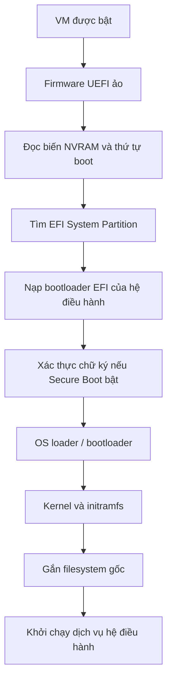

# UEFI, Secure Boot và chuỗi khởi động máy ảo

## Mục tiêu học tập

Sau bài học, bạn có thể:

- Mô tả vai trò của UEFI trong quá trình khởi động máy ảo và phân biệt UEFI với BIOS kiểu cũ.
- Giải thích chuỗi khởi động từ firmware, phân vùng hệ thống EFI, boot manager đến bộ nạp và nhân hệ điều hành.
- Trình bày cách Secure Boot xây dựng niềm tin bằng chữ ký số, khóa và danh sách chứng thư được phép hoặc bị thu hồi.
- Phân biệt Secure Boot với Measured Boot, TPM và mã hóa ổ đĩa.
- Chuẩn bị, kiểm tra và xử lý các lỗi khởi động thường gặp khi tạo image hoặc triển khai VM trên cloud.

## 1. Vì sao cần quan tâm đến quá trình khởi động?

Một máy ảo (virtual machine – VM) chỉ có thể chạy hệ điều hành sau khi firmware ảo khởi tạo phần cứng, tìm được chương trình khởi động và chuyển quyền điều khiển cho bộ nạp hệ điều hành. Quá trình này thường diễn ra rất nhanh nên dễ bị bỏ qua. Tuy nhiên, cấu hình firmware, phân vùng khởi động hoặc chữ ký của bootloader không tương thích có thể khiến VM không khởi động được dù đĩa hệ thống vẫn chứa đầy đủ dữ liệu.

Trong môi trường cloud, firmware và một phần thiết bị phần cứng được ảo hóa. Nhà cung cấp quyết định những chế độ firmware, thiết bị bảo mật và tính năng boot nào có thể bật cho từng loại VM. Image do người dùng tự tạo cũng phải phù hợp với chế độ đó. Vì vậy, khi chọn image, chuyển đổi máy từ BIOS sang UEFI hoặc bật Secure Boot, cần kiểm tra đồng thời hệ điều hành, cấu trúc đĩa, bootloader và khả năng hỗ trợ của nền tảng.

Ba khái niệm cần nắm:

- **UEFI (Unified Extensible Firmware Interface):** giao diện firmware hiện đại, chịu trách nhiệm khởi tạo môi trường trước hệ điều hành, quản lý các mục khởi động và nạp chương trình EFI.
- **Secure Boot:** cơ chế xác thực chữ ký hoặc mã băm của các chương trình EFI trước khi firmware cho phép chúng chạy. Mục đích là ngăn mã khởi động không được tin cậy thay thế các thành phần hợp lệ.
- **Boot chain (chuỗi khởi động):** các thành phần lần lượt được xác thực và thực thi để chuyển từ firmware đến hệ điều hành. Mức độ xác thực ở từng mắt xích phụ thuộc firmware, bootloader và chính sách của hệ điều hành.

## 2. UEFI và BIOS kiểu cũ

BIOS (Basic Input/Output System) là kiểu firmware truyền thống trên máy tính cá nhân. BIOS thực hiện kiểm tra và khởi tạo phần cứng cơ bản, sau đó tìm mã khởi động trong vùng đầu của thiết bị lưu trữ, thường là Master Boot Record (MBR). Mã khởi động ban đầu có dung lượng và khả năng hạn chế nên thường chuyển tiếp đến một bootloader nằm ở vị trí khác trên đĩa.

UEFI cung cấp môi trường khởi động có cấu trúc hơn. Firmware có thể đọc bảng phân vùng, truy cập phân vùng hệ thống EFI và chạy các chương trình EFI dạng tệp thực thi. Nó cũng lưu các mục khởi động và một số thiết lập trong biến NVRAM. UEFI hỗ trợ Secure Boot thông qua cơ chế xác thực chữ ký.

| Tiêu chí | BIOS kiểu cũ | UEFI |
|---|---|---|
| Cách tìm mã khởi động | Thực thi mã khởi động ban đầu trên thiết bị | Đọc mục boot và nạp chương trình EFI từ phân vùng phù hợp |
| Cấu trúc khởi động phổ biến | MBR và bootloader theo chuỗi | GPT và EFI System Partition (ESP) |
| Quản lý mục khởi động | Thường phụ thuộc mã trên đĩa và thứ tự thiết bị | Có mục khởi động trong biến NVRAM, có thể có đường dẫn dự phòng |
| Giao diện chương trình khởi động | Mã khởi động nhỏ, phụ thuộc firmware | Ứng dụng EFI có định dạng và giao diện chuẩn |
| Secure Boot | Không có cơ chế Secure Boot UEFI chuẩn | Có thể xác thực chữ ký các chương trình EFI |
| Tình huống hiện nay | Hệ điều hành và image cũ | Phần lớn triển khai VM hiện đại, nếu nền tảng hỗ trợ |

UEFI và GPT thường đi cùng nhau trên các hệ thống mới, nhưng không nên hiểu rằng chỉ cần đổi bảng phân vùng là có thể đổi chế độ boot. Một image cài đặt theo BIOS có thể thiếu EFI System Partition hoặc thiếu bootloader EFI. Ngược lại, image UEFI có thể không khởi động khi VM được cấu hình ở chế độ BIOS.

Trên cloud, tên gọi của nhà cung cấp có thể là UEFI, UEFI boot, Gen 2 hoặc một lựa chọn firmware tương tự. Tên và giới hạn cụ thể khác nhau giữa nền tảng. Hãy kiểm tra tài liệu của loại máy và image đang dùng trước khi tạo VM.

## 3. Các thành phần trong chuỗi khởi động UEFI

Một chuỗi khởi động UEFI điển hình có các thành phần sau:

1. **Firmware UEFI:** khởi tạo CPU ảo, bộ nhớ và các thiết bị cần thiết; đọc thiết lập firmware, thứ tự boot và các biến bảo mật.
2. **EFI System Partition (ESP):** phân vùng hệ thống EFI trên đĩa, thường dùng hệ thống tệp FAT32. Phân vùng này chứa boot manager và các chương trình EFI.
3. **Bootloader EFI của hệ điều hành:** UEFI Boot Manager trong firmware dùng BootOrder và các mục Boot#### để chọn một ứng dụng EFI trên ESP. Ứng dụng đó thường là shim/GRUB trên Linux hoặc Windows Boot Manager trên Windows.
4. **OS loader và kernel:** boot manager chuyển các tham số khởi động, nạp nhân hệ điều hành cùng những thành phần cần thiết.
5. **Initramfs hoặc môi trường khởi động ban đầu:** trên nhiều bản Linux, initramfs cung cấp driver và công cụ để tìm, mở khóa hoặc gắn phân vùng gốc.
6. **Hệ điều hành:** kernel khởi tạo các dịch vụ và chuyển sang tiến trình khởi tạo hệ thống như systemd.

Sơ đồ tổng quát:



Sơ đồ thể hiện luồng phổ biến. Một số hệ điều hành có thêm lớp trung gian, nhiều phân vùng hoặc cơ chế xác thực riêng. Firmware có thể thử mục khởi động tiếp theo nếu một mục không tồn tại hoặc không thể chạy.

### 3.1. EFI System Partition và mục khởi động

ESP là phân vùng chuyên chứa chương trình khởi động EFI. Trên máy x86-64, các đường dẫn thường gặp gồm:

- Linux: **\EFI\ubuntu\shimx64.efi**, **\EFI\ubuntu\grubx64.efi** hoặc đường dẫn tương tự tùy bản phân phối.
- Windows: **\EFI\Microsoft\Boot\bootmgfw.efi**.
- Đường dẫn khởi động dự phòng x86-64: **\EFI\BOOT\BOOTX64.EFI**.

Tên thư mục và tệp có thể khác theo bản phân phối, kiến trúc CPU và cách cài đặt. Hệ thống ARM64 sử dụng tên chương trình EFI phù hợp với kiến trúc đó, chẳng hạn **BOOTAA64.EFI** cho đường dẫn dự phòng. Không sao chép bootloader x86-64 sang VM ARM64 hoặc ngược lại.

Firmware thường dùng các mục **Boot####** trong NVRAM để xác định tệp EFI cần chạy. Biến **BootOrder** xác định thứ tự thử. Nếu mục bị mất sau khi di chuyển hoặc tạo image, firmware có thể không tìm thấy bootloader dù tệp vẫn còn trên ESP. Một số firmware có thể thử đường dẫn dự phòng; hành vi này phụ thuộc cách triển khai.

### 3.2. Linux và Windows đi qua chuỗi khởi động như thế nào?

**Ví dụ với Linux:**

- Firmware UEFI chọn shim hoặc GRUB từ ESP.
- Nếu dùng shim, firmware xác thực chữ ký của shim bằng chứng thư nằm trong cơ sở dữ liệu tin cậy của firmware.
- Shim kiểm tra bootloader tiếp theo, thường là GRUB, theo chính sách của bản phân phối.
- GRUB nạp kernel và initramfs. Với cấu hình Secure Boot của bản phân phối, kernel có chữ ký phù hợp sẽ được xác minh trước khi chạy.
- Kernel khởi tạo hệ thống, sử dụng initramfs để tìm và gắn phân vùng gốc, rồi khởi chạy tiến trình init.

Shim và Machine Owner Key (MOK) là cách một số bản phân phối Linux mở rộng mô hình tin cậy. Quản trị viên có thể đăng ký khóa của tổ chức để xác thực thành phần do tổ chức tự ký. Cách xác minh kernel, initramfs và module khác nhau theo bản phân phối và cấu hình; không nên giả định mọi tệp được nạp sau GRUB đều được firmware trực tiếp xác minh.

**Ví dụ với Windows:**

- Firmware xác thực và chạy Windows Boot Manager (bootmgfw.efi).
- Windows Boot Manager đọc cấu hình khởi động (BCD), sau đó gọi Windows OS Loader (winload.efi).
- OS Loader kiểm tra và nạp các thành phần hệ điều hành theo chính sách bảo mật của Windows.
- Kernel Windows tiếp tục khởi tạo driver và dịch vụ.

Điểm chung là firmware bắt đầu chuỗi tin cậy, sau đó boot manager và bộ nạp của hệ điều hành tiếp tục các bước kiểm tra của chúng. Secure Boot không có nghĩa firmware tự hiểu mọi thành phần bên trong hệ điều hành.

## 4. Secure Boot xác thực chương trình khởi động ra sao?

Secure Boot là một chính sách thực thi ở giai đoạn firmware. Khi bật, firmware kiểm tra chương trình EFI sắp được chạy dựa trên chữ ký số, chứng thư hoặc mã băm được phép. Nếu chương trình không được tin cậy hoặc bị thu hồi, firmware có thể từ chối chạy và chuyển sang mục khởi động khác hoặc dừng quá trình boot.

Mục tiêu là giữ cho các thành phần quan trọng đầu tiên của chuỗi khởi động đến từ nguồn được tin cậy. Cơ chế này giúp giảm nguy cơ bootkit hoặc mã độc can thiệp vào bootloader trước khi hệ điều hành và các công cụ bảo vệ thông thường hoạt động.

### 4.1. Các biến và cơ sở dữ liệu khóa

UEFI Secure Boot thường sử dụng bốn nhóm biến bảo mật quan trọng:

| Thành phần | Vai trò |
|---|---|
| PK (Platform Key) | Khóa nền tảng, xác định chủ thể quản lý chính sách Secure Boot của firmware |
| KEK (Key Exchange Key) | Tập khóa được phép cập nhật các cơ sở dữ liệu tin cậy như db và dbx |
| db (signature database) | Chứa chứng thư, khóa hoặc mã băm được phép chạy |
| dbx (forbidden signature database) | Chứa chữ ký hoặc mã băm bị thu hồi, phải bị từ chối |

Có thể hình dung luồng quản lý như sau:

- Chủ thể giữ quyền quản trị nền tảng quản lý PK.
- Các khóa trong KEK được quyền cập nhật danh sách cho phép và danh sách thu hồi theo chính sách firmware.
- Firmware đối chiếu chữ ký hoặc mã băm của ứng dụng EFI với db và dbx.
- Một mục nằm trong danh sách bị thu hồi phải bị từ chối ngay cả khi trước đây chữ ký đó từng được tin cậy.

Tên gọi và quy trình quản lý khóa là chuẩn UEFI tổng quát. Trong VM cloud, nhà cung cấp thường quản lý firmware và bộ khóa mặc định. Khả năng xem, thay đổi hoặc đưa khóa riêng vào firmware phụ thuộc nền tảng, loại VM và tính năng quản lý khóa mà nhà cung cấp cung cấp.

### 4.2. Chữ ký số và chuỗi tin cậy

Chữ ký số giúp xác minh chương trình EFI đến từ nhà phát hành được tin cậy và nội dung không bị thay đổi sau khi ký. Firmware thường xác minh chữ ký theo chứng thư hoặc mã băm đã được cấu hình. Chứng thư có thể tạo thành chuỗi từ chứng thư ký đến một CA được tin cậy.

Ví dụ minh họa cho một Linux VM:

1. Firmware có chứng thư của CA được chấp nhận.
2. Firmware xác minh chữ ký của shim.
3. Shim xác minh chữ ký của GRUB hoặc thành phần tiếp theo theo chính sách của shim.
4. GRUB hoặc cơ chế của bản phân phối xác minh kernel trước khi chuyển quyền điều khiển.
5. Kernel có thể áp dụng thêm chính sách khóa bảo mật và yêu cầu module kernel phải được ký.

Không phải mọi bản phân phối đều triển khai chuỗi giống nhau. Cần đọc hướng dẫn Secure Boot của hệ điều hành cụ thể, đặc biệt khi dùng kernel tùy chỉnh, driver bên thứ ba hoặc bootloader tự biên dịch.

### 4.3. Secure Boot bảo vệ đến đâu?

Secure Boot bảo vệ giai đoạn khởi động bằng cách hạn chế chương trình EFI được phép thực thi. Nó không tự động:

- Mã hóa dữ liệu trên đĩa hoặc bảo vệ snapshot và bản sao lưu.
- Xác minh mọi ứng dụng, script hay tệp được chạy sau khi hệ điều hành đã khởi động.
- Ngăn người dùng có quyền cao cài phần mềm độc hại sau khi đăng nhập.
- Thay thế cập nhật bảo mật, kiểm soát truy cập, firewall hoặc giám sát.
- Chứng minh VM không bị xâm nhập chỉ vì Secure Boot đang bật.

Nếu cần bảo vệ dữ liệu khi lưu trữ, hãy sử dụng mã hóa ổ đĩa và quản lý khóa phù hợp. Nếu cần xác minh trạng thái boot từ xa, hãy xem xét TPM và Measured Boot.

## 5. Secure Boot, Measured Boot và TPM

Ba cơ chế này liên quan đến bảo mật khởi động nhưng giải quyết những vấn đề khác nhau.

| Cơ chế | Cách hoạt động | Kết quả chính |
|---|---|---|
| Secure Boot | Xác thực chương trình EFI trước khi cho phép thực thi | Ngăn thành phần khởi động không được tin cậy chạy theo chính sách |
| Measured Boot | Đo và ghi nhận hash của các thành phần khởi động vào các Platform Configuration Register (PCR) của TPM | Tạo bằng chứng về những gì đã được nạp |
| TPM / vTPM | Cung cấp chức năng mật mã, lưu khóa và các PCR; vTPM mô phỏng TPM cho VM | Hỗ trợ đo lường, bảo vệ khóa và xác minh trạng thái |

Secure Boot tập trung vào **thực thi có kiểm soát**. Measured Boot tập trung vào **ghi nhận trạng thái**. TPM cung cấp nơi lưu trữ và xử lý thông tin đo lường, khóa và các phép toán mật mã.

Measured Boot không nhất thiết chặn thành phần có hash mới hoặc chưa biết. Nó ghi nhận phép đo để một thành phần khác, chẳng hạn dịch vụ attestation, có thể đánh giá. Trong quy trình remote attestation, hệ thống quản lý có thể yêu cầu VM cung cấp bằng chứng TPM, đối chiếu PCR với chính sách mong đợi rồi mới cho phép truy cập tài nguyên nhạy cảm.

Một số nền tảng cloud cung cấp vTPM hoặc tính năng đo lường và xác minh trạng thái VM. Tính năng, cách bật và loại VM được hỗ trợ khác nhau theo nhà cung cấp. Bật Secure Boot không đồng nghĩa vTPM hoặc remote attestation cũng tự động được bật.

## 6. UEFI và Secure Boot trong môi trường cloud

Trên máy vật lý, quản trị viên có thể truy cập trực tiếp thiết lập firmware. Trên cloud, firmware là một phần của nền tảng ảo hóa và được nhà cung cấp kiểm soát. Người dùng thường chọn chế độ boot hoặc tính năng bảo mật thông qua cấu hình VM, loại máy hoặc metadata của image.

Khi chuẩn bị VM, cần xác nhận các điểm sau:

- **Loại firmware:** VM phải hỗ trợ UEFI nếu image được cài đặt theo UEFI. Một số dòng máy hoặc thế hệ VM chỉ hỗ trợ một chế độ nhất định.
- **Khả năng Secure Boot:** không phải mọi loại VM, hệ điều hành hoặc vùng cloud đều hỗ trợ cùng một tập tính năng.
- **Định dạng image:** image phải có ESP hợp lệ, bootloader đúng kiến trúc và cấu hình hệ điều hành tương thích.
- **Bộ khóa firmware:** cần hiểu nhà cung cấp dùng bộ khóa mặc định nào, có cho phép tùy chỉnh hay không và cách cập nhật chứng thư.
- **Trạng thái NVRAM:** các mục boot và biến Secure Boot có thể được lưu trong vùng trạng thái firmware riêng. Cách chúng được sao chép khi clone hoặc tạo image phụ thuộc nền tảng.
- **Khả năng khôi phục:** cần có snapshot, bản image trước thay đổi hoặc quy trình gắn đĩa vào rescue VM nếu cập nhật bootloader làm VM không khởi động.

### 6.1. Chuẩn bị image UEFI có Secure Boot

Một quy trình tham khảo:

1. Chọn loại VM và image nền có hỗ trợ UEFI và Secure Boot.
2. Cài hệ điều hành ở chế độ UEFI; kiểm tra ESP được tạo và gắn đúng.
3. Dùng bootloader được nhà phát hành hệ điều hành ký và được bộ khóa firmware tin cậy.
4. Cập nhật hệ điều hành, bootloader và cơ sở dữ liệu chữ ký theo hướng dẫn của nhà phát hành.
5. Tạo image tùy chỉnh theo quy trình của cloud; xác nhận image giữ đúng cấu trúc phân vùng và bootloader.
6. Khởi chạy VM thử nghiệm với Secure Boot bật, kiểm tra console boot và trạng thái Secure Boot bên trong guest.
7. Kiểm tra cập nhật kernel, bootloader và driver trong một vòng đời thử nghiệm trước khi dùng image cho môi trường sản xuất.

Với Linux có kernel hoặc module tự biên dịch, tổ chức cần có quy trình ký và phân phối khóa. Nếu dùng MOK, phải thực hiện đăng ký khóa theo cách được bản phân phối hỗ trợ. Với Windows, cần dùng boot components và driver đáp ứng chính sách ký của hệ điều hành. Không nên thay bootloader hệ thống bằng tệp tải từ nguồn không xác định.

### 6.2. Tạo image từ VM đang chạy

Khi tạo image từ một VM đã cài đặt, cần giữ nguyên tính nhất quán giữa:

- Chế độ firmware của VM nguồn và VM đích.
- Bảng phân vùng và ESP.
- Các tệp EFI và cấu hình bootloader.
- Cấu hình hệ điều hành, initramfs và driver lưu trữ/mạng.
- Chính sách Secure Boot và khóa mà firmware đích chấp nhận.

Không phải mọi nền tảng đều sao chép trạng thái NVRAM hoặc biến firmware theo cùng một cách khi tạo image. Một số nền tảng tạo firmware state mới cho VM đích; một số nền tảng cung cấp tùy chọn hoặc giới hạn riêng. Vì vậy, cần kiểm thử VM được tạo từ image mới thay vì chỉ xác nhận VM nguồn vẫn khởi động.

## 7. Kiểm tra trạng thái UEFI và Secure Boot

Có thể kiểm tra từ trong hệ điều hành, kết hợp với console và cấu hình VM ở phía cloud.

### Linux

Các lệnh sau thường hữu ích trên Linux có công cụ tương ứng:

```bash
# Kiểm tra máy đang boot theo UEFI hay không
if [ -d /sys/firmware/efi ]; then
  echo "UEFI mode"
else
  echo "Legacy BIOS mode"
fi

# Kiểm tra trạng thái Secure Boot (nếu mokutil đã được cài)
mokutil --sb-state

# Xem các mục khởi động UEFI (cần quyền phù hợp và efibootmgr)
sudo efibootmgr -v

# Kiểm tra phân vùng và filesystem của đĩa
lsblk -f

# Tìm thông báo liên quan đến Secure Boot trong kernel log
dmesg | grep -i -E 'secure boot|secureboot|lockdown'
```

Ý nghĩa và giới hạn:

- **/sys/firmware/efi** thường hiện diện khi Linux được khởi động bằng UEFI.
- **mokutil --sb-state** cho biết trạng thái Secure Boot mà hệ thống nhận được; công cụ có thể không được cài sẵn.
- **efibootmgr -v** hiển thị mục boot và đường dẫn EFI nếu firmware cung cấp giao diện biến UEFI cho guest.
- **lsblk -f** giúp xác định ESP và filesystem. Cần kết hợp parted hoặc fdisk nếu muốn xem bảng phân vùng.
- Log kernel có thể cho biết Secure Boot hoặc lockdown có được nhận diện, nhưng không thay thế việc kiểm tra chữ ký từng thành phần.

Không chạy lệnh sửa biến NVRAM hoặc thay đổi boot order trên môi trường sản xuất nếu chưa có phương án khôi phục. Việc thay đổi mục boot có thể khiến VM không còn tìm thấy bootloader.

### Windows

Trong PowerShell chạy với quyền phù hợp:

```powershell
# Kiểm tra firmware có hỗ trợ truy vấn Secure Boot hay không
Confirm-SecureBootUEFI

# Đọc thông tin trạng thái Secure Boot từ firmware
Get-SecureBootUEFI -Name SecureBoot
```

Confirm-SecureBootUEFI có thể báo lỗi nếu máy đang chạy theo BIOS kiểu cũ, firmware không hỗ trợ giao diện cần thiết hoặc quyền truy cập không đủ. Vì vậy, hãy đối chiếu kết quả trong guest với chế độ boot đã cấu hình trên cloud console.

## 8. Xử lý lỗi khởi động thường gặp

| Triệu chứng | Nguyên nhân có thể | Hướng kiểm tra |
|---|---|---|
| VM báo không tìm thấy thiết bị khởi động | Sai chế độ firmware, thiếu ESP, mục boot không hợp lệ hoặc sai thứ tự boot | Kiểm tra cấu hình UEFI/BIOS, bảng phân vùng, ESP và BootOrder |
| Secure Boot từ chối bootloader | Bootloader không có chữ ký được tin cậy hoặc chứng thư đã bị thu hồi | Xác minh nguồn và chữ ký bootloader; kiểm tra db/dbx theo khả năng nền tảng |
| Linux bootloader chạy nhưng kernel không được nạp | Kernel tùy chỉnh chưa ký hoặc không được bootloader tin cậy | Kiểm tra chính sách Secure Boot của bản phân phối và quy trình ký kernel |
| VM lỗi sau khi cập nhật kernel | Initramfs thiếu driver lưu trữ/mạng, kernel mới không tương thích hoặc module chưa ký | Xem console log, thử kernel cũ qua boot menu, tái tạo initramfs theo hướng dẫn distro |
| Image chạy ở VM nguồn nhưng không boot ở VM mới | Khác kiến trúc, loại firmware, trạng thái NVRAM hoặc driver thiết bị ảo | So sánh cấu hình VM nguồn/đích và kiểm tra image trong VM thử nghiệm |
| Windows không vào được hệ điều hành sau thay đổi boot | BCD, Windows Boot Manager hoặc cấu hình phân vùng bị lỗi | Dùng công cụ khôi phục Windows và kiểm tra ESP/BCD từ môi trường rescue |

### Quy trình xử lý có kiểm soát

1. Thu thập thông báo lỗi từ console, serial console hoặc boot diagnostics của nhà cung cấp.
2. Xác định lỗi xảy ra ở firmware, boot manager, OS loader hay sau khi kernel bắt đầu chạy.
3. Kiểm tra chế độ boot, kiến trúc VM, ESP và mục boot.
4. Xác minh nguồn gốc, chữ ký và trạng thái thu hồi của bootloader/kernel theo tài liệu hệ điều hành.
5. Nếu cần, gắn bản sao đĩa vào một rescue VM tương thích để kiểm tra tệp và cấu hình. Giữ lại bản gốc hoặc snapshot trước khi sửa.
6. Thử khởi động lại từ image hoặc snapshot đã biết là tốt, sau đó sửa image trong môi trường thử nghiệm.
7. Ghi lại thay đổi firmware, bootloader, khóa và phiên bản image để có thể tái tạo kết quả.

Không nên tắt Secure Boot ngay khi gặp lỗi mà chưa xác định nguyên nhân. Nếu cần dùng thao tác tắt như một bước chẩn đoán, hãy thực hiện trên VM thử nghiệm có snapshot, theo quy trình thay đổi được kiểm soát và bật lại sau khi xác định lỗi. Một số nền tảng không cho phép thay đổi trạng thái này sau khi VM đã được tạo.

## 9. Các tình huống cần lưu ý khi vận hành

### Thay kernel hoặc bootloader tùy chỉnh

Kernel tự biên dịch hoặc bootloader nội bộ có thể không được bộ khóa mặc định chấp nhận. Tổ chức cần xác định ai giữ khóa ký, cách bảo vệ khóa riêng, cách phân phối chứng thư và cách thu hồi khi khóa bị lộ. Khóa ký không nên được lưu trực tiếp trong image hoặc repository mã nguồn.

### Cập nhật chứng thư và danh sách thu hồi

Chứng thư có thể hết hạn hoặc bị thu hồi. Firmware cũng có thể nhận cập nhật db hoặc dbx để chặn thành phần có lỗ hổng. Một bootloader từng chạy được có thể bị từ chối sau cập nhật danh sách thu hồi. Hãy kiểm thử image với phiên bản firmware và chính sách khóa hiện hành trước khi phát hành rộng rãi.

### Clone và di chuyển VM

Khi clone hoặc di chuyển VM, cần biết trạng thái firmware có được sao chép không. Nếu VM mới có bộ khóa hoặc NVRAM khác, mục boot có thể không còn hợp lệ. Quy trình tạo image nên được kiểm thử trên đúng loại VM đích và vùng triển khai.

### Bảo vệ dữ liệu và bí mật

Secure Boot chỉ xác thực thành phần khởi động theo chính sách. Để bảo vệ dữ liệu cần kết hợp mã hóa ổ đĩa, quản lý khóa, quyền truy cập snapshot, bảo vệ secret và kiểm soát quyền quản trị. Nếu dùng TPM/vTPM để bảo vệ khóa, phải xem xét quy trình sao lưu, khôi phục và thay đổi cấu hình VM vì khóa có thể gắn với trạng thái TPM hoặc phép đo khởi động.

## 10. Ví dụ thực tế: phát hành image Linux cho nhiều VM

Một nhóm vận hành cần tạo image Linux chuẩn để triển khai hàng chục VM chạy dịch vụ nội bộ. Nhóm muốn bật Secure Boot để giảm nguy cơ bootloader không được phép bị thay thế.

Quy trình phù hợp:

- Chọn image nền và loại VM có hỗ trợ UEFI Secure Boot.
- Cài hệ điều hành bằng UEFI, xác nhận ESP và bootloader của bản phân phối.
- Chuẩn hóa kernel, driver và gói cập nhật; giữ bootloader được ký bởi nhà phát hành.
- Nếu có module kernel nội bộ, xây dựng quy trình ký module và phân phối chứng thư theo cơ chế mà bản phân phối hỗ trợ.
- Tạo image phiên bản mới, gắn nhãn phiên bản và lưu thông tin về kernel, bootloader, firmware mode và trạng thái Secure Boot.
- Tạo một VM thử nghiệm từ image, bật Secure Boot và xác nhận VM khởi động thành công.
- Thử cập nhật kernel và khởi động lại; xác nhận module cần thiết được nạp và dịch vụ đạt kiểm tra sức khỏe.
- Chỉ sau khi kiểm thử đạt yêu cầu mới phát hành image cho nhóm VM tiếp theo.

Nếu VM thử nghiệm không boot, nhóm vận hành cần xem lỗi xuất hiện trước hay sau khi boot manager chạy. Nếu firmware từ chối shim, hãy xem chữ ký và bộ khóa firmware. Nếu shim chạy nhưng GRUB hoặc kernel bị từ chối, hãy kiểm tra chuỗi tin cậy của bản phân phối. Nếu kernel đã chạy nhưng không tìm thấy filesystem gốc, hãy điều tra initramfs và driver lưu trữ thay vì thay đổi Secure Boot một cách tùy tiện.

## 11. Những nhầm lẫn thường gặp

- **UEFI đồng nghĩa với Secure Boot.** UEFI là firmware interface; Secure Boot là một chính sách bảo mật có thể được hỗ trợ và bật trong môi trường UEFI.
- **Secure Boot mã hóa ổ đĩa.** Secure Boot xác thực thành phần khởi động. Mã hóa dữ liệu cần cơ chế riêng như mã hóa volume và quản lý khóa.
- **Bật Secure Boot là VM chắc chắn an toàn.** Nó giảm một nhóm rủi ro ở giai đoạn boot nhưng không thay thế cập nhật, kiểm soát truy cập, giám sát và bảo vệ runtime.
- **Mọi file trên ESP đều được firmware xác minh.** Firmware thường xác minh ứng dụng EFI mà nó trực tiếp nạp. Các thành phần tiếp theo cần được bootloader hoặc hệ điều hành kiểm tra theo chính sách riêng.
- **Clone image luôn giữ nguyên NVRAM.** Trạng thái firmware khi clone phụ thuộc nhà cung cấp và cách tạo image.
- **Tắt Secure Boot sẽ sửa được mọi lỗi boot.** Lỗi có thể đến từ sai kiến trúc, ESP hỏng, boot order, driver hoặc initramfs. Tắt cơ chế bảo vệ không giải quyết các nguyên nhân đó.
- **Measured Boot và Secure Boot giống nhau.** Một cơ chế xác thực trước khi chạy; cơ chế còn lại đo lường và ghi nhận trạng thái để đánh giá.

## 12. Tự kiểm tra

**Tình huống 1:** Một image Linux được cài theo UEFI nhưng VM mới được cấu hình boot theo BIOS. VM báo không tìm thấy thiết bị khởi động. Bạn nên kiểm tra điều gì trước?

**Gợi ý:** Kiểm tra chế độ firmware của VM và cấu trúc phân vùng của image. Image UEFI cần ESP và bootloader EFI phù hợp; thay đổi chế độ boot đơn thuần không tự tạo ra các thành phần còn thiếu.

**Tình huống 2:** Sau khi bật Secure Boot, firmware từ chối chạy bootloader do đội phát triển tự biên dịch. Nguyên nhân có khả năng nhất là gì?

**Gợi ý:** Bootloader chưa được ký bằng khóa mà firmware tin cậy hoặc chữ ký không còn hợp lệ. Cần thiết lập quy trình ký và đăng ký khóa theo khả năng của nền tảng.

**Tình huống 3:** Một tổ chức muốn biết VM có khởi động bằng đúng phiên bản bootloader đã phê duyệt hay không. Chỉ bật Secure Boot có đủ không?

**Gợi ý:** Secure Boot kiểm soát việc thực thi theo chính sách chữ ký nhưng không tự cung cấp báo cáo trạng thái từ xa. Có thể cần Measured Boot, TPM/vTPM và quy trình remote attestation để thu thập, đối chiếu phép đo.

**Tình huống 4:** Một VM vẫn bật Secure Boot nhưng dữ liệu trong volume có thể bị đọc nếu snapshot bị chia sẻ sai quyền. Điều này có mâu thuẫn không?

**Gợi ý:** Không. Secure Boot bảo vệ chuỗi khởi động; quyền truy cập snapshot và mã hóa volume thuộc lớp bảo vệ dữ liệu khác.

## Kết luận

UEFI cung cấp môi trường firmware hiện đại để VM tìm và chạy các chương trình EFI. Secure Boot xác thực những thành phần khởi động theo bộ khóa và chính sách tin cậy, giúp bảo vệ chuỗi khởi động khỏi mã không được phép. Khi triển khai trên cloud, cần đồng bộ chế độ firmware, ESP, bootloader, kiến trúc image, khóa và khả năng của loại VM. Measured Boot và TPM có thể bổ sung khả năng ghi nhận, xác minh trạng thái; mã hóa ổ đĩa và các biện pháp bảo vệ runtime vẫn cần được triển khai riêng.
