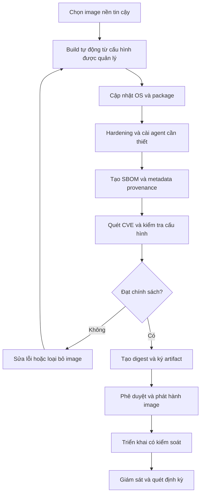

# Kiểm tra lỗ hổng, tính toàn vẹn và nguồn gốc image

Machine image là nền tảng để tạo máy ảo trên đám mây. Image thường chứa hệ điều hành, bootloader, driver, thư viện hệ thống, agent quản trị và một phần cấu hình ban đầu. Nếu image có lỗ hổng, bị chỉnh sửa trái phép hoặc không rõ nguồn gốc, mọi máy ảo được tạo từ image đó có thể kế thừa cùng rủi ro.

Vì vậy, quản lý image cần trả lời ba câu hỏi riêng biệt: image có thành phần dễ bị tấn công hay không; nội dung image có bị thay đổi ngoài ý muốn hay không; và tổ chức có chứng cứ đáng tin cậy về nơi image được tạo, cách tạo và người phê duyệt hay không. Ba câu hỏi này tương ứng với **kiểm tra lỗ hổng**, **tính toàn vẹn** và **nguồn gốc (provenance)**. Kết hợp chúng thành quy trình tạo, kiểm tra, ký, phát hành và cập nhật image giúp hạ tầng tính toán trên đám mây có thể tái lập, kiểm soát và vận hành an toàn hơn.

## 1. Image máy ảo và phạm vi cần bảo vệ

Machine image là mẫu dùng để khởi tạo máy ảo. Tùy nền tảng, image có thể được gọi là machine image, VM image, AMI, managed image hoặc image trong image gallery. Image thường bao gồm:

- Hệ điều hành và các gói hệ thống.
- Bootloader, kernel và cấu hình khởi động.
- Driver, agent giám sát, agent quản trị và công cụ bảo mật.
- Thư viện, runtime và phần mềm nền tảng.
- Cấu hình mạng, logging, cập nhật và chính sách hệ thống ở mức cơ sở.
- Tệp cấu hình hoặc script khởi tạo được tổ chức cho phép đóng gói.

Image có thể được tạo từ image chuẩn của nhà cung cấp, image trên marketplace, image nội bộ hoặc snapshot của một máy ảo đang chạy. Các nguồn này có mức độ tin cậy và khả năng kiểm soát khác nhau. Một snapshot có thể phản ánh trạng thái máy tại một thời điểm nhưng không tự động chứng minh máy đó đã được vá, cấu hình đúng hay không chứa secret.

Phạm vi của bài này tập trung vào image máy ảo và hệ điều hành. Container image có quy trình kiểm tra tương tự về SBOM, lỗ hổng, chữ ký và provenance, nhưng cơ chế phân phối, lớp filesystem và runtime có những khác biệt riêng.

## 2. Phân biệt lỗ hổng, tính toàn vẹn và nguồn gốc

Ba khái niệm liên quan nhưng không thay thế cho nhau:

| Khái niệm | Câu hỏi cần trả lời | Bằng chứng thường dùng |
|---|---|---|
| Kiểm tra lỗ hổng | Image có gói, kernel hoặc cấu hình chứa điểm yếu đã biết không? | Kết quả vulnerability scan, danh sách package, CVE, báo cáo cấu hình |
| Tính toàn vẹn (integrity) | Image có đúng là nội dung đã được phê duyệt và không bị thay đổi không? | Hash/digest, chữ ký số, xác minh chữ ký, kiểm soát quyền ghi |
| Nguồn gốc (provenance) | Image được tạo từ đâu, bằng quy trình nào, từ đầu vào nào và ai phê duyệt? | Metadata build, SBOM, build attestation, lịch sử pipeline và danh tính người phát hành |

Một image có thể không chứa CVE đã biết nhưng vẫn bị cài mã độc. Một image có chữ ký hợp lệ vẫn có thể chứa gói phần mềm lỗi thời. Một digest có thể xác nhận hai bản sao giống hệt nhau nhưng không nói ai đã tạo ra nội dung đó. Vì vậy, cần kết hợp cả ba nhóm kiểm soát.

## 3. Kiểm tra lỗ hổng trong image

**Vulnerability scanning** là quá trình đối chiếu phần mềm và cấu hình trong image với cơ sở dữ liệu lỗ hổng, chính sách bảo mật và chuẩn cấu hình. Scanner thường nhận diện hệ điều hành, package manager, tên gói, phiên bản, thư viện và một số tệp cấu hình.

Kết quả có thể chỉ ra:

- Gói hệ điều hành có phiên bản bị ảnh hưởng bởi một CVE.
- Kernel hoặc thành phần hệ thống có bản sửa lỗi bảo mật chưa được cài.
- Runtime, thư viện hoặc agent có phiên bản không còn được hỗ trợ.
- Dịch vụ không cần thiết được cài hoặc bật mặc định.
- Cấu hình yếu như SSH cho phép đăng nhập root trực tiếp, mật khẩu yếu hoặc quyền file quá rộng.
- Image sử dụng phiên bản hệ điều hành đã hết vòng đời hỗ trợ.

### 3.1. CVE và mức độ nghiêm trọng

CVE (Common Vulnerabilities and Exposures) là mã định danh cho một lỗ hổng đã được công bố. Một kết quả scan có thể kèm CVSS score hoặc mức độ như Critical, High, Medium và Low. CVSS giúp mô tả mức độ nghiêm trọng kỹ thuật, nhưng không tự phản ánh đầy đủ mức rủi ro đối với môi trường cụ thể.

Khi ưu tiên xử lý, cần xem thêm:

- Lỗ hổng có thể bị khai thác từ mạng hay chỉ từ tài khoản cục bộ?
- Dịch vụ hoặc thành phần bị ảnh hưởng có thực sự được bật và có thể truy cập không?
- Có exploit đang được sử dụng ngoài thực tế hoặc mã khai thác công khai không?
- Máy ảo có dữ liệu nhạy cảm, quyền truy cập cao hoặc nằm trong vùng mạng quan trọng không?
- Nhà cung cấp hệ điều hành đã phát hành bản vá hoặc advisory chưa?
- Có biện pháp giảm thiểu tạm thời nào được xác nhận không?

Không nên xếp thứ tự xử lý chỉ bằng CVSS. Một lỗ hổng có điểm số cao nhưng thành phần không được cài hoặc không thể truy cập có thể có mức rủi ro thực tế thấp hơn một lỗ hổng đang bị khai thác trên dịch vụ công khai.

### 3.2. Chú ý bản vá backport

Một số bản phân phối Linux đưa bản sửa lỗi vào phiên bản package của họ mà không nhất thiết đổi số phiên bản upstream theo cách dễ nhận ra. Vì vậy, scanner chỉ so sánh số phiên bản có thể báo dương tính giả nếu không hiểu quy tắc backport của nhà phân phối.

Khi xác minh phát hiện, cần đối chiếu advisory bảo mật chính thức của bản phân phối, release package và trạng thái bản vá. Không nên tự kết luận một package an toàn chỉ vì số phiên bản trông mới hơn; cũng không nên nâng package thủ công vượt khỏi kênh hỗ trợ nếu điều đó làm hỏng phụ thuộc hệ thống.

### 3.3. Quét image và quét máy đang chạy

Quét image trước khi phát hành giúp phát hiện vấn đề trước khi tạo máy ảo. Quét máy đang chạy giúp nhận ra những thay đổi sau khi khởi tạo, chẳng hạn package được cài thêm, bản vá bị thiếu hoặc cấu hình bị drift.

Hai hoạt động này bổ sung cho nhau:

- **Quét image:** đánh giá nội dung được đóng gói tại thời điểm build.
- **Quét instance:** đánh giá trạng thái thực tế của máy sau khi khởi tạo và trong suốt vòng đời.

Một image đạt yêu cầu khi build vẫn có thể trở nên lỗi thời vài tuần sau khi một CVE mới được công bố. Ngược lại, một máy đã được vá thủ công có thể khác với image chuẩn và khó tái tạo. Cần có lịch quét định kỳ và cơ chế rebuild image để cập nhật bản vá.

## 4. SBOM: biết image chứa những gì

SBOM (Software Bill of Materials) là danh mục thành phần phần mềm có trong một sản phẩm hoặc image. Với image máy ảo, SBOM có thể liệt kê package hệ điều hành, thư viện, runtime, ứng dụng và thông tin phiên bản.

SBOM giúp tổ chức:

- Xác định image nào bị ảnh hưởng khi một CVE mới xuất hiện.
- Truy tìm package có nguồn gốc hoặc giấy phép cần xem xét.
- So sánh thành phần giữa hai bản phát hành image.
- Hỗ trợ kiểm toán và điều tra sự cố chuỗi cung ứng phần mềm.
- Xác định những package không còn được duy trì hoặc không cần thiết.

Các định dạng phổ biến gồm SPDX và CycloneDX. Định dạng nào được chọn nên phù hợp với scanner, hệ thống quản lý tài sản và yêu cầu tích hợp của tổ chức.

SBOM chỉ hữu ích khi phản ánh đúng nội dung thực tế. Cần tạo nó từ artifact đã build hoặc từ package database/filesystem của image, lưu kèm phiên bản image và thời điểm tạo, rồi cập nhật mỗi lần rebuild. SBOM không phải chứng nhận image an toàn; nó là dữ liệu đầu vào để phân tích rủi ro.

## 5. Tính toàn vẹn: hash, digest và chữ ký số

Tính toàn vẹn bảo đảm nội dung image được sử dụng đúng với bản đã được kiểm tra và phê duyệt. Hai cơ chế thường dùng là hash/digest và chữ ký số.

### 5.1. Hash và digest

Hash là giá trị được tính từ dữ liệu. Với cùng một nội dung và thuật toán, kết quả digest sẽ giống nhau; thay đổi dữ liệu thường làm digest thay đổi. SHA-256 là một thuật toán hash mật mã thường dùng.

Ví dụ tính SHA-256 của một tệp image đã tải về trên Linux:

```bash
sha256sum ./golden-image.raw
```

Trên PowerShell:

```powershell
Get-FileHash -Algorithm SHA256 .\golden-image.raw
```

Digest giúp phát hiện nội dung khác với bản đã ghi nhận. Tuy nhiên, nếu kẻ tấn công có thể thay cả image lẫn tệp ghi digest, việc so sánh không tạo ra bằng chứng tin cậy. Digest cần được lưu trong hệ thống kiểm soát truy cập và gắn với quy trình phê duyệt.

### 5.2. Chữ ký số

Chữ ký số gắn digest hoặc metadata của image với khóa riêng của bên phát hành. Người nhận dùng khóa công khai hoặc chứng thư tin cậy để xác minh chữ ký. Nếu image bị thay đổi sau khi ký, xác minh sẽ thất bại.

Quy trình cơ bản:

1. Build image và tạo digest.
2. Tạo metadata mô tả image, phiên bản, nguồn đầu vào và kết quả kiểm tra.
3. Dùng khóa ký được bảo vệ để ký digest hoặc artifact/attestation theo định dạng đã chọn.
4. Phát hành image cùng chữ ký và chứng cứ liên quan.
5. Trước khi triển khai, xác minh chữ ký, danh tính người ký, chính sách tin cậy và digest.

Chữ ký hợp lệ chứng minh artifact khớp với nội dung được ký bởi danh tính tương ứng, trong phạm vi mô hình tin cậy. Nó không chứng minh image không có lỗ hổng. Nếu khóa ký bị lộ hoặc danh tính ký không được kiểm soát, chữ ký có thể hợp lệ về mặt mật mã nhưng không đáng tin về mặt vận hành.

### 5.3. Bảo vệ khóa ký

Khóa riêng cần được bảo vệ bằng dịch vụ quản lý khóa hoặc cơ chế ký có kiểm soát. Hạn chế quyền sử dụng khóa theo danh tính pipeline, môi trường và vai trò phát hành. Ghi log thao tác ký, xoay vòng khóa theo chính sách và có quy trình thu hồi hoặc ngừng tin cậy khi khóa bị lộ.

Không đặt khóa riêng, token truy cập hoặc credential cloud bên trong image. Image được sao chép qua nhiều môi trường và có thể được nhiều nhóm sử dụng; secret được đóng gói sẽ khó thu hồi và dễ bị lộ qua snapshot hoặc bản sao lưu.

## 6. Nguồn gốc image và provenance

**Image provenance** là thông tin có thể kiểm chứng về nguồn và quá trình tạo image. Provenance giúp trả lời:

- Image bắt đầu từ image nền hoặc artifact nào?
- Phiên bản hệ điều hành và package repository nào đã được sử dụng?
- Pipeline, script và cấu hình nào tạo ra image?
- Build diễn ra ở đâu, khi nào và dưới danh tính nào?
- Các bước scan, kiểm tra cấu hình và phê duyệt có thành công không?
- Artifact cuối cùng có đúng là artifact được phát hành từ build đó không?

Một hồ sơ provenance tốt thường gắn với digest image và có thể gồm:

- Tên và phiên bản image nền, kèm ID hoặc digest nếu nền tảng cung cấp.
- Commit của mã cấu hình, script build và phiên bản công cụ.
- Danh sách repository và nguồn package.
- Thời điểm build, pipeline run ID và danh tính workload thực hiện build.
- SBOM, báo cáo scan và kết quả kiểm tra cấu hình.
- Danh tính người hoặc nhóm phê duyệt phát hành.
- Chữ ký và attestation bảo vệ metadata.

Provenance có thể được biểu diễn bằng các định dạng hoặc chuẩn như in-toto attestation và SLSA provenance. Tổ chức không nhất thiết phải triển khai mọi chuẩn cùng lúc; điều quan trọng là xác định dữ liệu cần có, cách xác minh và nơi lưu bằng chứng.

### Image từ marketplace và image của nhà cung cấp

Image marketplace có thể giúp triển khai nhanh, nhưng cần kiểm tra nhà phát hành, hệ điều hành, phiên bản, ngày cập nhật, điều khoản hỗ trợ và phương thức cập nhật bảo mật. Nhãn “verified” hoặc hình ảnh thương hiệu trên marketplace cần được hiểu theo tiêu chí xác minh của nền tảng; nó không thay thế việc đánh giá nội dung image và yêu cầu nội bộ.

Image do nhà cung cấp cloud công bố thường có metadata về nhà phát hành và phiên bản. Tổ chức vẫn cần kiểm tra image ID, khu vực, kiến trúc CPU, trạng thái hỗ trợ và lịch cập nhật. Khi tạo image nội bộ từ image nền, cần ghi lại ID nguồn để truy xuất được chuỗi kế thừa.

## 7. Golden image và quy trình tạo image an toàn

**Golden image** là image chuẩn đã được tổ chức lựa chọn, cấu hình, kiểm tra và phê duyệt để dùng làm nền cho các máy ảo. Nó giúp giảm khác biệt cấu hình giữa môi trường, đơn giản hóa vá lỗi và hỗ trợ kiểm toán.

Một quy trình build image có thể gồm các bước:



Các nguyên tắc nên áp dụng:

- Tạo image bằng pipeline có thể tái chạy, có version control và log.
- Dùng image nền từ nguồn được phê duyệt, ưu tiên bản còn hỗ trợ.
- Cập nhật package từ repository tin cậy và xác minh chữ ký repository khi có hỗ trợ.
- Chỉ cài phần mềm cần thiết để giảm bề mặt tấn công.
- Tắt dịch vụ, cổng và tài khoản mặc định không cần thiết.
- Không nhúng secret, khóa riêng, token hoặc dữ liệu cá nhân vào image.
- Tạo SBOM, scan và kiểm tra cấu hình trước khi ký.
- Lưu digest, chữ ký, provenance và kết quả phê duyệt cùng phiên bản image.
- Giới hạn quyền tạo, sửa, chia sẻ và xóa image trong tài khoản cloud.

## 8. Hardening và kiểm tra cấu hình hệ điều hành

Vulnerability scan tập trung vào lỗ hổng đã biết trong phần mềm; hardening tập trung vào cấu hình giảm bề mặt tấn công. Hai hoạt động cần đi cùng nhau.

Một số hạng mục hardening cơ bản:

| Hạng mục | Kiểm tra |
|---|---|
| Tài khoản và xác thực | Xóa tài khoản mặc định không cần thiết, giới hạn đăng nhập đặc quyền, dùng SSH key hoặc cơ chế danh tính được quản lý |
| Dịch vụ hệ thống | Tắt daemon, dịch vụ và cổng không cần thiết |
| SSH/RDP | Giới hạn nguồn truy cập, cấu hình xác thực mạnh, ghi log và quản lý quyền truy cập |
| Firewall | Áp dụng host firewall và security group theo nguyên tắc tối thiểu |
| Quyền file | Kiểm tra quyền với tệp cấu hình, khóa, log và thư mục hệ thống |
| Cập nhật | Bật hoặc cấu hình quy trình cập nhật bảo mật, xác định cách khởi động lại khi cần |
| Logging | Bật log hệ thống, đồng bộ thời gian và chuyển log tới nơi lưu tập trung |
| Mã hóa | Dùng mã hóa volume/snapshot theo yêu cầu và bảo vệ khóa bằng KMS hoặc dịch vụ tương ứng |
| Boot integrity | Xem xét Secure Boot và cơ chế xác minh chuỗi khởi động nếu nền tảng hỗ trợ |
| Agent quản trị | Chỉ cài agent từ nguồn tin cậy, kiểm tra quyền và cơ chế cập nhật |

Các baseline như CIS Benchmarks có thể làm cơ sở kiểm tra cấu hình, nhưng cần chọn profile phù hợp với hệ điều hành và vai trò máy. Áp dụng cứng mọi khuyến nghị mà không kiểm thử có thể làm hỏng dịch vụ hoặc cản trở công cụ quản trị. Nên ghi nhận ngoại lệ, lý do, người phê duyệt và thời hạn xem xét lại.

## 9. Secure Boot, measured boot và tính toàn vẹn khi khởi động

Tính toàn vẹn của image cần được xem xét cả ở thời điểm lưu trữ và lúc máy khởi động.

**Secure Boot** xác minh chữ ký của các thành phần trong chuỗi khởi động theo chính sách khóa tin cậy. Nó giúp ngăn thành phần boot không được phép chạy trong các cấu hình được hỗ trợ. Khả năng bật Secure Boot phụ thuộc hypervisor, loại VM, firmware ảo và hệ điều hành.

**Measured Boot** ghi nhận phép đo mật mã của các thành phần khởi động vào vùng lưu trữ bảo vệ như TPM hoặc vTPM. Các phép đo này có thể được dùng để đánh giá trạng thái boot hoặc phục vụ remote attestation khi có hạ tầng hỗ trợ.

Hai cơ chế có vai trò khác nhau: Secure Boot kiểm tra quyền được phép khởi chạy theo chuỗi tin cậy; measured boot ghi nhận trạng thái để bên khác có thể đánh giá. Chúng bổ sung cho nhau nhưng không bảo đảm toàn bộ hệ điều hành sau khi khởi động không bị khai thác. Vẫn cần vá lỗi, bảo vệ runtime và giám sát máy.

## 10. Phát hành, phân phối và kiểm soát quyền truy cập image

Sau khi image vượt qua kiểm tra, cần phát hành theo cách hạn chế thay đổi ngoài ý muốn.

- Gắn phiên bản rõ ràng, chẳng hạn `ubuntu-app-2026.11.22-v3`, và lưu image ID/digest tương ứng.
- Lưu image trong project, subscription hoặc account được kiểm soát.
- Chỉ cấp quyền tạo image cho pipeline và nhóm vận hành được ủy quyền.
- Chỉ cấp quyền sử dụng hoặc chia sẻ image cho môi trường cần thiết.
- Xác minh digest/chữ ký trước khi copy image sang region hoặc account khác.
- Theo dõi bản sao và image cũ để tránh triển khai nhầm phiên bản.
- Đánh dấu image hết hạn hoặc thu hồi khỏi danh sách được phép sử dụng khi có rủi ro.

Image có thể được sao chép giữa các region, account hoặc subscription. Cần xác minh metadata, digest và chữ ký sau khi sao chép; một số nền tảng có thể tạo ID khác cho bản sao dù nội dung logic giống nhau. Digest của nội dung là căn cứ so sánh mạnh hơn tên hiển thị hoặc ID dễ thay đổi, nếu nền tảng cho phép lấy digest đáng tin cậy.

Không nên cho phép người dùng tùy ý chia sẻ image chứa dữ liệu nội bộ, tài khoản đã cấu hình hoặc thông tin nhạy cảm. Trước khi phát hành, cần làm sạch log, cache, history shell, credential tạm và dữ liệu của máy build.

## 11. Cập nhật image và quản lý vòng đời

Image là artifact có vòng đời. Một image từng đạt chuẩn có thể trở nên không an toàn khi hệ điều hành hết hỗ trợ hoặc có CVE mới. Cần xác định chính sách rebuild theo lịch và theo sự kiện.

Các tác nhân có thể kích hoạt rebuild:

- Bản vá bảo mật quan trọng được công bố.
- Hệ điều hành hoặc package nền sắp hết vòng đời hỗ trợ.
- Driver, agent hoặc runtime có bản sửa lỗi cần thiết.
- Scanner phát hiện lỗ hổng vượt ngưỡng chính sách.
- Chuẩn hardening hoặc yêu cầu tuân thủ thay đổi.
- Có thay đổi trong script build hoặc nguồn package.

Quy trình cập nhật nên tạo image mới có phiên bản mới, chạy lại scan và kiểm tra, sau đó phát hành theo quy trình phê duyệt. Tránh chỉnh sửa thủ công image đã phát hành rồi tiếp tục dùng cùng tên phiên bản; việc đó làm mất khả năng truy xuất và gây khó khăn khi điều tra.

### Thay thế máy đang chạy

Khi image mới được phê duyệt, tổ chức có thể tạo máy mới từ image đó rồi chuyển workload theo cách phù hợp với ứng dụng. Với dịch vụ stateless, có thể thay thế theo rolling deployment hoặc blue/green. Với máy stateful, cần thiết kế sao lưu, đồng bộ dữ liệu, kiểm tra khả năng khôi phục và cửa sổ bảo trì trước khi thay máy.

Không phải mọi bản vá đều bắt buộc tạo image mới ngay lập tức; một số môi trường có quy trình vá trực tiếp. Tuy nhiên, nếu vá trực tiếp, cần quản lý cấu hình drift và bảo đảm image chuẩn tiếp theo đã bao gồm bản vá, nếu không máy được tạo mới sẽ quay lại trạng thái dễ bị tấn công.

## 12. Xử lý phát hiện và ngoại lệ bảo mật

Không phải mọi phát hiện scanner đều có cùng mức độ chắc chắn hoặc cùng khả năng khắc phục. Quy trình xử lý nên bao gồm:

1. **Xác nhận phát hiện:** kiểm tra package, phiên bản, hệ điều hành, advisory và điều kiện bị ảnh hưởng.
2. **Đánh giá rủi ro:** xem khả năng khai thác, mức phơi nhiễm, dữ liệu và quyền của workload.
3. **Chọn biện pháp:** cập nhật package, thay image nền, tắt thành phần, cấu hình giảm thiểu hoặc cô lập tạm thời.
4. **Kiểm thử:** xác nhận ứng dụng và agent vẫn hoạt động sau khi thay đổi.
5. **Quét lại:** chạy scanner và kiểm tra cấu hình sau khắc phục.
6. **Ghi nhận:** lưu bằng chứng, người xử lý, thời điểm và kết quả.

Nếu chưa thể vá ngay, ngoại lệ cần có chủ sở hữu, lý do, phạm vi ảnh hưởng, biện pháp giảm thiểu, ngày hết hạn và lịch đánh giá lại. Không nên để ngoại lệ tồn tại vô thời hạn chỉ vì image đã được sử dụng trong production.

## 13. Ví dụ pipeline kiểm tra image

Ví dụ sau minh họa logic của một pipeline. Các lệnh scanner, công cụ ký và hệ thống provenance thực tế phụ thuộc tổ chức sử dụng.

```text
1. Lấy image nền từ nguồn được phê duyệt
2. Build image từ script đã quản lý trong version control
3. Cập nhật hệ điều hành và package
4. Áp dụng hardening và cài agent cần thiết
5. Tạo SBOM gắn với phiên bản build
6. Quét CVE và kiểm tra cấu hình
7. Nếu vi phạm ngưỡng: dừng phát hành, tạo ticket khắc phục
8. Nếu đạt: tạo digest và provenance attestation
9. Ký digest/attestation bằng khóa được bảo vệ
10. Người hoặc chính sách có thẩm quyền phê duyệt
11. Phát hành image vào kho được kiểm soát
12. Xác minh chữ ký trước khi triển khai
13. Theo dõi image và instance sau khi phát hành
```

Một chính sách phát hành có thể yêu cầu không còn lỗ hổng Critical, không có lỗ hổng đang bị khai thác chưa được giảm thiểu, image còn trong vòng đời hỗ trợ, scan gần thời điểm phát hành, chữ ký hợp lệ và provenance đầy đủ. Ngưỡng cụ thể cần dựa trên mức chấp nhận rủi ro của tổ chức và môi trường triển khai.

## 14. Những lỗi thường gặp

**Chỉ scan một lần khi tạo image.** Cơ sở dữ liệu CVE thay đổi liên tục; image đã phát hành có thể phát sinh rủi ro mới. Cần quét lại theo lịch và theo sự kiện.

**Tin rằng chữ ký đồng nghĩa với an toàn.** Chữ ký xác nhận artifact khớp với nội dung được ký và danh tính ký, không xác nhận nội dung không có lỗ hổng. Vẫn phải scan và kiểm tra cấu hình.

**Chỉ lưu tên image.** Tên hoặc tag có thể bị tái sử dụng. Cần lưu ID, digest, phiên bản và metadata provenance.

**Không kiểm tra nguồn image nền.** Một image nội bộ có thể kế thừa lỗ hổng hoặc cấu hình yếu từ image upstream. Phải lưu nguồn gốc và quét cả image nền lẫn image cuối.

**Đóng gói secret vào image.** Secret có thể bị sao chép sang nhiều môi trường hoặc lộ qua snapshot. Hãy lấy secret lúc runtime từ dịch vụ quản lý bí mật và cấp quyền tối thiểu.

**Bỏ qua package không được scanner nhận diện.** Phần mềm cài thủ công, binary tĩnh hoặc ứng dụng nội bộ có thể không xuất hiện trong package database. Cần kết hợp SBOM, inventory và kiểm tra filesystem.

**Vá trực tiếp máy production nhưng không cập nhật image chuẩn.** Máy hiện tại có thể an toàn hơn trong khi máy mới vẫn khởi tạo từ image cũ. Cần đưa bản vá vào pipeline build.

**Chia sẻ image quá rộng.** Quyền chia sẻ rộng có thể làm lộ phần mềm nội bộ hoặc dữ liệu vô tình bị đóng gói. Cần kiểm soát quyền và làm sạch image trước phát hành.

## 15. Checklist trước khi phát hành image

- [ ] Image nền đến từ nhà phát hành hoặc nguồn được phê duyệt.
- [ ] Hệ điều hành và package còn trong vòng đời hỗ trợ.
- [ ] Đã cập nhật bản vá bảo mật và kiểm tra advisory liên quan.
- [ ] Đã quét lỗ hổng và xác nhận các phát hiện vượt ngưỡng đã được xử lý hoặc có ngoại lệ hợp lệ.
- [ ] Đã kiểm tra hardening theo baseline phù hợp.
- [ ] Đã loại bỏ secret, credential, log và dữ liệu nhạy cảm khỏi image.
- [ ] Đã tạo SBOM và gắn với đúng phiên bản/digest image.
- [ ] Đã ghi lại image nền, commit, pipeline, nguồn package và danh tính build.
- [ ] Đã tạo digest, ký artifact hoặc attestation và xác minh được chữ ký.
- [ ] Khóa ký được bảo vệ và quyền phát hành được giới hạn.
- [ ] Image được phát hành với phiên bản rõ ràng trong kho được kiểm soát.
- [ ] Quyền chia sẻ và sử dụng image được giới hạn theo nhu cầu.
- [ ] Đã có lịch quét lại, rebuild, thu hồi và thay thế image.
- [ ] Đã kiểm thử máy khởi tạo từ image và xác minh cấu hình sau boot.

## 16. Kết luận

Kiểm tra lỗ hổng cho biết image có thành phần hoặc cấu hình dễ bị tấn công; kiểm tra tính toàn vẹn giúp xác nhận image không bị thay đổi so với artifact đã phê duyệt; provenance cho biết image được tạo từ nguồn nào, bằng quy trình nào và dưới danh tính nào. SBOM, digest, chữ ký số, attestation, scan và hardening cung cấp những bằng chứng bổ trợ để quản lý ba khía cạnh đó.

Một quy trình image an toàn cần bắt đầu từ nguồn nền tin cậy, build tự động, cập nhật và hardening, tạo SBOM, quét lỗ hổng, ký và phát hành có kiểm soát. Sau khi triển khai, tiếp tục quét instance, theo dõi thay đổi và rebuild khi có bản vá hoặc yêu cầu mới. Cách làm này giúp máy ảo được tạo ra nhất quán, dễ truy xuất nguồn gốc và giảm nguy cơ kế thừa rủi ro từ image cũ hoặc không đáng tin cậy.
