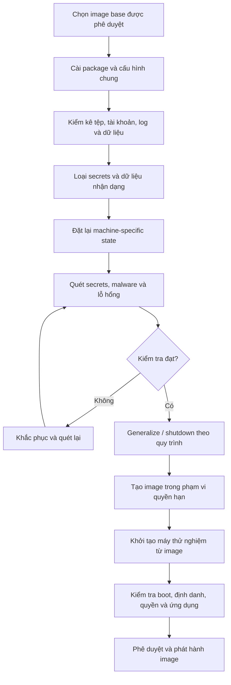
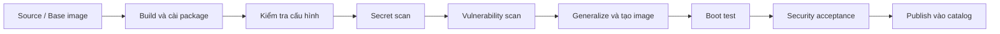

# Loại bỏ bí mật và dữ liệu nhận dạng trước khi tạo image

Machine image (ảnh máy) thường được dùng làm khuôn mẫu để tạo nhiều máy ảo hoặc môi trường chạy giống nhau. Image có thể chứa hệ điều hành, runtime, thư viện, agent giám sát và cấu hình ứng dụng. Nếu image được tạo từ một máy đã từng vận hành thật, nó cũng có thể vô tình mang theo mật khẩu, khóa SSH, token truy cập, chứng thư riêng, lịch sử lệnh, log hoặc dữ liệu của người dùng.

Một bí mật bị đưa vào image có thể được sao chép sang mọi máy được tạo từ image đó. Nếu image được chia sẻ, xuất ra ngoài hoặc lưu trong registry không đúng quyền, phạm vi ảnh hưởng còn rộng hơn. Vì vậy, trước khi chụp image cần kiểm kê, loại bỏ bí mật và dữ liệu nhận dạng, xác minh kết quả, rồi kiểm soát quyền truy cập và vòng đời của image.

Sau bài học, bạn có thể:

- Nhận diện các loại bí mật và dữ liệu nhận dạng có thể tồn tại trong máy nguồn.
- Giải thích vì sao xóa tệp đơn thuần chưa chắc loại bỏ được dữ liệu khỏi image.
- Thực hiện quy trình chuẩn bị, làm sạch và kiểm tra image trước khi tạo.
- Thiết kế cách cấp bí mật lúc chạy bằng danh tính workload hoặc dịch vụ quản lý secrets.
- Xử lý đúng khi phát hiện thông tin nhạy cảm đã lọt vào image hoặc bản sao của image.

## 1. Vì sao cần làm sạch trước khi tạo machine image?

Khi tạo image, nền tảng thường chụp trạng thái đĩa của máy nguồn tại một thời điểm. Các tệp và cấu hình còn trên đĩa có thể trở thành một phần của image, kể cả những dữ liệu không cần thiết cho máy mới. Ví dụ, một máy dùng để cài ứng dụng và kiểm thử có thể đã đăng nhập vào hệ thống quản trị, tải dữ liệu mẫu, chạy lệnh chứa token hoặc ghi thông tin kết nối vào log.

Image sau đó có thể được dùng để:

- Khởi tạo nhiều máy ảo trong cùng một dự án.
- Chia sẻ giữa các nhóm hoặc tài khoản cloud.
- Sao chép sang region khác để triển khai gần người dùng.
- Lưu trong image catalog hoặc kho lưu trữ dài hạn.
- Xuất thành tệp để chuyển sang môi trường khác.

Nếu một khóa riêng hoặc token được lưu trong image, mỗi bản sao có thể mang cùng thông tin xác thực. Nếu dữ liệu khách hàng hoặc log có thông tin cá nhân nằm trong image, các máy mới có thể nhận dữ liệu đó dù không có nhu cầu sử dụng. Đây là rủi ro về bảo mật, quyền riêng tư, tuân thủ và quản trị tài sản.

Làm sạch image là một phần của quy trình bảo vệ chuỗi cung ứng phần mềm và hạ tầng. Nó cần được thực hiện trước khi tạo image, kết hợp với kiểm tra tự động và kiểm soát quyền chia sẻ.

## 2. Phân biệt bí mật, dữ liệu nhận dạng và cấu hình máy

Không phải mọi thông tin cấu hình đều là bí mật. Cần phân loại để biết dữ liệu nào phải loại bỏ, dữ liệu nào có thể giữ lại và dữ liệu nào cần thay mới ở lần khởi động tiếp theo.

### Bí mật (secrets)

Bí mật là dữ liệu có thể cho phép một cá nhân hoặc hệ thống xác thực, truy cập tài nguyên hay giải mã dữ liệu. Ví dụ:

- Mật khẩu tài khoản người dùng, tài khoản quản trị, tài khoản cơ sở dữ liệu.
- Khóa riêng SSH, TLS, PGP hoặc khóa ký phần mềm.
- API key, access token, refresh token, OAuth client secret.
- Cloud access key, service account key, credential của workload hoặc tài khoản dịch vụ.
- Chứng thư số kèm private key, file keystore và truststore có thông tin nhạy cảm.
- Kubeconfig hoặc tệp cấu hình chứa token và chứng thư có quyền truy cập cụm.
- Tệp `.env`, cấu hình ứng dụng hoặc script có mật khẩu, connection string hay khóa bí mật.
- Cookie phiên đăng nhập, browser profile hoặc credential cache còn hiệu lực.

Một giá trị không có tên là `password` vẫn có thể là bí mật. Ví dụ, chuỗi kết nối cơ sở dữ liệu có thể chứa username và password; token trong URL hoặc header debug cũng có thể cấp quyền truy cập.

### Dữ liệu nhận dạng và dữ liệu vận hành nhạy cảm

Dữ liệu nhận dạng (identifiers) có thể liên kết thông tin với một người, tổ chức, tài khoản hoặc hệ thống. Tùy ngữ cảnh, chúng có thể là dữ liệu cá nhân hoặc thông tin nội bộ cần bảo vệ:

- Họ tên, email, số điện thoại, tên đăng nhập và mã nhân viên.
- ID khách hàng, ID người thuê (tenant), mã tài khoản cloud hoặc mã dự án.
- Địa chỉ IP, hostname, domain nội bộ, tên máy và sơ đồ mạng.
- Đường dẫn thư mục chứa tên người dùng, tên tổ chức hoặc tên khách hàng.
- Log có request, session ID, địa chỉ IP, email, nội dung request hoặc dữ liệu giao dịch.
- Cơ sở dữ liệu mẫu, bản dump, file tải lên và dữ liệu hỗ trợ được lấy từ môi trường thật.
- Lịch sử truy cập, lịch sử trình duyệt, tệp gần đây và danh sách máy chủ đã kết nối.

Một ID tài nguyên hoặc địa chỉ IP không nhất thiết là bí mật xác thực. Tuy nhiên, chúng có thể tiết lộ cấu trúc hệ thống, danh tính tổ chức hoặc tạo điều kiện cho hoạt động dò tìm. Hãy đánh giá theo chính sách dữ liệu và mô hình đe dọa của tổ chức.

### Trạng thái định danh riêng của máy

Một số dữ liệu không phải bí mật hay dữ liệu cá nhân, nhưng không nên được nhân bản nguyên trạng sang nhiều máy:

- SSH host key và certificate riêng của máy.
- Machine ID, hostname, cloud-init instance state và dữ liệu đăng ký agent.
- DHCP lease, địa chỉ mạng tĩnh, route hoặc cấu hình DNS dành riêng cho máy nguồn.
- ID agent giám sát, ID đăng ký hệ thống quản lý cấu hình hoặc ID phần mềm bản quyền gắn với máy.
- Cache metadata, thông tin phiên đăng nhập và trạng thái dịch vụ phụ thuộc vào instance cũ.

Nếu các giá trị này được sao chép, nhiều máy có thể cùng nhận một định danh. Điều đó gây nhầm lẫn khi kiểm kê, giám sát, cấp chứng thư, áp chính sách hoặc điều tra sự cố.

## 3. Những vị trí thường chứa dữ liệu nhạy cảm

Khi kiểm tra máy nguồn, không nên chỉ tìm một thư mục `secrets`. Bí mật và dữ liệu nhận dạng có thể nằm rải rác trong nhiều lớp.

| Vị trí | Ví dụ dữ liệu cần kiểm tra | Cách xử lý thường dùng |
|---|---|---|
| Thư mục home của người dùng | `.ssh`, `.aws`, `.azure`, `.config`, `.kube`, `.docker`, `.git-credentials` | Xóa credential không thuộc image; giữ cấu hình mẫu đã loại bí mật nếu thực sự cần |
| Lịch sử shell và terminal | `.bash_history`, `.zsh_history`, PowerShell history, script tạm | Xóa lịch sử chứa lệnh nhạy cảm; không dùng lịch sử lệnh làm nơi lưu bí mật |
| Cấu hình ứng dụng | `.env`, YAML/JSON/TOML, file properties, connection string | Chuyển secrets ra secret manager; chỉ giữ cấu hình không nhạy cảm |
| Khóa và chứng thư | SSH private key, TLS private key, keystore, PFX/P12 | Không bake khóa riêng theo môi trường; cấp chứng thư phù hợp lúc chạy |
| Log và báo cáo | `/var/log`, log ứng dụng, crash dump, support bundle | Kiểm tra nội dung, loại dữ liệu thật, giữ audit cần thiết ở kho log được bảo vệ |
| Cache và dữ liệu tạm | `/tmp`, package cache, browser cache, build cache | Xóa dữ liệu không cần; kiểm tra cache có chứa artifact riêng hoặc token không |
| Dữ liệu hệ thống | `/etc/machine-id`, cloud-init state, SSH host keys, DHCP lease | Đặt lại theo hướng dẫn của hệ điều hành và nền tảng trước khi chụp image |
| Windows profile và registry | Credential Manager, PowerShell history, profile người dùng, certificate store | Loại credential và dữ liệu người dùng; chạy quy trình generalize phù hợp |
| Dữ liệu ứng dụng | Database dump, file upload, test fixture lấy từ production | Loại bỏ hoặc thay bằng dữ liệu tổng hợp đã được phê duyệt |

Đường dẫn trên chỉ là ví dụ phổ biến. Mỗi hệ điều hành, bản phân phối, agent và ứng dụng có vị trí riêng. Cần dùng checklist theo image base và phần mềm thực tế đã cài.

## 4. Nguyên tắc thiết kế image an toàn

Một image tốt nên chứa những thành phần cần thiết để khởi động và chạy workload, đồng thời tránh chứa dữ liệu phụ thuộc vào một người, một tài khoản hoặc một máy cụ thể.

Các nguyên tắc quan trọng:

1. **Tạo từ nguồn sạch:** ưu tiên image nền được phê duyệt và quy trình build có thể lặp lại. Hạn chế biến một máy production đã sử dụng lâu ngày thành khuôn mẫu.
2. **Không bake secrets:** không lưu mật khẩu, API key, token, private key hoặc credential cloud trong image, script build, metadata hay layer của image.
3. **Cấp bí mật lúc chạy:** dùng IAM role, workload identity hoặc secret manager để workload lấy đúng bí mật cần thiết khi khởi động.
4. **Giữ cấu hình chung, tạo định danh riêng:** hostname, machine ID, SSH host key và trạng thái đăng ký agent phải được khởi tạo riêng cho từng instance.
5. **Dùng dữ liệu mẫu an toàn:** kiểm thử bằng dữ liệu tổng hợp hoặc đã được khử nhận dạng theo quy trình được phê duyệt.
6. **Giảm bề mặt tấn công:** chỉ cài package, service, công cụ và tài khoản cần thiết; tắt dịch vụ không dùng.
7. **Tự động hóa và kiểm tra:** thực hiện build, quét secrets, quét lỗ hổng và kiểm tra cấu hình trước khi phát hành image.
8. **Kiểm soát quyền và vòng đời:** giới hạn ai được tạo, chia sẻ, sao chép, sử dụng hoặc xóa image; theo dõi phiên bản và người sở hữu.

Không nên đặt bí mật trong image với lý do “chỉ có nhóm nội bộ được dùng”. Image có thể được sao chép, tải xuống, gắn vào máy khác hoặc lưu lại lâu hơn dự kiến. Quyền truy cập image cần được bảo vệ, nhưng thiết kế vẫn phải giả định rằng nội dung image có thể bị người được cấp quyền đọc.

## 5. Quy trình làm sạch trước khi chụp image

Quy trình cần phù hợp hệ điều hành và công cụ quản lý image. Một luồng tổng quát có thể gồm các bước sau:



### Bước 1: xác định nguồn và mục đích image

Ghi rõ image dành cho hệ điều hành nào, workload nào, môi trường nào và ai chịu trách nhiệm. Kiểm tra nguồn image nền, chữ ký hoặc checksum nếu có, phiên bản, ngày cập nhật và chính sách hỗ trợ. Chỉ cài package cần thiết.

Nếu image được dùng cho nhiều môi trường, hãy giữ cấu hình chung trong image và cung cấp cấu hình riêng cho từng môi trường lúc triển khai. Ví dụ, image của API có thể chứa runtime và agent, trong khi endpoint cơ sở dữ liệu, tên miền, tenant và quyền truy cập được cấp khi chạy.

### Bước 2: kiểm kê dữ liệu trên máy nguồn

Lập danh sách người dùng và nhóm, thư mục home, service account, khóa, chứng thư, file cấu hình, biến môi trường, lịch sử lệnh, log, cache, dữ liệu tạm và phần mềm quản lý đã đăng ký. Kiểm tra cả file ẩn, thư mục build, file backup và nội dung trong archive.

Tìm kiếm bằng công cụ quét secrets theo nhiều mẫu, nhưng không chỉ dựa vào regex. Một chuỗi ngẫu nhiên có thể là token dù không có tên biến rõ ràng; một mật khẩu có thể được mã hóa hoặc chia thành nhiều phần trong cấu hình. Kết hợp quét tự động với kiểm tra thủ công có phạm vi.

### Bước 3: loại bỏ bí mật và chuyển sang cơ chế cấp lúc chạy

Xóa credential không cần thiết khỏi máy nguồn, cấu hình và script. Nếu ứng dụng cần truy cập dịch vụ cloud, hãy gán danh tính workload hoặc instance role với quyền tối thiểu. Nếu cần mật khẩu hoặc token cho dịch vụ bên ngoài, hãy lấy từ secret manager trong lúc chạy và giới hạn thời gian tồn tại khi có thể.

Ví dụ, một cấu hình ứng dụng an toàn hơn có thể chỉ chứa tên secret hoặc tham chiếu đến secret:

```yaml
application:
  database:
    host: orders-db.internal.example
    name: orders
    credentials_source: secret-manager
    secret_reference: production/orders/database
```

Đây là cấu hình minh họa. `secret_reference` là tên tham chiếu, không phải nội dung bí mật. Danh tính workload phải được cấp quyền đọc đúng secret trong môi trường tương ứng.

### Bước 4: loại dữ liệu nhận dạng và dữ liệu vận hành không cần thiết

Xóa dữ liệu khách hàng, dữ liệu giao dịch, file tải lên, log có thông tin cá nhân và bản dump không thuộc mục đích của image. Nếu cần giữ dữ liệu kiểm thử, thay bằng dữ liệu tổng hợp hoặc đã được khử nhận dạng theo chính sách.

Không phải mọi log đều cần xóa. Log audit hoặc thông tin cần cho điều tra có thể phải được giữ theo thời hạn lưu trữ. Trong trường hợp đó, chuyển log đến hệ thống tập trung có kiểm soát truy cập và chính sách retention, rồi làm sạch bản sao cục bộ khỏi image. Không xóa dấu vết cần thiết để đáp ứng nghĩa vụ kiểm toán hoặc điều tra.

### Bước 5: đặt lại trạng thái riêng của máy

Chuẩn bị cho máy mới nhận định danh riêng. Tùy nền tảng, cần xóa hoặc reset machine ID, SSH host key, cloud-init state, DHCP lease, hostname tĩnh, dữ liệu đăng ký agent và các tệp cache gắn với instance cũ. Với Windows, cần dùng quy trình generalize được hỗ trợ, chẳng hạn công cụ chuẩn bị hệ thống tương ứng với phiên bản Windows và quy trình image của nhà cung cấp.

Không tự ý xóa các tệp hệ thống chỉ vì tên của chúng có vẻ đặc biệt. Thực hiện theo hướng dẫn của hệ điều hành và cloud provider để tránh làm image không thể khởi động hoặc mất cấu hình cần thiết.

### Bước 6: quét và xác minh

Chạy công cụ phát hiện secrets, quét lỗ hổng package, kiểm tra cấu hình bảo mật và rà soát file còn sót. Xác nhận không có credential dùng chung, dữ liệu khách hàng, lịch sử đăng nhập hoặc định danh máy nguồn cần phải tạo mới.

Nếu công cụ quét phát hiện kết quả, cần phân loại false positive và true positive có bằng chứng. Không nên chỉ bỏ qua cảnh báo bằng cách thêm ngoại lệ rộng. Ngoại lệ phải có lý do, phạm vi nhỏ, người phê duyệt và thời hạn xem xét.

### Bước 7: generalize, dừng máy và tạo image

Thực hiện bước generalize hoặc clean theo công cụ của hệ điều hành. Tắt máy theo quy trình chụp image của nhà cung cấp để tránh ghi dữ liệu chưa hoàn tất. Tạo image với tên, phiên bản, nguồn gốc, ngày build, chủ sở hữu và trạng thái phê duyệt rõ ràng.

### Bước 8: khởi tạo máy thử nghiệm từ image

Tạo một instance kiểm thử từ image vừa phát hành. Xác nhận máy khởi động, tạo định danh riêng, nhận cấu hình lúc chạy, lấy secrets bằng danh tính đúng, kết nối được dịch vụ cần thiết và không mang theo dữ liệu từ máy nguồn. Kiểm tra log khởi động, quyền truy cập và khả năng cập nhật.

## 6. Ví dụ kiểm tra trên Linux

Các lệnh dưới đây chỉ mang tính minh họa để hỗ trợ kiểm kê. Đường dẫn, quyền truy cập và công cụ cần điều chỉnh theo bản phân phối và tiêu chuẩn của tổ chức. Chạy trên máy build đã được phê duyệt, sao lưu hoặc tạo snapshot trước khi thực hiện thay đổi hệ thống quan trọng.

### Kiểm tra các vị trí phổ biến

```bash
# Liệt kê các thư mục home để xác định phạm vi kiểm tra
ls -la /home

# Kiểm tra một số thư mục có thể chứa credential
find /home -maxdepth 4 \
  \( -name '.ssh' -o -name '.aws' -o -name '.azure' \
     -o -name '.kube' -o -name '.docker' \) -print

# Kiểm tra file cấu hình môi trường, chỉ in tên file
find /opt /srv /etc -type f -name '.env' -print 2>/dev/null

# Kiểm tra các file lịch sử shell phổ biến
find /home -maxdepth 3 \
  \( -name '.bash_history' -o -name '.zsh_history' \) -print
```

Không dùng `cat`, `grep` hoặc lệnh tương tự để in toàn bộ nội dung credential vào terminal log hoặc bản ghi CI. Nếu cần kiểm tra nội dung, dùng công cụ có khả năng che giá trị nhạy cảm và hạn chế người được xem kết quả.

### Quét secrets

Có thể tích hợp một công cụ secret scanner vào pipeline build. Ví dụ dưới đây mô tả cách gọi một công cụ quét giả định; tên lệnh và tham số cần thay bằng công cụ được tổ chức phê duyệt:

```bash
# Ví dụ minh họa; thay secret-scanner bằng công cụ thực tế
secret-scanner scan --path /image-root --redact --fail-on-findings
```

Kết quả quét cần được lưu ở nơi có kiểm soát quyền. Bản ghi kết quả nên nêu đường dẫn, loại phát hiện, mức độ và trạng thái xử lý, nhưng không ghi nguyên giá trị bí mật.

### Làm sạch dữ liệu định danh

Các lệnh reset machine ID, SSH host key, cloud-init và agent đăng ký có thể khác nhau theo hệ điều hành và nền tảng. Hãy dùng script chuẩn hóa đã được kiểm thử cho đúng image base. Không sao chép một lệnh xóa chung từ môi trường khác vào pipeline production mà chưa kiểm tra tác động.

`rm` chỉ loại bỏ tham chiếu đến tệp trong hệ thống tệp; nó không đảm bảo các byte đã biến mất khỏi block, snapshot hoặc bản sao lưu. Trên SSD, thin-provisioned disk, copy-on-write filesystem và storage cloud, lệnh ghi đè tệp cũng không bảo đảm xóa vật lý dữ liệu cũ. Cách an toàn hơn là build lại từ image nền sạch, không đưa dữ liệu nhạy cảm vào quá trình build và quản lý mã hóa/lưu trữ theo chính sách.

## 7. Ví dụ chuẩn bị image trên Windows

Máy Windows có thể lưu credential trong Credential Manager, certificate store, profile người dùng, PowerShell history, registry, log và thư mục tạm. Một image được tạo từ máy đã đăng nhập vào domain hoặc công cụ quản trị có thể mang theo trạng thái riêng của máy.

Checklist trước khi tạo image Windows:

- Kiểm tra tài khoản người dùng, profile và file trong Desktop, Downloads, Documents, AppData.
- Rà soát Credential Manager, thông tin đăng nhập lưu trong ứng dụng, browser profile và PowerShell history.
- Kiểm tra certificate store, private key, file PFX/P12, SSH key và credential của công cụ cloud.
- Kiểm tra biến môi trường, file cấu hình, script triển khai và log ứng dụng.
- Loại dữ liệu cá nhân, bản dump, file kiểm thử có dữ liệu thật và cache không cần thiết.
- Dùng quy trình generalize được hỗ trợ cho phiên bản Windows và dịch vụ cloud đang dùng.
- Tạo máy kiểm thử từ image và xác nhận SID/định danh, hostname, chứng thư, agent và quyền truy cập được tạo đúng cho instance mới.

Không tự ý xóa registry key, certificate store hoặc thư mục hệ thống theo danh sách chung. Một số thành phần cần thiết cho quá trình khởi động hoặc đăng ký hệ thống. Hãy dùng quy trình chuẩn hóa chính thức và kiểm tra image sau khi tạo.

## 8. Vì sao xóa bí mật sau khi đã lộ vẫn chưa đủ?

Giả sử một API token đã được ghi vào file cấu hình, sau đó file bị xóa trước khi tạo image. Tùy hệ thống lưu trữ, dữ liệu cũ có thể còn trong block chưa được tái sử dụng, snapshot, bản sao lưu, cache hoặc layer của image. Nếu token đã từng được commit vào Git hoặc đưa vào build artifact, việc xóa file ở phiên bản mới cũng không loại token khỏi lịch sử cũ.

Khi phát hiện bí mật đã lọt vào image hoặc pipeline, hãy xử lý như một sự cố lộ credential:

1. **Thu hồi hoặc xoay vòng bí mật:** vô hiệu hóa token/khóa cũ, cấp credential mới và cập nhật workload cần dùng. Xóa file không làm credential cũ mất hiệu lực.
2. **Đánh giá phạm vi:** xác định image, snapshot, bản sao, registry, tài khoản và môi trường nào đã nhận dữ liệu.
3. **Hạn chế truy cập:** khóa quyền chia sẻ hoặc tải image có vấn đề trong khi điều tra; giữ bằng chứng cần thiết theo quy trình ứng phó.
4. **Tạo image mới từ nguồn sạch:** sửa pipeline, loại dữ liệu nhạy cảm và quét lại toàn bộ artifact mới.
5. **Xử lý bản cũ:** thu hồi, đánh dấu không còn được dùng, xóa hoặc cách ly image và snapshot theo chính sách retention và yêu cầu điều tra.
6. **Kiểm tra dấu hiệu sử dụng trái phép:** rà soát log xác thực và hoạt động tài nguyên bằng công cụ bảo mật có thẩm quyền.
7. **Ngăn tái diễn:** bổ sung secret scanning, kiểm tra trước phát hành, quyền tối thiểu và quy trình cấp secrets lúc chạy.

Nếu image đã được chia sẻ ra ngoài tổ chức, cần giả định người nhận có thể đã sao chép nó. Thu hồi quyền truy cập image không thể thu hồi bản sao đã tải xuống; việc xoay vòng credential và đánh giá dữ liệu đã lộ vẫn cần thực hiện.

## 9. Quản lý secrets sau khi image được tạo

Image nên chứa mã và cấu hình không nhạy cảm. Bí mật được cấp theo danh tính của workload vào lúc chạy.

### Dùng workload identity hoặc instance role

Thay vì lưu access key trong file, gán một danh tính cho instance, container hoặc workload. Nền tảng cung cấp thông tin xác thực tạm thời theo danh tính đó. Quyền nên giới hạn theo hành động, tài nguyên và thời gian cần thiết.

Ví dụ, một service xử lý đơn hàng chỉ cần quyền đọc một secret và ghi vào một hàng đợi. Không cấp quyền quản trị toàn bộ tài khoản cloud cho instance chỉ để thực hiện hai tác vụ này.

### Dùng secret manager

Secret manager lưu và phân phối mật khẩu, token, certificate hoặc khóa theo chính sách. Ứng dụng truy cập bằng danh tính workload; quyền đọc được giới hạn theo secret và môi trường. Có thể bật rotation, audit log và kiểm soát phiên bản secret tùy dịch vụ.

Không nên ghi bí mật vào log khi khởi động. Nếu ứng dụng cần hiển thị trạng thái cấu hình, chỉ ghi tên secret hoặc trạng thái thành công/thất bại, không ghi giá trị.

### Tách cấu hình theo môi trường

Dev, test, staging và production nên có secret riêng. Image chung có thể được dùng ở nhiều môi trường, nhưng danh tính và secret được cấp theo nơi triển khai. Tránh đóng gói một credential production vào image dùng cho kiểm thử.

## 10. Tự động hóa kiểm tra image trong pipeline

Một pipeline image có thể kiểm tra bảo mật trước khi cho phép phát hành. Các bước nên được tự động hóa để mọi phiên bản đều tuân theo cùng tiêu chuẩn.



Ví dụ về một mô tả pipeline ở mức khái niệm:

```yaml
image_pipeline:
  base_image: approved-linux-base
  steps:
    - install_required_packages
    - apply_os_updates
    - apply_baseline_configuration
    - remove_build_credentials
    - reset_machine_specific_state
    - scan_secrets:
        fail_on_unapproved_findings: true
        redact_output: true
    - scan_vulnerabilities:
        enforce_policy: true
    - create_image
    - boot_test:
        verify_unique_machine_identity: true
        verify_runtime_secret_injection: true
  publish:
    require_approval: true
    record_source_and_version: true
```

Đây là ví dụ mô tả, không phải cú pháp của một công cụ CI cụ thể. Pipeline thực tế cần tích hợp với công cụ build image, secret scanner, vulnerability scanner, hệ thống phê duyệt và image catalog mà tổ chức sử dụng.

### Tiêu chí chặn phát hành

Không nên phát hành image nếu còn một trong các vấn đề sau:

- Phát hiện bí mật hợp lệ chưa được xử lý hoặc chưa có ngoại lệ được phê duyệt.
- Có dữ liệu khách hàng hoặc dữ liệu cá nhân không thuộc mục đích của image.
- Có khóa riêng hoặc định danh máy nguồn sẽ bị nhân bản.
- Image chứa lỗ hổng vượt ngưỡng chính sách hoặc package không rõ nguồn gốc.
- Máy thử nghiệm không khởi động, không nhận định danh mới hoặc không lấy được cấu hình cần thiết.
- Không xác định được nguồn image, phiên bản, chủ sở hữu hoặc người phê duyệt.

Ngoại lệ cần có phạm vi, lý do, biện pháp giảm thiểu, người phê duyệt và ngày hết hạn. Không biến ngoại lệ thành cách bỏ qua kiểm tra lâu dài.

## 11. Quản trị image sau phát hành

Làm sạch trước khi tạo chỉ là một phần của vòng đời. Image cần được quản lý như một artifact có phiên bản và chủ sở hữu.

- Đặt tên và version nhất quán; ghi lại base image, commit hoặc build ID, package, ngày build và người phê duyệt.
- Chỉ cho phép nhóm có thẩm quyền tạo, chia sẻ và xóa image.
- Dùng quyền truy cập theo dự án hoặc môi trường; hạn chế public image nếu không có nhu cầu rõ ràng.
- Theo dõi image cũ, image hết hỗ trợ và image có lỗ hổng mới được công bố.
- Xác định thời hạn lưu trữ và quy trình thu hồi image không còn được phép dùng.
- Khi có bản vá bảo mật quan trọng, build image mới và thay thế instance theo quy trình triển khai an toàn.
- Giữ bằng chứng build, kết quả quét và lịch sử phê duyệt ở hệ thống có kiểm soát truy cập.

Không sửa trực tiếp một image đã phát hành để che dấu thay đổi. Hãy tạo phiên bản mới từ nguồn có thể tái lập, quét lại và phát hành theo quy trình. Điều này giúp xác định chính xác image nào đang chạy trong từng môi trường.

## 12. Những sai lầm thường gặp

**Chỉ xóa file `.env`.** Bí mật có thể còn trong shell history, log, file backup, layer build, snapshot hoặc Git history. Cần quét toàn bộ phạm vi và xử lý credential đã lộ.

**Dùng một SSH private key cho mọi máy.** Nếu key bị lộ từ một instance, tất cả máy dùng chung key có thể bị ảnh hưởng. Mỗi người hoặc workload cần danh tính riêng, và khóa host phải được tạo mới cho từng máy.

**Đưa dữ liệu production vào image để kiểm thử.** Dữ liệu thật có thể bị nhân bản đến môi trường không phù hợp. Dùng dữ liệu tổng hợp hoặc đã được khử nhận dạng theo quy trình.

**Tin rằng `rm` hoặc `shred` luôn xóa sạch dữ liệu.** Snapshot, copy-on-write, SSD và block storage có thể giữ bản sao cũ. Ưu tiên build lại từ nguồn sạch và xoay vòng credential đã từng xuất hiện.

**Xóa mọi log trước khi chụp image.** Một số log cần cho audit hoặc điều tra. Chuyển log cần giữ đến kho tập trung được bảo vệ, rồi loại bản sao cục bộ không cần thiết khỏi image.

**Bỏ qua định danh máy.** Machine ID, SSH host key hoặc ID agent trùng nhau có thể gây nhầm lẫn và lỗi bảo mật. Hãy generalize image và kiểm tra máy mới sau khi boot.

**Cho rằng image riêng tư thì không cần làm sạch.** Người có quyền đọc image có thể truy cập dữ liệu bên trong. Quyền chia sẻ và việc không lưu secrets cần được áp dụng đồng thời.

## 13. Checklist trước khi tạo và phát hành image

### Trước khi chụp image

- [ ] Xác định mục đích, môi trường, chủ sở hữu và nguồn image base.
- [ ] Kiểm kê tài khoản, home directory, credential, khóa, certificate và secret.
- [ ] Kiểm tra file cấu hình, biến môi trường, script, lịch sử shell và build artifact.
- [ ] Kiểm tra log, crash dump, cache, backup, dữ liệu tạm và dữ liệu ứng dụng.
- [ ] Loại dữ liệu cá nhân, dữ liệu khách hàng và thông tin nhận dạng không cần thiết.
- [ ] Chuyển bí mật cần dùng sang IAM/workload identity hoặc secret manager.
- [ ] Reset machine-specific state theo hướng dẫn của hệ điều hành và cloud provider.
- [ ] Chạy secret scan, vulnerability scan và kiểm tra cấu hình.
- [ ] Bảo toàn log audit cần thiết ở hệ thống tập trung có kiểm soát.

### Sau khi tạo image

- [ ] Khởi tạo máy thử nghiệm và xác nhận máy boot thành công.
- [ ] Xác nhận hostname, machine ID, SSH host key và agent identity được tạo riêng.
- [ ] Xác nhận workload nhận đúng cấu hình và secrets lúc chạy.
- [ ] Xác nhận image không chứa credential hoặc dữ liệu của máy nguồn.
- [ ] Kiểm tra quyền truy cập, phạm vi chia sẻ, version và metadata của image.
- [ ] Lưu kết quả quét, thông tin nguồn gốc và phê duyệt phát hành.
- [ ] Xác định lịch cập nhật, thu hồi và xóa image cũ.

## 14. Tự kiểm tra

1. Vì sao một machine image có thể làm tăng phạm vi ảnh hưởng khi token truy cập bị đưa vào image?
2. Phân biệt bí mật, dữ liệu nhận dạng và định danh riêng của máy. Cho ví dụ về mỗi loại.
3. Những vị trí nào trên Linux hoặc Windows thường có thể lưu credential ngoài file cấu hình ứng dụng?
4. Vì sao xóa một tệp chứa token trước khi tạo image chưa chắc giải quyết được rủi ro nếu token đã xuất hiện trong snapshot hoặc Git history?
5. Vì sao machine ID và SSH host key cần được tạo riêng cho từng instance?
6. Trình bày cách cấp secret cho workload lúc chạy bằng IAM/workload identity và secret manager.
7. Khi phát hiện private key trong image đã chia sẻ, những hành động nào cần thực hiện ngoài việc xóa image?
8. Những kiểm tra nào trong pipeline nên chặn phát hành image?

Image an toàn được tạo từ nguồn sạch, không chứa credential hay dữ liệu nhận dạng không cần thiết, có định danh riêng cho từng instance và được kiểm tra trước khi phát hành. Khi bí mật được cấp lúc chạy, image có thể dùng lại ở nhiều môi trường mà không mang theo quyền truy cập của một máy hoặc một người cụ thể.
