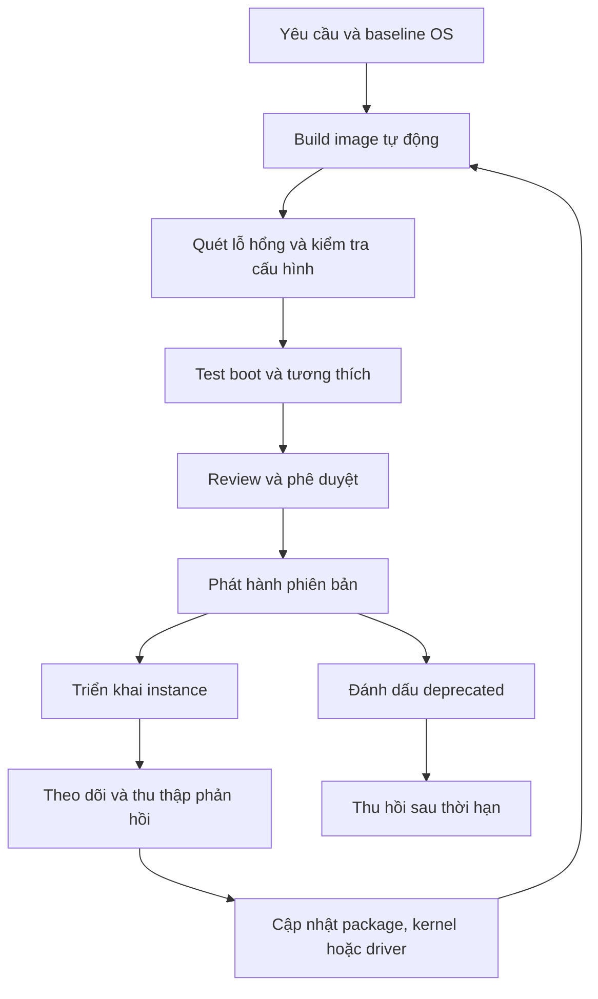

# Quản lý vòng đời image và tương thích khi đổi dòng máy

Machine image là mẫu dùng để tạo máy ảo hoặc máy chủ cloud với hệ điều hành, cấu hình khởi động và các thành phần phần mềm đã được chuẩn bị trước. Một image được quản lý tốt giúp các máy mới có môi trường nhất quán, rút ngắn thời gian triển khai và hỗ trợ khôi phục khi cần. Tuy nhiên, image không tồn tại độc lập với phần cứng ảo: thay đổi dòng máy có thể làm thay đổi kiến trúc CPU, chế độ khởi động, thiết bị lưu trữ, card mạng, GPU và các tính năng ảo hóa mà hệ điều hành cần hỗ trợ.

Vì vậy, quản lý image cần bao gồm cả vòng đời phát hành và kiểm tra tương thích. Khi nâng cấp hệ điều hành, cập nhật driver hoặc chuyển workload sang instance family mới, đội vận hành phải biết image được tạo từ đâu, chứa thành phần nào, đã kiểm thử trên cấu hình nào và có thể quay lui bằng cách nào.

## 1. Machine image là gì?

Machine image là một mẫu triển khai có thể chứa hệ điều hành, bootloader, kernel, driver, agent quản trị, thư viện hệ thống và phần mềm nền. Tùy nền tảng, image có thể bao gồm một hoặc nhiều disk image cùng metadata mô tả kiến trúc CPU, chế độ boot, loại ảo hóa, quyền truy cập và cấu hình thiết bị.

Khi tạo instance từ image, cloud dùng image để khởi tạo ổ đĩa hệ thống và thiết lập môi trường khởi động. Sau đó, nền tảng gắn CPU, bộ nhớ, mạng và các thiết bị khác theo loại instance được chọn. Vì vậy, image quyết định trạng thái phần mềm ban đầu, còn instance type quyết định tài nguyên và một phần thiết bị ảo mà hệ điều hành sẽ nhận diện.

### Phân biệt image, snapshot, backup và template

Các thuật ngữ có thể được nhà cung cấp sử dụng khác nhau, nhưng cần hiểu mục đích chính của từng loại:

| Khái niệm | Mục đích | Đặc điểm cần lưu ý |
|---|---|---|
| Machine image | Tạo máy mới với cấu hình hệ điều hành và phần mềm chuẩn | Có thể gồm nhiều disk và metadata boot; thường được kiểm thử để tái sử dụng |
| Disk snapshot | Ghi lại trạng thái của một volume tại một thời điểm | Có thể chỉ chụp một volume; tính nhất quán ứng dụng phụ thuộc cách tạo snapshot |
| Backup | Khôi phục dữ liệu hoặc hệ thống sau lỗi, xóa nhầm hay sự cố | Cần chính sách retention, kiểm tra khả năng restore và bảo vệ bản sao |
| VM template | Mẫu cấu hình máy ảo trong một nền tảng ảo hóa | Có thể chứa disk, metadata, cấu hình thiết bị hoặc thông tin triển khai |
| Container image | Đóng gói filesystem và metadata cho container | Không phải machine image; thường chia sẻ kernel của host |

Một machine image có thể được tạo từ snapshot, nhưng không phải mọi snapshot đều là image có thể khởi động. Backup cũng không thay thế hoàn toàn image chuẩn: backup phục vụ khôi phục trạng thái dữ liệu, còn image chuẩn phục vụ tái tạo môi trường máy mới. Với hệ thống stateful, thường cần kết hợp image đã kiểm thử với backup dữ liệu nhất quán.

## 2. Image chuẩn và nguyên tắc quản lý

### Golden image

Golden image là image chuẩn đã được tổ chức phê duyệt để dùng trong một phạm vi triển khai xác định. Nó thường chứa:

- Hệ điều hành và phiên bản đã được hỗ trợ.
- Bản vá bảo mật và cập nhật nền tảng đã được kiểm tra.
- Kernel, bootloader và driver cần thiết cho môi trường cloud mục tiêu.
- Agent giám sát, quản lý cấu hình, logging và bảo mật.
- Gói nền, chứng thư CA công khai và cấu hình mặc định an toàn.
- Cấu hình khởi tạo để instance có thể nhận hostname, khóa, địa chỉ mạng và metadata riêng khi boot.

Golden image nên tối thiểu hóa phần mềm cài sẵn. Mỗi gói bổ sung làm tăng bề mặt tấn công, thời gian cập nhật và nguy cơ xung đột. Chỉ đưa vào image những thành phần dùng chung có lý do rõ ràng; cấu hình ứng dụng riêng theo môi trường có thể được cung cấp trong bước triển khai.

### Image bất biến

Trong mô hình immutable infrastructure, image sau khi phát hành không được chỉnh sửa trực tiếp. Khi cần cập nhật OS hoặc agent, pipeline tạo image phiên bản mới, kiểm thử rồi triển khai thay thế các instance cũ. Cách làm này giúp mọi máy được tạo từ cùng một phiên bản có trạng thái ban đầu dễ truy vết.

Không nên đăng nhập vào image chuẩn đang được dùng chung rồi sửa thủ công. Thay đổi thủ công khiến các instance cùng mang một tên image nhưng có trạng thái khác nhau, gây khó khăn khi xử lý sự cố. Nếu cần sửa lỗi khẩn cấp trên instance đang chạy, hãy ghi lại thay đổi và đưa nó vào quy trình build để image kế tiếp có cùng bản sửa.

### Tách phần chung và phần riêng của môi trường

Image nên chứa thành phần chung, ổn định và có thể kiểm chứng. Các giá trị phụ thuộc môi trường như endpoint production, token, mật khẩu, khóa riêng, cấu hình subnet hoặc thông tin định danh instance phải được cấp lúc triển khai bằng cơ chế quản lý cấu hình và secrets.

Không nhúng credential vào image, script khởi tạo, metadata công khai hoặc layer container. Image có thể được sao chép giữa tài khoản, project hay region; bí mật được đóng gói bên trong sẽ lan rộng theo mọi bản sao và rất khó thu hồi triệt để.

## 3. Vòng đời image

Một quy trình phổ biến có các giai đoạn từ xác định yêu cầu đến ngừng sử dụng:



### Xác định baseline

Trước khi build, cần thống nhất hệ điều hành, phiên bản, kiến trúc CPU, chế độ boot, yêu cầu tuân thủ, gói phần mềm, agent và cấu hình bảo mật. Baseline nên được ghi thành mã hoặc cấu hình có kiểm soát phiên bản để pipeline có thể tái tạo.

### Build tự động

Pipeline thường tạo máy build tạm, cài OS hoặc lấy image nền đã được tin cậy, áp dụng bản vá, cài package, cấu hình agent, dọn dữ liệu tạm và xuất image mới. Công cụ như Packer hoặc cơ chế image builder của nhà cung cấp có thể tự động hóa quy trình này. Nên cố định phiên bản nguồn, package và script để kết quả có thể tái lập.

Không nên build image bằng cách phụ thuộc vào package repository không kiểm soát phiên bản nếu cần khả năng tái tạo nghiêm ngặt. Có thể dùng repository nội bộ, artifact đã xác minh hoặc snapshot package metadata để biết chính xác thành phần được cài.

### Kiểm tra và phê duyệt

Image mới cần vượt qua các kiểm tra về boot, truy cập, agent, logging, cấu hình bảo mật, lỗ hổng, khả năng cài bản vá và tương thích với loại instance mục tiêu. Kiểm tra tự động nên chạy trước khi image được đánh dấu sẵn sàng cho production.

### Phát hành và promotion

Một image có thể đi qua các kênh như development, test, staging và production. Mỗi môi trường nên tham chiếu đến một ID hoặc version cụ thể. Khi image đã được phê duyệt, promotion chỉ thay đổi trạng thái hoặc alias trỏ tới image đó theo quy trình kiểm soát; tránh tạo lại image khác nhau cho từng môi trường nếu không có lý do kỹ thuật.

### Deprecated và retirement

Khi có phiên bản mới, image cũ có thể được đánh dấu deprecated để ngăn việc tạo instance mới ngoài các trường hợp được phép. Sau thời gian chuyển đổi, image có thể bị thu hồi. Trước khi xóa, cần xác định instance, launch template, autoscaling group, pipeline, backup hoặc tài liệu nào còn tham chiếu đến image đó.

Không xóa image chỉ vì đã có bản mới. Giữ một số phiên bản trước đó trong thời hạn phù hợp giúp điều tra sự cố và quay lui. Thời hạn giữ cần cân bằng giữa nhu cầu rollback, chi phí lưu trữ và yêu cầu bảo mật.

## 4. Đặt tên, version và metadata

Tên image cần giúp người vận hành xác định hệ điều hành, phiên bản, kiến trúc và mục đích. Một quy ước ví dụ:

```text
<team>-<os>-<os-version>-<arch>-<purpose>-<release>

platform-ubuntu-24.04-x86_64-web-2026.11.22.1
platform-ubuntu-24.04-arm64-worker-2026.11.22.1
```

Không nên chỉ dùng tên như `latest`, `production` hoặc `ubuntu-current` làm định danh triển khai. Alias có thể được dùng để thuận tiện, nhưng hệ thống triển khai cần lưu lại ID/version thực tế đã được sử dụng để có thể tái tạo hoặc rollback.

Metadata nên ghi tối thiểu:

| Trường | Nội dung |
|---|---|
| Image ID và version | Định danh duy nhất và phiên bản phát hành |
| OS và release | Hệ điều hành, phiên bản và kênh hỗ trợ |
| Architecture | x86_64, arm64 hoặc kiến trúc được hỗ trợ khác |
| Boot mode | BIOS/legacy hoặc UEFI; Secure Boot nếu áp dụng |
| Kernel và bootloader | Phiên bản kernel, initramfs và bootloader |
| Drivers | Driver lưu trữ, mạng, GPU và phiên bản tương ứng |
| Packages | Danh sách package, phiên bản và nguồn cài đặt |
| Build provenance | Pipeline, commit, người hoặc service account tạo bản build |
| Security result | Kết quả quét lỗ hổng, hardening và kiểm thử |
| Compatibility | Các instance family, loại thiết bị và môi trường đã kiểm tra |
| Lifecycle | Ngày tạo, ngày review, ngày deprecated và thời hạn hỗ trợ |

Nếu image được phát hành cho nhiều kiến trúc, hãy tạo artifact riêng cho từng kiến trúc và thể hiện rõ trong tên, metadata và pipeline. Không thể đổi một image x86_64 thành arm64 chỉ bằng cách đổi nhãn metadata.

## 5. Bảo mật trong vòng đời image

Image là điểm khởi đầu của mọi instance được tạo từ nó. Một cấu hình sai hoặc package có lỗ hổng có thể nhân bản thành hàng trăm máy. Vì vậy, bảo mật cần được thực hiện ngay trong pipeline.

### Cập nhật và quét lỗ hổng

- Dùng nguồn OS và package đáng tin cậy, xác minh chữ ký hoặc checksum khi nền tảng cung cấp.
- Cập nhật bản vá bảo mật theo chính sách rủi ro và thời hạn khắc phục.
- Quét package, kernel, thư viện và cấu hình trước khi phát hành.
- Xác định cách xử lý lỗ hổng chưa có bản vá: loại bỏ package, tắt tính năng, áp dụng biện pháp giảm thiểu hoặc chặn phát hành.
- Lưu kết quả quét gắn với image version để phục vụ kiểm toán.

### Hardening hệ điều hành

Baseline hardening có thể gồm tắt dịch vụ không cần thiết, giới hạn cổng và giao thức, cấu hình firewall host, bật audit/logging, giới hạn quyền sudo, đặt chính sách mật khẩu hoặc SSH, bật SELinux/AppArmor theo yêu cầu và bảo vệ cấu hình kernel. Mức hardening phải phù hợp với vai trò máy và không làm hỏng agent hoặc dịch vụ cần thiết.

### Secrets và danh tính

Không lưu private key, mật khẩu, token, cloud credential hoặc chứng thư riêng trong image. Khi tạo instance, hãy dùng identity/role gắn với instance, secret manager hoặc cơ chế cấp credential ngắn hạn. Khóa SSH và thông tin định danh máy phải được tạo hoặc cấp riêng cho từng instance.

### Ký và xác minh image

Nếu nền tảng hỗ trợ, có thể ký image hoặc artifact manifest để xác minh nguồn gốc và tính toàn vẹn. Pipeline triển khai chỉ nên chấp nhận image có provenance hợp lệ và trạng thái kiểm tra đạt yêu cầu. Việc ký không thay thế quét lỗ hổng; nó giúp xác minh artifact có đúng nguồn và không bị thay đổi ngoài quy trình.

### SBOM và khả năng truy xuất

Software Bill of Materials (SBOM) liệt kê package và thành phần phần mềm trong image. SBOM giúp xác định image nào bị ảnh hưởng khi một thư viện có lỗ hổng mới được công bố. Nên lưu SBOM theo image version và gắn với kết quả scan, commit và build pipeline.

## 6. Tương thích hệ điều hành và phần cứng ảo

Một image có thể boot thành công trên dòng máy này nhưng thất bại hoặc hoạt động thiếu tính năng trên dòng máy khác. Nguyên nhân thường nằm ở kiến trúc CPU, firmware, boot mode, driver, thiết bị ảo hoặc tính năng mà kernel hỗ trợ.

### Kiến trúc CPU: x86_64 và arm64

Image chứa bootloader, kernel, thư viện và binary được biên dịch cho một kiến trúc CPU. Image x86_64 không thể chạy trực tiếp trên instance arm64 như một image native, và ngược lại. Muốn chuyển kiến trúc cần build image tương ứng, cài package đúng kiến trúc và kiểm tra mọi binary phụ thuộc.

Các thành phần cần kiểm tra khi chuyển x86_64 sang arm64 hoặc chiều ngược lại:

- OS release có cung cấp image và package cho kiến trúc đích không.
- Ứng dụng, runtime, agent, thư viện native và extension có binary tương thích không.
- Container image có manifest đa kiến trúc hay chỉ có một platform.
- Phần mềm thương mại, driver hoặc module kernel có hỗ trợ kiến trúc đích không.
- Có phụ thuộc vào tập lệnh CPU cụ thể như AVX2 hoặc AVX-512 không.
- Hiệu năng và hành vi số học có thay đổi đáng kể sau khi biên dịch hoặc chuyển runtime không.

Với ứng dụng Java hoặc ngôn ngữ chạy trên VM, bytecode có thể đa kiến trúc, nhưng JVM, native library, JNI, agent APM, codec hoặc thư viện mật mã vẫn cần bản build phù hợp. Không nên kết luận ứng dụng tương thích chỉ vì mã nguồn không phụ thuộc CPU.

### BIOS, UEFI và Secure Boot

Instance family hoặc nền tảng ảo hóa khác nhau có thể hỗ trợ chế độ boot khác nhau. Image cài theo legacy BIOS có thể không boot trên máy chỉ hỗ trợ UEFI nếu không có phân vùng EFI và bootloader phù hợp. Ngược lại, image UEFI cần cấu trúc phân vùng và boot entry đúng.

Secure Boot kiểm tra chữ ký của thành phần trong chuỗi khởi động theo chính sách nền tảng. Kernel module hoặc driver bên thứ ba không được ký phù hợp có thể bị chặn khi Secure Boot bật. Trước khi đổi dòng máy, cần kiểm tra boot mode, EFI System Partition, bootloader, kernel signing và hỗ trợ Secure Boot của image.

### Driver lưu trữ và root device

Các thế hệ instance có thể thay đổi bộ điều khiển lưu trữ ảo, cách thiết bị được trình bày hoặc loại volume. Linux cần driver phù hợp trong kernel hoặc initramfs để nhận diện root disk đủ sớm trong quá trình boot. Windows cần driver boot-start tương ứng để truy cập volume hệ thống.

Nếu image thiếu driver cho thiết bị mới, instance có thể không tìm thấy root volume và dừng ở initramfs, màn hình lỗi boot hoặc trạng thái không truy cập được. Trước khi chuyển dòng máy, cần kiểm tra loại controller, driver, initramfs, boot-start driver và quy tắc đặt tên thiết bị.

### Driver mạng và tên giao diện

Instance family mới có thể dùng NIC ảo khác, tốc độ khác hoặc driver chuyên biệt. Hệ điều hành có thể đặt tên interface khác sau khi đổi thiết bị, ví dụ từ `eth0` sang tên dựa trên PCI path. Cấu hình firewall, routing, network manager hoặc script khởi động dựa cứng vào tên interface cũ có thể làm mất kết nối.

Hãy kiểm tra driver NIC, tính năng offload, MTU, queue, địa chỉ MAC, tên interface và cách nền tảng gán địa chỉ IP. Nếu cloud cung cấp agent mạng riêng, cần bảo đảm phiên bản agent tương thích với dòng máy đích.

### CPU feature và kernel module

CPU thế hệ mới hoặc khác kiến trúc có thể cung cấp tập lệnh, virtualization extension và tính năng mã hóa khác. Binary được biên dịch với yêu cầu CPU quá cao có thể không chạy trên một dòng máy cũ hơn. Ngược lại, chuyển sang dòng máy mới có thể làm ứng dụng thay đổi đường tối ưu hoặc hành vi hiệu năng.

Kernel module ngoài cây (out-of-tree), driver GPU, module bảo mật hoặc phần mềm giám sát mức thấp cần được kiểm tra với phiên bản kernel mới và kiến trúc CPU đích. Nếu dùng DKMS hoặc cơ chế build module lúc cài kernel, phải xác minh module có thể build thành công trong image và sau mỗi lần cập nhật kernel.

## 7. Tương thích khi đổi instance family

Đổi instance family thường nhằm tăng CPU, RAM, băng thông mạng, hiệu năng lưu trữ hoặc giảm chi phí. Dù cùng nhà cung cấp, hai family có thể dùng thế hệ CPU, NIC, thiết bị lưu trữ, GPU và hypervisor capability khác nhau.

### Những thay đổi cần kiểm tra

| Thành phần | Khác biệt có thể gặp | Rủi ro nếu image không tương thích |
|---|---|---|
| CPU architecture | x86_64 sang arm64 hoặc ngược lại | Không boot hoặc binary không chạy |
| CPU generation | Tập lệnh, feature flag, NUMA và hiệu năng mỗi core | Lỗi ứng dụng hoặc hiệu năng khác kỳ vọng |
| Firmware / boot | BIOS sang UEFI, Secure Boot hoặc thay đổi boot chain | Không tìm thấy bootloader hoặc kernel bị chặn |
| Storage controller | NVMe, virtio, SCSI hoặc controller riêng của nền tảng | Không nhận root disk, lỗi boot hoặc đổi thứ tự thiết bị |
| Network interface | NIC model, driver, queue, offload và tên interface | Mất mạng, throughput thấp hoặc firewall áp sai interface |
| GPU / accelerator | Model, driver, VRAM, runtime và PCIe topology | Driver không nạp, framework không nhận thiết bị |
| RAM / NUMA | Số node, locality và cách cấp phát bộ nhớ | Độ trễ tăng hoặc ứng dụng không tận dụng RAM hiệu quả |
| Local ephemeral disk | Dung lượng, tên thiết bị và vòng đời dữ liệu thay đổi | Mất dữ liệu tạm hoặc script mount sai |
| Metadata / cloud agent | Endpoint metadata, agent và cách khởi tạo thay đổi | Không lấy được cấu hình, khóa hoặc thông tin instance |

### Ma trận tương thích

Trước khi chuyển production, lập ma trận thể hiện image version nào đã được kiểm thử trên family nào. Ví dụ:

| Image | Family cũ x86_64 | Family mới x86_64 | Family arm64 |
|---|---|---|---|
| `web-ubuntu-24.04-x86_64-v3` | PASS | TEST REQUIRED | NOT COMPATIBLE |
| `web-ubuntu-24.04-arm64-v1` | NOT COMPATIBLE | NOT COMPATIBLE | PASS |

Các trạng thái trong bảng phải dựa trên kết quả kiểm thử thực tế. `TEST REQUIRED` có nghĩa image chưa được xác minh trên family đó; `NOT COMPATIBLE` có nghĩa có ràng buộc đã biết khiến không thể dùng image nguyên trạng. Không suy ra PASS chỉ vì hai dòng máy có cùng số vCPU hoặc cùng dung lượng RAM.

### Kiểm tra trước khi thay đổi

1. Xác định chính xác family nguồn và family đích, bao gồm kiến trúc CPU và loại thiết bị.
2. Kiểm tra image có hỗ trợ boot mode, root disk, NIC và accelerator của family đích không.
3. Xác minh OS release còn được hỗ trợ và kernel có driver cần thiết.
4. Kiểm tra agent quản trị, monitoring, backup, security, cloud-init hoặc công cụ sysprep.
5. Kiểm tra license OS và phần mềm thương mại khi thay đổi số core, socket hoặc kiến trúc.
6. Xác nhận dữ liệu trên local/ephemeral disk có được lưu ở nơi bền vững không.
7. Tạo instance thử nghiệm từ image hiện tại trên family đích và chạy kiểm tra boot, mạng, lưu trữ, ứng dụng.
8. Đo hiệu năng và chi phí dưới workload đại diện trước khi triển khai rộng.

## 8. Chuẩn bị image để có thể tái sử dụng an toàn

### Linux: cloud-init và trạng thái máy

Cloud-init thường được dùng để cấu hình instance lần đầu khi boot. Nó có thể thiết lập hostname, user, SSH key, package, mount và script khởi tạo dựa trên metadata. Khi tạo image chuẩn, cần dọn trạng thái khiến instance mới bị nhận nhầm là máy cũ, chẳng hạn machine ID hoặc dữ liệu cloud-init đã hoàn tất, theo hướng dẫn của bản phân phối và nhà cung cấp.

Ví dụ, trước khi capture image Linux, quy trình chuẩn hóa có thể cần:

```bash
# Kiểm tra trạng thái cloud-init
cloud-init status --long

# Xem machine ID hiện tại
cat /etc/machine-id

# Kiểm tra các thiết bị block và filesystem
lsblk -f

# Kiểm tra cấu hình boot và kernel
uname -a
```

Các lệnh trên dùng để kiểm tra. Việc xóa machine ID, reset cloud-init hoặc dọn SSH host key cần thực hiện theo quy trình capture image dành cho hệ điều hành và cloud cụ thể. Không chạy lệnh dọn trạng thái trên một máy production đang phục vụ traffic.

### Windows: Sysprep và driver

Với Windows, Sysprep thường được dùng để chuẩn bị hệ điều hành trước khi capture image, loại bỏ thông tin định danh riêng và cho phép quá trình specialize khi instance mới khởi động. Cần kiểm tra trạng thái activation, Windows licensing, agent, driver boot-critical và các ứng dụng có yêu cầu định danh máy riêng.

Không capture một máy Windows đang ở trạng thái cập nhật chưa hoàn tất hoặc có pending reboot nếu quy trình của nhà cung cấp không cho phép. Sau Sysprep, kiểm tra image mới bằng cách tạo máy thử nghiệm và xác nhận quá trình specialize, network, activation và domain join hoạt động đúng.

### Driver và agent

Driver nên đến từ nguồn được tin cậy và phiên bản được kiểm tra với kernel hoặc OS release. Với image đa dòng máy, có thể cài sẵn driver tương thích cho nhiều loại thiết bị nếu không gây xung đột; nếu driver phụ thuộc phần cứng đặc thù, có thể tách image theo family. Agent cloud, monitoring và security cần khởi tạo danh tính mới trên mỗi instance để tránh trùng ID.

## 9. Di chuyển sang dòng máy mới

Thay instance family là một thay đổi hạ tầng có thể ảnh hưởng cả boot, mạng, hiệu năng và chi phí. Quy trình an toàn nên tách thử nghiệm khỏi chuyển đổi production.

### Giai đoạn thử nghiệm

- Chọn một instance đại diện và tạo bản sao môi trường từ image đã phát hành.
- Gắn family mới, kiểm tra boot và truy cập console/serial nếu có.
- Xác nhận root disk, filesystem, mount, NIC, route, DNS, firewall và agent.
- Chạy health check ứng dụng, smoke test và kiểm tra log hệ điều hành.
- Chạy benchmark với dữ liệu gần production, đo CPU, RAM, network, disk và latency.
- Kiểm tra backup, snapshot, monitoring, shutdown và reboot.

### Triển khai theo từng đợt

Với dịch vụ stateless, có thể tạo nhóm instance mới từ image đã xác minh, đưa vào load balancer, kiểm tra sức khỏe rồi tăng dần traffic. Giữ nhóm cũ trong giai đoạn quan sát để có thể chuyển traffic quay lại nếu có lỗi.

Với hệ thống stateful, cần xác định cách đồng bộ dữ liệu, thời điểm chuyển quyền ghi, tính nhất quán và thời gian dừng dịch vụ. Không nên khởi chạy đồng thời hai máy cùng gắn một volume có chế độ chỉ cho phép một writer. Cần dùng quy trình migration hoặc replication phù hợp với hệ thống lưu trữ và cơ sở dữ liệu.

### Rollback

Rollback cần được thiết kế trước khi chuyển đổi. Một phương án có thể gồm:

1. Giữ image version cũ và cấu hình instance family cũ trong thời gian rollback.
2. Giữ khả năng chuyển traffic hoặc scale lại nhóm instance cũ.
3. Bảo đảm dữ liệu mới có thể được đọc bởi phiên bản ứng dụng cũ, hoặc có kế hoạch khôi phục dữ liệu nhất quán.
4. Xác định điều kiện kích hoạt rollback, người chịu trách nhiệm và thời gian quyết định.
5. Kiểm tra rollback trong staging trước khi áp dụng production.

Lưu ý: đổi instance family không phải lúc nào cũng có thể khôi phục bằng cách chỉ đổi lại loại máy. Nếu migration đã thay đổi định dạng dữ liệu, schema, boot volume hoặc kiến trúc CPU, cần kế hoạch tương thích và phục hồi tương ứng.

## 10. Tự động hóa pipeline build và phát hành image

Một pipeline tốt giúp image được tạo và kiểm thử theo cùng quy trình mỗi lần phát hành. Các bước điển hình:

```yaml
stages:
  - validate-source
  - build-image
  - security-scan
  - compatibility-test
  - publish-candidate
  - approve
  - promote

image:
  os: ubuntu-24.04
  architecture: x86_64
  purpose: web
  version: 2026.11.22.1
  source_revision: git-commit-sha

checks:
  - boot-test
  - ssh-or-ssm-access
  - cloud-agent-health
  - storage-and-network-driver
  - vulnerability-scan
  - hardening-policy
  - application-smoke-test
```

Đây là cấu trúc minh họa, không phải cú pháp cấu hình của một công cụ cụ thể. Trong pipeline thật, cần pin phiên bản image nguồn và package, bảo vệ secret, ghi log build, lưu SBOM, tạo manifest và chỉ publish khi tất cả kiểm tra bắt buộc đạt.

### Kiểm tra tự động tối thiểu

| Nhóm kiểm tra | Nội dung | Điều kiện đạt |
|---|---|---|
| Artifact | Image có ID, version, metadata và provenance | Truy xuất được nguồn và phiên bản |
| Boot | Tạo instance và boot thành công trên family mục tiêu | Hệ điều hành sẵn sàng trong thời gian dự kiến |
| Access | Truy cập qua cơ chế quản trị được phê duyệt | Không cần credential nhúng trong image |
| Storage | Root disk, filesystem và mount hoạt động | Không có lỗi driver hoặc mount ngoài dự kiến |
| Network | NIC, route, DNS, firewall và agent mạng | Kết nối đúng chính sách |
| Security | Scan lỗ hổng và hardening | Không có finding chặn phát hành |
| Observability | Agent gửi metric, log và trạng thái | Instance được nhận diện duy nhất |
| Compatibility | Boot và smoke test trên family đã chọn | Không có lỗi phần cứng ảo hoặc ứng dụng |
| Recovery | Snapshot/backup và quy trình rollback | Có thể khôi phục trong mục tiêu đã định |

## 11. Các lỗi thường gặp và cách xử lý

| Triệu chứng | Nguyên nhân có thể | Hướng xử lý |
|---|---|---|
| Instance không tìm thấy boot volume | Thiếu driver storage trong initramfs hoặc boot-start driver | Kiểm tra controller, driver và cấu hình boot của family đích |
| Bootloader không chạy sau khi đổi family | BIOS/UEFI hoặc EFI partition không tương thích | Xác minh boot mode, boot entry và Secure Boot |
| Linux boot được nhưng mất kết nối mạng | Driver NIC, interface name hoặc network agent thay đổi | Kiểm tra `ip link`, driver, route, firewall và cloud agent |
| Windows dừng ở lỗi boot sau thay đổi controller | Thiếu driver storage boot-critical | Chuẩn bị và kiểm thử driver trước khi đổi thiết bị |
| Instance ARM64 không chạy ứng dụng | Binary hoặc native dependency chỉ có x86_64 | Build artifact và image cho arm64, kiểm tra thư viện native |
| GPU không được nhận diện | Driver/runtime không khớp kernel hoặc model GPU | Kiểm tra phiên bản driver, runtime, device assignment và log |
| Agent trùng danh tính giữa các instance | Image chứa machine ID hoặc agent ID đã được tạo từ máy nguồn | Reset state theo hướng dẫn capture và tạo identity mới khi boot |
| Instance mới thiếu log hoặc metric | Agent không khởi tạo, credential hết hạn hoặc endpoint bị chặn | Kiểm tra bootstrap, IAM, DNS, network và agent health |
| Hiệu năng giảm sau khi đổi family | CPU generation, NUMA, NIC, storage hoặc giới hạn burst khác | Benchmark từng tài nguyên và so sánh với baseline cũ |
| Rollback không khôi phục được ứng dụng | Schema hoặc dữ liệu đã thay đổi không tương thích | Thiết kế migration tương thích ngược và backup nhất quán |

Không nên khắc phục lỗi boot bằng cách thay đổi nhiều driver hoặc boot setting cùng lúc. Hãy giữ log console, ghi lại thay đổi, thử từng giả thuyết trên instance kiểm thử và cập nhật image pipeline sau khi tìm được nguyên nhân.

## 12. Checklist quản lý vòng đời và đổi dòng máy

Trước khi phát hành image:

- [ ] Có owner, mục đích sử dụng, OS release, kiến trúc CPU và version rõ ràng.
- [ ] Build được tự động từ nguồn và package đã xác minh.
- [ ] Không chứa secret, SSH private key hoặc định danh của máy build.
- [ ] Kernel, bootloader, storage driver, NIC driver và agent tương thích với family mục tiêu.
- [ ] Có kết quả scan lỗ hổng, hardening và SBOM.
- [ ] Đã kiểm tra boot, truy cập, mạng, lưu trữ và observability.
- [ ] Có provenance, manifest và trạng thái phê duyệt.
- [ ] Có thời hạn review, deprecation và chính sách giữ phiên bản cũ.

Trước khi đổi instance family:

- [ ] Đã xác nhận family đích và kiến trúc CPU.
- [ ] Đã kiểm tra boot mode, Secure Boot và driver thiết bị.
- [ ] Đã xác minh ứng dụng, native library, container và agent tương thích.
- [ ] Đã kiểm tra network, storage, local disk và accelerator.
- [ ] Đã thử boot, reboot, health check và benchmark trên môi trường thử nghiệm.
- [ ] Đã kiểm tra backup, replication, dữ liệu stateful và quyền gắn volume.
- [ ] Có kế hoạch rollout, theo dõi, rollback và người chịu trách nhiệm.
- [ ] Đã so sánh hiệu năng, SLA và tổng chi phí sau khi chuyển đổi.

## Kết luận

Image chuẩn là nền tảng để tạo instance nhất quán, an toàn và có thể tái tạo. Quản lý vòng đời image cần tự động hóa build, kiểm thử, quét bảo mật, version, promotion, deprecation và lưu giữ phiên bản cũ. Khi đổi instance family, phải xác minh kiến trúc CPU, boot mode, kernel, driver lưu trữ và mạng, accelerator, agent và phần mềm native. Hãy thử nghiệm trên family đích, triển khai theo từng đợt và chuẩn bị rollback gắn với dữ liệu thực tế. Cách làm này giúp tận dụng dòng máy mới mà vẫn kiểm soát rủi ro vận hành.
