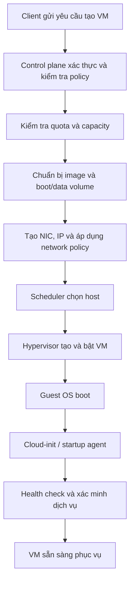

# Tạo máy ảo và hiểu các trạng thái trong quá trình cấp phát

## Bối cảnh: từ yêu cầu tạo VM đến khi ứng dụng sẵn sàng

Máy ảo (virtual machine, VM) là một môi trường tính toán ảo hóa có CPU, bộ nhớ, thiết bị lưu trữ và giao diện mạng riêng theo cấu hình được nền tảng cung cấp. Khi người vận hành gửi API tạo VM hoặc chọn **Create instance**, máy ảo không nhất thiết xuất hiện và chạy ngay lập tức. Nền tảng cần kiểm tra yêu cầu, tìm năng lực phù hợp, tạo ổ đĩa và giao diện mạng, đặt VM lên host, khởi động hệ điều hành rồi mới đưa VM đến trạng thái có thể sử dụng.

Quá trình đó được gọi là **provisioning (cấp phát)**. Trong suốt quá trình, control plane ghi nhận và điều phối trạng thái tài nguyên; hypervisor và host thực thi VM; hệ điều hành khách khởi động và chạy ứng dụng. Hiểu từng giai đoạn giúp người vận hành biết khi nào VM đã được tạo, khi nào máy đã bật và khi nào dịch vụ bên trong thực sự sẵn sàng.

Trong module **CLOUD_CORE_SERVICES_COMPUTE**, kiến thức về vòng đời VM kết nối việc chọn CPU/RAM, image, lưu trữ, mạng và bảo mật với triển khai ứng dụng, khả năng sẵn sàng và chi phí vận hành.

## 1. Những thông tin cần chuẩn bị trước khi tạo VM

Một yêu cầu tạo VM thường gồm các nhóm thông tin sau. Tên trường và cách cấu hình có thể khác nhau giữa các nhà cung cấp cloud.

| Nhóm | Thông tin cần chọn | Mục đích |
|---|---|---|
| Image | Hệ điều hành, phiên bản, kiến trúc CPU, image ID | Xác định nội dung đĩa khởi động và môi trường ban đầu |
| Compute shape | Số vCPU, RAM, họ instance, GPU nếu cần | Quy định năng lực xử lý được cấp cho VM |
| Placement | Region, availability zone, host group hoặc placement policy | Xác định phạm vi triển khai và miền lỗi |
| Boot storage | Kích thước, loại volume, mã hóa, chế độ xóa khi xóa VM | Cung cấp đĩa hệ điều hành và đặc tính I/O |
| Data storage | Volume bổ sung, mount point, snapshot hoặc backup policy | Lưu dữ liệu ứng dụng độc lập với vòng đời VM khi cần |
| Network | VPC/VNet, subnet, NIC, IP, route và DNS | Kết nối VM với các mạng và dịch vụ khác |
| Security | Security group/firewall, IAM role, key pair hoặc phương thức đăng nhập | Kiểm soát quyền quản trị và lưu lượng |
| Initialization | User data, cloud-init, startup script hoặc cấu hình quản lý | Cài đặt gói, tạo người dùng và khởi tạo ứng dụng |
| Operations | Tags, tên, monitoring, logging, backup và lịch bật/tắt | Quản lý, giám sát và kiểm soát chi phí |

### 1.1. Chọn image và cấu hình compute

Image là mẫu hệ điều hành và phần mềm ban đầu của VM. Cần chọn image phù hợp với kiến trúc CPU, phiên bản hệ điều hành, yêu cầu bản quyền, chính sách vá lỗi và khả năng hỗ trợ của ứng dụng. Image tùy chỉnh nên có nguồn gốc rõ ràng, được cập nhật và kiểm tra trước khi dùng rộng rãi.

Compute shape quyết định số vCPU, dung lượng RAM và các đặc tính phần cứng. Chọn quá nhỏ có thể gây thiếu CPU hoặc bộ nhớ khi tải tăng; chọn quá lớn làm tăng chi phí và có thể gây lãng phí. Với workload cần GPU, local NVMe, mạng tốc độ cao hoặc bộ nhớ lớn, phải chọn đúng họ instance có hỗ trợ đặc tính đó.

### 1.2. Chọn mạng và bảo mật

VM cần được gắn vào đúng VPC/VNet và subnet. Cần xác định VM có cần IP công khai hay chỉ cần IP riêng, route đến các dịch vụ phụ trợ, DNS và kết nối ra ngoài. Security group hoặc firewall nên chỉ mở những cổng cần thiết cho đúng nguồn truy cập. Ví dụ, máy chủ web có thể nhận HTTPS từ Internet, trong khi cổng SSH/RDP chỉ nên cho phép từ mạng quản trị hoặc giải pháp truy cập riêng.

Để quản trị, ưu tiên cơ chế danh tính và quyền truy cập có thể thu hồi, key pair hoặc dịch vụ quản lý phiên. Gắn IAM role/service identity cho VM khi ứng dụng cần gọi API cloud; chỉ cấp quyền tối thiểu. Thông tin xác thực không nên được nhúng trực tiếp trong image hoặc cấu hình khởi tạo có thể được nhiều thành phần đọc.

### 1.3. Chọn boot volume và data volume

Boot volume chứa hệ điều hành. Cần chọn dung lượng đủ cho hệ điều hành, log, package và phần mềm ứng dụng. Data volume nên được tách riêng khi dữ liệu cần tồn tại qua việc thay thế VM, khi cần snapshot/backup độc lập hoặc khi cần điều chỉnh hiệu năng lưu trữ riêng.

Hãy xác định rõ chính sách **delete on termination** hoặc tùy chọn tương đương. Một số nền tảng có thể tự xóa boot volume khi VM bị xóa, trong khi data volume có thể được giữ lại nếu cấu hình phù hợp. Snapshot không thay thế hoàn toàn cho backup đã kiểm tra khả năng khôi phục.

## 2. Quy trình cấp phát một máy ảo

Các nhà cung cấp triển khai nội bộ khác nhau, nhưng luồng logic thường có các bước sau:

1. **Gửi yêu cầu:** người dùng, CLI, SDK, API hoặc pipeline gửi cấu hình VM và một mã yêu cầu/idempotency key nếu API hỗ trợ.
2. **Xác thực và kiểm tra chính sách:** control plane kiểm tra danh tính, quyền tạo tài nguyên, project, region, image được phép và chính sách bảo mật.
3. **Kiểm tra quota và capacity:** xác minh hạn mức vCPU/RAM/instance/volume/IP và tìm pool/host phù hợp với shape cùng ràng buộc placement.
4. **Chuẩn bị lưu trữ:** tạo hoặc chọn boot volume, áp dụng mã hóa, gắn data volume nếu có và chuẩn bị image.
5. **Chuẩn bị mạng:** tạo hoặc gắn NIC, cấp địa chỉ IP, áp dụng route, security group/firewall và các chính sách mạng.
6. **Đặt VM lên host:** bộ lập lịch chọn host; hypervisor tạo cấu hình máy ảo và gắn CPU, RAM, thiết bị ảo.
7. **Khởi động:** hypervisor bật VM, firmware ảo khởi chạy, bootloader nạp kernel và hệ điều hành khách bắt đầu khởi động.
8. **Khởi tạo bên trong guest:** cloud-init hoặc startup agent áp dụng user data, cấu hình hostname, người dùng, package, agent giám sát và ứng dụng.
9. **Kiểm tra sẵn sàng:** hệ thống hoặc người vận hành xác minh VM đang chạy, hệ điều hành đã sẵn sàng, dịch vụ cần thiết phản hồi và health check đạt yêu cầu.



Một số bước có thể chạy song song hoặc được trừu tượng hóa bởi nhà cung cấp. Sơ đồ mô tả các phụ thuộc thường gặp, không phải trình tự API bắt buộc của mọi cloud.

## 3. Các trạng thái thường gặp trong vòng đời VM

Trạng thái VM biểu diễn tiến trình cấp phát hoặc trạng thái nguồn của máy. Tên gọi cụ thể phụ thuộc nhà cung cấp; một nền tảng có thể dùng `PROVISIONING`, nền tảng khác dùng `BUILD`, `PENDING` hoặc `STARTING`. Vì vậy, cần hiểu ý nghĩa trạng thái và đọc tài liệu của API đang dùng.

| Trạng thái khái niệm | Ý nghĩa | Việc đang diễn ra hoặc hành động phù hợp |
|---|---|---|
| `REQUESTED` / `PENDING` | Yêu cầu đã được tiếp nhận, đang chờ xử lý | Theo dõi operation ID, quota, scheduler và hàng đợi |
| `SCHEDULING` / `PLACEMENT` | Đang tìm host hoặc pool phù hợp | Kiểm tra capacity, zone và ràng buộc placement nếu kéo dài |
| `PROVISIONING` / `BUILD` | Đang tạo VM và gắn tài nguyên | Theo dõi volume, NIC, image và sự kiện cấp phát |
| `BOOTING` / `STARTING` | VM đã được tạo và đang khởi động | Chờ firmware, bootloader và guest OS khởi động |
| `RUNNING` / `ACTIVE` | Nền tảng xem VM đang bật và hypervisor đang thực thi | Kiểm tra guest OS, agent, network và ứng dụng |
| `STOPPING` / `SHUTTING_DOWN` | Đang thực hiện thao tác tắt | Chờ guest shutdown hoặc thao tác cưỡng bức hoàn tất |
| `STOPPED` / `SHUTOFF` | VM đã tắt nhưng tài nguyên lưu trữ và cấu hình có thể vẫn tồn tại | Có thể khởi động lại; kiểm tra chi phí tài nguyên còn giữ |
| `REBOOTING` / `RESTARTING` | Đang khởi động lại VM | Chờ VM quay lại trạng thái chạy và xác minh dịch vụ |
| `DELETING` / `TERMINATING` | Đang xóa VM và giải phóng tài nguyên liên quan | Theo dõi việc tháo NIC, volume và thu hồi địa chỉ |
| `DELETED` / `TERMINATED` | Tài nguyên VM đã bị xóa | Kiểm tra tài nguyên độc lập còn tồn tại và chi phí phát sinh |
| `ERROR` / `FAILED` | Tạo hoặc thao tác vòng đời thất bại | Đọc reason, event, operation log và xác định tài nguyên đã tạo dở |

Các trạng thái trong bảng là tên khái niệm để học. Không phải API nào cũng cung cấp đủ tất cả trạng thái hoặc dùng đúng các chuỗi này. Một số nền tảng phân biệt trạng thái provisioning với trạng thái power; ví dụ VM có thể đã được cấp phát nhưng đang tắt.

### 3.1. Trạng thái tài nguyên khác với trạng thái nguồn

Một lỗi phổ biến là xem `RUNNING` như bằng chứng ứng dụng đã sẵn sàng. `RUNNING` thường cho biết hypervisor đang chạy VM. Hệ điều hành khách vẫn có thể đang khởi động, đang chạy cập nhật, chưa gắn filesystem, chưa nhận được cấu hình mạng hoặc ứng dụng chưa mở cổng dịch vụ.

Nên theo dõi ít nhất ba lớp trạng thái:

- **Provisioning state:** tài nguyên cloud đã được tạo, đang tạo hay bị lỗi.
- **Power state:** VM đang bật, tắt hoặc chuyển trạng thái nguồn.
- **Guest/application health:** hệ điều hành, agent và dịch vụ bên trong có hoạt động đúng hay không.

Ví dụ, control plane có thể báo VM `ACTIVE`, hypervisor báo máy đang chạy, nhưng health check HTTP vẫn thất bại vì ứng dụng chưa hoàn tất migration cơ sở dữ liệu. Trong trường hợp đó, cần chờ hoặc xử lý ở lớp guest/application thay vì tạo thêm một VM giống hệt.

### 3.2. Chuyển trạng thái không phải lúc nào cũng tức thời

API tạo VM thường là thao tác bất đồng bộ. API có thể trả về operation ID hoặc tài nguyên ở trạng thái `PENDING` trước khi hoàn tất. Client nên truy vấn trạng thái operation/tài nguyên hoặc nhận event thay vì giả định thao tác đã xong ngay sau khi nhận HTTP success.

Trạng thái có thể cập nhật trễ do hệ thống phân tán và cơ chế đồng bộ. Một lần đọc ngay sau khi gửi yêu cầu có thể vẫn thấy trạng thái cũ. Nên dùng thời hạn chờ hợp lý, backoff khi polling và dừng khi gặp trạng thái kết thúc như `RUNNING`, `FAILED` hoặc `TERMINATED` tùy thao tác.

## 4. Khởi tạo hệ điều hành và ứng dụng bằng cloud-init

Sau khi VM bật, guest OS cần được cấu hình. Cloud-init hoặc công cụ tương tự thường đọc user data/metadata để thiết lập hostname, người dùng, package, file cấu hình và lệnh khởi động. Đây là bước quan trọng để VM mới tạo có thể tự động gia nhập hệ thống.

Ví dụ user data cloud-init đơn giản trên Linux:

```yaml
#cloud-config
package_update: true
packages:
  - nginx
write_files:
  - path: /var/www/html/index.html
    permissions: "0644"
    content: |
      <!doctype html>
      <html>
        <head><title>Compute VM</title></head>
        <body><h1>VM is ready</h1></body>
      </html>
runcmd:
  - [systemctl, enable, --now, nginx]
```

Ví dụ cài Nginx và tạo trang kiểm tra. User data thực tế nên được quản lý như mã, kiểm thử với image tương ứng và thiết kế để chạy an toàn khi khởi tạo lại nếu nền tảng có thể thực thi lặp.

Không nên đưa thông tin xác thực dài hạn vào user data. User data thường có thể được truy xuất qua API quản trị, metadata service hoặc log của quá trình khởi tạo. Hãy dùng secret manager, identity gắn với VM hoặc cơ chế cấp thông tin xác thực ngắn hạn.

## 5. Kiểm tra VM đã sẵn sàng

Trước khi đưa VM vào phục vụ, nên xác minh theo nhiều lớp:

1. **Cloud resource:** VM có ID, đúng region/zone, đúng flavor, volume và NIC đã gắn chưa?
2. **Power state:** VM có ở trạng thái đang chạy không? Có sự kiện boot hoặc lỗi hypervisor không?
3. **Guest OS:** hệ điều hành có hoàn tất boot, filesystem có mount, thời gian hệ thống đúng và agent có kết nối không?
4. **Network:** IP, route, DNS, security group và kết nối đến các dependency có đúng không?
5. **Application:** tiến trình có chạy, port có lắng nghe, health endpoint có trả kết quả tốt và log có lỗi không?
6. **Observability:** metric CPU/RAM/disk/network, log và cảnh báo đã được gửi đến hệ thống giám sát chưa?

Ví dụ, sau khi VM có IP riêng, có thể kiểm tra kết nối từ máy trong cùng mạng, sau đó kiểm tra endpoint ứng dụng qua load balancer. Ping thành công chỉ chứng minh một phần đường mạng; nó không chứng minh ứng dụng HTTP hoặc cơ sở dữ liệu đã sẵn sàng.

Health check nên phản ánh khả năng phục vụ thật. Có thể tách:

- **Liveness:** tiến trình còn sống và không bị treo đến mức cần khởi động lại.
- **Readiness:** ứng dụng đã sẵn sàng nhận lưu lượng, dependency thiết yếu đã đáp ứng.
- **Startup check:** cho phép ứng dụng có thời gian khởi tạo dài trước khi áp dụng các kiểm tra liveness/readiness thông thường.

Không nên dùng một health check quá nặng hoặc phụ thuộc vào mọi dịch vụ bên ngoài, vì một dependency chập chờn có thể khiến nhiều VM bị đánh dấu không khỏe cùng lúc.

## 6. Các thao tác vòng đời sau khi tạo

### 6.1. Start và stop

**Start** bật lại VM đang dừng. Nền tảng có thể cần tìm host, khôi phục cấu hình thiết bị và gắn các volume. Việc start có thể thất bại nếu capacity không còn phù hợp, quota hoặc reservation thay đổi, volume lỗi hay cấu hình mạng không hợp lệ.

**Stop** tắt guest OS và dừng thực thi VM. Nếu có thể, nên yêu cầu hệ điều hành shutdown bình thường để flush dữ liệu và dừng dịch vụ. Hard stop có thể tương đương rút nguồn, làm tăng nguy cơ filesystem hoặc dữ liệu ứng dụng không nhất quán.

VM ở trạng thái `STOPPED` thường vẫn giữ boot volume, data volume, IP được giữ chỗ hoặc reservation tùy nền tảng. Vì vậy, dừng VM không đồng nghĩa mọi chi phí bằng không. Cần kiểm tra chính sách tính phí cho compute, storage, IP và reservation.

### 6.2. Reboot và rebuild

**Reboot** khởi động lại VM hiện có, thường giữ nguyên cấu hình và volume. Reboot có thể là thao tác mềm trong guest OS hoặc thao tác cưỡng bức do hypervisor. Cần xác minh ứng dụng tự khởi động sau reboot và dữ liệu đã được ghi bền vững.

**Rebuild** trên một số nền tảng có thể tạo lại nội dung boot disk từ image trong khi giữ một số thuộc tính hoặc volume khác. Ý nghĩa cụ thể rất khác nhau theo nhà cung cấp. Trước khi rebuild, phải xác định rõ volume nào sẽ bị ghi đè và dữ liệu nào được giữ.

### 6.3. Resize và thay đổi cấu hình

Resize thay đổi vCPU, RAM hoặc loại instance. Có nền tảng cần stop VM trước; có nền tảng hỗ trợ thay đổi một số tài nguyên khi đang chạy. Resize có thể yêu cầu host mới, vì vậy phải có capacity phù hợp và có thể có giai đoạn gián đoạn.

Trước resize, kiểm tra tương thích image/driver, giới hạn hệ điều hành, NUMA, GPU, local disk, license và quota của loại instance mới. Sau thay đổi, xác minh guest OS nhận đủ CPU/RAM và ứng dụng không bị thay đổi hiệu năng ngoài dự kiến.

### 6.4. Delete và giải phóng tài nguyên

Delete/terminate xóa đối tượng VM và giải phóng năng lực compute. Tuy nhiên, volume độc lập, snapshot, public IP, load balancer, DNS record hoặc backup có thể vẫn tồn tại. Cần xác định rõ chính sách giữ/xóa từng tài nguyên trước khi thực hiện.

Trước khi xóa VM có dữ liệu quan trọng, xác nhận backup hoặc snapshot có thể khôi phục, kiểm tra dữ liệu trên data volume và lưu lại thông tin cần thiết cho audit. Sau khi xóa, kiểm tra lại danh sách tài nguyên liên quan để tránh phát sinh chi phí ngoài dự kiến.

## 7. Xử lý lỗi trong quá trình cấp phát

Khi VM mắc kẹt ở `PENDING`, `PROVISIONING` hoặc `BOOTING`, hãy tìm đúng bước bị chậm trước khi gửi thêm yêu cầu tạo VM. Tạo lặp có thể sinh nhiều VM hoặc volume trùng nếu request ban đầu chỉ chậm phản hồi.

| Hiện tượng | Nguyên nhân thường gặp | Cách kiểm tra |
|---|---|---|
| Yêu cầu bị từ chối ngay | IAM, policy, quota hoặc cấu hình không hợp lệ | API error, quyền, quota, image ID, region và tham số |
| `PENDING` kéo dài | Hàng đợi, quota, capacity hoặc scheduler | Operation status, scheduler event, pool/zone và quota |
| `PROVISIONING` kéo dài | Tạo volume, NIC, image hoặc backend storage bị chậm | Event của volume/NIC, image availability và control-plane logs |
| `BOOTING` nhưng không sang `RUNNING` | Image lỗi, bootloader, filesystem hoặc driver | Console log, serial output, boot diagnostics và trạng thái volume |
| `RUNNING` nhưng không SSH/RDP được | IP, route, firewall, key, guest agent hoặc dịch vụ truy cập | Security rule, route, DNS, console và log xác thực guest |
| `RUNNING` nhưng ứng dụng không phản hồi | Ứng dụng chưa khởi động, thiếu dependency hoặc lỗi cấu hình | System log, application log, port, health endpoint và dependency |
| Delete không hoàn tất | Volume đang gắn, tác vụ snapshot hoặc dependency còn tồn tại | Operation event, attachment, snapshot và tài nguyên phụ thuộc |

Quy trình chẩn đoán đề xuất:

1. Ghi lại VM ID, request/operation ID, thời điểm, region/zone và cấu hình yêu cầu.
2. Kiểm tra trạng thái hiện tại và lịch sử sự kiện; xác định transition cuối cùng đã hoàn tất.
3. Đọc reason/error code và log tương ứng của control plane, storage, network hoặc hypervisor.
4. Nếu VM đã boot, truy cập console/serial log để phân biệt lỗi guest OS với lỗi cloud resource.
5. Kiểm tra user data/cloud-init, network, firewall, key và dependency của ứng dụng.
6. Chỉ retry khi biết thao tác trước đã thất bại hoặc API hỗ trợ idempotency; nếu không, kiểm tra tài nguyên đã tạo dở trước.
7. Sau khi sửa lỗi, xác minh health check và theo dõi metric trước khi đưa VM vào phục vụ.

## 8. Tự động hóa tạo VM an toàn

Trong môi trường production, nên mô tả VM bằng Infrastructure as Code hoặc pipeline có kiểm soát để cấu hình có thể xem xét, lặp lại và kiểm toán. Một mẫu khai báo khái niệm:

```yaml
vm:
  name: web-01
  image: linux-lts-approved
  region: region-a
  zone: zone-1
  shape:
    vcpu: 2
    memory_gib: 4
  boot_volume:
    size_gib: 40
    encrypted: true
    delete_with_vm: true
  network:
    subnet: private-app-subnet
    public_ip: false
    security_policy: web-app-only
  identity:
    service_role: web-read-config
  initialization:
    user_data: cloud-init/web.yaml
  monitoring:
    metrics: enabled
    logs: enabled
```

Đây là cấu trúc minh họa trung lập, không phải manifest có thể áp dụng trực tiếp cho một nhà cung cấp cụ thể. Khi chuyển thành Terraform, CLI hoặc API thật, cần dùng đúng schema và tên tài nguyên của nền tảng.

Một số nguyên tắc tự động hóa quan trọng:

- Dùng idempotency key hoặc kiểm tra tài nguyên theo ID/tag để retry không tạo bản sao ngoài ý muốn.
- Chờ operation hoàn tất bằng polling có backoff hoặc event; đặt timeout và xử lý trạng thái thất bại rõ ràng.
- Tách cấu hình khỏi thông tin xác thực; lấy thông tin nhạy cảm từ secret manager bằng identity có quyền tối thiểu.
- Gắn tag/label cho owner, environment, application, cost center và thời hạn tài nguyên.
- Chỉ đưa VM vào load balancer sau khi readiness check thành công.
- Ghi nhận đầu ra như VM ID, IP, image version và operation ID để phục vụ vận hành.
- Có quy trình cleanup cho tài nguyên tạo dở khi pipeline thất bại.

## 9. Tính sẵn sàng và chi phí trong vòng đời VM

Một VM đơn lẻ là một đơn vị lỗi. Nếu ứng dụng cần tính sẵn sàng cao, nên triển khai nhiều VM ở các miền lỗi khác nhau, dùng load balancer và health check, đồng bộ dữ liệu hoặc dùng dịch vụ lưu trữ có cơ chế dự phòng phù hợp. Việc đặt hai VM trên cùng một host hoặc cùng một zone có thể khiến chúng cùng chịu ảnh hưởng bởi một sự cố hạ tầng.

Vòng đời VM cũng ảnh hưởng trực tiếp đến chi phí:

- VM đang chạy thường phát sinh phí compute theo loại máy và thời gian sử dụng.
- VM đã stop có thể vẫn phát sinh phí boot/data volume, snapshot, IP được giữ và reservation.
- VM bị xóa nhưng volume hoặc IP độc lập còn tồn tại vẫn có thể phát sinh chi phí.
- VM quá lớn so với tải gây lãng phí; VM quá nhỏ gây chậm, lỗi và có thể cần scale-out nhiều hơn.
- Môi trường phát triển/test có thể dùng lịch tự động tắt khi không làm việc nếu phù hợp.

Nên theo dõi tuổi tài nguyên, mức sử dụng CPU/RAM, dung lượng lưu trữ, chi phí theo tag và trạng thái backup. Chính sách vòng đời rõ ràng giúp thu hồi tài nguyên không còn cần thiết mà vẫn bảo vệ dữ liệu cần giữ.

## 10. Những nhầm lẫn thường gặp

**API tạo VM trả thành công nghĩa là VM đã sẵn sàng.** API có thể chỉ xác nhận yêu cầu được tiếp nhận. Cần theo dõi operation và kiểm tra guest/application health.

**`RUNNING` nghĩa là ứng dụng hoạt động tốt.** Đây thường là trạng thái nguồn của VM. Hệ điều hành và ứng dụng vẫn có thể đang khởi động hoặc gặp lỗi.

**Stop giống delete.** Stop tắt compute nhưng thường giữ lại cấu hình và một số tài nguyên tính phí. Delete/terminate mới xóa VM; volume hoặc IP độc lập vẫn có thể tồn tại.

**Reboot luôn an toàn như restart ứng dụng.** Reboot tác động đến toàn guest OS và có thể làm gián đoạn mọi tiến trình; hard reboot còn có rủi ro dữ liệu chưa flush.

**Xóa VM sẽ xóa mọi dữ liệu liên quan.** Hành vi phụ thuộc chính sách volume, snapshot và tài nguyên độc lập. Phải kiểm tra tùy chọn giữ/xóa trước khi terminate.

**Retry tạo VM luôn vô hại.** Nếu request trước đang xử lý nhưng client timeout, retry có thể tạo VM trùng. Dùng idempotency và kiểm tra operation/resource trước khi gửi lại.

## Kết luận

Tạo VM là một quy trình bất đồng bộ gồm xác thực, kiểm tra quota và capacity, chuẩn bị lưu trữ/mạng, đặt VM lên host, khởi động guest OS và khởi tạo ứng dụng. Các trạng thái như `PENDING`, `PROVISIONING`, `BOOTING`, `RUNNING`, `STOPPED`, `DELETING` và `ERROR` mô tả tiến trình ở các lớp khác nhau; tên gọi chính xác phụ thuộc nền tảng. Người vận hành cần phân biệt trạng thái cấp phát, trạng thái nguồn và sức khỏe ứng dụng, sau đó xác minh từng lớp trước khi đưa VM vào phục vụ. Quản lý đúng vòng đời giúp triển khai ổn định, bảo vệ dữ liệu và kiểm soát chi phí compute, storage cùng network.
