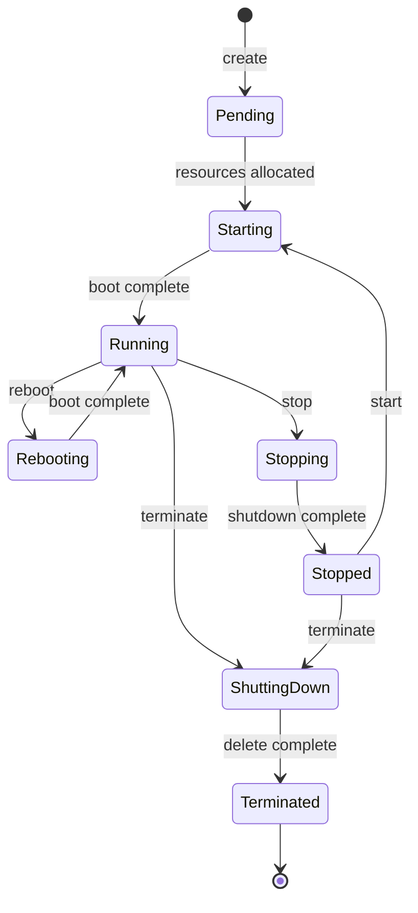

# Start, stop, reboot, terminate và tác động đến dữ liệu, địa chỉ mạng

Máy ảo (virtual machine – VM) có vòng đời gồm nhiều trạng thái và thao tác quản trị. Start đưa một VM đã dừng vào hoạt động; stop yêu cầu VM tắt và giải phóng một phần tài nguyên tính toán; reboot khởi động lại hệ điều hành; terminate xóa VM khỏi nền tảng. Các thao tác này có vẻ đơn giản, nhưng có thể ảnh hưởng đến dữ liệu trên ổ đĩa, địa chỉ IP, kết nối mạng, chi phí và khả năng khôi phục dịch vụ.

Trước khi thao tác, cần biết dữ liệu đang nằm ở đâu, ổ đĩa nào sẽ bị xóa cùng VM, địa chỉ IP nào là tạm thời hay cố định, và ứng dụng có chịu được gián đoạn hay không. Hành vi cụ thể phụ thuộc nhà cung cấp cloud, loại VM, loại disk, cấu hình network interface và chính sách của tài khoản. Vì vậy, hãy kiểm tra thuộc tính của tài nguyên trong dịch vụ đang dùng thay vì suy luận chỉ từ tên lệnh.

## 1. Các trạng thái phổ biến trong vòng đời VM

Một VM thường đi qua các trạng thái như tạo mới, đang khởi động, đang chạy, đang dừng, đã dừng và đang xóa. Tên trạng thái có thể khác nhau giữa các nền tảng, nhưng ý nghĩa vận hành thường tương tự.

| Trạng thái | Ý nghĩa | Điều cần chú ý |
|---|---|---|
| Pending / Provisioning | Nền tảng đang cấp phát CPU, RAM, NIC và disk | VM chưa sẵn sàng nhận traffic |
| Starting | VM đang khởi động firmware, bootloader và OS | Có thể cần chờ cloud-init, agent và ứng dụng khởi tạo |
| Running | VM đã được cấp phát và đang hoạt động | Ứng dụng vẫn cần health check để xác nhận sẵn sàng |
| Rebooting | Hệ điều hành hoặc VM đang khởi động lại | Kết nối hiện tại có thể bị ngắt tạm thời |
| Stopping | Nền tảng đang thực hiện yêu cầu tắt VM | Chưa nên giả định dữ liệu đã flush hoặc VM đã dừng hoàn toàn |
| Stopped / Deallocated | VM đã tắt; một phần tài nguyên compute có thể được giải phóng | Disk và một số tài nguyên mạng vẫn có thể tiếp tục tính phí |
| Shutting down / Terminating | Nền tảng đang xóa VM | Không nên dựa vào VM hoặc ổ đĩa sẽ bị xóa cùng nó để lưu dữ liệu duy nhất |
| Terminated / Deleted | VM đã bị xóa và không thể khởi động lại từ chính tài nguyên đó | Khả năng khôi phục phụ thuộc snapshot, backup và chính sách giữ disk |

Sơ đồ dưới đây mô tả một vòng đời đơn giản. Một số nền tảng có thêm trạng thái hibernate, suspended, failed hoặc trạng thái chuyển tiếp riêng.



Trạng thái `Running` chỉ cho biết VM đang chạy theo góc nhìn của control plane. Ứng dụng có thể chưa sẵn sàng vì còn tải dữ liệu, chạy migration, khởi động worker hoặc chờ kết nối tới dịch vụ phụ thuộc. Hệ thống điều phối nên dùng health check ở cấp ứng dụng trước khi đưa VM vào load balancer.

## 2. Start: khởi động VM đã dừng

Start yêu cầu cloud cấp phát lại tài nguyên compute và khởi động VM từ disk hệ thống. Hệ điều hành thực hiện boot như sau khi máy được bật nguồn. Các dịch vụ được cấu hình tự khởi động sẽ chạy lại; script bootstrap hoặc cloud-init có thể được gọi tùy trạng thái và cấu hình của image.

Khi start VM, nên kiểm tra:

- VM chuyển sang `Running` và không bị lỗi cấp phát tài nguyên.
- Root disk và các data disk được gắn đúng, filesystem mount thành công.
- NIC có trạng thái hoạt động, route, DNS và firewall đúng.
- Cloud agent, monitoring, logging và cơ chế quản trị từ xa đã kết nối.
- Ứng dụng khởi động thành công, kết nối được database, queue và dịch vụ phụ thuộc.
- Health check đạt yêu cầu trước khi nhận traffic.

Start không đồng nghĩa ứng dụng sẽ phục hồi đúng trạng thái trước khi dừng. Tiến trình trong RAM đã mất khi VM tắt; các tác vụ đang chạy dở phải được ứng dụng khôi phục từ dữ liệu bền vững hoặc được gửi lại qua queue.

## 3. Stop: tắt VM và giải phóng compute

Stop yêu cầu hệ điều hành tắt máy một cách có trật tự nếu nền tảng gửi được tín hiệu shutdown. OS có cơ hội dừng dịch vụ, flush cache xuống disk và unmount filesystem. Khi VM đã dừng, nhà cung cấp thường giải phóng CPU và RAM vật lý để không tiếp tục tính phí compute theo mức thông thường; disk, IP tĩnh, snapshot, backup, license hoặc tài nguyên mạng có thể vẫn tính phí.

### Graceful stop và force stop

Graceful stop cho OS thời gian xử lý tín hiệu tắt máy. Ứng dụng có thể hoàn tất request đang xử lý, đóng kết nối, ghi checkpoint và đồng bộ dữ liệu. Đây là cách nên dùng trong quy trình vận hành thông thường.

Force stop hoặc hard stop ngắt VM mà không bảo đảm OS hoàn tất shutdown. Cách này tương tự rút nguồn điện: dữ liệu đã ghi xuống disk thường vẫn còn, nhưng dữ liệu đang nằm trong RAM, cache hoặc buffer có thể mất. Filesystem hoặc database có thể cần recovery khi khởi động lại. Chỉ dùng khi VM treo hoặc không thể tắt theo cách bình thường, và cần kiểm tra tính nhất quán dữ liệu sau đó.

### Stop khác với suspend và hibernate

- **Stop:** tắt hệ điều hành; nội dung RAM không được giữ để tiếp tục thực thi. VM boot lại khi start.
- **Suspend:** một số nền tảng giữ trạng thái VM trong bộ nhớ hoặc lưu trạng thái theo cơ chế riêng; tài nguyên và chi phí có thể vẫn được giữ.
- **Hibernate:** trạng thái RAM được ghi xuống storage để có thể tiếp tục phiên làm việc sau khi start. Tính năng này cần hỗ trợ từ image, OS, instance type và nền tảng; thường cần đủ dung lượng disk và có giới hạn riêng.

Hibernate không thay thế backup. Nó lưu trạng thái thực thi để tiếp tục VM, còn backup bảo vệ dữ liệu khỏi xóa nhầm, hỏng disk hoặc sự cố vùng. Không nên dựa vào hibernate làm bản sao dữ liệu duy nhất.

## 4. Reboot: khởi động lại hệ điều hành hoặc VM

Reboot khởi động lại hệ điều hành trên VM đang chạy. Trong trường hợp thông thường, nền tảng vẫn giữ tài nguyên compute đã cấp và VM quay lại trạng thái chạy sau khi OS boot xong. Reboot thường được dùng sau khi cập nhật kernel, thay đổi cấu hình hệ thống hoặc xử lý lỗi phần mềm.

### Reboot từ bên trong OS và reboot từ control plane

Reboot từ bên trong OS dùng cơ chế shutdown/restart của hệ điều hành. Ví dụ trên Linux:

```bash
# Khởi động lại có trật tự
sudo systemctl reboot

# Tắt máy có trật tự
sudo systemctl poweroff
```

Reboot từ cloud control plane gửi yêu cầu đến hypervisor hoặc guest agent. Nếu guest không phản hồi, một số nền tảng cho phép hard reboot. Hard reboot có thể tương đương reset nguồn và có rủi ro mất dữ liệu chưa được ghi xuống disk.

Reboot thường giữ lại disk, NIC và địa chỉ IP đã gắn, nhưng điều này vẫn cần xác minh theo nền tảng. Reboot không phải là stop/start; nó thường không giải phóng compute và không nhất thiết cấp lại host vật lý. Nếu mục tiêu là chuyển sang host mới hoặc lấy lại năng lực compute sau sự cố phần cứng, có thể cần stop/start hoặc thao tác migrate/repair được nhà cung cấp hỗ trợ.

### Khi nào cần reboot?

- Cập nhật kernel hoặc thành phần hệ thống yêu cầu khởi động lại.
- Thay đổi cấu hình hệ điều hành chỉ có hiệu lực sau reboot.
- Khôi phục dịch vụ bị treo khi chưa cần thay đổi tài nguyên VM.
- Kiểm tra khả năng tự khởi động và tính bền vững của cấu hình sau reboot.

Trước khi reboot production, cần drain traffic khỏi VM, chờ request đang chạy hoàn tất, xác nhận còn đủ capacity ở các node khác và theo dõi health check sau khi máy trở lại.

## 5. Terminate: xóa VM

Terminate yêu cầu nền tảng xóa VM khỏi control plane. Sau khi hoàn tất, VM không còn trạng thái để start hoặc reboot. Các tài nguyên liên quan có thể được giữ lại hoặc xóa tùy chính sách, chẳng hạn root disk, data disk, NIC, địa chỉ IP tạm thời, IP tĩnh, snapshot, placement reservation và metadata.

Điểm quan trọng nhất là **không giả định mọi disk đều được giữ lại hoặc mọi disk đều bị xóa khi terminate**. Hành vi phụ thuộc thuộc tính `delete on termination`, loại volume, cấu hình boot và chính sách của dịch vụ. Một data volume có thể tồn tại sau khi VM bị xóa nếu được cấu hình giữ lại; root volume có thể bị xóa tự động. Cần kiểm tra từng volume trước khi terminate.

### Terminate khác với stop

| Tiêu chí | Stop | Terminate |
|---|---|---|
| Có thể start lại chính VM đó | Thường có | Không |
| CPU và RAM | Thường được giải phóng khi dừng hoàn tất | Được giải phóng khi xóa |
| Root disk | Thường giữ lại để start lại | Có thể giữ hoặc xóa theo chính sách |
| Data disk độc lập | Thường vẫn tồn tại nếu không detach/xóa | Có thể giữ hoặc xóa tùy cấu hình |
| Địa chỉ IP tạm thời | Có thể bị thu hồi hoặc đổi khi start lại | Thường được giải phóng khi VM/NIC bị xóa |
| Địa chỉ IP tĩnh | Có thể vẫn được giữ hoặc gắn với NIC | Có thể cần disassociate hoặc giải phóng riêng |
| Mục đích | Tạm ngừng hoạt động | Kết thúc vòng đời tài nguyên VM |

### Bảo vệ khỏi terminate nhầm

Với VM quan trọng, có thể bật termination protection hoặc delete protection nếu nền tảng hỗ trợ. Có thể dùng IAM policy để chỉ cho phép một nhóm vai trò thực hiện thao tác xóa, yêu cầu phê duyệt, gắn tag phân loại môi trường và ghi audit log. Cơ chế bảo vệ không thay thế backup: người có quyền phù hợp vẫn có thể tắt bảo vệ hoặc xóa tài nguyên theo quy trình quản trị.

Trước khi terminate, hãy xác nhận đúng VM ID, môi trường, owner, load balancer membership, volume, IP, backup, lịch tác vụ và các tài nguyên phụ thuộc. Với workload stateful, cần xác nhận đã chuyển quyền ghi hoặc dừng ứng dụng đúng cách.

## 6. Dữ liệu tồn tại ở đâu sau mỗi thao tác?

Tác động đến dữ liệu phụ thuộc loại lưu trữ. Cần phân biệt bộ nhớ RAM, root disk, data volume bền vững, local/ephemeral disk và dịch vụ lưu trữ bên ngoài VM.

### RAM và trạng thái tiến trình

RAM là bộ nhớ tạm. Khi stop hoặc terminate, nội dung RAM mất; các tiến trình, kết nối TCP, session trong bộ nhớ và dữ liệu chưa ghi xuống storage cũng mất. Reboot cũng làm tiến trình dừng và RAM được khởi tạo lại. Nếu cần tiếp tục tác vụ dài sau reboot, ứng dụng phải ghi checkpoint hoặc lưu trạng thái vào một hệ thống bền vững.

### Root volume và data volume

Root volume chứa OS và thường là disk khởi động. Data volume chứa dữ liệu ứng dụng hoặc database. Với persistent block storage, dữ liệu thường tồn tại độc lập với vòng đời compute nếu volume không bị xóa. Volume có thể cần được detach khỏi VM cũ rồi attach vào VM mới theo quy tắc của nền tảng.

Snapshot của volume thường ghi lại trạng thái block tại một thời điểm. Nếu ứng dụng vẫn đang ghi dữ liệu, snapshot có thể chỉ crash-consistent thay vì application-consistent. Với database, cần dùng cơ chế freeze, checkpoint, backup native hoặc quy trình snapshot được hỗ trợ để bảo đảm khôi phục nhất quán.

### Local ephemeral disk / instance store

Local ephemeral disk nằm trên storage gắn với host hoặc vòng đời instance. Nó có thể có độ trễ thấp và throughput cao, nhưng không nên xem là bản lưu trữ bền vững duy nhất. Dữ liệu có thể mất khi terminate, thay host, stop/start hoặc khi phần cứng gặp sự cố; một số nền tảng vẫn giữ dữ liệu qua reboot nhưng không bảo đảm qua các thao tác khác. Phải đọc cam kết của loại instance cụ thể.

Hãy đặt cache, scratch data, temporary files hoặc dữ liệu có thể tái tạo trên ephemeral disk. Dữ liệu quan trọng cần được đồng bộ sang persistent volume, object storage hoặc database có backup.

### Bảng tác động điển hình

| Loại dữ liệu/tài nguyên | Reboot | Stop rồi start | Terminate |
|---|---|---|---|
| RAM và tiến trình | Mất | Mất | Mất |
| Root persistent volume | Thường giữ | Thường giữ | Theo chính sách xóa volume |
| Data persistent volume | Thường giữ | Thường giữ | Giữ hoặc xóa theo cấu hình |
| Local ephemeral disk | Thường có thể giữ, tùy nền tảng | Có thể mất hoặc được giữ tùy nền tảng | Thường bị xóa hoặc không còn được bảo đảm |
| Snapshot/backup độc lập | Giữ | Giữ | Giữ nếu không bị xóa riêng |
| Log chỉ lưu trên VM | Có thể còn trên persistent disk | Có thể còn trên persistent disk | Mất nếu disk bị xóa; vẫn có thể mất nếu chỉ lưu cục bộ |

Bảng mô tả hành vi phổ biến, không phải cam kết chung cho mọi cloud. Trước thao tác quan trọng, hãy kiểm tra tài liệu của nhà cung cấp và thuộc tính thực tế của từng volume.

## 7. Địa chỉ IP và kết nối mạng

Địa chỉ mạng có thể gắn với VM, network interface, subnet hoặc tài nguyên IP tĩnh. Khi VM dừng hoặc bị xóa, mỗi loại địa chỉ có hành vi khác nhau.

### Private IP

Private IP được sử dụng trong mạng riêng/VPC/VNet. Nếu địa chỉ được gắn với network interface tồn tại độc lập với VM, địa chỉ đó thường được giữ khi VM stop/start. Nếu interface bị xóa hoặc địa chỉ được cấp động theo vòng đời VM, địa chỉ có thể được thu hồi và cấp lại.

Khi terminate, nếu NIC bị xóa, private IP gắn với NIC thường được giải phóng về subnet pool. Nếu NIC được giữ lại, private IP có thể vẫn được giữ và có thể gắn với VM khác theo quy tắc của nền tảng.

### Public IP động

Public IP động thường được cấp từ pool của nhà cung cấp và gắn với VM hoặc NIC trong một khoảng thời gian. Một số cloud thu hồi public IP khi stop/deallocate rồi cấp địa chỉ khác khi start lại. Vì vậy, client kết nối trực tiếp tới IP cũ có thể không truy cập được sau stop/start.

Không nên hard-code public IP động vào cấu hình ứng dụng, DNS record hoặc firewall bên ngoài. Nếu cần địa chỉ ổn định, dùng IP tĩnh/reserved IP hoặc đặt dịch vụ sau load balancer, gateway hay DNS name ổn định.

### Static / reserved public IP

Static hoặc reserved IP là địa chỉ được giữ riêng cho tài khoản hoặc project, có thể được gắn và tháo khỏi VM/NIC theo quy trình của nhà cung cấp. Địa chỉ thường tồn tại qua reboot và stop/start nếu không giải phóng reservation. Khi terminate VM, IP tĩnh có thể vẫn được giữ và tiếp tục tính phí nếu chưa release hoặc disassociate.

Trước khi xóa VM, cần quyết định IP sẽ chuyển sang máy thay thế, giữ để dùng sau hay giải phóng. Tránh để IP tĩnh không gắn với tài nguyên mà vẫn bị tính phí.

### DNS và cache

DNS record có thể trỏ tới public IP, private IP hoặc load balancer. Khi IP thay đổi, record cần được cập nhật. DNS resolver và client có thể cache record theo TTL; do đó thay đổi DNS không có hiệu lực tức thì ở mọi nơi. Với hệ thống yêu cầu chuyển đổi nhanh, hãy giảm TTL trước cửa sổ migration nếu phù hợp và dùng health check/load balancer để điều phối traffic.

### Tác động mạng theo thao tác

| Thành phần | Reboot | Stop/start | Terminate |
|---|---|---|---|
| Private IP trên NIC còn tồn tại | Thường giữ | Thường giữ | NIC bị xóa thì IP được giải phóng |
| Public IP động | Thường giữ | Có thể đổi hoặc bị thu hồi | Thường được giải phóng |
| Static/reserved IP | Thường giữ | Thường giữ nếu reservation còn | Có thể còn reservation; cần disassociate/release riêng |
| TCP connection và session | Bị ngắt | Bị ngắt | Bị ngắt |
| DNS cache | Không tự thay đổi nếu IP không đổi | Có thể stale nếu IP đổi | Cần cập nhật record nếu endpoint thay đổi |

Các kết luận về IP là điển hình; hãy xác minh chính sách của cloud, loại NIC và cấu hình IP cụ thể. IPv6, địa chỉ secondary và IP được gán theo interface có thể có quy tắc riêng.

## 8. Chi phí khi start, stop và terminate

Stop VM thường giảm hoặc dừng chi phí compute sau khi trạng thái deallocated/stopped được xác nhận. Tuy nhiên, những tài nguyên còn tồn tại có thể tiếp tục tính phí:

- Persistent block volumes và snapshot.
- Static/reserved public IP hoặc network resource được giữ riêng.
- Backup, object storage và log archive.
- License phần mềm hoặc reservation có cam kết thời hạn.
- Dedicated host hoặc tài nguyên đặt trước không được giải phóng cùng VM.
- Một số dịch vụ quản trị, monitoring hoặc network gateway.

Terminate có thể giảm chi phí compute và các tài nguyên tự động xóa cùng VM. Nếu volume, IP tĩnh, snapshot hoặc backup được giữ lại, chúng vẫn có thể phát sinh chi phí. Vì vậy, terminate không đồng nghĩa mọi khoản phí liên quan tự động về 0.

Với môi trường dev/test, có thể lập lịch stop ngoài giờ và start trước giờ làm việc. Cần bảo đảm database, queue, job định kỳ và các dịch vụ phụ thuộc xử lý được khoảng thời gian VM dừng. Không stop máy chỉ dựa trên CPU utilization thấp nếu nó còn giữ vai trò leader, scheduler, NAT, bastion hoặc thành phần stateful.

## 9. Quản lý vòng đời an toàn cho ứng dụng stateless và stateful

### Ứng dụng stateless

Ứng dụng stateless không lưu trạng thái quan trọng duy nhất trong bộ nhớ hoặc disk cục bộ của một VM. Session, file tải lên và dữ liệu nghiệp vụ được lưu trong database, object storage, cache dùng chung hoặc dịch vụ bên ngoài.

Với stateless VM, quy trình thay thế thường đơn giản hơn:

1. Đưa VM ra khỏi load balancer hoặc đánh dấu không nhận traffic mới.
2. Chờ request đang chạy hoàn tất và drain connection.
3. Tạo hoặc khởi động VM thay thế từ image đã kiểm thử.
4. Kiểm tra health check, quyền truy cập và kết nối dịch vụ phụ thuộc.
5. Chuyển traffic sang VM mới.
6. Theo dõi lỗi và latency rồi mới terminate VM cũ.

### Ứng dụng stateful

Ứng dụng stateful có dữ liệu hoặc trạng thái gắn với một VM, chẳng hạn database, queue, file server hoặc node lưu trữ. Trước stop, reboot hoặc terminate cần kiểm tra:

- Có replica hoặc node dự phòng đang khỏe không.
- Dữ liệu đã được flush và checkpoint chưa.
- Database đã hoàn tất transaction, checkpoint hoặc shutdown sạch chưa.
- Volume có thể detach an toàn không và có cần unmount trước không.
- Máy thay thế có thể mount volume với đúng filesystem, driver và quyền truy cập không.
- Có nguy cơ split-brain nếu hai node cùng nhận quyền ghi không.

Với database, nên dùng cơ chế failover hoặc backup native của hệ quản trị. Snapshot block storage đơn lẻ trong lúc database đang ghi có thể không đủ để khôi phục ở mức ứng dụng.

## 10. Quy trình thao tác đề xuất

### Trước khi stop hoặc reboot

1. Xác nhận VM ID, môi trường, owner và lý do thao tác.
2. Kiểm tra health của hệ thống và capacity còn lại.
3. Drain traffic hoặc dừng lịch tác vụ mới.
4. Chờ request, batch job và transaction đang chạy hoàn tất.
5. Ghi checkpoint, flush dữ liệu và xác nhận backup theo yêu cầu.
6. Ghi nhận IP, NIC, volume, mount và trạng thái hiện tại để đối chiếu sau khi khởi động.
7. Thực hiện graceful stop/reboot và theo dõi trạng thái đến khi hoàn tất.

### Sau khi start hoặc reboot

1. Chờ control plane báo VM `Running`.
2. Kiểm tra console log và trạng thái boot của OS.
3. Xác nhận volume, filesystem, NIC, route, IP và DNS.
4. Xác nhận cloud agent, monitoring, logging và bảo mật hoạt động.
5. Kiểm tra database, queue và dependency.
6. Chạy health check hoặc smoke test ở cấp ứng dụng.
7. Đưa VM trở lại load balancer và theo dõi metric, log, error rate và latency.

### Trước khi terminate

1. Xác nhận đây là VM cần xóa và không còn workload phụ thuộc.
2. Chuyển traffic, quyền ghi, scheduler hoặc địa chỉ IP sang tài nguyên thay thế nếu cần.
3. Kiểm tra root volume, data volume và thuộc tính xóa khi terminate.
4. Xác minh backup/snapshot có thể truy cập và đã thử restore khi dữ liệu quan trọng.
5. Lưu log cần thiết, metadata, cấu hình, image ID và thông tin phục vụ audit.
6. Quyết định giữ, detach, snapshot hay xóa từng volume; quyết định giữ hoặc release static IP.
7. Kiểm tra termination protection và quyền phê duyệt.
8. Terminate VM, chờ trạng thái hoàn tất rồi kiểm kê tài nguyên còn lại và chi phí.

## 11. Tự động hóa vòng đời VM

Các thao tác start/stop/reboot/terminate thường được gọi từ console, CLI, API hoặc hệ thống điều phối. Trong môi trường lớn, nên dùng Infrastructure as Code và automation có kiểm soát để tránh thao tác thủ công nhầm máy.

Ví dụ pseudo-workflow cho một lần dừng máy bảo trì:

```yaml
maintenance:
  target: vm-by-tag
  pre_checks:
    - verify_owner_and_environment
    - verify_redundancy_and_capacity
    - drain_load_balancer
    - wait_for_active_jobs
    - verify_backup_or_checkpoint
  action:
    type: graceful_stop
  post_checks:
    - wait_for_stopped_state
    - verify_volume_inventory
    - verify_ip_and_network_policy
```

Đây là ví dụ mô tả logic, không phải cú pháp của một cloud provider cụ thể. Workflow production cần có timeout, retry có giới hạn, audit log, xử lý lỗi một phần và cơ chế dừng an toàn khi pre-check không đạt.

### Idempotency và kiểm soát trạng thái

Automation nên kiểm tra trạng thái hiện tại trước khi gửi lệnh. Start một VM đã running hoặc stop một VM đã stopped có thể trả lỗi hoặc kết quả khác nhau tùy API. Thiết kế idempotent giúp chạy lại workflow không gây thay đổi ngoài ý muốn.

Không gửi lệnh terminate chỉ vì một lần health check thất bại. Cần phân biệt lỗi ứng dụng, lỗi guest OS, lỗi host, lỗi mạng và lỗi control plane. Với thao tác xóa, nên yêu cầu xác nhận danh tính tài nguyên và điều kiện bảo vệ riêng.

## 12. Sự cố thường gặp và cách chẩn đoán

| Triệu chứng | Nguyên nhân có thể | Hướng kiểm tra |
|---|---|---|
| VM không chuyển sang Running | Thiếu quota, capacity vùng, lỗi disk hoặc cấu hình instance | Xem activity/event log, quota, trạng thái volume và lỗi provisioning |
| VM Running nhưng SSH/RDP không truy cập được | OS chưa boot xong, firewall, route, IP hoặc agent lỗi | Xem console output, serial log, security group và network route |
| Ứng dụng không hoạt động sau reboot | Service không tự khởi động hoặc dependency chưa sẵn sàng | Kiểm tra systemd/service manager, log ứng dụng và health check |
| Root disk không mount | Driver, filesystem hoặc initramfs có vấn đề | Xem boot log, `lsblk`, `blkid`, `dmesg` và cấu hình mount |
| Public IP thay đổi sau stop/start | IP là loại động và đã bị thu hồi | Kiểm tra IP mới, DNS, firewall ngoài cloud và client config |
| Không thể attach volume vào VM mới | Volume còn attach, zone không khớp hoặc giới hạn thiết bị | Kiểm tra attachment, zone, encryption key và giới hạn của volume |
| Dữ liệu mất sau terminate | Root/ephemeral volume bị xóa theo chính sách | Kiểm tra snapshot, backup và thuộc tính delete-on-termination |
| Chi phí vẫn phát sinh sau stop | Disk, IP tĩnh, reservation hoặc dedicated host còn tồn tại | Kiểm kê tài nguyên và bảng giá từng dịch vụ |
| Database recovery kéo dài sau force stop | Transaction hoặc buffer chưa được ghi hoàn tất | Theo dõi recovery log, kiểm tra backup và tính nhất quán |

Khi điều tra, hãy giữ lại event log của control plane, console output, OS log và thời điểm thao tác. Đối chiếu trạng thái tài nguyên trước và sau để phân biệt lỗi do thao tác vòng đời với lỗi ứng dụng hoặc mạng.

## 13. Checklist trước thao tác vòng đời

**Stop hoặc reboot**

- [ ] Đã xác nhận đúng VM, môi trường và người phụ trách.
- [ ] Đã drain traffic và xử lý job đang chạy.
- [ ] Đã xác định dữ liệu trong RAM, persistent disk và ephemeral disk.
- [ ] Đã xác minh backup/checkpoint theo mức độ quan trọng.
- [ ] Đã kiểm tra replica, capacity và khả năng phục hồi.
- [ ] Đã ghi nhận IP, NIC, volume và health check hiện tại.

**Start hoặc reboot xong**

- [ ] VM và OS đã boot thành công.
- [ ] Volume, filesystem và mount đúng.
- [ ] IP, route, DNS và firewall đúng.
- [ ] Agent, logging và monitoring hoạt động.
- [ ] Ứng dụng và dependency khỏe trước khi nhận traffic.

**Terminate**

- [ ] Đã xác nhận không còn workload hoặc dependency cần VM.
- [ ] Đã kiểm tra thuộc tính xóa của root/data volume.
- [ ] Backup hoặc snapshot có thể dùng để khôi phục.
- [ ] Đã quyết định giữ hay release IP tĩnh.
- [ ] Đã kiểm tra termination protection và quyền phê duyệt.
- [ ] Đã kiểm kê volume, NIC, IP, snapshot và reservation sau khi xóa.

## Kết luận

Start đưa VM đã dừng trở lại hoạt động; stop tắt OS và thường giải phóng compute; reboot khởi động lại hệ điều hành; terminate kết thúc và xóa tài nguyên VM. RAM và tiến trình không tồn tại qua các thao tác tắt hoặc khởi động lại, trong khi persistent disk, ephemeral disk, NIC và địa chỉ IP có quy tắc vòng đời riêng. Trước mỗi thao tác, hãy xác định vị trí dữ liệu, chính sách xóa volume, loại IP, tác động chi phí và cách phục hồi ứng dụng. Với hệ thống production, drain traffic, kiểm tra backup, thực hiện theo từng bước và xác nhận health sau thao tác để giảm nguy cơ gián đoạn hoặc mất dữ liệu.
