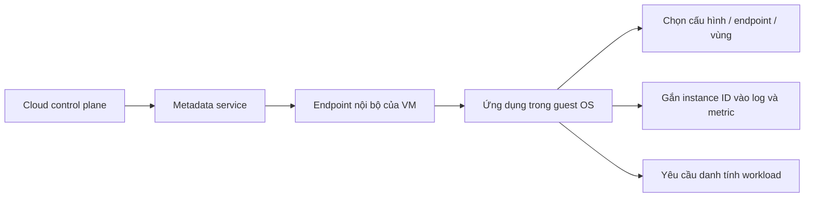
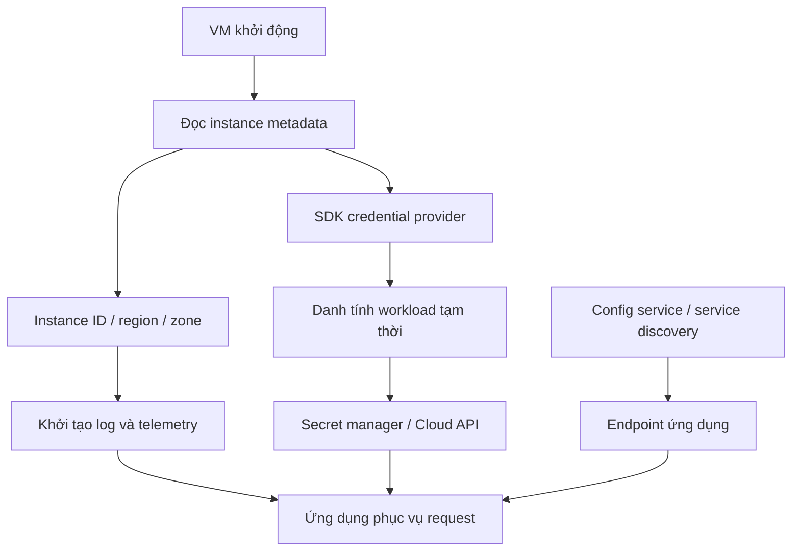

# Metadata của máy ảo và cách ứng dụng nhận biết môi trường chạy

Một ứng dụng chạy trên máy ảo thường cần biết một số thông tin về môi trường hiện tại: ID của máy, vùng triển khai, zone, loại instance, địa chỉ mạng hoặc danh tính dịch vụ được gán cho máy. Nếu đưa những giá trị này vào cấu hình tĩnh, mỗi lần chuyển image, thay instance hoặc triển khai sang region khác, nhóm vận hành lại phải sửa cấu hình và tạo một bản phát hành mới.

Các nền tảng đám mây cung cấp **instance metadata service** để máy ảo đọc những thông tin do control plane quản lý thông qua một endpoint nội bộ. Ứng dụng có thể dùng metadata để nhận biết môi trường chạy, chọn endpoint phù hợp, gắn nhãn log, điều chỉnh hành vi theo zone hoặc lấy token danh tính workload. Cần hiểu rõ dữ liệu nào được cung cấp, cách truy cập và giới hạn tin cậy của nó để tránh tạo ra phụ thuộc cứng hoặc mở ra rủi ro bảo mật.

## 1. Metadata của máy ảo là gì?

**Instance metadata** là tập thông tin mô tả máy ảo và môi trường hạ tầng mà nhà cung cấp cloud cung cấp cho guest operating system. Máy ảo thường truy cập dữ liệu này qua một địa chỉ nội bộ đặc biệt, thường là địa chỉ link-local hoặc hostname nội bộ được nền tảng định tuyến tới metadata service.

Metadata có thể chứa:

- **Danh tính instance:** instance ID, resource ID hoặc tên máy do nền tảng cấp.
- **Vị trí:** region, availability zone, zone hoặc fault domain.
- **Cấu hình máy:** loại instance, kiến trúc, một số thuộc tính CPU và bộ nhớ.
- **Mạng:** địa chỉ IP nội bộ, network interface, subnet hoặc thông tin định tuyến được công bố.
- **Image và khởi tạo:** ID image nguồn, thông tin boot hoặc dữ liệu khởi tạo mà nền tảng cho phép truy cập.
- **Danh tính workload:** thông tin về role, managed identity hoặc service account gắn với máy.
- **Dữ liệu định danh có thể xác minh:** identity document hoặc token có chữ ký/audience, tùy nền tảng.

Không phải nhà cung cấp nào cũng cung cấp cùng tập trường. Một số thuộc tính có thể thay đổi khi máy được stop/start, resize, gắn network interface hoặc chuyển sang cấu hình khác. Ứng dụng cần đọc đúng API và phiên bản metadata mà nền tảng hỗ trợ.

## 2. Metadata service hoạt động như thế nào?

Khi tạo máy ảo, control plane biết máy thuộc project hoặc account nào, dùng image nào, nằm ở region/zone nào và được gắn với những tài nguyên nào. Hypervisor hoặc hạ tầng mạng của nhà cung cấp cung cấp một endpoint metadata cho guest OS. Tiến trình trong VM gửi HTTP request tới endpoint này và nhận về dữ liệu dạng văn bản hoặc JSON.



Đặc điểm thường gặp của metadata service:

- Endpoint chỉ truy cập được từ môi trường máy ảo hoặc mạng được nền tảng cho phép.
- Giao thức thường là HTTP nội bộ, không cần Internet public.
- Một số nền tảng yêu cầu header hoặc token đặc biệt để hạn chế request giả mạo.
- API thường có đường dẫn phiên bản để nhà cung cấp có thể bổ sung trường mới mà vẫn giữ khả năng tương thích.
- Dữ liệu metadata có thể được truy cập bởi nhiều tiến trình trong guest OS; quyền truy cập không tự động được tách riêng cho từng ứng dụng.

Metadata service không phải là cơ sở dữ liệu cấu hình tổng quát. Nó chủ yếu cung cấp thông tin về máy và danh tính do nền tảng quản lý. Cấu hình nghiệp vụ như tên cụm dịch vụ, feature flag hoặc endpoint của hệ thống nội bộ nên được quản lý bằng cơ chế cấu hình phù hợp.

## 3. Phân biệt instance metadata, user data, tag và secret

Các khái niệm này thường xuất hiện gần nhau trong giao diện quản trị cloud nhưng có mục đích khác nhau:

| Loại dữ liệu | Mục đích | Ví dụ | Lưu ý |
|---|---|---|---|
| Instance metadata | Mô tả máy và môi trường do nền tảng cung cấp | Instance ID, zone, machine type | Thường do nền tảng tạo và quản lý |
| User data / startup data | Dữ liệu hoặc script tùy chỉnh được cung cấp khi khởi tạo | Script cài agent, cấu hình bootstrap | Có thể đọc được từ bên trong VM; không đặt secret vào đây |
| Tags / labels | Gắn nhãn tài nguyên để tìm kiếm, phân loại, tính phí hoặc tự động hóa | `environment=production` | Không phải cơ chế xác thực và không nên chứa mật khẩu/token |
| Secret | Thông tin xác thực cần được bảo vệ | API key, database password | Lấy từ secret manager bằng danh tính workload và quyền tối thiểu |
| Runtime configuration | Cấu hình ứng dụng thay đổi theo môi trường | URL dịch vụ, feature flag | Nên quản lý qua config service hoặc hệ thống triển khai |

Một số nền tảng cho phép metadata service trả về user data hoặc tags. Việc cùng truy cập qua một endpoint không làm chúng trở thành dữ liệu có cùng mức độ tin cậy hoặc mục đích. User data có thể được sửa bởi người tạo VM và có thể chứa script; ứng dụng không nên thực thi nội dung nhận được nếu chưa xác minh nguồn và chính sách.

## 4. Những trường metadata thường được ứng dụng sử dụng

### 4.1. Instance ID và thông tin nhận diện

Instance ID là giá trị hữu ích để phân biệt từng máy trong log, trace, metric và hệ thống inventory. Khi một VM bị thay thế, instance mới thường có ID khác dù dùng cùng image và cùng cấu hình ứng dụng.

Ví dụ, một ứng dụng có thể ghi `instance_id`, `region` và `zone` vào log để nhóm vận hành xác định request được xử lý bởi máy nào. Không nên dùng instance ID làm secret hoặc bằng chứng xác thực độc lập; đây là thông tin định danh, không phải credential.

### 4.2. Region, zone và failure domain

Ứng dụng có thể dùng region để chọn endpoint gần nơi triển khai, zone để gắn nhãn telemetry hoặc để ưu tiên đọc dữ liệu cục bộ. Hệ thống phân tán có thể dùng zone trong thuật toán placement hoặc cân bằng tải.

Không nên tự suy luận zone chỉ từ tên instance hoặc địa chỉ IP. Hãy đọc trường topology do nhà cung cấp công bố. Ý nghĩa của zone và failure domain có thể khác nhau giữa các nền tảng.

### 4.3. Machine type và cấu hình phần cứng

Một số ứng dụng cần điều chỉnh worker count, thread pool hoặc kích thước cache theo số CPU, bộ nhớ hoặc loại accelerator. Metadata có thể cung cấp machine type hay thuộc tính cấu hình, nhưng ứng dụng cần kiểm tra khả năng hỗ trợ và không giả định mọi thuộc tính luôn có sẵn.

Trong nhiều trường hợp, đọc trực tiếp thông tin hệ điều hành như số CPU khả dụng và RAM khả dụng đáng tin cậy hơn cho sizing tiến trình, vì container hoặc cgroup có thể áp giới hạn thấp hơn cấu hình toàn VM. Metadata machine type mô tả cấu hình instance, còn ứng dụng cần sử dụng đúng tài nguyên mà tiến trình thực sự được phép dùng.

### 4.4. Network interface và địa chỉ IP

Metadata có thể cung cấp địa chỉ IP nội bộ, network interface hoặc subnet. Các trường này hữu ích cho chẩn đoán và một số cấu hình mạng, nhưng địa chỉ có thể thay đổi khi thay NIC, cấu hình IP hoặc thay instance.

Với giao tiếp dịch vụ, ưu tiên DNS, service discovery hoặc load balancer thay vì lưu cố định IP của VM. Chỉ dùng IP từ metadata khi ứng dụng thực sự cần biết địa chỉ của chính máy hoặc khi nền tảng yêu cầu.

## 5. Metadata service trên các nền tảng cloud phổ biến

Các nền tảng lớn đều có metadata endpoint, nhưng cách xác thực request và đường dẫn API khác nhau. Những ví dụ sau minh họa cách đọc một số trường cơ bản; hãy kiểm tra tài liệu của đúng nhà cung cấp, loại VM và phiên bản API trước khi dùng trong production.

### 5.1. AWS EC2 Instance Metadata Service

AWS EC2 cung cấp Instance Metadata Service (IMDS) qua địa chỉ IPv4 `169.254.169.254`. Nên dùng **IMDSv2**, trong đó ứng dụng lấy session token bằng HTTP PUT rồi gửi token trong header khi đọc metadata.

Ví dụ lấy instance ID trên Linux:

```bash
TOKEN=$(curl -sS -X PUT \
  "http://169.254.169.254/latest/api/token" \
  -H "X-aws-ec2-metadata-token-ttl-seconds: 21600")

curl -sS \
  -H "X-aws-ec2-metadata-token: $TOKEN" \
  "http://169.254.169.254/latest/meta-data/instance-id"
```

Một số đường dẫn metadata thường dùng:

| Đường dẫn | Thông tin |
|---|---|
| `/latest/meta-data/instance-id` | Instance ID |
| `/latest/meta-data/instance-type` | Loại instance |
| `/latest/meta-data/placement/availability-zone` | Availability Zone |
| `/latest/dynamic/instance-identity/document` | Tài liệu định danh instance dạng JSON |
| `/latest/meta-data/iam/security-credentials/` | Thông tin tên role được gắn với instance profile |

Token IMDSv2 có thời hạn; ứng dụng cần xử lý trường hợp token hết hạn và lấy token mới. Không nên lưu token trong log hoặc trả token cho tiến trình không cần truy cập metadata.

### 5.2. Azure Instance Metadata Service

Azure Instance Metadata Service có endpoint nội bộ `http://169.254.169.254/metadata/instance`. Request phải có header `Metadata: true` và tham số `api-version`.

Ví dụ lấy thông tin instance dưới dạng JSON:

```bash
curl -sS \
  -H "Metadata: true" \
  "http://169.254.169.254/metadata/instance?api-version=2021-02-01"
```

Response có thể chứa thông tin compute như VM ID, tên, kích thước, region, zone và thông tin network tùy loại máy và API version. Azure cũng cung cấp endpoint metadata cho managed identity; ứng dụng nên dùng SDK hoặc endpoint identity chính thức để lấy token theo resource/audience được yêu cầu.

### 5.3. Google Cloud Compute Engine Metadata Server

Google Cloud cung cấp metadata server thông qua hostname `metadata.google.internal` hoặc địa chỉ nội bộ `169.254.169.254`. Request cần header `Metadata-Flavor: Google`.

Ví dụ đọc thông tin instance:

```bash
curl -sS \
  -H "Metadata-Flavor: Google" \
  "http://metadata.google.internal/computeMetadata/v1/instance/?recursive=true"
```

Một số đường dẫn phổ biến:

| Đường dẫn | Thông tin |
|---|---|
| `/computeMetadata/v1/instance/id` | Instance ID |
| `/computeMetadata/v1/instance/name` | Tên instance |
| `/computeMetadata/v1/instance/zone` | Zone resource path |
| `/computeMetadata/v1/instance/machine-type` | Machine type resource path |
| `/computeMetadata/v1/instance/service-accounts/default/` | Thông tin service account mặc định |

Metadata server của Google Cloud cũng có endpoint cung cấp access token cho service account gắn với VM. Ứng dụng nên dùng thư viện xác thực chính thức để quản lý token và refresh token.

## 6. Ứng dụng nên nhận biết môi trường chạy như thế nào?

Có nhiều cách để ứng dụng biết nó đang chạy trên VM nào hoặc ở cloud nào. Nên chọn cách phù hợp với mục đích thay vì phụ thuộc vào một dấu hiệu đơn lẻ.

### 6.1. Dùng SDK và credential provider chain

Nếu ứng dụng cần gọi API cloud, cách ưu tiên thường là SDK chính thức của nhà cung cấp. SDK có thể tự tìm danh tính workload qua instance role, managed identity hoặc service account, sau đó quản lý việc lấy và làm mới token.

Ví dụ, một ứng dụng AWS dùng SDK có thể lấy thông tin region và credential theo provider chain. Ứng dụng không cần tự đọc đường dẫn credential từ metadata rồi tự xử lý vòng đời token. Với Azure, dùng Azure Identity và managed identity; với Google Cloud, dùng Application Default Credentials và service account gắn với VM.

### 6.2. Đọc metadata khi cần thuộc tính của instance

Nếu ứng dụng cần instance ID, zone hoặc machine type, có thể gọi metadata endpoint khi khởi động. Nên tạo một module nhỏ phụ trách truy cập metadata, xác định timeout, parse dữ liệu và cung cấp kiểu dữ liệu rõ ràng cho phần còn lại của ứng dụng.

Không để mọi thành phần tự gọi HTTP tới metadata server. Tập trung truy cập giúp dễ kiểm thử, cache, giới hạn trường được đọc và xử lý lỗi nhất quán.

### 6.3. Dùng cấu hình triển khai tường minh

Nếu ứng dụng chỉ cần biết `environment=production`, `service=checkout` hoặc `deployment_ring=canary`, biến môi trường hay cấu hình do hệ thống triển khai cấp thường phù hợp hơn metadata. Các giá trị này là quyết định của đội vận hành và có thể không tồn tại trong metadata chuẩn của nhà cung cấp.

Không nên dùng việc gọi metadata server thành phép thử duy nhất để xác định ứng dụng đang chạy trong cloud. Một request thất bại có thể do endpoint bị chặn, VM đang khởi động hoặc môi trường test giả lập. Hãy hỗ trợ cấu hình tường minh và xử lý trường hợp metadata không khả dụng.

## 7. Ví dụ đọc metadata trong ứng dụng Python

Ví dụ sau minh họa cách lấy instance ID từ AWS IMDSv2. Mã đặt timeout ngắn, kiểm tra lỗi HTTP và không ghi token ra log:

```python
import requests

METADATA_BASE = "http://169.254.169.254/latest"


def get_aws_instance_id() -> str:
    token_response = requests.put(
        f"{METADATA_BASE}/api/token",
        headers={"X-aws-ec2-metadata-token-ttl-seconds": "60"},
        timeout=1.5,
    )
    token_response.raise_for_status()
    token = token_response.text

    metadata_response = requests.get(
        f"{METADATA_BASE}/meta-data/instance-id",
        headers={"X-aws-ec2-metadata-token": token},
        timeout=1.5,
    )
    metadata_response.raise_for_status()
    return metadata_response.text.strip()


if __name__ == "__main__":
    try:
        print("instance_id:", get_aws_instance_id())
    except requests.RequestException:
        # Có thể dùng cấu hình triển khai hoặc ghi nhận metadata chưa khả dụng.
        print("instance metadata unavailable")
```

Trong ứng dụng production, nên inject HTTP session, cấu hình retry có giới hạn và cache trường ổn định. Tránh retry liên tục khi endpoint không khả dụng vì điều đó có thể làm chậm startup hoặc tạo tải không cần thiết.

## 8. Metadata và danh tính workload

Một trong những chức năng quan trọng nhất của metadata service là hỗ trợ máy ảo lấy danh tính để gọi dịch vụ cloud mà không phải lưu access key dài hạn trong image hoặc file cấu hình.

Ví dụ:

- AWS gắn IAM role thông qua instance profile; ứng dụng lấy credential tạm thời từ cơ chế credential provider của SDK.
- Azure gắn managed identity cho VM; ứng dụng yêu cầu access token cho resource hoặc scope cần thiết.
- Google Cloud gắn service account cho VM; ứng dụng lấy token ngắn hạn thông qua metadata server hoặc SDK.

Credential tạm thời thường có thời hạn và được refresh. Quyền truy cập được quyết định bởi IAM policy, role assignment hoặc quyền của service account. Vì vậy:

- Chỉ cấp quyền tối thiểu cần cho workload.
- Tách role giữa môi trường development, staging và production.
- Tránh gắn một role quyền rộng cho mọi VM trong cùng project.
- Dùng SDK chính thức để refresh credential và xử lý lỗi hết hạn.
- Không ghi access token hoặc credential vào log, trace, crash dump hay response HTTP.
- Thu hồi hoặc thay đổi quyền ở control plane khi workload không còn cần truy cập.

Metadata endpoint có thể cung cấp credential có quyền truy cập tài nguyên cloud. Vì vậy, khả năng đọc metadata cần được xem là một ranh giới bảo mật quan trọng, đặc biệt với VM chạy mã từ nhiều nguồn hoặc container nhiều tenant.

## 9. Rủi ro bảo mật của metadata service

### 9.1. SSRF và truy cập metadata ngoài ý muốn

SSRF (Server-Side Request Forgery) xảy ra khi kẻ tấn công khiến ứng dụng gửi request tới một địa chỉ do họ kiểm soát. Nếu ứng dụng có thể truy cập metadata endpoint, một lỗ hổng SSRF có thể bị lợi dụng để đọc thông tin instance hoặc credential.

Các tình huống rủi ro gồm:

- API backend nhận URL do người dùng cung cấp rồi tải nội dung mà không lọc địa chỉ đích.
- Proxy hoặc service fetch cho phép truy cập địa chỉ link-local.
- Ứng dụng parse URL nhưng không kiểm tra redirect, DNS resolution hoặc địa chỉ sau khi phân giải.
- Container không tin cậy có thể truy cập metadata của node hoặc VM host.

### 9.2. Biện pháp giảm thiểu

- **Dùng phiên bản metadata có bảo vệ request.** Trên AWS, yêu cầu IMDSv2 và tắt IMDSv1 nếu workload hỗ trợ.
- **Giới hạn hop.** Cấu hình metadata response hop limit phù hợp, thường dùng giá trị thấp nhất đáp ứng kiến trúc; với AWS, hop limit 1 giúp hạn chế một số đường truy cập từ container qua network hop.
- **Kiểm soát SSRF.** Chỉ cho phép ứng dụng truy cập hostname/scheme/port cần thiết; chặn địa chỉ link-local và private ranges khi chức năng không cần truy cập.
- **Kiểm tra redirect và DNS.** Không chỉ kiểm tra chuỗi URL đầu vào; cần xác minh địa chỉ IP đích sau phân giải và sau redirect.
- **Tách workload.** Không chạy mã không tin cậy chung VM với workload có quyền cloud rộng. Dùng VM/node pool hoặc sandbox riêng khi cần cô lập.
- **Giảm quyền IAM.** Giả định credential metadata có thể bị lộ và giới hạn quyền của nó để giảm tác động.
- **Bảo vệ log và dữ liệu nhạy cảm.** Không ghi token, user data bí mật hoặc toàn bộ response metadata vào log công khai.

Header bắt buộc của IMDSv2 và các header yêu cầu của Azure/GCP giúp phân biệt request hợp lệ theo cơ chế từng nền tảng, nhưng không phải biện pháp thay thế cho kiểm soát SSRF và quyền IAM. Một ứng dụng có thể truy cập metadata hợp lệ vẫn có thể bị lừa gửi request ngoài ý muốn.

### 9.3. Không đưa secret vào user data hoặc metadata tùy chỉnh

User data thường có thể được đọc bởi tiến trình chạy trong VM và có thể tồn tại trong lịch sử khởi tạo hoặc snapshot. Không nên đưa mật khẩu database, private key, access token hay credential dài hạn vào user data, tag hoặc custom metadata. Hãy dùng secret manager và cấp quyền truy cập qua danh tính workload.

## 10. Cache, timeout và độ tin cậy khi đọc metadata

Metadata service thường ở gần VM và phản hồi nhanh, nhưng ứng dụng vẫn cần xử lý lỗi mạng, timeout, lỗi phiên bản API hoặc trường dữ liệu không tồn tại.

Một số nguyên tắc:

- Chỉ đọc những trường thực sự cần.
- Dùng timeout ngắn và retry có giới hạn với backoff.
- Cache các trường ít thay đổi như instance ID hoặc zone trong phạm vi vòng đời tiến trình nếu phù hợp.
- Không cache access token quá thời hạn; ưu tiên SDK quản lý refresh.
- Xử lý trường không có hoặc API version chưa hỗ trợ theo cách rõ ràng.
- Không để metadata server trở thành dependency bắt buộc cho mọi request nghiệp vụ nếu thông tin đó có thể đọc một lần khi khởi động.
- Có fallback phù hợp khi chạy local, trong CI hoặc môi trường container không có metadata service.

Đối với thông tin có thể thay đổi trong vòng đời VM, chẳng hạn network interface hoặc địa chỉ IP, không nên cache vô thời hạn. Hãy xác định rõ thời điểm cần refresh theo đặc tính nền tảng và ứng dụng.

## 11. Metadata trong container và môi trường điều phối

Container chạy trên VM có thể nhìn thấy một phần metadata endpoint của host nếu network namespace và chính sách mạng cho phép. Điều này có thể hữu ích cho agent hạ tầng, nhưng cũng có thể khiến container không tin cậy lấy được thông tin hoặc credential của node.

Trong Kubernetes, Pod thường nên nhận thông tin của chính Pod qua Downward API, environment variables hoặc API của nền tảng. Ví dụ, Pod có thể nhận tên Pod, namespace và label qua Downward API mà không cần truy cập metadata của VM host.

Với danh tính workload trong Kubernetes, ưu tiên cơ chế được nền tảng hỗ trợ như IAM Roles for Service Accounts/Pod Identity trên AWS, Workload Identity trên Google Cloud hoặc Workload Identity Federation/managed identity integration phù hợp trên Azure. Cơ chế này giúp cấp danh tính cho Pod theo service account và giảm nhu cầu dùng chung credential của node.

Với serverless, nhà cung cấp thường trừu tượng hóa VM và metadata hạ tầng. Ứng dụng nên dùng runtime context, environment variables và identity provider mà dịch vụ serverless cung cấp thay vì giả định có thể gọi metadata endpoint của VM.

## 12. Xác minh danh tính instance và giới hạn tin cậy

Một số nền tảng cung cấp identity document hoặc token có thể dùng để chứng minh workload thuộc một instance/project cụ thể. Nếu cần xác minh danh tính ở phía dịch vụ nhận request, hãy dùng cơ chế attestation hoặc token có chữ ký theo hướng dẫn của nhà cung cấp.

Không nên chỉ dựa vào một chuỗi `instance-id` do ứng dụng tự gửi trong HTTP header để cấp quyền. Client có thể giả mạo chuỗi đó. Dịch vụ nhận cần xác minh token/chữ ký, issuer, audience, thời hạn và các claim cần thiết; sau đó mới ánh xạ danh tính tới quyền được phép.

Metadata thông thường là dữ liệu mà guest OS có thể đọc. Nếu guest OS hoặc tiến trình đặc quyền đã bị xâm nhập, kẻ tấn công có thể đọc hoặc giả mạo dữ liệu trong phạm vi kiểm soát của guest. Do đó, metadata hữu ích cho cấu hình và nhận diện môi trường, còn quyết định cấp quyền quan trọng cần dựa vào cơ chế xác thực có thể kiểm chứng.

## 13. Ví dụ thiết kế: ứng dụng đa vùng trên VM

Giả sử một dịch vụ API chạy trên nhiều VM ở hai region và nhiều zone. Ứng dụng cần ghi log có instance ID, chọn endpoint dịch vụ gần nhất và dùng danh tính VM để đọc secret.

Một thiết kế phù hợp có thể là:

1. Khi khởi động, module metadata đọc instance ID, region và zone qua API của nhà cung cấp.
2. Ứng dụng ghi các trường này vào log và metric để hỗ trợ điều tra, nhưng không dùng chúng làm credential.
3. Endpoint dịch vụ được lấy từ cấu hình triển khai hoặc service discovery; region chỉ là tín hiệu để chọn endpoint phù hợp.
4. SDK cloud dùng role/managed identity/service account gắn với VM để lấy credential tạm thời.
5. Ứng dụng yêu cầu secret từ secret manager với quyền đọc đúng secret cần thiết.
6. Nếu metadata service tạm thời không khả dụng khi khởi động, ứng dụng xử lý theo chính sách: có thể khởi động với cấu hình tường minh cho những trường không bắt buộc, hoặc dừng nếu danh tính là yêu cầu bảo mật bắt buộc.
7. Hệ thống giám sát cảnh báo khi thiếu metadata bắt buộc, credential refresh thất bại hoặc ứng dụng chạy ở region/zone không mong muốn.



Thiết kế này phân tách thông tin mô tả máy, danh tính xác thực và cấu hình nghiệp vụ. Khi thay VM hoặc chuyển region, ứng dụng có thể lấy metadata và danh tính mới mà không cần nhúng credential hay IP cố định vào image.

## 14. Lỗi thường gặp khi sử dụng metadata

**Coi metadata là nguồn cấu hình duy nhất.** Metadata không chứa mọi giá trị ứng dụng cần. Hãy phân biệt thông tin hạ tầng với cấu hình nghiệp vụ và secret.

**Hardcode endpoint hoặc đường dẫn của một nhà cung cấp.** Điều này khiến ứng dụng khó chuyển môi trường. Đưa thao tác metadata vào adapter theo provider và dùng cấu hình tường minh trong môi trường phát triển.

**Dùng instance ID làm xác thực.** ID có thể bị giả mạo nếu chỉ được truyền như một chuỗi. Dùng identity token hoặc cơ chế attestation có xác minh.

**Dùng IMDSv1 khi đã có IMDSv2.** Request không có token làm tăng rủi ro SSRF. Bật yêu cầu IMDSv2 và kiểm thử tất cả agent trước khi tắt phiên bản cũ.

**Đặt secret vào user data hoặc tag.** Những dữ liệu này có thể được đọc hoặc sao chép. Dùng secret manager với quyền tối thiểu.

**Để container truy cập metadata của host.** Container có thể nhận được credential của node nếu endpoint được mở. Dùng workload identity riêng và kiểm soát đường mạng.

**Không đặt timeout hoặc retry vô hạn.** Ứng dụng có thể treo lúc khởi động hoặc tạo nhiều request. Dùng timeout ngắn, retry có giới hạn và fallback rõ ràng.

**Ghi toàn bộ response metadata vào log.** Response có thể chứa thông tin nội bộ hoặc token. Chỉ log các trường không nhạy cảm và cần thiết.

## 15. Checklist triển khai

- [ ] Đã xác định trường metadata ứng dụng thực sự cần.
- [ ] Đã chọn API version và endpoint đúng với nhà cung cấp.
- [ ] Đã dùng cơ chế bảo vệ request metadata phù hợp, chẳng hạn AWS IMDSv2.
- [ ] Đã tách instance metadata, user data, tags, cấu hình ứng dụng và secret.
- [ ] Đã dùng SDK/credential provider chính thức cho danh tính workload.
- [ ] IAM role, managed identity hoặc service account có quyền tối thiểu.
- [ ] Có timeout, retry có giới hạn, cache và xử lý trường không tồn tại.
- [ ] Ứng dụng vẫn có thể chạy trong local/CI hoặc môi trường không có metadata nếu phù hợp.
- [ ] Đã kiểm soát SSRF, redirect và truy cập địa chỉ link-local.
- [ ] Container không được truy cập metadata/credential của host ngoài nhu cầu đã phê duyệt.
- [ ] Token, credential và dữ liệu nhạy cảm không xuất hiện trong log hoặc image.
- [ ] Đã kiểm thử thay instance, đổi zone/region và tình huống metadata tạm thời không khả dụng.
- [ ] Đã xác minh identity token/attestation khi dùng metadata để chứng minh danh tính.

## 16. Kết luận

Metadata service cung cấp thông tin về instance và môi trường cloud để ứng dụng có thể nhận biết nơi đang chạy, ghi nhận telemetry, chọn cấu hình phù hợp và lấy danh tính workload. AWS IMDS, Azure IMDS và Google Cloud Metadata Server có endpoint, header và cơ chế truy cập riêng; ứng dụng cần dùng đúng API và phiên bản của nền tảng.

Hãy dùng metadata cho thông tin hạ tầng, SDK hoặc workload identity cho xác thực, và config/secret manager cho cấu hình nghiệp vụ cùng dữ liệu nhạy cảm. Bảo vệ metadata endpoint khỏi SSRF, giới hạn quyền workload, xử lý timeout và kiểm thử khi VM thay đổi giúp ứng dụng hoạt động ổn định trong suốt vòng đời máy ảo.
