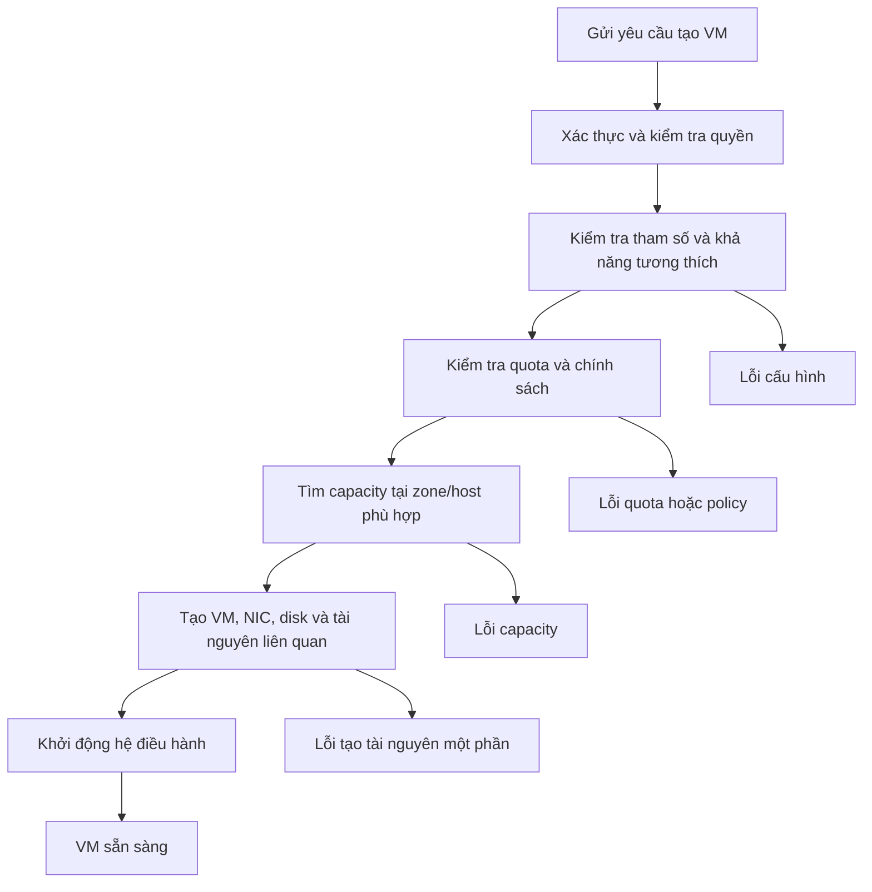

# Xử lý lỗi cấp phát do thiếu capacity, quota hoặc cấu hình không hợp lệ

## Mục tiêu học tập

Sau bài học, bạn có thể:

- Phân biệt lỗi thiếu capacity, vượt quota và cấu hình cấp phát không hợp lệ.
- Xác định phạm vi và giai đoạn phát sinh lỗi trong quá trình tạo máy ảo (VM).
- Đọc mã lỗi, thông tin vùng/zone, loại máy và quota để tìm nguyên nhân.
- Chọn cách khắc phục phù hợp, từ thử lại có kiểm soát, đổi zone hoặc loại máy đến yêu cầu tăng quota và sửa cấu hình.
- Thiết kế quy trình cấp phát có khả năng phục hồi, tránh tạo tài nguyên trùng lặp và kiểm soát chi phí.

## 1. Vì sao yêu cầu tạo VM có thể thất bại?

Khi gửi yêu cầu tạo VM, nền tảng cloud phải kiểm tra nhiều điều kiện trước khi có thể cung cấp một máy hoạt động. Hệ thống xác thực quyền, kiểm tra cấu hình, đối chiếu hạn mức tài nguyên, tìm vị trí có đủ năng lực phần cứng, tạo các tài nguyên liên quan rồi khởi động hệ điều hành. Chỉ một điều kiện không đáp ứng cũng có thể khiến thao tác thất bại.

Ba nhóm lỗi thường gặp trong bước cấp phát (provisioning) là:

- **Thiếu capacity:** nền tảng chưa có đủ năng lực phần cứng phù hợp tại vị trí được yêu cầu. Ví dụ, zone đang hết chỗ cho một dòng máy hoặc loại GPU cụ thể.
- **Vượt quota:** yêu cầu làm tổng lượng tài nguyên sử dụng vượt hạn mức được cấp cho tài khoản, project, subscription hoặc một phạm vi khác. Ví dụ, project đã dùng hết quota vCPU của một họ máy.
- **Cấu hình không hợp lệ:** các tham số yêu cầu không hợp lệ hoặc không tương thích. Ví dụ, chọn loại máy không được hỗ trợ ở zone, image sai kiến trúc CPU hoặc kết hợp thiết bị không được nền tảng hỗ trợ.

Các nhóm này có cách xử lý khác nhau. Thử lại liên tục không tạo thêm capacity vật lý, không tăng quota và cũng không sửa được tham số sai. Bước đầu tiên là phân loại đúng nguyên nhân dựa trên mã lỗi, thông báo chi tiết và giai đoạn thao tác thất bại.

Ngoài ba nhóm trên, yêu cầu có thể thất bại do thiếu quyền, chính sách tổ chức, giới hạn tốc độ API, lỗi mạng điều khiển hoặc dịch vụ phụ thuộc. Những lỗi đó cần được nhận diện riêng để tránh xử lý nhầm như lỗi capacity.

## 2. Hiểu quá trình cấp phát VM

Một luồng cấp phát điển hình có thể được mô tả như sau:



Đây là mô hình khái niệm. Trình tự thực tế, số bước và cách báo lỗi khác nhau theo nhà cung cấp. Một nền tảng có thể kiểm tra quota trước, nền tảng khác có thể xác thực một số tài nguyên phụ thuộc trong lúc cấp phát. Thao tác tạo VM cũng thường là bất đồng bộ: API có thể chấp nhận yêu cầu trước, sau đó trả về trạng thái lỗi trong operation hoặc deployment record.

Một VM có thể đi qua các trạng thái như **Creating**, **Provisioning**, **Starting**, **Running** hoặc **Failed**. Tên trạng thái tùy nền tảng. Vì vậy, HTTP response thành công hoặc việc nhận được operation ID chưa chứng minh VM đã được tạo thành công. Cần theo dõi operation đến trạng thái cuối cùng và kiểm tra trạng thái tài nguyên.

### Những tài nguyên có thể tham gia vào một lần cấp phát

Ngoài CPU và RAM của VM, thao tác tạo máy thường cần một số tài nguyên khác:

- vCPU và bộ nhớ từ một host hoặc nhóm host phù hợp.
- Accelerator như GPU hoặc FPGA nếu cấu hình yêu cầu.
- Boot disk, data disk, loại lưu trữ và thông lượng/IOPS.
- Network interface, subnet, địa chỉ IP và quy tắc mạng.
- Placement group, host group, reservation hoặc yêu cầu affinity/anti-affinity.
- Tính năng bảo mật như vTPM, Secure Boot, confidential computing hoặc mã hóa.
- Quyền sử dụng image, key, secret và các dịch vụ liên quan.

Một yêu cầu có thể đủ CPU và RAM nhưng vẫn thất bại vì không còn địa chỉ IP trong subnet, hết quota public IP hoặc loại disk không được hỗ trợ tại zone. Khi điều tra, hãy xác định chính xác tài nguyên nào bị từ chối.

## 3. Phân biệt ba nhóm lỗi chính

| Tiêu chí | Thiếu capacity | Vượt quota | Cấu hình không hợp lệ |
|---|---|---|---|
| Bản chất | Không tìm được năng lực vật lý phù hợp ở vị trí yêu cầu | Lượng tài nguyên được yêu cầu vượt hạn mức được phép | Tham số hoặc tổ hợp tài nguyên không được hỗ trợ |
| Phạm vi thường gặp | Region, zone, loại máy, accelerator hoặc nhóm host | Account, project, subscription, region, family hoặc loại tài nguyên | Trường cấu hình, image, loại máy, zone, disk, network hoặc tính năng |
| Tính chất | Có thể tạm thời và thay đổi theo tải hoặc thời điểm | Thường tồn tại cho đến khi giảm mức dùng hoặc quota được điều chỉnh | Thường tái hiện ổn định với cùng tham số |
| Cách khắc phục | Thử lại có kiểm soát, chọn zone hoặc loại máy khác, dùng reservation | Giải phóng tài nguyên hoặc yêu cầu tăng quota | Sửa tham số hoặc chọn tổ hợp được hỗ trợ |
| Có nên retry ngay? | Có thể, nếu lỗi được xác định là tạm thời và có giới hạn retry | Thường không; retry không làm quota tăng | Không; cần sửa cấu hình trước |

### 3.1. Thiếu capacity

Capacity là năng lực hạ tầng thực tế mà nhà cung cấp có thể bố trí cho yêu cầu tại một vị trí và thời điểm cụ thể. Capacity có thể phụ thuộc:

- Region hoặc zone.
- Họ máy và kích thước instance.
- Kiến trúc CPU, thế hệ CPU hoặc yêu cầu host cụ thể.
- GPU, accelerator, bộ nhớ GPU và topology liên kết.
- Placement group, dedicated host hoặc yêu cầu affinity.
- Năng lực mạng hoặc loại lưu trữ gắn với cấu hình.

Ví dụ, một zone vẫn có thể cấp phát VM general purpose nhưng tạm thời không có host phù hợp cho cấu hình GPU lớn. Đây là thiếu capacity theo loại tài nguyên, không có nghĩa toàn bộ zone đã hết chỗ.

Capacity có thể thay đổi khi nhà cung cấp bổ sung host, khách hàng khác giải phóng tài nguyên hoặc nhu cầu giảm. Tuy nhiên, không có cam kết rằng một lần retry sau vài giây sẽ thành công. Nếu workload cần capacity chắc chắn vào một thời điểm, cần xem xét cơ chế reservation hoặc capacity commitment mà nền tảng hỗ trợ.

### 3.2. Vượt quota

Quota là hạn mức quản trị lượng tài nguyên mà một phạm vi tài khoản được phép sử dụng. Quota giúp kiểm soát chi phí, bảo vệ tài nguyên dùng chung và ngăn một project tiêu thụ vượt mức được phê duyệt.

Quota có thể áp dụng cho:

- Tổng vCPU trong một region.
- vCPU của từng instance family hoặc loại accelerator.
- Số VM, disk, network interface hoặc public IP.
- Dung lượng lưu trữ, số lượng volume hoặc throughput được cấp.
- Số địa chỉ IP hoặc tài nguyên mạng trong một phạm vi.
- Các dịch vụ cloud khác được tạo cùng lúc với VM.

Quota thường có phạm vi rõ ràng. Một project có thể còn quota ở region A nhưng hết quota ở region B; tổng vCPU có thể còn nhưng quota riêng cho GPU đã hết. Cũng có thể quota được đặt ở cấp tổ chức hoặc subscription và áp dụng xuống các project con.

Cần phân biệt **quota** với **usage**. Usage là lượng tài nguyên đang được tính vào hạn mức; quota là mức tối đa được phép. Việc VM ở trạng thái stopped có còn được tính hay không phụ thuộc quy tắc của từng dịch vụ. Reservation, tài nguyên đang tạo hoặc thao tác xóa chưa hoàn tất cũng có thể ảnh hưởng cách nền tảng tính usage.

### 3.3. Cấu hình không hợp lệ

Cấu hình không hợp lệ xảy ra khi tham số riêng lẻ hoặc tổ hợp tham số không thỏa điều kiện của dịch vụ. Ví dụ:

- Chọn kích thước VM không tồn tại hoặc không được hỗ trợ tại region/zone.
- Image có kiến trúc ARM64 nhưng loại máy yêu cầu x86-64, hoặc ngược lại.
- Image cần UEFI nhưng cấu hình máy không hỗ trợ chế độ boot tương ứng.
- Chọn disk type hoặc tính năng lưu trữ không khả dụng cho loại máy.
- Yêu cầu GPU, Secure Boot, vTPM hoặc confidential computing theo một tổ hợp không được hỗ trợ.
- Dung lượng boot disk nhỏ hơn yêu cầu tối thiểu của image.
- Chọn subnet thuộc region khác hoặc network interface không tương thích.
- Thiết lập placement, affinity hoặc dedicated host xung đột với nhau.

Một số trường hợp có thông báo giống lỗi capacity nhưng nguyên nhân là giới hạn cấu hình. Ví dụ, một dòng máy không được cung cấp ở zone đã chọn có thể được báo bằng thông báo chung về tài nguyên không khả dụng. Cần kiểm tra danh sách loại máy được hỗ trợ và mã lỗi chi tiết.

## 4. Đọc thông báo lỗi và xác định phạm vi

Khi cấp phát thất bại, hãy lưu lại thông tin trước khi thử lại:

- Mã lỗi (error code) và thông báo đầy đủ.
- HTTP status hoặc trạng thái operation nếu API cung cấp.
- Request ID, correlation ID, operation ID hoặc deployment ID.
- Project/account/subscription và region/zone.
- Loại máy, số vCPU, RAM và accelerator.
- Image ID, kiến trúc, chế độ firmware và cấu hình boot.
- Disk, subnet, network interface và các tính năng bổ sung.
- Thời điểm, số lần thử và những thay đổi gần nhất.

Không nên chỉ dựa vào một câu thông báo ngắn. Mã lỗi thường có giá trị phân loại tốt hơn; phần chi tiết có thể cho biết quota nào đã vượt, zone nào không có capacity hoặc trường nào sai.

Ví dụ minh họa dưới đây dùng mã tổng quát, không phải mã bắt buộc của mọi nhà cung cấp:

```json
{
  "error": {
    "code": "QUOTA_EXCEEDED",
    "message": "The requested vCPU count exceeds the regional family quota.",
    "details": {
      "scope": "project",
      "region": "region-a",
      "resource": "compute-family-vcpu",
      "requested": 16,
      "available": 8
    },
    "requestId": "example-request-id"
  }
}
```

Trong ví dụ, yêu cầu cần 16 vCPU nhưng phạm vi quota hiện chỉ còn 8. Hướng xử lý là giảm quy mô yêu cầu, giải phóng usage hoặc yêu cầu tăng quota. Chuyển sang zone khác trong cùng phạm vi quota có thể không giải quyết được nếu quota được tính theo region.

### Các dấu hiệu thường gặp

| Dấu hiệu trong lỗi | Nhóm cần kiểm tra trước | Điều cần xác minh |
|---|---|---|
| Insufficient capacity, resource pool exhausted, capacity unavailable | Capacity | Zone, loại máy, accelerator, reservation và thời điểm |
| Quota exceeded, limit reached, maximum allowed | Quota | Quota name, scope, usage hiện tại và lượng còn lại |
| Invalid parameter, unsupported configuration, incompatible image | Cấu hình | Trường sai, kiến trúc, loại máy, zone và tổ hợp tính năng |
| Permission denied, not authorized, policy violation | Quyền/chính sách | IAM role, service account, organization policy và quyền với image/key |
| Too many requests, throttled, rate limit exceeded | Giới hạn API | Tốc độ gọi, Retry-After và cơ chế backoff |
| Address exhaustion, no available IP | Capacity mạng hoặc quota IP | Dải địa chỉ subnet, IP đã dùng và quota địa chỉ |

Tên lỗi thực tế có thể khác nhau. Hãy dùng tài liệu mã lỗi của API và operation record để xác nhận.

## 5. Xử lý lỗi thiếu capacity

Khi đã xác định lỗi do capacity, hãy kiểm tra phạm vi trước khi thay đổi kiến trúc.

### 5.1. Kiểm tra vị trí và loại máy

- Xác nhận region và zone được chọn.
- Kiểm tra loại máy có được cung cấp tại zone đó hay không.
- Xem cấu hình có yêu cầu GPU, CPU generation, dedicated host hoặc placement group cụ thể không.
- Kiểm tra reservation hiện có và loại VM có thể sử dụng reservation đó.
- Xác định workload có phụ thuộc vào zone của database, disk, subnet hoặc dịch vụ khác không.

Nếu loại máy không được cung cấp ở zone đó theo danh mục dịch vụ, đây là vấn đề khả dụng của cấu hình tại vị trí, không nhất thiết là thiếu capacity tạm thời. Chuyển sang zone có hỗ trợ là hướng xử lý phù hợp.

### 5.2. Thử lại có giới hạn

Nếu nhà cung cấp xác nhận lỗi capacity có thể tạm thời, có thể thử lại với exponential backoff và jitter. Khoảng chờ tăng dần để tránh nhiều client cùng gửi yêu cầu liên tục:

\[
d_n = \min(d_{\max}, d_0 \times 2^n)
\]

Thời gian chờ thực tế có thể cộng thêm jitter ngẫu nhiên để phân tán các lần retry. Nếu API trả về thời gian chờ đề xuất, hãy ưu tiên tuân thủ hướng dẫn đó.

Nguyên tắc:

- Chỉ retry lỗi được xác định là tạm thời.
- Đặt giới hạn số lần thử và tổng thời gian retry.
- Ghi log mỗi lần thử, mã lỗi và request ID.
- Dùng idempotency key hoặc cơ chế nhận diện yêu cầu để tránh tạo VM trùng.
- Dừng retry khi đã đạt giới hạn và chuyển sang phương án dự phòng.

Không nên retry liên tục với cùng một cấu hình nếu thông báo lỗi không thay đổi và không có dấu hiệu capacity đang được giải phóng.

### 5.3. Chuyển sang phương án dự phòng

Có thể chuẩn bị một ma trận fallback trước khi triển khai:

| Thứ tự | Phương án | Điều kiện cần kiểm tra |
|---|---|---|
| 1 | Thử lại cùng zone và loại máy sau thời gian chờ | Lỗi được xác định là tạm thời |
| 2 | Chọn zone khác trong cùng region | Disk, subnet, database và dịch vụ phụ thuộc hỗ trợ zone mới |
| 3 | Chọn kích thước khác cùng họ máy | Ứng dụng đáp ứng được CPU/RAM và giới hạn mới |
| 4 | Chọn họ máy tương đương | Kiến trúc CPU, driver, hiệu năng và image tương thích |
| 5 | Chuyển region | Độ trễ, residency, kết nối dữ liệu, quota và chính sách cho phép |

Việc chuyển zone hoặc region có thể kéo theo thay đổi subnet, địa chỉ IP, firewall, disk và vị trí dữ liệu. Không thực hiện fallback chỉ dựa trên việc tạo VM thành công; cần xác nhận ứng dụng vẫn đáp ứng yêu cầu vận hành.

### 5.4. Dùng reservation khi cần capacity dự kiến trước

Với workload quan trọng có thời điểm khởi chạy đã biết, capacity reservation hoặc cam kết capacity có thể giúp giảm rủi ro thiếu host. Cần kiểm tra:

- Reservation áp dụng cho region, zone, loại máy và thuộc tính nào.
- Số lượng và thời hạn reservation.
- Cách reservation được gắn với VM hoặc nhóm VM.
- Chi phí, điều kiện thanh toán và cách giải phóng.
- Reservation có đảm bảo đúng accelerator, host hoặc topology mà workload cần hay không.

Reservation không đồng nghĩa quota được tăng. Một yêu cầu có thể có reservation nhưng vẫn bị từ chối nếu quota, quyền hoặc cấu hình không đáp ứng.

## 6. Xử lý lỗi vượt quota

### 6.1. Xác định đúng quota đã chạm giới hạn

Mở trang quota/limits của dịch vụ hoặc truy vấn API quota. Đối chiếu:

- Tên quota cụ thể.
- Loại tài nguyên được tính.
- Phạm vi áp dụng: tổ chức, account, project, subscription, region hoặc family.
- Limit hiện tại, usage và phần còn khả dụng.
- Tài nguyên đang tạo, reservation hoặc thao tác xóa chưa hoàn tất.
- Quota có thể yêu cầu tăng hay là giới hạn cố định.

Đừng chỉ nhìn tổng quota vCPU. Một số nền tảng đồng thời có quota tổng, quota theo họ máy và quota theo accelerator. Cả ba có thể ảnh hưởng một yêu cầu.

### 6.2. Giải phóng usage không còn cần thiết

Nếu quota đã bị sử dụng hết, hãy xác định tài nguyên nào có thể thu hồi an toàn:

- VM thử nghiệm hoặc VM cũ không còn dùng.
- Disk, snapshot hoặc image tạm thời theo chính sách lưu giữ.
- Public IP và network interface không còn gắn với dịch vụ.
- Accelerator hoặc reservation không còn cần.
- Tài nguyên bị bỏ lại sau lần triển khai thất bại.

Kiểm tra phụ thuộc trước khi xóa. Một disk không gắn với VM hiện tại có thể vẫn chứa dữ liệu cần giữ; snapshot có thể là bản sao lưu duy nhất. Thực hiện theo quy trình quản lý dữ liệu và quyền sở hữu tài nguyên.

Một số quota chỉ giảm usage sau khi thao tác xóa hoàn tất và hệ thống cập nhật số liệu. Hãy theo dõi trạng thái xóa thay vì gửi lại yêu cầu ngay lập tức.

### 6.3. Yêu cầu tăng quota

Nếu nhu cầu hợp lệ vượt hạn mức hiện tại:

1. Xác định quota name và phạm vi chính xác.
2. Ước lượng nhu cầu hiện tại, tăng trưởng và mức dự phòng.
3. Kiểm tra quota có thể tự điều chỉnh trong console hay cần gửi yêu cầu hỗ trợ.
4. Nêu rõ region, loại tài nguyên, số lượng cần thiết và mục đích sử dụng.
5. Theo dõi trạng thái yêu cầu đến khi hạn mức mới được áp dụng.
6. Đọc lại quota sau khi được duyệt, sau đó thử cấp phát.

Không giả định quota được tăng ngay sau khi gửi yêu cầu. Việc xét duyệt có thể phụ thuộc lịch sử sử dụng, năng lực vùng, loại dịch vụ và chính sách của nhà cung cấp.

### 6.4. Dự phòng quota cho autoscaling

Nếu VM được tạo tự động theo tải, quota cần đủ cho số lượng instance tối đa dự kiến. Ví dụ, một nhóm autoscaling có thể tăng từ 4 lên 20 VM, mỗi VM 4 vCPU. Chỉ riêng nhóm này có thể cần đến 80 vCPU ở mức tối đa, chưa tính các workload khác trong cùng phạm vi quota.

Hãy tính theo tổng nhu cầu đồng thời:

\[
Q_{\text{cần}} =
Q_{\text{đang dùng}} +
Q_{\text{mở rộng tối đa}} +
Q_{\text{dự phòng}}
\]

Đây là cách lập kế hoạch, không phải công thức tính quota chính thức của mọi nhà cung cấp. Cần dùng đúng cách tính usage của từng loại tài nguyên và tránh cộng hai lần phần đã được tính trong quota hiện tại.

## 7. Xử lý cấu hình không hợp lệ

Với lỗi cấu hình, hãy tìm tham số hoặc tổ hợp gây ra lỗi và sửa ở nguồn khai báo để tránh lỗi lặp lại.

### 7.1. Kiểm tra tương thích loại máy và vị trí

Đối chiếu ma trận hỗ trợ của nhà cung cấp:

- Loại máy có sẵn ở region/zone không?
- CPU architecture của loại máy có khớp với image không?
- GPU/accelerator có tương thích với dòng máy và driver không?
- Disk type, kích thước tối thiểu và tính năng IOPS có được hỗ trợ không?
- Placement group, dedicated host và reservation có tương thích không?
- Tính năng Secure Boot, vTPM, confidential computing có hỗ trợ trên loại máy đó không?

Không suy luận khả năng hỗ trợ từ tên gần giống nhau. Các kích thước trong cùng một họ máy có thể có giới hạn khác nhau.

### 7.2. Kiểm tra image và cấu hình boot

Image có thể gây lỗi nếu:

- Kiến trúc CPU không phù hợp.
- Firmware mode không khớp.
- Image thiếu driver lưu trữ hoặc mạng cần thiết cho loại VM.
- Boot disk nhỏ hơn kích thước tối thiểu.
- Bootloader hoặc chữ ký không đáp ứng chính sách Secure Boot.
- Image không được chia sẻ hoặc cấp quyền cho project đang tạo VM.

Đọc metadata image, tài liệu hệ điều hành và yêu cầu của loại VM. Nếu thay đổi image, hãy thử boot trên VM nhỏ trong cùng cấu hình firmware và network trước khi đưa vào môi trường chính.

### 7.3. Kiểm tra network và storage

Lỗi cấp phát có thể phát sinh từ tài nguyên phụ thuộc:

- Subnet không còn địa chỉ IP khả dụng.
- Network interface vượt giới hạn số lượng hoặc không được hỗ trợ.
- Security group, route hoặc network policy không hợp lệ.
- Disk type không khả dụng tại zone.
- Boot disk thiếu dung lượng hoặc mã hóa yêu cầu key không truy cập được.
- Kích thước IOPS/throughput vượt giới hạn của disk hoặc VM.

Phân biệt lỗi subnet hết IP với lỗi thiếu host capacity. Hai vấn đề có cách xử lý khác nhau: một bên liên quan đến dải địa chỉ mạng; bên kia liên quan đến năng lực bố trí VM.

### 7.4. Kiểm tra cấu hình như một tập hợp

Một VM có thể dùng các giá trị riêng lẻ đều hợp lệ nhưng tổ hợp lại không được hỗ trợ. Ví dụ: một loại máy hỗ trợ GPU nhưng không hỗ trợ tính năng confidential computing đã chọn; image UEFI có Secure Boot nhưng loại VM không cung cấp bộ khóa tương ứng; disk mã hóa yêu cầu key mà service account không có quyền đọc.

Nên kiểm tra cấu hình bằng validation API, deployment preview hoặc công cụ kiểm tra template trước khi gửi yêu cầu cấp phát thật. Kiểm tra trước giúp phát hiện lỗi sớm, nhưng không bảo đảm capacity vẫn còn ở thời điểm tạo VM.

## 8. Phân biệt lỗi quyền, chính sách và giới hạn API

Một số lỗi dễ bị nhầm với quota hoặc capacity:

- **Permission/IAM:** người gọi không có quyền tạo VM, gắn disk, sử dụng image hoặc truy cập key. Hướng xử lý là kiểm tra principal, role, scope và quyền trên tài nguyên liên quan.
- **Organization policy:** chính sách có thể cấm loại máy, region, image công khai, địa chỉ IP hoặc tính năng bảo mật. Hướng xử lý là xem policy evaluation và yêu cầu người quản trị điều chỉnh nếu nhu cầu hợp lệ.
- **API throttling:** số lượng request vượt giới hạn tốc độ. Đây là giới hạn tần suất gọi API, không nhất thiết là quota số VM. Hãy tuân thủ Retry-After, giảm concurrency và dùng backoff.
- **Service dependency:** thao tác tạo VM phụ thuộc dịch vụ image, network, disk hoặc key management đang lỗi. Hãy kiểm tra trạng thái dịch vụ và operation record.

Việc phân loại chính xác giúp gửi yêu cầu hỗ trợ đúng nhóm và tránh thay đổi cấu hình không cần thiết.

## 9. Quy trình chẩn đoán và khôi phục chuẩn

Có thể áp dụng quy trình sau cho thao tác tạo VM thủ công, qua API hoặc bằng Infrastructure as Code (IaC):

1. **Ghi nhận yêu cầu.** Lưu cấu hình đã gửi, thời điểm, project/account, region/zone, request ID và operation ID.
2. **Chờ operation kết thúc.** Nếu API bất đồng bộ, theo dõi operation đến trạng thái cuối cùng trước khi kết luận thành công hay thất bại.
3. **Phân loại lỗi.** Dùng error code và details để xác định capacity, quota, cấu hình, quyền/chính sách hay throttling.
4. **Xác định phạm vi.** Kiểm tra region, zone, instance family, project/subscription, quota name và tài nguyên phụ thuộc.
5. **Chọn hành động tương ứng.** Capacity: retry có giới hạn hoặc fallback. Quota: giải phóng usage hoặc yêu cầu tăng. Cấu hình: sửa tham số. Quyền/policy: xử lý IAM hoặc policy.
6. **Kiểm tra tài nguyên tạo dở.** Xem VM, disk, NIC, IP, reservation và operation liên quan để tránh rò rỉ tài nguyên hoặc tính phí.
7. **Thử lại có kiểm soát.** Dùng idempotency key hoặc tên tài nguyên có quy tắc để không tạo bản trùng.
8. **Xác minh kết quả.** Kiểm tra VM đã chạy, boot thành công, network và disk sẵn sàng, health check đạt và ứng dụng hoạt động.
9. **Ghi lại nguyên nhân và biện pháp.** Cập nhật runbook, quota forecast, fallback matrix và cảnh báo.

### Bảng quyết định nhanh

| Kết quả phân loại | Hành động đầu tiên | Khi nào thử lại? |
|---|---|---|
| Capacity tạm thời | Kiểm tra zone/loại máy và phương án thay thế | Sau thời gian chờ, có backoff và giới hạn |
| Capacity do loại máy không có ở zone | Chọn zone hoặc loại máy được hỗ trợ | Sau khi thay đổi vị trí/cấu hình |
| Quota exceeded | Xem quota và usage, giải phóng hoặc yêu cầu tăng | Khi quota còn đủ cho yêu cầu |
| Invalid configuration | Sửa trường hoặc tổ hợp không hợp lệ | Sau khi validation thành công |
| Permission/policy denied | Sửa quyền hoặc policy theo quy trình | Khi quyền/policy đã có hiệu lực |
| API throttling | Giảm tốc độ và concurrency | Theo Retry-After hoặc backoff |

## 10. Ví dụ thực tế: autoscaling không tạo thêm VM

Một dịch vụ web có nhóm autoscaling đang chạy 6 VM, mỗi VM 4 vCPU. Khi lưu lượng tăng, bộ điều khiển muốn nâng số lượng lên 12 VM. Các yêu cầu mới lần lượt thất bại.

Đội vận hành thu thập operation record và nhận thấy hai loại lỗi:

- Một số yêu cầu báo quota vCPU của instance family đã hết. Tổng nhu cầu mục tiêu là 48 vCPU, trong khi quota hiện tại chỉ còn đủ cho 8 vCPU nữa.
- Một số yêu cầu ở zone cụ thể báo không có capacity cho loại máy đang dùng.

Nếu chỉ retry tất cả yêu cầu, hệ thống sẽ tiếp tục gặp lỗi quota và tạo nhiều request không cần thiết. Quy trình xử lý nên là:

1. Tính tổng vCPU mà nhóm autoscaling cần ở mức tối đa và đối chiếu quota của đúng region/family.
2. Giảm số lượng VM mục tiêu về mức được quota cho phép trong lúc chờ xử lý hạn mức.
3. Gửi yêu cầu tăng quota nếu tải dự kiến cần 12 VM và nhu cầu đó được phê duyệt.
4. Chuẩn bị zone dự phòng có cùng loại máy hoặc loại máy tương đương đã được kiểm thử.
5. Chỉ retry các yêu cầu bị lỗi capacity sau thời gian chờ, đồng thời dùng giới hạn retry và idempotency.
6. Theo dõi operation của từng VM và kiểm tra health check trước khi đưa vào load balancer.

Ví dụ này cho thấy autoscaling cần cả quota headroom và capacity strategy. Tăng maximum instance count trong cấu hình autoscaling không tự động làm quota tăng hoặc bảo đảm zone có đủ host.

## 11. Tự động hóa để giảm lỗi cấp phát

Một hệ thống vận hành tốt nên phát hiện phần lớn lỗi trước khi gọi API tạo VM và có cách phản ứng phù hợp khi lỗi vẫn xảy ra.

### Kiểm tra trước khi cấp phát

- Validate schema và các trường bắt buộc của template.
- Kiểm tra image, kiến trúc CPU và firmware mode.
- Kiểm tra loại máy và tính năng có được hỗ trợ tại zone.
- Đọc quota và usage trước khi mở rộng số lượng lớn.
- Kiểm tra subnet còn IP, disk và network limit.
- Kiểm tra IAM, policy và quyền truy cập image/key.
- Ước lượng số lượng VM tối đa của autoscaling hoặc deployment batch.

Kiểm tra trước là ảnh chụp trạng thái tại một thời điểm. Quota usage và capacity có thể thay đổi trước khi thao tác tạo VM hoàn tất, nên vẫn phải xử lý lỗi ở runtime.

### Retry có phân loại

Một bộ điều khiển có thể phân loại mã lỗi và chỉ retry nhóm lỗi tạm thời:

```python
def handle_provisioning_error(error, attempt, max_attempts):
    if error.category == "INVALID_CONFIGURATION":
        return "FIX_CONFIGURATION"

    if error.category == "QUOTA_EXCEEDED":
        return "RELEASE_USAGE_OR_REQUEST_QUOTA"

    if error.category in ("PERMISSION_DENIED", "POLICY_DENIED"):
        return "FIX_ACCESS_OR_POLICY"

    if error.category == "THROTTLED":
        return "RETRY_WITH_RATE_LIMIT"

    if error.category == "CAPACITY_TEMPORARY":
        if attempt >= max_attempts:
            return "TRY_FALLBACK_OR_ESCALATE"
        return "RETRY_WITH_BACKOFF_AND_JITTER"

    return "INSPECT_OPERATION_AND_ESCALATE"
```

Đây là pseudocode minh họa. Trong triển khai thật, cần ánh xạ mã lỗi cụ thể của nhà cung cấp vào nhóm lỗi, tôn trọng Retry-After, giới hạn tổng thời gian và ghi lại request ID.

### Tránh tạo tài nguyên trùng lặp

Khi client timeout, chưa chắc cloud đã hủy thao tác. Có thể VM vẫn đang tạo và phản hồi bị mất trên đường truyền. Trước khi gửi lại yêu cầu:

- Tra cứu operation ID hoặc resource name đã dùng.
- Dùng idempotency token nếu API hỗ trợ.
- Kiểm tra trạng thái tài nguyên hiện có.
- Chỉ xóa tài nguyên tạo dở khi đã xác nhận không còn phụ thuộc.
- Đồng bộ trạng thái của IaC với trạng thái thực tế của cloud trước lần apply tiếp theo.

Với Terraform hoặc công cụ IaC tương tự, hãy đọc phần provider diagnostic và operation detail, sau đó kiểm tra state và tài nguyên thực tế. Một lần apply thất bại có thể đã tạo được một phần tài nguyên phụ thuộc; chạy lại mù quáng có thể tạo xung đột tên hoặc tài nguyên thừa.

## 12. Thiết kế để hạn chế lỗi trong môi trường production

- **Dự phòng quota:** lập kế hoạch theo mức mở rộng tối đa, workload nền và phần tăng trưởng dự kiến.
- **Fallback zone/type:** chuẩn bị trước những tổ hợp VM, disk, network và image đã được kiểm thử.
- **Capacity reservation:** cân nhắc cho workload quan trọng có thời điểm khởi chạy xác định.
- **Autoscaling có giới hạn:** đặt min/max hợp lý, theo dõi quota headroom và tránh tăng số lượng đồng thời quá nhanh.
- **Image chuẩn hóa:** quản lý kiến trúc, firmware, driver, boot disk và phiên bản image trong pipeline.
- **Observability:** ghi operation ID, error code, zone, family, số lần retry và thời gian cấp phát.
- **Runbook:** định nghĩa hành động theo từng loại lỗi và ngưỡng chuyển cho đội cloud/platform.
- **Diễn tập:** thử tình huống quota thấp, zone không có capacity và cấu hình sai trong môi trường kiểm thử để xác nhận fallback hoạt động.

Các biện pháp này giảm thời gian khôi phục và làm lỗi dễ dự đoán hơn. Chúng không loại bỏ hoàn toàn khả năng nhà cung cấp thiếu capacity hoặc dịch vụ phụ thuộc gặp sự cố.

## 13. Những nhầm lẫn thường gặp

- **Thiếu capacity nghĩa là đã hết quota.** Capacity là năng lực bố trí thực tế; quota là giới hạn sử dụng được cấp. Một yêu cầu có thể còn quota nhưng không tìm được host phù hợp.
- **Chuyển zone luôn giải quyết được quota.** Nếu quota áp dụng theo region hoặc project, chuyển zone trong cùng phạm vi không làm hạn mức tăng.
- **Retry liên tục sẽ làm VM được tạo.** Retry chỉ phù hợp với lỗi tạm thời. Với quota hoặc cấu hình sai, cần thay đổi điều kiện trước.
- **Tăng quota đảm bảo có capacity.** Quota cho phép sử dụng thêm tài nguyên; nó không bảo đảm nhà cung cấp có host ở zone và loại máy mong muốn.
- **API trả về thành công nghĩa là VM đã sẵn sàng.** Cần theo dõi operation bất đồng bộ và kiểm tra trạng thái cuối cùng, boot, network, disk và health check.
- **Autoscaling tự tăng quota.** Autoscaling chỉ yêu cầu thêm instance theo chính sách; quota vẫn được quản lý riêng.
- **Xóa tài nguyên bất kỳ sẽ giải phóng quota.** Một số tài nguyên cần thời gian xóa, có phụ thuộc hoặc thuộc chính sách lưu giữ dữ liệu.
- **Mọi lỗi resource unavailable đều là capacity.** Có thể là loại máy không hỗ trợ ở zone, image không tương thích hoặc policy chặn cấu hình. Phải đọc error details trước khi đổi zone.

## 14. Tự kiểm tra

**Tình huống 1:** Một project còn đủ quota vCPU nhưng tạo VM GPU tại zone A thất bại với thông báo capacity unavailable. Bạn nên làm gì?

**Gợi ý:** Xác nhận loại GPU/VM có được hỗ trợ tại zone A và kiểm tra capacity hoặc reservation. Nếu lỗi tạm thời, retry có giới hạn; nếu vẫn thiếu, thử zone hoặc cấu hình đã được kiểm thử. Quota còn dư không bảo đảm GPU host luôn sẵn sàng.

**Tình huống 2:** Tạo VM 8 vCPU thất bại vì quota family còn 4 vCPU. Việc retry sau 30 giây có giải quyết được không?

**Gợi ý:** Không nếu usage và quota không đổi. Cần giảm cấu hình, giải phóng usage hoặc yêu cầu tăng đúng quota của family và region.

**Tình huống 3:** Image ARM64 được gắn vào loại VM x86-64 và API báo cấu hình không tương thích. Hướng xử lý là gì?

**Gợi ý:** Dùng image đúng kiến trúc hoặc loại VM tương thích. Retry cùng cấu hình không sửa được sự không tương thích.

**Tình huống 4:** API tạo VM trả timeout, nhưng console vẫn hiển thị VM ở trạng thái Creating. Có nên gửi ngay một yêu cầu tạo VM mới không?

**Gợi ý:** Trước tiên tra cứu operation và resource name, chờ trạng thái cuối cùng hoặc xác định thao tác đã thất bại. Dùng idempotency nếu có để tránh tạo VM trùng.

## Kết luận

Lỗi cấp phát VM cần được phân loại theo nguyên nhân. Thiếu capacity yêu cầu kiểm tra vị trí, loại máy và phương án dự phòng; vượt quota yêu cầu xem usage, phạm vi hạn mức và khả năng tăng quota; cấu hình không hợp lệ yêu cầu sửa tham số hoặc chọn tổ hợp được hỗ trợ. Hãy thu thập mã lỗi và operation ID, xử lý theo đúng nhóm, retry có giới hạn, tránh tạo tài nguyên trùng và xác minh VM đã sẵn sàng trước khi đưa vào phục vụ.
