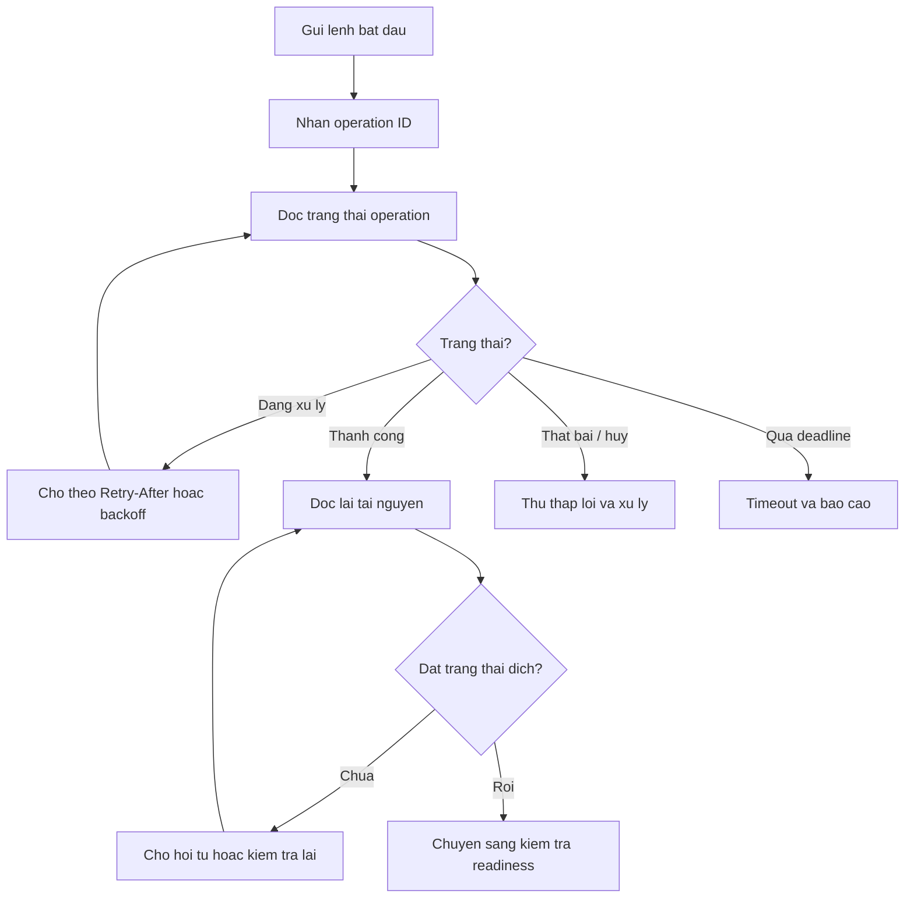

# Tác vụ bất đồng bộ, trạng thái đích và chờ máy sẵn sàng

Khi tạo, khởi động, dừng hoặc thay đổi cấu hình máy ảo trên đám mây, lời gọi API thường không hoàn tất toàn bộ công việc ngay trong một lần request. Nền tảng tiếp nhận yêu cầu, ghi nhận công việc cần thực hiện rồi xử lý ở control plane và hạ tầng phía sau. Máy ảo có thể cần thời gian để cấp phát tài nguyên, gắn đĩa, cấu hình mạng, khởi động hệ điều hành và chạy các bước bootstrap.

Vì vậy, nhận được phản hồi chấp nhận yêu cầu chưa có nghĩa máy ảo đã sẵn sàng. Một quy trình tự động đáng tin cậy cần theo dõi tác vụ bất đồng bộ, xác định trạng thái đích, chờ trạng thái thực tế hội tụ và kiểm tra điều kiện sẵn sàng của workload.

## 1. Vì sao thao tác máy ảo thường là bất đồng bộ?

Một thao tác máy ảo có thể liên quan đến nhiều thành phần: bộ lập lịch tài nguyên, hypervisor, hệ thống lưu trữ, mạng ảo, dịch vụ định danh, guest operating system và công cụ bootstrap. Các thành phần này thực hiện công việc ở những thời điểm khác nhau. API quản lý thường trả lời sớm để client không phải giữ một kết nối HTTP mở trong suốt quá trình.

Ví dụ, khi gửi yêu cầu tạo máy ảo, nền tảng có thể:

1. Xác thực quyền, quota và tham số yêu cầu.
2. Ghi nhận yêu cầu và trả về mã tác vụ hoặc tài nguyên operation.
3. Chọn host vật lý và cấp phát CPU, RAM.
4. Tạo hoặc gắn volume, cấu hình NIC, IP và security rule.
5. Khởi động máy ảo và chờ hypervisor báo trạng thái.
6. Chờ hệ điều hành boot, hoàn tất cloud-init hoặc cơ chế bootstrap.
7. Đăng ký agent, tải cấu hình và đưa dịch vụ ứng dụng vào trạng thái phục vụ.

Thời gian cho từng bước phụ thuộc vùng, loại instance, image, dung lượng đĩa, tải của control plane, cấu hình mạng và workload. Do đó, một khoảng `sleep` cố định sau lệnh tạo máy không bảo đảm máy đã sẵn sàng. Máy nhỏ có thể sẵn sàng trước khoảng chờ, còn máy cần khởi tạo dữ liệu lớn có thể vẫn chưa hoàn tất sau khoảng chờ đó.

## 2. Phân biệt yêu cầu được chấp nhận và công việc hoàn tất

Một API bất đồng bộ thường có hai lớp thông tin:

- **Phản hồi của request:** cho biết nền tảng đã nhận, từ chối hoặc xử lý đồng bộ một phần yêu cầu.
- **Trạng thái của operation:** cho biết công việc nền đang chờ, đang chạy, đã thành công, thất bại hoặc bị hủy.

Một số API trả về HTTP `202 Accepted` cùng operation ID hoặc URL để truy vấn kết quả. API khác có thể trả về mã phản hồi khác và một resource mô tả tiến trình. Hãy đọc hợp đồng API của nhà cung cấp để biết cách lấy operation ID, trạng thái kết thúc và thông tin lỗi.

Ví dụ phản hồi minh họa:

```json
{
  "operationId": "op-7f31a9",
  "status": "InProgress",
  "targetResource": "/virtual-machines/app-vm-01"
}
```

Đây chỉ là cấu trúc ví dụ, không phải định dạng chuẩn của mọi nền tảng. Client lưu operation ID, sau đó truy vấn operation hoặc tài nguyên liên quan cho đến khi nhận trạng thái kết thúc. Không nên coi phản hồi `Accepted`, `Queued` hoặc `InProgress` là kết quả thành công cuối cùng.

Trạng thái operation và trạng thái máy ảo cũng là hai khái niệm khác nhau. Operation `Succeeded` thường nói rằng thao tác control plane đã hoàn tất theo hợp đồng API. Nó chưa chắc chứng minh ứng dụng bên trong máy đã mở cổng, kết nối được database hoặc vượt qua health check.

## 3. Hiểu trạng thái đích và trạng thái quan sát được

Trong quản lý hạ tầng, cần phân biệt **trạng thái đích** (desired state) với **trạng thái quan sát được** (observed state):

- Trạng thái đích là điều người vận hành hoặc hệ thống khai báo muốn đạt được, ví dụ máy phải `running`, có 4 vCPU và thuộc một subnet xác định.
- Trạng thái quan sát được là thông tin nền tảng hiện báo tại thời điểm kiểm tra, ví dụ `starting`, `running` hoặc `stopped`.

Một bộ điều khiển hoặc workflow so sánh hai trạng thái rồi thực hiện hành động để đưa tài nguyên về trạng thái mong muốn. Đây là cách tiếp cận phổ biến trong hệ thống khai báo (declarative): người dùng mô tả kết quả cần có, hệ thống xử lý các bước để hội tụ về kết quả đó.

Ví dụ, nếu trạng thái đích là `running` nhưng máy đang `stopped`, workflow gửi yêu cầu start. Nếu máy đang `starting`, workflow tiếp tục chờ. Nếu máy đã `running`, workflow không cần gửi thêm lệnh start. Nếu máy đang `stopping`, workflow cần chờ thao tác hiện tại kết thúc rồi mới đánh giá lại, theo quy tắc của nền tảng.

Các trạng thái cụ thể khác nhau giữa nhà cung cấp, nhưng vòng đời máy ảo thường có các trạng thái tương tự:

| Trạng thái thường gặp | Ý nghĩa khái quát | Hành động của workflow |
|---|---|---|
| `provisioning` / `creating` | Đang cấp phát tài nguyên | Theo dõi operation tạo máy |
| `starting` | Đang bật máy | Chờ trạng thái máy chuyển tiếp |
| `running` | Hypervisor đang chạy máy ảo | Kiểm tra tiếp trạng thái guest và ứng dụng nếu cần |
| `stopping` | Đang tắt máy | Chờ dừng hoàn tất trước thao tác phụ thuộc |
| `stopped` / `deallocated` | Máy đã dừng; cách giữ tài nguyên tính phí tùy nền tảng | Có thể start hoặc thực hiện thao tác được hỗ trợ |
| `restarting` | Đang khởi động lại | Chờ máy hoạt động trở lại và kiểm tra dịch vụ |
| `deleting` | Đang xóa tài nguyên | Theo dõi đến trạng thái xóa hoàn tất |
| `failed` / `error` | Thao tác hoặc tài nguyên gặp lỗi | Đọc chi tiết lỗi, xác định có thể thử lại hay cần can thiệp |

Không giả định mọi nền tảng dùng cùng tên trạng thái hoặc cùng chuyển tiếp. Ví dụ, `stopped` có thể khác `deallocated`: máy không chạy guest nhưng tài nguyên compute có thể vẫn được giữ và tính phí. Cần tra cứu ý nghĩa trạng thái của đúng dịch vụ đang sử dụng.

## 4. Theo dõi operation đến trạng thái kết thúc

Quy trình cơ bản để chờ một thao tác bất đồng bộ gồm các bước:

1. Gửi yêu cầu và kiểm tra phản hồi ban đầu.
2. Lưu operation ID, resource ID và thời điểm bắt đầu.
3. Truy vấn operation theo chu kỳ hợp lý hoặc nhận sự kiện cập nhật.
4. Tiếp tục khi trạng thái còn đang xử lý.
5. Kết thúc thành công khi operation báo trạng thái thành công cuối cùng.
6. Dừng và xử lý khi operation thất bại, bị hủy hoặc vượt quá deadline.
7. Sau thành công, đọc lại tài nguyên để xác nhận trạng thái đích.

Ví dụ luồng tổng quát:



Trong một số API, endpoint operation tự chuyển sang trạng thái cuối cùng và cung cấp mã lỗi chi tiết. Ở API khác, operation kết thúc trước khi trạng thái tài nguyên phản ánh đầy đủ thay đổi. Vì vậy, sau khi operation thành công, nên đọc lại tài nguyên và xác nhận các thuộc tính quan trọng như power state, kích thước máy, NIC hoặc volume.

## 5. Polling có kiểm soát: khoảng chờ, backoff và timeout

Polling là cách client truy vấn trạng thái theo chu kỳ. Cách đơn giản nhất là hỏi liên tục sau mỗi vài mili giây, nhưng cách này gây nhiều request không cần thiết, tăng tải control plane và có thể chạm rate limit. Một waiter tốt cần có khoảng chờ hợp lý và giới hạn thời gian.

Các nguyên tắc chính:

- Nếu API trả về `Retry-After` hoặc khoảng polling được đề xuất, ưu tiên tuân theo hướng dẫn đó.
- Nếu không có chỉ dẫn, dùng exponential backoff: tăng dần thời gian giữa các lần truy vấn, ví dụ 1, 2, 4, 8 giây, rồi giới hạn ở một mức tối đa.
- Thêm jitter ngẫu nhiên để nhiều client không cùng truy vấn tại một thời điểm.
- Đặt deadline tổng thể cho workflow; không chờ vô hạn.
- Phân biệt timeout của một lần request với timeout của toàn operation.
- Ghi log operation ID, resource ID, trạng thái cuối cùng, số lần polling và thời gian chờ.
- Tôn trọng rate limit và chính sách retry của API.

Ví dụ giả mã cho waiter:

```python
deadline = monotonic_time() + total_timeout
delay = initial_delay

while monotonic_time() < deadline:
    operation = get_operation(operation_id)

    if operation.status == "Succeeded":
        break
    if operation.status in ("Failed", "Cancelled"):
        raise OperationError(operation.error)

    wait_for = operation.retry_after or delay_with_jitter(delay)
    sleep(min(wait_for, deadline - monotonic_time()))
    delay = min(delay * 2, maximum_delay)
else:
    raise TimeoutError(operation_id)
```

Đây là giả mã để giải thích thuật toán. `monotonic_time`, `get_operation`, `delay_with_jitter` và các kiểu exception cần được triển khai bằng thư viện thực tế. Không dùng đồng hồ hệ thống có thể bị chỉnh lùi/tiến để đo deadline vì điều đó làm sai thời gian chờ.

Timeout không có nghĩa operation chắc chắn đã thất bại. Client có thể hết thời gian chờ trong khi nền tảng vẫn tiếp tục xử lý. Khi timeout, cần lưu operation ID để có thể kiểm tra lại, tránh gửi lặp yêu cầu tạo máy hoặc xóa máy một cách mù quáng.

## 6. Idempotency và xử lý retry an toàn

Trong mạng phân tán, client có thể gửi request nhưng không nhận được phản hồi do timeout hoặc mất kết nối. Không thể biết chắc server chưa nhận request hay đã nhận và đang xử lý. Nếu gửi lại một lệnh tạo máy ngay lập tức, có nguy cơ tạo ra hai máy giống nhau.

Một thao tác **idempotent** có thể được lặp lại mà không làm thay đổi kết quả cuối cùng sau lần thực hiện đầu. Để retry an toàn:

- Dùng idempotency key nếu API hỗ trợ, với cùng key cho những lần gửi lại của cùng một ý định.
- Gán tên hoặc resource ID ổn định khi phù hợp và kiểm tra tài nguyên đã tồn tại trước khi tạo lại.
- Lưu operation ID sau khi nhận được và tiếp tục theo dõi operation đó.
- Trước khi retry sau timeout, đọc trạng thái tài nguyên hoặc operation để xác định yêu cầu trước đã được tiếp nhận hay chưa.
- Chỉ retry lỗi tạm thời như rate limit hoặc lỗi dịch vụ có thể phục hồi, theo chính sách của API.
- Không tự retry lỗi cấu hình, quyền truy cập, quota hoặc tham số không hợp lệ mà chưa sửa nguyên nhân.

Không phải mọi thao tác đều idempotent theo cùng một cách. Lệnh `start` có thể được thiết kế để đưa máy về trạng thái chạy, nhưng lệnh tạo snapshot hoặc tạo resource mới có thể tạo thêm tài nguyên mỗi lần gọi. Hãy kiểm tra hợp đồng API và dùng cơ chế chống trùng lặp thích hợp.

## 7. Trạng thái máy ảo `running` chưa đồng nghĩa ứng dụng sẵn sàng

Đây là khác biệt quan trọng trong tự động hóa. Trạng thái `running` thường phản ánh máy ảo đã được hypervisor bật. Guest operating system vẫn có thể đang boot, cấu hình ổ đĩa, nhận địa chỉ mạng, chạy cloud-init hoặc khởi động dịch vụ.

Có thể chia quá trình sẵn sàng thành nhiều lớp:

| Lớp | Điều kiện cần kiểm tra | Ví dụ tín hiệu |
|---|---|---|
| Hạ tầng | Instance tồn tại, power state đúng, NIC và volume được gắn | API mô tả resource, operation thành công |
| Hệ điều hành | Guest boot xong và có thể truy cập | SSH/RDP, guest agent, serial console hoặc heartbeat |
| Bootstrap | Script khởi tạo, đăng ký agent và lấy cấu hình hoàn tất | Cloud-init status, log bootstrap, trạng thái config management |
| Ứng dụng | Tiến trình chạy và endpoint phục vụ được | Health endpoint, kiểm tra cổng hoặc systemd service |
| Phụ thuộc | Ứng dụng kết nối được các dịch vụ cần thiết | Kiểm tra database, cache, queue hoặc API phụ thuộc |

Một health check tốt phản ánh khả năng phục vụ của workload. Kiểm tra TCP port chỉ cho biết có tiến trình nhận kết nối; nó chưa chắc chứng minh request thực tế được xử lý đúng. Với ứng dụng web, endpoint readiness có thể kiểm tra trạng thái khởi tạo và những phụ thuộc thiết yếu. Liveness và readiness cũng có mục đích khác nhau: liveness phát hiện tiến trình bị treo cần khởi động lại, còn readiness xác định instance có nên nhận traffic hay chưa.

Không nên đưa mọi phụ thuộc tùy chọn vào readiness check. Nếu một dịch vụ phân tích không bắt buộc bị lỗi mà ứng dụng vẫn có thể phục vụ chức năng chính, readiness không nhất thiết phải thất bại. Hãy định nghĩa điều kiện sẵn sàng theo yêu cầu nghiệp vụ và cách load balancer hoặc orchestrator sử dụng tín hiệu đó.

## 8. Chờ nhiều máy và điều phối workflow

Một hệ thống thường phải tạo hoặc khởi động nhiều máy ảo. Có thể chờ từng máy tuần tự hoặc theo dõi song song. Tuần tự đơn giản nhưng tổng thời gian có thể gần bằng tổng thời gian của mọi máy. Song song rút ngắn thời gian nhưng cần giới hạn concurrency để tránh vượt quota hoặc gây tải lớn lên control plane.

Một workflow tạo nhóm máy có thể thực hiện:

1. Tạo yêu cầu cho từng máy với resource name ổn định.
2. Lưu operation ID tương ứng với từng máy.
3. Theo dõi các operation song song với giới hạn số tác vụ đồng thời.
4. Khi từng operation hoàn tất, đọc lại power state và cấu hình tài nguyên.
5. Chờ guest và bootstrap readiness theo từng máy.
6. Chỉ thêm máy đạt readiness vào backend pool hoặc cho phép nhận traffic.
7. Nếu một máy thất bại, ghi nhận máy và nguyên nhân; áp dụng chính sách retry hoặc dừng toàn bộ đợt triển khai.

Chính sách lỗi cần được quyết định trước. Một số workload yêu cầu tất cả máy phải sẵn sàng mới chuyển bước; một số hệ thống chấp nhận triển khai một tỷ lệ tối thiểu rồi tiếp tục. Với rollout production, nên giới hạn số máy thay đổi cùng lúc và giữ đủ capacity phục vụ trong suốt quá trình.

## 9. Event-driven và polling

Ngoài polling, nền tảng có thể phát sự kiện khi operation thay đổi trạng thái. Sự kiện có thể được gửi qua webhook, message queue, event bus hoặc dịch vụ thông báo. Cách event-driven giảm số lần truy vấn và giúp workflow phản ứng nhanh hơn.

| Cách theo dõi | Ưu điểm | Điều cần chú ý |
|---|---|---|
| Polling | Dễ triển khai, có thể tự phục hồi khi bỏ lỡ một lần kiểm tra | Tăng số request, cần backoff và rate limit |
| Event-driven | Phản ứng khi có thay đổi, giảm truy vấn lặp | Có thể nhận trùng, trễ hoặc sai thứ tự; cần xác thực và đối soát |
| Kết hợp | Sự kiện đánh thức workflow, polling xác minh trạng thái cuối | Cần quản lý cả event subscription và waiter |

Khi dùng sự kiện, không giả định mỗi event chỉ đến một lần hoặc luôn theo đúng thứ tự. Consumer nên xử lý idempotent, kiểm tra event ID hoặc version nếu có, xác minh resource hiện tại trước hành động quan trọng và có cơ chế đối soát định kỳ. Webhook phải được xác thực, giới hạn quyền và bảo vệ khỏi replay theo hướng dẫn nền tảng.

Một mô hình thực tế là dùng event để báo workflow kiểm tra lại operation, sau đó đọc trạng thái chính thức từ API. Như vậy, event đóng vai trò tín hiệu đánh thức, còn resource state là căn cứ để quyết định bước tiếp theo.

## 10. Ví dụ workflow khởi động máy và chờ ứng dụng sẵn sàng

Giả sử một hệ thống cần khởi động máy `orders-api-01` sau thời gian bảo trì. Yêu cầu là máy phải ở trạng thái chạy, bootstrap hoàn tất và endpoint readiness trả về thành công trước khi load balancer nhận traffic.

Workflow có thể được mô tả như sau:

```text
desired_state = RUNNING

current = describe_vm("orders-api-01")

if current.power_state == STOPPED:
    operation = start_vm("orders-api-01")
    wait_for_operation(operation.id, deadline=5 minutes)

wait_until(
    condition = vm_power_state("orders-api-01") == RUNNING,
    deadline = 2 minutes
)

wait_until(
    condition = guest_agent_connected("orders-api-01"),
    deadline = 5 minutes
)

wait_until(
    condition = http_readiness("https://orders-api-01/ready") == HEALTHY,
    deadline = 5 minutes
)

enable_backend("orders-api-01")
```

Đây là mô tả logic, không phải lệnh có thể chạy trực tiếp. Trong triển khai thật, các deadline, endpoint, cách xác thực và trạng thái cần dựa trên SLO, nhà cung cấp và kiến trúc ứng dụng. Nếu máy đã `RUNNING`, workflow bỏ qua lệnh start và tiếp tục kiểm tra readiness. Nếu operation start thất bại, workflow không bật backend. Nếu guest hoạt động nhưng readiness không đạt trước deadline, cần giữ máy ngoài traffic và thu thập log để chẩn đoán.

Điểm quan trọng là mỗi bước kiểm tra một điều kiện cụ thể. Không nên dùng một lần `sleep(60)` rồi mặc định rằng máy và ứng dụng đã sẵn sàng.

## 11. Xử lý lỗi và tình huống biên

Tác vụ bất đồng bộ có thể thất bại ở nhiều thời điểm. Một số lỗi xuất hiện ngay khi gửi request; số khác chỉ xuất hiện trong operation hoặc khi kiểm tra guest. Workflow cần lưu đủ ngữ cảnh để chẩn đoán.

| Tình huống | Nguyên nhân có thể | Cách xử lý |
|---|---|---|
| Request bị từ chối ngay | Tham số sai, thiếu quyền, quota hoặc policy | Sửa đầu vào hoặc quyền; không retry mù quáng |
| Operation vẫn chạy lâu | Thiếu capacity, image lớn, volume chậm hoặc control plane bận | Theo dõi tiến trình, kiểm tra event và deadline; liên hệ vận hành nếu vượt ngưỡng |
| Operation báo thất bại | Lỗi cấp phát, network, storage hoặc cấu hình | Đọc mã lỗi và chi tiết operation; xác định bước có thể thử lại |
| Client timeout nhưng không rõ kết quả | Phản hồi bị mất trong khi server vẫn xử lý | Dùng operation ID nếu có; đọc resource và idempotency key trước retry |
| Máy `running` nhưng không truy cập được | Guest chưa boot xong, firewall, route hoặc agent lỗi | Kiểm tra console, network và guest agent |
| Guest hoạt động nhưng ứng dụng chưa ready | Bootstrap chưa xong, thiếu secret, phụ thuộc lỗi hoặc ứng dụng crash | Giữ ngoài traffic, kiểm tra log và health check |
| Event đến trùng hoặc sai thứ tự | Cơ chế truyền sự kiện có giao nhận ít nhất một lần | Xử lý idempotent và đọc lại trạng thái chính thức |
| Chờ quá deadline | Operation hoặc workload không đạt SLO | Dừng chờ, lưu bằng chứng và áp dụng quy trình khôi phục |

Khi operation thất bại, đừng chỉ ghi một thông báo chung như “start VM failed”. Hãy lưu resource ID, operation ID, thời điểm, trạng thái, mã lỗi, request correlation ID và bước workflow. Tránh ghi secret, token hoặc dữ liệu nhạy cảm vào log.

## 12. Thực hành tốt khi thiết kế waiter và workflow

Một waiter đáng tin cậy nên có các thuộc tính sau:

- **Điều kiện rõ ràng:** chờ một trạng thái hoặc health condition cụ thể, không chờ một khoảng thời gian phỏng đoán.
- **Deadline hữu hạn:** có timeout tổng thể và thông báo trạng thái cuối khi hết hạn.
- **Retry có chọn lọc:** chỉ lặp lại lỗi tạm thời, dùng backoff, jitter và tuân thủ rate limit.
- **Idempotent:** có thể tiếp tục sau khi tiến trình client bị restart mà không tạo tài nguyên trùng lặp.
- **Có thể quan sát:** log operation ID, resource ID, lần thử, thời gian chờ và lỗi.
- **Phân lớp readiness:** kiểm tra hạ tầng, guest, bootstrap và ứng dụng theo thứ tự phù hợp.
- **Có thể khôi phục:** định nghĩa hành động khi thất bại, timeout hoặc một phần nhóm máy không sẵn sàng.
- **Không mở traffic quá sớm:** chỉ đưa máy vào backend pool khi readiness đáp ứng điều kiện đã thống nhất.

Nên lưu trạng thái workflow bên ngoài tiến trình chờ nếu thao tác có thể kéo dài hơn vòng đời của worker hoặc CI job. Khi worker bị restart, hệ thống có thể đọc lại operation ID và tiếp tục theo dõi. Cách này hữu ích cho quy trình tạo máy, nâng cấp fleet, backup, restore và thay đổi cấu hình kéo dài.

Khi thiết kế timeout, phân biệt thời gian dự kiến của operation với thời gian phục vụ tối đa của ứng dụng. Deadline phải đủ cho các bước hợp lệ nhưng vẫn ngăn workflow treo vô hạn. Có thể đặt deadline riêng cho cấp phát máy, boot hệ điều hành, bootstrap và readiness để xác định bước gây chậm.

## 13. Checklist trước khi đưa tự động hóa vào vận hành

- [ ] Đã xác định API trả operation ID hoặc cơ chế theo dõi tương đương.
- [ ] Đã phân biệt phản hồi chấp nhận request với trạng thái operation cuối cùng.
- [ ] Đã biết các trạng thái máy và ý nghĩa của chúng trên nền tảng đang dùng.
- [ ] Đã xác định trạng thái đích và cách đọc lại trạng thái thực tế.
- [ ] Polling tuân theo Retry-After, backoff, jitter và rate limit.
- [ ] Có deadline, timeout và xử lý trường hợp timeout nhưng operation vẫn chạy.
- [ ] Retry an toàn nhờ idempotency key hoặc kiểm tra resource trước khi gửi lại.
- [ ] Đã phân biệt power state `running` với guest và ứng dụng readiness.
- [ ] Có health check phù hợp trước khi cho máy nhận traffic.
- [ ] Event consumer xử lý được sự kiện trùng, trễ và sai thứ tự.
- [ ] Log có operation ID, resource ID, correlation ID và mã lỗi cần thiết.
- [ ] Có phương án xử lý thất bại từng phần, rollback hoặc tiếp tục workflow.

Quản lý tác vụ bất đồng bộ tốt giúp tự động hóa vòng đời máy ảo có thể dự đoán và phục hồi. Khi workflow theo dõi operation, so sánh trạng thái thực tế với trạng thái đích và kiểm tra readiness theo từng lớp, hệ thống tránh được việc chuyển bước quá sớm, gửi lặp thao tác và đưa máy chưa sẵn sàng vào phục vụ.
