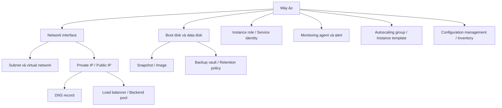
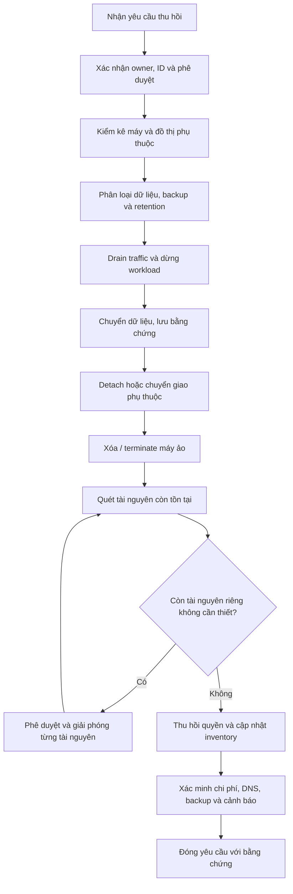

# Thu hồi máy và kiểm tra tài nguyên phụ thuộc còn tồn tại

Khi một máy ảo không còn phục vụ workload, nhóm vận hành cần đưa máy ra khỏi hệ thống một cách có kiểm soát. Thao tác xóa máy ảo có thể kết thúc tiến trình và giải phóng năng lực CPU/RAM, nhưng không phải lúc nào cũng xóa các tài nguyên liên quan. Đĩa dữ liệu, snapshot, địa chỉ IP, card mạng, bản ghi DNS, cấu hình cân bằng tải, bản sao lưu và tài nguyên giám sát có thể vẫn tồn tại và tiếp tục phát sinh chi phí hoặc tạo rủi ro bảo mật.

**Thu hồi máy ảo (decommissioning)** là quy trình kết thúc việc sử dụng máy, xử lý dữ liệu và danh tính của máy, tháo gỡ các phụ thuộc, giải phóng tài nguyên không còn cần thiết và xác minh trạng thái cuối cùng. Quy trình này phải dựa trên quan hệ phụ thuộc thực tế để tránh xóa nhầm tài nguyên dùng chung hoặc làm gián đoạn workload khác.

Sau bài học, bạn có thể:

- Phân biệt stop, deallocate và delete/terminate theo hành vi của nền tảng.
- Lập danh sách tài nguyên phụ thuộc trước khi thu hồi máy ảo.
- Xử lý dữ liệu, snapshot, bản sao lưu, danh tính và quyền truy cập theo chính sách.
- Phát hiện tài nguyên mồ côi còn tồn tại sau khi máy đã bị xóa.
- Thực hiện quy trình thu hồi có phê duyệt, có thể kiểm tra lại và có bằng chứng hoàn tất.

## 1. Vì sao xóa máy ảo chưa chắc đã hoàn tất thu hồi?

Máy ảo thường chỉ là một nút trong một nhóm tài nguyên. Một ứng dụng có thể dựa vào máy ảo để chạy tiến trình, nhưng còn sử dụng đĩa riêng để lưu dữ liệu, IP công khai để nhận kết nối, card mạng để gắn vào subnet, DNS để phân giải tên và load balancer để phân phối lưu lượng.

Khi máy ảo bị xóa, nhà cung cấp thường giải phóng một số tài nguyên gắn trực tiếp với vòng đời của máy. Những tài nguyên được tạo độc lập hoặc có chính sách giữ lại có thể không bị xóa. Hành vi cụ thể phụ thuộc nhà cung cấp, loại tài nguyên, tùy chọn khi tạo máy và cấu hình của tổ chức.

Ví dụ, một máy ảo staging được xóa nhưng đĩa dữ liệu 500 GiB, ba snapshot, một địa chỉ IP tĩnh và một bản sao lưu vẫn còn. Máy không còn chạy ứng dụng, nhưng tài nguyên vẫn chiếm dung lượng, có thể tính phí và vẫn chứa dữ liệu cần bảo vệ. Nếu IP hoặc DNS còn trỏ đến máy đã xóa, người dùng có thể gặp lỗi hoặc một địa chỉ có thể bị tái sử dụng ngoài dự kiến.

Vì vậy, cần phân biệt hai kết quả:

- **Máy ảo đã kết thúc vòng đời:** instance không còn chạy hoặc không còn tồn tại trong inventory.
- **Workload và các phụ thuộc đã được thu hồi đúng cách:** lưu lượng đã được chuyển đi, dữ liệu được xử lý, quyền truy cập được thu hồi, tài nguyên không cần thiết được giải phóng và tài nguyên phải giữ lại có chủ sở hữu cùng thời hạn rõ ràng.

## 2. Phân biệt stop, deallocate và delete/terminate

Các nhà cung cấp dùng thuật ngữ khác nhau. Một số nền tảng có trạng thái stopped nhưng vẫn giữ năng lực tính toán đã đặt trước; một số nền tảng có thao tác deallocate để giải phóng host capacity. Hãy kiểm tra tài liệu và trạng thái thực tế của dịch vụ trước khi dự đoán chi phí hoặc khả năng khởi động lại.

| Thao tác | Hành vi thường gặp | Tài nguyên có thể còn lại | Khi nào sử dụng |
|---|---|---|---|
| Stop / Shutdown | Tắt hệ điều hành hoặc dừng instance; một số nền tảng vẫn giữ vị trí hoặc năng lực đã cấp | Đĩa bền vững, IP tĩnh, NIC, snapshot, cấu hình và một số khoản phí liên quan | Tạm ngừng để bảo trì hoặc chờ sử dụng lại |
| Deallocate | Dừng instance và giải phóng năng lực tính toán trên host theo cách của nền tảng | Đĩa, IP tĩnh, NIC, backup, snapshot, DNS và các phụ thuộc độc lập | Tạm ngừng lâu hơn khi muốn giảm phí compute nhưng giữ môi trường |
| Delete / Terminate | Xóa instance khỏi inventory và kết thúc vòng đời máy | Đĩa được giữ lại, snapshot, IP, NIC, DNS, backup, log, cấu hình IAM hoặc tài nguyên dùng chung | Máy không còn cần thiết và đã hoàn tất bước chuẩn bị thu hồi |

Một số nền tảng tự xóa đĩa khởi động khi xóa máy, nhưng giữ lại đĩa dữ liệu nếu chọn chính sách retain. Nền tảng khác cho phép chọn xóa hoặc giữ từng đĩa. Không suy luận chỉ từ tên nút bấm hoặc trạng thái `stopped`; hãy kiểm tra chính sách từng tài nguyên.

Trước khi thực hiện, cần trả lời ba câu hỏi:

1. Máy có thể cần khởi động lại không, hay quyết định thu hồi đã được phê duyệt?
2. Dữ liệu nào phải giữ, sao lưu, chuyển giao hoặc xóa?
3. Tài nguyên nào được tạo riêng cho máy và tài nguyên nào đang được workload khác dùng chung?

## 3. Lập bản đồ tài nguyên phụ thuộc

Một máy ảo có thể liên kết với nhiều tài nguyên trực tiếp và gián tiếp. Việc kiểm kê cần đi từ instance ra các phụ thuộc, sau đó kiểm tra xem mỗi phụ thuộc có còn được tài nguyên khác sử dụng hay không.



### Nhóm tài nguyên cần kiểm tra

| Nhóm | Ví dụ | Rủi ro nếu bỏ sót |
|---|---|---|
| Compute | VM instance, dedicated host, autoscaling group, launch template | Máy có thể được tạo lại tự động hoặc vẫn chiếm năng lực |
| Storage | Boot disk, data disk, local volume, file share | Tiếp tục phát sinh phí; dữ liệu nhạy cảm còn tồn tại |
| Bản sao dữ liệu | Snapshot, machine image, backup, replica | Dữ liệu tồn tại ngoài máy và có thể được khôi phục ngoài dự kiến |
| Network | NIC, private IP, public IP, elastic IP, route, security group | Cấu hình rác, IP bị giữ, bề mặt tấn công hoặc mất kết nối của workload khác |
| Traffic management | Load balancer backend, target group, health check, NAT, gateway | Lưu lượng tiếp tục trỏ đến máy cũ hoặc thành phần không còn cần thiết |
| Naming | DNS A/AAAA/CNAME, service discovery, reverse DNS | Tên miền trỏ đến địa chỉ cũ hoặc địa chỉ được tái sử dụng |
| Identity | Instance profile, IAM role, service account, certificate, SSH key | Quyền thừa hoặc credential không còn chủ sở hữu rõ ràng |
| Operations | Monitoring, alert, log group, agent registration, patch group | Cảnh báo giả, chi phí lưu log và inventory sai lệch |
| Automation | IaC state, configuration management, deployment pipeline, scheduler | Tài nguyên bị tạo lại hoặc bị xóa ngoài quy trình |
| Commercial | Reservation, commitment, license, support plan | Cam kết hoặc giấy phép vẫn tính phí dù instance đã dừng |

Không phải mọi tài nguyên trong bảng đều cần xóa. Mạng ảo, subnet, security group, log hoặc backup có thể được dùng chung. Mục tiêu là xác định chủ sở hữu, mức độ phụ thuộc và quyết định giữ/xóa có căn cứ.

### Phân biệt phụ thuộc trực tiếp và gián tiếp

Phụ thuộc trực tiếp thường xuất hiện trong cấu hình instance, chẳng hạn boot disk hoặc NIC. Phụ thuộc gián tiếp có thể nằm trong dịch vụ khác: DNS trỏ đến IP của máy, target group chứa instance, autoscaling group tham chiếu launch template hoặc một pipeline vẫn triển khai vào máy đó.

Hãy kiểm tra cả hai chiều:

- Từ máy ảo đi ra: máy đang gắn hoặc sử dụng những tài nguyên nào?
- Từ tài nguyên đi vào: tài nguyên đó còn được máy khác hoặc ứng dụng khác tham chiếu không?

Một đĩa có tên giống hostname không đủ để kết luận nó thuộc riêng máy đó. Cần đối chiếu ID tài nguyên, attachment, tag, lịch sử tạo và cấu hình tham chiếu.

## 4. Xác định chủ sở hữu và trạng thái của từng tài nguyên

Inventory nên ghi ít nhất các trường sau:

| Trường | Mục đích |
|---|---|
| Resource ID và resource type | Định danh duy nhất để tránh nhầm tên |
| Region / zone / project / account | Xác định phạm vi quản trị |
| Owner / application / environment | Biết ai chịu trách nhiệm và workload nào liên quan |
| Relationship to VM | Gắn trực tiếp, tham chiếu gián tiếp hay dùng chung |
| Current state | Đang chạy, đã detach, đã xóa, retain hoặc không rõ |
| Data classification | Có dữ liệu nhạy cảm, dữ liệu cá nhân hay dữ liệu công khai |
| Retention requirement | Thời hạn lưu, legal hold, backup policy hoặc yêu cầu kiểm toán |
| Cost estimate | Chi phí định kỳ hoặc theo mức sử dụng nếu giữ lại |
| Decision and approver | Giữ, chuyển giao, xóa hoặc điều tra thêm; ai phê duyệt |

Tag/label giúp truy vấn inventory, nhưng không phải bằng chứng duy nhất về quan hệ phụ thuộc. Tag có thể thiếu, sai hoặc cũ. Hãy kết hợp tag với attachment, resource reference, audit log, cấu hình IaC và xác nhận của chủ sở hữu ứng dụng.

Nếu không xác định được chủ sở hữu của một đĩa, IP hoặc snapshot, hãy đưa vào danh sách cần điều tra và áp dụng quy trình quản trị tài nguyên mồ côi của tổ chức. Không xóa chỉ vì tài nguyên có vẻ không hoạt động.

## 5. Chuẩn bị trước khi thu hồi máy

Thu hồi máy là thay đổi vận hành có thể ảnh hưởng người dùng. Trước khi xóa, cần xác nhận máy thực sự không còn phục vụ workload và các phụ thuộc đã được xử lý.

### Xác nhận quyết định và phạm vi

- Xác định instance ID, hostname, account/project, region và môi trường.
- Xác nhận chủ sở hữu workload và người phê duyệt.
- Kiểm tra máy có thuộc cụm HA, autoscaling group, cluster hoặc hệ thống batch không.
- Xác nhận thời điểm thu hồi, cửa sổ bảo trì và tác động dự kiến.
- Kiểm tra deletion protection, retention policy, legal hold và quy trình thay đổi.

### Chuyển lưu lượng và dừng công việc

Với máy đang phục vụ request, cần đưa máy ra khỏi load balancer hoặc service discovery, chờ kết nối đang hoạt động kết thúc và xác nhận các bản sao còn lại đủ khả năng phục vụ. Với worker, cần ngừng nhận công việc mới, xử lý hoặc chuyển tiếp message đang chạy và xác minh hàng đợi không mất dữ liệu.

Không tắt máy chỉ dựa trên CPU thấp. Máy có thể đang chạy batch theo lịch, giữ vai trò standby hoặc thực hiện tác vụ ít thường xuyên. Kiểm tra scheduler, cron, event trigger, queue consumer và lịch nghiệp vụ trước khi dừng.

### Sao lưu và xác nhận dữ liệu

Phân loại dữ liệu trên boot disk và data disk. Xác định dữ liệu cần chuyển sang dịch vụ lưu trữ khác, snapshot hoặc backup cần giữ, thời hạn retention và người có quyền khôi phục. Kiểm tra bản sao lưu đã hoàn tất và có thể khôi phục theo yêu cầu.

Snapshot thành công không tự chứng minh dữ liệu ứng dụng nhất quán. Với cơ sở dữ liệu hoặc hệ thống ghi liên tục, cần dùng cơ chế backup nhất quán của ứng dụng, freeze/quiesce hoặc công cụ backup được hỗ trợ.

### Ghi lại trạng thái và bằng chứng

Lưu inventory, cấu hình quan trọng, phiên bản image, IP, DNS, rule mạng, metric cuối kỳ và kết quả kiểm tra phụ thuộc. Ghi thời điểm dừng, người thực hiện và mã thay đổi. Bằng chứng này giúp xử lý sự cố nếu phát hiện một thành phần khác còn phụ thuộc vào máy.

## 6. Xử lý dữ liệu và bảo vệ thông tin trước khi xóa

Đĩa máy ảo có thể chứa dữ liệu ứng dụng, log, credential, khóa riêng, cache và dữ liệu cá nhân. Khi thu hồi, cần xác định dữ liệu nào được giữ và dữ liệu nào phải xóa theo chính sách.

### Phân loại và giữ lại dữ liệu cần thiết

- Dữ liệu nghiệp vụ cần tiếp tục sử dụng nên được chuyển đến hệ thống lưu trữ có chủ sở hữu và quyền truy cập phù hợp.
- Log phục vụ kiểm toán hoặc điều tra cần chuyển đến kho log tập trung với thời hạn lưu rõ ràng.
- Backup và snapshot cần có mục đích, người sở hữu, thời hạn và cơ chế kiểm soát khôi phục.
- Dữ liệu tạm, cache, credential cục bộ và file thử nghiệm không còn cần thiết phải được loại bỏ theo quy trình.

Không sao lưu toàn bộ đĩa theo thói quen nếu image có thể chứa token, private key hoặc dữ liệu cá nhân không cần lưu. Bản backup là một bản sao dữ liệu và phải chịu cùng yêu cầu bảo mật, mã hóa, phân quyền và retention.

### Xóa dữ liệu an toàn

Phương thức xóa phụ thuộc loại storage, mã hóa và cam kết của nhà cung cấp. Trên cloud block storage, snapshot, SSD và hệ thống copy-on-write, việc xóa file hoặc ghi đè trong hệ điều hành không nhất thiết xóa mọi bản sao vật lý. Cần dùng khả năng xóa/crypto-erase hoặc quy trình xử lý media do nhà cung cấp hỗ trợ và chính sách tổ chức quy định.

Nếu dữ liệu được mã hóa bằng khóa riêng cho workload, việc thu hồi hoặc hủy khóa theo quy trình có thể hỗ trợ cryptographic erasure. Tuy nhiên, phải xác nhận không còn bản sao khóa ở nơi khác và hiểu ảnh hưởng đến dữ liệu cần lưu trữ. Không hủy khóa khi còn legal hold hoặc nghĩa vụ giữ dữ liệu.

### Kiểm tra snapshot và backup còn sót

Sau khi xóa máy, snapshot và backup có thể vẫn được giữ theo retention policy. Hãy lập danh sách tất cả bản sao có nguồn từ máy, phân biệt bản sao dùng chung với bản sao chỉ thuộc máy đó. Xóa hoặc đặt lịch hết hạn khi đã được phê duyệt; không thay đổi backup policy dùng chung để xử lý riêng một máy.

## 7. Quy trình thu hồi máy ảo theo từng giai đoạn

Quy trình dưới đây có thể điều chỉnh theo nền tảng và quy định của tổ chức. Mỗi bước cần có trạng thái và bằng chứng để người khác có thể xác minh.



### Giai đoạn 1: lập kế hoạch và kiểm kê

Xác nhận instance ID thay vì chỉ dựa trên tên. Lấy danh sách disk, NIC, IP, snapshot, backup, role, certificate, target group, DNS, monitoring, autoscaling và các tham chiếu IaC. Ghi lại quan hệ trực tiếp/gián tiếp và phân loại tài nguyên dùng riêng hay dùng chung.

### Giai đoạn 2: chuyển giao hoặc ngừng workload

Thông báo chủ sở hữu, điều phối cửa sổ thay đổi, drain traffic, ngừng scheduler và worker, chờ request hoặc job đang chạy kết thúc. Nếu cần, chuyển dữ liệu và tác vụ sang máy hoặc dịch vụ thay thế. Kiểm tra hệ thống còn hoạt động theo SLO sau khi máy được rút khỏi luồng.

### Giai đoạn 3: xử lý dữ liệu và danh tính

Hoàn tất backup/restore test nếu cần; chuyển log cần lưu; thu hồi credential, certificate, key hoặc token gắn với máy. Gỡ máy khỏi hệ thống quản lý cấu hình, patch management, endpoint protection và inventory. Xóa hoặc reset trạng thái riêng của máy theo chính sách.

### Giai đoạn 4: tháo gỡ phụ thuộc

Gỡ instance khỏi backend pool, target group, autoscaling group hoặc service discovery. Cập nhật DNS và chờ TTL phù hợp trước khi giải phóng IP nếu có thể. Detach disk hoặc NIC theo quy trình, sau đó quyết định giữ, chuyển giao hay xóa. Kiểm tra security group và rule mạng có còn được tài nguyên khác tham chiếu không.

### Giai đoạn 5: xóa instance

Sau khi xác nhận không còn workload và phụ thuộc cần giữ, thực hiện delete/terminate bằng quy trình được phê duyệt. Nếu nền tảng có deletion protection, cần xác minh phê duyệt trước khi tắt bảo vệ. Ghi lại kết quả thao tác và thời điểm instance biến mất khỏi inventory.

### Giai đoạn 6: quét phần còn lại

Truy vấn lại tài nguyên theo instance ID, tag, attachment và các reference. Kiểm tra đĩa đã detach, IP đã giải phóng, snapshot và backup đã được quyết định, DNS không còn trỏ sai, target group không còn backend cũ, alert không còn gắn với máy và pipeline không tạo lại máy.

### Giai đoạn 7: đóng yêu cầu

Đối chiếu hóa đơn hoặc cost explorer sau khoảng thời gian đủ để dữ liệu chi phí cập nhật. Xác nhận tài nguyên được giữ có owner và ngày xem xét. Cập nhật CMDB/inventory, tài liệu vận hành, sơ đồ kiến trúc và ticket với bằng chứng cuối cùng.

## 8. Phát hiện tài nguyên mồ côi sau khi xóa máy

**Tài nguyên mồ côi (orphaned resource)** là tài nguyên còn tồn tại nhưng không còn workload hoặc chủ sở hữu hợp lệ sử dụng. Một số tài nguyên có thể thực sự không còn cần thiết; một số khác có thể đang chờ phục hồi hoặc là thành phần dùng chung. Cần xác minh trước khi xóa.

### Dấu hiệu thường gặp

- Đĩa ở trạng thái unattached trong thời gian dài.
- Public IP không còn gắn với NIC hoặc load balancer.
- Snapshot không có image, backup policy hoặc owner rõ ràng.
- NIC không gắn với instance nhưng vẫn nằm trong subnet.
- DNS record trỏ đến IP đã giải phóng hoặc hostname không còn tồn tại.
- Target group hoặc backend pool còn địa chỉ máy đã xóa.
- Alert theo dõi hostname không còn trong inventory.
- Log group hoặc backup vault vẫn tăng dung lượng nhưng không có workload tương ứng.
- Security group, firewall rule hoặc IAM role không có tham chiếu rõ ràng.

### Cách kiểm tra

1. Lọc tài nguyên theo trạng thái và tuổi, ví dụ disk unattached hoặc IP không gắn với endpoint.
2. Tra cứu quan hệ tham chiếu từ API của nhà cung cấp và inventory nội bộ.
3. Đối chiếu tag, owner, application, environment, ngày tạo và audit log.
4. Kiểm tra cấu hình IaC và pipeline để xác định tài nguyên có được quản lý ở nơi khác không.
5. Liên hệ owner hoặc nhóm vận hành khi chưa xác định được mục đích.
6. Đưa tài nguyên đủ điều kiện vào danh sách đề xuất xóa, kèm ID, lý do, chi phí và rủi ro.
7. Chỉ xóa sau khi được phê duyệt và kiểm tra lại không có phụ thuộc mới phát sinh.

Không nên xóa hàng loạt tất cả disk unattached hoặc snapshot cũ. Một đĩa có thể được detach có chủ đích để phục hồi; snapshot cũ có thể là bản sao trước khi nâng cấp hoặc thuộc retention dài hạn.

## 9. Kiểm tra từng nhóm phụ thuộc

### Đĩa, snapshot và image

- Xác nhận boot disk có được cấu hình tự xóa cùng VM hay không.
- Xác định data disk có chứa dữ liệu cần giữ hoặc chuyển giao không.
- Kiểm tra snapshot, image dẫn xuất và bản sao liên vùng.
- Xác minh backup vault, policy và recovery point có nguồn từ máy.
- Xác nhận encryption key và quyền khôi phục còn đúng với retention.

### IP, NIC, DNS và load balancer

- Kiểm tra private IP có được cấp động hay tĩnh; giải phóng IP tĩnh chỉ khi không còn phụ thuộc.
- Kiểm tra public/elastic IP có gắn với máy, NAT, gateway hoặc endpoint khác không.
- Gỡ instance khỏi backend pool và health check; kiểm tra không còn lưu lượng đến máy.
- Cập nhật DNS A/AAAA/CNAME và service discovery; xét TTL và cache DNS.
- Kiểm tra NIC, route, firewall và security group có được dùng chung hay không.

### Identity và chứng thư

- Thu hồi instance role, service account binding hoặc quyền riêng được tạo cho máy.
- Xoay vòng credential nếu có khả năng đã được lưu trên máy hoặc trong backup.
- Thu hồi certificate gắn với hostname hoặc workload khi không còn sử dụng.
- Xóa SSH key hoặc user access chỉ khi không được dùng chung cho máy khác.
- Gỡ agent registration và khóa danh tính khỏi hệ thống quản lý.

### Monitoring, log và automation

- Gỡ target khỏi dashboard, alert, synthetic check và service discovery.
- Giữ log cần audit theo retention, xóa log tạm theo chính sách.
- Xóa lịch patch, job backup hoặc scheduler riêng cho máy.
- Cập nhật inventory, CMDB, IaC state và tài liệu triển khai.
- Xác nhận autoscaling group, orchestration controller hoặc pipeline không tạo lại instance.

## 10. Ngăn tài nguyên bị tạo lại hoặc bị xóa nhầm

Một lỗi thường gặp là xóa máy thủ công trong portal nhưng cấu hình IaC vẫn khai báo máy đó. Lần chạy pipeline tiếp theo có thể tạo lại máy. Ngược lại, xóa một resource trong IaC có thể kéo theo việc xóa đĩa hoặc network đang được workload khác dùng nếu quan hệ và lifecycle policy không rõ.

Các thực hành giúp kiểm soát:

- Dùng một nguồn quản lý trạng thái mong muốn rõ ràng, như IaC hoặc hệ thống provisioning được tổ chức phê duyệt.
- Thay đổi cấu hình khai báo trước hoặc đồng thời với thao tác thu hồi theo quy trình, tránh drift giữa portal và code.
- Đọc kế hoạch thay đổi trước khi apply; kiểm tra resource nào sẽ bị destroy hoặc replace.
- Dùng deletion protection, resource lock hoặc policy cho tài nguyên quan trọng và dùng chung.
- Tách resource có vòng đời độc lập, đặc biệt là data disk, backup và network shared.
- Gắn tag owner, application, environment, cost center và expiration date.
- Thiết lập cảnh báo cho tài nguyên không có owner hoặc unattached quá thời hạn.
- Yêu cầu phê duyệt thứ hai cho thao tác xóa dữ liệu, snapshot hoặc tài nguyên dùng chung.

Ví dụ, với Terraform, thuộc tính bảo vệ hủy có thể được dùng cho tài nguyên dữ liệu quan trọng:

```hcl
resource "example_managed_disk" "orders_data" {
  name = "orders-data"
  size = 500

  lifecycle {
    prevent_destroy = true
  }
}
```

Đây là ví dụ minh họa về ý tưởng lifecycle trong IaC; resource type và schema phải thay bằng provider thực tế. `prevent_destroy` giúp chặn một số thao tác hủy qua Terraform, nhưng không ngăn người có quyền xóa trực tiếp qua portal hoặc API. Cần kết hợp IAM, policy và quy trình phê duyệt.

## 11. Kiểm soát chi phí sau khi thu hồi

Sau khi instance bị xóa, một số khoản phí có thể tiếp tục phát sinh:

| Tài nguyên còn lại | Chi phí có thể phát sinh | Cách xử lý |
|---|---|---|
| Managed disk / volume | Dung lượng cấp phát, hiệu năng hoặc provisioned IOPS | Giữ nếu cần; chuyển giao, giảm kích thước theo khả năng hoặc xóa sau phê duyệt |
| Snapshot / backup | Dung lượng lưu, số recovery point, bản sao liên vùng | Áp dụng retention và lifecycle phù hợp |
| Public IP / static IP | Phí giữ IP hoặc phí theo trạng thái của nhà cung cấp | Giải phóng khi không còn sử dụng |
| Load balancer / NAT / gateway | Giờ hoạt động, capacity unit hoặc dữ liệu truyền | Xác minh có dùng chung; điều chỉnh backend hoặc xóa nếu riêng máy |
| Log / monitoring | Dung lượng log, metric, alert và thời gian lưu | Gỡ nguồn không còn dùng; giữ audit theo retention |
| Reservation / commitment / license | Cam kết hoặc phí hợp đồng có thể tiếp tục | Kiểm tra điều kiện hợp đồng, chuyển workload hoặc điều chỉnh ở kỳ phù hợp |

Không nên dùng hóa đơn ngay sau khi xóa làm bằng chứng duy nhất. Dữ liệu chi phí có thể cập nhật trễ hoặc được tổng hợp theo ngày. Hãy kết hợp inventory tài nguyên và báo cáo chi phí sau một chu kỳ cập nhật phù hợp.

## 12. Ví dụ: thu hồi máy ảo staging của ứng dụng bán hàng

Một nhóm có máy `staging-order-api-03` đã được thay bằng phiên bản chạy trên nền tảng mới. Máy cũ không còn nhận request nhưng vẫn tồn tại một đĩa dữ liệu, một IP tĩnh, hai snapshot và một bản ghi DNS.

**Kiểm kê:** nhóm tra cứu instance ID, xác nhận đĩa dữ liệu chỉ gắn với máy cũ, IP được dùng riêng, snapshot là bản trước khi nâng cấp và DNS trỏ tới IP tĩnh. Nhóm kiểm tra thêm máy không thuộc autoscaling group và không có pipeline nào tạo lại instance.

**Chuyển giao:** nhóm xác nhận dữ liệu staging không cần giữ lâu dài, nhưng giữ một snapshot theo chính sách kiểm thử trong 14 ngày. DNS được chuyển sang endpoint staging mới; target cũ được gỡ khỏi load balancer và nhóm chờ hết thời gian drain.

**Thu hồi:** nhóm dừng workload, lưu log cần thiết, thu hồi credential riêng, gỡ agent khỏi inventory và xóa instance theo ticket đã duyệt. Đĩa dữ liệu được xóa sau khi chủ sở hữu xác nhận; IP tĩnh được giải phóng. Snapshot còn lại được gắn owner và ngày hết hạn.

**Xác minh:** nhóm truy vấn lại inventory, xác nhận instance và NIC không còn, DNS không còn trỏ tới IP cũ, backend pool không còn target, credential riêng bị thu hồi và snapshot có retention rõ. Sau kỳ cập nhật hóa đơn, nhóm xác nhận phí compute, IP và disk riêng đã dừng; snapshot còn lại vẫn có chi phí lưu trữ dự kiến.

Ví dụ này minh họa rằng thu hồi máy không phải là một lệnh xóa đơn lẻ. Mỗi phụ thuộc có quyết định riêng và cần được xác minh sau thao tác.

## 13. Những sai lầm thường gặp

**Chỉ kiểm tra instance biến mất khỏi danh sách.** Đĩa, IP, snapshot và backup có thể còn tồn tại. Cần quét inventory theo ID và quan hệ phụ thuộc.

**Xóa mọi tài nguyên có cùng tag với máy.** Tag có thể được chia sẻ cho ứng dụng hoặc môi trường. Kiểm tra resource ID, attachment và owner trước khi xóa.

**Giữ snapshot vô thời hạn “phòng khi cần”.** Snapshot có thể chứa dữ liệu nhạy cảm và phát sinh chi phí. Đặt owner, mục đích, retention và quy trình hết hạn.

**Xóa IP trước khi cập nhật DNS hoặc load balancer.** Người dùng có thể gặp gián đoạn hoặc địa chỉ được tái sử dụng. Drain traffic, cập nhật record và kiểm tra TTL trước khi giải phóng IP.

**Quên autoscaling hoặc IaC.** Controller hoặc pipeline có thể tạo lại máy đã xóa. Cập nhật nguồn cấu hình mong muốn và kiểm tra lịch triển khai.

**Xóa backup để tiết kiệm chi phí mà không kiểm tra retention.** Có thể vi phạm yêu cầu khôi phục, kiểm toán hoặc legal hold. Xác nhận chính sách và phê duyệt trước khi xóa.

**Cho rằng stop đã dừng toàn bộ chi phí.** Đĩa, IP, snapshot và dịch vụ phụ trợ vẫn có thể tính phí. Xác minh từng loại tài nguyên.

## 14. Checklist thu hồi và xác minh

### Trước khi xóa máy

- [ ] Xác định chính xác instance ID, account/project, region, hostname và owner.
- [ ] Có yêu cầu thay đổi và phê duyệt thu hồi.
- [ ] Xác nhận máy không còn phục vụ traffic hoặc job theo lịch.
- [ ] Kiểm tra autoscaling, cluster, IaC, scheduler và pipeline.
- [ ] Lập danh sách disk, NIC, IP, snapshot, backup, DNS, load balancer, IAM và monitoring.
- [ ] Phân loại tài nguyên dùng riêng, dùng chung và cần chuyển giao.
- [ ] Xác định dữ liệu cần giữ, retention, legal hold và phương thức xóa an toàn.
- [ ] Drain traffic, dừng workload và xác nhận các bản sao còn lại đủ năng lực.
- [ ] Lưu log, cấu hình và bằng chứng cần thiết.

### Sau khi xóa máy

- [ ] Instance không còn tồn tại trong inventory hoặc ở trạng thái đã kết thúc theo nền tảng.
- [ ] Disk đã được giữ, chuyển giao hoặc xóa theo quyết định; không có volume vô chủ chưa rõ owner.
- [ ] Snapshot và backup có owner, retention và quyền khôi phục rõ ràng.
- [ ] NIC và IP riêng đã được giải phóng; tài nguyên dùng chung còn nguyên.
- [ ] DNS, service discovery và load balancer không còn tham chiếu máy cũ.
- [ ] IAM role, service account, certificate, key và credential riêng đã được xử lý.
- [ ] Monitoring, alert, log source, patch group và inventory đã được cập nhật.
- [ ] IaC và pipeline không còn khai báo tạo lại máy ngoài ý muốn.
- [ ] Báo cáo chi phí sau chu kỳ cập nhật xác nhận các khoản phí đã dừng hoặc được giải thích.
- [ ] Ticket lưu quyết định, người thực hiện, thời điểm và bằng chứng hoàn tất.

## 15. Tự kiểm tra

1. Stop, deallocate và delete/terminate khác nhau như thế nào? Vì sao hành vi cụ thể cần được kiểm tra theo nhà cung cấp?
2. Một máy ảo đã bị xóa nhưng data disk, IP tĩnh và snapshot còn tồn tại. Mỗi tài nguyên có thể gây ra rủi ro hoặc chi phí gì?
3. Làm thế nào phân biệt tài nguyên mồ côi với tài nguyên được detach có chủ đích để phục hồi?
4. Vì sao cần kiểm tra cả phụ thuộc trực tiếp và gián tiếp trước khi xóa máy?
5. Trước khi xóa máy đang phục vụ API, cần thực hiện những bước nào để tránh mất request đang xử lý?
6. Vì sao snapshot và backup cũng phải tuân theo phân loại dữ liệu, mã hóa và retention?
7. Autoscaling group hoặc IaC có thể làm máy xuất hiện trở lại như thế nào sau khi xóa thủ công?
8. Những bằng chứng nào giúp xác nhận một yêu cầu thu hồi máy đã hoàn tất?

Thu hồi máy ảo chỉ hoàn tất khi workload đã được chuyển hoặc dừng an toàn, dữ liệu và danh tính được xử lý theo chính sách, mọi phụ thuộc đã có quyết định rõ ràng, tài nguyên không cần thiết được giải phóng và inventory cùng chi phí được xác minh. Quy trình có kiểm kê và bằng chứng giúp giảm chi phí tồn đọng, hạn chế rủi ro dữ liệu và tránh ảnh hưởng đến các hệ thống còn hoạt động.
